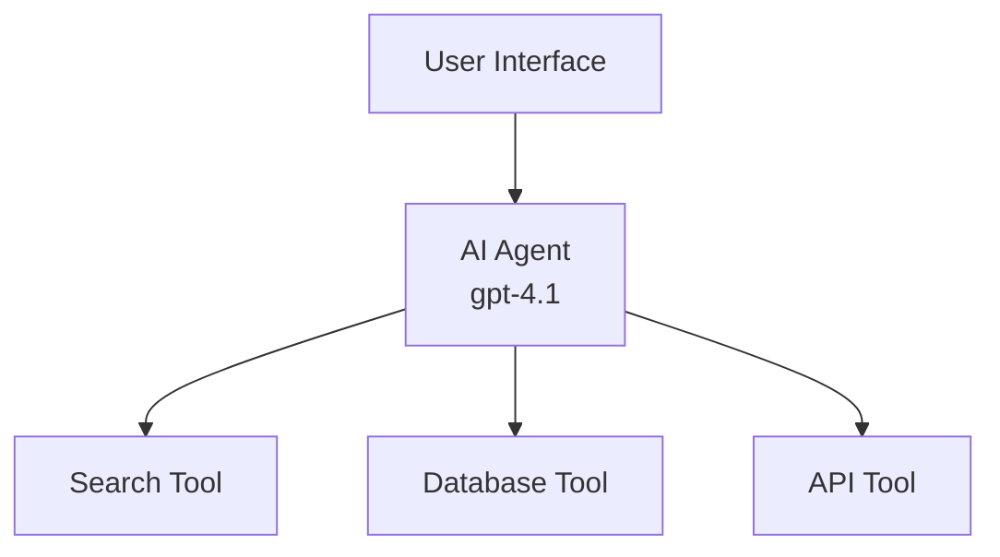
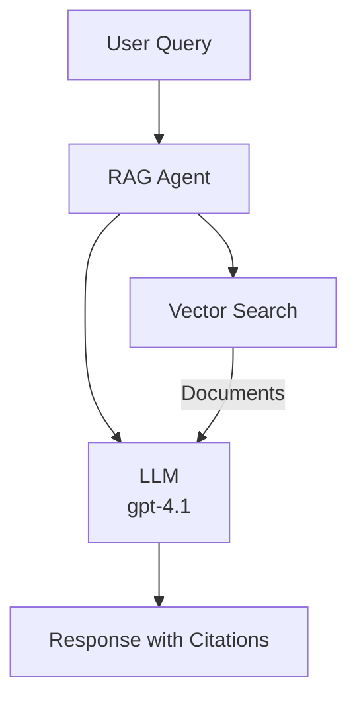
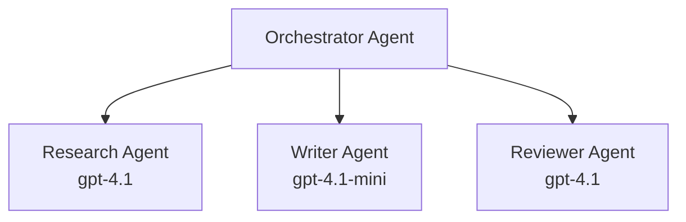

# AI ügynökök az Azure Developer CLI segítségével

**Fejezet navigáció:**
- **📚 Tanfolyam kezdőlapja**: [AZD kezdőknek](../../README.md)
- **📖 Jelenlegi fejezet**: 2. fejezet - AI-első fejlesztés
- **⬅️ Előző**: [Microsoft Foundry integráció](microsoft-foundry-integration.md)
- **➡️ Következő**: [AI modell telepítése](ai-model-deployment.md)
- **🚀 Haladó**: [Többügynökös megoldások](../../examples/retail-scenario.md)

---

## Bevezetés

Az AI ügynökök autonóm programok, amelyek érzékelik környezetüket, döntéseket hoznak, és cselekvéseket hajtanak végre adott célok elérése érdekében. Az egyszerű chatbotokkal ellentétben, amelyek csak válaszolnak kérdésekre, az ügynökök képesek:

- **Eszközöket használni** – API-kat hívni, adatbázisokat keresni, kódot futtatni
- **Tervezni és gondolkodni** – Összetett feladatokat lépésekre bontani
- **Tanulni a kontextusból** – Memóriát fenntartani és viselkedést adaptálni
- **Együttműködni** – Más ügynökökkel dolgozni (többügynökös rendszerek)

Ez az útmutató megmutatja, hogyan telepíts AI ügynököket az Azure-ra az Azure Developer CLI (azd) segítségével.

A beszélgetési kontextus használata nem modelltréning: tartós memóriát, hozzáférés-vezérlést és megtartást az alkalmazásnak kell megvalósítania/konfigurálnia.

> **Kiadás áttekintése (2026-11-04):** A CLI példákat összevetették az `azd` `1.37.2`, `azure.ai.agents` `1.0.0-beta.23`, és `azure.ai.evaluations` `1.0.0-beta.2` dokumentáció/forrással, nem egy élő Azure telepítéssel. Használd a `azd >= 1.37.0` parancsot az integrált munkafolyamathoz. Tekintsd meg a [legutóbbi változtatásokat és javításokat](../chapter-08-production/production-ai-practices.md#recent-release-changes-and-fixes) régebbi projektek frissítése előtt.

## Tanulási célok

Az útmutató elvégzésével:
- Megérted, mik az AI ügynökök és hogyan különböznek a chatbotoktól
- Előre elkészített AI ügynök sablonokat telepítesz AZD-vel
- Foundry ügynököket konfigurálsz egyedi ügynökök számára
- Alap ügynökmintákat valósítasz meg (eszközhasználat, RAG, többügynök)
- Követed és hibakeresed a telepített ügynököket

## Tanulási eredmények

Az útmutató után képes leszel:
- AI ügynök alkalmazásokat egyetlen paranccsal Azure-ra telepíteni
- Ügynöki eszközöket és képességeket konfigurálni
- Visszakeresés-alapú generálást (RAG) ügynökökkel megvalósítani
- Többügynökös architektúrákat tervezni összetett munkafolyamatokhoz
- Gyakori ügynök telepítési hibákat hárítani

---

## 🤖 Miben különbözik egy ügynök egy chatbot-tól?

| Jellemző | Chatbot | AI ügynök |
|---------|---------|----------|
| **Viselkedés** | Válaszol a kérdésekre | Autonóm cselekvéseket hajt végre |
| **Eszközök** | Használhat visszakeresést vagy eszközöket | Jellemzően eszközöket használ célorientált ciklusban |
| **Memória** | Alkalmazásfüggő | Tartós memória csak explicit megvalósítás esetén |
| **Tervezés** | Egy válaszra korlátozva | Többlépéses gondolkodás |
| **Együttműködés** | Egyedüli entitás | Más ügynökökkel is képes dolgozni |

### Egyszerű hasonlat

- **Chatbot** = Egy segítőkész személy az információs pultnál
- **AI ügynök** = Egy személyi asszisztens, aki hívásokat intéz, időpontokat foglal és elvégzi a feladatokat helyetted

---

## 🚀 Gyors kezdés: Telepítsd első ügynöködet

Válassz egy opciót egy **új, üres munkakönyvtárban**. A végződő `.` ott inicializál; kifejezett célpont nélkül az aktuális AZD létrehozhat egy sablonnevű alkönyvtárat, és nem vált át a shell könyvtáradra. Tartsd a különböző sablonokat/ünnepélyeket külön mappákban.

Az alábbi idő- és költségtartományok illusztratívak, nem hiteles árajánlatok. Minden mintánál ellenőrizd az aktuális előfeltételeket, árakat, modell kereteket és opcionális szolgáltatásokat telepítés előtt.

### 1. opció: Foundry ügynök sablon (ajánlott)

```bash
# Initialize the AI agents template
azd init --template get-started-with-ai-agents .

# Deploy to Azure
azd up
```

**Mi települ:** A minta aktuális infrastruktúrája és kiválasztott opciói határozzák meg a modellt, eszközöket, hosztolást és monitorozási erőforrásokat. Nézd át a README-jét és a `infra/`-t provisioning előtt; ne feltételezd, hogy minden ügynök sablon tartalmaz Keresést vagy webes felületet.

**Idő:** kb. 15-20 perc
**Költség:** kb. 100-150 USD/hónap (fejlesztés)

### 2. opció: Kreatív író ügynökök Prompty-val

```bash
# Initialize the Prompty-based agent template
azd init --template https://github.com/Azure-Samples/contoso-creative-writer .

# Deploy to Azure
azd up
```

**Mi települ:** FastAPI/Prompty többügynökös író minta Azure OpenAI-val, Bing Grounding-gel, és Azure AI Kereséssel. A korábbi `agent-openai-python-prompty` tároló ide irányít; nem egy minimális Azure Functions időjárás-ügynök sablon. Kövesd az aktuális README-t hosztolás, modellkeret és Bing Grounding előfeltételekhez.

**Idő:** kb. 10-15 perc
**Költség:** kb. 50-100 USD/hónap (fejlesztés)

### 3. opció: RAG csevegő ügynök

```bash
# Initialize RAG chat template
azd init --template azure-search-openai-demo .

# Deploy to Azure
azd up
```

**Mi települ:**
- ✅ Microsoft Foundry modellek
- ✅ Azure AI Keresés mintaadatokkal
- ✅ Dokumentumfeldolgozó csővezeték
- ✅ Csevegőfelület hivatkozásokkal

**Idő:** kb. 15-25 perc
**Költség:** kb. 80-150 USD/hónap (fejlesztés)

### 4. opció: AZD AI Agent Init (Projekt sablon előnézet)

Használd `azd ai agent init` interaktívan, vagy alkalmazz egy aktuális `azure.yaml` ügynök projektet `--template`/`-t`-mal. A régi `--manifest`/`-m` opció egy elavult alias, nem konvertáló régi manifesztumokhoz.

```bash
# Install the AI agents extension
azd extension install azure.ai.agents

# Optional: verify the installed preview version
azd extension show azure.ai.agents

# Initialize from a current agent project template (supply your template path)
azd ai agent init --template ./templates/support-agent/azure.yaml

# Deploy to Azure
azd up

# Test the deployed agent (shows latency + time-to-first-byte)
azd ai agent invoke
```

**Mikor használd a `azd ai agent init` vs `azd init --template`:**

| Megközelítés | Legjobb | Hogyan működik |
|----------|----------|------|
| `azd init --template` | Egy működő mintaalkalmazással kezdve | Teljes sablon repo klónozása kóddal + infrastruktúrával |
| `azd ai agent init --template` | Egy aktuális Foundry ügynök projekt alkalmazása | Egy `azure.yaml` projekt dokumentumot és definíciókat használ |

> **Tipp:** Tanuláshoz használd a `azd init --template` parancsot (a fentiek 1-3. opció). Foundry ügynök munkafolyamathoz a `azd ai agent init`-t használd. Az ügynök közvetlen definiálásához meglévő projekthez lásd a [inicializálás és migráció útmutatót](../chapter-08-production/production-ai-practices.md#initializing-agent-projects-with-azd-ai-agent-init).

A `azd up` után használd a `azd ai agent invoke`-t teszteléshez, a különálló `azure.ai.evaluations` bővítményt (`azd ai eval init`, `generate`, és `run start`) a minőség mérésére, és `azd ai agent optimize`-t a minőség javítására új értékelési konfigurációval. Az Agents beta.22 lecserélte a régi értékelési munkafolyamatot és megváltoztatta az optimalizáció `--config` formátumát. Lásd a [értékelési migrációt](../chapter-08-production/production-ai-practices.md#evaluation-migration-and-quality-checks) és [optimalizációs migrációt](../chapter-08-production/production-ai-practices.md#optimization-configuration-migration) régebbi példák újrafelhasználása előtt.

---

## 🏗️ Ügynök architektúra minták

### Minta 1: Egyetlen ügynök eszközökkel

A legegyszerűbb ügynökminta – egy ügynök, amely több eszközt is használhat.



**Leginkább alkalmas:**
- Ügyfélszolgálati chatbotok
- Kutatási asszisztensek
- Adatfeldolgozó ügynökök

**Kapcsolódó alkalmazás minta:** `azure-search-openai-demo` bemutatja a RAG-ot, nem egy általános tetszőleges-eszköz ügynök ciklust.

### Minta 2: RAG ügynök (Visszakeresés-alapú generálás)

Egy olyan ügynök, amely adott dokumentumokat keres elő a válasz generálása előtt.



**Leginkább alkalmas:**
- Vállalati tudásbázisok
- Dokumentum kérdés-válasz rendszerek
- Megfelelőségi és jogi kutatások

**AZD sablon:** `azure-search-openai-demo`

### Minta 3: Többügynökös rendszer

Több speciális ügynök együtt dolgozik összetett feladatokon.



**Leginkább alkalmas:**
- Összetett tartalom generálás
- Többlépéses munkafolyamatok
- Különböző szakértelmet igénylő feladatok

**Továbbtanulás:** [Többügynökös koordinációs minták](../chapter-06-pre-deployment/coordination-patterns.md)

---

## ⚙️ Ügynöki eszközök konfigurálása

Ügynökök akkor válnak erőssé, ha eszközöket használhatnak. Íme, hogyan konfigurálhatod a gyakori eszközöket:

### Eszközkonfiguráció Foundry ügynököknél

Ez a **klasszikus Agent Service SDK töredék** az `azure-ai-projects==1.0.0` és `azure-ai-agents==1.1.0` API-kat célozza `azure-identity`-tel. Nem az újabb versioned-agent/Responses API, amit néhány aktuális Foundry sablon használ, és nem az `azure.ai.agents` AZD bővítmény (másik csomag). Ne keverd az API generációkat. Állítsd be a `PROJECT_ENDPOINT` egy klasszikus Foundry projekt végpontra és `MODEL_DEPLOYMENT_NAME` egy létező támogatott modell telepítésre; hitelesíts helyileg `az login`-val és adj meg a szükséges projekt engedélyeket.

```python
# agent_config.py
import os
from azure.ai.projects import AIProjectClient
from azure.ai.agents.models import FunctionTool
from azure.identity import DefaultAzureCredential

def search_knowledge_base(query: str) -> str:
    """Search the demonstration knowledge base.

    :param query: Search text.
    :return: Matching demonstration information.
    """
    # Local fixture only, not a production search implementation.
    return "Demo policy: returns are accepted within 30 days."

project_client = AIProjectClient(
    endpoint=os.environ["PROJECT_ENDPOINT"],
    credential=DefaultAzureCredential(),
)
search_tool = FunctionTool(functions={search_knowledge_base})
project_client.agents.enable_auto_function_calls(search_tool)
agent = project_client.agents.create_agent(
    model=os.environ["MODEL_DEPLOYMENT_NAME"],
    name="Support Agent",
    instructions="Use search_knowledge_base for policy questions. Label results as demo data.",
    tools=search_tool.definitions,
)
```

Egy függvény sémájának regisztrálása nem futtat Python kódot a szolgáltatáson. Ebben az SDK-ban a `enable_auto_function_calls` plusz `agents.runs.create_and_process(...)` futtatja a regisztrált callback-eket a kliens folyamatodban. Lásd a [kiadott SDK példát](https://github.com/Azure/azure-sdk-for-python/blob/azure-ai-agents_1.1.0/sdk/ai/azure-ai-agents/samples/agents_tools/sample_agents_auto_function_call.py). A munka befejeztével zárd be a klienst és töröld a demó ügynököket/fonalakat.

### Környezeti konfiguráció

A következő nevek **illusztratív egyéni sablonbemenetek**, nem beépített AZD kapcsolók. Először minden értéket átvezetsz a `infra/main.parameters.json`-n, infrastruktúrán és alkalmazáskódban. A `azd env set` önmagában nem változtat az ügynök eszközein vagy utasításain.

```bash
# Set up agent-specific environment variables
azd env set AZURE_OPENAI_MODEL "gpt-4.1"
azd env set AGENT_INSTRUCTIONS "You are a helpful assistant..."
azd env set ENABLE_CODE_INTERPRETER "true"
azd env set ENABLE_FILE_SEARCH "true"

# Apply wired infrastructure and application changes
azd up
```

---

## 📊 Ügynökök monitorozása

### Application Insights integráció

Ha az általad választott sablon biztosítja az Application Insights szolgáltatást és konfigurálja az instrumentálást:

```bash
# Open monitoring dashboard
azd monitor --overview

# Open the Application Insights logs view (not a streaming log tail)
azd monitor --logs

# View live metrics
azd monitor --live
```

### Nyomon követendő kulcsfontosságú mutatók

| Mutató | Leírás | Cél |
|--------|-------------|--------|
| Válasz késleltetés | A válasz létrejöttének ideje | < 5 másodperc |
| Token használat | Tokenek minden kérésnél | Költség nyomon követése |
| Eszközhívás sikerességi arány | Sikeres eszközvégrehajtások aránya | > 95% |
| Hibaarány | Sikertelen ügynök kérések | < 1% |
| Felhasználói elégedettség | Visszajelzési pontszámok | > 4,0/5,0 |

### Egyéni naplózás az ügynökök számára

```python
import os
from azure.monitor.opentelemetry import configure_azure_monitor
from opentelemetry import trace

# Configure Azure Monitor with OpenTelemetry
configure_azure_monitor(
    connection_string=os.environ["APPLICATIONINSIGHTS_CONNECTION_STRING"]
)

tracer = trace.get_tracer(__name__)

def log_agent_interaction(user_query, agent_response, tools_used, latency_ms):
    with tracer.start_as_current_span("agent_interaction") as span:
        span.set_attributes({
            "query_length": len(user_query),  # Do not log raw prompts or personal data
            "response_length": len(agent_response),
            "tools_used": tools_used,
            "latency_ms": latency_ms
        })
```

> **Megjegyzés:** Telepítsd a szükséges csomagot: `pip install azure-monitor-opentelemetry`. Ez tartalmazza az OpenTelemetry függőségeket; a import névtér nem követelmény egy `opentelemetry` nevű csomag telepítéséhez.

---

## 💰 Költségszempontok

### Becsült havi költségek mintánként

Ezek illusztratív tervezési tartományok, nem árajánlatok vagy költési felső korlátok. A régió, modell tokenek, Keresés/számítás SKU-k, eszköz munkamenetek, tárolás és forgalom meghaladhatják őket. Ellenőrizd a minta költség útmutatóját és az Azure árakat `azd up` előtt.

| Minta | Fejlesztési környezet | Éles környezet |
|---------|-----------------|------------|
| Egyetlen ügynök | 50-100 USD | 200-500 USD |
| RAG ügynök | 80-150 USD | 300-800 USD |
| Többügynök (2-3 ügynök) | 150-300 USD | 500-1 500 USD |
| Vállalati többügynök | 300-500 USD | 1 500-5 000+ USD |

### Költségoptimalizálási tippek

1. **Használd a gpt-4.1-mini modellt egyszerű feladatokhoz** (ha a sablon elfogadja ezt a bemenetet)
   ```bash
   azd env set AZURE_OPENAI_MODEL "gpt-4.1-mini"
   ```

2. **Valósíts meg körülhatárolt gyorsítótárazást biztonságos ismételt lekérdezésekhez.** Tartalmazza a bérlő/felhasználó jogosultságot, modell telepítést, utasításokat és visszakeresési verziót a cache kulcsban; állíts be lejárati időt. Ne ossz meg privát beszélgetési válaszokat folyamat-szintű, csak lekérdezéses gyorsítótárral. Az SDK ügynök objektumnak nincs általános `agent.run()` metódusa.

3. **Állíts be token korlátokat futásonként**
   ```python
   # Set max_completion_tokens when running the agent, not during creation
   run = project_client.agents.runs.create_and_process(
       thread_id=thread.id,
       agent_id=agent.id,
       max_completion_tokens=1000  # Budget across the run; may finish as incomplete
   )
   ```

4. **Skálázd a jogosult Container Applikációkat nullára, ha nem használod őket**
   ```bash
   # Custom-template input: must map to template.scale.minReplicas
   azd env set MIN_REPLICAS "0"
   ```
   Alkalmazd az infrastruktúra változtatást `azd provision` vagy `azd up` használatával. A nullára skálázás megfelelő triggerrel működik, de nem állítja le a Keresést, tárolást, vagy modell/eszköz díjakat.

---

## 🔧 Ügynök hibakeresés

### Gyakori problémák és megoldások

<details>
<summary><strong>❌ Az ügynök nem válaszol eszközhívásokra</strong></summary>

```bash
# Inspect the application deployment (not the agent's registered tools)
azd show

# Verify OpenAI deployment
az cognitiveservices account deployment list \
  --name $AZURE_OPENAI_NAME \
  --resource-group $RG_NAME

# Check agent logs
azd monitor --logs
```

**Gyakori okok:**
- Eszköz függvény szignatúra eltérés
- Hiányzó szükséges engedélyek
- API végpont nem elérhető
</details>

<details>
<summary><strong>❌ Magas késleltetés az ügynök válaszokban</strong></summary>

```bash
# Check Application Insights for bottlenecks
azd monitor --live

# Consider using a faster model
azd env set AZURE_OPENAI_MODEL "gpt-4.1-mini"
azd up
```

**Optimalizálási tippek:**
- Használj streaming válaszokat
- Valósíts meg válasz gyorsítótárat
- Csökkentsd a kontextusablak méretét
</details>

<details>
<summary><strong>❌ Ügynök pontatlan vagy kitalált információt ad vissza</strong></summary>

```python
# Improve with better system prompts
instructions = """
You are a helpful assistant. IMPORTANT:
- Only answer based on provided context
- If you don't know, say "I don't know"
- Always cite your sources
- Never make up information
"""

# Use these instructions in the agent definition.
# For classic file search, first upload/index documents in a vector store,
# then use FileSearchTool(vector_store_ids=[...]) and pass both its
# .definitions and .resources when creating the agent.
```
Utásítások és visszakeresés csökkenti a kockázatot; egyik sem garantál tényalapú válaszokat. Értékeld a megalapozott és témán kívüli kérdéseket ismert válaszokkal szemben.
</details>

<details>
<summary><strong>❌ Token limit túllépési hibák</strong></summary>

```python
# Implement context window management
def truncate_context(messages, max_tokens=8000, model="gpt-4.1"):
    """Approximate content-only budget for objects with .content strings."""
    import tiktoken
    encoding = tiktoken.encoding_for_model(model)
    total_tokens = 0
    truncated = []
    
    for msg in reversed(messages):
        msg_tokens = len(encoding.encode(msg.content))
        if total_tokens + msg_tokens > max_tokens:
            break
        truncated.insert(0, msg)
        total_tokens += msg_tokens
    
    return truncated
```
Ez a segéd kizárja a szerep/eszköz sémákat, rendszer instrukciókat, képtokeneket és protokolltöbbletet. Foglalj helyet ezeknek és a kitöltésnek; ne szétválaszd az eszköz-hívás/eredmény párokat vagy dobd el a szükséges rendszer utasításokat. Telepítsd külön a `tiktoken`-t. Nem általános kontextusablak ellenőrző.
</details>

---

## 🎓 Gyakorlati feladatok

### 1. gyakorlat: Alapvető ügynök telepítése (20 perc)

**Cél:** Telepítsd első AI ügynöködet az AZD használatával

```bash
# Step 1: Initialize template
azd init --template get-started-with-ai-agents .

# Step 2: Login to Azure
azd auth login
# If you work across tenants, add --tenant-id <tenant-id>

# Step 3: Deploy
azd up

# Step 4: Test the agent
# Expected output after deployment:
#   Deployment Complete!
#   Endpoint: https://<app-name>.<region>.azurecontainerapps.io
# Open the URL shown in the output and try asking a question

# Step 5: View monitoring
azd monitor --overview

# Step 6: Clean up
azd down --force --purge
```

**Siker kritériumok:**
- [ ] Az ügynök válaszol a kérdésekre
- [ ] Hozzáfér az `azd monitor` monitorozó irányítópulthoz
- [ ] Az erőforrásokat sikeresen törlik

### 2. gyakorlat: Egyedi eszköz hozzáadása (30 perc)

**Cél:** Bővítsd ügynöködet egyedi eszközzel

**Kiindulópont:** Használd a klasszikus SDK klienset a [Eszköz konfiguráció](#tool-configuration-in-foundry-agents) útmutatóból, ne egy általános sablont más SDK generációval.

1. Add hozzá ezt a determinisztikus konfigurációt a `agent_config.py`-hez:
   ```python
   def get_weather(location: str) -> str:
       """Return demonstration weather, not live conditions.

       :param location: City name.
       :return: A clearly labelled fixture.
       """
       print(f"TOOL_CALLED: {location}")
       return f"Demo weather in {location}: Sunny, 72°F (fixture, not live)"
   ```
2. Cseréld ki a keresőeszköz regisztrációs és létrehozási blokkot erre:
   ```python
   weather_tool = FunctionTool(functions={get_weather})
   project_client.agents.enable_auto_function_calls(weather_tool)
   agent = project_client.agents.create_agent(
       model=os.environ["MODEL_DEPLOYMENT_NAME"],
       name="Weather Agent",
       instructions="Call get_weather for weather questions; explain that it returns demo data.",
       tools=weather_tool.definitions,
   )
   thread = project_client.agents.threads.create()
   try:
       project_client.agents.messages.create(
           thread_id=thread.id, role="user", content="Use get_weather for Seattle."
       )
       run = project_client.agents.runs.create_and_process(
           thread_id=thread.id, agent_id=agent.id
       )
       if run.status != "completed":
           raise RuntimeError(f"Run status: {run.status}; error: {run.last_error}")
       for message in project_client.agents.messages.list(thread_id=thread.id):
           for text in message.text_messages:
               print(text.text.value)
   finally:
       project_client.agents.threads.delete(thread.id)
       project_client.agents.delete_agent(agent.id)
       project_client.close()
   ```
3. Futtasd helyileg (ez a meglévő Azure projektet hívja meg és modeldíjakat von maga után):
   ```bash
   python agent_config.py
   # Expected: TOOL_CALLED: Seattle, then a completed answer labelled demo data.
   ```

**Sikerkritériumok:**
- [ ] Az ügynök felismeri az időjáráshoz kapcsolódó kérdéseket
- [ ] Az eszköz helyesen kerül meghívásra
- [ ] A válasz tartalmaz időjárási információkat

### 3. Gyakorlat: Építs egy RAG ügynököt (45 perc)

**Cél:** Készíts olyan ügynököt, amely a dokumentumaidból válaszol kérdésekre

```bash
# Step 1: Deploy RAG template
azd init --template azure-search-openai-demo .
azd up

# Step 2: Upload your documents
# For the sample's local ingestion path, place supported files in data/.
# Run from the sample root after following its Python environment setup:
./scripts/prepdocs.sh
# Windows PowerShell equivalent: .\\scripts\\prepdocs.ps1

# Step 3: Test with domain-specific questions
# Open the web app URL from the azd up output
# Ask questions about your uploaded documents
# Responses should include citation references like [doc.pdf]
```

**Sikerkritériumok:**
- [ ] Az ügynök a feltöltött dokumentumokból válaszol
- [ ] A válaszok tartalmaznak hivatkozásokat
- [ ] A hatáskörön kívüli tesztkérdéseket támogatás nélküli állítások nélkül kezeli (nem garancia minden jövőbeli kérdésre)

Ha `USE_CLOUD_INGESTION=true`, akkor használd helyette a minta felhőbeli archiválási/feltöltési munkafolyamatát; a helyi csomagoló szándékosan kihagyja az archiválást. Tesztelés után futtasd `azd down` a RAG környezetben, és tekintsd át a törlendő erőforrásokat.

---

## 📚 Következő lépések

Most, hogy megérted az AI ügynököket, fedezd fel ezeket a haladó témákat:

| Téma | Leírás | Link |
|-------|-------------|------|
| **Többügynökös rendszerek** | Több, együttműködő ügynökből álló rendszerek építése | [Kiskereskedelmi Többügynökös Példa](../../examples/retail-scenario.md) |
| **Koordinációs minták** | Tanuld meg az összehangolási és kommunikációs mintákat | [Koordinációs Minták](../chapter-06-pre-deployment/coordination-patterns.md) |
| **Éles üzembe helyezés** | Üzleti szintű ügynök telepítés | [Éles AI gyakorlatok](../chapter-08-production/production-ai-practices.md) |
| **Ügynök értékelés** | Teszteld és értékeld az ügynök teljesítményét | [AI hibakeresés](../chapter-07-troubleshooting/ai-troubleshooting.md) |
| **AI Műhely Labor** | Gyakorlati: Tedd AZD-kompatibilissé az AI megoldásodat | [AI Műhely Labor](ai-workshop-lab.md) |

---

## 📖 További erőforrások

### Hivatalos dokumentáció
- [Microsoft Foundry Agent Service](https://learn.microsoft.com/azure/ai-services/agents/)
- [Microsoft Foundry Agent Service Gyorsindítás](https://learn.microsoft.com/azure/ai-services/agents/quickstart)
- [Semantic Kernel Agent Framework](https://learn.microsoft.com/semantic-kernel/)

### AZD sablonok ügynökökhöz
- [Kezdő lépések az AI ügynökökkel](https://github.com/Azure-Samples/get-started-with-ai-agents)
- [Kreatív író ügynökök Prompty-val](https://github.com/Azure-Samples/contoso-creative-writer)
- [Azure Search OpenAI Demo](https://github.com/Azure-Samples/azure-search-openai-demo)

### Közösségi erőforrások
- [Awesome AZD - Ügynök sablonok](https://azure.github.io/awesome-azd/?tags=ai-agents)
- [Azure AI Discord](https://discord.gg/microsoft-azure)
- [Microsoft Foundry Discord](https://discord.gg/nTYy5BXMWG)

### Ügynök képességek a szerkesztődnek
- [**Microsoft Azure Agent Skills**](https://skills.sh/microsoft/github-copilot-for-azure) - Telepíts újrafelhasználható AI ügynök képességeket Azure fejlesztéshez GitHub Copilotban, Cursorban vagy bármely támogatott ügynökben. Tartalmaz képességeket [Azure AI](https://skills.sh/microsoft/github-copilot-for-azure/azure-ai), [Microsoft Foundry](https://skills.sh/microsoft/github-copilot-for-azure/microsoft-foundry), [telepítés](https://skills.sh/microsoft/github-copilot-for-azure/azure-deploy) és [diagnosztika](https://skills.sh/microsoft/github-copilot-for-azure/azure-diagnostics) területeken:
  ```bash
  npx skills add microsoft/github-copilot-for-azure
  ```

---

**Navigáció**
- **Előző lecke**: [Microsoft Foundry Integráció](microsoft-foundry-integration.md)
- **Következő lecke**: [AI Modell telepítés](ai-model-deployment.md)

---

<!-- CO-OP TRANSLATOR DISCLAIMER START -->
**Jogi nyilatkozat**:
Ez a dokumentum az AI fordítási szolgáltatás, a [Co-op Translator](https://github.com/Azure/co-op-translator) segítségével készült. Bár az pontosságra törekszünk, kérjük, vegye figyelembe, hogy az automatikus fordítások hibákat vagy pontatlanságokat tartalmazhatnak. Az eredeti dokumentum az anyanyelvén tekintendő hiteles forrásnak. Fontos információk esetén professzionális emberi fordítást javasolunk. Nem vállalunk felelősséget semmilyen félreértésért vagy téves értelmezésért, amely ebből a fordításból ered.
<!-- CO-OP TRANSLATOR DISCLAIMER END -->