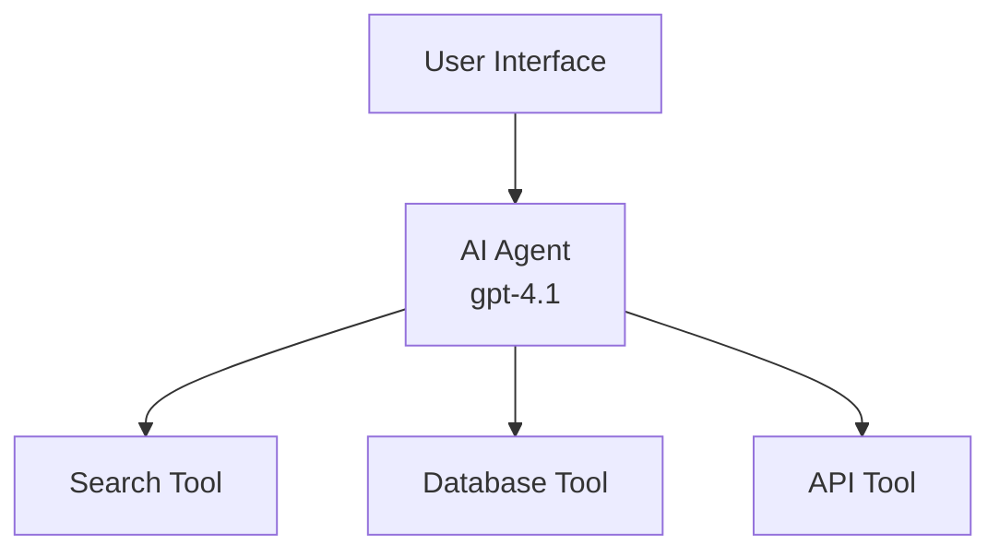
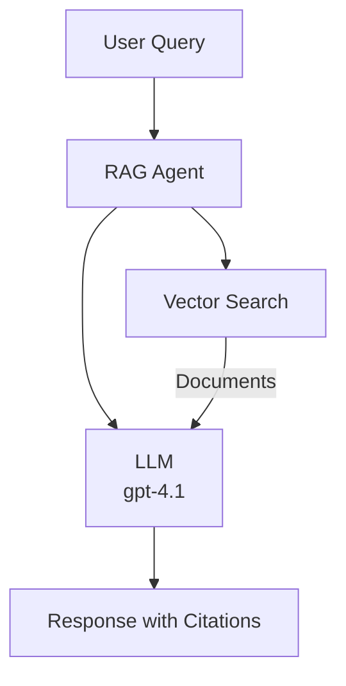
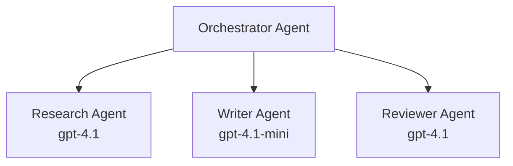

# AI Ügynökök Azure Developer CLI-vel

**Fejezet navigáció:**
- **📚 Tanfolyam kezdőlap**: [AZD Kezdőknek](../../README.md)
- **📖 Jelenlegi fejezet**: 2. fejezet - AI-első fejlesztés
- **⬅️ Előző**: [Microsoft Foundry integráció](microsoft-foundry-integration.md)
- **➡️ Következő**: [AI modell telepítés](ai-model-deployment.md)
- **🚀 Haladó**: [Többügynökös megoldások](../../examples/retail-scenario.md)

---

## Bevezetés

Az AI ügynökök autonóm programok, amelyek képesek érzékelni a környezetüket, döntéseket hozni és cselekedni meghatározott célok eléréséhez. Ellentétben az egyszerű chatbotokkal, amelyek válaszolnak a kérésekre, az ügynökök:

- **Eszközöket használnak** – API-kat hívnak, adatbázisokat keresnek, kódot futtatnak
- **Terveznek és következtetnek** – Komplex feladatokat lépésekre bontanak
- **A kontextusból tanulnak** – Memóriát tartanak fenn és adaptálják viselkedésüket
- **Együttműködnek** – Más ügynökökkel dolgoznak együtt (többügynökös rendszerek)

Ez az útmutató megmutatja, hogyan telepíts AI ügynököket az Azure-ba az Azure Developer CLI (azd) segítségével.

A beszélgetés kontextusának használata nem modelltréning: az állandó memória, hozzáférésvezérlés és megtartás megvalósítása/konfigurálása az alkalmazás feladata.

> **Foundry GA frissítés (2026-11-09):** Telepítsd a általánosan elérhető `microsoft.foundry` 1.0 csomagot `azd >= 1.37.0` használatával. Az értékelések külön telepíthetők; a választható előzetes funkciók és az alábbi klasszikus SDK töredék nem kerül GA-ba a csomag bejelentése által. Ezek az iránymutatások a [GA bejelentésen](https://devblogs.microsoft.com/azure-sdk/microsoft-foundry-azure-developer-cli-ga/) és dokumentáción alapulnak, nem egy élő Azure telepítésen.

## Tanulási célok

Ennek az útmutatónak az elvégzésével:
- Megérted, mik az AI ügynökök és miben különböznek a chatbotoktól
- Telepítesz előre elkészített AI ügynök sablonokat AZD-vel
- Beállítod a Foundry Ügynököket egyedi ügynökök számára
- Alapvető ügynök mintákat valósítasz meg (eszközhasználat, RAG, többügynökös)
- Figyelemmel kíséred és hibakeresed a telepített ügynököket

## Tanulási eredmények

A befejezés után képes leszel:
- Egyetlen paranccsal AI ügynök alkalmazásokat telepíteni az Azure-ba
- Beállítani az ügynök eszközeit és képességeit
- Végrehajtani a lekérdezéssel bővített generálást (RAG) ügynökökkel
- Tervezni többügynökös architektúrákat összetett folyamatokhoz
- Hibaelhárítani az általános ügynök telepítési problémákat

---

## 🤖 Miben különbözik az ügynök egy chattól?

| Jellemző | Chatbot | AI Ügynök |
|---------|---------|----------|
| **Viselkedés** | Válaszol a kérésekre | Autonóm akciókat hajt végre |
| **Eszközök** | Lehet, hogy használ keresést vagy eszközöket | Jellemzően eszközöket használ célvezérelt ciklusban |
| **Memória** | Alkalmazástól függ | Állandó memória csak ha kifejezetten megvalósított |
| **Tervezés** | Egy lépéses válasz | Többlépcsős következtetés |
| **Együttműködés** | Egy entitás | Dolgozhat más ügynökökkel együtt |

### Egyszerű analógia

- **Chatbot** = Egy segítőkész személy az információs pultnál, aki kérdésekre válaszol
- **AI ügynök** = Egy személyes asszisztens, aki hívásokat bonyolít le, időpontokat foglal és elvégzi a feladatokat

---

## 🚀 Gyors indulás: Telepítsd az első ügynöködet

Válassz egy opciót egy **új, üres munkakönyvtárban**. A végén lévő `.` inicializál itt; explicit célpont nélkül az aktuális AZD létrehozhat egy sablon nevű alkönyvtárat, és nem változtatja meg a shell könyvtáradat. Tartsd a sablonokat és környezeteket külön könyvtárakban.

Az alábbi idő- és költségtartományok illusztratívak, nem érvényes árajánlatok. Ellenőrizd a minta aktuális előfeltételeit, árképzését, modell-kvótáját és választható szolgáltatásait telepítés előtt.

### 1. opció: Foundry Ügynökök Sablon (Ajánlott)

```bash
# Initialize the AI agents template
azd init --template get-started-with-ai-agents .

# Deploy to Azure
azd up
```

**Ami települ:** A minta aktuális infrastruktúrája és kiválasztott opciói határozzák meg a modellt, eszközöket, hosztolást és monitorozási erőforrásokat. Nézd át a README-jét és `infra/`-t a provisioning előtt; ne feltételezd, hogy az összes ügynök sablon tartalmaz keresést vagy webes felületet.

**Idő:** kb. 15-20 perc
**Költség:** kb. 100-150 $/hónap (fejlesztés)

### 2. opció: Kreatív író ügynökök Prompty-val

```bash
# Initialize the Prompty-based agent template
azd init --template https://github.com/Azure-Samples/contoso-creative-writer .

# Deploy to Azure
azd up
```

**Ami települ:** Egy FastAPI/Prompty többügynökös író minta Azure OpenAI, Bing Grounding és Azure AI Search használatával. A korábbi `agent-openai-python-prompty` tárhely erre irányít át; nem egy minimális Azure Functions időjárás-ügynök sablon. Kövesd a minta aktuális README-jét a hosztolásra, modellkvótára és Bing Grounding előfeltételeire.

**Idő:** kb. 10-15 perc
**Költség:** kb. 50-100 $/hónap (fejlesztés)

### 3. opció: RAG Chat Ügynök

```bash
# Initialize RAG chat template
azd init --template azure-search-openai-demo .

# Deploy to Azure
azd up
```

**Ami települ:**
- ✅ Microsoft Foundry modellek
- ✅ Azure AI Search mintaadatokkal
- ✅ Dokumentumfeldolgozó adatfolyam
- ✅ Chatfelület hivatkozásokkal

**Idő:** kb. 15-25 perc
**Költség:** kb. 80-150 $/hónap (fejlesztés)

### 4. opció: Hosztolt Ügynök a GA Foundry csomaggal

Használd a [teljes hosztolt ügynök útmutatót](microsoft-foundry-integration.md#hosted-agent-walkthrough-ga) az alap Python Agent Framework Responses API mintához. Ez a kódfuttatási útvonal Python 3.13+, aktuális uv, Foundry jogosultságok és régiós modellkvóta szükséges. Az Azure CLI hitelesítő adatokkal lokálisan külön hitelesítsd az SDK hívásokat.

```bash
azd auth login
azd ext install microsoft.foundry
```

A üres könyvtárban inicializáld a mintát:

```text
azd ai agent init --template https://github.com/microsoft-foundry/foundry-samples/blob/main/samples/python/hosted-agents/agent-framework/responses/01-basic/azure.yaml --deploy-mode code --src .
```

Válassz új vagy meglévő projektet, nézd át `azure.yaml`-t, és futtasd `azd provision`-t. Használd `azd ai agent run`-t az Agent Inspector megnyitásához, majd egy másik terminálból az adott könyvtárban futtasd `azd ai agent invoke --local "Explain how this agent is hosted."`-at. Lokális ellenőrzés után használd `azd deploy`-et és `azd ai agent invoke "Explain how this agent is hosted."`-et a telepített válasz összehasonlításához. A Foundry távolról építi a feltöltött forrást; helyi konténer építés nem szükséges.

**Mikor használd a `azd ai agent init` vs `azd init --template` parancsokat:**

| Megközelítés | Legjobb | Hogyan működik |
|----------|----------|------|
| `azd init --template` | Egy működő mintaalkalmazásból indulsz | Klónoz egy teljes sablon tárhelyet kóddal + infrastruktúrával |
| `azd ai agent init --template` | Egy meglévő Foundry ügynök projektet alkalmazol | Használ egy `azure.yaml` projekt dokumentumot és definícióit |

> **Tipp:** Az 1-3 opció teljes alkalmazás sablonokból indul; a 4. megtanítja a GA hosztolt-ügynök munkafolyamatot. Egyik inicializációs parancs sem migrál automatikusan régi ügynök manifestumokat. Egy meglévő projekthez közvetlen ügynök definíció hozzáadásáról lásd az [inicializációs és migrációs útmutatót](../chapter-08-production/production-ai-practices.md#initializing-agent-projects-with-azd-ai-agent-init).

Telepítsd külön `azure.ai.evaluations`-ot tesztadatok/rubrikák generálására és ellenőrzésére, értékelés konfigurálására, majd futtasd `azd ai eval` segítségével. Az optimalizálás újrafelhasználhat kompatibilis értékeléseket; nézd át a jelölteket telepítés előtt. Kövesd az [értékelési munkafolyamatot](../chapter-08-production/production-ai-practices.md#evaluation-migration-and-quality-checks) és az [optimalizációs migrációt](../chapter-08-production/production-ai-practices.md#optimization-configuration-migration) régebbi példák újrafelhasználása előtt. Tisztításkor egy újrafelhasznált Foundry projekt erőforrásai megmaradnak `azd down` után; egy új projekt erőforráscsoportja törlődik. Lásd a [tisztítási útmutatót](microsoft-foundry-integration.md#7-clean-up-deliberately).

---

## 🏗️ Ügynök architektúra minták

### Minta 1: Egyetlen ügynök eszközökkel

A legegyszerűbb ügynök minta – egy ügynök, amely több eszközt használhat.



**Legjobb erre:**
- Ügyféltámogató botok
- Kutatási asszisztensek
- Adatfeldolgozó ügynökök

**Kapcsolódó alkalmazás minta:** `azure-search-openai-demo` RAG-et mutat be, nem egy általános eszközhasználó ügynök ciklust.

### Minta 2: RAG Ügynök (Lekérdezéssel bővített generálás)

Egy olyan ügynök, amely releváns dokumentumokat keres, mielőtt válaszokat generálna.



**Legjobb erre:**
- Vállalati tudásbázisok
- Dokumentumos kérdés-felelet rendszerek
- Megfelelőség és jogi kutatás

**AZD Sablon:** `azure-search-openai-demo`

### Minta 3: Többügynökös rendszer

Több specializált ügynök dolgozik együtt összetett feladatokon.



**Legjobb erre:**
- Összetett tartalomgenerálás
- Többlépcsős munkafolyamatok
- Különböző szakértelmet igénylő feladatok

**További információ:** [Többügynökös koordinációs minták](../chapter-06-pre-deployment/coordination-patterns.md)

---

## ⚙️ Az ügynök eszközök konfigurálása

Az ügynökök akkor lesznek igazán hatékonyak, ha eszközöket használhatnak. Így konfigurálhatod a gyakori eszközöket:

### Eszközkonfiguráció Foundry Ügynököknél

Ez a **klasszikus Agent Service SDK töredék** a `azure-ai-projects==1.0.0` és `azure-ai-agents==1.1.0` támogatására szolgál `azure-identity` segítségével. Nem az újabb verziózású agent/Responses API, amit néhány aktuális Foundry sablon használ, és nem a `azure.ai.agents` AZD kiterjesztés (más csomag). Ne keverd a két API generációt. Állítsd be `PROJECT_ENDPOINT`-t egy klasszikus Foundry projekt végpontra és `MODEL_DEPLOYMENT_NAME`-t egy létező támogatott modell telepítésre; lokálisan hitelesíts `az login`-val és add meg a szükséges projekt jogosultságokat.

```python
# agent_config.py
import os
from azure.ai.projects import AIProjectClient
from azure.ai.agents.models import FunctionTool
from azure.identity import DefaultAzureCredential

def search_knowledge_base(query: str) -> str:
    """Search the demonstration knowledge base.

    :param query: Search text.
    :return: Matching demonstration information.
    """
    # Local fixture only, not a production search implementation.
    return "Demo policy: returns are accepted within 30 days."

project_client = AIProjectClient(
    endpoint=os.environ["PROJECT_ENDPOINT"],
    credential=DefaultAzureCredential(),
)
search_tool = FunctionTool(functions={search_knowledge_base})
project_client.agents.enable_auto_function_calls(search_tool)
agent = project_client.agents.create_agent(
    model=os.environ["MODEL_DEPLOYMENT_NAME"],
    name="Support Agent",
    instructions="Use search_knowledge_base for policy questions. Label results as demo data.",
    tools=search_tool.definitions,
)
```

Egy függvényséma regisztrálása nem futtat Python kódot a szolgáltatáson. Ebben az SDK-ban a `enable_auto_function_calls` és `agents.runs.create_and_process(...)` hívások a kliens folyamatban futtatják a regisztrált callbackeket. Lásd a [kiadott SDK példát](https://github.com/Azure/azure-sdk-for-python/blob/azure-ai-agents_1.1.0/sdk/ai/azure-ai-agents/samples/agents_tools/sample_agents_auto_function_call.py). Használat után zárd be a klienset és töröld a demonstrációs ügynököket/fonatokat.

### Környezet konfiguráció

A következő nevek **illusztratív egyedi sablon bemenetek**, nem beépített AZD kapcsolók. Először minden értéket átvezetünk `infra/main.parameters.json`-n, az infrastruktúrán és alkalmazás kódján. `azd env set` önmagában nem változtatja meg az ügynök eszközeit vagy utasításait.

```bash
# Set up agent-specific environment variables
azd env set AZURE_OPENAI_MODEL "gpt-4.1"
azd env set AGENT_INSTRUCTIONS "You are a helpful assistant..."
azd env set ENABLE_CODE_INTERPRETER "true"
azd env set ENABLE_FILE_SEARCH "true"

# Apply wired infrastructure and application changes
azd up
```

---

## 📊 Ügynökök monitorozása

### Application Insights integráció

Ha a kiválasztott sablon telepíti az Application Insights-ot és beállítja a mérést:

```bash
# Open monitoring dashboard
azd monitor --overview

# Open the Application Insights logs view (not a streaming log tail)
azd monitor --logs

# View live metrics
azd monitor --live
```

### Követendő főbb mutatók

| Mutató | Leírás | Cél |
|--------|-------------|--------|
| Válasz késleltetés | Idő a válasz generálására | < 5 másodperc |
| Token használat | Tokenek kérdésenként | Költség figyelése |
| Eszköz hívás sikeresség | Sikeres eszköz végrehajtások aránya | > 95% |
| Hibaarány | Sikertelen ügynök kérések | < 1% |
| Felhasználói elégedettség | Visszajelzési értékek | > 4.0/5.0 |

### Egyedi naplózás ügynököknek

```python
import os
from azure.monitor.opentelemetry import configure_azure_monitor
from opentelemetry import trace

# Configure Azure Monitor with OpenTelemetry
configure_azure_monitor(
    connection_string=os.environ["APPLICATIONINSIGHTS_CONNECTION_STRING"]
)

tracer = trace.get_tracer(__name__)

def log_agent_interaction(user_query, agent_response, tools_used, latency_ms):
    with tracer.start_as_current_span("agent_interaction") as span:
        span.set_attributes({
            "query_length": len(user_query),  # Do not log raw prompts or personal data
            "response_length": len(agent_response),
            "tools_used": tools_used,
            "latency_ms": latency_ms
        })
```

> **Megjegyzés:** Telepítsd a szükséges csomagot: `pip install azure-monitor-opentelemetry`. Ez hozza az OpenTelemetry függőségeket; a névtér importálása nem követelmény egy `opentelemetry` nevű csomag telepítéséhez.

---

## 💰 Költség megfontolások

### Becsült havi költségek mintánként

Ezek illusztratív tervezési tartományok, nem árajánlatok vagy költési korlátok. A régió, modell tokenek, Keresés/számítási SKUk, eszköz munkamenetek, tárolás és forgalom meghaladhatja ezeket. Ellenőrizd a minta költségirányelveit és az Azure árazást telepítés előtt `azd up`.

| Minta | Fejlesztői környezet | Üzemeltetés |
|---------|-----------------|------------|
| Egyedi ügynök | $50-100 | $200-500 |
| RAG ügynök | $80-150 | $300-800 |
| Többügynök (2-3 ügynök) | $150-300 | $500-1,500 |
| Vállalati többügynök | $300-500 | $1,500-5,000+ |

### Költségoptimalizálási tippek

1. **Használd a gpt-4.1-mini-t egyszerű feladatokra** (csak ha a sablon ezt használja bemenetként)
   ```bash
   azd env set AZURE_OPENAI_MODEL "gpt-4.1-mini"
   ```

2. **Valósíts meg körülhatárolt cache-t ismétlődő, biztonságos lekérdezésekhez.** Tartalmazza a bérlő/felhasználó engedélyezést, modell telepítést, utasításokat, és lekérdezés verzióját a cache kulcsban; állíts be lejáratot. Ne oszd meg privát beszélgetési válaszokat egy folyamat széles query-only cache-ben. Az SDK ügynök objektumnak nincs általános `agent.run()` metódusa.

3. **Állíts be token korlátokat futásonként**
   ```python
   # Set max_completion_tokens when running the agent, not during creation
   run = project_client.agents.runs.create_and_process(
       thread_id=thread.id,
       agent_id=agent.id,
       max_completion_tokens=1000  # Budget across the run; may finish as incomplete
   )
   ```

4. **Skálázd a jogosult Container App-eidet nullára, ha nincsenek használatban**
   ```bash
   # Custom-template input: must map to template.scale.minReplicas
   azd env set MIN_REPLICAS "0"
   ```
   Alkalmazd az infrastruktúra változtatást `azd provision` vagy `azd up`-tel. A nullára skálázás megfelelő triggerhez kötött, és nem állítja le a Keresés, tárolást vagy modell/eszköz díjakat.

---

## 🔧 Hibakeresés ügynököknél

### Gyakori problémák és megoldások

<details>
<summary><strong>❌ Ügynök nem válaszol az eszköz hívásokra</strong></summary>

```bash
# Inspect the application deployment (not the agent's registered tools)
azd show

# Verify OpenAI deployment
az cognitiveservices account deployment list \
  --name $AZURE_OPENAI_NAME \
  --resource-group $RG_NAME

# Check agent logs
azd monitor --logs
```

**Gyakori okok:**
- Eszköz függvény szignatúra nem egyezik
- Hiányzó szükséges engedélyek
- API végpont nem elérhető
</details>

<details>
<summary><strong>❌ Magas késés az ügynök válaszokban</strong></summary>

```bash
# Check Application Insights for bottlenecks
azd monitor --live

# Consider using a faster model
azd env set AZURE_OPENAI_MODEL "gpt-4.1-mini"
azd up
```

**Optimalizálási tippek:**
- Használj streaming válaszokat
- Valósíts meg válaszcachingot
- Csökkentsd a kontextus ablak méretét
</details>

<details>
<summary><strong>❌ Ügynök hibás vagy hallucinált információkat ad vissza</strong></summary>

```python
# Improve with better system prompts
instructions = """
You are a helpful assistant. IMPORTANT:
- Only answer based on provided context
- If you don't know, say "I don't know"
- Always cite your sources
- Never make up information
"""

# Use these instructions in the agent definition.
# For classic file search, first upload/index documents in a vector store,
# then use FileSearchTool(vector_store_ids=[...]) and pass both its
# .definitions and .resources when creating the agent.
```
Az utasítások és a visszakeresés csökkenti a kockázatot; egyik sem garantálja a tényszerű választ. Értékeld a helyhez kötött és kívül eső kérdéseket ismert válaszok alapján.
</details>

<details>
<summary><strong>❌ Token limit túllépési hibák</strong></summary>

```python
# Implement context window management
def truncate_context(messages, max_tokens=8000, model="gpt-4.1"):
    """Approximate content-only budget for objects with .content strings."""
    import tiktoken
    encoding = tiktoken.encoding_for_model(model)
    total_tokens = 0
    truncated = []
    
    for msg in reversed(messages):
        msg_tokens = len(encoding.encode(msg.content))
        if total_tokens + msg_tokens > max_tokens:
            break
        truncated.insert(0, msg)
        total_tokens += msg_tokens
    
    return truncated
```
Ez a segédeszköz kizárja a szerep/eszköz sémákat, rendszerutasításokat, képtokeneket és protokoll overhead-et. Foglalj helyet ezeknek és a completition-nek; ne bontsd szét eszköz-hívás/eredmény párokat és ne dobd el a szükséges rendszerutasításokat. Telepítsd külön `tiktoken`-at. Nem általános kontextus-ablak validátor.
</details>

---

## 🎓 Gyakorlati feladatok

### Gyakorlat 1: Egyszerű ügynök telepítése (20 perc)

**Cél:** Telepítsd az első AI ügynöködet AZD segítségével

```bash
# Step 1: Initialize template
azd init --template get-started-with-ai-agents .

# Step 2: Login to Azure
azd auth login
# If you work across tenants, add --tenant-id <tenant-id>

# Step 3: Deploy
azd up

# Step 4: Test the agent
# Expected output after deployment:
#   Deployment Complete!
#   Endpoint: https://<app-name>.<region>.azurecontainerapps.io
# Open the URL shown in the output and try asking a question

# Step 5: View monitoring
azd monitor --overview

# Step 6: Review the listed resources and confirm cleanup
azd down
```

**Siker kritériumok:**
- [ ] Az ügynök válaszol a kérdésekre
- [ ] Hozzáfér a felügyeleti műszerfalhoz `azd monitor` segítségével
- [ ] Az erőforrások sikeresen törlődnek

### Gyakorlat 2: Egyedi eszköz hozzáadása (30 perc)

**Cél:** Egy ügynök bővítése egy egyedi eszközzel

**Kiindulópont:** Használja a klasszikus SDK klienst a [Tool Configuration](#tool-configuration-in-foundry-agents) oldalról, ne egy tetszőleges, más SDK-generációval készült sablont.

1. Adja hozzá ezt a determinisztikus eszközt a `agent_config.py` fájlhoz:
   ```python
   def get_weather(location: str) -> str:
       """Return demonstration weather, not live conditions.

       :param location: City name.
       :return: A clearly labelled fixture.
       """
       print(f"TOOL_CALLED: {location}")
       return f"Demo weather in {location}: Sunny, 72°F (fixture, not live)"
   ```
2. Cserélje ki a search-tool regisztrációs és létrehozási blokkot erre:
   ```python
   weather_tool = FunctionTool(functions={get_weather})
   project_client.agents.enable_auto_function_calls(weather_tool)
   agent = project_client.agents.create_agent(
       model=os.environ["MODEL_DEPLOYMENT_NAME"],
       name="Weather Agent",
       instructions="Call get_weather for weather questions; explain that it returns demo data.",
       tools=weather_tool.definitions,
   )
   thread = project_client.agents.threads.create()
   try:
       project_client.agents.messages.create(
           thread_id=thread.id, role="user", content="Use get_weather for Seattle."
       )
       run = project_client.agents.runs.create_and_process(
           thread_id=thread.id, agent_id=agent.id
       )
       if run.status != "completed":
           raise RuntimeError(f"Run status: {run.status}; error: {run.last_error}")
       for message in project_client.agents.messages.list(thread_id=thread.id):
           for text in message.text_messages:
               print(text.text.value)
   finally:
       project_client.agents.threads.delete(thread.id)
       project_client.agents.delete_agent(agent.id)
       project_client.close()
   ```
3. Futtassa helyileg (ez meghívja a meglévő Azure projektet és modellköltségeket generál):
   ```bash
   python agent_config.py
   # Expected: TOOL_CALLED: Seattle, then a completed answer labelled demo data.
   ```

**Siker kritériumok:**
- [ ] Az ügynök felismeri az időjárással kapcsolatos lekérdezéseket
- [ ] Az eszközt megfelelően hívják meg
- [ ] A válasz tartalmaz időjárási információkat

### Gyakorlat 3: Egy RAG ügynök létrehozása (45 perc)

**Cél:** Készítsen egy ügynököt, amely a dokumentumaiból válaszol a kérdésekre

```bash
# Step 1: Deploy RAG template
azd init --template azure-search-openai-demo .
azd up

# Step 2: Upload your documents
# For the sample's local ingestion path, place supported files in data/.
# Run from the sample root after following its Python environment setup:
./scripts/prepdocs.sh
# Windows PowerShell equivalent: .\\scripts\\prepdocs.ps1

# Step 3: Test with domain-specific questions
# Open the web app URL from the azd up output
# Ask questions about your uploaded documents
# Responses should include citation references like [doc.pdf]
```

**Siker kritériumok:**
- [ ] Az ügynök a feltöltött dokumentumokra válaszol
- [ ] A válaszok tartalmaznak hivatkozásokat
- [ ] Az a körön kívüli tesztkérdéseket támogatás nélküli állítások nélkül kezeli (nem garantált minden jövőbeli kérdésre)

Ha `USE_CLOUD_INGESTION=true`, használja helyette a minta felhő alapú betöltési/feltöltési munkafolyamatát; a helyi csomagoló szándékosan kihagyja a betöltést. Tesztelés után futtassa `azd down` a RAG környezetben, és tekintse át a törlendő erőforrásokat.

---

## 📚 További lépések

Most, hogy megértette az AI ügynököket, fedezze fel ezeket a haladó témákat:

| Téma | Leírás | Link |
|-------|-------------|------|
| **Többügynökös rendszerek** | Több, együttműködő ügynökből álló rendszerek építése | [Retail Multi-Agent Example](../../examples/retail-scenario.md) |
| **Koordinációs minták** | Tanulja meg a szervezési és kommunikációs mintákat | [Coordination Patterns](../chapter-06-pre-deployment/coordination-patterns.md) |
| **Éles üzembe helyezés** | Vállalati szintű ügynök telepítés | [Production AI Practices](../chapter-08-production/production-ai-practices.md) |
| **Ügynök értékelés** | Az ügynök teljesítményének tesztelése és értékelése | [AI Troubleshooting](../chapter-07-troubleshooting/ai-troubleshooting.md) |
| **AI Workshop Lab** | Gyakorlati: Tegye AI megoldását AZD-kompatibilissé | [AI Workshop Lab](ai-workshop-lab.md) |

---

## 📖 További források

### Hivatalos dokumentáció
- [Microsoft Foundry Agent Service](https://learn.microsoft.com/azure/ai-services/agents/)
- [Microsoft Foundry Agent Service Gyorsindítás](https://learn.microsoft.com/azure/ai-services/agents/quickstart)
- [Semantic Kernel Agent Framework](https://learn.microsoft.com/semantic-kernel/)

### AZD sablonok ügynököknek
- [AI ügynökök kezdése](https://github.com/Azure-Samples/get-started-with-ai-agents)
- [Kreatív írási ügynökök Prompty-vel](https://github.com/Azure-Samples/contoso-creative-writer)
- [Azure Search OpenAI demo](https://github.com/Azure-Samples/azure-search-openai-demo)

### Közösségi források
- [Remek AZD - ügynök sablonok](https://azure.github.io/awesome-azd/?tags=ai-agents)
- [Azure AI Discord](https://discord.gg/microsoft-azure)
- [Microsoft Foundry Discord](https://discord.gg/nTYy5BXMWG)

### Ügynök képességek az Ön szerkesztőjéhez
- [**Microsoft Azure ügynök képességek**](https://skills.sh/microsoft/github-copilot-for-azure) - Telepítsen újrahasznosítható AI ügynök képességeket Azure fejlesztéshez GitHub Copilotban, Cursorban vagy bármely támogatott ügynökben. Tartalmaz képességeket a [Azure AI](https://skills.sh/microsoft/github-copilot-for-azure/azure-ai), [Microsoft Foundry](https://skills.sh/microsoft/github-copilot-for-azure/microsoft-foundry), [telepítés](https://skills.sh/microsoft/github-copilot-for-azure/azure-deploy) és [diagnosztika](https://skills.sh/microsoft/github-copilot-for-azure/azure-diagnostics) területeken:
  ```bash
  npx skills add microsoft/github-copilot-for-azure
  ```

---

**Navigáció**
- **Előző lecke**: [Microsoft Foundry integráció](microsoft-foundry-integration.md)
- **Következő lecke**: [AI modell telepítése](ai-model-deployment.md)

---

<!-- CO-OP TRANSLATOR DISCLAIMER START -->
**Jogi nyilatkozat**:
Ez a dokumentum az AI fordítási szolgáltatás, a [Co-op Translator](https://github.com/Azure/co-op-translator) segítségével készült. Bár az pontosságra törekszünk, kérjük, vegye figyelembe, hogy az automatikus fordítások hibákat vagy pontatlanságokat tartalmazhatnak. Az eredeti dokumentum az anyanyelvén tekintendő hiteles forrásnak. Fontos információk esetén professzionális emberi fordítást javasolunk. Nem vállalunk felelősséget semmilyen félreértésért vagy téves értelmezésért, amely ebből a fordításból ered.
<!-- CO-OP TRANSLATOR DISCLAIMER END -->