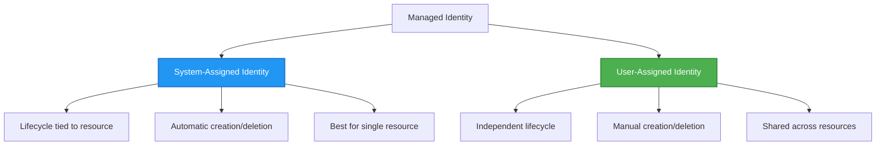

# Hitelesítési minták és kezelt azonosító

⏱️ **Becsült idő**: 45-60 perc olvasás; extra időt hagyj a gyakorlatok integrálására | 💰 **Költséghatás**: Identitás/RBAC ingyenes; a telepített számítási kapacitás, tárhely és Key Vault számlázható | ⭐ **Bonyolultság**: Középhaladó

> Átvizsgálva a `azd 1.37.2` (2026 november) alapján. Ez a lecke **illusztratív integrációs töredékeket tartalmaz, nem egy teljes letölthető `secure-app` sablont**. Hozd létre a hivatkozott fájlokat, biztosíts hozzá illő infrastruktúrát, és cseréld le a helykitöltőket a telepítés előtt. Átvizsgálás közben nem történtek Azure erőforrás létrehozások.

**📚 Tanulási útvonal:**
- ← Előző: [Konfigurációkezelés](configuration.md) - Környezeti változók és titkok kezelése
- 🎯 **Jelenleg itt tartasz**: Hitelesítés és Biztonság (Kezelt identitás, Key Vault, biztonságos minták)
- → Következő: [Infrastruktúra mint kód](../chapter-04-infrastructure/README.md) - Erőforrások létrehozása és telepítése
- 🏠 [Kurzus kezdőoldal](../../README.md)

---

## Amit megtanulsz

Ezzel a leckével képes leszel:
- Megérteni az Azure hitelesítési mintáit (kulcsok, kapcsolati karakterláncok, kezelt identitás)
- Megvalósítani a **Kezelt Identitást** jelszó nélküli hitelesítéshez
- Titkokat biztonságosan kezelni az **Azure Key Vault** integrációval
- Beállítani a **szerepkör alapú hozzáférés-vezérlést (RBAC)** AZD telepítésekhez
- Alkalmazni a biztonsági legjobb gyakorlatokat Container Apps és Azure szolgáltatások esetén
- Átállni kulcs-alapú hitelesítésről identitás-alapúra

## Miért fontos a Kezelt Identitás

### Probléma: Hagyományos hitelesítés

**Kezelt Identitás nélkül:**
```javascript
// ❌ SECURITY RISK: Hardcoded secrets in code
const connectionString = "Server=mydb.database.windows.net;User=admin;Password=P@ssw0rd123";
const storageKey = "xK7mN9pQ2wR5tY8uI0oP3aS6dF1gH4jK...";
const cosmosKey = "C2x7B9n4M1p8Q5w3E6r0T2y5U8i1O4p7...";
```

**Problémák:**
- 🔴 Kódban, konfigurációs fájlokban, környezeti változókban **megvilágítva titkok**
- 🔴 **Hitelesítő adatok forgatása** kódmódosítást és újratelepítést igényel
- 🔴 **Audit rémálom** - ki, mikor és mit ért el?
- 🔴 **Szétszóródás** - titkok több rendszerben szétszórva
- 🔴 **Megfelelőségi kockázatok** - sikertelen biztonsági auditok

### Megoldás: Kezelt Identitás

**Kezelt Identás után:**
```javascript
// ✅ SECURE: No secrets in code
const credential = new DefaultAzureCredential();
const client = new BlobServiceClient(
  "https://mystorageaccount.blob.core.windows.net",
  credential  // Azure automatically handles authentication
);
```

**Előnyök:**
- ✅ **Nincsenek titkok** a kódban vagy konfigurációban
- ✅ **Automatikus forgatás** - az Azure kezeli
- ✅ **Teljes audit nyomvonal** a Microsoft Entra ID naplókban
- ✅ **Központosított biztonság** - az Azure Portalon keresztül kezelhető
- ✅ **Megfelelőségi kész** - biztonsági szabványoknak megfelel

**Hasonlat**: A hagyományos hitelesítés olyan, mintha több fizikai kulcsot hordoznál különböző ajtókhoz. A Kezelt Identitás olyan, mint egy biztonsági jelvény, amely automatikusan hozzáférést biztosít a személyed alapján – nincs kulcs, amit elveszíthetsz, lemásolhatsz vagy forgathatsz.

---

## Architektúra áttekintés

### Hitelesítési folyamat Kezelt Identitással

```mermaid
sequenceDiagram
    participant App as Your Application<br/>(Container App)
    participant MI as Managed Identity<br/>(Microsoft Entra ID)
    participant KV as Key Vault
    participant Storage as Azure Storage
    participant DB as Azure SQL
    
    App->>MI: Request access token<br/>(automatic)
    MI->>MI: Verify identity<br/>(no password needed)
    MI-->>App: Return token for requested audience<br/>(lifetime varies)
    
    App->>KV: Get secret<br/>(using token)
    KV->>KV: Check RBAC permissions
    KV-->>App: Return secret value
    
    App->>Storage: Upload blob<br/>(using token)
    Storage->>Storage: Check RBAC permissions
    Storage-->>App: Success
    
    App->>DB: Query data<br/>(using token)
    DB->>DB: Check SQL permissions
    DB-->>App: Return results
    
    Note over App,DB: Request a separate token for each service audience;<br/>SDK credentials handle caching and renewal
```

### Kezelt identitás típusok



| Tulajdonság | Rendszer által hozzárendelt | Felhasználó által hozzárendelt |
|---------|----------------|---------------|
| **Élettartam** | Erőforráshoz kötött | Független |
| **Létrehozás** | Automatikus az erőforrással együtt | Manuális létrehozás |
| **Törlés** | Erőforrással együtt törlődik | Megmarad az erőforrás törlése után is |
| **Megosztás** | Egy erőforráshoz kötött | Több erőforrás között megosztható |
| **Felhasználási eset** | Egyszerű helyzetek | Összetett, több erőforrásos helyzetek |
| **Sablon választás** | Infrastrukturában meghatározott | Infrastrukturában meghatározott |

---

## Előfeltételek

### Szükséges eszközök

Ezek már telepítve kell legyenek az előző leckék alapján:

```bash
# Verify Azure Developer CLI
azd version
# ✅ Expected: azd version 1.0.0 or higher

# Verify Azure CLI
az --version
# ✅ Expected: azure-cli 2.50.0 or higher
```

### Azure követelmények

- Aktív Azure előfizetés
- Jogosultságok:
  - Kezelt identitások létrehozása
  - RBAC szerepkörök hozzárendelése
  - Key Vault erőforrások létrehozása
  - Container Apps telepítése

### Tudás előfeltételei

Elvégezve:
- [Telepítési útmutató](../chapter-01-foundation/installation.md) - AZD beállítása
- [AZD alapok](../chapter-01-foundation/azd-basics.md) - Alapfogalmak
- [Konfigurációkezelés](configuration.md) - Környezeti változók

---

## 1. lecke: A hitelesítési minták megértése

### Minta 1: Kapcsolati karakterláncok (Hagyományos - Kerülendő)

**Működése:**
```bash
# Connection string contains credentials
STORAGE_CONNECTION_STRING="DefaultEndpointsProtocol=https;AccountName=myaccount;AccountKey=xK7mN9pQ2wR5..."
COSMOS_CONNECTION_STRING="AccountEndpoint=https://myaccount.documents.azure.com:443/;AccountKey=C2x7..."
SQL_CONNECTION_STRING="Server=myserver.database.windows.net;User=admin;Password=P@ssw0rd..."
```

**Problémák:**
- ❌ Titkok láthatók környezeti változókban
- ❌ Naplózva telepítési rendszerekben
- ❌ Nehéz forgatni
- ❌ Nincs hozzáférési audit nyomvonal

**Mikor használjuk:** Amikor a cél szolgáltatás kulcs-alapú hitelesítést igényel. Előnyben részesítsd az identitást, ahol elérhető; különben a kulcsokat biztonságosan tárold és forgasd, beleértve a tényleges környezetet is.

---

### Minta 2: Key Vault hivatkozások (Jobb)

**Működése:**
**Részleges Bicep töredékek:** a szükséges vault mezők, Container App identitás és az `configuration.secrets` bejegyzése hiányzik. Az `secretRef` egy Container App titok nevét adja meg; **nem maga** egy Key Vault URI. A Key Vault használatához definiáld az adott nevű titkot `keyVaultUrl`-lal és egy engedélyezett `identity`-el.

```bicep
// Store secret in Key Vault
resource keyVault 'Microsoft.KeyVault/vaults@2023-02-01' = {
  name: 'mykv'
  properties: {
    enableRbacAuthorization: true
  }
}

// Reference in Container App
env: [
  {
    name: 'STORAGE_KEY'
    secretRef: 'storage-key'  // References Key Vault
  }
]
```

**Előnyök:**
- ✅ Titkok biztonságosan tárolva a Key Vaultban
- ✅ Központosított titokkezelés
- ✅ Forgatás kódváltoztatás nélkül

**Korlátozások:**
- ⚠️ Még mindig kulcsok/jelszavak használata
- ⚠️ Key Vault hozzáférést kell kezelni

**Mikor használjuk:** Átmeneti lépés kapcsolati karakterláncról kezelt identitásra.

---

### Minta 3: Kezelt identitás (Legjobb gyakorlat)

**Működése:**
**Részleges Bicep:** egyesítsd az identitás blokkot egy teljes Container App-mal, és add meg az `storageAccount`-ot és a szerepkör definíciót. Egy szerepkör hozzárendeléshez determinisztikus `name` is szükséges.

```bicep
// Enable managed identity
resource containerApp 'Microsoft.App/containerApps@2023-05-01' = {
  name: 'myapp'
  identity: {
    type: 'SystemAssigned'  // Automatically creates identity
  }
}

// Grant permissions
resource roleAssignment 'Microsoft.Authorization/roleAssignments@2022-04-01' = {
  name: guid(storageAccount.id, containerApp.id, storageBlobDataContributorRole)
  scope: storageAccount
  properties: {
    roleDefinitionId: storageBlobDataContributorRole
    principalId: containerApp.identity.principalId
    principalType: 'ServicePrincipal'
  }
}
```

**Alkalmazás kód:**
```javascript
// No secrets needed!
const { DefaultAzureCredential } = require('@azure/identity');
const { BlobServiceClient } = require('@azure/storage-blob');

const credential = new DefaultAzureCredential();
const blobServiceClient = new BlobServiceClient(
  'https://mystorageaccount.blob.core.windows.net',
  credential
);
```

**Előnyök:**
- ✅ Nincs titok kódban/configban
- ✅ Automatikus hitelesítő adat forgatás
- ✅ Teljes audit nyomvonal
- ✅ RBAC alapú jogosultságok
- ✅ Megfelelőségi kész

**Mikor használjuk:** Előnyben részesítsd Azure-ban futó alkalmazásoknál, amelyek Microsoft Entra hitelesítést támogatnak.

---

### Minta 4: Szolgáltatás Elsődleges Fiókok (CI/CD és automatizálás)

A kezelt identitás a *legjobb megoldás* az Azure-ban futó erőforrásokra. De mi a helyzet a **külső** környezettel – például egy CI/CD pipeline-ral egy build agente vagy egy script-tel a laptopodon, amely nem használja az interaktív bejelentkezést? Itt jön képbe a **szolgáltatás elsődleges fiók**: nem emberi identitás saját hitelesítő adatokkal, amellyel egy automatizált folyamat tud bejelentkezni.

**Működése:**

Hozz létre egy szolgáltatás elsődleges fiókot egy erőforráscsoporthoz kötve (legkisebb jogosultság):

```bash
az ad sp create-for-rbac \
  --name "myapp-cicd" \
  --role contributor \
  --scopes "/subscriptions/<sub-id>/resourceGroups/<rg-name>"
```

Ez kiír egy kliensazonosítót, kliens titkot és bérlőazonosítót. Az azd nem-interaktívan tud ezekkel bejelentkezni:

```bash
azd auth login \
  --client-id "<appId>" \
  --client-secret "<password>" \
  --tenant-id "<tenant>"
```

**Előnyben részesítsd a federált hitelesítő adatokat (OIDC) a titkok helyett.** Hosszú életű kliens titok helyett állíts be egy federált hitelesítő adatot, hogy a pipeline rövid életű tokent cseréljen – nincs titok, ami kiszivárog vagy forgatandó:

```bash
azd auth login \
  --client-id "<appId>" \
  --federated-credential-provider "github" \
  --tenant-id "<tenant>"
```

> `azd pipeline config` automatikusan beállítja ezt neked. Lásd a CI/CD részletes útmutatókat a [8. fejezetben](../chapter-08-production/production-ai-practices.md).

**Előnyök:**
- ✅ Működik Azure-on kívül is (build agentek, helyszín, más felhők)
- ✅ Egy erőforráscsoporthoz és egy szerepkörhöz köthető
- ✅ Federált (OIDC) változat nem tárol titkot

**Hátrányok:**
- ⚠️ Titok alapú változat tárolása és forgatása gondos kezelést kíván
- ⚠️ Egy kiszivárgott titok bármilyen jogosultságot átenged az SP-nek – tartsd szűkön a jogosultságokat

**Mikor használjuk:** CI/CD pipeline-ok és automatizálás, amelyek nem használhatnak kezelt identitást. Mindig a **federált/OIDC** változatot válaszd kliens titok helyett, és használj kezelt identitást, ha a munkaterhelés Azure-ban fut.

**Hitelesítő adatok biztonságos tárolása:**
- Soha ne tárold titkokat verziókezelőben – használd a pipeline titoktárait (GitHub Actions titkok, Azure DevOps változócsoportok / Key Vault).
- Szűkítsd az SP jogosultságait a legkisebb szükséges szerepkörre és erőforráscsoportra.
- Állíts be lejáratot és forgatást, vagy szüntesd meg teljesen a titkot OIDC-vel.

---

## 2. lecke: Kezelt identitás megvalósítása AZD-vel

### Lépésről lépésre megvalósítás

Az alábbi töredékek azt mutatják be, hogyan integráld a kezelt identitást egy Container App projektbe. Ezek **nem egyszerűen lefuttatható kezdő kódok**: a Storage modul, a teljes kezelt környezet-/regiszter infrastruktúra, Dockerfile és paraméterfájl nem mind egyben van itt. Kezdj egy működő Container Apps sablonnal, és illeszd be ezeket a mintákat megtartva a regiszter beállításait és szolgáltatás címkéit.

### Projektszerkezet

```
secure-app/
├── azure.yaml                 # AZD configuration
├── infra/
│   ├── main.bicep            # Main infrastructure
│   ├── core/
│   │   ├── identity.bicep    # Managed identity setup
│   │   ├── keyvault.bicep    # Key Vault configuration
│   │   └── storage.bicep     # Storage with RBAC
│   └── app/
│       └── container-app.bicep
└── src/
    ├── app.js                # Application code
    ├── package.json
    └── Dockerfile
```

### 1. AZD konfigurálása (azure.yaml)

```yaml
name: secure-app
metadata:
  template: secure-app@1.0.0

services:
  api:
    project: ./src
    language: js
    host: containerapp

# Managed identity must be enabled in the infrastructure, not by this YAML.
```

### 2. Infrastruktúra: Kezelt Identitás engedélyezése

**Fájl: `infra/main.bicep`**

```bicep
targetScope = 'subscription'

param environmentName string
param location string = 'eastus'
param containerAppsEnvironmentId string
param containerImage string

var tags = { 'azd-env-name': environmentName }

// Resource group
resource rg 'Microsoft.Resources/resourceGroups@2021-04-01' = {
  name: 'rg-${environmentName}'
  location: location
  tags: tags
}

// Storage Account
module storage './core/storage.bicep' = {
  name: 'storage'
  scope: rg
  params: {
    name: 'st${uniqueString(rg.id)}'
    location: location
    tags: tags
  }
}

// Key Vault
module keyVault './core/keyvault.bicep' = {
  name: 'keyvault'
  scope: rg
  params: {
    name: 'kv-${uniqueString(rg.id)}'
    location: location
    tags: tags
  }
}

// Container App with Managed Identity
module containerApp './app/container-app.bicep' = {
  name: 'container-app'
  scope: rg
  params: {
    name: 'ca-${environmentName}'
    location: location
    tags: tags
    storageAccountName: storage.outputs.name
    keyVaultName: keyVault.outputs.name
    containerAppsEnvironmentId: containerAppsEnvironmentId
    containerImage: containerImage
  }
}

// Grant Container App access to Storage
module storageRoleAssignment './core/role-assignment.bicep' = {
  name: 'storage-role'
  scope: rg
  params: {
    principalId: containerApp.outputs.identityPrincipalId
    roleDefinitionId: 'ba92f5b4-2d11-453d-a403-e96b0029c9fe'  // Storage Blob Data Contributor
    targetResourceType: 'storage'
    targetResourceName: storage.outputs.name
  }
}

// Grant Container App access to Key Vault
module kvRoleAssignment './core/role-assignment.bicep' = {
  name: 'kv-role'
  scope: rg
  params: {
    principalId: containerApp.outputs.identityPrincipalId
    roleDefinitionId: '4633458b-17de-408a-b874-0445c86b69e6'  // Key Vault Secrets User
    targetResourceType: 'keyvault'
    targetResourceName: keyVault.outputs.name
  }
}

// Outputs
output AZURE_STORAGE_ACCOUNT_NAME string = storage.outputs.name
output AZURE_KEY_VAULT_NAME string = keyVault.outputs.name
output APP_URL string = containerApp.outputs.url
```

### 3. Container App rendszer által hozzárendelt identitással

**Fájl: `infra/app/container-app.bicep`**

```bicep
param name string
param location string
param tags object = {}
param storageAccountName string
param keyVaultName string
param containerAppsEnvironmentId string
param containerImage string

resource containerApp 'Microsoft.App/containerApps@2023-05-01' = {
  name: name
  location: location
  tags: union(tags, { 'azd-service-name': 'api' })
  identity: {
    type: 'SystemAssigned'  // 🔑 Enable managed identity
  }
  properties: {
    managedEnvironmentId: containerAppsEnvironmentId
    configuration: {
      ingress: {
        external: true
        targetPort: 3000
      }
    }
    template: {
      containers: [
        {
          name: 'api'
          image: containerImage // Must exist; configure registry credentials for private images
          resources: {
            cpu: json('0.5')
            memory: '1Gi'
          }
          env: [
            {
              name: 'AZURE_STORAGE_ACCOUNT_NAME'
              value: storageAccountName
            }
            {
              name: 'AZURE_KEY_VAULT_NAME'
              value: keyVaultName
            }
            // 🔑 No secrets - managed identity handles authentication!
          ]
        }
      ]
    }
  }
}

// Output the identity for RBAC assignments
output identityPrincipalId string = containerApp.identity.principalId
output id string = containerApp.id
output url string = 'https://${containerApp.properties.configuration.ingress.fqdn}'
```

### 4. RBAC szerepkör hozzárendelés modulja

**Fájl: `infra/core/role-assignment.bicep`**

```bicep
param principalId string
param roleDefinitionId string  // Azure built-in role ID
@allowed(['storage', 'keyvault'])
param targetResourceType string
param targetResourceName string

// Typed existing resources give Bicep a valid resource scope, not a string ID.
resource storageTarget 'Microsoft.Storage/storageAccounts@2023-01-01' existing = {
  name: targetResourceName
}
resource vaultTarget 'Microsoft.KeyVault/vaults@2023-02-01' existing = {
  name: targetResourceName
}

resource storageAssignment 'Microsoft.Authorization/roleAssignments@2022-04-01' = if (targetResourceType == 'storage') {
  name: guid(storageTarget.id, principalId, roleDefinitionId)
  scope: storageTarget
  properties: {
    roleDefinitionId: subscriptionResourceId('Microsoft.Authorization/roleDefinitions', roleDefinitionId)
    principalId: principalId
    principalType: 'ServicePrincipal'
  }
}

resource vaultAssignment 'Microsoft.Authorization/roleAssignments@2022-04-01' = if (targetResourceType == 'keyvault') {
  name: guid(vaultTarget.id, principalId, roleDefinitionId)
  scope: vaultTarget
  properties: {
    roleDefinitionId: subscriptionResourceId('Microsoft.Authorization/roleDefinitions', roleDefinitionId)
    principalId: principalId
    principalType: 'ServicePrincipal'
  }
}

// This module assigns at the target resource scope, not the whole resource group.
```

### 5. Alkalmazás kód kezeltt identitással

**Fájl: `src/app.js`**

```javascript
const express = require('express');
const { DefaultAzureCredential } = require('@azure/identity');
const { BlobServiceClient } = require('@azure/storage-blob');
const { SecretClient } = require('@azure/keyvault-secrets');

const app = express();
const PORT = process.env.PORT || 3000;

// 🔑 Initialize credential (works automatically with managed identity)
const credential = new DefaultAzureCredential();

// Azure Storage setup
const storageAccountName = process.env.AZURE_STORAGE_ACCOUNT_NAME;
const blobServiceClient = new BlobServiceClient(
  `https://${storageAccountName}.blob.core.windows.net`,
  credential  // No keys needed!
);

// Key Vault setup
const keyVaultName = process.env.AZURE_KEY_VAULT_NAME;
const secretClient = new SecretClient(
  `https://${keyVaultName}.vault.azure.net`,
  credential  // No keys needed!
);

// Health check
app.get('/health', (req, res) => {
  res.json({ status: 'healthy', authentication: 'managed-identity' });
});

// Upload file to blob storage
app.post('/upload', async (req, res) => {
  try {
    const containerClient = blobServiceClient.getContainerClient('uploads');
    await containerClient.createIfNotExists();
    
    const blobName = `file-${Date.now()}.txt`;
    const blockBlobClient = containerClient.getBlockBlobClient(blobName);
    
    const content = 'Hello from managed identity!';
    await blockBlobClient.upload(content, Buffer.byteLength(content));
    
    res.json({
      success: true,
      blobName: blobName,
      message: 'File uploaded using managed identity!'
    });
  } catch (error) {
    console.error('Upload error:', error);
    res.status(500).json({ error: error.message });
  }
});

// Get secret from Key Vault
app.get('/secret/:name', async (req, res) => {
  try {
    const secretName = req.params.name;
    const secret = await secretClient.getSecret(secretName);
    
    res.json({
      name: secretName,
      retrieved: secret.value !== undefined, // Never return the secret value to callers
      message: 'Secret retrieved using managed identity!'
    });
  } catch (error) {
    console.error('Secret error:', error);
    res.status(500).json({ error: error.message });
  }
});

// List blob containers (demonstrates read access)
app.get('/containers', async (req, res) => {
  try {
    const containers = [];
    for await (const container of blobServiceClient.listContainers()) {
      containers.push(container.name);
    }
    
    res.json({
      containers: containers,
      count: containers.length,
      message: 'Containers listed using managed identity!'
    });
  } catch (error) {
    console.error('List error:', error);
    res.status(500).json({ error: error.message });
  }
});

app.listen(PORT, () => {
  console.log(`Secure API listening on port ${PORT}`);
  console.log('Authentication: Managed Identity (passwordless)');
});
```

**Fájl: `src/package.json`**

```json
{
  "name": "secure-app",
  "version": "1.0.0",
  "dependencies": {
    "express": "^4.18.2",
    "@azure/identity": "^4.0.0",
    "@azure/storage-blob": "^12.17.0",
    "@azure/keyvault-secrets": "^4.7.0"
  },
  "scripts": {
    "start": "node app.js"
  }
}
```

### 6. Telepítés és tesztelés

Csak futtasd ezeket a parancsokat **miután** elkészült az infrastruktúra, Dockerfile és az `main.parameters.json` megfelelő implementációja a saját projektedben. Az azd-t hitelesítsd `azd auth login`-tel; az Azure CLI ellenőrzésekhez külön jelentkezz be `az login`-tal. Az itt bemutatott végpontok demonstrációk és közhasználat előtt megfelelő hozzáférés-vezérlés szükséges.

```bash
# Initialize AZD environment
azd init

# Deploy infrastructure and application
azd up

# Get the app URL
APP_URL=$(azd env get-value APP_URL)

# Test health check
curl $APP_URL/health
```

**✅ Várt eredmény:**
```json
{
  "status": "healthy",
  "authentication": "managed-identity"
}
```

**Teszt blob feltöltés:**
```bash
curl -X POST $APP_URL/upload
```

**✅ Várt eredmény:**
```json
{
  "success": true,
  "blobName": "file-1700404800000.txt",
  "message": "File uploaded using managed identity!"
}
```

**Teszt konténer lista:**
```bash
curl $APP_URL/containers
```

**✅ Várt eredmény:**
```json
{
  "containers": ["uploads"],
  "count": 1,
  "message": "Containers listed using managed identity!"
}
```

---

## Gyakori Azure RBAC szerepkörök

### Beépített szerepkör-azonosítók kezelt identitáshoz

| Szolgáltatás | Szerepkör neve | Szerepkör azonosító | Jogosultságok |
|---------|-----------|---------|-------------|
| **Storage** | Storage Blob Data Reader | `2a2b9908-6ea1-4ae2-8e65-a410df84e7d1` | Blob és konténer olvasás |
| **Storage** | Storage Blob Data Contributor | `ba92f5b4-2d11-453d-a403-e96b0029c9fe` | Blobok olvasása, írása, törlése |
| **Storage** | Storage Queue Data Contributor | `974c5e8b-45b9-4653-ba55-5f855dd0fb88` | Sorok/üzenetek olvasása, írása, törlése |
| **Key Vault** | Key Vault Secrets User | `4633458b-17de-408a-b874-0445c86b69e6` | Titkok olvasása |
| **Key Vault** | Key Vault Secrets Officer | `b86a8fe4-44ce-4948-aee5-eccb2c155cd7` | Titkok olvasása, írása, törlése |
| **Cosmos DB** | Cosmos DB Built-in Data Reader | `00000000-0000-0000-0000-000000000001` | Cosmos DB adatok olvasása |
| **Cosmos DB** | Cosmos DB Built-in Data Contributor | `00000000-0000-0000-0000-000000000002` | Cosmos DB adatok olvasása, írása |
| **SQL Database** | SQL DB Contributor | `9b7fa17d-e63e-47b0-bb0a-15c516ac86ec` | Adatbázis erőforrások kezelése; SQL adat hozzáférést nem biztosít |
| **Service Bus** | Azure Service Bus Data Owner | `090c5cfd-751d-490a-894a-3ce6f1109419` | Üzenetek küldése, fogadása, kezelése |

### Szerepkör azonosítók keresése

A Cosmos DB for NoSQL két fent említett azonosítója **natív Cosmos adat sík szerepkör definíció**, nem Azure RBAC előfizetési szerepkörazonosítók. Ezeket `az cosmosdb sql role assignment create`-vel (vagy `Microsoft.DocumentDB/databaseAccounts/sqlRoleAssignments`-vel) rendeld hozzá, nem `az role assignment create`-kal. SQL adat hozzáféréshez Entra adatbázis felhasználó és SQL jogosultságok szükségesek.

```bash
# List all built-in roles
az role definition list --query "[].{Name:roleName, ID:name}" --output table

# Search for specific role
az role definition list --query "[?contains(roleName, 'Storage Blob')].{Name:roleName, ID:name}" --output table

# Get role details
az role definition list --name "Storage Blob Data Contributor"
```

---

## Gyakorlati feladatok

**Integrációs előfeltételek mindhárom gyakorlathoz:** működő Container App sablon a saját projektedben, illeszkedő Bicep erőforrások, Azure CLI/azd bejelentkezés, és jogosultság az adott szerepkörök hozzárendelésére. Ezek irányított adaptációk, nem önálló helyi kezdőcsomagok; cseréld le a minta erőforrás neveket a telepítettekre.

### Feladat 1: Kezelt identitás engedélyezése meglévő alkalmazás számára ⭐⭐ (Középhaladó)

**Cél:** Kezelt identitás hozzáadása egy meglévő Container App telepítéshez

**Helyzet:** Egy Container App használ kapcsolati karakterláncokat. Alakítsd át kezelt identitásra.

**Kiindulási pont:** Container App ezzel a konfigurációval:

```bicep
// ❌ Current: Using connection string
env: [
  {
    name: 'STORAGE_CONNECTION_STRING'
    secretRef: 'storage-connection'
  }
]
```

**Lépések:**

1. **Kezelt identitás engedélyezése Bicep-ben:**

```bicep
resource containerApp 'Microsoft.App/containerApps@2023-05-01' = {
  name: 'myapp'
  identity: {
    type: 'SystemAssigned'  // Add this
  }
  // ... rest of configuration
}
```

2. **Storage hozzáférés engedélyezése:**

```bicep
// Get storage account reference
resource storageAccount 'Microsoft.Storage/storageAccounts@2023-01-01' existing = {
  name: storageAccountName
}

// Assign role
resource roleAssignment 'Microsoft.Authorization/roleAssignments@2022-04-01' = {
  name: guid(containerApp.id, 'ba92f5b4-2d11-453d-a403-e96b0029c9fe', storageAccount.id)
  scope: storageAccount
  properties: {
    roleDefinitionId: subscriptionResourceId('Microsoft.Authorization/roleDefinitions', 'ba92f5b4-2d11-453d-a403-e96b0029c9fe')
    principalId: containerApp.identity.principalId
    principalType: 'ServicePrincipal'
  }
}
```

3. **Alkalmazás kód frissítése:**

**Előtte (kapcsolati karakterlánc):**
```javascript
const { BlobServiceClient } = require('@azure/storage-blob');

const blobServiceClient = BlobServiceClient.fromConnectionString(
  process.env.STORAGE_CONNECTION_STRING
);
```

**Utána (kezelt identitás):**
```javascript
const { DefaultAzureCredential } = require('@azure/identity');
const { BlobServiceClient } = require('@azure/storage-blob');

const credential = new DefaultAzureCredential();
const blobServiceClient = new BlobServiceClient(
  `https://${process.env.STORAGE_ACCOUNT_NAME}.blob.core.windows.net`,
  credential
);
```

4. **Környezeti változók frissítése:**

```bicep
env: [
  {
    name: 'STORAGE_ACCOUNT_NAME'
    value: storageAccountName  // Just the name, no secrets!
  }
  // Remove STORAGE_CONNECTION_STRING
]
```

5. **Telepítés és tesztelés:**

```bash
# Redeploy
azd up

# Test that it still works
APP_URL=$(azd show --output json | jq -er '.services.api.ingressUrl')
curl --fail -X POST "$APP_URL/upload"
```

**✅ Siker kritériumok:**
- ✅ Az alkalmazás hibák nélkül települ
- ✅ Storage műveletek működnek (feltöltés, lista, letöltés)
- ✅ Nincsenek kapcsolati karakterláncok a környezeti változók között
- ✅ Az identitás látható az Azure Portal "Identitás" panelen

**Ellenőrzés:**

```bash
# Check managed identity is enabled
az containerapp show \
  --name myapp \
  --resource-group rg-myapp \
  --query "identity.type"
# ✅ Expected: "SystemAssigned"

# Check role assignment
az role assignment list \
  --assignee $(az containerapp show --name myapp --resource-group rg-myapp --query "identity.principalId" -o tsv) \
  --scope /subscriptions/{sub-id}/resourceGroups/rg-myapp/providers/Microsoft.Storage/storageAccounts/mystorageaccount
# ✅ Expected: Shows "Storage Blob Data Contributor" role
```

**Idő:** 20-30 perc

---

### Feladat 2: Több-szolgáltatás hozzáférése felhasználó által hozzárendelt identitással ⭐⭐⭐ (Haladó)

**Cél:** Olyan felhasználó által hozzárendelt identitás létrehozása, melyet több Container App is megoszt

**Helyzet:** Három mikroszolgáltatásnak hozzáférésre van szüksége ugyanahhoz a Storage fiókhoz és Key Vaulthoz.

**Lépések:**

1. **Felhasználó által hozzárendelt identitás létrehozása:**

**Fájl: `infra/core/identity.bicep`**

```bicep
param name string
param location string
param tags object = {}

resource userAssignedIdentity 'Microsoft.ManagedIdentity/userAssignedIdentities@2023-01-31' = {
  name: name
  location: location
  tags: tags
}

output id string = userAssignedIdentity.id
output principalId string = userAssignedIdentity.properties.principalId
output clientId string = userAssignedIdentity.properties.clientId
```

2. **Szerepkörök hozzárendelése a felhasználó által hozzárendelt identitáshoz:**

```bicep
// In main.bicep
module userIdentity './core/identity.bicep' = {
  name: 'user-identity'
  scope: rg
  params: {
    name: 'id-${environmentName}'
    location: location
    tags: tags
  }
}

// Grant Storage access
resource storageRoleAssignment 'Microsoft.Authorization/roleAssignments@2022-04-01' = {
  name: guid(storageAccount.id, environmentName, 'storage-contributor')
  scope: storageAccount
  properties: {
    roleDefinitionId: subscriptionResourceId('Microsoft.Authorization/roleDefinitions', 'ba92f5b4-2d11-453d-a403-e96b0029c9fe')
    principalId: userIdentity.outputs.principalId
    principalType: 'ServicePrincipal'
  }
}

// Grant Key Vault access
resource kvRoleAssignment 'Microsoft.Authorization/roleAssignments@2022-04-01' = {
  name: guid(keyVault.id, environmentName, 'kv-secrets-user')
  scope: keyVault
  properties: {
    roleDefinitionId: subscriptionResourceId('Microsoft.Authorization/roleDefinitions', '4633458b-17de-408a-b874-0445c86b69e6')
    principalId: userIdentity.outputs.principalId
    principalType: 'ServicePrincipal'
  }
}
```

3. **Több Container Apphez identitás hozzárendelése:**

```bicep
resource apiGateway 'Microsoft.App/containerApps@2023-05-01' = {
  name: 'api-gateway'
  identity: {
    type: 'UserAssigned'
    userAssignedIdentities: {
      '${userIdentity.outputs.id}': {}
    }
  }
  // ... rest of config
}

resource productService 'Microsoft.App/containerApps@2023-05-01' = {
  name: 'product-service'
  identity: {
    type: 'UserAssigned'
    userAssignedIdentities: {
      '${userIdentity.outputs.id}': {}
    }
  }
  // ... rest of config
}

resource orderService 'Microsoft.App/containerApps@2023-05-01' = {
  name: 'order-service'
  identity: {
    type: 'UserAssigned'
    userAssignedIdentities: {
      '${userIdentity.outputs.id}': {}
    }
  }
  // ... rest of config
}
```

4. **Alkalmazáskód (minden szolgáltatás ugyanazt a mintát használja):**

```javascript
const { ManagedIdentityCredential } = require('@azure/identity');
const { BlobServiceClient } = require('@azure/storage-blob');

// For user-assigned identity, specify the client ID
const credential = new ManagedIdentityCredential(
  process.env.AZURE_CLIENT_ID  // User-assigned identity client ID
);

// Alternative (choose ONE credential declaration):
// const { DefaultAzureCredential } = require('@azure/identity');
// const credential = new DefaultAzureCredential({
//   managedIdentityClientId: process.env.AZURE_CLIENT_ID
// });

const blobServiceClient = new BlobServiceClient(
  `https://${process.env.STORAGE_ACCOUNT_NAME}.blob.core.windows.net`,
  credential
);
```

Állítsa be minden Container App futtatási idejének `AZURE_CLIENT_ID` értékét `userIdentity.outputs.clientId`-re és `STORAGE_ACCOUNT_NAME`-t a Bicep-ben használt tárolónevére. Csak az identitás hozzárendelése vagy a `azd env set` futtatása nem állítja be ezeket a futtatási értékeket.

5. **Telepítés és ellenőrzés:**

```bash
azd up

# Test all services can access storage
# Replace with the actual ingress URLs reported for your three services
curl --fail -X POST "$API_GATEWAY_URL/upload"
curl --fail -X POST "$PRODUCT_SERVICE_URL/upload"
curl --fail -X POST "$ORDER_SERVICE_URL/upload"
```

**✅ Siker kritériumok:**
- ✅ Egy identitás osztozik 3 szolgáltatáson
- ✅ Minden szolgáltatás hozzáfér a Storage-hoz és a Key Vault-hoz
- ✅ Az identitás megmarad, ha egy szolgáltatást töröl
- ✅ Központosított jogosultságkezelés

**User-assigned identitás előnyei:**
- Egyetlen identitás kezelése
- Következetes jogosultságok szolgáltatások között
- Túlél szolgáltatás törlése esetén
- Jobb bonyolult architektúráknál

**Idő**: 30-40 perc

---

### Gyakorlat 3: Key Vault titok forgatása ⭐⭐⭐ (Haladó)

**Cél**: Harmadik fél API kulcsok tárolása a Key Vault-ban és elérése kezelő identitással

**Forgatókönyv**: Az appnak külső API-t kell hívnia (OpenAI, Stripe, SendGrid), ami API kulcsokat igényel.

**Lépések**:

1. **Key Vault létrehozása RBAC-kal:**

**Fájl: `infra/core/keyvault.bicep`**

```bicep
param name string
param location string
param tags object = {}

resource keyVault 'Microsoft.KeyVault/vaults@2023-02-01' = {
  name: name
  location: location
  tags: tags
  properties: {
    enableRbacAuthorization: true  // Use RBAC instead of access policies
    sku: {
      family: 'A'
      name: 'standard'
    }
    tenantId: subscription().tenantId
    enableSoftDelete: true
    softDeleteRetentionInDays: 90
  }
}

// Allow Container App to read secrets
output id string = keyVault.id
output name string = keyVault.name
output uri string = keyVault.properties.vaultUri
```

2. **Titkok tárolása a Key Vault-ban:**

```bash
# Get Key Vault name
KV_NAME=$(azd env get-value AZURE_KEY_VAULT_NAME)

# Store third-party API keys
az keyvault secret set \
  --vault-name $KV_NAME \
  --name "OpenAI-ApiKey" \
  --value "sk-proj-xxxxxxxxxxxxx"

az keyvault secret set \
  --vault-name $KV_NAME \
  --name "Stripe-ApiKey" \
  --value "sk_live_xxxxxxxxxxxxx"

az keyvault secret set \
  --vault-name $KV_NAME \
  --name "SendGrid-ApiKey" \
  --value "SG.xxxxxxxxxxxxx"
```

3. **Alkalmazáskód a titkok lekéréséhez:**

**Fájl: `src/config.js`**

```javascript
const { DefaultAzureCredential } = require('@azure/identity');
const { SecretClient } = require('@azure/keyvault-secrets');

class Config {
  constructor() {
    this.credential = new DefaultAzureCredential();
    this.secretClient = new SecretClient(
      `https://${process.env.AZURE_KEY_VAULT_NAME}.vault.azure.net`,
      this.credential
    );
    this.cache = {};
  }

  async getSecret(secretName) {
    // Check cache first
    if (this.cache[secretName]) {
      return this.cache[secretName];
    }

    try {
      const secret = await this.secretClient.getSecret(secretName);
      this.cache[secretName] = secret.value;
      console.log(`✅ Retrieved secret: ${secretName}`);
      return secret.value;
    } catch (error) {
      console.error(`❌ Failed to get secret ${secretName}:`, error.message);
      throw error;
    }
  }

  async getOpenAIKey() {
    return this.getSecret('OpenAI-ApiKey');
  }

  async getStripeKey() {
    return this.getSecret('Stripe-ApiKey');
  }

  async getSendGridKey() {
    return this.getSecret('SendGrid-ApiKey');
  }
}

module.exports = new Config();
```

4. **Titkok használata az alkalmazásban:**

**Fájl: `src/app.js`**

Ez a **helyettesítő alkalmazásrészlet** igényli a `npm install openai`-et, egy valós harmadik fél kulcsát, elérhető modellt és az alapinfrastruktúrát a működő projektedből. Közvetlenül az OpenAI-t hívja, nem az Azure OpenAI telepítést. Az alábbi helyőrző kulcsok nem jogosítanak fel kérést.

```javascript
const express = require('express');
const config = require('./config');
const { OpenAI } = require('openai');

const app = express();

// Initialize OpenAI with key from Key Vault
let openaiClient;

async function initializeServices() {
  const openaiKey = await config.getOpenAIKey();
  openaiClient = new OpenAI({ apiKey: openaiKey });
  console.log('✅ Services initialized with secrets from Key Vault');
}

app.post('/chat', async (req, res) => {
  try {
    const completion = await openaiClient.chat.completions.create({
      model: 'gpt-4.1',
      messages: [{ role: 'user', content: 'Hello!' }]
    });
    
    res.json({
      response: completion.choices[0].message.content,
      authentication: 'Key from Key Vault via Managed Identity'
    });
  } catch (error) {
    res.status(500).json({ error: error.message });
  }
});

// Start listening only after initialization succeeds.
initializeServices().then(() => {
  app.listen(3000, () => console.log('Key Vault demo running'));
}).catch(error => {
  console.error('Initialization failed:', error.message);
  process.exitCode = 1;
});
```

5. **Telepítés és tesztelés:**

```bash
azd up

# Test that API keys work
curl -X POST https://myapp.azurecontainerapps.io/chat \
  -H "Content-Type: application/json" \
  -d '{"message":"Hello AI"}'
```

**✅ Siker kritériumok:**
- ✅ Nincsenek API kulcsok kódban vagy környezeti változókban
- ✅ Az alkalmazás a Key Vault-ból szerzi be a kulcsokat
- ✅ A harmadik fél API-k megfelelően működnek
- ✅ Kulcsok forgathatók kódváltoztatás nélkül

**Titok forgatása:**

```bash
# Update secret in Key Vault
az keyvault secret set \
  --vault-name $KV_NAME \
  --name "OpenAI-ApiKey" \
  --value "sk-proj-NEW_KEY_HERE"

# Find the active revision name, then restart it to clear the in-process cache
az containerapp revision list --name myapp --resource-group rg-myapp --output table
az containerapp revision restart \
  --name myapp \
  --resource-group rg-myapp \
  --revision "<active-revision-name>"
```

**Idő**: 25-35 perc

---

## Tudásellenőrzés

### 1. Hitelesítési minták ✓

Teszteld a megértésed:

- [ ] **K1**: Mik a három fő hitelesítési minta? 
  - **V**: Kapcsolati karakterláncok (régi), Key Vault hivatkozások (átmenet), Kezelt identitás (legjobb)

- [ ] **K2**: Miért jobb a kezelt identitás, mint a kapcsolati karakterláncok?
  - **V**: Nincs titok a kódban, automatikus forgatás, teljes audit napló, RBAC jogosultságok

- [ ] **K3**: Mikor használnál user-assigned identitást a system-assigned helyett?
  - **V**: Ha identitást osztasz meg több erőforrás között vagy az identitás élettartama független az erőforrásétól

**Gyakorlati ellenőrzés:**
```bash
# Check what type of identity your app uses
az containerapp show \
  --name myapp \
  --resource-group rg-myapp \
  --query "identity.type"

# List all role assignments for the identity
az role assignment list \
  --assignee $(az containerapp show --name myapp --resource-group rg-myapp --query "identity.principalId" -o tsv)
```

---

### 2. RBAC és jogosultságok ✓

Teszteld a megértésed:

- [ ] **K1**: Mi az azonosítója a "Storage Blob Data Contributor" szerepkörnek?
  - **V**: `ba92f5b4-2d11-453d-a403-e96b0029c9fe`

- [ ] **K2**: Milyen jogosultságokat ad a "Key Vault Secrets User"?
  - **V**: Csak olvasási hozzáférés a titkokhoz (nem hozhat létre, nem frissíthet vagy törölhet)

- [ ] **K3**: Hogyan adsz hozzáférést egy Container Appnak az Azure SQL-hez?
  - **V**: Állítsd be a Microsoft Entra hitelesítést, hozd létre az identitást adatbázis felhasználóként, és adj meg a szükséges SQL jogosultságokat. A "SQL DB Contributor" csak az Azure erőforrásokat kezeli; nem jogosít fel lekérdezésekre.

**Gyakorlati ellenőrzés:**
```bash
# Find specific role
az role definition list --name "Storage Blob Data Contributor"

# Check what roles are assigned to your identity
PRINCIPAL_ID=$(az containerapp show --name myapp --resource-group rg-myapp --query "identity.principalId" -o tsv)
az role assignment list --assignee $PRINCIPAL_ID --output table
```

---

### 3. Key Vault integráció ✓

Teszteld a megértésed:

- [ ] **K1**: Hogyan engedélyezel RBAC-ot a Key Vaulton hozzáférési szabályok helyett?
  - **V**: Állítsd be `enableRbacAuthorization: true` értékét Bicep-ben

- [ ] **K2**: Melyik Azure SDK könyvtár kezeli a kezelt identitás hitelesítést?
  - **V**: `@azure/identity` a `DefaultAzureCredential` osztállyal

- [ ] **K3**: Mennyi ideig maradnak a Key Vault titkok a gyorsítótárban?
  - **V**: Az alkalmazástól függ; valósítsd meg saját cache stratégiádat

**Gyakorlati ellenőrzés:**
```bash
# Test Key Vault access
az keyvault secret show \
  --vault-name $KV_NAME \
  --name "OpenAI-ApiKey" \
  --query "{name:name,enabled:attributes.enabled}"

# Check RBAC is enabled
az keyvault show \
  --name $KV_NAME \
  --query "properties.enableRbacAuthorization"
# ✅ Expected: true
```

---

## Biztonsági legjobb gyakorlatok

### ✅ Tedd:

1. **Mindig használj kezelt identitást éles környezetben**
   ```bicep
   identity: {
     type: 'SystemAssigned'
   }
   ```

2. **Használj minimális jogosultságú RBAC szerepköröket**
   - Használd a "Reader" szerepköröket, ahol csak lehet
   - Kerüld az "Owner" vagy "Contributor" használatát, ha nem szükséges

3. **Tárold a harmadik fél kulcsokat Key Vault-ban**
   ```javascript
   const apiKey = await secretClient.getSecret('ThirdPartyApiKey');
   ```

4. **Engedélyezd az audit naplózást** (részleges erőforrás fragmentum; egyesítsd a vault és workspace deklarációiddal)
   ```bicep
   resource vaultDiagnostics 'Microsoft.Insights/diagnosticSettings@2021-05-01-preview' = {
     name: 'vault-audit'
     scope: keyVault
     properties: {
       workspaceId: logAnalytics.id
       logs: [{ category: 'AuditEvent', enabled: true }]
     }
   }
   ```

5. **Használj különböző identitásokat fejlesztéshez, teszteléshez és éleshez**
   ```bash
   azd env new dev
   azd env new staging
   azd env new prod
   ```

6. **Titkok rendszeres forgatása**
   - Állíts be lejárati időket a Key Vault titkoknál
   - Automatizáld a forgatást Azure Functions segítségével

### ❌ Ne tedd:

1. **Soha ne kódolj be titkokat keményen**
   ```javascript
   // ❌ BAD
   const apiKey = "sk-proj-xxxxxxxxxxxxx";
   ```

2. **Ne használj kapcsolati karakterláncokat éles környezetben**
   ```javascript
   // ❌ BAD
   BlobServiceClient.fromConnectionString(process.env.STORAGE_CONNECTION_STRING)
   ```

3. **Ne adj ki túlzott jogosultságokat**
   ```bicep
   // ❌ BAD - too much access
   roleDefinitionId: subscriptionResourceId('Microsoft.Authorization/roleDefinitions', '8e3af657-a8ff-443c-a75c-2fe8c4bcb635')
   
   // ✅ GOOD - least privilege
   roleDefinitionId: subscriptionResourceId('Microsoft.Authorization/roleDefinitions', '2a2b9908-6ea1-4ae2-8e65-a410df84e7d1')
   ```

4. **Ne naplózz titkokat**
   ```javascript
   // ❌ BAD
   console.log('API Key:', apiKey);
   
   // ✅ GOOD
   console.log('API Key retrieved successfully');
   ```

5. **Ne ossz meg éles identitásokat környezetek között**
   ```bicep
   // ❌ BAD - same identity for dev and prod
   // ✅ GOOD - separate identities per environment
   ```

---

## Hibakeresési útmutató

### Probléma: "Unauthorized" az Azure Storage elérésekor

**Tünetek:**
```
Error: Unauthorized (403)
AuthorizationPermissionMismatch: This request is not authorized to perform this operation
```

**Diagnózis:**

```bash
# Check if managed identity is enabled
az containerapp show \
  --name myapp \
  --resource-group rg-myapp \
  --query "identity.type"
# ✅ Expected: "SystemAssigned" or "UserAssigned"

# Check role assignments
PRINCIPAL_ID=$(az containerapp show --name myapp --resource-group rg-myapp --query "identity.principalId" -o tsv)
az role assignment list --assignee $PRINCIPAL_ID

# Expected: Should see "Storage Blob Data Contributor" or similar role
```

**Megoldások:**

1. **Adj helyes RBAC szerepkört:**
```bash
STORAGE_ID=$(az storage account show --name mystorageaccount --resource-group rg-myapp --query "id" -o tsv)
az role assignment create \
  --assignee $PRINCIPAL_ID \
  --role "Storage Blob Data Contributor" \
  --scope $STORAGE_ID
```

2. **Várj a változások érvényesülésére (5-10 perc is lehet):**
```bash
# Check role assignment status
az role assignment list --assignee $PRINCIPAL_ID --scope $STORAGE_ID
```

3. **Ellenőrizd, hogy a kód a megfelelő hitelesítést használja:**
```javascript
// Make sure you're using DefaultAzureCredential
const credential = new DefaultAzureCredential();
```

---

### Probléma: Key Vault hozzáférés megtagadva

**Tünetek:**
```
Error: Forbidden (403)
The user, group or application does not have secrets get permission
```

**Diagnózis:**

```bash
# Check Key Vault RBAC is enabled
az keyvault show \
  --name $KV_NAME \
  --query "properties.enableRbacAuthorization"
# ✅ Expected: true

# Check role assignments
az role assignment list \
  --assignee $PRINCIPAL_ID \
  --scope /subscriptions/{sub-id}/resourceGroups/rg-myapp/providers/Microsoft.KeyVault/vaults/$KV_NAME
```

**Megoldások:**

1. **Engedélyezd az RBAC-ot a Key Vaulton:**
```bash
az keyvault update \
  --name $KV_NAME \
  --enable-rbac-authorization true
```

2. **Adj Key Vault Secrets User szerepkört:**
```bash
KV_ID=$(az keyvault show --name $KV_NAME --query "id" -o tsv)
az role assignment create \
  --assignee $PRINCIPAL_ID \
  --role "Key Vault Secrets User" \
  --scope $KV_ID
```

---

### Probléma: DefaultAzureCredential lokálisan hibásan működik

**Tünetek:**
```
Error: DefaultAzureCredential failed to retrieve a token
CredentialUnavailableError: No credential available
```

**Diagnózis:**

```bash
# Check if you're logged in
az account show

# Check Azure CLI authentication
az ad signed-in-user show
```

**Megoldások:**

1. **Jelentkezz be az Azure CLI-be:**
```bash
az login
```

2. **Állítsd be az Azure előfizetést:**
```bash
az account set --subscription "Your Subscription Name"
```

3. **Lokális fejlesztéshez környezeti változók használata:**
```bash
export AZURE_TENANT_ID="your-tenant-id"
export AZURE_CLIENT_ID="your-client-id"
export AZURE_CLIENT_SECRET="your-client-secret"
```

4. **Vagy használj más hitelesítést lokálisan:**
```javascript
const { DefaultAzureCredential, AzureCliCredential } = require('@azure/identity');

// Use AzureCliCredential for local dev
const credential = process.env.NODE_ENV === 'production' 
  ? new DefaultAzureCredential()
  : new AzureCliCredential();
```

---

### Probléma: Szerepkör hozzárendelés lassan érvényesül

**Tünetek:**
- Szerepkör sikeresen hozzárendelve
- Mégis 403 hibák jelentkeznek
- Időnkénti hozzáférés (néha működik, néha nem)

**Magyarázat:**
Az Azure RBAC változások globális érvényesülése 5-10 percet is igénybe vehet.

**Megoldás:**

```bash
# Wait and retry
echo "Waiting for RBAC propagation..."
sleep 300  # Wait 5 minutes

# Test access
curl --fail -X POST "$APP_URL/upload"

# If still failing, restart the app
az containerapp revision restart \
  --name myapp \
  --resource-group rg-myapp \
  --revision "<active-revision-name>"
```

---

## Költségszempontok

### Kezelt identitás költségek

| Erőforrás | Költség |
|----------|------|
| **Kezelt identitás** | 🆓 **INGYENES** - Nincs díj |
| **RBAC szerepkör hozzárendelések** | 🆓 **INGYENES** - Nincs díj |
| **Microsoft Entra ID token kérések** | 🆓 **INGYENES** - Tartalmazva |
| **Key Vault műveletek** | $0,03 / 10 000 művelet |
| **Key Vault titok tárolás** | Ellenőrizd az aktuális árakat; ne feltételezz havi díjat titkonként |

**A kezelt identitás pénzt takarít meg azzal, hogy:**
- ✅ Megszünteti a Key Vault műveleteket szolgáltatás-szolgáltatás hitelesítéshez
- ✅ Csökkenti a biztonsági incidenseket (nincsenek kiszivárgott hitelesítések)
- ✅ Csökkenti az üzemeltetési terheket (nincs manuális forgatás)

Az alkalmazás kérés száma nem egyenlő a Key Vault műveletek számával: a gyorsítótárazási és forgatási minták határozzák meg a titkoki olvasási költségeket. Az identitás nem távolítja el a számítási/tárolási díjakat. Ellenőrizd a [Key Vault árakat](https://azure.microsoft.com/pricing/details/key-vault/) és az Azure Árkalkulátort az adott régióra, ne csak kérés szám alapján számolj megtakarítást.

---

## További információk

### Hivatalos dokumentáció
- [Azure Kezelt Identitás](https://learn.microsoft.com/entra/identity/managed-identities-azure-resources/overview)
- [Azure RBAC](https://learn.microsoft.com/azure/role-based-access-control/overview)
- [Azure Key Vault](https://learn.microsoft.com/azure/key-vault/general/overview)
- [DefaultAzureCredential](https://learn.microsoft.com/dotnet/api/azure.identity.defaultazurecredential)

### SDK dokumentáció
- [@azure/identity (Node.js)](https://www.npmjs.com/package/@azure/identity)
- [Azure.Identity (C#)](https://www.nuget.org/packages/Azure.Identity/)
- [azure-identity (Python)](https://pypi.org/project/azure-identity/)

### Következő lépések ebben a kurzusban
- ← Előző: [Konfiguráció kezelés](configuration.md)
- → Következő: [Infrastruktúra mint kód](../chapter-04-infrastructure/README.md)
- 🏠 [Kurzus főoldal](../../README.md)

### Kapcsolódó példák
- [Microsoft Foundry Modellek Chat példa](../../../../examples/azure-openai-chat) - Kezelt identitás használata Microsoft Foundry Modellekhez
- [Microservices példa](../../../../examples/microservices) - Több szolgáltatás hitelesítési mintái

---

## Összefoglalás

**Amit megtanultál:**
- ✅ Három hitelesítési minta (kapcsolati karakterláncok, Key Vault, kezelt identitás)
- ✅ Hogyan lehet engedélyezni és konfigurálni a kezelt identitást AZD-ben
- ✅ RBAC szerepkör hozzárendelések Azure szolgáltatásokhoz
- ✅ Key Vault integráció harmadik féltől származó titkokhoz
- ✅ User-assigned vs system-assigned identitások
- ✅ Biztonsági legjobb gyakorlatok és hibakeresés

**Fő tanulságok:**
1. **Mindig használj kezelt identitást éles környezetben** - Nincsenek titkok, automatikus forgatás
2. **Használj minimális jogosultságú RBAC szerepköröket** - Csak szükséges engedélyeket adj
3. **Tárold harmadik fél kulcsokat a Key Vault-ban** - Központosított titokkezelés
4. **Külön identitások környezetenként** - Fejlesztés, teszt, éles elkülönítés
5. **Engedélyezd az audit naplózást** - Kövesd, ki fér hozzá mit

**Következő lépések:**
1. Végezd el a fentebb leírt gyakorlati feladatokat
2. Migrálj egy meglévő appot kapcsolati karakterláncokról kezelt identitásra
3. Tekintsd át újra az kezdő telepítési folyamatot: [Első projekt](../chapter-01-foundation/first-project.md)

---

<!-- CO-OP TRANSLATOR DISCLAIMER START -->
**Jogi nyilatkozat**:
Ez a dokumentum az AI fordítási szolgáltatás, a [Co-op Translator](https://github.com/Azure/co-op-translator) segítségével készült. Bár az pontosságra törekszünk, kérjük, vegye figyelembe, hogy az automatikus fordítások hibákat vagy pontatlanságokat tartalmazhatnak. Az eredeti dokumentum az anyanyelvén tekintendő hiteles forrásnak. Fontos információk esetén professzionális emberi fordítást javasolunk. Nem vállalunk felelősséget semmilyen félreértésért vagy téves értelmezésért, amely ebből a fordításból ered.
<!-- CO-OP TRANSLATOR DISCLAIMER END -->