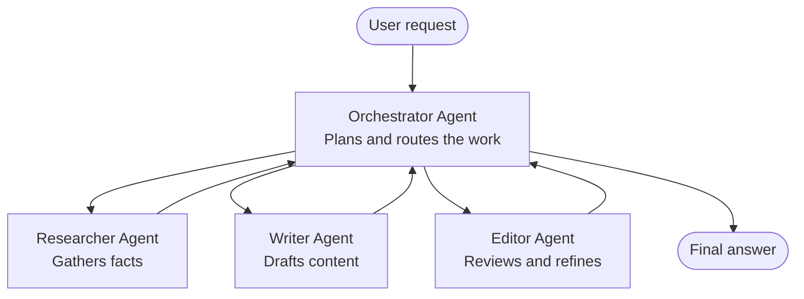

# Többügynökös Alapok - Telepítse Első Koordinált Mesterséges Intelligencia Rendszerét

**Fejezet navigáció:**
- **📚 Kurzus főoldal**: [AZD kezdőknek](../../README.md)
- **📖 Jelenlegi fejezet**: 5. fejezet - Többügynökös MI megoldások
- **⬅️ Előző**: [4. fejezet: Infrastruktúra](../chapter-04-infrastructure/README.md)
- **➡️ Következő**: [Koordinációs minták](../chapter-06-pre-deployment/coordination-patterns.md)

> A parancs útmutatót a kiadott `azd 1.37.2` referencia alapján ellenőrizték. Felhőben való telepítések nem történtek.

## Bevezetés

A korábbi fejezetekben egyetlen alkalmazást telepített, és a 2. fejezetben egyetlen MI ügynököt. Ez a lecke a következő lépést teszi meg: többügynökös rendszer telepítése, ahol több specializált ügynök együtt dolgozik egy olyan probléma megoldásán, amelyet egyetlen ügynök nem tudna jól kezelni.

Jó hír a kezdőknek: **nem szükségesek új parancsok.** Egy többügynökös megoldás még mindig egy azd projekt. `azd init`, `azd up`, tesztelni és `azd down` fog—pontosan ugyanaz a munkafolyamat, amit már ismer. Amit megváltozik, az az alkalmazás *formája* belül.

## Tanulási célok

A lecke végére Ön:
- Meg fogja érteni, mit jelent a "többügynökös" és mikor éri meg az extra összetettség
- Fel fogja ismerni a többügynökös rendszerek általános szerepeit (rendező + szakértők)
- Egy valódi, működő többügynökös sablont telepít `azd up` segítségével
- Megérti azokat az Azure erőforrásokat, amelyek egy többügynökös alkalmazást támogatnak
- Tudni fogja, hogyan ellenőrizze, testreszabja és biztonságosan bontsa le a megoldást

## Tanulási eredmények

A lecke elvégzése után képes lesz:
- Elmagyarázni az egy ügynökös és a többügynökös rendszer közötti különbséget
- Eldönteni az eszközökkel rendelkező egy ügynök és az igazi többügynökös tervezés között
- Végigtelepíteni és tesztelni egy többügynökös sablont azazd-vel
- Meghatározni, hol fut minden ügynök és hogyan kommunikálnak egymással
- Kitakarítani minden erőforrást a folyamatos költségek elkerülése érdekében

---

## Mi az a többügynökös rendszer?

Egyetlen MI ügynök egy modell egy utasításkészlettel és (opcionálisan) néhány eszközzel. Ez jól működik fókuszált feladatoknál. De ahogy a feladat nő — kutatás, majd írás, majd szerkesztés, majd tényellenőrzés — minden egyetlen promtba tömörítése lassítja az ügynököt, kevésbé megbízhatóvá teszi, és nehezebb hibakeresni.

Egy **többügynökös rendszer** a munkát specialista részekre bontja, amelyek mindegyike jól végzi az egy adott feladatot, egy rendező koordinálja őket:



### A két szerep, amit mindig látni fog

| Szerep | Feladat | Példa |
|------|-----|---------|
| **Rendező** | eldönti, *mi történik ezután* és irányítja a munkát az ügynökök között | "Először kutatás, aztán írás, majd szerkesztés" |
| **Specialista** | egy fókuszált feladatot végez és eredményt ad vissza | Egy "kutató", aki csak tényeket gyűjt |

### Valójában szüksége van több ügynökre?

Kezdjen egyszerűen. Többügynökös **csak akkor**, ha az alábbiak egyike igaz:

- ✅ A feladatnak vannak **egyértelmű szakaszai**, amelyek különböző utasításokat igényelnek (kutatás vs. írás vs. átnézés)
- ✅ Szeretné, hogy a szakértők **párhuzamosan fussanak** az időmegtakarítás érdekében
- ✅ Különböző lépések eltérő **eszközöket vagy adatforrásokat igényelnek**
- ✅ Minden lépést **külön tesztelni és hibakeresni lehessen**

Ha a feladat egy egyszerű kérdés-válasz vagy egyszerű eszközhívás, egy **eszközökkel rendelkező egyetlen ügynök** (2. fejezet) egyszerűbb, olcsóbb és könnyebben kezelhető.

> **Kezdő tipp:** „Több ügynök” nem mindig „jobb.” Minden ügynök hozzáad késleltetést, költséget és egy újabb elemet, amit figyelni kell. Csak akkor adjon hozzá több ügynököt, ha a probléma egyértelműen részekre bontható.

---

## Két mód a többügynökös rendszer építésére Azure-on

| Megközelítés | Mi ez | Mire a legjobb |
|----------|-----------|----------|
| **Egyetlen ügynök + eszközök** | Egy Foundry ügynök, amely funkciókat/eszközöket hív meg | Egyszerű munkafolyamatok, kezdéshez |
| **Több koordinált ügynök** | Több ügynök egy rendezővel | Különböző szakaszok, párhuzamos munka, specializáció |

Ez a lecke a második megközelítésre fókuszál egy **kész sablon** használatával, így láthat valódi többügynökös rendszert futni, mielőtt a sajátját építené.

---

## Gyakorlati rész: Működő többügynökös alkalmazás telepítése

Telepítjük a **Contoso Creative Writer**-t, egy hivatalos Azure mintát, amely koordinálja a kutatás, termék, írás és szerkesztés ügynököket egy cikk előállításához. Mielőtt tovább lépne, ellenőrizze a [minta előfeltételeit és költségeit](https://github.com/Azure-Samples/contoso-creative-writer#azure-account-requirements): szükséges modellkvóta, Azure MI Keresés, Bing Grounding hozzáférés, Python, Docker és Bash-kompatibilis hookok. A modell és régió elérhetősége előfizetéstől függ; egy adott régió választása nem garantálja a telepítést.

### 1. lépés: A sablon inicializálása

```bash
# Create a working folder
mkdir creative-writer && cd creative-writer

# Initialize from the official multi-agent template
azd init --template Azure-Samples/contoso-creative-writer .
```

> Több többügynökös sablont bármikor böngészhet a [Awesome AZD MI galériában](https://azure.github.io/awesome-azd/?tags=ai). Más kezdőbarát opciók például `get-started-with-ai-agents` és `azure-ai-travel-agents`.

### 2. lépés: Hitelesítés

```bash
# Required for azd workflows
azd auth login

# Also required by this sample's Azure CLI hooks
az login
```

### 3. lépés: Környezet ellenőrzése

```bash
# init normally creates/selects an environment; confirm it before proceeding
azd env list
# Only if you need an additional environment:
# azd env new dev
```

### 4. lépés: Előnézet, majd telepítés

```bash
# See what will be created before spending anything (recommended)
azd provision --preview

# Provision infrastructure and deploy all agents in one step
azd up
```

`azd up` hiányzó előfizetési és régió beállításokra kérdez rá, majd lekéri az erőforrásokat és telepíti az alkalmazást. Az előnézet nem foglal kvótát és nem garantál sikeres telepítést; a sablon hookok előnézeti provisioning során is lefutnak, ezért először ellenőrizze őket. Az azd várakozási idejét meghosszabbíthatja minden **szolgáltatás telepítésére** (nem a modell provisioningra):

```bash
azd deploy --timeout 1800
```

Az időkorlát megállítja az azd várakozását; nem törli a telepítést az Azure-ban. Ellenőrizze az erőforrás állapotát újrapróbálkozás előtt.

> **Költségek és kapacitás figyelmeztetés:** Többügynökös alkalmazások MI modelleket futtatnak, amelyek kvótát használnak és költséget generálnak. Ha `azd up` modell kvótán sikertelen, tekintse meg az [MI hibaelhárítást](../chapter-07-troubleshooting/ai-troubleshooting.md) régió- és kvóta javításokra, valamint a 6. fejezet [Kapacitástervezés](../chapter-06-pre-deployment/capacity-planning.md) témát.

---

## Amit telepítettél, megértése

Egy tipikus többügynökös alkalmazás a fent látható felelősségi ábrához közvetlenül illeszkedő Azure erőforrások készletét igényli:

| Erőforrás | Miért van jelen |
|----------|----------------|
| **Microsoft Foundry / Modellek** | Nyelvi modellek gazdája, amelyeket az ügynökök használnak |
| **Azure AI Search** | Megadja a kutató ügynöknek a forrásadatokat a kereséshez |
| **Konténeralkalmazások** (vagy App Service) | Rendező és ügynök kód futtatására szolgál |
| **Cosmos DB** (néhány mintában) | Megosztott állapot/memória tárolása az ügynökök között |
| **Application Insights** | Kéréseket követ *ügynökök között*, hogy nyomon tudja követni a folyamatot |

### Hogyan kommunikálnak az ügynökök egymással

A legtöbb azd többügynökös mintában a **rendező az alkalmazáskódban fut** (például a Semantic Kernel vagy a Microsoft Agent Framework használatával). A rendező sorban hívja meg a szakértő ügynököket, átadja az eredményeket és összeállítja a végső választ. Az ügynökök így osztanak meg kontextust:

- **Funkció/eszköz hívások** — a rendező meghív egy szakértőt és visszakapja az eredményt
- **Megosztott memória** — egy adatbázis (gyakran Cosmos DB) tárolja az állapotot, amit mindkét ügynök el tud olvasni
- **Üzenetek/események** — lazább összekapcsoltság érdekében az ügynökök sor vagy Service Bus segítségével kommunikálnak

> **Miért fontos ez hibakeresésnél:** mert minden lépés különálló, az Application Insights megmutatja, *melyik* ügynök volt lassú vagy hibás. Ez az egyik fő oka annak, hogy az első helyen szétosztjuk a munkát ügynökök között.

---

## Ellenőrizze a telepítést

Győződjön meg róla, hogy a rendszer valóban működik, mielőtt tovább lép:

```bash
# Show the deployed endpoints
azd show

# Open the app's monitoring dashboard
azd monitor

# Open Application Insights Logs (not a terminal log stream)
azd monitor --logs
```

Ezután nyissa meg az alkalmazás URL-jét a `azd show`-ből és kérjen egy rövid cikket. Használja a minta hibakeresési nézetét az ügynöki munkafolyamat megtekintéséhez. Az Application Insights tranzakciókeresés csak akkor mutatja a lépéseket egyenként, ha a minta ezt megvalósítja és korrelálja; az azd nem ad hozzá automatikusan ügynöki szakaszokat.

**Siker kritériumok:**
- ✅ `azd show` elérhető végpontot listáz
- ✅ Egy kérés olyan eredményt ad, ami egyértelműen több szakaszon ment keresztül
- ✅ A hibakeresési nézet több ügynöki lépést mutat; ha a nyomkövetés engedélyezett, ellenőrizze a megfelelő telemetriát feldolgozás után

---

## Testreszabás: Ügynök hozzáadása vagy módosítása

Mivel minden ügynök csak utasításokból és eszközökből áll, a testreszabás megközelíthető:

1. **Keresse meg az ügynök definíciókat** a sablonban (gyakran egy `prompts/`, `agents/` vagy `*.prompty` fájlcsomagban).
2. **Finomhangolja egy ügynök utasításait** — például mondja meg a szerkesztő ügynöknek, hogy tartson bizonyos hangnemet vagy szószámot.
3. **Csak a kódot telepítse újra** (az infrastruktúra változatlan):

   ```bash
   azd deploy
   ```

Ha tovább szeretne lépni a *saját* Foundry ügynök projekttel, használja a GA csomagot az AZD 1.37.0+ verzióval egy külön, üres mappában:

```bash
azd ext install microsoft.foundry
azd ai agent init
azd up
azd ai agent invoke      # test, with response timing
```

Tekintse meg a [GA hosztolt ügynök bemutatót](../chapter-02-ai-development/microsoft-foundry-integration.md#hosted-agent-walkthrough-ga) Agent Inspector helyi teszteléshez, távoli kód telepítéshez és takarítás kezeléshez. Az [AZD MI CLI referencia](../chapter-08-production/production-ai-practices.md#azd-ai-cli-commands-and-extensions) szintén lefedi a külön értékelések, optimalizáció és ügynök törlés témáit.

---

## Takarítás

Többügynökös alkalmazások több számlázható szolgáltatást futtatnak. Mindent bontson le, amikor végzett:

```bash
# Review the resources and confirm deletion interactively
azd down
```

A törlés végleges. Egy egyszer használatos labor esetén `azd down --force --purge` kihagyja a törlést és a támogatott soft-delete törlés megerősítéseket; a törlés visszafordíthatatlan, ahol támogatott, és blokkolható a törlésvédelemmel. A soft delete inkább helyreállítási/név újrafelhasználási kérdés, és nem bizonyíték a folyamatos költségekre. Ellenőrizze az megtartott erőforrásokat és a számlázást a takarítás után.

Ha hosztolt ügynököt is inicializált egy meglévő Foundry projekttel, `azd down` érintetlenül hagyja az adott projekt ügynökét és egyéb erőforrásait. Csak az Ön által birtokolt nem kívánt erőforrásokat távolítsa el külön. Egy új Foundry projekt esetén, ami az AZD környezete által jött létre, `azd down` törli az erőforráscsoportot és mindent benne.

---

## Megjegyzés a gyártási többügynökös rendszerekről

A [Retail Multi-Agent Solution](../../examples/retail-scenario.md) ebben a repóban egy **architektúra tervrajz**, nem egy egypontos parancs sablon — dokumentálja, hogyan épül *fel* egy gyártásra kész kiskereskedelmi rendszer (és egyértelművé teszi, hogy a teljes felépítés jelentős erőfeszítés). Használd tervezési referenciaként *azután*, hogy telepítettél egy működő mintapéldányt itt. A gyártási szempontok (rugalmasság, költség, monitorozás, irányítás) érdekében folytasd a [8. fejezet: Gyártási AI gyakorlatok](../chapter-08-production/production-ai-practices.md) olvasását.

---

## Összegzés

- Egy multi-agent rendszer a munkát szakemberek között osztja meg, akiket egy koordinátor hangol össze.
- Csak akkor használd, ha a feladatnak vannak elkülönült szakaszai, párhuzamossága vagy lépésenként eltérő eszközök—máskülönben inkább egyetlen ügynököt válassz.
- Az azd munkafolyamat változatlan: `azd init` → `azd up` → teszt → `azd down`.
- Egy valódi sablon, mint például a `contoso-creative-writer`, ma lehetővé teszi, hogy megtekinthess és testreszabhass egy működő multi-agent alkalmazást.
- Az Application Insights követés az ügynökök között az egyik legnagyobb gyakorlati előnye a multi-agent tervezésnek.

---

## 🔗 Navigáció

| Irány | Lecke |
|-----------|--------|
| **Előző** | [4. fejezet: Infrastruktúra](../chapter-04-infrastructure/README.md) |
| **Következő** | [Koordinációs minták](../chapter-06-pre-deployment/coordination-patterns.md) |

## 📖 Kapcsolódó források

- [AI ügynökök útmutatója](../chapter-02-ai-development/agents.md)
- [Koordinációs minták](../chapter-06-pre-deployment/coordination-patterns.md)
- [Gyártási AI gyakorlatok](../chapter-08-production/production-ai-practices.md)
- [AI hibakeresés](../chapter-07-troubleshooting/ai-troubleshooting.md)

---

<!-- CO-OP TRANSLATOR DISCLAIMER START -->
**Jogi nyilatkozat**:
Ez a dokumentum az AI fordítási szolgáltatás, a [Co-op Translator](https://github.com/Azure/co-op-translator) segítségével készült. Bár az pontosságra törekszünk, kérjük, vegye figyelembe, hogy az automatikus fordítások hibákat vagy pontatlanságokat tartalmazhatnak. Az eredeti dokumentum az anyanyelvén tekintendő hiteles forrásnak. Fontos információk esetén professzionális emberi fordítást javasolunk. Nem vállalunk felelősséget semmilyen félreértésért vagy téves értelmezésért, amely ebből a fordításból ered.
<!-- CO-OP TRANSLATOR DISCLAIMER END -->