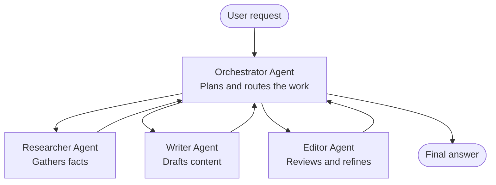

# Többügynökös Alapok - Telepítsd Első Koordinált MI Rendszeredet

**Fejezet Navigáció:**
- **📚 Tanfolyam Főoldal**: [AZD Kezdőknek](../../README.md)
- **📖 Aktuális Fejezet**: 5. Fejezet - Többügynökös MI Megoldások
- **⬅️ Előző**: [4. Fejezet: Infrastruktúra](../chapter-04-infrastructure/README.md)
- **➡️ Következő**: [Koordinációs Minták](../chapter-06-pre-deployment/coordination-patterns.md)

> Parancs iránymutatás a kiadott `azd 1.37.2` referenciával összevetve. Felhőbeli telepítések nem történtek.

## Bevezetés

A korábbi fejezetekben egyetlen alkalmazást telepítettél – a 2. fejezetben pedig egyetlen MI ügynököt. Ez a lecke következő lépése: egy **többügynökös rendszer** telepítése, ahol több különleges ügynök együtt dolgozik egy olyan probléma megoldásán, amelyet egyetlen ügynök sem tudna egyedül jól kezelni.

Jó hír a kezdőknek: **nincs szükség új parancsokra.** A többügynökös megoldás továbbra is egy azd projekt. `azd init`, `azd up`, tesztelni és `azd down` fogsz – pontosan a megszokott munkafolyamatod szerint. Ami változik, az az alkalmazás *belső* alakja.

## Tanulási célok

A lecke végére képes leszel:
- Megérteni, hogy mit jelent a "többügynökös" és mikor éri meg a plusz összetettség
- Felismerni a többügynökös rendszer tipikus szerepeit (irányító + specialisták)
- Egy működő többügynökös sablon telepítése `azd up` használatával
- Megérteni azokat az Azure erőforrásokat, amelyek egy többügynökös alkalmazást támogatnak
- Ismerni, hogyan ellenőrizheted, testreszabhatod és bontod le biztonságosan a megoldást

## Tanulási eredmények

A lecke elvégzése után képes leszel:
- Elmagyarázni a különbséget egyetlen ügynök és egy többügynökös rendszer között
- Választani egy eszközökkel felszerelt egyetlen ügynök és egy valódi többügynökös dizájn között
- End-to-end telepíteni és tesztelni egy többügynökös sablont az azd-vel
- Azonosítani, hogy melyik ügynök hol fut és hogyan kommunikálnak
- Kitakarítani minden erőforrást, hogy elkerüld a folyamatos költségeket

---

## Mi az a Többügynökös Rendszer?

Egyetlen MI ügynök egy modell, utasításokkal és (opcionálisan) néhány eszközzel. Ez jól működik fókuszált feladatoknál. De ahogy a feladat nő – kutatás, majd írás, utána szerkesztés, végül tényellenőrzés –, a minden egy promptba zsúfolása lassabbá, kevésbé megbízhatóvá és nehezebben hibakereshetővé teszi az ügynököt.

Egy **többügynökös rendszer** a munkát olyan specialista részekre bontja, akik mind egy konkrét feladatot jól végeznek, egy irányító koordinálásával:



### A két szerep, amit mindig látsz

| Szerep | Feladat | Példa |
|------|---------|---------|
| **Irányító** | Meghatározza, *mi történjen ezután*, és irányítja a munkát az ügynökök között | "Először kutatás, aztán írás, végül szerkesztés" |
| **Specialista** | Egy fókuszált feladatot végez és visszaad egy eredményt | Egy "kutató", aki csak tényeket gyűjt |

### Valójában szükséged van több ügynökre?

Kezdd egyszerűen. Többügynököket **csak akkor** használj, ha igaz az alábbiak közül legalább egy:

- ✅ A feladatnak **elkülönülő szakaszai** vannak, amelyek külön utasításokat igényelnek (kutatás vs. írás vs. áttekintés)
- ✅ Szeretnéd, ha a specialisták **párhuzamosan** futnának az idő megtakarításáért
- ✅ Különböző lépésekhez **különböző eszközök vagy adatforrások** kellenek
- ✅ Minden lépést **külön-külön tesztelni és hibakeresni lehessen**

Ha a feladat egyetlen kérdés-válasz vagy egyszerű eszköz-hívás, egy **eszközökkel rendelkező egyetlen ügynök** (2. fejezet) egyszerűbb, olcsóbb és könnyebben használható.

> **Kezdő tipp:** "Több ügynök" nem feltétlenül "jobb." Minden ügynök késleltetést, költséget és egy újabb felügyelendő elemet jelent. Csak akkor adj ügynököket, ha a probléma világosan részekre osztható.

---

## Két mód többügynökös rendszer építésére Azure-on

| Megközelítés | Mi az | Leginkább erre való |
|------------|--------|------------------|
| **Egyetlen ügynök + eszközök** | Egy Foundry ügynök, amely függvényeket/eszközöket hív | Egyszerű munkafolyamatok, kezdőknek |
| **Több koordinált ügynök** | Több ügynök, egy irányítóval | Elkülönült szakaszok, párhuzamos munka, specializáció |

Ez a lecke a második megközelítésre koncentrál egy **kész sablon** segítségével, hogy láthasd a valódi többügynökös rendszert működés közben, mielőtt a sajátodat építenéd.

---

## Gyakorlati rész: Egy működő többügynökös alkalmazás telepítése

Telepítjük a **Contoso Kreatív Író** nevű hivatalos Azure mintát, amely koordinálja a kutatási, termék, írás és szerkesztő ügynököket egy cikk elkészítéséhez. Mielőtt továbbmennél, nézd meg a [minta előfeltételeit és költségeit](https://github.com/Azure-Samples/contoso-creative-writer#azure-account-requirements): szükséges modellkvóta, Azure AI Search, Bing Grounding hozzáférés, Python, Docker és Bash-kompatibilis hookok. A modell és régió elérhetősége előfizetéstől függ; egy adott régió kiválasztása nem garantálja a telepítést.

### 1. lépés: Sablon inicializálása

```bash
# Create a working folder
mkdir creative-writer && cd creative-writer

# Initialize from the official multi-agent template
azd init --template Azure-Samples/contoso-creative-writer .
```

> További többügynökös sablonokat bármikor megnézhetsz az [Awesome AZD AI galériában](https://azure.github.io/awesome-azd/?tags=ai). Más kezdőbarát lehetőségek például `get-started-with-ai-agents` és `azure-ai-travel-agents`.

### 2. lépés: Hitelesítés

```bash
# Required for azd workflows
azd auth login

# Also required by this sample's Azure CLI hooks
az login
```

### 3. lépés: Környezet ellenőrzése

```bash
# init normally creates/selects an environment; confirm it before proceeding
azd env list
# Only if you need an additional environment:
# azd env new dev
```

### 4. lépés: Előnézet, majd telepítés

```bash
# See what will be created before spending anything (recommended)
azd provision --preview

# Provision infrastructure and deploy all agents in one step
azd up
```

Az `azd up` kéri majd a hiányzó előfizetési és régióbeállításokat, majd erőforrásokat hoz létre és telepíti az alkalmazást. Az előnézet nem foglal le kvótát és nem garantálja a sikert; a sablonhorgonyok még futtathatók egy előnézeti üzembe helyezés során, ezért először vizsgálja meg őket. Ahhoz, hogy meghosszabbítsa, mennyi ideig vár az azd minden **szolgáltatás telepítésére** (nem modell üzembe helyezésére):

```bash
azd deploy --timeout 1800
```

Az időkorlát leállítja az azd várakozását; nem törli a telepítést az Azure-ban. Ellenőrizze az erőforrás állapotát a próbálkozás előtt.

> **Figyelem a költségre és kapacitásra:** Az egynél több ügynököt futtató alkalmazások AI modelleket telepítenek, amelyek kvótát használnak és költséget okoznak. Ha az `azd up` modell kvótára hibázik, tekintse meg az [AI hibaelhárítást](../chapter-07-troubleshooting/ai-troubleshooting.md) a régió- és kvóta javításokhoz, valamint a 6. fejezetet [Kapacitástervezés](../chapter-06-pre-deployment/capacity-planning.md).

---

## Megértése annak, amit telepítettél

Egy tipikus többügynökös alkalmazás így egy sor Azure erőforrást hoz létre, amelyek közvetlenül megfelelnek a fenti diagram felelősségeinek:

| Erőforrás | Miért van ott |
|----------|----------------|
| **Microsoft Foundry / Modellek** | A nyelvi modelleket tárolja, amelyeket minden ügynök használ |
| **Azure AI Keresés** | A kutató ügynök számára biztosít alapozott adatokat a kereséshez |
| **Container Apps** (vagy App Service) | Tárhelyet ad az irányítónak és az ügynök kódjának |
| **Cosmos DB** (néhány mintában) | Tárolja a megosztott állapotot/ emlékezetet, amelyet az ügynökök között osztanak meg |
| **Application Insights** | Leköveti a kérdéseket *az ügynökök között*, hogy hibakeresést végezhessen |

### Hogyan kommunikálnak az ügynökök egymással

A legtöbb azd többügynökös példában az **irányító az alkalmazáskódodban fut** (például Semantic Kernel vagy a Microsoft Agent Framework keretrendszert használva). Az irányító sorra hívja a szakértő ügynököket, továbbítja az eredményeket, és összeállítja a végső választ. Az ügynökök kontextust osztanak meg:

- **Funkció/eszköz hívásokkal** — az irányító hív egy szakértőt és kap vissza eredményt
- **Megosztott memóriával** — egy adatbázis (gyakran Cosmos DB) tartalmazza az állapotot, amelyet mindkét ügynök olvashat
- **Üzenetek/ események** — lazább kapcsolódás esetén az ügynökök egy sor vagy Service Bus segítségével kommunikálnak

> **Miért fontos ez a hibakeresésnél:** mert minden lépés különálló, az Application Insights megmutatja, hogy *melyik* ügynök volt lassú vagy hibázott. Ez egy fő oka annak, hogy először szétosszák a munkát az ügynökök között.

---

## Ellenőrizze a telepítést

Győződjön meg róla, hogy a rendszer valóban működik, mielőtt továbblép:

```bash
# Show the deployed endpoints
azd show

# Open the app's monitoring dashboard
azd monitor

# Open Application Insights Logs (not a terminal log stream)
azd monitor --logs
```

Ezután nyissa meg az alkalmazás URL-jét az `azd show`-ból és kérjen egy rövid cikket. Használja a minta hibakeresési nézetét az ügynök munkafolyamatának megtekintéséhez. Az Application Insights tranzakciókeresője csak akkor mutatja az egyéni lépéseket, ha a minta mérőszámoz és összekapcsolja azokat; azd nem ad hozzá automatikusan ügynök szakaszokat.

**Siker kritériumok:**
- ✅ Az `azd show` elérhető végpontot listáz
- ✅ Egy kérés eredményt ad, amely egyértelműen több szakaszon ment keresztül
- ✅ A hibakeresési nézet több ügynök lépést mutat; ha a nyomkövetés engedélyezve van, ellenőrizze a hozzá tartozó telemetriát befogadás után

---

## Testreszabás: ügynök hozzáadása vagy módosítása

Mivel az ügynök csak utasítások és eszközök kombinációja, a testreszabás könnyen megközelíthető:

1. **Keresse meg az ügynök definíciókat** a sablonban (gyakran egy `prompts/`, `agents/` vagy `*.prompty` fájlsorozat).
2. **Hangolja az ügynök utasításait** — például mondja meg a szerkesztő ügynöknek, hogy tartson be egy bizonyos hangnemet vagy szószámot.
3. **Csak a kódot telepítse újra** (az infrastruktúra változatlan):

   ```bash
   azd deploy
   ```

Ahhoz, hogy tovább haladjon a *saját* Foundry ügynök projektjével, használja az ügynök kiterjesztés interaktív inicializációját:

```bash
azd extension install azure.ai.agents
azd ai agent init
azd up
azd ai agent invoke      # test, with response timing
```

Lásd a [2. fejezet: Ügynökök](../chapter-02-ai-development/agents.md) és az [AZD AI CLI referencia](../chapter-08-production/production-ai-practices.md#azd-ai-cli-commands-and-extensions) teljes életciklusát: ügynök `invoke`, a különálló értékelési kiterjesztés `azd ai eval` munkafolyamatát, ügynök `optimize`, és ügynök `delete`.

---

## Takarítás

Többügynökös alkalmazások több számlázható szolgáltatást futtatnak. Minden legyen eltávolítva, ha végeztél:

```bash
# Review the resources and confirm deletion interactively
azd down
```

A törlés végleges. Egy eldobható laborhoz az `azd down --force --purge` kihagyja a törlést és a támogatott szoft törlés megerősítéseket; a törlés visszavonhatatlan, ahol támogatott, és megakadályozható törlésvédelemmel. A szoft törlés helyreállítási/név újrafelhasználási kérdés, önmagában nem bizonyítéka a folyamatos díjaknak. Ellenőrizze a megtartott erőforrásokat és a számlázást a takarítás után.

---

## Megjegyzés a termelési többügynökös rendszerekről

A [Retail Multi-Agent Solution](../../examples/retail-scenario.md) ebben a tárban egy **architekturális tervrajz**, nem egy parancsra működő sablon—dokumentálja, hogyan *kellene* egy éles kereskedelmi rendszert felépíteni (és egyértelművé teszi, hogy a teljes felépítés jelentős erőfeszítést igényel). Használd tervezési hivatkozásként *azután*, hogy itt telepítettél egy működő mintát. Az éles üzem szempontjaihoz (megbízhatóság, költség, monitorozás, irányítás) folytasd a [8. fejezet: Production AI Practices](../chapter-08-production/production-ai-practices.md) olvasását.

---

## Összefoglaló

- Egy többügynökös rendszer a munkát specialisták között osztja meg, akiket egy összehangoló irányít.
- Csak olyan feladathoz használd, amelynek megkülönböztethető szakaszai, párhuzamossága vagy lépésenként különböző eszközei vannak—egyébként előnyösebb egyetlen ügynököt választani.
- Az azd munkafolyamat változatlan marad: `azd init` → `azd up` → teszt → `azd down`.
- Egy valós sablon, mint a `contoso-creative-writer`, ma lehetővé teszi, hogy láss és testre szabj egy működő többügynökös alkalmazást.
- Az Application Insights követés az ügynökök között a többügynökös tervezés egyik legnagyobb gyakorlati előnye.

---

## 🔗 Navigáció

| Irány | Lecke |
|-----------|--------|
| **Előző** | [4. fejezet: Infrastruktúra](../chapter-04-infrastructure/README.md) |
| **Következő** | [Koordinációs minták](../chapter-06-pre-deployment/coordination-patterns.md) |

## 📖 Kapcsolódó források

- [AI ügynökök útmutatója](../chapter-02-ai-development/agents.md)
- [Koordinációs minták](../chapter-06-pre-deployment/coordination-patterns.md)
- [Termelési AI gyakorlatok](../chapter-08-production/production-ai-practices.md)
- [AI hibakeresés](../chapter-07-troubleshooting/ai-troubleshooting.md)

---

<!-- CO-OP TRANSLATOR DISCLAIMER START -->
**Jogi nyilatkozat**:
Ez a dokumentum az AI fordítási szolgáltatás, a [Co-op Translator](https://github.com/Azure/co-op-translator) segítségével készült. Bár az pontosságra törekszünk, kérjük, vegye figyelembe, hogy az automatikus fordítások hibákat vagy pontatlanságokat tartalmazhatnak. Az eredeti dokumentum az anyanyelvén tekintendő hiteles forrásnak. Fontos információk esetén professzionális emberi fordítást javasolunk. Nem vállalunk felelősséget semmilyen félreértésért vagy téves értelmezésért, amely ebből a fordításból ered.
<!-- CO-OP TRANSLATOR DISCLAIMER END -->