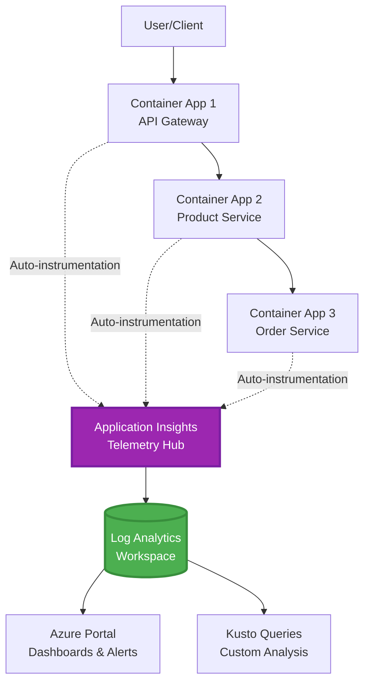
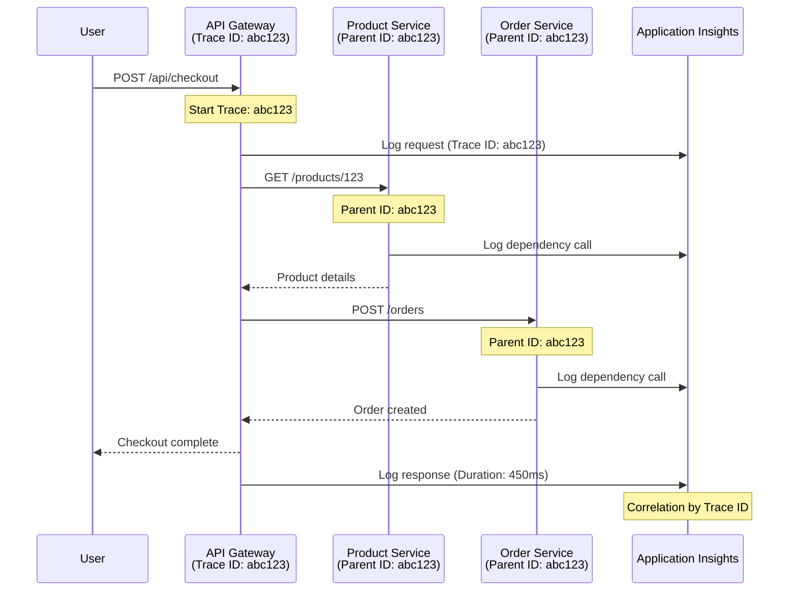

# Application Insights integráció az AZD-vel

⏱️ **Várható idő**: 40-50 perc | 💰 **Költséghatás**: kb. 5-15 $/hó | ⭐ **Bonyolultság**: Középhaladó

**📚 Tanulási útvonal:**
- ← Előző: [Előzetes ellenőrzések](preflight-checks.md) - Telepítés előtti érvényesítés
- 🎯 **Jelenleg itt tartasz**: Application Insights integráció (monitorozás, telemetria, hibakeresés)
- → Következő: [Telepítési útmutató](../chapter-04-infrastructure/deployment-guide.md) - Telepítés Azure-ba
- 🏠 [Tanfolyam kezdőlap](../../README.md)

---

## Amit megtanulsz

Ennek a leckének az elvégzése után képes leszel:
- Az **Application Insights** deklarálása az AZD infrastruktúrában és az SDK instrumentáció konfigurálása
- A **elosztott követés** beállítása mikroszolgáltatásokhoz
- **Egyedi telemetria** megvalósítása (mérőszámok, események, függőségek)
- **Élő mérőszámok** beállítása valós idejű monitorozáshoz
- **Riasztások és műszerfalak** létrehozása AZD telepítésekből
- Gyártási hibák hibakeresése **telemetria lekérdezésekkel**
- Költség- és mintavételi stratégiák optimalizálása
- **AI/LLM alkalmazások** monitorozása (tokenek, késleltetés, költségek)

## Miért fontos az Application Insights az AZD-vel

### A kihívás: Gyártási megfigyelhetőség

**Application Insights nélkül:**
```
❌ No visibility into production behavior
❌ Manual log aggregation across services
❌ Reactive debugging (wait for customer complaints)
❌ No performance metrics
❌ Cannot trace requests across services
❌ Unknown failure rates and bottlenecks
```

**Application Insights + AZD-vel:**
```
✅ Automatic telemetry collection
✅ Centralized logs from all services
✅ Proactive issue detection
✅ End-to-end request tracing
✅ Performance metrics and insights
✅ Real-time dashboards
✅ AZD provisions the monitoring declared in your templates
```

**Analógia**: Az Application Insights olyan, mint egy "fekete doboz" repülési rögzítő + pilótafülke műszerfal az alkalmazásod számára. Valós időben mindent látsz, ami történik, és bármilyen eseményt visszajátszhatsz.

---

## Architektúra áttekintés

### Application Insights az AZD architektúrában



### Amit automatikusan monitoroz

A támogatott automatikus instrumentáció rögzíti a kéréseket/függőségeket az instrumentált könyvtárak esetén. Egyedi események és mérőszámok alkalmazáskódot igényelnek; az elérhetőségi teszteket külön kell konfigurálni. Nem gyűjti össze minden tételt alább csak azért, mert az erőforrás létezik.

| Telemetria típusa | Mit rögzít | Használati eset |
|----------------|------------------|----------|
| **Kérések** | HTTP kérések, státuszkódok, időtartam | API teljesítmény monitorozása |
| **Függőségek** | Külső hívások (adatbázis, API-k, tárhely) | Szűk keresztmetszetek azonosítása |
| **Kivételek** | Kezeletlen hibák veremnyomokkal | Hibakeresés |
| **Egyedi események** | Üzleti események (regisztráció, vásárlás) | Analitika és tölcsérek |
| **Mérőszámok** | Teljesítményszámlálók, egyedi mérőszámok | Kapacitástervezés |
| **Nyomok** | Naplóüzenetek súlyossággal | Hibakeresés és auditálás |
| **Elérhetőség** | Üzemidő és válaszidő tesztek | SLA monitorozás |

---

## Előfeltételek

### Szükséges eszközök

```bash
# Verify Azure Developer CLI
azd version
# Command reference baseline: azd 1.37.2

# Verify Azure CLI
az --version
# ✅ Expected: azure-cli 2.50.0 or higher
```

### Azure követelmények

- Aktív Azure előfizetés
- Jogosultságok az alábbiak létrehozásához:
  - Application Insights erőforrások
  - Log Analytics munkaterületek
  - Konténer alkalmazások
  - Erőforráscsoportok

### Tudás előfeltételek

Előzőleg el kell végezned:
- [AZD Alapok](../chapter-01-foundation/azd-basics.md) - AZD alapfogalmak
- [Konfiguráció](../chapter-03-configuration/configuration.md) - Környezet beállítása
- [Első projekt](../chapter-01-foundation/first-project.md) - Alapvető telepítés

---

## 1. lecke: Automatikus Application Insights az AZD-vel

### Hogyan biztosítja az AZD az Application Insights szolgáltatást

Az AZD csak akkor biztosítja az Application Insights-ot, **ha a projekt infrastruktúrája azt deklarálja**. `azure.yaml` önmagában nem hoz létre megfigyelést vagy nem instrumentálja az alkalmazáskódot.

> **Példa hatókör:** Ez a lecke integrációs töredékeket tartalmaz, nem egy teljes `monitored-app` projektet ebben a tárolóban. Biztosítson egy fő sablont és paramétertérképet, egy Container Apps környezetet, registry/kép és identitás konfigurációt, Dockerfile-t és szolgáltatáscímkéket a telepítés előtt. Későbbi leckék alternatív/kiterjesztő töredékeket mutatnak be, nem fájlokat, melyek változtatás nélkül összemásolhatók. Ha futtatható kiindulópontot szeretne, kezdje egy működő [mikroszolgáltatás-példával](../../../../examples/microservices).

### Projekt Struktúra

```
monitored-app/
├── azure.yaml                     # AZD configuration
├── infra/
│   ├── main.bicep                # Main infrastructure
│   ├── core/
│   │   └── monitoring.bicep      # Application Insights + Log Analytics
│   └── app/
│       └── api.bicep             # Container App with monitoring
└── src/
    ├── app.py                    # Application with telemetry
    ├── requirements.txt
    └── Dockerfile
```

---

### 1. lépés: AZD konfigurálása (azure.yaml)

**Fájl: `azure.yaml`**

```yaml
name: monitored-app
metadata:
  template: monitored-app@1.0.0

services:
  api:
    project: ./src
    language: python
    host: containerapp

# Monitoring must be declared in infra/ and enabled in application code.
```

Ez deklarálja a telepíthető szolgáltatást. A következő Bicep és SDK konfigurációk biztosítják a megfigyelést; az azd nem adja hozzá őket implicit módon.

---

### 2. lépés: Megfigyelő infrastruktúra (Bicep)

**Fájl: `infra/core/monitoring.bicep`**

```bicep
param logAnalyticsName string
param applicationInsightsName string
param location string = resourceGroup().location
param tags object = {}

// Log Analytics Workspace (required for Application Insights)
resource logAnalytics 'Microsoft.OperationalInsights/workspaces@2022-10-01' = {
  name: logAnalyticsName
  location: location
  tags: tags
  properties: {
    sku: {
      name: 'PerGB2018'  // Pay-as-you-go pricing
    }
    retentionInDays: 30  // Keep logs for 30 days
    features: {
      enableLogAccessUsingOnlyResourcePermissions: true
    }
  }
}

// Application Insights
resource applicationInsights 'Microsoft.Insights/components@2020-02-02' = {
  name: applicationInsightsName
  location: location
  tags: tags
  kind: 'web'
  properties: {
    Application_Type: 'web'
    WorkspaceResourceId: logAnalytics.id
    IngestionMode: 'LogAnalytics'
    publicNetworkAccessForIngestion: 'Enabled'
    publicNetworkAccessForQuery: 'Enabled'
  }
}

// Outputs for Container Apps
output logAnalyticsWorkspaceId string = logAnalytics.id
output logAnalyticsWorkspaceName string = logAnalytics.name
output applicationInsightsConnectionString string = applicationInsights.properties.ConnectionString
output applicationInsightsInstrumentationKey string = applicationInsights.properties.InstrumentationKey
output applicationInsightsName string = applicationInsights.name
output applicationInsightsId string = applicationInsights.id
```

---

### 3. lépés: Csatlakoztassa a Container App-ot az Application Insights-hoz

**Fájl: `infra/app/api.bicep`**

```bicep
param name string
param location string
param tags object = {}
param containerAppsEnvironmentId string
param containerImage string
param applicationInsightsConnectionString string

resource containerApp 'Microsoft.App/containerApps@2023-05-01' = {
  name: name
  location: location
  tags: tags
  properties: {
    managedEnvironmentId: containerAppsEnvironmentId
    configuration: {
      ingress: {
        external: true
        targetPort: 8000
      }
      secrets: [
        {
          name: 'appinsights-connection-string'
          value: applicationInsightsConnectionString
        }
      ]
    }
    template: {
      containers: [
        {
          name: 'api'
          image: containerImage // Supply an accessible image and registry authentication
          resources: {
            cpu: json('0.5')
            memory: '1Gi'
          }
          env: [
            {
              name: 'APPLICATIONINSIGHTS_CONNECTION_STRING'
              secretRef: 'appinsights-connection-string'
            }
            {
              name: 'APPLICATIONINSIGHTS_ENABLED'
              value: 'true'
            }
          ]
        }
      ]
    }
  }
}

output uri string = 'https://${containerApp.properties.configuration.ingress.fqdn}'
```

---

### 4. lépés: Alkalmazáskód telemetriával

**Fájl: `src/app.py`**

```python
from flask import Flask, request, jsonify
from azure.monitor.opentelemetry import configure_azure_monitor
import logging
import os

app = Flask(__name__)

# Get Application Insights connection string
connection_string = os.environ.get('APPLICATIONINSIGHTS_CONNECTION_STRING')

if connection_string:
    # Azure Monitor OpenTelemetry instruments supported libraries, including Flask.
    configure_azure_monitor(
        connection_string=connection_string,
        logger_name=__name__,
        enable_live_metrics=True
    )
    logger = logging.getLogger(__name__)
    logger.setLevel(logging.INFO)
    
    print("✅ Application Insights enabled")
else:
    logger = logging.getLogger(__name__)
    logger.setLevel(logging.INFO)
    print("⚠️ Application Insights not configured")

@app.route('/health')
def health():
    logger.info('Health check endpoint called')
    return jsonify({'status': 'healthy', 'monitoring': 'enabled' if connection_string else 'disabled'})

@app.route('/api/products')
def get_products():
    logger.info('Fetching products')
    
    # In-memory fixture: this is not a database dependency call.
    products = [
        {'id': 1, 'name': 'Laptop', 'price': 999.99},
        {'id': 2, 'name': 'Mouse', 'price': 29.99},
        {'id': 3, 'name': 'Keyboard', 'price': 79.99}
    ]
    
    logger.info(f'Returned {len(products)} products')
    return jsonify(products)

@app.route('/api/error-test')
def error_test():
    """Test error tracking"""
    logger.error('Testing error tracking')
    try:
        raise ValueError('This is a test exception')
    except Exception as e:
        logger.exception('Exception occurred in error-test endpoint')
        return jsonify({'error': str(e)}), 500

@app.route('/api/slow')
def slow_endpoint():
    """Test performance tracking"""
    import time
    logger.info('Slow endpoint called')
    time.sleep(3)  # Simulate slow operation
    logger.warning('Endpoint took 3 seconds to respond')
    return jsonify({'message': 'Slow operation completed'})

if __name__ == '__main__':
    app.run(host='0.0.0.0', port=8000)
```

**Fájl: `src/requirements.txt`**

```txt
Flask
azure-monitor-opentelemetry
gunicorn
requests
openai
```

Ezeket a függőségeket oldja meg a projektjében, tesztelje őket együtt, és zárja le a kapott verziókat. Az új projekteknek az Azure Monitor OpenTelemetry-t kell használniuk, nem a megszüntetett OpenCensus Python exportőröket.

---

### 5. lépés: Telepítés és ellenőrzés

```bash
# Deploy only after completing and wiring the infrastructure fragments above
azd up

# Get app URL
APP_URL=$(azd env get-value API_URL) # Requires this output in main.bicep

# Generate telemetry
curl $APP_URL/health
curl $APP_URL/api/products
curl $APP_URL/api/error-test
curl $APP_URL/api/slow
```

**✅ Várt kimenet:**
```json
{
  "status": "healthy",
  "monitoring": "enabled"
}
```

---

### 6. lépés: Telemetria megtekintése az Azure Portalon

```bash
# Get Application Insights details
azd env get-values | grep APPLICATIONINSIGHTS

# Open in Azure Portal
az monitor app-insights component show \
  --app $(azd env get-values | grep APPLICATIONINSIGHTS_NAME | cut -d '=' -f2 | tr -d '"') \
  --resource-group $(azd env get-values | grep AZURE_RESOURCE_GROUP | cut -d '=' -f2 | tr -d '"') \
  --query "appId" -o tsv
```

**Navigáljon az Azure Portalon → Application Insights → Transaction Search**

Ezeket kell látnia:
- ✅ HTTP kérések állapotkódokkal
- ✅ Kérés időtartama (3+ másodperc `/api/slow` esetén)
- ✅ Kivétel részletek `/api/error-test`-ból
- ✅ Egyéni naplóüzenetek

---

## 2. lecke: Egyéni telemetria és események

### Üzleti események követése

Adjunk hozzá egyéni telemetriát az üzletileg kritikus eseményekhez.

**Fájl: `src/telemetry.py`**

```python
from contextlib import contextmanager
from azure.monitor.opentelemetry import configure_azure_monitor
from opentelemetry import metrics, trace
from opentelemetry.trace import SpanKind
import logging
import os

class TelemetryClient:
    """Custom telemetry client for Application Insights"""
    
    def __init__(self, connection_string=None):
        self.connection_string = connection_string or os.environ.get('APPLICATIONINSIGHTS_CONNECTION_STRING')
        
        # Configure once per process. If app.py already calls this, keep only
        # one configure_azure_monitor call and use logger_name='telemetry'.
        if self.connection_string:
            configure_azure_monitor(
                connection_string=self.connection_string,
                logger_name=__name__,
                enable_live_metrics=True
            )
        self.logger = logging.getLogger(__name__)
        self.logger.setLevel(logging.INFO)
        self.tracer = trace.get_tracer(__name__)
        self.meter = metrics.get_meter(__name__)
        self.instruments = {}
    
    def track_event(self, event_name: str, properties: dict = None):
        """Track custom business event"""
        properties = properties or {}
        self.logger.info(
            f"CustomEvent: {event_name}",
            extra={
                # OTel log attributes become customDimensions in App Insights.
                    'event_name': event_name,
                    **properties
            }
        )
    
    def track_metric(self, metric_name: str, value: float, properties: dict = None):
        """Track custom metric"""
        properties = properties or {}
        if metric_name not in self.instruments:
            self.instruments[metric_name] = self.meter.create_histogram(metric_name)
        self.instruments[metric_name].record(value, attributes=properties)
    
    @contextmanager
    def track_dependency(self, name: str):
        """Time the real operation inside a client span; exceptions mark failure."""
        with self.tracer.start_as_current_span(name, kind=SpanKind.CLIENT) as span:
            yield span

# Global telemetry client
telemetry = TelemetryClient()
```

### Alkalmazás frissítése egyéni eseményekkel

**Fájl: `src/app.py` (bővített)**

Adja hozzá ezeket az útvonalakat a meglévő Flask alkalmazáshoz; tartsa meg a korábbi egészség/teszt útvonalakat is. Az alábbi rövidített blokk egy külön alkalmazást mutat a jobb átláthatóságért. A telemetria inicializálása most az `telemetry.py`-ben történik — ne inicializálja kétszer az exportőröket.

```python
from flask import Flask, request, jsonify
from telemetry import telemetry
import time
import random
import os

app = Flask(__name__)

@app.route('/api/purchase', methods=['POST'])
def purchase():
    """Track purchase event with custom telemetry"""
    data = request.get_json(silent=True) or {}
    product_id = data.get('product_id')
    quantity = data.get('quantity', 1)
    price = data.get('price', 0)
    if not isinstance(quantity, int) or quantity < 1 or \
       not isinstance(price, (int, float)) or price < 0:
        return jsonify({'error': 'quantity and price must be non-negative numbers; quantity >= 1'}), 400
    
    # Track business event
    telemetry.track_event('Purchase', {
        'product_id': product_id,
        'quantity': quantity,
        'total_amount': price * quantity,
        'user_id': request.headers.get('X-User-Id', 'anonymous')
    })
    
    # Track revenue metric
    telemetry.track_metric('Revenue', price * quantity, {
        'product_id': product_id,
        'currency': 'USD'
    })
    
    return jsonify({
        'order_id': f'ORD-{random.randint(1000, 9999)}',
        'status': 'confirmed',
        'total': price * quantity
    })

@app.route('/api/search')
def search():
    """Track search queries"""
    query = request.args.get('q', '')
    
    start_time = time.time()
    
    # Simulate search (would be real database query)
    results = [{'id': 1, 'name': f'Result for {query}'}]
    
    duration = (time.time() - start_time) * 1000  # Convert to ms
    
    # Track search event
    telemetry.track_event('Search', {
        'query': query,
        'results_count': len(results),
        'duration_ms': duration
    })
    
    # Track search performance metric
    telemetry.track_metric('SearchDuration', duration, {
        'query_length': len(query)
    })
    
    return jsonify({'results': results, 'count': len(results)})

@app.route('/api/external-call')
def external_call():
    """Track external API dependency"""
    import requests
    
    try:
        # Set an actual test endpoint; api.example.com is not a working API.
        with telemetry.track_dependency('ExternalAPI'):
            response = requests.get(os.environ['EXTERNAL_API_URL'], timeout=5)
            response.raise_for_status()
            result = response.json()
    except Exception as e:
        return jsonify({'error': 'External dependency failed'}), 502
    
    return jsonify(result)

if __name__ == '__main__':
    app.run(host='0.0.0.0', port=8000)
```

### Tesztelje az egyéni telemetriát

```bash
# Track purchase event
curl -X POST $APP_URL/api/purchase \
  -H "Content-Type: application/json" \
  -H "X-User-Id: user123" \
  -d '{"product_id": 1, "quantity": 2, "price": 29.99}'

# Track search event
curl "$APP_URL/api/search?q=laptop"

# Track external dependency
curl $APP_URL/api/external-call
```

**Nézze meg az Azure Portalon:**

Navigáljon az Application Insights → Logs menüponthoz, majd futtassa:

```kusto
// View purchase events
traces
| where customDimensions.event_name == "Purchase"
| project 
    timestamp,
    product_id = tostring(customDimensions.product_id),
    total_amount = todouble(customDimensions.total_amount),
    user_id = tostring(customDimensions.user_id)
| order by timestamp desc

// Revenue recorded in Purchase events (not a billing ledger)
traces
| where customDimensions.event_name == "Purchase"
| summarize TotalRevenue = sum(todouble(customDimensions.total_amount)) by bin(timestamp, 1h)
| render timechart

// View search performance
traces
| where customDimensions.event_name == "Search"
| summarize 
    AvgDuration = avg(todouble(customDimensions.duration_ms)),
    SearchCount = count()
  by bin(timestamp, 5m)
| render timechart
```

---

## 3. lecke: Elosztott nyomkövetés mikroszolgáltatásokhoz

### Kapcsolt szolgáltatásközi nyomkövetés engedélyezése

Kompatibilis instrumentációval és W3C trace-context propagációval az Application Insights összekapcsolja a kéréseket a szolgáltatások között. A csak kapcsolat string megosztása nem hoz létre szülő-gyermek nyomokat. Az alábbi architektúra töredék olyan modulokra hivatkozik, amelyeket implementálnia kell.

**Fájl: `infra/main.bicep`**

```bicep
targetScope = 'subscription'

param environmentName string
param location string = 'eastus'

var tags = { 'azd-env-name': environmentName }

resource rg 'Microsoft.Resources/resourceGroups@2021-04-01' = {
  name: 'rg-${environmentName}'
  location: location
  tags: tags
}

// Monitoring (shared by all services)
module monitoring './core/monitoring.bicep' = {
  name: 'monitoring'
  scope: rg
  params: {
    logAnalyticsName: 'log-${environmentName}'
    applicationInsightsName: 'appi-${environmentName}'
    location: location
    tags: tags
  }
}

// API Gateway
module apiGateway './app/api-gateway.bicep' = {
  name: 'api-gateway'
  scope: rg
  params: {
    name: 'ca-gateway-${environmentName}'
    location: location
    tags: union(tags, { 'azd-service-name': 'gateway' })
    applicationInsightsConnectionString: monitoring.outputs.applicationInsightsConnectionString
  }
}

// Product Service
module productService './app/product-service.bicep' = {
  name: 'product-service'
  scope: rg
  params: {
    name: 'ca-products-${environmentName}'
    location: location
    tags: union(tags, { 'azd-service-name': 'products' })
    applicationInsightsConnectionString: monitoring.outputs.applicationInsightsConnectionString
  }
}

// Order Service
module orderService './app/order-service.bicep' = {
  name: 'order-service'
  scope: rg
  params: {
    name: 'ca-orders-${environmentName}'
    location: location
    tags: union(tags, { 'azd-service-name': 'orders' })
    applicationInsightsConnectionString: monitoring.outputs.applicationInsightsConnectionString
  }
}

output APPLICATIONINSIGHTS_CONNECTION_STRING string = monitoring.outputs.applicationInsightsConnectionString
output GATEWAY_URL string = apiGateway.outputs.uri
```

### Teljes tranzakció megtekintése



**Teljes trace lekérdezése:**

```kusto
// Find complete request flow
let traceId = "abc123...";  // Copy operation_Id from a request in Application Insights
dependencies
| union requests
| where operation_Id == traceId
| project 
    timestamp,
    type = itemType,
    name,
    duration,
    success,
    cloud_RoleName
| order by timestamp asc
```

---

## 4. lecke: Élő metrikák és valós idejű megfigyelés

### Élő metrikák stream engedélyezése

Az Élő Metrikák közel valós idejű telemetriát biztosít, amikor az SDK támogatja és engedélyezi. Ez nem késleltetési SLA. A fentebb ismertetett Python OpenTelemetry setup az `enable_live_metrics=True` opcióval kapcsol be.

**Élő metrikák elérése:**

```bash
# Get Application Insights resource
APPI_NAME=$(azd env get-values | grep APPLICATIONINSIGHTS_NAME | cut -d '=' -f2 | tr -d '"')

# Get resource group
RG_NAME=$(azd env get-values | grep AZURE_RESOURCE_GROUP | cut -d '=' -f2 | tr -d '"')

echo "Navigate to: Azure Portal → Resource Groups → $RG_NAME → $APPI_NAME → Live Metrics"
```

**A valós időben látott adatok:**
- ✅ Beérkező kérelmek sebessége (kérések/mp)
- ✅ Kimenő függőségi hívások
- ✅ Kivételszám
- ✅ CPU és memória használat
- ✅ Aktív szerver szám
- ✅ Minta telemetria

### Tesztelési terhelés létrehozása

```bash
# Generate load to see live metrics
for i in {1..100}; do
  curl --silent --max-time 10 "$APP_URL/api/products"
  curl --silent --max-time 10 "$APP_URL/api/search?q=test$i"
done

# Watch live metrics in Azure Portal
# You should see request rate spike
```

---

## Gyakorlati feladatok

### 1. feladat: Riasztások beállítása ⭐⭐ (Közepes)

**Cél:** Riasztások létrehozása magas hibaarányra és lassú válaszokra.

**Lépések:**

1. **Hozzon létre riasztást hibaarányra:**

```bash
# Get Application Insights resource ID
APPI_ID=$(az monitor app-insights component show \
  --app $APPI_NAME \
  --resource-group $RG_NAME \
  --query "id" -o tsv)

# Create metric alert for failed requests
az monitor metrics alert create \
  --name "High-Error-Rate" \
  --resource-group $RG_NAME \
  --scopes $APPI_ID \
  --condition "count requests/failed > 10" \
  --window-size 5m \
  --evaluation-frequency 1m \
  --description "Alert when failed request count exceeds 10 per 5 minutes"
```

2. **Hozzon létre riasztást lassú válaszokra:**

```bash
az monitor metrics alert create \
  --name "Slow-Responses" \
  --resource-group $RG_NAME \
  --scopes $APPI_ID \
  --condition "avg requests/duration > 3000" \
  --window-size 5m \
  --evaluation-frequency 1m \
  --description "Alert when average response time exceeds 3 seconds"
```

3. **Hozzon létre riasztást Bicep-pel (preferált AZD-hez):**

**Fájl: `infra/core/alerts.bicep`**

```bicep
param applicationInsightsId string
param actionGroupId string = ''
param location string = resourceGroup().location

// High error rate alert
resource errorRateAlert 'Microsoft.Insights/metricAlerts@2018-03-01' = {
  name: 'high-error-rate'
  location: 'global'
  properties: {
    description: 'Alert when error rate exceeds threshold'
    severity: 2
    enabled: true
    scopes: [
      applicationInsightsId
    ]
    evaluationFrequency: 'PT1M'
    windowSize: 'PT5M'
    criteria: {
      'odata.type': 'Microsoft.Azure.Monitor.SingleResourceMultipleMetricCriteria'
      allOf: [
        {
          name: 'Error rate'
          metricName: 'requests/failed'
          operator: 'GreaterThan'
          threshold: 10
          timeAggregation: 'Count'
        }
      ]
    }
    actions: actionGroupId != '' ? [
      {
        actionGroupId: actionGroupId
      }
    ] : []
  }
}

// Slow response alert
resource slowResponseAlert 'Microsoft.Insights/metricAlerts@2018-03-01' = {
  name: 'slow-responses'
  location: 'global'
  properties: {
    description: 'Alert when response time is too high'
    severity: 3
    enabled: true
    scopes: [
      applicationInsightsId
    ]
    evaluationFrequency: 'PT1M'
    windowSize: 'PT5M'
    criteria: {
      'odata.type': 'Microsoft.Azure.Monitor.SingleResourceMultipleMetricCriteria'
      allOf: [
        {
          name: 'Response duration'
          metricName: 'requests/duration'
          operator: 'GreaterThan'
          threshold: 3000
          timeAggregation: 'Average'
        }
      ]
    }
  }
}

output errorAlertId string = errorRateAlert.id
output slowResponseAlertId string = slowResponseAlert.id
```

4. **Tesztelje a riasztásokat:**

```bash
# Generate errors
for i in {1..20}; do
  curl $APP_URL/api/error-test
done

# Generate slow responses
for i in {1..10}; do
  curl $APP_URL/api/slow
done

# Check rule configuration (not fired/resolved alert-instance history)
az monitor metrics alert list \
  --resource-group $RG_NAME \
  --query "[].{Name:name, Enabled:enabled}" \
  --output table
```

**✅ Sikerkritériumok:**
- ✅ A riasztások sikeresen létrejöttek
- ✅ A riasztások akkor jelentenek, ha a küszöbértékek teljesülnek
- ✅ A riasztások előzménye megtekinthető az Azure Portalon
- ✅ Integrálva az AZD telepítéssel

**Idő:** 20-25 perc

---

### 2. feladat: Egyéni műszerfal létrehozása ⭐⭐ (Közepes)

**Cél:** Készítsen műszerfalat a kulcsfontosságú alkalmazás-metrikák megjelenítéséhez.

**Lépések:**

1. **Hozzon létre műszerfalat Azure Portalon:**

Navigáljon ide: Azure Portal → Dashboards → New Dashboard

2. **Adjon hozzá lapokat a kulcsmérőszámoknak:**

- Kérések száma (utolsó 24 óra)
- Átlagos válaszidő
- Hibaarány
- Az 5 leglassabb művelet
- Felhasználók földrajzi megoszlása

3. **Hozzon létre műszerfalat Bicep segítségével:**

**Fájl: `infra/core/dashboard.bicep`**

```bicep
param dashboardName string
param applicationInsightsId string
param location string = resourceGroup().location

resource dashboard 'Microsoft.Portal/dashboards@2020-09-01-preview' = {
  name: dashboardName
  location: location
  properties: {
    lenses: [
      {
        order: 0
        parts: [
          // Request count
          {
            position: {
              x: 0
              y: 0
              rowSpan: 4
              colSpan: 6
            }
            metadata: {
              type: 'Extension/Microsoft_OperationsManagementSuite_Workspace/PartType/LogsDashboardPart'
              inputs: [
                {
                  name: 'resourceId'
                  value: applicationInsightsId
                }
                {
                  name: 'query'
                  value: '''
                    requests
                    | summarize RequestCount = count() by bin(timestamp, 1h)
                    | render timechart
                  '''
                }
              ]
            }
          }
          // Error rate
          {
            position: {
              x: 6
              y: 0
              rowSpan: 4
              colSpan: 6
            }
            metadata: {
              type: 'Extension/Microsoft_OperationsManagementSuite_Workspace/PartType/LogsDashboardPart'
              inputs: [
                {
                  name: 'resourceId'
                  value: applicationInsightsId
                }
                {
                  name: 'query'
                  value: '''
                    requests
                    | summarize 
                        Total = count(),
                        Failed = countif(success == false)
                    | extend ErrorRate = (Failed * 100.0) / Total
                    | project ErrorRate
                  '''
                }
              ]
            }
          }
        ]
      }
    ]
  }
}

output dashboardId string = dashboard.id
```

4. **Telepítse a műszerfalat:**

```bicep
// Add to a subscription-scoped main.bicep with rg and monitoring declared
module dashboard './core/dashboard.bicep' = {
  name: 'dashboard'
  scope: rg
  params: {
    dashboardName: 'dashboard-${environmentName}'
    applicationInsightsId: monitoring.outputs.applicationInsightsId
    location: location
  }
}
```

```bash
# Deploy
azd up
```

**✅ Sikerkritériumok:**
- ✅ A műszerfal mutatja a kulcsmérőszámokat
- ✅ Rögzíthető az Azure Portal kezdőlapjára
- ✅ Valós időben frissül
- ✅ Az AZD által telepíthető

**Idő:** 25-30 perc

---

### 3. feladat: AI/LLM alkalmazás megfigyelése ⭐⭐⭐ (Haladó)

**Cél:** Kövesse a Microsoft Foundry Modellek használatát (tokenek, költségek, késleltetés).

**Lépések:**

1. **Hozzon létre AI megfigyelő csomagot:**

**Fájl: `src/ai_telemetry.py`**

```python
from telemetry import telemetry
from openai import AzureOpenAI
import time

class MonitoredAzureOpenAI:
    """Microsoft Foundry Models client with automatic telemetry"""
    
    def __init__(self, api_key, endpoint, input_usd_per_million,
                 output_usd_per_million, api_version="2024-10-21"):
        self.client = AzureOpenAI(
            api_key=api_key,
            api_version=api_version,
            azure_endpoint=endpoint
        )
        self.input_rate = input_usd_per_million
        self.output_rate = output_usd_per_million
    
    def chat_completion(self, model: str, messages: list, **kwargs):
        """Track chat completion with telemetry"""
        start_time = time.time()
        
        try:
            # Call Microsoft Foundry Models
            response = self.client.chat.completions.create(
                model=model,
                messages=messages,
                **kwargs
            )
            
            duration = (time.time() - start_time) * 1000  # ms
            
            # Extract usage
            usage = response.usage
            prompt_tokens = usage.prompt_tokens
            completion_tokens = usage.completion_tokens
            total_tokens = usage.total_tokens
            
            # Approximation: supply actual deployment/region/contract rates.
            # Cached input, batch, provisioned and other charges need separate accounting.
            prompt_cost = (prompt_tokens / 1_000_000) * self.input_rate
            completion_cost = (completion_tokens / 1_000_000) * self.output_rate
            total_cost = prompt_cost + completion_cost
            
            # Track custom event
            telemetry.track_event('OpenAI_Request', {
                'model': model,
                'prompt_tokens': prompt_tokens,
                'completion_tokens': completion_tokens,
                'total_tokens': total_tokens,
                'duration_ms': duration,
                'cost_usd': total_cost,
                'success': True
            })
            
            # Track metrics
            telemetry.track_metric('OpenAI_Tokens', total_tokens, {
                'model': model,
                'type': 'total'
            })
            
            telemetry.track_metric('OpenAI_Cost', total_cost, {
                'model': model,
                'currency': 'USD'
            })
            
            telemetry.track_metric('OpenAI_Duration', duration, {
                'model': model
            })
            
            return response
            
        except Exception as e:
            duration = (time.time() - start_time) * 1000
            
            telemetry.track_event('OpenAI_Request', {
                'model': model,
                'duration_ms': duration,
                'success': False,
                'error': str(e)
            })
            
            raise
```

2. **Használja a megfigyelt klienst:**

```python
from flask import Flask, request, jsonify
from ai_telemetry import MonitoredAzureOpenAI
import os

app = Flask(__name__)

# Initialize monitored OpenAI client
openai_client = MonitoredAzureOpenAI(
    api_key=os.environ['AZURE_OPENAI_API_KEY'],
    endpoint=os.environ['AZURE_OPENAI_ENDPOINT'],
    input_usd_per_million=float(os.environ['INPUT_USD_PER_MILLION']),
    output_usd_per_million=float(os.environ['OUTPUT_USD_PER_MILLION'])
)

@app.route('/api/chat', methods=['POST'])
def chat():
    data = request.json
    user_message = data.get('message')
    
    # Call with automatic monitoring
    response = openai_client.chat_completion(
        model=os.environ['AZURE_OPENAI_DEPLOYMENT'], # Deployment name, not catalog ID
        messages=[
            {'role': 'user', 'content': user_message}
        ]
    )
    
    return jsonify({
        'response': response.choices[0].message.content,
        'tokens': response.usage.total_tokens
    })
```

3. **Lekérdezze az AI metrikákat:**

```kusto
// Total AI spend over time
traces
| where customDimensions.event_name == "OpenAI_Request"
| where tobool(customDimensions.success) == true
| summarize TotalCost = sum(todouble(customDimensions.cost_usd)) by bin(timestamp, 1h)
| render timechart

// Token usage by model
traces
| where customDimensions.event_name == "OpenAI_Request"
| summarize 
    TotalTokens = sum(toint(customDimensions.total_tokens)),
    RequestCount = count()
  by Model = tostring(customDimensions.model)

// Average latency
traces
| where customDimensions.event_name == "OpenAI_Request"
| summarize AvgDuration = avg(todouble(customDimensions.duration_ms))
| project AvgDurationSeconds = AvgDuration / 1000

// Cost per request
traces
| where customDimensions.event_name == "OpenAI_Request"
| extend Cost = todouble(customDimensions.cost_usd)
| summarize 
    TotalCost = sum(Cost),
    RequestCount = count(),
    AvgCostPerRequest = avg(Cost)
```

**✅ Sikerkritériumok:**
- ✅ Minden OpenAI hívás automatikusan követve van
- ✅ Token használat és költségek láthatóak
- ✅ Késleltetés megfigyelve
- ✅ Beállíthatók költségkeret riasztások

**Idő:** 35-45 perc

---

## Költségoptimalizálás

### Mintavételezési stratégiák

A költségek szabályozása telemetria mintavételezéssel:

```python
import os

# Configure before the one configure_azure_monitor() call in your process.
os.environ["OTEL_TRACES_SAMPLER"] = "microsoft.fixed_percentage"
os.environ["OTEL_TRACES_SAMPLER_ARG"] = "0.1" # 10% trace sampling
```

A trace mintavételezés nem csökkenti az összes telemetria kategóriát 90%-kal. A metrikáknak és az önállóan kibocsátott naplóknak külön hangerő szabályozásuk van. A mintavételi arányt a megfigyelési igények alapján válassza, ne általános termelési tiltásként.

Az SDK mintavételezést kifejezetten állítsa be; az alkotó `SamplingPercentage` tulajdonsága nem helyettesíti a Python OpenTelemetry mintavételező konfigurációját.

### Adatmegőrzés

```bicep
resource logAnalytics 'Microsoft.OperationalInsights/workspaces@2022-10-01' = {
  name: logAnalyticsName
  properties: {
    retentionInDays: 30  // Minimum (cheapest)
    // Options: 30, 31, 60, 90, 120, 180, 270, 365, 550, 730
  }
}
```

### Havi költségbecslések

| Adatméret | Megőrzési idő | Havi költség |
|-------------|-----------|--------------|
| 1 GB/hó | 30 nap | kb. $2-5 |
| 5 GB/hó | 30 nap | kb. $10-15 |
| 10 GB/hó | 90 nap | kb. $25-40 |
| 50 GB/hó | 90 nap | kb. $100-150 |

Ezek az értékek illusztratívak, nem árajánlatok. Ellenőrizze a régiójára és szerződésére vonatkozó bevitel, megőrzés, riasztás és teszt árakat; az ingyenes keretek az Azure Monitor árazás szerint megosztottak/hatóköriek, nem garantált ingyenes SKU minden Application Insights erőforrásra.

---

## Tudásellenőrző pont

### 1. Alap integráció ✓

Tesztelje tudását:

- [ ] **K1**: Hogyan biztosítja az AZD az Application Insights-ot?
  - **V**: A projekt Bicep/Terraform sablonjában explicit módon deklarált megfigyelő erőforrásokat telepíti.

- [ ] **K2**: Melyik környezeti változó engedélyezi az Application Insights-ot?
  - **V**: `APPLICATIONINSIGHTS_CONNECTION_STRING`

- [ ] **K3**: Mik a három fő telemetria típus?
  - **V**: Kérések (HTTP hívások), Függőségek (külső hívások), Kivételek (hibák)

**Gyakorlati ellenőrzés:**
```bash
# Check if Application Insights is configured
azd env get-values | grep APPLICATIONINSIGHTS

# Verify telemetry is flowing
az monitor app-insights metrics show \
  --app $APPI_NAME \
  --resource-group $RG_NAME \
  --metric "requests/count"
```

---

### 2. Egyéni telemetria ✓

Tesztelje tudását:

- [ ] **K1**: Hogyan kövesse az egyéni üzleti eseményeket?
  - **V**: Ez a lecke csomagolása strukturált OTel naplókat ír `event_name` attribútumokkal, lekérdezhető `traces`-ban; ezek nem automatikusan `customEvents`.

- [ ] **K2**: Mi a különbség az események és a metrikák között?
  - **V**: Az események diszkrét események, a metrikák számszerű mérések

- [ ] **K3**: Hogyan kapcsolja össze a telemetriát a szolgáltatások között?
  - **V**: Az Application Insights automatikusan használja a `operation_Id`-t az összekapcsoláshoz

**Gyakorlati ellenőrzés:**
```kusto
// Verify custom events
traces
| where customDimensions.event_name != ""
| summarize count() by tostring(customDimensions.event_name)
```

---

### 3. Termelési megfigyelés ✓

Tesztelje tudását:

- [ ] **K1**: Mi a mintavételezés és miért használják?
  - **V**: A mintavételezés csökkenti az adatmennyiséget (és költséget) azáltal, hogy csak egy százalékát rögzíti a telemetriának

- [ ] **K2**: Hogyan állít be riasztásokat?
  - **V**: Használjon metrikariasztásokat Bicep-ben vagy az Azure Portalon az Application Insights metrikák alapján

- [ ] **K3**: Mi a különbség a Log Analytics és az Application Insights között?
  - **V**: Az Application Insights az adatokat Log Analytics munkaterületen tárolja; az App Insights alkalmazás-specifikus nézeteket biztosít

**Gyakorlati ellenőrzés:**
```bash
# Check the sampler configured for the running application, not only the ARM component.
az containerapp show --name "$APP_NAME" --resource-group "$RG_NAME" \
  --query "properties.template.containers[].env[?starts_with(name, 'OTEL_TRACES_SAMPLER')]"
```

---

## Legjobb gyakorlatok

### ✅ TEKINTSE EZT:

1. **Használjon korrelációs azonosítókat**
   ```python
   logger.info('Processing order', extra={
           'order_id': order_id,
           'user_id': user_id
   })
   ```

2. **Állítson be riasztásokat kritikus metrikákra**
   ```bicep
   // Error rate, slow responses, availability
   ```

3. **Használjon strukturált naplózást**
   ```python
   # ✅ GOOD: Structured
   logger.info('User signup', extra={'user_id': 'pseudonymous-id'})
   
   # ❌ BAD: Unstructured
   logger.info(f'User 123 signed up')
   ```

4. **Figyelje a függőségeket**
   ```python
   # Automatically track database calls, HTTP requests, etc.
   ```

5. **Használja az Élő Metrikákat a telepítések során**

### ❌ NE TEGYE:

1. **Ne naplózz érzékeny adatokat**
   ```python
   # ❌ BAD
   logger.info(f'Login: {username}:{password}')
   
   # ✅ GOOD
   logger.info('Login attempt', extra={'result': 'failed'})
   ```

2. **Ne válassz mintavételezést az adatmennyiség és diagnosztikai igények mérése nélkül**
   ```python
   # ❌ Expensive
   # 100% traces may be appropriate for a small workload or investigation.
   
   # ✅ Cost-effective
   # A lower trace rate reduces visibility; validate coverage before enabling.
   ```

3. **Ne hagyd figyelmen kívül a "dead letter" sorokat**

4. **Ne felejtsd el beállítani az adatok megtartási korlátait**

---

## Hibakeresés

### Probléma: Nincs megjelenő telemetria

**Diagnózis:**
```bash
# Check connection string is set
azd env get-values | grep APPLICATIONINSIGHTS

# Check application logs via Azure Monitor
azd monitor --logs

# Or use Azure CLI for Container Apps:
az containerapp logs show --name $APP_NAME --resource-group $RG_NAME --tail 50
```

**Megoldás:**
```bash
# Verify connection string in Container App
az containerapp show \
  --name $APP_NAME \
  --resource-group $RG_NAME \
  --query "properties.template.containers[0].env" \
  | grep -i applicationinsights
```

---

### Probléma: Magas költségek

**Diagnózis:**
```bash
# Query ingestion volume in the linked Log Analytics workspace.
# WORKSPACE_ID is the workspace customer ID (GUID), not its ARM resource ID.
az monitor log-analytics query --workspace "$WORKSPACE_ID" \
  --analytics-query "Usage | where TimeGenerated > ago(30d) | where IsBillable == true | summarize IngestedMB=sum(Quantity) by DataType"
```

**Megoldás:**
- Csökkentsd a mintavételezési arányt
- Rövidítsd le a megtartási időszakot
- Szűntesd meg a részletes naplózást

---

## További információk

### Hivatalos dokumentáció
- [Application Insights áttekintés](https://learn.microsoft.com/azure/azure-monitor/app/app-insights-overview)
- [Azure Monitor OpenTelemetry beállítás](https://learn.microsoft.com/azure/azure-monitor/app/opentelemetry-enable?tabs=python)
- [Kusto Query Language](https://learn.microsoft.com/azure/data-explorer/kusto/query/)
- [AZD Monitoring](https://learn.microsoft.com/azure/developer/azure-developer-cli/monitor-your-app)

### További lépések a kurzusban
- ← Előző: [Előzetes ellenőrzések](preflight-checks.md)
- → Következő: [Telepítési útmutató](../chapter-04-infrastructure/deployment-guide.md)
- 🏠 [Kurzus kezdőlap](../../README.md)

### Kapcsolódó példák
- [Microsoft Foundry Modellek példa](../../../../examples/azure-openai-chat) - AI telemetria
- [Mikroszolgáltatások példa](../../../../examples/microservices) - Elosztott nyomkövetés

---

## Összefoglalás

**Amit tanultál:**
- ✅ Automatikus Application Insights beállítás AZD-vel
- ✅ Egyedi telemetria (események, metrikák, függőségek)
- ✅ Elosztott nyomkövetés mikroszolgáltatások között
- ✅ Élő metrikák és valós idejű felügyelet
- ✅ Riasztások és műszerfalak
- ✅ AI/LLM alkalmazásmegfigyelés
- ✅ Költségoptimalizálási stratégiák

**Főbb tanulságok:**
1. **Határozd meg explicit módon a megfigyelést** - AZD telepíti a sablonokat; az SDK telemetriát küld
2. **Használj strukturált naplózást** - Könnyíti a lekérdezést
3. **Kövesd az üzleti eseményeket** - Nem csak technikai metrikákat
4. **Figyeld az AI költségeit** - Kövesd a tokeneket és kiadásokat
5. **Állíts be riasztásokat** - Légy proaktív, ne reaktív
6. **Optimalizáld a költségeket** - Használj mintavételezést és megtartási korlátokat

**Következő lépések:**
1. Teljesítsd a gyakorlati feladatokat
2. Add hozzá az Application Insights-t az AZD projektjeidhez
3. Készíts egyedi műszerfalakat a csapatod számára
4. Tanulmányozd a [Telepítési útmutatót](../chapter-04-infrastructure/deployment-guide.md)

---

<!-- CO-OP TRANSLATOR DISCLAIMER START -->
**Jogi nyilatkozat**:
Ez a dokumentum az AI fordítási szolgáltatás, a [Co-op Translator](https://github.com/Azure/co-op-translator) segítségével készült. Bár az pontosságra törekszünk, kérjük, vegye figyelembe, hogy az automatikus fordítások hibákat vagy pontatlanságokat tartalmazhatnak. Az eredeti dokumentum az anyanyelvén tekintendő hiteles forrásnak. Fontos információk esetén professzionális emberi fordítást javasolunk. Nem vállalunk felelősséget semmilyen félreértésért vagy téves értelmezésért, amely ebből a fordításból ered.
<!-- CO-OP TRANSLATOR DISCLAIMER END -->