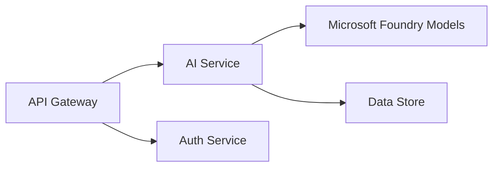
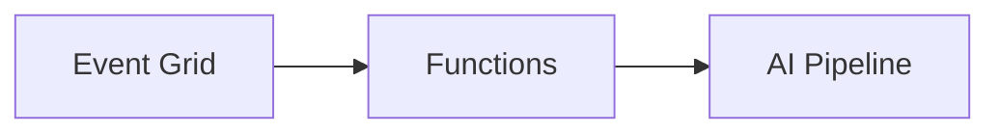

# 8. fejezet: Termelési és vállalati minták

**📚 Tanfolyam**: [AZD kezdőknek](../../README.md) | **⏱️ Időtartam**: 2-3 óra | **⭐ Összetettség**: Haladó

---

## Áttekintés

Ebben a fejezetben vállalati szintű telepítési mintákat, biztonsági megerősítést, megfigyelést és költségoptimalizálást tárgyalunk éles AI munkafolyamatokhoz.

Ez egy architekturális referencia, nem egy teljesen telepíthető termelési sablon. A példák kihagyják az integrációs részleteket, amelyeket a saját alkalmazásodban kell biztosítani és tesztelni; a listát elolvasni nem jelent termelési készséget.

> **Kiadás átvizsgálás (2026-11-04):** Az AI CLI útmutatót összevetettük az `azd 1.37.2`, az agentek `1.0.0-beta.23` és az értékelések `1.0.0-beta.2` dokumentáció/forrásaival. Lásd a [kiadási változások és hibajavítások](production-ai-practices.md#recent-release-changes-and-fixes) kompatibilitási követelményeit és migrációs részleteit; ez nem élő telepítési érvényesítés.

## Tanulási célok

A fejezet elvégzése után képes leszel:
- Több régióra kiterjedő ellenálló alkalmazásokat telepíteni
- Vállalati biztonsági mintákat megvalósítani
- Átfogó megfigyelést konfigurálni
- Költségeket méretezve optimalizálni
- AZD-vel CI/CD csővezetékeket beállítani

---

## 📚 Tananyagok

| # | Lecke | Leírás | Időtartam |
|---|--------|-------------|------|
| 1 | [Termelési AI gyakorlatok](production-ai-practices.md) | Vállalati telepítési minták | 90 perc |

---

## 🚀 Termelési ellenőrzőlista

- [ ] Több régiós telepítés az ellenálló képességért
- [ ] Kezelt identitás hitelesítéshez (kulcsok nélkül)
- [ ] Application Insights a megfigyeléshez
- [ ] Költségvetések és riasztások beállítva
- [ ] Biztonsági szkennelés engedélyezve
- [ ] CI/CD csővezeték integráció
- [ ] Katasztrófa-helyreállítási terv

---

## 🏗️ Architektúra minták

### Minta 1: Mikroservice AI



### Minta 2: Eseményvezérelt AI



---

## 🔐 Biztonsági legjobb gyakorlatok

```bicep
// Illustrative properties from different resources, NOT a standalone Bicep file.
// Attach identity to the application host:
identity: {
  type: 'SystemAssigned'
}

// AI account properties (also require private endpoints, DNS and app connectivity):
properties: {
  publicNetworkAccess: 'Disabled'
  networkAcls: {
    defaultAction: 'Deny'
  }
}
```

---

## 💰 Költségoptimalizálás

| Stratégia | Fő korlát |
|----------|---------|
| Skálázás nullára (Container Apps) | Megfelelő kiváltó ok szükséges; más szolgáltatások továbbra is költséget okoznak |
| Fogyasztási szintek használata fejlesztéshez | Összehasonlítja a kiválasztott szolgáltatás árazását és a munkaterhelést |
| Ütemezett skálázás | A támogatott infrastruktúrán/automatizáláson keresztül történő skálázás |
| Foglalások/fenntartott kapacitás | Csak ha támogatott; kötelezettségek növelhetik a tétlen költségeket |

Használd a [teljes költségvetési erőforrás-mintát](production-ai-practices.md#2-cost-monitoring-and-budgets) érvényes kezdő dátummal, számlázási hatókörrel, címzettekkel és jogosultságokkal. A költségvetés riasztásokat küld; nem korlátozza a kiadásokat. A megtakarítások a mért használattól függenek és nem garantált százalékok.

---

## 📊 Megfigyelés beállítása

```bash
# Open the Application Insights logs view (requires configured monitoring)
azd monitor --logs

# Check Application Insights
azd monitor --overview

# View metrics
az monitor metrics list --resource <resource-id>
```

---

## 🔗 Navigáció

| Irány | Fejezet |
|-----------|---------|
| **Előző** | [7. fejezet: Hibakeresés](../chapter-07-troubleshooting/README.md) |
| **Tanfolyam befejezve** | [Tanfolyam kezdőlap](../../README.md) |

---

## 📖 Kapcsolódó források

- [AI Agentek útmutatója](../chapter-02-ai-development/agents.md)
- [Application Insights](../chapter-06-pre-deployment/application-insights.md)
- [Több-agent megoldások](../chapter-05-multi-agent/README.md)
- [Mikroszolgáltatások példa](../../examples/microservices/README.md)

---

<!-- CO-OP TRANSLATOR DISCLAIMER START -->
**Jogi nyilatkozat**:
Ez a dokumentum az AI fordítási szolgáltatás, a [Co-op Translator](https://github.com/Azure/co-op-translator) segítségével készült. Bár az pontosságra törekszünk, kérjük, vegye figyelembe, hogy az automatikus fordítások hibákat vagy pontatlanságokat tartalmazhatnak. Az eredeti dokumentum az anyanyelvén tekintendő hiteles forrásnak. Fontos információk esetén professzionális emberi fordítást javasolunk. Nem vállalunk felelősséget semmilyen félreértésért vagy téves értelmezésért, amely ebből a fordításból ered.
<!-- CO-OP TRANSLATOR DISCLAIMER END -->