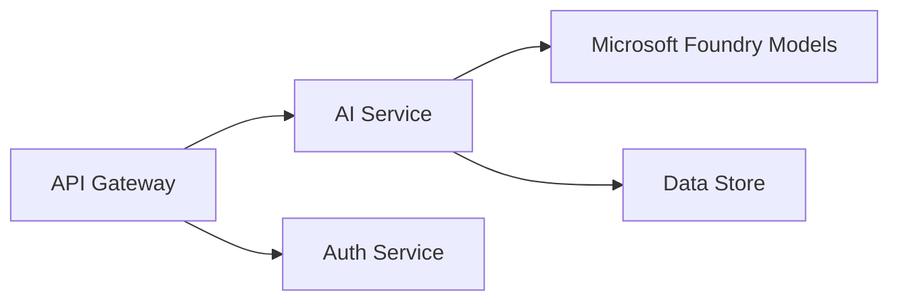
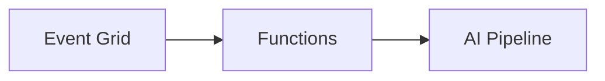

# 8. fejezet: Termelési & Vállalati minták

**📚 Tanfolyam**: [AZD kezdőknek](../../README.md) | **⏱️ Időtartam**: 2-3 óra | **⭐ Bonyolultság**: Haladó

---

## Áttekintés

Ez a fejezet vállalati szintű üzembe helyezési mintákat, biztonsági megerősítést, monitorozást és költségoptimalizálást tárgyal a termelési AI munkaterhelésekhez.

Ez egy architekturális referencia, nem egy teljesen telepíthető termelési sablon. A példák mellőzik az integrációs részleteket, amelyeket a saját alkalmazásában kell szolgáltatni és tesztelni; a lista elolvasása nem igazolja a termelési készenlétet.

> **Foundry GA frissítés (2026-11-09):** Használja az `azd >= 1.37.0` -t és a széles körben elérhető `microsoft.foundry` 1.0 csomagot a Foundry munkafolyamathoz; az értékelések külön kerülnek telepítésre. Lásd a [kiadás terjedelme és migráció](production-ai-practices.md#recent-release-changes-and-fixes) és az [azonosított pipeline példa](production-ai-practices.md#cicd-pipeline-configuration). Ez dokumentációs áttekintés, nem élő telepítési érvényesítés vagy átfogó GA státusz az opcionális előzetes funkciókról.

## Tanulási célok

E fejezet elvégzése után képes lesz:
- Több régióban reziliens alkalmazásokat telepíteni
- Vállalati biztonsági mintákat megvalósítani
- Átfogó monitorozást konfigurálni
- Költségeket nagy méretekben optimalizálni
- CI/CD pipeline-okat beállítani AZD-vel

---

## 📚 Tanórák

| # | Tanóra | Leírás | Idő |
|---|--------|-------------|------|
| 1 | [Termelési AI gyakorlatok](production-ai-practices.md) | Vállalati üzembe helyezési minták | 90 perc |

---

## 🚀 Termelési ellenőrző lista

- [ ] Több régióban történő üzembe helyezés a reziliencia érdekében
- [ ] Kezelt identitás hitelesítéshez (nincs kulcs)
- [ ] Application Insights monitorozáshoz
- [ ] Költségkeretek és riasztások beállítása
- [ ] Biztonsági szkennelés engedélyezve
- [ ] CI/CD pipeline integráció
- [ ] Katasztrófa-helyreállítási terv

---

## 🏗️ Architektúra minták

### Minta 1: Microservices AI



### Minta 2: Eseményvezérelt AI



---

## 🔐 Biztonsági legjobb gyakorlatok

```bicep
// Illustrative properties from different resources, NOT a standalone Bicep file.
// Attach identity to the application host:
identity: {
  type: 'SystemAssigned'
}

// AI account properties (also require private endpoints, DNS and app connectivity):
properties: {
  publicNetworkAccess: 'Disabled'
  networkAcls: {
    defaultAction: 'Deny'
  }
}
```

---

## 💰 Költségoptimalizálás

| Stratégia | Fő korlátozás |
|----------|---------|
| Nullára skálázás (Container Apps) | Megfelelő kiváltó esemény szükséges; más szolgáltatások továbbra is költséget okoznak |
| Fogyasztási szintek használata fejlesztéshez | Választott szolgáltatás árazásának és munkaterhelés összevetése |
| Ütemezett skálázás | Támogatott infrastruktúrával/automatizálással skáláz |
| Foglalások/kijelölt kapacitás | Csak ha támogatott; kötelezettségek növelhetik az inaktív költségeket |

Használja a [teljes költségvetési erőforrás mintát](production-ai-practices.md#2-cost-monitoring-and-budgets) érvényes kezdő dátummal, számlázási hatállyal, címzettekkel és jogosultságokkal. Egy költségvetés riasztásokat küld; nem korlátozza a kiadásokat. A megtakarítások a mért kihasználtságtól függenek, és nem garantált százalékok.

---

## 📊 Monitorozási beállítás

```bash
# Open the Application Insights logs view (requires configured monitoring)
azd monitor --logs

# Check Application Insights
azd monitor --overview

# View metrics
az monitor metrics list --resource <resource-id>
```

---

## 🔗 Navigáció

| Irány | Fejezet |
|-----------|---------|
| **Előző** | [7. fejezet: Hibaelhárítás](../chapter-07-troubleshooting/README.md) |
| **Tanfolyam befejezve** | [Tanfolyam kezdőlap](../../README.md) |

---

## 📖 Kapcsolódó források

- [AI ügynökök útmutató](../chapter-02-ai-development/agents.md)
- [Application Insights](../chapter-06-pre-deployment/application-insights.md)
- [Több ügynök megoldások](../chapter-05-multi-agent/README.md)
- [Microservices példa](../../examples/microservices/README.md)

---

<!-- CO-OP TRANSLATOR DISCLAIMER START -->
**Jogi nyilatkozat**:
Ez a dokumentum az AI fordítási szolgáltatás, a [Co-op Translator](https://github.com/Azure/co-op-translator) segítségével készült. Bár az pontosságra törekszünk, kérjük, vegye figyelembe, hogy az automatikus fordítások hibákat vagy pontatlanságokat tartalmazhatnak. Az eredeti dokumentum az anyanyelvén tekintendő hiteles forrásnak. Fontos információk esetén professzionális emberi fordítást javasolunk. Nem vállalunk felelősséget semmilyen félreértésért vagy téves értelmezésért, amely ebből a fordításból ered.
<!-- CO-OP TRANSLATOR DISCLAIMER END -->