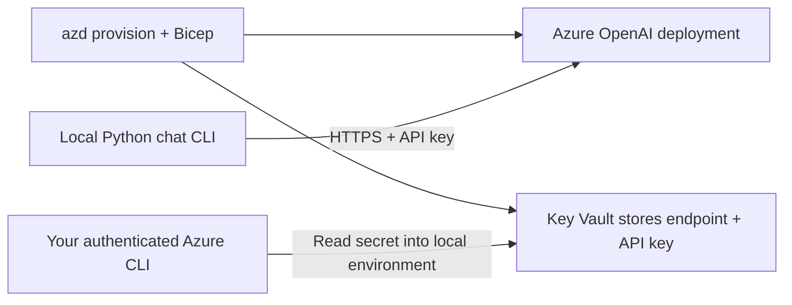

# Azure OpenAI Chat — Helyi CLI és AZD infrastruktúra

**Szint:** Középhaladó · **Időtartam:** 35–60 perc, beleértve a beállítást

Ez a példa egy **Azure OpenAI erőforrást és Key Vault-ot** biztosít, majd futtat egy
interaktív Python csevegő CLI-t **a gépeden**. Nem üzemeltet webalkalmazást
vagy Container App-et. Az alapértelmezett modell a `gpt-4.1`, verzió `2025-04-14`, amely
`GlobalStandard` telepítési kapacitással 20. Ellenőrizd az aktuális elérhetőséget és kvótát a
kiválasztott régiódban a biztosítás előtt; a modell életciklus dátumai változhatnak.

## Tanulási célok

- Modell infrastruktúra biztosítása Bicep és azd használatával.
- API-kulcs lekérése Key Vault-ból anélkül, hogy az megjelenne a telepítési kimenetben.
- Chat Completions kérések küldése és a beszélgetés előzményeinek megőrzése.
- Token számlálók és a költségbecslések korlátainak értelmezése.



Ebben a példában nincs kezelt identitás futtatási integráció, több régiós failover, egyedi
sebességkorlátozó, streaming mód vagy hosztolt számítás. Az OpenAI SDK
legfeljebb két ismétlést hajt végre hiba esetén; a CLI jelent a megmaradt hibákról.

## Előfeltételek

- Egy aktuális stabil [azd](https://learn.microsoft.com/azure/developer/azure-developer-cli/install-azd)
  (a felülvizsgálat idején kiadott verzió: 1.37.2).
- [Azure CLI](https://learn.microsoft.com/cli/azure/install-azure-cli).
- Python **3.10+** (ajánlott: 3.11) és egy virtuális környezet.
- Egy Azure előfizetés, amely jogosult Cognitive Services és Key Vault
  erőforrások létrehozására, modellek telepítésére és a Key Vault titkok olvasására.
- Régiós elérhetőség és `GlobalStandard` kvóta `gpt-4.1` számára. A hozzáférési követelmények
  az előfizetéstől és a funkciótól függnek; nincs garantált jóváhagyási időkeret.

```bash
azd version
az version
python --version
azd auth login
az login
```

Ezek külön hitelesítési munkamenetek. Mindkét eszközben válaszd ki ugyanazt az előfizetést
az alábbi parancsok futtatása előtt.

## Gyors kezdés (Bash)

Futtasd a repozitórium gyökérkönyvtárából:

```bash
cd examples/azure-openai-chat
azd env new myopenai
azd provision
```

Válassz egy támogatott régiót. A biztosítás létrehoz egy erőforráscsoportot, OpenAI fiókot,
modell telepítést, Key Vault-ot, valamint az `openai-endpoint`/`openai-api-key` titkokat.
Nincs **telepítendő szolgáltatás** `azure.yaml` alatt.

Töltsd be a nem titkos kimeneteket, és szerezd be a titkot az aktuális shell környezetedbe:

```bash
export AZURE_OPENAI_ENDPOINT="$(azd env get-value AZURE_OPENAI_ENDPOINT)"
export AZURE_OPENAI_MODEL="$(azd env get-value AZURE_OPENAI_MODEL)"
KV_NAME="$(azd env get-value AZURE_KEY_VAULT_NAME)"
export AZURE_OPENAI_API_KEY="$(az keyvault secret show \
  --vault-name "$KV_NAME" --name openai-api-key --query value --output tsv)"

python -m venv .venv
source .venv/bin/activate
python -m pip install -r src/requirements.txt
python src/chat.py
```

PowerShell-ben aktiváld `.\.venv\Scripts\Activate.ps1` segítségével és állítsd be a környezeti
változókat `$env:AZURE_OPENAI_ENDPOINT = azd env get-value AZURE_OPENAI_ENDPOINT` használatával.
(és hasonlóan a modell esetében). Az API kulcs lekérése az
`$env:AZURE_OPENAI_API_KEY = az keyvault secret show --vault-name $KV_NAME --name openai-api-key --query value -o tsv` használatával történik.
Állítsa be először az `$KV_NAME = azd env get-value AZURE_KEY_VAULT_NAME` értéket.

Ne nyomtassa ki, ne kövesse el, és ne illessze be az API kulcsot hibajelentésekbe. A CLI a folyamatot olvassa be
környezeti változók; nem **tölt le** Key Vault titkokat vagy `.env` fájlokat.
`config.py` érvényesíti a végpontot, a token korlátot és a hőmérsékletet indításkor.

Várt kimenet (a tartalom és a használat változik):

```text
Azure OpenAI Chat Application
Model: gpt-4.1
...
You: Say hello in one sentence.
Assistant: Hello! How can I help you today?
[Tokens: ... | Cost: $...]
```

Parancsok: `stats` összesítéseket mutat, `clear` törli a beszélgetési előzményeket, és
`quit`/`exit` lezárja a munkamenetet. Nincsenek `--stream`, `--show-tokens`, `tokens`,
vagy `cost` parancsok.

## Az üzembe helyezés ellenőrzése

A fenti shell változók betöltése után:

```bash
curl --fail-with-body \
  "${AZURE_OPENAI_ENDPOINT%/}/openai/deployments/${AZURE_OPENAI_MODEL}/chat/completions?api-version=2024-10-21" \
  -H "Content-Type: application/json" \
  -H "api-key: $AZURE_OPENAI_API_KEY" \
  -d '{"messages":[{"role":"user","content":"Say hello!"}],"max_tokens":50}'

az keyvault secret list --vault-name "$KV_NAME" --query "[].name" -o table
```

Siker: az API HTTP 200-at ad vissza `choices[0].message.content` és `usage` értékekkel;
a key vault felsorolja `openai-api-key` és `openai-endpoint` értékeket. Egy sikeres ARM telepítés
önmagában nem igazolja a lekérdezést.

## Fájlok és konfiguráció

```text
azure.yaml                         # Infrastructure-only AZD project
infra/main.bicep                   # Subscription deployment
infra/main.parameters.json         # Environment, location, principal ID
infra/resources/openai.bicep       # Account + model
infra/resources/keyvault.bicep     # Vault + deploying user's secret access policy
infra/resources/secrets.bicep      # Writes secrets, no key output
src/chat.py                        # Interactive CLI
src/config.py                      # Environment validation
src/requirements.txt               # Python packages
```

A kiosztott modell/verzió/kapacitás megváltoztatásához szerkeszd az alapértelmezett értékeket a
`infra/main.bicep` fájlban, majd futtasd a `azd provision` parancsot. Az `AZURE_OPENAI_MODEL` érték beállítása a
shellben csak egy **létező telepítési nevet** választ ki; nem telepít új modellt.

| Futási változó | Alapértelmezett / forrás |
|---|---|
| `AZURE_OPENAI_ENDPOINT` | Kötelező; azd nem titkos kimenet |
| `AZURE_OPENAI_API_KEY` | Kötelező; lekérés a Key Vaultból |
| `AZURE_OPENAI_MODEL` | `gpt-4.1`; Azure telepítési név |
| `AZURE_OPENAI_MAX_TOKENS` | 800 (érvényességi tartomány 1–4096) |
| `AZURE_OPENAI_TEMPERATURE` | 0.7 (tartomány 0–2) |
| `AZURE_OPENAI_INPUT_PRICE_PER_1K` | 0.002 USD; illusztratív, nem gyorsított bemeneti díj |
| `AZURE_OPENAI_OUTPUT_PRICE_PER_1K` | 0.008 USD; illusztratív kimeneti díj |

## Költségek és biztonsági korlátozások

A költségmegjelenítés **becslés**, nem az Azure számlázása. Az API token
használatát megszorozza a beállított díjakkal, nem veszi figyelembe a gyorsított
bemenet kedvezményeket, regionális/SKU eltéréseket, adókat, árváltozásokat vagy sikertelen/újrapróbált hívásokat.
Mindkét díjat felül kell írni, ha más modellt vagy SKU-t használsz, és ellenőrizni az aktuális
[Azure OpenAI árazást](https://azure.microsoft.com/pricing/details/cognitive-services/openai-service/).

Példaként 100 lekérés, melyek mindegyike 500 gyorsítatlan bemeneti és 200 kimeneti tokenből áll
az alapértelmezett díjak mellett összesen `100 × (500/1000 × .002 + 200/1000 × .008) = $0.26` költséget eredményez.
A Key Vault műveletek/tárolás külön költségeket vonnak maguk után. Nincs fix 50$ / hónap
költség a helyi CLI-hez, és nincs üzemeltetett számítási kapacitás a sablonban.

A vault egy hozzáférési szabályzatot használ a telepítést végző entitásra; ez nem RBAC vagy
felügyelt identitású alkalmazás példa. Nyilvános végpontok és API-kulcs hitelesítés
oktatási célokat szolgálnak. Korlátozd a jogosultságokat, és adj hozzá megfelelő identitás/hálózati
vezérléseket, mielőtt éles környezetben használnád.

## Gyakorlati feladatok

### 1. Ellenőrizd a kontextust és állítsd vissza

**Kezdés:** futó CLI. **Cél:** a történelem megfigyelése.
Mondjuk: "Emlékezz a cedrus szóra", majd kérdezd meg: "Melyik szóra kértelek, hogy emlékezz?"
Futtasd `stats`; két sikeres fordulónak két üzenetváltásnak kell számítania.
Futtasd `clear` és `stats` parancsokat; az üzenetváltások száma nulla kell legyen (token összesítők megmaradnak).
A modell pontos megfogalmazása nem determinisztikus.

### 2. Változtasd meg a válasz korlátját

**Kezdés:** lépj ki a CLI-ből, de tartsd meg ugyanazt a shellt.
Futtasd `export AZURE_OPENAI_MAX_TOKENS=100` parancsot, indítsd újra `python src/chat.py`, és kérj egy rövid magyarázatot az azd-ról.
Ellenőrizd, hogy a fejléc 100-at mutat.
Állítsd vissza `unset AZURE_OPENAI_MAX_TOKENS` segítségével. A kisebb válaszkorlát nem
csökkenti a már elküldött történeti tokeneket.

### Gyakori problémák

- **Hiányzó környezeti változók:** a kiosztás nem exportál shell értékeket;
  ismételd meg az exportálási lépéseket. Egy új terminál ismét igényli őket.
- **403 Key Vault olvasáskor:** ellenőrizd az Azure CLI előfizetést/bejelentkezést és a fő entitást
  a vault hozzáférési szabályzatban. A szabályzatváltozások hatása késhet.
- **404 inferencia:** ellenőrizze a telepítés nevét, a végpontot és a telepítés állapotát.
- **429 inferencia:** várjon az aránykorlátok visszaállítására; ellenőrizze a régiós modell kvótát.
  A CLI eltávolítja a sikertelen köröket a történelemből, így az újrapróbálkozás nem duplikálja azokat.
- **Kontextus hossza:** a minta nem vágja le a hosszú beszélgetéseket; használja a `clear`-et.
- **Nem elérhető/visszavont modell:** konzultáljon az aktuális modell elérhetőséggel, és frissítse
  a modellt/verziót/SKU-t együtt; az API verzió és a modell verzió külön beállítások.

## Tisztítás és következő lépések

```bash
azd down
unset AZURE_OPENAI_API_KEY
```

A Key Vault puha törlés megtartási ideje hét nap; az eltávolítás külön jogosultságokat igényel.
Nincs rögzített tesztkészlet; ne futtasson nem létező `pytest tests/` parancsot.
Adjon hozzá becsapott API teszteket a kód bővítése előtt.

[Konténer példák](../../../../examples/container-app) · [Kiskereskedelmi architektúra vázlat](../retail-scenario.md) ·
[Tanfolyam kezdőlap](../../README.md) · [Probléma jelentése](https://github.com/microsoft/AZD-for-beginners/issues)

---

<!-- CO-OP TRANSLATOR DISCLAIMER START -->
**Jogi nyilatkozat**:
Ez a dokumentum az AI fordítási szolgáltatás, a [Co-op Translator](https://github.com/Azure/co-op-translator) segítségével készült. Bár az pontosságra törekszünk, kérjük, vegye figyelembe, hogy az automatikus fordítások hibákat vagy pontatlanságokat tartalmazhatnak. Az eredeti dokumentum az anyanyelvén tekintendő hiteles forrásnak. Fontos információk esetén professzionális emberi fordítást javasolunk. Nem vállalunk felelősséget semmilyen félreértésért vagy téves értelmezésért, amely ebből a fordításból ered.
<!-- CO-OP TRANSLATOR DISCLAIMER END -->