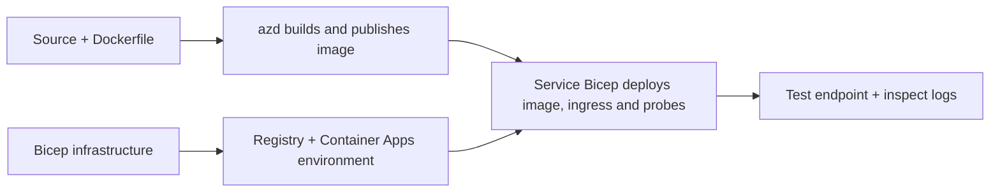

# Konténeres alkalmazástelepítési példák az AZD-vel

Ez a könyvtár két tanulási mintát tartalmaz forráskóddal, Dockerfile-okal,
Bicep infrastruktúrával és `azure.yaml`. Egyik sem érett termék.

## Példa kiválasztása

| Minta | Mi valósul meg | Előfeltétel |
|---|---|---|
| [Egyszerű Flask API](../../../../examples/container-app/simple-flask-api) | Egyetlen Python CRUD API, memóriabeli elemek, egészségügyi vizsgálatok, HTTP skálázás | Alapvető CLI és HTTP ismeretek |
| [Két szolgáltatás mikroservizek](../../../../examples/container-app/microservices) | Node.js átjáró, belső csak-olvasási Python termék szolgáltatás, telemetria és skálázás | Először fejezze be az egy szolgáltatásos mintát |

Szánjon rá 30–60 percet a beállítással és az ellenőrzéssel együtt. Az Azure erőforrások létrehozási ideje változó.

## Előfeltételek

- [Azure Developer CLI](https://learn.microsoft.com/azure/developer/azure-developer-cli/install-azd)
- [Azure CLI](https://learn.microsoft.com/cli/azure/install-azure-cli) ellenőrző parancsokhoz
- Docker a démon futtatásával ezen konténerképek építéséhez
- Egy Azure-előfizetés erőforrás-létrehozási jogosultságokkal és elegendő regionális kvótával
- Bash a shell példákhoz, vagy egyenértékű PowerShell parancsok

```bash
azd version
az version
docker info
azd auth login
az login
```

A két eszköz külön bejelentkezési munkameneteket használ. Használjon egy aktuális stabil azd-t; a jelenlegi
kiadott verzió a cikk megjelenésekor 1.37.2. A régebbi minimális verzió követelmények nem
jelentenek kompatibilitási garanciát.

## Gyors kezdés

A tárház gyökérkönyvtárából:

```bash
cd examples/container-app/simple-flask-api
azd env new flask-demo
azd up
API_URL=$(azd env get-value API_ENDPOINT)
curl --fail-with-body "${API_URL}/health"
```

Várt eredmény: HTTP 200 a `"status": "healthy"`-el. Kövesse a mintapéldány README-jét egy elem létrehozásához,
olvasásához, frissítéséhez és törléséhez, valamint a naplók megtekintéséhez.



A kezdeti előkészítés egy nyilvános hello-world képet használ a 80-as porton. A szolgáltatás-specifikus
Bicep paraméterfájlok lehetővé teszik, hogy a `azd deploy` lecserélje azt az elkészült alkalmazásképére
és a megfelelő alkalmazás port/probe beállításokra (8000 a Flask/termék, 8080 a gateway esetén).
Tartsa ezeket a fájlokat a `azure.yaml` `module` beállításaikkal.

## Konfiguráció: mi változtat meg mit

A `azure.yaml` kiválasztja a forráskönyvtárakat, nyelveket, hosztokat és a telepítési modulokat.
A konténer CPU/memória, az ingress, a probe-ok, a replikák száma és a skálázási szabályok definiálva vannak
a **Bicep**-ben, nem tetszőleges `resources`, `scale` vagy `regions` szolgáltatás tulajdonságok.

`azd env set SOME_VALUE ...` helyileg tárolja az értéket. Csak akkor változtatja meg egy telepített
erőforrást, ha egy paraméter, környezeti leképezés vagy hook kifejezetten felhasználja ezt az
értéket. Ezek a példák nem használják a `MAX_REPLICAS`, `SCALE_TO_ZERO_TIMEOUT`,
`CONTAINER_APP_REPLICA_TYPE` vagy egyéni canary beállításokat az azd környezeti értékekből.
Szerkessze a megfelelő Bicep fájlt, és futtassa a `azd up` parancsot az újra-províziózás és telepítés érdekében.

Ne helyezze az alkalmazás forráskódját `infra/` alá. `project`-nek a Dockerfile-t és függőség-manifesztet tartalmazó forráskönyvtárra kell mutatnia.


- `azd monitor --logs` portál nézetet nyit meg; nem terminál naplófolyam.
  Használja a `az containerapp logs show --follow`-t a tényleges erőforrásnévvel.
- Az egyszerű API stdout naplókat ír, amelyeket a Container Apps/Log Analytics gyűjtött össze.
  Az előírt Application Insights erőforrás nincs automatikusan instrumentálva.
- A mikroszolgáltatás gateway a Node.js Application Insights SDK-t használja; a Python
  szolgáltatás alkalmazásnapló nyomokat exportál. Teljes Python kérés-/függőségkövetés
  nincs beállítva.
- A scale-to-zero csökkentheti a számítási költségeket, de a regisztráció és a napló bevitel/tárolás
  továbbra is költséges lehet. A mikroszolgáltatás alapértelmezett beállításai futó példányokat tartanak fenn.
  Becslést készíthet régiójáról és használatáról a
  [Azure árazási kalkulátor](https://azure.microsoft.com/pricing/calculator/) segítségével.

## Fejlett minták — nem tartalmazott megvalósítások

Ezek tervezési irányelvek, nem további helyi projektek vagy másolás-futtatás kódok:

- **Tartós adatok és hitelesítés:** cserélje le a memóriában tárolt adatokat, és adjon hozzá
  Microsoft Entra ID hitelesítést/engedélyezést éles környezet előtt.
- **Blue-green/canary:** használja a Container Apps többváltozatú módját, a verzió
  címkéit, forgalom súlyozást, egészségellenőrzést és rollback eljárásokat.
  Ezekben a mintákban nincs `deploymentStrategy: canary` azd konfiguráció.
  Lásd a [verziókezelést](https://learn.microsoft.com/azure/container-apps/revisions).
- **Több régió:** hozzon létre különálló környezeteket és alkalmazásokat Bicep-ben, és tervezze meg
  a globális útválasztást és az adatkonzisztenciát. Egy szolgáltatás `regions` lista nem az azd
  telepítési mechanizmusa.
- **Queue dolgozók:** adjon hozzá dolgozó forrást, függőségeket, sor erőforrásokat, egy kezelt
  identitást adat-sík szerepekkel, és egy hitelesített skálázási szabályt. Ne másoljon
  egy üres `src/worker` útvonalat, és várja futtatható projektként.
- **Dapr:** szolgáltasson komponenseket, konfigurálja a sidecar-t, telepítse a megfelelő SDK-t,
  és valósítson meg állapot/pub-sub hibakezelést.
- **Titkok:** használjon lehetőség szerint kezelt identitást és szerepkiosztásokat. Az egyszerű
  Key Vault létrehozása nem biztosít hozzáférést vagy titkok betöltését az alkalmazásoknak.

## Tisztítás

A minta könyvtárból:

```bash
azd down
```

Ellenőrizze a törlésre vonatkozó megerősítéseket, és erősítse meg, hogy a dedikált erőforráscsoport eltávolításra került.
Ne használja ezeket a mintákat éles alapként további tervezés és tesztek nélkül.

[Példák index](../README.md) · [Tanfolyam főoldala](../../README.md) ·
[Container Apps dokumentáció](https://learn.microsoft.com/azure/container-apps/) ·
[Jelentsen hibát](https://github.com/microsoft/AZD-for-beginners/issues)

---

<!-- CO-OP TRANSLATOR DISCLAIMER START -->
**Jogi nyilatkozat**:
Ez a dokumentum az AI fordítási szolgáltatás, a [Co-op Translator](https://github.com/Azure/co-op-translator) segítségével készült. Bár az pontosságra törekszünk, kérjük, vegye figyelembe, hogy az automatikus fordítások hibákat vagy pontatlanságokat tartalmazhatnak. Az eredeti dokumentum az anyanyelvén tekintendő hiteles forrásnak. Fontos információk esetén professzionális emberi fordítást javasolunk. Nem vállalunk felelősséget semmilyen félreértésért vagy téves értelmezésért, amely ebből a fordításból ered.
<!-- CO-OP TRANSLATOR DISCLAIMER END -->