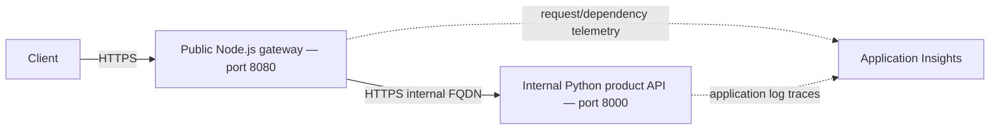

# Két szolgáltatásos mikroservizek — Azure Container Apps

**Szint:** Középhaladó · **Időtartam:** 45–60 perc, beleértve a beállítást

Ez a tanulási példa egy **Node.js API átjárót** és egy **csak olvasható Python
termékszolgáltatást** valósít meg. Forráskód, Dockerfile-ok, Bicep és azd konfigurációk is szerepelnek.
Nem egy éles környezetbe szánt rendszer.

## Amit megtanulsz

- Két szolgáltatás független telepítése.
- Belső backend FQDN használata HTTPS-en keresztül.
- Sikeres, nem található és nem elérhető szolgáltatás válaszok ellenőrzése.
- Telemetria és független skálázási határok megértése.



A termékkatalógus öt rögzített terméket tartalmaz a memóriában. **Nincsenek POST,
PUT vagy DELETE kezelők**, adatbázis, Service Bus, rendelés/felhasználó/értesítés szolgáltatás,
C# vagy Go kód. Ezek jövőbeli fejlesztési ötletek, nem tartalmazott funkciók.
A gateway nem hitelesíti a felhasználókat; a belső bejutás nem helyettesíti
az alkalmazás jogosultságkezelését.

## Előfeltételek

Először fejezze be az [egyszerű Flask API](../../../../../examples/container-app/simple-flask-api) használatát.
Telepítsen egy aktuális stabil azd verziót (a felülvizsgálat idején kiadott verzió: 1.37.2), Azure CLI-t,
és Dockert a futó démonnal. Szüksége van Azure előfizetésre, erőforrás
létrehozási jogosultságokra és Container Apps régiós kvótára.

```bash
azd version
az version
docker info
azd auth login
az login
```

Ugyanazt az előfizetést használja mindkét CLI eszközben. Az alábbi parancsok Bash-ben vannak.

## Telepítés és ellenőrzés

A tároló gyökérkönyvtárából:

```bash
cd examples/container-app/microservices
azd env new microservices-demo
azd up
GATEWAY_URL=$(azd env get-value API_GATEWAY_URL)
RG_NAME=$(azd env get-value AZURE_RESOURCE_GROUP)
GATEWAY_NAME=$(azd env get-value API_GATEWAY_NAME)
PRODUCT_NAME=$(azd env get-value PRODUCT_SERVICE_NAME)

curl --fail-with-body "${GATEWAY_URL}/health"
curl --fail-with-body "${GATEWAY_URL}/api/products"
curl --fail-with-body "${GATEWAY_URL}/api/products/1"
curl -i "${GATEWAY_URL}/api/products/999"
```

**Siker:** health 200; lista 200 **öt** termékkel; az 1-es termék egy Laptop,
ára 999,99, készlet 50; az ismeretlen termék 404-et ad vissza.
A válaszok tartalmazzák a leírásokat; az időbélyegek változóak.

Az első üzembe helyezés nyilvános hello-world képeket használ port 80-on, így nem próbál
nem létező képeket lehúzni egy üres tárolóból. A szolgáltatás-specifikus Bicep modulok
és paraméter fájlok a beépített képekkel és alkalmazás portokkal/probírókkal helyettesítik ezeket a
`azd deploy` során. A fő paraméterek megőrzik a közzétett képek neveit a későbbi üzembe helyezéshez.

## Szolgáltatások és hálózat

| Szolgáltatás | Kitettségi végpontok | Alapértelmezett erőforrások |
|---|---|---|
| Gateway | GET `/`, `/health`, `/api/products`, `/api/products/:id` | 1 vCPU, 2 GiB, 2–20 példány |
| Product | GET `/`, `/health`, `/products`, `/products/<id>` | 0.5 vCPU, 1 GiB, 1–10 példány |

A Product belépési pont rendelkezik `external: false` és `allowInsecure: false`-zal. A Bicep beszúrja
`PRODUCT_SERVICE_URL=https://<actual-internal-fqdn>` a gateway-be. A HTTP
átirányítás; az HTTPS egyezik a konfigurált ingress-szel. Egy rövid DNS névnek meg kell egyeznie a
**valódi Container App névvel**, nem a logikai szolgáltatáskulccsal `product-service`.
Ne próbáld meg közvetlenül hívni a belső URL-t a laptopodról.

A gateway-nek öt másodperces időkorlátja van a termékhívásokra. Az hiányzó termékazonosítók
404-ként terjednek tovább; szállítási hibák/más háttérrendszeri hibák 503-at adnak vissza. A gateway
`/health` csak a gateway-t ellenőrzi, nem a háttérrendszer elérhetőségét.

## Fájlok és konfiguráció

```text
azure.yaml
infra/main.bicep
infra/main.parameters.json
infra/abbreviations.json
infra/core/container-apps-environment.bicep
infra/core/monitor.bicep
infra/app/api-gateway.bicep
infra/app/api-gateway.parameters.json
infra/app/product-service.bicep
infra/app/product-service.parameters.json
src/api-gateway/{app.js,package.json,Dockerfile}
src/product-service/{main.py,requirements.txt,Dockerfile}
```

A skálázás, CPU/memória, portok és probe-ok az `infra/app/*.bicep` fájlban vannak beállítva. Módosítsd ezeket
a fájlokat, majd futtasd az `azd up` parancsot az infrastruktúra alkalmazásához és az újratelepítéshez. Nincs
`GATEWAY_MAX_REPLICAS` környezeti változós paraméter ebben a példában.

Csak kódváltozások esetén:

```bash
azd deploy product-service
azd deploy api-gateway
```

A Node képfájl a Node 22-t használja; a Python képfájl a Python 3.11-et használja. Mindkettő a
`0.0.0.0`-hez kötődik. Az ingressz/probák rendre a 8080-as (átjáró) és 8000-es (termék) portokat használják.

## Helyi fejlesztés Dockerral

Fuss ebből a példakönyvtárból. Használj felhasználó által definiált hálózatot, **ne `localhost`
az egyik tárolóból a másik eléréséhez**:

```bash
docker network create azd-microservices-demo
docker build -t local-product ./src/product-service
docker build -t local-gateway ./src/api-gateway
docker run -d --name azd-product --network azd-microservices-demo local-product
docker run -d --name azd-gateway --network azd-microservices-demo \
  -p 8080:8080 -e PRODUCT_SERVICE_URL=http://azd-product:8000 local-gateway
curl --fail-with-body http://localhost:8080/api/products
```

Várható eredmény: öt termék. Az HTTP csak ehhez a helyi Docker hálózathoz van használva.

```bash
docker stop azd-product azd-gateway
docker rm azd-product azd-gateway
docker network rm azd-microservices-demo
```

## Monitorozás

```bash
az containerapp logs show --name "$GATEWAY_NAME" --resource-group "$RG_NAME" --follow
# In a separate terminal:
az containerapp logs show --name "$PRODUCT_NAME" --resource-group "$RG_NAME" --tail 100
```

Az `azd monitor --logs` portál nézetet nyit; nem streameli a terminál logokat.
A Node SDK gyűjti a gateway kéréseket/függőségeket. A Python `AzureLogHandler`
**log trace-eket** exportál, nem automatikus Flask kéréseket, SQL függőségeket, vagy teljes
elosztott trace-eket. Az OpenCensus egy régi SDK; ehelyett a Azure Monitor OpenTelemetry használata ajánlott,
amikor ezt a példát bővíted.

Az Application Insights Logs-ban generálj kéréseket és vizsgáld meg azokat:

```kusto
requests
| where timestamp > ago(1h)
| where name contains "products"
| summarize RequestCount=count(), AvgDuration=avg(duration) by bin(timestamp, 5m)
```

Python alkalmazásüzenetek esetén:

```kusto
traces
| where timestamp > ago(1h)
| where message contains "products"
| project timestamp, message, severityLevel
```

Vedd figyelembe a feldolgozási késleltetést és a mintavételezést; ne várj pontos kérésszámot vagy
garantált késleltetést. Nincsenek testreszabott riasztások vagy műszerfalak konfigurálva.

## Gyakorlati feladatok

### 1. gyakorlat: Módosítsd a katalógust

**Kezdőpont:** `src/product-service/main.py`.
**Cél:** független szolgáltatás telepítésének ellenőrzése.
Változtasd meg a Laptop készletét 50-ről 49-re a rögzített `products` listában, futtasd
az `azd deploy product-service`-at, majd kérd le az `${GATEWAY_URL}/api/products/1`-et.

**Siker kritérium / megoldás:** HTTP 200 az `"stock":49`-tel. Állítsd vissza 50-re és telepítsd újra.
**Gyakori hiba:** a katalógust tartalmazó szolgáltatás helyett a gateway szerkesztése.
Ez a forrásadatokat változtatja, nem egy tartós készletadatbázist.

### 2. gyakorlat: Replika konfiguráció ellenőrzése

**Kezdőpont:** `infra/app/product-service.bicep`.
**Cél:** infrastruktúra-változás megfigyelése automatikus skálázás nélkül.
Változtasd `minReplicas: 1`-et `minReplicas: 2`-ra, futtasd az `azd up`-at, majd:

```bash
az containerapp show --name "$PRODUCT_NAME" --resource-group "$RG_NAME" \
  --query properties.template.scale -o json
```

**Siker kritérium:** konfigurált minimum 2, maximális érték 10 marad.
Állítsd vissza az 1-es minimumot és futtasd az `azd up`-at.
**Gyakori hiba:** az `azd deploy` egyedül nem alkalmaz változtatásokat a nem kapcsolódó megosztott
infrastruktúrára. Ne állítsd az `maxReplicas` értékét nullára mint leállási szimulációt.
Ez a konfiguráció ellenőrzése, nem terhelés-teszt vagy garantált azonnali replika szám.

### 3. gyakorlat: Teszteld a helyi nem elérhető szolgáltatás kezelését

**Kezdőpont:** mindkét helyi Docker konténer fent van.
**Cél:** megkülönböztetni a backend hibát a hiányzó terméktől.
Állítsd le csak a termék tárolót:

```bash
docker stop azd-product
curl -i http://localhost:8080/api/products
docker start azd-product
curl --fail-with-body http://localhost:8080/api/products
```

**Siker kritérium:** leállítás alatt a gateway 503-at ad válaszként az
`"error":"Product service unavailable"`-val; újraindítás után a lista 200-at ad vissza.
Szükség esetén próbáld újra egy rövid indítási késleltetés után.
**Gyakori hiba:** a gateway megállítása más hibát tesztel (nincs HTTP válasz).

## Költségek és gyártási hiányosságok

Az alapértelmezett minimum replika a számítást folyamatosan futtatja. A Registry és a monitorozás is
költségeket okoz. Nincs validált fix havi összeg $50: becsüld meg a régió CPU/memória,
replika órák, lekérések, registry és log megőrzést az
[Azure árkalkulátor](https://azure.microsoft.com/pricing/calculator/) segítségével.
Töröld időben a tanulási erőforrásokat.

A gyártási munka magában foglalja a hitelesítést/engedélyezést, környezetre szabott kezelt identitásokat,
tartós adatokat, bemenet/válasz validálást, támogatott megfigyelhetőségi eszközöket,
terhelési/hiba teszteket, CI/CD-t, riasztásokat és helyreállítási eljárásokat. Egy rendelési
szolgáltatás, sor vagy adatbázis hozzáadása külön implementációs feladat, nem kész
gyakorlat vagy már itt elérhető funkció.

## Hibakeresés és takarítás

- **Kép nem található az első telepítéskor:** a bootstrapnak a nyilvános képet kell használni;
  ellenőrizd az alapértelmezett fő kép paramétereket és a telepítési modul leképezéseket.
- **503-as termékek:** ellenőrizd a termék logokat, a kép verzióját és a befecskendezett belső HTTPS URL-t.
- **404 váratlan útvonal:** a termék API csak olvasható; ellenőrizd az útvonalat, ne egy nem létező CRUD kezelőt.
- **Nincs telemetria:** vizsgáld meg a futási kapcsolatot sztringeket anélkül, hogy azok nyilvánosak lennének és
  engedd meg a késleltetett feldolgozást. A Python kérés táblák nem töltődnek a log kezelője által.

Innen a példa könyvtárból:

```bash
azd down
```

Nézd át a törlési megerősítéseket és ellenőrizd, hogy a dedikált erőforrás csoport törlésre került-e.

[Előző: Flask API](../../../../../examples/container-app/simple-flask-api) · [Következő: Adatbázis alkalmazás](../../../../../examples/database-app) ·
[AI fejlesztés](../../../docs/chapter-02-ai-development/README.md) ·
[Tanfolyam kezdőlap](../../../README.md) · [Jelents hibát](https://github.com/microsoft/AZD-for-beginners/issues)

---

<!-- CO-OP TRANSLATOR DISCLAIMER START -->
**Jogi nyilatkozat**:
Ez a dokumentum az AI fordítási szolgáltatás, a [Co-op Translator](https://github.com/Azure/co-op-translator) segítségével készült. Bár az pontosságra törekszünk, kérjük, vegye figyelembe, hogy az automatikus fordítások hibákat vagy pontatlanságokat tartalmazhatnak. Az eredeti dokumentum az anyanyelvén tekintendő hiteles forrásnak. Fontos információk esetén professzionális emberi fordítást javasolunk. Nem vállalunk felelősséget semmilyen félreértésért vagy téves értelmezésért, amely ebből a fordításból ered.
<!-- CO-OP TRANSLATOR DISCLAIMER END -->