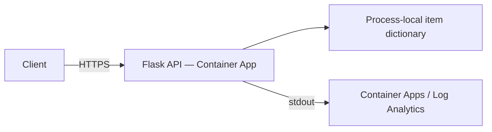

# Egyszerű Flask API — Azure Container Apps

**Szint:** Kezdő · **Időtartam:** 30–45 perc a beállítással együtt

Egy Python Flask CRUD API telepítése az Azure Developer CLI-vel (azd). Forráskód, Dockerfile,
Bicep és telepítési paraméterek mellékelve. Ez egy **tanulási példa**, nem
éles környezetbe szánt API.

## Amit megtanulsz

- Konténer építése és közzététele az azd segítségével.
- Ingress és liveness/readiness probe-ok konfigurálása.
- CRUD válaszok ellenőrzése és alkalmazásnaplók megtekintése.
- Megérteni, hogy az in-memory adat miért nem alkalmas tartós alkalmazásokhoz.



**Fontos:** az elemek egy folyamaton belül vannak tárolva. Az alapértelmezett beállítás **egy Gunicorn munkás,
0–1 replika**, szándékosan elkerülve az inkonzisztens adatokat a munkások/replikák között.
Az elemek újraindítás, verzióváltás vagy nulla skálázás esetén elvesznek. A replikák növelése
megosztott perzisztens tárolót igényel. Az API nem rendelkezik hitelesítéssel vagy jogosultságkezeléssel.

## Előfeltételek

- [Jelenlegi stabil azd](https://learn.microsoft.com/azure/developer/azure-developer-cli/install-azd)
  (a vizsgálat idején kiadott verzió: 1.37.2).
- [Azure CLI](https://learn.microsoft.com/cli/azure/install-azure-cli) ellenőrzéshez.
- Docker a daemon futtatásával; szükséges az alapértelmezett helyi képfelépítéshez.
- Azure-előfizetés, erőforrás létrehozási jogosultságok, és Container Apps régiós kvóta.
- Bash a lentebb használatos parancsokhoz (vagy PowerShell megfelelője).
- Python 3.11 opcionális helyi fejlesztéshez.

```bash
azd version
az version
docker info
azd auth login
az login
```

A CLI eszközök külön bejelentkezési szekciókat használnak. Mindkettőben ugyanazt az előfizetést használd.

## Gyors indítás

A repó gyökeréből:

```bash
cd examples/container-app/simple-flask-api
azd env new flask-demo
azd up
API_URL=$(azd env get-value API_ENDPOINT)
RG_NAME=$(azd env get-value AZURE_RESOURCE_GROUP)
API_NAME=$(azd env get-value API_NAME)
curl --fail-with-body "${API_URL}/health"
```

Várt eredmény: HTTP 200 és JSON, amely tartalmazza `"status":"healthy"`,
`"service":"simple-flask-api"`, és egy aktuális UTC időbélyeget.
A telepítés és a képépítés általában néhány percet vesz igénybe; az időzítés változó.

Az első telepítés egy publikus hello-world képet használ, amely a 80-as porton hallgat.
`azure.yaml` kiválasztja a `infra/app/api.bicep` és a hozzá tartozó paraméterfájl használatát a
szolgáltatás telepítéséhez, ami a képet, ingress-t és probe-okat 8000-es portra váltja.
Ne töröld ezeket a telepítési paramétereket.

## CRUD ellenőrzése

Futtasd a következőket egymás után, miközben ugyanaz a replika aktív marad:

```bash
# Create: HTTP 201; note the returned id (1 for a fresh process).
curl -i -X POST "${API_URL}/api/items" \
  -H "Content-Type: application/json" \
  -d '{"name":"Test Item","description":"My first item"}'

# Read list: HTTP 200, total 1 in a fresh process.
curl --fail-with-body "${API_URL}/api/items"

# Replace 1 if your create response returned another id.
curl --fail-with-body "${API_URL}/api/items/1"
curl -i -X PUT "${API_URL}/api/items/1" \
  -H "Content-Type: application/json" -d '{"name":"Updated Item"}'
curl -i -X DELETE "${API_URL}/api/items/1"
curl -i "${API_URL}/api/items/1"
```

Siker: POST 201, olvasás/PUT 200, DELETE 204 test nélkül, majd hiányzó elem 404.
Hibás/ nem objektum JSON vagy üres név 400-as választ ad.
Ha egy elem eltűnik a kérések között, ellenőrizd az újraindítást vagy a nulla skálázást;
ez szándékos in-memory korlátozás, nem perzisztencia hiánya.

| Endpoint | Módszerek |
|---|---|
| `/` | GET — szolgáltatás információ |
| `/health` | GET — liveness/readiness |
| `/api/items` | GET, POST |
| `/api/items/{id}` | GET, PUT, DELETE |

## Naplók és konfiguráció

```bash
az containerapp logs show --name "$API_NAME" --resource-group "$RG_NAME" --follow
```

Várt eredmény: Gunicorn indítás, kérés hozzáférési naplók, és alkalmazásüzenetek.
`azd monitor --logs` megnyit egy portál nézetet; nem streamel a terminálba.
Application Insights elő van készítve, de **ezt a Flask kód nem instrumentálja**;
stdout naplókhoz használd a Container Apps/Log Analytics-et.

Szerkeszd a `infra/app/api.bicep` fájlt CPU/memória, replika korlátok vagy skálázási szabályok miatt, majd
futtassa `azd up`. Az alapértelmezett értékek 0,5 vCPU, 1 GiB, minimum 0 / maximum 1 replika,
és az HTTP küszöbérték 50 egyidejű kérés. A skálázás nullára hidegindítási késleltetést okozhat.

Tetszőleges `azd env set MAX_REPLICAS`, `API_KEY`, `LOG_LEVEL` vagy
`SCALE_TO_ZERO_TIMEOUT` értékek **nincsenek bekötve ehhez a sablonhoz vagy alkalmazáshoz**.
Egy érték beállítása nem automatikusan teszi futásidejű környezeti változóvá.
A kép explicit módon a 8000-es portot köti; ha változtatja a portot, frissítse együtt a Dockerfile-t, a Bicep ingress-t és a probe-okat.


## Fájlok

```text
azure.yaml
infra/main.bicep
infra/main.parameters.json
infra/app/container-apps.bicep       # Environment, registry, monitoring
infra/app/api.bicep                  # App, ingress, probes, scale settings
infra/app/api.parameters.json        # Image and resource values for azd deploy
src/app.py
src/Dockerfile
src/requirements.txt
```

## Helyi fejlesztés

Ebben a példa könyvtárban:

```bash
python -m venv .venv
source .venv/bin/activate  # PowerShell: .\.venv\Scripts\Activate.ps1
python -m pip install -r src/requirements.txt
python src/app.py
```

Egy másik terminálban tesztelje az `http://localhost:8000/health`-t és a CRUD végpontokat.
Vagy építse meg és futtassa a tényleges képet:

```bash
docker build -t flask-api:local ./src
docker run --rm -p 8000:8000 flask-api:local
```

Csak kódváltoztatás esetén az első telepítés után futtassa az `azd deploy api`-ot.
Bicep változásokhoz futtassa az `azd up`-et az újratervezéshez és telepítéshez.

## Gyakorlati feladatok

### 1. Érvényesítse a bemenet elutasítását

**Kiindulópont:** telepített API, fent az `API_URL`.
**Cél:** ellenőrizze, hogy az API elutasítja a hibás JSON formátumokat és a hiányzó neveket.

```bash
curl -i -X POST "${API_URL}/api/items" \
  -H "Content-Type: application/json" -d '[]'
curl -i -X POST "${API_URL}/api/items" \
  -H "Content-Type: application/json" -d '{"name":""}'
```

**Siker feltétele / megoldás:** mindkettő 400-as hibát ad vissza JSON hibával, nem 500-ast.
**Gyakori hiba:** a JSON tartalom-típus fejléc hiánya.

### 2. Adjon hozzá egy csak olvasható verzió végpontot

**Kiindulópont:** `src/app.py`. **Cél:** bővítse és telepítse újra az API-t.
Adja hozzá ezt az `if __name__ == '__main__':` blokk elé:

```python
@app.route('/version', methods=['GET'])
def version():
    return jsonify({'version': '1.0.0'})
```

Futtassa az `azd deploy api`-et, majd az `curl --fail-with-body "${API_URL}/version"`-t.
**Siker feltétele:** HTTP 200 és `{"version":"1.0.0"}`.
**Gyakori hiba:** a route-ot az akadályozó `app.run()` hívás után elhelyezni, amikor
az `python src/app.py`-tal tesztelünk.

### Tudásellenőrzés

Miért nem elég egyetlen worker a tartós adatkezeléshez? Mert még egyetlen folyamat is elveszíti
a szótárát újraindításkor. Egy éles verziónak tartós, megosztott tárhelyre,
hitelesítésre, jogosultságkezelésre, migrációkra, tesztekre és működési megfigyelésre van szüksége.

## Költségek és hibakeresés

Ez nem garantáltan $0-ba kerülő telepítés: a Basic regisztráció és napló tárolás/betekintés
díjakat számíthat fel, még akkor is, ha az alkalmazás számítási kapacitása nulla. Használja a
[árkalkulátort](https://azure.microsoft.com/pricing/calculator/) a régiójára vonatkozóan.

- **Docker build hiba:** ellenőrizze `docker info`, a hálózati hozzáférést és a függőségeket.
- **Egészségtelen alkalmazás:** vizsgálja meg a konzol-/rendszernaplókat, és ellenőrizze, hogy az image port, az ingress
  és a probok összhangban vannak-e. A helyőrző nem lehet probe-olva a Flask porton.
- **403/jogosultság:** ellenőrizze az előfizetés és az erőforrás létrehozási jogosultságokat.
- **Elemek eltűnése:** a memóriabeli állapot újraindításkor/nullára skálázáskor törlődik; használjon adatbázist
  a tartós viselkedés érdekében.

## Takarítás és következő lépések

```bash
azd down
```

Tekintse át a törlési megerősítést, és ellenőrizze, hogy a dedikált erőforráscsoport eltávolításra került-e.
Ne használjon destruktív takarítást olyan erőforráscsoportra, amely nem kapcsolódó adatokat tartalmaz.

[Következő: Adatbázis alkalmazás](../../../../../examples/database-app) · [Mikroszolgáltatások](../../../../../examples/container-app/microservices) ·
[Konténer áttekintés](../README.md) · [Tanfolyam főoldal](../../../README.md) ·
[Jelentés hibáról](https://github.com/microsoft/AZD-for-beginners/issues)

---

<!-- CO-OP TRANSLATOR DISCLAIMER START -->
**Jogi nyilatkozat**:
Ez a dokumentum az AI fordítási szolgáltatás, a [Co-op Translator](https://github.com/Azure/co-op-translator) segítségével készült. Bár az pontosságra törekszünk, kérjük, vegye figyelembe, hogy az automatikus fordítások hibákat vagy pontatlanságokat tartalmazhatnak. Az eredeti dokumentum az anyanyelvén tekintendő hiteles forrásnak. Fontos információk esetén professzionális emberi fordítást javasolunk. Nem vállalunk felelősséget semmilyen félreértésért vagy téves értelmezésért, amely ebből a fordításból ered.
<!-- CO-OP TRANSLATOR DISCLAIMER END -->