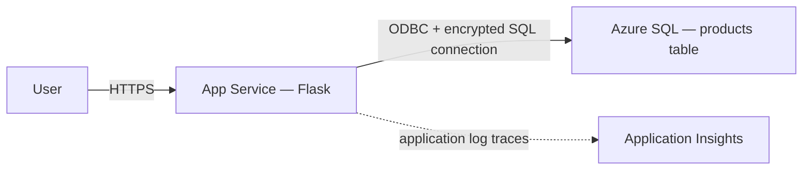

# Flask és Azure SQL az App Service-en

**Szint:** Középhaladó · **Időtartam:** 30–60 perc a előfeltételekkel együtt

Ez a példa egy Python Flask olvasó API-t telepít **Linux App Service**-re és egy Basic
Azure SQL adatbázisra. A forrás, Bicep és az azd konfiguráció is megtalálható. Ez
egy tanulóalkalmazás, nem egy produkciós kész adatbázis architektúra.

## Amit megtanulsz

- App Service, SQL és figyelő erőforrások előkészítése Bicep-pel.
- Titkosított SQL kapcsolódás konfigurálása anélkül, hogy hitelesítő adatokat mentenél.
- Sémának az inicializálása a Gunicorn munkások elindítása előtt.
- Beültetett adatok, nem található válaszok és adatbázis állapotának ellenőrzése.



Erőforrások: dedikált erőforráscsoport, B1 Linux App Service terv, Python 3.11 Web
App, SQL szerver és Basic 2 GB adatbázis, Application Insights és Log Analytics.
A Web App **forrás/ZIP telepítést és Oryx függőség telepítést** használ;
`azd deploy` nem építi vagy telepíti az opcionális Dockerfile-t.

## Előfeltételek

- Aktuális stabil [azd](https://learn.microsoft.com/azure/developer/azure-developer-cli/install-azd)
  (a publicált verzió az ellenőrzés időpontjában: 1.37.2).
- [Azure CLI](https://learn.microsoft.com/cli/azure/install-azure-cli) ellenőrzéshez.
- Azure előfizetés, jogosultságok a felsorolt erőforrások létrehozásához, és régiós kvóta.
- Python **3.11** helyi fejlesztéshez; a beépített `pyodbc==5.0.1` esetleg igényelhet
  natív build eszközöket újabb Python verzióknál.
- Microsoft ODBC Driver 18 (vagy 17) SQL Serverhez helyi gépeken. `pip install
  pyodbc` nem telepíti a rendszerszintű drivert. Lásd
  [ODBC telepítés](https://learn.microsoft.com/sql/connect/odbc/download-odbc-driver-for-sql-server).
- Csak Docker ha az opcionális konténert lokálisan teszteled.

```bash
azd version
az version
azd auth login
az login
```

Ugyanazt az előfizetést használd mindkét eszközben. Az alábbi parancsok Bash-ben vannak.

## Telepítés

A tároló gyökérkönyvtárából:

```bash
cd examples/database-app
azd env new sql-demo
azd provision
azd deploy
WEB_URL=$(azd env get-value WEB_APP_URI)
WEB_NAME=$(azd env get-value WEB_APP_NAME)
RG_NAME=$(azd env get-value AZURE_RESOURCE_GROUP)
```

Válassz támogatott régiót. `sqlAdminLogin` alapértelmezettje `sqladmin`; a szükséges
`sqlAdminPassword` biztonságos paraméter. Erős jelszót adj meg kéréskor.
A telepítési hitelesítő adatokat tartsd távol a Git-től és hibabejelentésektől. A jelenlegi
kapcsolat string interpoláció jelszóként nem vár olyan elválasztót, mint
`;`; módosítsd az escape-szabályokat ilyen érték használata előtt.

A Bicep beállít egy induló parancsot amely futtatja `init_database()`-t **mielőtt** Gunicorn
munkások elindulnak. Ez szükséges, mert `app:app` importálása nem futtatja
Python `if __name__ == '__main__'` blokkot. Egy friss adatbázison az inicializálás
létrehozza `products`-t és beszúr öt sort. Ez egy egyszerű oktató seed, nem egy
konkurens migrációs rendszer; nagyméretű példányok esetén használj megfelelő migrációkat.

Az app kiválasztja a telepített Microsoft ODBC Driver 18-at, majd 17-et, ha a kapcsolat
string nem nevez meg kifejezetten drivert. Ha egyik sem létezik, az indulás hibával
megszakad egy telepíthető hibaüzenettel. Ellenőrizd a driver elérhetőségét a kiválasztott
App Service futtatókörnyezetedben, ne feltételezd.

## Ellenőrzés

```bash
curl --fail-with-body "${WEB_URL}/"
curl --fail-with-body "${WEB_URL}/health"
curl --fail-with-body "${WEB_URL}/products"
curl --fail-with-body "${WEB_URL}/products/1"
curl -i "${WEB_URL}/products/999"
```

Elvárt:

- `/` visszaadja a végpont adatait.
- `/health` 200-at ad vissza `{"status":"healthy","database":"connected"}`-mal.
- `/products` öt seedelt terméket ad vissza friss adatbázison.
- `/products/1` visszaadja a Laptop-ot 1299.99 árral.
- Nem létező termék 404-et ad vissza `{"error":"Product not found"}`-val.

Az API csak olvasható. Nincs POST/PUT/DELETE útvonal vagy böngészői UI.
Az adatbázis kapcsolódás hibája 503-at ad vissza `/health`-ből; nem siker.

## Fájlok és konfiguráció

```text
azure.yaml                         # Python App Service source deployment
infra/main.bicep
infra/main.parameters.json
infra/abbreviations.json
infra/resources/sql-server.bicep
infra/resources/sql-database.bicep
infra/resources/app-service-plan.bicep
infra/resources/web-app.bicep       # Settings + initialization/startup command
infra/resources/app-insights.bicep
src/web/app.py
src/web/requirements.txt
src/web/Dockerfile                 # Optional local container, not the azd target
.env.sample
```

`SQL_CONNECTION_STRING` biztonságos Bicep paraméterként kerül át a Web App modulnak
és az App Service beállításokban tárolódik, nem a telepítési kimenetekben.
`APPLICATIONINSIGHTS_CONNECTION_STRING` konfigurálja a log exportot.
`SCM_DO_BUILD_DURING_DEPLOYMENT=true` engedélyezi a szerver oldali függőség telepítést.
Tetszőleges `azd env` értékek beállítása nem változtat automatikusan applikáció beállításokat.

Az SQL tűzfalának `0.0.0.0` szabálya engedélyezi az **Azure szolgáltatásokból,
beleértve más ügyfelek előfizetéseit is** történő kapcsolódást, SQL hitelesítéssel.
Nem korlátozódik erre az appra vagy előfizetésre. Az SQL nyilvános hálózati hozzáférés engedélyezett.
Használj körülhatárolt hálózatot és nem adminisztrátori alkalmazás azonosítót élesítés előtt.

## Helyi fejlesztés

Használj Python 3.11-et és telepített Microsoft SQL ODBC drivert:

```bash
python -m venv .venv
source .venv/bin/activate  # PowerShell: .\.venv\Scripts\Activate.ps1
python -m pip install -r src/web/requirements.txt
export SQL_CONNECTION_STRING='Server=tcp:YOUR_SERVER.database.windows.net,1433;Database=YOUR_DATABASE;UID=YOUR_USER;PWD=YOUR_PASSWORD;Encrypt=yes;TrustServerCertificate=no;Connection Timeout=30;'
python src/web/app.py
```

A helyettesítő értékeket biztonságosan cseréld ki. Egy másolt `.env` fájl **nem töltődik be automatikusan**
ebben az alkalmazásban. E helyett exportáld a változókat az aktuális shellben.
Azure SQL-hez laptopról ideiglenesen engedélyezd csak a saját nyilvános IP-det:

```bash
SQL_SERVER=$(azd env get-value SQL_SERVER_NAME)
MY_IP=YOUR_PUBLIC_IP
az sql server firewall-rule create -g "$RG_NAME" -s "$SQL_SERVER" \
  -n AllowMyLearningIP --start-ip-address "$MY_IP" --end-ip-address "$MY_IP"
```

A tesztelés után távolítsd el a szabályt:

```bash
az sql server firewall-rule delete -g "$RG_NAME" -s "$SQL_SERVER" -n AllowMyLearningIP
```

Opcionális konténer teszt ebből a példa könyvtárból:

```bash
docker build -t sql-flask:local src/web
docker run --rm -p 8000:8000 -e SQL_CONNECTION_STRING sql-flask:local
```

Ez a kép a Driver 18-at a Debian 12 csomag tárolójából telepíti, amely a Bookworm alapot használja,
egyszer inicializálja az adatbázist, majd elindítja a Gunicorn-t.

## Figyelés és hibakeresés

Engedélyezd/kövess App Service fájlrendszer alkalmazás logokat az indulás diagnosztizálásához:

```bash
az webapp log config --name "$WEB_NAME" --resource-group "$RG_NAME" \
  --application-logging filesystem --level information
az webapp log tail --name "$WEB_NAME" --resource-group "$RG_NAME"
```

Ez a kód az alkalmazás **log trace**-eket exportálja egy régi OpenCensus kezelőn keresztül.
Nem konfigurál automatikus Flask kérés/függőség nyomkövetést, Live Metrics-et,
SQL auditálást, diagnosztikai beállításokat vagy riasztásokat. Ezekhez külön beállítás szükséges.
Új instrumentálás esetén az Azure Monitor OpenTelemetry ajánlott.

Az Application Insights Log-okban API kérések után:

```kusto
traces
| where timestamp > ago(1h)
| where message contains "products" or message contains "Health check"
| project timestamp, message, severityLevel
```

Hagyj időt a feldolgozásra. A kérés-tábla vagy Live Metrics aktivitás nem befejező kritérium
ehhez a csak log alapú instrumentáláshoz.

- **Hiányzó driver:** ellenőrizd `pyodbc.drivers()`-t a futtató környezetben és telepítsd a
  támogatott Microsoft ODBC drivert. Csak egy Python csomag nem elég.
- **Kapcsolódási hiba:** ellenőrizd az SQL beállításokat, hitelesítő adatokat, tűzfalat és kiválasztott
  előfizetés. Ne tiltsa le a titkosítást, hogy kikerülje a hibát.
- **Hiányzó termékek táblázat:** erősítse meg, hogy a Bicep indító parancs telepítve lett;
  az `gunicorn app:app` önálló indítása kihagyja az inicializálást.
- **Csomagépítés sikertelensége:** használjon Python 3.11-et vagy biztosítson natív build előfeltételeket.
- **Nulla árú adat:** nulla érvényes tizedes ár; azt 0.0-ként kell sorosítani,
  nem `null`-ként.

## Gyakorlati feladatok

### 1. feladat: A hiányzó termék viselkedésének ellenőrzése

**Kiindulópont:** telepített API és a fent említett `WEB_URL`.
**Cél:** megkülönböztetni egy hiányzó sort egy hibás adatbázistól.
Kérje le az `/health` és `/products/999`-et a fent megadott parancsokkal.
**Siker kritériumok / válasz:** egészségi állapot 200, nem létező termék 404 (nem 500 vagy 503).
**Gyakori probléma:** feltételezni, hogy a nem talált válasz azt bizonyítja, hogy az SQL kapcsolat hibás.

### 2. feladat: Érték módosítása a seed adatban

**Kiindulópont:** Azure SQL Query Editor, csatlakozva a minta adatbázishoz.
**Cél:** bemutatni, hogy az API adatai az SQL-ben vannak tárolva, nem a folyamat memóriájában.

```sql
UPDATE products SET price = 0 WHERE id = 1;
SELECT id, name, price FROM products WHERE id = 1;
```

Kérje le az `${WEB_URL}/products/1`-at. **Siker kritérium:** az ár legyen `0.0`, ne `null`.
Állítsa vissza az értéket:

```sql
UPDATE products SET price = 1299.99 WHERE id = 1;
```

**Gyakori probléma:** a Python seed list szerkesztése nem frissíti az SQL-ben már létező sorokat.
Ne futtasson sémára/adatokra vonatkozó feladatokat éles adatbázison.

### 3. feladat: Olvasásra szolgáló darabszám végpont hozzáadása

**Kiindulópont:** `src/web/app.py`.
**Cél:** bővítse az API-t paraméter nélküli aggregált lekérdezéssel.
Adja hozzá ezt a következő `if __name__ == '__main__':` blokk elé:

```python
@app.route('/product-count')
def product_count():
    from contextlib import closing
    with closing(get_db_connection()) as conn, closing(conn.cursor()) as cursor:
        cursor.execute("SELECT COUNT(*) FROM products")
        return jsonify({'count': cursor.fetchone()[0]})
```

Futtassa az `azd deploy web`-öt, majd kérje le az `${WEB_URL}/product-count`-ot.
**Siker kritérium:** 200 az `{"count":5}`-vel az érintetlen seed adatbázison.
**Gyakori probléma:** megváltoztatni az útvonalat, de elfelejteni újratelepíteni.
Éles környezetben hibakezelést/teszteket kell hozzáadni; ez a rövid feladat a lekérdezésre fókuszál.

## Költségek, éles környzeti hiányosságok és takarítás

A B1 App Service és a Basic adatbázis díjköteles a fenntartás ideje alatt. Az
Web App leállítása **nem** állítja le az App Service terv számlázását. A naplók és a tárolás további költségeket okozhat.
Használja az [Azure árazási kalkulátort](https://azure.microsoft.com/pricing/calculator/)
a jelenlegi regionális árak megtekintéséhez. Az F1-re váltás szintén megköveteli `alwaysOn` letiltását;
ez nem csupán egy soros csere. Az SQL szerver nélküli verzió automatikusan nem ingyenes.

Az éles munkák közé tartozik a legkevesebb jogosultságú alkalmazásazonosító (nem SQL admin),
hitelesítés/engedélyezés, privát hálózat, biztonságos migrációk, kapcsolódási
pool/lifecycle áttekintés, telemetria, auditálás, riasztások, tesztek és helyreállítási eljárások.
A Redis gyorsítótárazás és további táblák fejlesztési ötletek, nem megvalósított feladatok.

Ebben a példa könyvtárban:

```bash
azd down
```

Tekintse át a törlési megerősítést, és ellenőrizze, hogy a dedikált erőforrás csoport eltávolításra került-e.
Ne töröljön olyan csoportokat, amelyek nem kapcsolódó adatokat tartalmaznak.

[Konténer példák](../../../../examples/container-app) ·
[AI fejlesztés](../../docs/chapter-02-ai-development/README.md) ·
[Tanfolyam kezdőlap](../../README.md) · [Hiba jelentése](https://github.com/microsoft/AZD-for-beginners/issues)

---

<!-- CO-OP TRANSLATOR DISCLAIMER START -->
**Jogi nyilatkozat**:
Ez a dokumentum az AI fordítási szolgáltatás, a [Co-op Translator](https://github.com/Azure/co-op-translator) segítségével készült. Bár az pontosságra törekszünk, kérjük, vegye figyelembe, hogy az automatikus fordítások hibákat vagy pontatlanságokat tartalmazhatnak. Az eredeti dokumentum az anyanyelvén tekintendő hiteles forrásnak. Fontos információk esetén professzionális emberi fordítást javasolunk. Nem vállalunk felelősséget semmilyen félreértésért vagy téves értelmezésért, amely ebből a fordításból ered.
<!-- CO-OP TRANSLATOR DISCLAIMER END -->