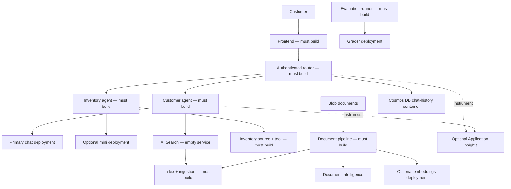

# Többügynökös ügyféltámogatás — Kiskereskedelmi architektúra tervrajz

**5. fejezet: Többügynökös MI megoldások**

- [Tanfolyam kezdőoldala](../README.md)
- [5. fejezet](../docs/chapter-05-multi-agent/README.md)
- [Előfeltétel: MI integráció](../docs/chapter-02-ai-development/microsoft-foundry-integration.md)
- [Következő: Kapacitástervezés](../docs/chapter-06-pre-deployment/capacity-planning.md)
- [ARM infrastruktúra váz](retail-multiagent-arm-template/README.md)

> **Architektúra útmutató, nem működő alkalmazás.** Az egyetlen kiskereskedelmi
> implementációs fájl az `azuredeploy.json`, `azuredeploy.parameters.json` és `deploy.sh` a
> `retail-multiagent-arm-template/`-ban. A router/frontend konténerek hello-world helyőrzők.
> Nincs helyileg kiskereskedelmi ügynök, UI, adatfeldolgozó csővezeték, kiértékelő,
> szkenner vagy alkalmazásteszt-készlet.

## Áttekintés

**Cél:** egy ügyféltámogatási rendszer tervezése ügyféligénnyel és készletügynökkel,
az infrastruktúra nyújtotta elemek azonosítása, valamint a hiányzó alkalmazási
szerződések és ellenőrzés megtervezése.

**Célközönség:** fejlesztők, akik befejezték a helyi
[chat mintát](../../../examples/azure-openai-chat) és a [két szolgáltatásos konténer mintát](../../../examples/container-app/microservices).
Szánjon 2-3 órát az architekturális tanulmányra. Az alkalmazás építése külön
projekt: 80-120 fejlesztési óra illusztratív tervezési becslés tapasztalt fejlesztőknek,
**nem szállítási ígéret**; a gyártásra való alkalmassá tétel, tesztek,
biztonsági felülvizsgálat és üzemeltetés további munkát igényel.

### Tanulási eredmények

- Ismertesse a routolást, alátámasztást, eszközjogosultságokat és a beszélgetés tulajdonjogát.
- Különböztesse meg a modellazonosítókat, telepítési neveket, API verziókat és ARM verziókat.
- Tervezze meg a dokumentum feldolgozást és lekérést illeszkedő vektor dimenziókkal.
- Határozzon meg ellenőrizhető funkcionális, kiértékelési és hibakezelési követelményeket.
- Válassza szét az opcionális architekturális célokat a ténylegesen biztosított erőforrásoktól.

## Megoldás architektúra



Ez egy **célnyelvű alkalmazás architektúra**, nem egy futó ügynök szolgáltatások diagramja.
Az ARM váz a háttérszolgáltatásokat és csak két helyőrző konténert hoz létre.
Front Door, regisztráció, kezelt identitások, szerepkijelölések,
privát végpontok, failover, alkalmazás mérés és riasztások nem szerepelnek.

### Feladatok és szerződések

| Komponens | Követelt viselkedés | Befejezettség bizonyítéka a hívás előtt |
|---|---|---|
| Frontend | Hitelesítse a felhasználókat, jelenítse meg a chatet, biztonságosan töltse fel a dokumentumokat | UI és feltöltési tesztek, elérhető hibák |
| Router | Jogosítsa az igényléseket, válasszon ügynököt, korlátozott eszközhívások/timeoutok | Routolási tesztek, jogosultság ellenőrzések, hibatesztek |
| Ügyfélügynök | Alapozza meg a szabályzat/termék válaszokat jóváhagyott forrásokban | Helyes hivatkozások, tartózkodás adat hiányában |
| Készlet eszköz | Olvassa az illetékes készletet körülhatárolt engedélyekkel | Determinisztikus készlet tesztek; nem feltalált elérhetőség |
| Dokumentum csővezeték | Kinyerni, részekre bontani, beágyazni, indexelni, frissíteni/törölni | Indexelt minták és újrapróbálkozási/direk levelezési viselkedés |
| Beszélgetés tárolás | Izolálja a felhasználókat, érvényesítse a megőrzést | Kereszt-felhasználói jogosultság és TTL tesztek |
| Kiértékelő futtató | Összehasonlítja a kimeneteket az igazsággal és értékelési szempontokkal | Lefedettség, hibaszám, reprodukálható jelentések |

Gondoljon a routerre, mint egy fogadó pult, és az eszközökre, mint korlátozott belső rendszerek:
a szakember kiválasztása nem engedély a minden ügyfél rekordjának elérésére.
Érvényesítse a személyazonosságot és jogosultságokat az alkalmazáskódban és adat szolgáltatásokban, ne üzenetekben.

## Infrastruktúra vs. alkalmazás

Olvassa el a [váz README](retail-multiagent-arm-template/README.md)-t az
előállítás előtt. Pontosan felsorolja az erőforrásokat, módokat, költségeket és korlátokat.

| Logikai használat | ARM telepítési név | Modell / verzió | Alapértelmezett régió |
|---|---|---|---|
| Ügyfél chat | `gpt-4.1-chat` | `gpt-4.1` / `2025-04-14` | `eastus2` |
| Készlet | `gpt-4.1-mini-inventory` | `gpt-4.1-mini` / `2025-04-14` | `westus2`, opcionális |
| Beágyazások | `text-embedding-ada-002` | `text-embedding-ada-002` / `2` | `francecentral`, opcionális |
| Kiértékelés | `gpt-4.1-grader` | `gpt-4.1` / `2025-04-14` | Alapértelmezett elsődleges régió |

Ellenőrizze a modell/verzió/SKU elérhetőségét és kvótát **minden régióban**. A Chat/mini/grader
használja az `GlobalStandard`-t; a beágyazások az `Standard`-t. A kapacitás-egység-TPM leképezések
modell-specifikusak. Ne adjon hozzá eltérő kapacitás egységeket univerzális kvóta garanciaként.

Egy Azure OpenAI kérés `model` argumentuma a **telepítés neve**, nem
feltétlenül a katalógus modellazonosítója. Az adat-sík API verzió `2024-10-21`
eltér a modell verziójától `2025-04-14` és az ARM erőforrástól `apiVersion`.
Egy nem elérhető modellt nem lehet csak az adat-sík API verziójának megváltoztatásával javítani.

`--no-multi-region` kihagyja a másodlagos és beágyazási fiókokat. Egy elsődleges chat és
független értékelő fiók megmarad. A különálló modellfiókok nem biztosítanak automatikus
átváltást; ehhez alkalmazás útválasztás, kompatibilis telepítések, egészségügyi ellenőrzések,
újrapróbálási korlátok és adat-tartózkodási felülvizsgálat szükséges.

## Megvalósítási ütemterv

### 1. Kezdd egy tesztelt interakcióval

A nagy szerkezet telepítése előtt használd a helyi chat mintát az
következtetési kapcsolódás megteremtéséhez. Határozz meg egy reprezentatív ügyfélkérdést,
a jóváhagyott válaszforrást, a várt hivatkozást és a hibakezelést abban az esetben, ha az a forrás hiányzik.

### 2. Határozd meg az útválasztási és eszközhatárokat

Hozd létre saját útválasztó forrásodat, függőségi manifestumot, Dockerfile-t és teszteket. Egy
szemléltető szerződés lehet `POST /chat` `{"message":"...","conversation_id":"..."}`-tel.
**Ez a végpont egy tervezési javaslat; az ARM sablon nem valósítja meg.**

Érvényesítsd a törzs típusokat/korlátokat, származtasd a felhasználó identitását a hitelesítésből, érvényesítsd
a beszélgetés tulajdonjogát, alkalmazz kérések időkorlátját, és adj vissza értelmes hiba kódokat.
Ne tekints HTTP hibákat vagy üres válaszokat sikeres ügynök eredménynek.

### 3. Valósítsd meg az alapozást és a betöltést

Az ARM sablon nem hoz létre keresési indexet. Ez egy **referencia JSON
töredék, amelyet adaptálni kell a saját index definíciódban**, nem egy már meglévő fájl a repóban:

```json
{
  "name": "retail-product-index",
  "fields": [
    {"name": "id", "type": "Edm.String", "key": true},
    {"name": "title", "type": "Edm.String", "searchable": true},
    {"name": "content", "type": "Edm.String", "searchable": true},
    {"name": "category", "type": "Edm.String", "filterable": true},
    {
      "name": "content_vector",
      "type": "Collection(Edm.Single)",
      "searchable": true,
      "dimensions": 1536,
      "vectorSearchProfile": "retail-profile"
    }
  ],
  "vectorSearch": {
    "algorithms": [{"name": "retail-hnsw", "kind": "hnsw"}],
    "profiles": [{"name": "retail-profile", "algorithm": "retail-hnsw"}]
  }
}
```

A profil összekapcsolja a vektormezőt az algoritmusával. A dimenzióknak meg kell egyezniük a
tényleges beágyazási kimenettel (1536 ehhez az `ada-002` telepítéshez). Python lekérdezéshez
használd az `azure.search.documents.models.VectorizedQuery`-t a nem teljes
dictionary helyett, amely hiányzik a vektor lekérdezés típusából:

```python
# Reference function only: supply an authenticated async SearchClient and an embedding.
from azure.search.documents.models import VectorizedQuery

async def retrieve(search_client, embedding):
    results = await search_client.search(
        search_text=None,
        vector_queries=[VectorizedQuery(
            vector=embedding,
            k_nearest_neighbors=5,
            fields="content_vector"
        )],
        select=["id", "title", "content"]
    )
    return [document async for document in results]
```

Készíts külön betöltési megvalósítást, amely:

1. Engedélyezi a feltöltési hozzáférést és ellenőrzi a tartalom típusát és méretét.
2. Hitelesített SDK hívásokkal olvassa a privát blobokat. Egy privát blob URL önmagában
   **nem** egy olvasható Dokumentum Intelligencia bemenet; küldd el a letöltött bájtokat
   `AnalyzeDocumentRequest(bytes_source=...)`-val vagy használj megfelelő hatókörű,
   rövid élettartamú SAS-t a hozzáférési követelmények áttekintése után.
3. Kinyeri a szöveget, darabolja, hogy megfeleljen a beágyazási korlátoknak, és generálja a beágyazásokat.
4. Stabil, érvényes dokumentumkulcsokat hoz létre, és feltölti a darabokat illeszkedő vektorokkal.
5. Ellenőrzi a dokumentumonkénti indexelési eredményeket, kezeli az újrapróbálást, és frissíti/törli az elavult adatokat.

Ne interpolálj tetszőleges felhasználói kulcsokat/értékeket OData szűrőkbe. Engedélyezd a mezőket,
érvényesítsd az érték típusokat, és idézőjelezz a karakterláncokat. A logikai és számszűrők típusos literálokat igényelnek,
nem idézett karakterláncokat.

### 4. Web alapozás

**A Bing Search v7-et 2025. augusztus 11-én megszüntették.** A régi `Microsoft.Bing/accounts`
erőforrás és `api.bing.microsoft.com/v7.0/search` példák nem támogatott
megvalósítási útvonalak. Értékeld ki egy jelenleg támogatott alapozási integrációt a
Microsoft Foundry-ban és annak SDK-ját, jogosultságait, számlázását, valamint hivatkozási követelményeit;
itt egyik sem került megvalósításra. Ez nem helyettesíti az elavult végpontot.

### 5. Adj hozzá telemetriát és értékelést

Az Application Insights létrehozása nem instrumentálja a kódot. Használj támogatott Azure Monitor
OpenTelemetry instrumentálást új alkalmazás építésekor, továbbítsd a trace
kontextus a szolgáltatások között, és kerüljük az ügyfél kéréseinek, dokumentumainak vagy titkainak naplózását.
Egy lekérdezés levágása **nem** anonimizálja azt.

Mérje a kérés időtartamát, az útválasztási/eszközhibákat, a lekérés relevanciáját, a hivatkozás
helyességét, a tokenhasználatot és a tartózkodást. Tárolja a valós tényeket/tárolási szabályzatokat
az értékelési esetek mellett: egy értékelő megbízhatóan nem tudja megállapítani a ténybeli pontosságot
csak egy kérdés és egy válasz alapján.

Egy értékelő telepítése nem egy értékelési futtató. Valósítson meg verziózott értékelési szempontokat,
strukturált kimenet/séma érvényesítést, pontszámtartomány ellenőrzéseket, szállítási hibaszámokat,
és ember által átnézett eseteket. Jelentse külön az befejezetlen/hálózati hibás eseteket; ne alakítsa át
azokat sikeres értékeléssé vagy ne vegye őket csendben nulla minőségű modell válaszként.

Hasonlóképpen, néhány kulcsszó ellenőrzés nem jelent biztonsági tanúsítványt. Egy sikertelen HTTP
kérés, hiányzó tesztstratégia vagy üres válasz **bizonytalan vagy sikertelen** tesztet kell eredményezzen, nem
“100%-ban biztonságos” pontszámot. Végezzék el az engedélyezett tesztelést megfelelő
eszközökkel és emberi átnézéssel bármilyen éles használatra való alkalmassági állítás előtt.

### 6. Telepítse az alkalmazását

Hozza létre a saját forráskönyvtárait, manifesztjeit, tesztjeit, regisztrációját és képhúzási
engedélyeit. Cserélje ki a helyőrzőket elkészített képekre, és frissítse az ingresszt/próbákat, hogy
minden alkalmazás hallgató portjához illeszkedjenek. Konfigurálja a futtatási környezeti változókat Bicep-ben
vagy egy explicit támogatott azd környezet tábla alapján.

Nincs általános `config` szótár az azd szolgáltatás alatt, amely automatikusan
létrehozza a futási környezeti változókat. Az `azd env set` csak azokat az erőforrásokat változtatja,
amelyek kifejezetten használják ezeket az értékeket. Ebben a vázban nincs megvalósítva
semmilyen canary, régiólista vagy finomhangoló hurok.

## Gyakorlati tervezési feladatok

Ezek **architekturális gyakorlatok**, nem futtatható kiskereskedelmi induló kód állításai.

### 1. gyakorlat: Ellenőrizze a határvonalat

**Kiindulópont:** a három fájl a `retail-multiagent-arm-template/` alatt.
**Cél:** megkülönböztetni az előkészítést az alkalmazás funkciójától.
Nyissa meg a `azuredeploy.json` fájlt, keresse meg mindkét konténer képet és a `targetPort` értékeket,
majd sorolja fel az adattárból hiányzó alkalmazás összetevőket.

**Siker kritérium / válasz:** mindkét kép hello-world helyőrző, amely a 80-as porton figyel;
hiányoznak az ügynökök, chat UI, router kezelők, index/ingesztálás, értékelő és beolvasó.
Egy sikeres helyőrző gyökér kérés nem érvényesít `/chat`-t.
**Gyakori probléma:** az olyan erőforrásnevek `retail-router` működő kódnak való félreértelmezése.

### 2. gyakorlat: Kövesse nyomon a vektor konfigurációt

**Kiindulópont:** fentebbi index JSON.
**Cél:** megérteni a mező → profil → algoritmus kapcsolatot.
Azonosítsa, mely értékeknek kell megváltozniuk, ha beágyazó modellt vált egy
más kimeneti dimenzióval, majd vizsgálja meg a `retrieve` függvényt.

**Siker kritérium / válasz:** változtassa meg a `dimensions` mezőt a tényleges vektor hosszára;
tartsa a `vectorSearchProfile`-t összhangban egy deklarált profillal és annak algoritmusával;
a `fields` lekérdezésnek meg kell neveznie a vektor mezőt. Generáljon újra meglévő dokumentum vektorokat
amikor a beágyazó modell változik.
**Gyakori probléma:** csak a modell nevének megváltoztatása, miközben inkompatibilis vektorok maradnak.

### 3. gyakorlat: Definiáljon hibatesztet

**Kiindulópont:** felelősségi táblázat.
**Cél:** megakadályozni a hamis sikert.
Írjon meg egy várt viselkedést egy nem elérhető készlet API-ra, egy keresési indexre találat nélküli dokumentumokkal,
és egy értékelő kérésre, amely HTTP 503-at ad vissza.

**Siker kritérium / válasz:** nincs kitalált készlet érték; kifejezett tartózkodás vagy
eszkaláció, ha a kontextus hiányzik; az értékelés szállítási hibát jelez, nem pedig minőségi vagy biztonsági átmenetet.
Adj hozzá futtatható teszteket, amikor az alkalmazást építed.
**Gyakori probléma:** minden kivételt elkapni és üres válasszal folytatni.

## Költségek, hibakeresés és takarítás

- Az infrastruktúrának folyamatos költségei vannak még akkor is, ha üresek a keresési indexek és helyőrző alkalmazások.
  Használd a jelenlegi regionális árakat; sem a „minimális”, sem a több régió nem jelent ingyenességet.
- A token költségek a modell, a gyorsítótárazott/gyorsítótárazatlan bemenet, a kimenet és a telepítési SKU függvényei.
  Az útválasztás csak akkor spórolhat pénzt, ha a mért munkaterhelés és minőségi eredmények indokolják;
  fix 60–80%-os megtakarítás nem garantált.
- Ellenőrizd a modell elérhetőségét és kvótáját telepítés előtt; különbséget tegyél jogosultsági,
  telepítési név, régió, modell verzió és API verzió hibák között.
- Ne futtass hiányzó `setup-data.sh`, értékelő CLI-ket vagy `pytest tests/` parancsokat.
  Ezek megvalósítása a fejlesztési backlog része.
- A váz kizárólag ARM-eszközökön működik: kövesd a
  [ellenőrzési és takarítási utasításokat](retail-multiagent-arm-template/README.md).
  `azd down` nem kezeli ezeket az erőforrásokat.

## Kapcsolódó erőforrások

- [Működő helyi csevegő példa](../../../examples/azure-openai-chat)
- [Működő két szolgáltatásos konténer példa](../../../examples/container-app/microservices)
- [AI Search vektor indexek](https://learn.microsoft.com/azure/search/vector-search-how-to-create-index)
- [Konténeralkalmazás dokumentáció](https://learn.microsoft.com/azure/container-apps/)
- [Hibakeresés](../docs/chapter-07-troubleshooting/common-issues.md)
- [Jelents hibát](https://github.com/microsoft/AZD-for-beginners/issues)

---

<!-- CO-OP TRANSLATOR DISCLAIMER START -->
**Jogi nyilatkozat**:
Ez a dokumentum az AI fordítási szolgáltatás, a [Co-op Translator](https://github.com/Azure/co-op-translator) segítségével készült. Bár az pontosságra törekszünk, kérjük, vegye figyelembe, hogy az automatikus fordítások hibákat vagy pontatlanságokat tartalmazhatnak. Az eredeti dokumentum az anyanyelvén tekintendő hiteles forrásnak. Fontos információk esetén professzionális emberi fordítást javasolunk. Nem vállalunk felelősséget semmilyen félreértésért vagy téves értelmezésért, amely ebből a fordításból ered.
<!-- CO-OP TRANSLATOR DISCLAIMER END -->