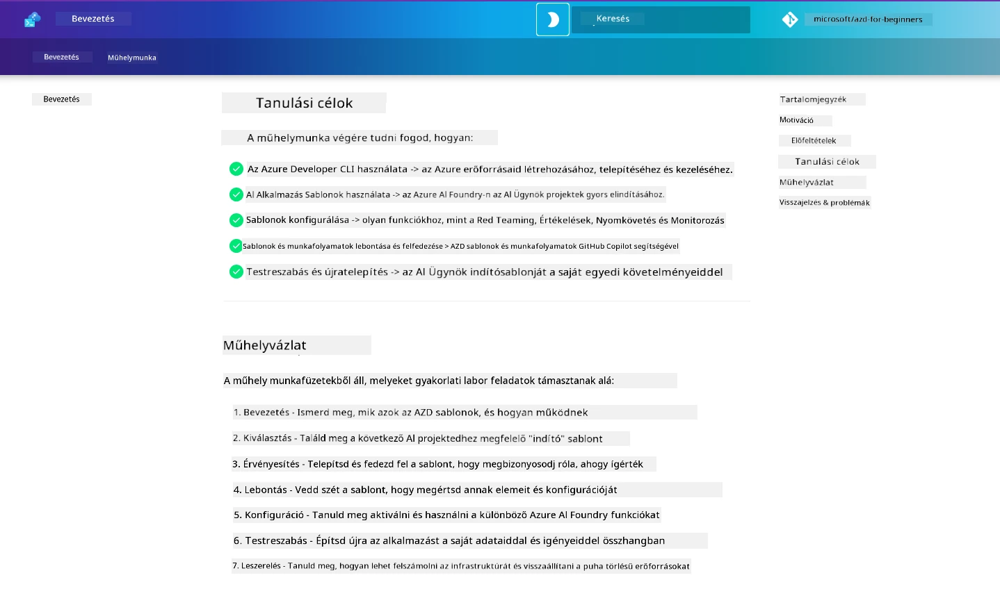

<div align="center">
  <div style="background: linear-gradient(135deg, #0078d4, #106ebe); border-radius: 10px; padding: 20px; margin: 20px 0; box-shadow: 0 4px 15px rgba(0, 120, 212, 0.3); border: 2px solid #005a9e;">
    <h2 style="color: white; margin: 0; font-size: 24px; text-shadow: 1px 1px 2px rgba(0,0,0,0.3);">
      🎯 AZD a mesterséges intelligencia fejlesztőknek workshop
    </h2>
    <p style="color: white; margin: 10px 0 0 0; font-size: 16px; text-shadow: 1px 1px 2px rgba(0,0,0,0.3);">
      <strong>Gyakorlati workshop az Azure Developer CLI-vel AI alkalmazások építéséhez.</strong><br>
      Teljesítsd a 7 modult, hogy elsajátítsd az AZD sablonokat és az AI telepítési munkafolyamatokat.
    </p>
    <div style="margin-top: 15px;">
      <span style="background: rgba(255,255,255,0.2); padding: 5px 10px; border-radius: 15px; color: white; font-size: 14px;">
        📅 Forrás útmutató ellenőrizve: 2026 november
      </span>
    </div>
  </div>
</div>

# AZD a mesterséges intelligencia fejlesztőknek workshop

Üdvözlünk a gyakorlati workshopon, amely az Azure Developer CLI (AZD) AI alkalmazások telepítésére fókuszáló használatát tanítja. Ez a workshop 3 lépésben segít mélyrehatóan megismerni az AZD sablonokat:

1. **Felfedezés** - találd meg a számodra megfelelő sablont.
1. **Telepítés** - telepítsd és ellenőrizd, hogy működik
1. **Testreszabás** - módosítsd és ismételd meg, hogy a sajátoddá váljon!

A workshop során megismerkedsz a fő fejlesztői eszközökkel és munkafolyamatokkal is, hogy egyszerűsítsd a teljes fejlesztési folyamatodat.

<br/>

## Böngészőalapú útmutató

A workshop leckéi Markdown formátumban vannak. Közvetlenül a GitHubon navigálhatsz bennük – vagy elindíthatsz egy böngészőalapú előnézetet az alábbi képernyőkép szerint.



Ehhez az opcióhoz készíts egy forkot a repositoriról a profilodra, majd indítsd el a GitHub Codespaces-et. Amikor a VS Code terminál aktív, írd be ezt a parancsot:

Ez a böngészőelőnézet működik GitHub Codespaces-ben, fejlesztőkörnyezetekben vagy egy helyi klónban, ha telepítve van Python és MkDocs.

```bash title="" linenums="0"
python -m pip install -r requirements-dev.txt
python -m mkdocs serve --config-file workshop/mkdocs.yml
```

Ezeket a parancsokat a **tanfolyam tárhely gyökeréből** kell futtatni, nem az AI minta külön elindított könyvtárából. Tartsd az előnézetet az előtérben, hogy a hibák láthatók maradjanak; a Ctrl+C-vel állíthatod le. Az oldalt kiszolgálás nélkül a `python -m mkdocs build --strict --config-file workshop/mkdocs.yml` paranccsal tudod megnézni.

Pár másodperc múlva megjelenik egy felugró ablak. Válaszd az opciót `Open in browser`. A webalapú útmutató most új böngészőfülön nyílik meg. Ez az előnézet többek között a következő előnyökkel jár:

1. **Beépített keresés** - gyorsan megtalálhatod a kulcsszavakat vagy leckéket.
1. **Másolás ikon** - az egérrel a kódrészletek fölé húzva jelenik meg
1. **Téma váltás** - válthatsz világos és sötét megjelenés között
1. **Segítségkérés** - kattints a Discord ikonra a láblécben a csatlakozáshoz!

<br/>

## Workshop áttekintés

**Időtartam:** 3-4 óra  
**Szint:** Kezdőtől középhaladóig  
**Előfeltételek:** Ismeretek az Azure-ról, AI fogalmakról, VS Code-ról és parancssori eszközökről.

Ez egy gyakorlati workshop, ahol a tanulás cselekvéssel történik. A gyakorlatok elvégzése után ajánljuk az AZD Kezdőknek tananyagot, hogy folytasd a tanulást a biztonság és a termelékenység legjobb gyakorlataira fókuszálva.

| Idő| Modul  | Cél |
|:---|:---|:---|
| 15 perc | [Bevezető](docs/instructions/0-Introduction.md) | A téma felvezetése, célok megértése |
| 30 perc | [AI Sablon kiválasztása](docs/instructions/1-Select-AI-Template.md) | Opciók felfedezése és kezdő sablon választása | 
| 30 perc | [AI Sablon érvényesítése](docs/instructions/2-Validate-AI-Template.md) | Alapmegoldás telepítése Azure-ra |
| 30 perc | [AI Sablon szétszedése](docs/instructions/3-Deconstruct-AI-Template.md) | Szerkezet és konfiguráció felfedezése |
| 30 perc | [AI Sablon konfigurálása](docs/instructions/4-Configure-AI-Template.md) | Elérhető funkciók aktiválása és kipróbálása |
| 30 perc | [AI Sablon testreszabása](docs/instructions/5-Customize-AI-Template.md) | A sablon igényeid szerinti igazítása |
| 30 perc | [Infrastruktúra bontása](docs/instructions/6-Teardown-Infrastructure.md) | Erőforrások kitakarítása és felszabadítása |
| 15 perc | [Összefoglalás & következő lépések](docs/instructions/7-Wrap-up.md) | Tanulási források, workshop kihívás |

<br/>

## Amit megtanulsz

Az AZD sablont tekintheted egy tanuló játszótérnek különféle képességek és eszközök felfedezésére a Microsoft Foundry végponttól végpontig történő fejlesztéséhez. A workshop végére intuitív érzéked lesz e kontextus különböző eszközeihez és fogalmaihoz.

| Fogalom  | Cél |
|:---|:---|
| **Azure Developer CLI** | Az eszközparancsok és munkafolyamatok megértése|
| **AZD sablonok**| Projekt szerkezet és konfiguráció megértése|
| **Azure AI Agent**| Microsoft Foundry projekt létrehozása és telepítése  |
| **Azure AI Search**| Kontextus-alapú mérnökség engedélyezése ügynökökkel |
| **Megfigyelhetőség**| Követés, monitorozás és értékelések felfedezése |
| **Red Teaming**| Ellenséges tesztelés és enyhítési megoldások feltérképezése |

<br/>

## A workshop felépítése

A workshop úgy van felépítve, hogy elvezessen a sablon felfedezésétől a telepítésen, szétszedésen át a testreszabásig - az hivatalos [AI ügynökökkel való kezdés](https://github.com/Azure-Samples/get-started-with-ai-agents) kezdő sablon alapjaként használata mellett.

### [1. modul: AI sablon kiválasztása](docs/instructions/1-Select-AI-Template.md) (30 perc)

- Mik azok az AI sablonok?
- Hol találhatók AI sablonok?
- Hogyan kezdjem el építeni AI ügynökök?
- **Labor**: Gyors indulás Codespaces-ben vagy fejlesztőkörnyezetben

### [2. modul: AI sablon érvényesítése](docs/instructions/2-Validate-AI-Template.md) (30 perc)

- Mi az AI sablon architektúra?
- Mi az AZD fejlesztési munkafolyamat?
- Hogyan kérhetek segítséget az AZD fejlesztéshez?
- **Labor**: AI ügynök sablon telepítése és érvényesítése

### [3. modul: AI sablon szétszedése](docs/instructions/3-Deconstruct-AI-Template.md) (30 perc)

- Fedezd fel a környezetedet az `.azure/`-ban
- Fedezd fel erőforrásaid beállítását az `infra/`-ban
- Fedezd fel AZD konfigurációdat az `azure.yaml`-ben
- **Labor**: Környezeti változók módosítása és újratelepítés

### [4. modul: AI sablon konfigurálása](docs/instructions/4-Configure-AI-Template.md) (30 perc)
- Fedezd fel: Visszakereséssel kiegészített generálás
- Fedezd fel: Ügynök értékelés és red teaming
- Fedezd fel: Követés és monitorozás
- **Labor**: AI ügynök és megfigyelhetőség felfedezése

### [5. modul: AI sablon testreszabása](docs/instructions/5-Customize-AI-Template.md) (30 perc)
- Határozd meg: Termékkövetelmény dokumentum forgatókönyvvel
- Konfiguráld: Környezeti változók az AZD-hez
- Valósítsd meg: Életciklus horgok hozzáadott feladatokhoz
- **Labor**: Sablon testreszabása az én forgatókönyvemre

### [6. modul: Infrastrukturális bontás](docs/instructions/6-Teardown-Infrastructure.md) (30 perc)
- Összefoglalás: Mik az AZD sablonok?
- Összefoglalás: Miért használjuk az Azure Developer CLI-t?
- Következő lépések: Próbálj ki egy másik sablont!
- **Labor**: Infrastrukturális bontás és takarítás

<br/>

## Workshop kihívás

Szeretnéd magad kihívás elé állítani és többet csinálni? Íme néhány projektjavaslat – vagy oszd meg ötleteidet velünk!

| Projekt | Leírás |
|:---|:---|
|1. **Egy összetett AI sablon elemzése** | Használd a felvázolt munkafolyamatot és eszközöket, és próbáld meg telepíteni, érvényesíteni, valamint testreszabni egy másik AI megoldász sablont. _Mit tanultál?_|
|2. **Testreszabás a saját forgatókönyvedhez**  | Próbálj meg írna egy PRD-t (Termékkövetelmény dokumentum) egy másik forgatókönyvhöz. Ezután használd a GitHub Copilot-ot az ügynök modell sablonrepo-ban, és kérd meg, hogy generáljon neked testreszabási munkafolyamatot. _Mit tanultál? Hogyan javíthatnál ezeken a javaslatokon?_|
| | |

## Van visszajelzésed?

1. Nyiss egy issue-t ebben a tárolóban – jelöld meg `Workshop` címkével a könnyebb kezelhetőségért.
1. Csatlakozz a Microsoft Foundry Discordhoz – találkozz a társaiddal!


| | | 
|:---|:---|
| **📚 Tanfolyam otthona**| [AZD kezdőknek](../README.md)|
| **📖 Dokumentáció** | [Kezdj bele az AI sablonokba](https://learn.microsoft.com/en-us/azure/ai-foundry/how-to/develop/ai-template-get-started)|
| **🛠️AI sablonok** | [Microsoft Foundry sablonok](https://ai.azure.com/templates) |
|**🚀 Következő lépések** | [Indítsd el a workshopot](#workshop-overview) |
| | |

<br/>

---

**Navigáció:** [Fő tanfolyam](../README.md) | [Bevezető](docs/instructions/0-Introduction.md) | [1. modul: Sablon kiválasztása](docs/instructions/1-Select-AI-Template.md)

**Készen állsz, hogy AI alkalmazásokat építs AZD-vel?**

[Indítsd el a workshopot: Bevezető →](docs/instructions/0-Introduction.md)

---

<!-- CO-OP TRANSLATOR DISCLAIMER START -->
**Jogi nyilatkozat**:
Ez a dokumentum az AI fordítási szolgáltatás, a [Co-op Translator](https://github.com/Azure/co-op-translator) segítségével készült. Bár az pontosságra törekszünk, kérjük, vegye figyelembe, hogy az automatikus fordítások hibákat vagy pontatlanságokat tartalmazhatnak. Az eredeti dokumentum az anyanyelvén tekintendő hiteles forrásnak. Fontos információk esetén professzionális emberi fordítást javasolunk. Nem vállalunk felelősséget semmilyen félreértésért vagy téves értelmezésért, amely ebből a fordításból ered.
<!-- CO-OP TRANSLATOR DISCLAIMER END -->