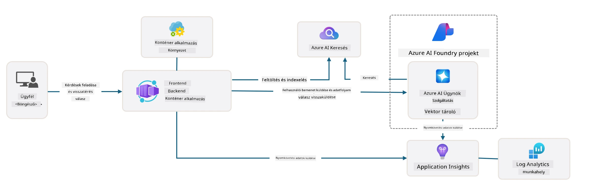
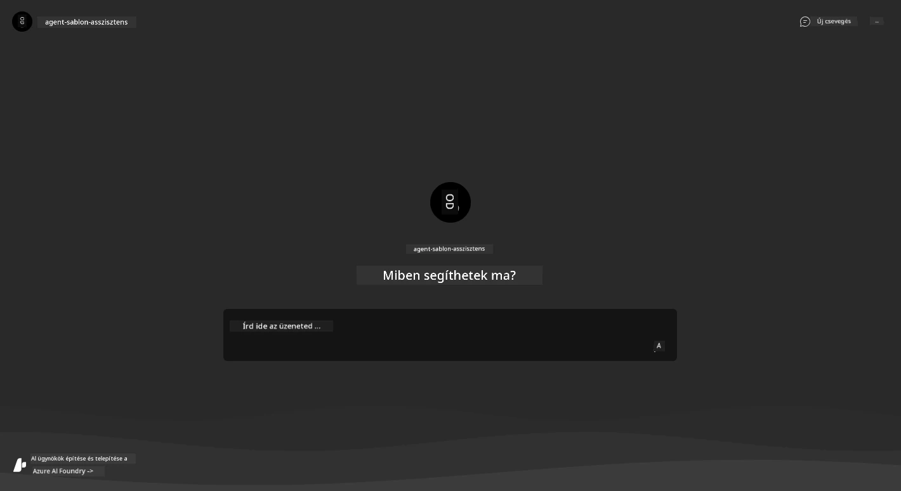

# 2. Egy sablon érvényesítése

> A forrás útmutatását az AZD 1.37.2 és a jelenlegi minta alapján felülvizsgálták 2026. november 4-én. A képernyőképek szemléltető jellegűek; a portál navigációja, a sablon alapértelmezett beállításai és a szolgáltatások elérhetősége változhat. Ez az áttekintés nem végzett élő Azure telepítést.

!!! tip "A MODUL VÉGÉRE KÉPES LESZ"

    - [ ] Identify the sample's prerequisites and intended resources
    - [ ] Deploy the selected template into an intentional environment
    - [ ] Verify the application and agent behavior separately from deployment success
    - [ ] **Lab 2:** Record evidence of a working baseline, or an actionable deployment blocker

---

## 1. Ellenőrizze az előfeltételeket

Az [Azure Developer CLI](https://learn.microsoft.com/azure/developer/azure-developer-cli/) kezeli az alkalmazás telepítését a sablon konfigurációja, infrastruktúrája és kódja alapján. Ellenőrizze a telepített verzióját:

```bash
azd version
```

Szükség esetén használja a [jelenlegi telepítési/frissítési utasításokat](https://learn.microsoft.com/azure/developer/azure-developer-cli/install-azd). Az átvizsgált minta deklarálja az AZD `>=1.14.0` verziót, de ajánlott egy jelenleg támogatott kiadás használata. Az opcionális MI kiterjesztéseknek külön verziókövetelményei vannak; ennek a mintának a normál `azd up` munkafolyamata nem igényli az ügynök kiterjesztést.

A telepítés előtt olvassa el a minta [Azure fiók beállítását](https://github.com/Azure-Samples/get-started-with-ai-agents/blob/main/docs/azure_account_setup.md) és [telepítési útmutatóját](https://github.com/Azure-Samples/get-started-with-ai-agents/blob/main/docs/deployment.md). Erősítse meg előfizetését, jogosultságait, a modell elérhetőségét, a régiós kvótát és a várható díjakat. Egy Azure ingyenes fiók nem garantál hozzáférést vagy ingyenes használatot minden szükséges szolgáltatáshoz.

## 2. Nyissa meg a kiválasztott mintát

Használja a [Get Started with AI Agents](https://github.com/Azure-Samples/get-started-with-ai-agents) tárhelyet, amelyet az 1. modulban inicializáltak. Ha még nem inicializálta, válasszon az alábbi lehetőségek közül:

- Nyisson meg egy [Codespace-et a mintához](https://github.com/codespaces/new/Azure-Samples/get-started-with-ai-agents).
- Klónozza a mintát, és kövesse a helyi/dev-container beállítást.
- Egy **üres könyvtárban** futtassa:

```bash
azd init --template Azure-Samples/get-started-with-ai-agents .
```

Ne inicializáljon egy második sablont egy meglévő projekten. A további parancsokat a mintagyökérből futtassa, amely tartalmazza a `azure.yaml`-t, ne pedig a kurzus tárhelyének gyökeréből.

A minta egy ügynök által támogatott csevegőalkalmazást hosztol Container Apps-ben, és provisionál támogató Foundry erőforrásokat. Tekintse át a jelenlegi architektúrát és az opcionális szolgáltatásokat, ne tekintsen egy régi képernyőképet a pontos erőforráskészletként.



## 3. Szándékos telepítés

```bash
azd auth login
azd up
```

Tekintse át a kérdéseket:

1. Válasszon egy egyedi AZD környezetnevet.
2. Válassza ki a szándékolt előfizetést, ne csak az elsőként felajánlottat.
3. Válasszon olyan régiót, amelyet a szükséges modell/verzió/SKU és az Ön kvótája támogat.
4. Olvassa el a provisioning, telepítés és utótelepítési hook kimenetet.

Az átvizsgált alapértelmezett értékek `gpt-5-mini`, verzió `2025-08-07` és `GlobalStandard`. Ellenőrizze a inicializált sablonját és a [támogatott modell/régió kombinációkat](https://learn.microsoft.com/azure/ai-services/agents/concepts/model-region-support). Egyetlen régió sem garantáltan működik minden esetben.

A telepítés időtartama változó. Ha a provisioning meghiúsul, mentse el a hibát és javítsa az okát újrapróbálkozás előtt. Ne törölje a telepítést vagy ne tisztítsa ki véglegesen az erőforrásokat általános hibakeresési lépésként.

## 4. Érvényesítse az alkalmazást

```bash
azd show
```

Nyissa meg a `api_and_frontend` végpontot, vagy keresse meg a Container App-et a telepítés erőforráscsoportjában a [Azure portálon](https://portal.azure.com/). Kövesse a minta hozzáférési/azonosítási utasításait, ha bejelentkezés szükséges; ne tiltsa le az azonosítást csak azért, hogy átfussanak az egyszerű tesztek.



Próbáljon ki néhány [minta kérdést](https://github.com/Azure-Samples/get-started-with-ai-agents/blob/main/docs/sample_questions.md):

- Egy általános ténykérdés.
- Egy kérdés, amelyre a válasz jelen kell legyen a minta feltöltött dokumentumaiban.
- Egy kérdés, amelyre ezekből a dokumentumokból nem lehet válaszolni.

Ellenőrizze, hogy az UI betöltődik, az API válaszol, az adatlekérés a várt adatokat használja, az idézetek megfelelnek a forrás tartalomnak, és a nem támogatott kérdések megfelelően vannak kezelve. Egy sikeres `azd up` üzenet önmagában nem igazolja ezeket az eredményeket.

## 5. Vizsgálja meg a telepített ügynököt

Nyissa meg a projektet a [Foundry portálon](https://ai.azure.com/). Az áttekintett portál folyamatban válassza a **Build** majd az **Agents** lehetőséget, és találja meg a mintából létrehozott ügynököt. A navigációs címkék változhatnak.

Jegyezze fel:

- Az ügynök nevét és verzióját.
- A konfigurált modell telepítést.
- A tényleges utasításokat és engedélyezett eszközöket.
- Mely fájlok vagy keresési indexek vannak hozzákapcsolva, és hogy a beállítás sikeresen befejeződött-e.

A vizsgált minta az ügynök azonosítására `agent_name:agent_version` formátumot használ értékelő tesztjeihez. Ne másoljon klasszikus ügynök/feladat azonosítót egy régi képernyőképről egy újabb API munkafolyamatba.

Hasonlítsa össze a feltöltött dokumentumokat a `src/files/`-val az inicializált változatában. Korábbi képernyőképek 32 fájlt mutattak; ez a szám nem garantált aktuális alapértelmezés. Ellenőrizzen minden választ a minta vevőiről/termékeiről a tényleges szintetikus forrásadatokkal szemben, és ne töltsön fel valós ügyféladatokat ehhez a gyakorlathoz.

## 6. Hasonlítsa össze a játszóteret

Nyissa meg a kiválasztott ügynök játszóterét a Foundry-ban, és tegye fel ugyanazt a lekérdezést. Hasonlítsa össze a konfigurált ügynök verzióját, eszközeit, idézeteit és a válasz minőségét a telepített alkalmazással.

A válaszok valószínűségi alapon működnek; a szóról szóra egyezés nem a mérce. Ha az eredmények jelentősen eltérnek, ellenőrizze, hogy az alkalmazás és a játszótér ugyanazt a projektet, ügynök/verziót és tudásforrást célozza-e meg.

## 7. Ellenőrizze a megfigyelhetőségi előfeltételeket

A minta [megfigyelhetőségi útmutatója](https://github.com/Azure-Samples/get-started-with-ai-agents/blob/main/docs/observability.md) az igazság forrása a követés, értékelés és red-teaming beállításokhoz.

Az áttekintett infrastruktúra alapértelmezésben az Application Insights engedélyezve van, de a **kliens követés le van tiltva** (`ENABLE_AZURE_MONITOR_TRACING=false`). Egy monitorozó erőforrás létrehozása nem bizonyítja, hogy az alkalmazás exportálja a követéseket. Az 5. modul foglalkozik a követés engedélyezésével és egy tesztkérés generálásával.

Használja a Container App alkalmazás naplóit a indítás/API hibák vizsgálatához. A Foundry-ban vizsgálja meg az ügynök elérhető követési és monitorozási nézeteit. Az értékelési bejegyzésekhez a megfelelő konfiguráció, támogatott értékelők/régió és tényleges kérések szükségesek; nem garantált, hogy minden futásnál automatikusan megjelennek.

Hagyja alapértelmezettként letiltva a prompt/válasz tartalom rögzítését, kivéve ha a magánélet, megőrzés, hozzáférés és kitakarás feltételeit ellenőrizték.

## 8. Értse meg a környezeti értékeket

Az AZD a kiválasztott környezetet a `.azure/<environment-name>/` alatt tárolja. Az állandó bemenetek és a telepítési kimenetek lekérdezhetők:

```bash
azd env list
azd env get-value AZURE_ENV_NAME
azd env get-value AZURE_LOCATION
```

A `azd env get-values` kilistázza az összes értéket, amelyek érzékeny konfigurációt is tartalmazhatnak. Ne másolja be ezt a kimenetet nyilvános kérdésekbe vagy naplókba.

Az AZD a kiválasztott környezetet használja parancsai/hookjai futtatásakor, miközben a folyamat környezeti változói is befolyásolhatják a parancsokat és sablonokat. Ez **nem** exportál értékeket a szülő shelljébe vagy minden önállóan indított Python folyamatba. Kövesse a minta [helyi fejlesztési utasításait](https://github.com/Azure-Samples/get-started-with-ai-agents/blob/main/docs/local_development.md).

A sablon alapértelmezések alkalmazhatók `infra/main.parameters.json`-ban anélkül, hogy explicit helyi értékként jelenjenek meg. Egy tetszőleges változó beállítása nem változtatja meg az infrastruktúrát, hacsak a sablon nem használja azt fel.

Például, hogy kifejezetten kiválassza a felülvizsgált modell alapértelmezéseket:

```bash
azd env set AZURE_AI_AGENT_MODEL_NAME gpt-5-mini
azd env set AZURE_AI_AGENT_MODEL_VERSION 2025-08-07
azd env set AZURE_AI_AGENT_DEPLOYMENT_SKU GlobalStandard
azd provision --preview
azd up
```

Először vizsgálja meg a kompatibilitást, kapacitást, elérhetőséget és a tervezett változtatásokat. Az infrastruktúra frissítése provisioningot igényel; önmagában az `azd deploy` nem elegendő. A támogatott modellváltoztatások általában nem igénylik az egész alkalmazás lebontását.

A `azd env refresh` lekéri a telepítési kimeneteket egy elérhető környezethez; nem rekonstruál minden egyedi bemenetet, nem szinkronizál titkokat, és nem helyettesíti a konfigurációkezelést.

## 9. Rögzítse bázisértékeit

- [ ] A helyes környezet, előfizetés, régió és modell ellenőrizve.
- A provisioning, telepítés és a szükséges beállítási hook-ok befejezve megoldatlan hibák nélkül.
- Az alkalmazáshoz való hozzáférés, csevegés, lekérés és idézetek ellenőrizve.
- Az ügynök/verzió és a tudásforrás azonosítva.
- A megfigyelhetőségi előfeltételek és esetleges fennmaradó akadályok dokumentálva.

Folytassa a [Egy sablon lebontása](3-Deconstruct-AI-Template.md) lépéssel.

---

<!-- CO-OP TRANSLATOR DISCLAIMER START -->
**Jogi nyilatkozat**:
Ez a dokumentum az AI fordítási szolgáltatás, a [Co-op Translator](https://github.com/Azure/co-op-translator) segítségével készült. Bár az pontosságra törekszünk, kérjük, vegye figyelembe, hogy az automatikus fordítások hibákat vagy pontatlanságokat tartalmazhatnak. Az eredeti dokumentum az anyanyelvén tekintendő hiteles forrásnak. Fontos információk esetén professzionális emberi fordítást javasolunk. Nem vállalunk felelősséget semmilyen félreértésért vagy téves értelmezésért, amely ebből a fordításból ered.
<!-- CO-OP TRANSLATOR DISCLAIMER END -->