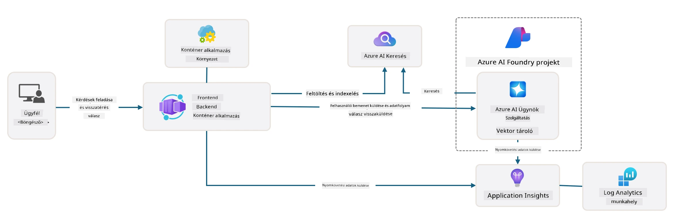

# 3. Egy sablon bontása

!!! tip "A MODUL VÉGÉRE KÉPES LESZEL"

    - [ ] Use GitHub Copilot and optional MCP tools for Azure documentation and read-only exploration
    - [ ] Identify the template's application, infrastructure, configuration, and test entry points
    - [ ] Verify generated explanations against actual repository files
    - [ ] **Lab 3:** Trace one request and one configuration input through the project

---

## 1. GitHub Copilot aktiválása

Nyisd meg a inicializált AI mintát a VS Code-ban, és engedélyezd a [GitHub Copilot](https://code.visualstudio.com/docs/copilot/chat/chat-agent-mode) szolgáltatást. Jelentkezz be olyan fiókkal, amely jogosult tervvel rendelkezik; a használati korlátok változóak. Kérd meg a Copilot-ot, hogy magyarázza el a tárolót a változtatások engedélyezése előtt.

### Választható MCP szerverek

Ezek a szolgáltatások további eszközöket biztosíthatnak:

- [Azure MCP szerver](https://learn.microsoft.com/azure/developer/azure-mcp-server/overview)
- [Microsoft Learn MCP szerver](https://learn.microsoft.com/training/support/mcp)

A VS Code-ban tekintsd át a [MCP konfigurációs útmutatót](https://code.visualstudio.com/docs/copilot/chat/mcp-servers), és hozd létre a `.vscode/mcp.json` fájlt, ha szükséges:

```json
{
  "servers": {
    "Azure MCP Server": {
      "type": "stdio",
      "command": "npx",
      "args": ["-y", "@azure/mcp@latest", "server", "start"]
    },
    "microsoft.docs.mcp": {
      "type": "http",
      "url": "https://learn.microsoft.com/api/mcp"
    }
  }
}
```

Az `npx` parancs támogatott Node.js/npm telepítést igényel, és végrehajtható kódot tölt le. Vizsgáld meg a csomagot, és rögzíts engedélyezett verziót az ismételhető csapatbeállításhoz. Indítsd el a szervereket a VS Code MCP vezérlőivel, és tekintsd meg az elérhető eszközöket; a nevek verziók között változhatnak.

**Az azonosítás külön van kezelve.** Használd az `azd auth login`-t AZD-hez. Kövesd az Azure MCP dokumentált azonosítási folyamatát az eszközök számára; az AZD bejelentkezés önmagában nem hoz létre MCP munkamenetet. Az `az login`-at használd külön, amikor egy feladat vagy hook az Azure CLI-t hívja meg.

Próbálj ki csak olvasási parancsokat:

1. „Használd a Microsoft Learn MCP-t az Azure Developer CLI konfigurációs dokumentációjának megtalálásához.”
2. „Magyarázd el ennek a tárolónak az `azure.yaml`-ját; idézd az egyes hookokat megvalósító fájlokat.”
3. „Az elérhető Azure MCP eszközök használatával sorold fel a telepített erőforrásaimat anélkül, hogy bármit módosítanál.”

Ellenőrizd a kiválasztott bérlőt/előfizetést és minden javasolt eszközhívást. Ne engedélyezd erőforrás létrehozását, törlését vagy hozzáférés megváltoztatását pusztán az architektúra feltérképezése érdekében.

## 2. Értsd meg az architektúrát

A minta Python FastAPI backendet és React/TypeScript frontendet futtat Azure Container Appsekben. A backend kommunikál egy agenttel egy Microsoft Foundry projektben. Az adatok lekérése és megfigyelése az engedélyezett sablonfunkcióktól és a sikeres beállítástól függ; nem garantált, hogy működik csak azért, mert az alkalmazás telepítve lett.



Hasonlítsd össze ezt az ábrát a [jelenlegi upstream telepítési útmutatóval](https://github.com/Azure-Samples/get-started-with-ai-agents/blob/main/docs/deployment.md) és a saját erőforrásaiddal. Ellenőrizd a konfigurált modelltelepítést, az agent eszközöket, kezelt identitást, szerepköri hozzárendeléseket és az opcionális AI Search/Application Insights erőforrásokat.

**Gyakorlat:** Kérd meg a Copilot-ot, hogy kövesse nyomon egy chat kérés útját a frontendtől az API-n keresztül a Foundry-ig, fájl- és függvény hivatkozásokkal. Nyisd meg azokat a hivatkozásokat, és ellenőrizd a magyarázatot. Ne következtess a megvalósított hitelesítésre, útválasztásra vagy engedélyezésre csak az ábra alapján.

## 3. Tároló szerkezete

A következő kiválasztott elérési utak 2026. november 4-én lettek ellenőrizve a mintán. Az inicializált verziód marad az igazság forrása:

```text
get-started-with-ai-agents/
  azure.yaml
  docker-compose.yaml
  requirements-dev.txt
  .devcontainer/
  infra/
    main.bicep
    main.parameters.json
    api.bicep
    core/
  src/
    Dockerfile
    pyproject.toml
    requirements.txt
    api/
      main.py
      routes.py
      search_index_manager.py
    frontend/
      package.json
      src/
    files/
  scripts/
    validate_env_vars.sh
    validate_env_vars.ps1
    postdeploy.sh
    postdeploy.ps1
  tests/
    test_evaluation.py
    test_red_teaming.py
  docs/
    deployment.md
    deploy_customization.md
    ai_search.md
    observability.md
    local_development.md
    troubleshooting.md
```

### Infrastruktúra és konfiguráció

Az `infra/main.bicep` kezeli az erőforrásokat; az `main.parameters.json` kapcsolja össze a sablon bemeneteket az AZD környezeti értékekkel. Az `azure.yaml` választja ki az alkalmazás szolgáltatást és az életciklus hookokat. Kövesd nyomon egy olyan bemenetet, mint az `USE_AZURE_AI_SEARCH_SERVICE` ezekben a fájlokban, hogy megtaláld mi változik valójában.

### Alkalmazás és identitás

Olvasd együtt az `src/api/` és az `src/frontend/` fájlokat. Határozd meg, hol jön létre vagy kerül lekérésre az agent, hol konfigurálják az utasításokat/eszközöket, és melyik identitás használatával történnek az Azure hívások. Az `src/files/` alatti minta fájlok bemutató adatok, nem termelési katalógus vagy engedélyezési modell.

### Tesztek és megfigyelhetőség

A jelenlegi értékelési és red-teaming belépési pontok az `tests/` alatt találhatók; a régebbi `evals/` és `airedteaming/` könyvtári hivatkozások elavultak ehhez a mintához. Futtatás előtt olvasd el az `docs/observability.md`-öt a követelményekről és költségekről. Ezek a Python tesztek különállóak az opcionális `azure.ai.evaluations` AZD kiterjesztéstől.

## 4. Ellenőrizd a megállapításaidat

- Azonosítsd az API útvonalat, az agent interakciót és a lekérési kódot egy minta kérdés alapján.
- Magyarázd el, melyik identitás fér hozzá a Foundry-hoz, és melyik konfiguráció választja ki annak végpontját.
- Találd meg a tényleges pre-up és post-deploy szkripteket és azok hibakezelési viselkedését.
- Sorold fel az esetleges függőségeket vagy hiányzó opcionális funkciókat a telepítésedben.

Folytasd a [Sablon konfigurálása](4-Configure-AI-Template.md) tematikával.

---

<!-- CO-OP TRANSLATOR DISCLAIMER START -->
**Jogi nyilatkozat**:
Ez a dokumentum az AI fordítási szolgáltatás, a [Co-op Translator](https://github.com/Azure/co-op-translator) segítségével készült. Bár az pontosságra törekszünk, kérjük, vegye figyelembe, hogy az automatikus fordítások hibákat vagy pontatlanságokat tartalmazhatnak. Az eredeti dokumentum az anyanyelvén tekintendő hiteles forrásnak. Fontos információk esetén professzionális emberi fordítást javasolunk. Nem vállalunk felelősséget semmilyen félreértésért vagy téves értelmezésért, amely ebből a fordításból ered.
<!-- CO-OP TRANSLATOR DISCLAIMER END -->