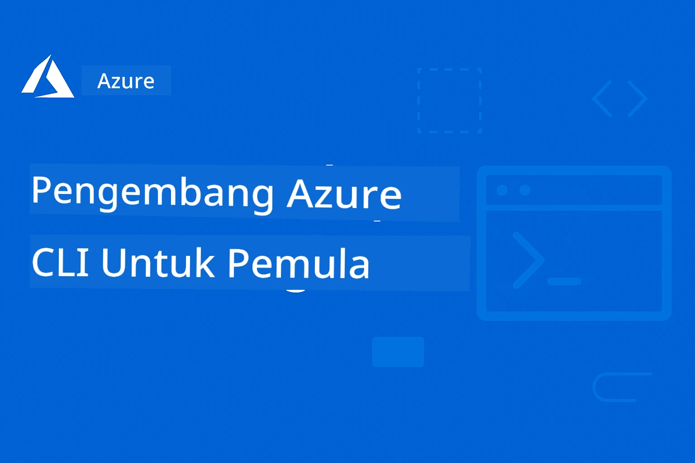

# AZD Untuk Pemula: Perjalanan Pembelajaran Terstruktur

 

[](https://github.com/microsoft/AZD-for-beginners)
[](https://GitHub.com/microsoft/azd-for-beginners/network/)
[](https://github.com/microsoft/AZD-for-beginners)

[](https://discord.com/invite/nkVh3dp)
[](https://discord.gg/nTYy5BXMWG)

---

### Terjemahan Otomatis (Selalu Terbaru)

<!-- CO-OP TRANSLATOR LANGUAGES TABLE START -->
[Arabic](../ar/README.md) | [Bengali](../bn/README.md) | [Bulgarian](../bg/README.md) | [Burmese (Myanmar)](../my/README.md) | [Chinese (Simplified)](../zh-CN/README.md) | [Chinese (Traditional, Hong Kong)](../zh-HK/README.md) | [Chinese (Traditional, Macau)](../zh-MO/README.md) | [Chinese (Traditional, Taiwan)](../zh-TW/README.md) | [Croatian](../hr/README.md) | [Czech](../cs/README.md) | [Danish](../da/README.md) | [Dutch](../nl/README.md) | [Estonian](../et/README.md) | [Finnish](../fi/README.md) | [French](../fr/README.md) | [German](../de/README.md) | [Greek](../el/README.md) | [Hebrew](../he/README.md) | [Hindi](../hi/README.md) | [Hungarian](../hu/README.md) | [Indonesian](./README.md) | [Italian](../it/README.md) | [Japanese](../ja/README.md) | [Kannada](../kn/README.md) | [Khmer](../km/README.md) | [Korean](../ko/README.md) | [Lithuanian](../lt/README.md) | [Malay](../ms/README.md) | [Malayalam](../ml/README.md) | [Marathi](../mr/README.md) | [Nepali](../ne/README.md) | [Nigerian Pidgin](../pcm/README.md) | [Norwegian](../no/README.md) | [Persian (Farsi)](../fa/README.md) | [Polish](../pl/README.md) | [Portuguese (Brazil)](../pt-BR/README.md) | [Portuguese (Portugal)](../pt-PT/README.md) | [Punjabi (Gurmukhi)](../pa/README.md) | [Romanian](../ro/README.md) | [Russian](../ru/README.md) | [Serbian (Cyrillic)](../sr/README.md) | [Slovak](../sk/README.md) | [Slovenian](../sl/README.md) | [Spanish](../es/README.md) | [Swahili](../sw/README.md) | [Swedish](../sv/README.md) | [Tagalog (Filipino)](../tl/README.md) | [Tamil](../ta/README.md) | [Telugu](../te/README.md) | [Thai](../th/README.md) | [Turkish](../tr/README.md) | [Ukrainian](../uk/README.md) | [Urdu](../ur/README.md) | [Vietnamese](../vi/README.md)

> **Lebih suka Clone secara Lokal?**
>
> Repositori ini termasuk lebih dari 50 terjemahan bahasa yang secara signifikan meningkatkan ukuran unduhan. Untuk clone tanpa terjemahan, gunakan sparse checkout:
>
> **Bash / macOS / Linux:**
> ```bash
> git clone --filter=blob:none --sparse https://github.com/microsoft/AZD-for-beginners.git
> cd AZD-for-beginners
> git sparse-checkout set --no-cone '/*' '!translations' '!translated_images'
> ```
>
> **CMD (Windows):**
> ```cmd
> git clone --filter=blob:none --sparse https://github.com/microsoft/AZD-for-beginners.git
> cd AZD-for-beginners
> git sparse-checkout set --no-cone "/*" "!translations" "!translated_images"
> ```
>
> Ini memberi Anda semua yang Anda butuhkan untuk menyelesaikan kursus dengan unduhan yang jauh lebih cepat.
<!-- CO-OP TRANSLATOR LANGUAGES TABLE END -->

## 🆕 Apa yang Baru di azd Hari Ini

> 📌 **Ulasan rilis AI CLI (2026-11-04):** Panduan diperiksa terhadap dokumentasi/sumber **`azd 1.37.2`**, **agen `1.0.0-beta.23`**, dan **evaluasi `1.0.0-beta.2`** yang dipublikasikan. Gunakan `azd >= 1.37.0` untuk alur kerja gabungan. Jalankan `azd version` dan [perbarui core CLI](https://learn.microsoft.com/azure/developer/azure-developer-cli/install-azd) sebelum ekstensi. Lihat [perubahan dan perbaikan rilis](docs/chapter-08-production/production-ai-practices.md#recent-release-changes-and-fixes). Ini bukan validasi deployment langsung untuk seluruh kursus.

Azure Developer CLI mendukung banyak jenis aplikasi, termasuk aplikasi web, API, dan agen AI, melalui host, template, dan ekstensi yang didukung.

Berikut artinya untuk Anda:

- **Agen AI sekarang menjadi beban kerja azd kelas utama.** Anda dapat menginisialisasi, men-deploy, dan mengelola proyek agen AI menggunakan alur kerja `azd init` → `azd up` yang sudah Anda kenal.
- **Siklus hidup agen melalui dua ekstensi.** Gunakan `azure.ai.agents` untuk menginisialisasi, memanggil, mengoptimalkan, dan pensiun agen. Instal **`azure.ai.evaluations`** secara terpisah untuk `azd ai eval init`, `generate`, dan `run start`. Agen beta.22 menggantikan alur evaluasi warisan dan mengubah konfigurasi optimasi; ikuti [panduan migrasi](docs/chapter-08-production/production-ai-practices.md#evaluation-migration-and-quality-checks).
- **Lebih banyak blok bangunan AI.** Ekstensi pratinjau baru—`azure.ai.skills` dan `azure.ai.connections`—memungkinkan Anda mengelola keterampilan agen yang dapat digunakan ulang dan koneksi Foundry langsung dengan azd.
- **Integrasi Microsoft Foundry** menghadirkan deployment model, hosting agen, dan konfigurasi layanan AI langsung ke dalam ekosistem template azd.
- **Dasar-dasar harian yang lebih lancar.** Rilis terbaru membuat `azd init` idempoten (aman untuk dijalankan ulang), membuat `azd auth login` membersihkan token usang secara otomatis, dan menambahkan prompt pengaturan pertama kali `azd tool` yang ramah pengguna.
- **Alur kerja inti tidak berubah.** Baik Anda men-deploy aplikasi todo, mikroservis, atau solusi AI multi-agen, perintahnya tetap sama.

> **Catatan untuk pengguna Aspire:** Microsoft sekarang menyebut produk ini cukup dengan nama **Aspire** (sebelumnya ".NET Aspire"). Dukungan Aspire di azd tidak berubah—hanya namanya yang diperbarui.

Jika Anda pernah menggunakan azd sebelumnya, dukungan AI adalah ekstensi alami—bukan alat terpisah atau jalur lanjutan. Jika Anda memulai dari awal, Anda akan belajar satu alur kerja yang bekerja untuk segalanya.

---

## 🚀 Apa itu Azure Developer CLI (azd)?

**Azure Developer CLI (azd)** adalah alat baris perintah yang ramah pengembang yang memudahkan deploy aplikasi ke Azure. Alih-alih membuat dan menghubungkan puluhan sumber daya Azure secara manual, Anda bisa men-deploy aplikasi lengkap dengan satu perintah.

### Keajaiban `azd up`

```bash
# This single command does everything:
# ✅ Creates all Azure resources  
# ✅ Configures networking and security
# ✅ Builds your application code
# ✅ Deploys to Azure
# ✅ Gives you a working URL
azd up
```

Template menyediakan konfigurasi aplikasi dan infrastruktur. Deploy yang berhasil masih memerlukan layanan/model yang didukung, kuota dan izin yang cukup, input yang benar, serta verifikasi aplikasi yang dideploy. `azd up` tidak secara otomatis membuat template aman, sesuai aturan, atau siap produksi.

---

## ❓ Azure Developer CLI vs Azure CLI: Apa Bedanya?

Ini adalah pertanyaan paling umum yang diajukan pemula. Berikut jawaban sederhana:

| Fitur | **Azure CLI (`az`)** | **Azure Developer CLI (`azd`)** |
|---------|---------------------|--------------------------------|
| **Tujuan** | Mengelola satuan sumber daya Azure | Men-deploy aplikasi lengkap |
| **Pola Pikir** | Fokus infrastruktur | Fokus aplikasi |
| **Contoh** | `az webapp create --name myapp...` | `azd up` |
| **Kurva Pembelajaran** | Harus tahu layanan Azure | Cukup tahu aplikasi Anda |
| **Terbaik Untuk** | DevOps, Infrastruktur | Pengembang, Prototipe |

### Analogi Sederhana

- **Azure CLI** seperti memiliki semua alat untuk membangun rumah - palu, gergaji, paku. Anda bisa membangun apa saja, tetapi harus tahu konstruksi.
- **Azure Developer CLI** seperti menyewa kontraktor - Anda jelaskan apa yang Anda inginkan, dan mereka menangani pembangunan.

### Kapan Pakai Masing-Masing

| Skenario | Pakai Ini |
|----------|----------|
| "Saya ingin men-deploy aplikasi web saya dengan cepat" | `azd up` |
| "Saya perlu membuat hanya akun penyimpanan" | `az storage account create` |
| "Saya membangun aplikasi AI lengkap" | `azd init --template azure-search-openai-demo` |
| "Saya perlu debug sumber daya Azure spesifik" | `az resource show` |
| "Saya ingin men-deploy ke lingkungan produksi yang sudah dikonfigurasi" | Tinjau konfigurasi, akses, biaya, dan gerbang operasional sebelum `azd up --environment production` |

### Mereka Bekerja Bersama!

AZD dan Azure CLI memiliki autentikasi dan konfigurasi terpisah. Gunakan `azd auth login` untuk AZD, dan `az login` saat hook atau perintah diagnostik secara eksplisit membutuhkan Azure CLI. Anda bisa menggunakan keduanya:
```bash
# Deploy your app with AZD
azd up

# Then fine-tune specific resources with Azure CLI
az webapp config set --name myapp --always-on true
```

---

## 🌟 Temukan Template di Awesome AZD

Jangan mulai dari nol! **Awesome AZD** adalah koleksi komunitas dari template siap deploy:

| Sumber Daya | Deskripsi |
|----------|-------------|
| 🔗 [**Galeri Awesome AZD**](https://azure.github.io/awesome-azd/) | Telusuri lebih dari 200 template dengan deploy sekali klik |
| 🔗 [**Kirim Template**](https://github.com/Azure/awesome-azd/issues) | Kontribusikan template Anda sendiri ke komunitas |
| 🔗 [**Repositori GitHub**](https://github.com/Azure/awesome-azd) | Bintang dan jelajahi sumbernya |

### Template AI Populer dari Awesome AZD

Pilih satu template di direktori kosong sendiri; perintah di bawah ini adalah alternatif. Trailing `.` menginisialisasi direktori itu.

```bash
# RAG Chat with Microsoft Foundry Models + AI Search
azd init --template azure-search-openai-demo .

# Quick AI Chat Application
azd init --template openai-chat-app-quickstart .

# AI Agents with Foundry Agents
azd init --template get-started-with-ai-agents .
```

---

## 🎯 Memulai dalam 3 Langkah

Sebelum memulai, pastikan mesin Anda siap untuk template yang ingin Anda deploy:

**Windows:**
```powershell
.\validate-setup.ps1
```

**macOS / Linux:**
```bash
bash ./validate-setup.sh
```

Jika ada pemeriksaan yang gagal, perbaiki terlebih dahulu lalu lanjutkan dengan mulai cepat.

### Langkah 1: Instal AZD (2 menit)

**Windows:**
```powershell
winget install microsoft.azd
```

**macOS:**
```bash
brew tap azure/azd && brew install azd
```

**Linux:**
```bash
curl -fsSL https://aka.ms/install-azd.sh | bash
```

### Langkah 2: Autentikasi untuk AZD

```bash
# Optional if you plan to use Azure CLI commands directly in this course
az login

# Required for AZD workflows
azd auth login
```

Jika Anda tidak yakin mana yang Anda butuhkan, ikuti alur setup penuh di [Instalasi & Pengaturan](docs/chapter-01-foundation/installation.md#authentication-setup).

### Langkah 3: Deploy Aplikasi Pertama Anda

```bash
# Initialize from a template
azd init --template todo-nodejs-mongo .

# Deploy to Azure (creates everything!)
azd up
```

**🎉 Selesai!** Aplikasi Anda kini aktif di Azure.

### Bersihkan (Jangan Lupa!)

```bash
# Remove all resources when done experimenting
azd down --force --purge
```

---

## 📚 Cara Menggunakan Kursus Ini

Kursus ini dirancang untuk **pembelajaran progresif** - mulai dari yang Anda nyaman lalu naikkan tingkatnya:

| Pengalaman Anda | Mulai Di Sini |
|-----------------|------------|
| **Baru di Azure** | [Bab 1: Dasar](#-chapter-1-foundation--quick-start) |
| **Kenal Azure, baru di AZD** | [Bab 1: Dasar](#-chapter-1-foundation--quick-start) |
| **Ingin men-deploy aplikasi AI** | [Bab 2: Pengembangan AI-Pertama](#-chapter-2-ai-first-development-recommended-for-ai-developers) |
| **Ingin latihan langsung** | [🎓 Workshop Interaktif](workshop/README.md) - lab panduan 3-4 jam |
| **Butuh pola produksi** | [Bab 8: Produksi & Enterprise](#-chapter-8-production--enterprise-patterns) |

### Setup Cepat

1. **Fork Repositori Ini**: [](https://GitHub.com/microsoft/azd-for-beginners/fork)
2. **Clone**: `git clone https://github.com/YOUR-USERNAME/azd-for-beginners.git`
3. **Dapatkan Bantuan**: [Komunitas Azure Discord](https://discord.com/invite/ByRwuEEgH4)

> **Lebih suka Clone secara Lokal?**

> Repositori ini termasuk lebih dari 50 terjemahan bahasa yang secara signifikan meningkatkan ukuran unduhan. Untuk clone tanpa terjemahan, gunakan sparse checkout:
> ```bash
> git clone --filter=blob:none --sparse https://github.com/microsoft/AZD-for-beginners.git
> cd AZD-for-beginners
> git sparse-checkout set --no-cone '/*' '!translations' '!translated_images'
> ```
> Ini memberi Anda semua yang Anda butuhkan untuk menyelesaikan kursus dengan unduhan yang jauh lebih cepat.


## Ikhtisar Kursus

Kuasai Azure Developer CLI (azd) melalui bab-bab terstruktur yang dirancang untuk pembelajaran progresif. **Fokus khusus pada penerapan aplikasi AI dengan integrasi Microsoft Foundry.**

### Mengapa Kursus Ini Penting untuk Pengembang Modern

Pengembang yang menerapkan beban kerja AI umumnya memerlukan panduan tentang:
- Arsitektur AI multi-layanan yang kompleks
- Praktik terbaik penerapan AI di lingkungan produksi  
- Integrasi dan konfigurasi layanan AI Azure
- Optimasi biaya untuk beban kerja AI
- Pemecahan masalah khusus penerapan AI

### Tujuan Pembelajaran

Dengan menyelesaikan kursus terstruktur ini, Anda akan:
- **Menguasai Dasar AZD**: Konsep inti, instalasi, dan konfigurasi
- **Menerapkan Aplikasi AI**: Gunakan AZD dengan layanan Microsoft Foundry
- **Mengimplementasikan Infrastruktur sebagai Kode**: Mengelola sumber daya Azure dengan template Bicep
- **Memecahkan Masalah Penerapan**: Menyelesaikan masalah umum dan debugging
- **Mengoptimalkan untuk Produksi**: Keamanan, penskalaan, pemantauan, dan manajemen biaya
- **Membangun Solusi Multi-Agent**: Menerapkan arsitektur AI yang kompleks

## Sebelum Anda Mulai: Akun, Akses, dan Asumsi

Sebelum memulai Bab 1, pastikan Anda mempunyai hal-hal berikut. Langkah instalasi di panduan ini mengasumsikan dasar-dasar ini sudah terpenuhi.

- **Langganan Azure**: Anda dapat menggunakan langganan yang sudah ada dari pekerjaan atau akun pribadi Anda, atau membuat [uji coba gratis](https://aka.ms/azurefreetrial) untuk memulai.
- **Izin membuat sumber daya Azure**: Untuk sebagian besar latihan, Anda sebaiknya memiliki akses minimal **Contributor** pada langganan atau grup sumber daya yang ditargetkan. Beberapa bab juga mengasumsikan Anda dapat membuat grup sumber daya, managed identities, dan penugasan RBAC.
- [**Akun GitHub**](https://github.com): Ini berguna untuk melakukan fork repositori, melacak perubahan Anda sendiri, dan menggunakan GitHub Codespaces untuk workshop.
- **Prasyarat runtime template**: Beberapa template membutuhkan alat lokal seperti Node.js, Python, Java, atau Docker. Jalankan validator setup sebelum mulai agar bisa mendeteksi alat yang hilang sejak awal.
- **Pemahaman dasar terminal**: Anda tidak perlu ahli, tapi Anda harus nyaman menjalankan perintah seperti `git clone`, `azd auth login`, dan `azd up`.

> **Bekerja di langganan perusahaan?**
> Jika lingkungan Azure Anda dikelola oleh administrator, konfirmasikan sebelumnya bahwa Anda bisa menerapkan sumber daya di langganan atau grup sumber daya yang akan Anda pakai. Jika tidak, minta langganan sandbox atau akses Contributor sebelum memulai.

> **Baru di Azure?**
> Mulailah dengan uji coba Azure pribadi Anda atau langganan bayar sesuai pemakaian di https://aka.ms/azurefreetrial sehingga Anda dapat menyelesaikan latihan secara menyeluruh tanpa perlu menunggu persetujuan tingkat tenant.

## 🗺️ Peta Kursus: Navigasi Cepat per Bab

Setiap bab memiliki README khusus dengan tujuan pembelajaran, panduan cepat, dan latihan:

| Bab | Topik | Pelajaran | Durasi | Kompleksitas |
|---------|-------|---------|----------|------------|
| **[Bab 1: Dasar](docs/chapter-01-foundation/README.md)** | Memulai | [Dasar AZD](docs/chapter-01-foundation/azd-basics.md) &#124; [Instalasi](docs/chapter-01-foundation/installation.md) &#124; [Proyek Pertama](docs/chapter-01-foundation/first-project.md) | 30-45 menit | ⭐ |
| **[Bab 2: Pengembangan AI](docs/chapter-02-ai-development/README.md)** | Aplikasi AI-Utama | [Integrasi Foundry](docs/chapter-02-ai-development/microsoft-foundry-integration.md) &#124; [Agen AI](docs/chapter-02-ai-development/agents.md) &#124; [Penerapan Model](docs/chapter-02-ai-development/ai-model-deployment.md) &#124; [Workshop](docs/chapter-02-ai-development/ai-workshop-lab.md) | 1-2 jam | ⭐⭐ |
| **[Bab 3: Konfigurasi](docs/chapter-03-configuration/README.md)** | Otentikasi & Keamanan | [Konfigurasi](docs/chapter-03-configuration/configuration.md) &#124; [Otentikasi & Keamanan](docs/chapter-03-configuration/authsecurity.md) | 45-60 menit | ⭐⭐ |
| **[Bab 4: Infrastruktur](docs/chapter-04-infrastructure/README.md)** | IaC & Penerapan | [Panduan Penerapan](docs/chapter-04-infrastructure/deployment-guide.md) &#124; [Provisioning](docs/chapter-04-infrastructure/provisioning.md) | 1-1.5 jam | ⭐⭐⭐ |
| **[Bab 5: Multi-Agent](docs/chapter-05-multi-agent/README.md)** | Solusi Agen AI | [Skenario Retail](examples/retail-scenario.md) &#124; [Pola Koordinasi](docs/chapter-06-pre-deployment/coordination-patterns.md) | 2-3 jam | ⭐⭐⭐⭐ |
| **[Bab 6: Pra-Penerapan](docs/chapter-06-pre-deployment/README.md)** | Perencanaan & Validasi | [Pengecekan Pra-Penerbangan](docs/chapter-06-pre-deployment/preflight-checks.md) &#124; [Perencanaan Kapasitas](docs/chapter-06-pre-deployment/capacity-planning.md) &#124; [Pemilihan SKU](docs/chapter-06-pre-deployment/sku-selection.md) &#124; [App Insights](docs/chapter-06-pre-deployment/application-insights.md) | 1 jam | ⭐⭐ |
| **[Bab 7: Pemecahan Masalah](docs/chapter-07-troubleshooting/README.md)** | Debug & Perbaikan | [Masalah Umum](docs/chapter-07-troubleshooting/common-issues.md) &#124; [Debugging](docs/chapter-07-troubleshooting/debugging.md) &#124; [Masalah AI](docs/chapter-07-troubleshooting/ai-troubleshooting.md) | 1-1.5 jam | ⭐⭐ |
| **[Bab 8: Produksi](docs/chapter-08-production/README.md)** | Pola Perusahaan | [Praktik Produksi](docs/chapter-08-production/production-ai-practices.md) | 2-3 jam | ⭐⭐⭐⭐ |
| **[🎓 Workshop](workshop/README.md)** | Lab Praktik | [Pengenalan](workshop/docs/instructions/0-Introduction.md) &#124; [Pemilihan](workshop/docs/instructions/1-Select-AI-Template.md) &#124; [Validasi](workshop/docs/instructions/2-Validate-AI-Template.md) &#124; [Dekonstruksi](workshop/docs/instructions/3-Deconstruct-AI-Template.md) &#124; [Konfigurasi](workshop/docs/instructions/4-Configure-AI-Template.md) &#124; [Kustomisasi](workshop/docs/instructions/5-Customize-AI-Template.md) &#124; [Pembongkaran](workshop/docs/instructions/6-Teardown-Infrastructure.md) &#124; [Penutupan](workshop/docs/instructions/7-Wrap-up.md) | 3-4 jam | ⭐⭐ |

**Total Durasi Kursus:** ~10-14 jam | **Progres Kemampuan:** Pemula → Siap Produksi

---

## 📚 Bab Pembelajaran

*Pilih jalur pembelajaran berdasarkan tingkat pengalaman dan tujuan*

### 🚀 Bab 1: Dasar & Memulai Cepat
**Prasyarat**: Langganan Azure, pengetahuan dasar command line  
**Durasi**: 30-45 menit  
**Kompleksitas**: ⭐

#### Apa yang Akan Anda Pelajari
- Memahami dasar Azure Developer CLI
- Menginstal AZD di platform Anda
- Penerapan sukses pertama Anda

#### Sumber Pembelajaran
- **🎯 Mulai di Sini**: [Apa itu Azure Developer CLI?](#-what-is-azure-developer-cli-azd)
- **📖 Teori**: [Dasar AZD](docs/chapter-01-foundation/azd-basics.md) - Konsep inti dan terminologi
- **⚙️ Setup**: [Instalasi & Setup](docs/chapter-01-foundation/installation.md) - Panduan spesifik platform
- **🛠️ Praktik**: [Proyek Pertama Anda](docs/chapter-01-foundation/first-project.md) - Tutorial langkah demi langkah
- **📋 Referensi Cepat**: [Daftar Perintah Cheat Sheet](resources/cheat-sheet.md)

#### Latihan Praktis
```bash
# Quick installation check
azd version

# Deploy your first application
azd init --template todo-nodejs-mongo .
azd up
```

**💡 Hasil Bab**: Berhasil menerapkan aplikasi web sederhana ke Azure menggunakan AZD

**✅ Validasi Keberhasilan:**
```bash
# After completing Chapter 1, you should be able to:
azd version              # Shows installed version
azd init --template todo-nodejs-mongo  # Initializes project
azd up                  # Deploys to Azure
azd show                # Displays running app URL
# Application opens in browser and works
azd down --force --purge  # Cleans up resources
```

**📊 Waktu Investasi:** 30-45 menit  
**📈 Tingkat Kemampuan Setelah:** Dapat menerapkan aplikasi dasar secara mandiri

---

### 🤖 Bab 2: Pengembangan AI-Utama (Disarankan untuk Pengembang AI)
**Prasyarat**: Bab 1 selesai  
**Durasi**: 1-2 jam  
**Kompleksitas**: ⭐⭐

#### Apa yang Akan Anda Pelajari
- Integrasi Microsoft Foundry dengan AZD
- Menerapkan aplikasi bertenaga AI
- Memahami konfigurasi layanan AI

#### Sumber Pembelajaran
- **🎯 Mulai di Sini**: [Integrasi Microsoft Foundry](docs/chapter-02-ai-development/microsoft-foundry-integration.md)
- **🤖 Agen AI**: [Panduan Agen AI](docs/chapter-02-ai-development/agents.md) - Menerapkan agen cerdas dengan AZD
- **📖 Pola**: [Penerapan Model AI](docs/chapter-02-ai-development/ai-model-deployment.md) - Menerapkan dan mengelola model AI
- **🛠️ Workshop**: [Lab Workshop AI](docs/chapter-02-ai-development/ai-workshop-lab.md) - Membuat solusi AI Anda siap AZD
- **🎥 Panduan Interaktif**: [Materi Workshop](workshop/README.md) - Pembelajaran berbasis browser dengan MkDocs * Lingkungan DevContainer
- **📋 Template**: [Template Microsoft Foundry](#featured-microsoft-foundry-templates)
- **📝 Contoh**: [Contoh Penerapan AZD](examples/README.md)

#### Latihan Praktis
```bash
# Deploy your first AI application
azd init --template azure-search-openai-demo .
azd up

# Try additional AI templates
azd init --template openai-chat-app-quickstart .
azd init --template agent-openai-python-prompty .
```

**💡 Hasil Bab**: Menerapkan dan mengonfigurasi aplikasi chat bertenaga AI dengan kemampuan RAG

**✅ Validasi Keberhasilan:**
```bash
# After Chapter 2, you should be able to:
azd init --template azure-search-openai-demo .
azd up
# Test the AI chat interface
# Ask questions and get AI-powered responses with sources
# Verify search integration works
azd monitor  # Check Application Insights shows telemetry
azd down --force --purge
```

**📊 Waktu Investasi:** 1-2 jam  
**📈 Tingkat Kemampuan Setelah:** Dapat menerapkan aplikasi pembelajaran AI dan mengidentifikasi kebutuhan kesiapan produksi tambahan
**💰 Kesadaran Biaya:** Memahami biaya pengembangan $80-150/bulan, biaya produksi $300-3500/bulan

#### 💰 Pertimbangan Biaya untuk Penerapan AI

**Lingkungan Pengembangan (Perkiraan $80-150/bulan):**
- Model Microsoft Foundry (Bayar sesuai pemakaian): $0-50/bulan (berdasarkan penggunaan token)
- AI Search (Tingkat dasar): $75/bulan
- Container Apps (Konsumsi): $0-20/bulan
- Penyimpanan (Standar): $1-5/bulan

**Lingkungan Produksi (Perkiraan $300-3.500+/bulan):**
- Model Microsoft Foundry (PTU untuk performa konsisten): $3.000+/bulan ATAU Bayar sesuai pemakaian dengan volume tinggi
- AI Search (Tingkat standar): $250/bulan
- Container Apps (Dedicated): $50-100/bulan
- Application Insights: $5-50/bulan
- Penyimpanan (Premium): $10-50/bulan

**💡 Tips Optimasi Biaya:**
- Periksa harga inferensi model dan kredit spesifik akun; Azure OpenAI tidak termasuk kuota gratis 50.000 token per bulan secara universal
- Jalankan `azd down` untuk menghapus sumber daya saat tidak diperlukan lagi, setelah meninjau lingkungan yang dipilih
- Mulai dengan penagihan berbasis konsumsi, naikkan ke PTU hanya untuk produksi
- Gunakan `azd provision --preview` untuk memeriksa infrastruktur yang direncanakan, lalu hitung harga sumber daya tersebut dengan Azure Pricing Calculator
- Aktifkan auto-scaling: bayar hanya untuk penggunaan sebenarnya

**Pemantauan Biaya:**
```bash
# Inspect planned resources (this does not calculate prices)
azd provision --preview

# Monitor actual costs in Azure Portal
az consumption budget list --resource-group <your-rg>
```

---

### ⚙️ Bab 3: Konfigurasi & Otentikasi
**Prasyarat**: Bab 1 selesai  
**Durasi**: 45-60 menit  
**Kompleksitas**: ⭐⭐

#### Apa yang Akan Anda Pelajari
- Konfigurasi dan pengelolaan lingkungan
- Praktik terbaik otentikasi dan keamanan
- Penamaan dan organisasi sumber daya

#### Sumber Pembelajaran
- **📖 Konfigurasi**: [Panduan Konfigurasi](docs/chapter-03-configuration/configuration.md) - Pengaturan lingkungan
- **🔐 Keamanan**: [Pola otentikasi dan managed identity](docs/chapter-03-configuration/authsecurity.md) - Pola otentikasi
- **📝 Contoh**: [Contoh Aplikasi Database](examples/database-app/README.md) - Contoh Database AZD

#### Latihan Praktis
- Konfigurasikan beberapa lingkungan (dev, staging, prod)
- Siapkan otentikasi managed identity
- Terapkan konfigurasi khusus lingkungan

**💡 Hasil Bab**: Mengelola beberapa lingkungan dengan otentikasi dan keamanan yang tepat

---

### 🏗️ Bab 4: Infrastruktur sebagai Kode & Penerapan
**Prasyarat**: Bab 1-3 selesai  
**Durasi**: 1-1.5 jam  
**Kompleksitas**: ⭐⭐⭐

#### Apa yang Akan Anda Pelajari
- Pola penerapan lanjutan
- Infrastruktur sebagai Kode dengan Bicep
- Strategi provisioning sumber daya

#### Sumber Pembelajaran
- **📖 Penerapan**: [Panduan Penerapan](docs/chapter-04-infrastructure/deployment-guide.md) - Alur kerja lengkap
- **🏗️ Provisioning**: [Provisioning Sumber Daya](docs/chapter-04-infrastructure/provisioning.md) - Pengelolaan sumber daya Azure
- **📝 Contoh**: [Contoh Aplikasi Container](../../examples/container-app) - Penerapan containerized

#### Latihan Praktis
- Buat template Bicep kustom
- Terapkan aplikasi multi-layanan
- Terapkan strategi penerapan blue-green

**💡 Hasil Bab**: Menerapkan aplikasi multi-layanan kompleks menggunakan template infrastruktur kustom

---

### 🎯 Bab 5: Solusi AI Multi-Agent (Tingkat Lanjut)
**Prasyarat**: Bab 1-2 selesai  
**Durasi**: 2-3 jam  
**Kompleksitas**: ⭐⭐⭐⭐

#### Apa yang Akan Anda Pelajari
- Pola arsitektur multi-agent
- Orkestrasi dan koordinasi agen
- Penerapan AI siap produksi

#### Sumber Pembelajaran
- **🤖 Desain Unggulan**: [Solusi Multi-Agent Retail](examples/retail-scenario.md) - Cetak biru arsitektur, bukan aplikasi lengkap
- **🛠️ Template ARM**: [Paket Template ARM](../../examples/retail-multiagent-arm-template) - Kerangka infrastruktur; tinjau prasyarat dan komponen aplikasi yang hilang
- **📖 Arsitektur**: [Pola koordinasi multi-agen](docs/chapter-06-pre-deployment/coordination-patterns.md) - Pola

#### Latihan Praktis
```bash
# Inspect the retail infrastructure scaffold before choosing to deploy it
cd examples/retail-multiagent-arm-template
cat README.md

# After an intentional deployment, inspect infrastructure state
az deployment group show --resource-group <rg-name> --name <deployment-name>
```

**💡 Hasil Bab**: Memahami desain multi-agen dan mengidentifikasi pekerjaan implementasi, validasi, dan operasional yang diperlukan di luar kerangka infrastruktur

---

### 🔍 Bab 6: Validasi & Perencanaan Pra-Penerapan
**Prasyarat**: Bab 4 selesai  
**Durasi**: 1 jam  
**Kompleksitas**: ⭐⭐

#### Apa yang Akan Anda Pelajari
- Perencanaan kapasitas dan validasi sumber daya
- Strategi pemilihan SKU
- Pemeriksaan pra-penerbangan dan otomatisasi

#### Sumber Belajar
- **📊 Perencanaan**: [Perencanaan Kapasitas](docs/chapter-06-pre-deployment/capacity-planning.md) - Validasi sumber daya
- **💰 Pemilihan**: [Pemilihan SKU](docs/chapter-06-pre-deployment/sku-selection.md) - Pilihan hemat biaya
- **✅ Validasi**: [Pemeriksaan Pra-Penerbangan](docs/chapter-06-pre-deployment/preflight-checks.md) - Skrip otomatis

#### Latihan Praktis
- Jalankan skrip validasi kapasitas
- Optimalkan pemilihan SKU untuk biaya
- Terapkan pemeriksaan otomatis pra-penerapan

**💡 Hasil Bab**: Validasi dan optimalkan penerapan sebelum eksekusi

---

### 🚨 Bab 7: Pemecahan Masalah & Debugging
**Prasyarat**: Bab penerapan mana saja selesai  
**Durasi**: 1-1.5 jam  
**Kompleksitas**: ⭐⭐

#### Apa yang Akan Anda Pelajari
- Pendekatan debugging sistematis
- Masalah umum dan solusi
- Pemecahan masalah khusus AI

#### Sumber Belajar
- **🔧 Masalah Umum**: [Masalah Umum](docs/chapter-07-troubleshooting/common-issues.md) - FAQ dan solusi
- **🕵️ Debugging**: [Panduan Debugging](docs/chapter-07-troubleshooting/debugging.md) - Strategi langkah demi langkah
- **🤖 Masalah AI**: [Pemecahan Masalah Khusus AI](docs/chapter-07-troubleshooting/ai-troubleshooting.md) - Masalah layanan AI

#### Latihan Praktis
- Diagnosa kegagalan penerapan
- Selesaikan masalah autentikasi
- Debug konektivitas layanan AI

**💡 Hasil Bab**: Mendiagnosis dan menyelesaikan masalah penerapan umum secara mandiri

---

### 🏢 Bab 8: Pola Produksi & Perusahaan
**Prasyarat**: Bab 1-4 selesai  
**Durasi**: 2-3 jam  
**Kompleksitas**: ⭐⭐⭐⭐

#### Apa yang Akan Anda Pelajari
- Strategi penerapan produksi
- Pola keamanan perusahaan
- Pemantauan dan optimisasi biaya

#### Sumber Belajar
- **🏭 Produksi**: [Praktik Terbaik AI Produksi](docs/chapter-08-production/production-ai-practices.md) - Pola perusahaan
- **📝 Contoh**: [Contoh Mikroservis](../../examples/microservices) - Arsitektur kompleks
- **📊 Pemantauan**: [Integrasi Application Insights](docs/chapter-06-pre-deployment/application-insights.md) - Pemantauan

#### Latihan Praktis
- Terapkan pola keamanan perusahaan
- Siapkan pemantauan menyeluruh
- Terapkan ke produksi dengan tata kelola yang tepat

**💡 Hasil Bab**: Terapkan aplikasi siap perusahaan dengan kapabilitas produksi penuh

---

## 🎓 Ikhtisar Workshop: Pengalaman Pembelajaran Praktis

> **⚠️ STATUS WORKSHOP: Pengembangan Aktif**  
> Materi workshop saat ini sedang dikembangkan dan disempurnakan. Modul inti berfungsi, tetapi beberapa bagian lanjutan belum lengkap. Kami terus bekerja untuk menyelesaikan semua konten. [Lacak kemajuan →](workshop/README.md)

### Materi Workshop Interaktif
**Pembelajaran praktis komprehensif dengan alat berbasis browser dan latihan terpandu**

Materi workshop kami menyediakan pengalaman belajar interaktif yang terstruktur yang melengkapi kurikulum berbasis bab di atas. Workshop ini dirancang untuk pembelajaran mandiri maupun sesi yang dipandu instruktur.

#### 🛠️ Fitur Workshop
- **Antarmuka Berbasis Browser**: Workshop lengkap dengan MkDocs yang didukung pencarian, salin, dan fitur tema
- **Integrasi GitHub Codespaces**: Pengaturan lingkungan pengembangan dengan satu klik
- **Jalur Pembelajaran Terstruktur**: 8 modul latihan terpandu (total 3-4 jam)
- **Metodologi Progresif**: Pengenalan → Pemilihan → Validasi → Dekonstruksi → Konfigurasi → Kustomisasi → Pembongkaran → Penutupan
- **Lingkungan DevContainer Interaktif**: Alat dan dependensi sudah dikonfigurasi sebelumnya

#### 📚 Struktur Modul Workshop
Workshop mengikuti **metodologi progresif 8 modul** yang membawa Anda dari penemuan hingga penguasaan penerapan:

| Modul | Topik | Apa yang Akan Anda Lakukan | Durasi |
|--------|-------|----------------|----------|
| **0. Pengenalan** | Ikhtisar Workshop | Memahami tujuan pembelajaran, prasyarat, dan struktur workshop | 15 menit |
| **1. Pemilihan** | Penemuan Template | Jelajahi template AZD dan pilih template AI yang tepat untuk skenario Anda | 20 menit |
| **2. Validasi** | Penerapan & Verifikasi | Terapkan template dengan `azd up` dan validasi infrastruktur berfungsi | 30 menit |
| **3. Dekonstruksi** | Memahami Struktur | Gunakan GitHub Copilot untuk menjelajah arsitektur template, file Bicep, dan organisasi kode | 30 menit |
| **4. Konfigurasi** | Pendalaman azure.yaml | Kuasai konfigurasi `azure.yaml`, hooks lifecycle, dan variabel lingkungan | 30 menit |
| **5. Kustomisasi** | Buat Sendiri | Aktifkan AI Search, pelacakan, evaluasi, dan sesuaikan untuk skenario Anda | 45 menit |
| **6. Pembongkaran** | Bersihkan | Hapus sumber daya dengan aman menggunakan `azd down --purge` | 15 menit |
| **7. Penutupan** | Langkah Selanjutnya | Tinjau pencapaian, konsep utama, dan lanjutkan perjalanan belajar Anda | 15 menit |

**Alur Workshop:**
```
Introduction → Selection → Validation → Deconstruction → Configuration → Customization → Teardown → Wrap-up
     ↓            ↓           ↓              ↓               ↓              ↓            ↓           ↓
  Overview    Find the     Deploy &      Explore        Master         Customize     Clean up    Review &
             right        verify        code &        azure.yaml      for your      resources   next steps
             template                   structure                     scenario
```

#### 🚀 Memulai Workshop
```bash
# Option 1: GitHub Codespaces (Recommended)
# Click "Code" → "Create codespace on main" in the repository

# Option 2: Local Development
git clone https://github.com/microsoft/azd-for-beginners.git
cd azd-for-beginners/workshop
# Follow the setup instructions in workshop/README.md
```

#### 🎯 Hasil Pembelajaran Workshop
Dengan menyelesaikan workshop, peserta akan:
- **Menerapkan Aplikasi AI Produksi**: Gunakan AZD dengan layanan Microsoft Foundry
- **Menguasai Arsitektur Multi-Agen**: Terapkan solusi agen AI yang terkoordinasi
- **Menerapkan Praktik Keamanan Terbaik**: Konfigurasikan autentikasi dan kontrol akses
- **Optimalkan untuk Skala**: Rancang penerapan hemat biaya dan performa tinggi
- **Pemecahan Masalah Penerapan**: Selesaikan masalah umum secara mandiri

#### 📖 Sumber Workshop
- **🎥 Panduan Interaktif**: [Materi Workshop](workshop/README.md) - Lingkungan belajar berbasis browser
- **📋 Instruksi Modul per Modul**:
  - [0. Pengenalan](workshop/docs/instructions/0-Introduction.md) - Ikhtisar dan tujuan workshop
  - [1. Pemilihan](workshop/docs/instructions/1-Select-AI-Template.md) - Temukan dan pilih template AI
  - [2. Validasi](workshop/docs/instructions/2-Validate-AI-Template.md) - Terapkan dan verifikasi template
  - [3. Dekonstruksi](workshop/docs/instructions/3-Deconstruct-AI-Template.md) - Jelajahi arsitektur template
  - [4. Konfigurasi](workshop/docs/instructions/4-Configure-AI-Template.md) - Kuasai azure.yaml
  - [5. Kustomisasi](workshop/docs/instructions/5-Customize-AI-Template.md) - Sesuaikan untuk skenario Anda
  - [6. Pembongkaran](workshop/docs/instructions/6-Teardown-Infrastructure.md) - Bersihkan sumber daya
  - [7. Penutupan](workshop/docs/instructions/7-Wrap-up.md) - Tinjau dan langkah berikutnya
- **🛠️ Lab Workshop AI**: [Lab Workshop AI](docs/chapter-02-ai-development/ai-workshop-lab.md) - Latihan berfokus AI
- **💡 Mulai Cepat**: [Panduan Pengaturan Workshop](workshop/README.md#browser-based-guide) - Konfigurasi lingkungan

**Cocok untuk**: Pelatihan perusahaan, kursus universitas, pembelajaran mandiri, dan bootcamp pengembang.

---

## 📖 Pendalaman: Kapabilitas AZD

Selain dasar, AZD menyediakan fitur kuat untuk penerapan produksi:

- **Penerapan berbasis template** - Gunakan template bawaan untuk pola aplikasi umum
- **Infrastruktur sebagai Kode** - Kelola sumber daya Azure menggunakan Bicep atau Terraform  
- **Alur kerja terintegrasi** - Dengan mulus menyediakan, menerapkan, dan memantau aplikasi
- **Ramah pengembang** - Dioptimalkan untuk produktivitas dan pengalaman pengembang

### **AZD + Microsoft Foundry: Sempurna untuk Penerapan AI**

**Mengapa AZD untuk Solusi AI?** AZD mengatasi tantangan utama yang dihadapi pengembang AI:

- **Template Siap AI** - Template pra-konfigurasi untuk Model Microsoft Foundry, Layanan AI Azure, dan beban kerja ML
- **Penerapan AI Aman** - Pola keamanan bawaan untuk layanan AI, kunci API, dan endpoint model  
- **Pola AI Produksi** - Praktik terbaik untuk penerapan aplikasi AI yang skalabel dan hemat biaya
- **Alur Kerja AI End-to-End** - Dari pengembangan model hingga penerapan produksi dengan pemantauan yang tepat
- **Optimisasi Biaya** - Alokasi sumber daya cerdas dan strategi penskalaan untuk beban kerja AI
- **Integrasi Microsoft Foundry** - Koneksi mulus ke katalog model dan endpoint Microsoft Foundry

---

## 🎯 Perpustakaan Template & Contoh

### Unggulan: Template Microsoft Foundry
**Mulai di sini jika Anda menerapkan aplikasi AI!**

> **Catatan:** Template ini menampilkan berbagai pola AI. Beberapa adalah Azure Samples eksternal, lainnya adalah implementasi lokal.

| Template | Bab | Kompleksitas | Layanan | Tipe |
|----------|---------|------------|----------|------|
| [**Mulai dengan chat AI**](https://github.com/Azure-Samples/get-started-with-ai-chat) | Bab 2 | ⭐⭐ | AzureOpenAI + Azure AI Model Inference API + Azure AI Search + Azure Container Apps + Application Insights | Eksternal |
| [**Mulai dengan agen AI**](https://github.com/Azure-Samples/get-started-with-ai-agents) | Bab 2 | ⭐⭐ | Foundry Agents + AzureOpenAI + Azure AI Search + Azure Container Apps + Application Insights| Eksternal |
| [**Demo Azure Search + OpenAI**](https://github.com/Azure-Samples/azure-search-openai-demo) | Bab 2 | ⭐⭐ | Azure OpenAI + Azure AI Search + Container Apps (default) + Storage | Eksternal |
| [**Mulai Cepat Aplikasi Chat OpenAI**](https://github.com/Azure-Samples/openai-chat-app-quickstart) | Bab 2 | ⭐ | AzureOpenAI + Container Apps + Application Insights | Eksternal |
| [**Agent OpenAI Python Prompty**](https://github.com/Azure-Samples/agent-openai-python-prompty) | Bab 5 | ⭐⭐⭐ | AzureOpenAI + Azure Functions + Prompty | Eksternal |
| [**Contoso Chat RAG**](https://github.com/Azure-Samples/contoso-chat) | Bab 8 | ⭐⭐⭐⭐ | AzureOpenAI + AI Search + Cosmos DB + Container Apps | Eksternal |
| [**Solusi Multi-Agen Retail**](examples/retail-scenario.md) | Bab 5 | ⭐⭐⭐⭐ | Rencana arsitektur dan kerangka infrastruktur; implementasi aplikasi diperlukan | **Cetak biru lokal** |

### Unggulan: Skenario Pembelajaran Lengkap
**Template aplikasi siap produksi dipetakan ke bab pembelajaran**

| Template | Bab Pembelajaran | Kompleksitas | Pembelajaran Utama |
|----------|------------------|------------|--------------|
| [**openai-chat-app-quickstart**](https://github.com/Azure-Samples/openai-chat-app-quickstart) | Bab 2 | ⭐ | Pola penerapan AI dasar |
| [**azure-search-openai-demo**](https://github.com/Azure-Samples/azure-search-openai-demo) | Bab 2 | ⭐⭐ | Implementasi RAG dengan Azure AI Search |
| [**mulai-dengan-agen-ai**](https://github.com/Azure-Samples/get-started-with-ai-agents) | Bab 2 | ⭐⭐ | Chat berbasis agen dan tes evaluasi contoh spesifik |
| [**agent-openai-python-prompty**](https://github.com/Azure-Samples/agent-openai-python-prompty) | Bab 5 | ⭐⭐⭐ | Kerangka agen dan pemanggilan fungsi |
| [**contoso-chat**](https://github.com/Azure-Samples/contoso-chat) | Bab 8 | ⭐⭐⭐ | Orkestrasi AI perusahaan |
| [**retail-multi-agent-solution**](examples/retail-scenario.md) | Bab 5 | ⭐⭐⭐⭐ | Arsitektur multi-agen dengan agen Pelanggan dan Inventaris |

### Belajar Berdasarkan Jenis Contoh

> **📌 Contoh Lokal vs. Eksternal:**  
> **Contoh Lokal** (di repositori ini) = Periksa README contoh untuk status implementasi dan prasyarat
> **Contoh Eksternal** (Azure Samples) = Clone dari repositori terkait

#### Contoh Lokal (Siap Pakai)
- [**Solusi Multi-Agen Retail**](examples/retail-scenario.md) - Cetak biru arsitektur dengan kerangka infrastruktur ARM
  - Peran agen Pelanggan dan Inventaris yang diusulkan
  - Pemantauan, evaluasi, dan kode aplikasi harus diimplementasikan dan diverifikasi
  - Penyediaan sumber daya saja tidak menghasilkan aplikasi retail yang berfungsi

#### Contoh Lokal - Aplikasi Container (Bab 2-5)
**Contoh lengkap penerapan container di repositori ini:**
- [**Contoh Aplikasi Container**](examples/container-app/README.md) - Panduan lengkap untuk penerapan containerized
  - [API Flask sederhana](../../examples/container-app/simple-flask-api) - REST API dasar dengan skala ke nol
  - [Arsitektur Mikroservis](../../examples/container-app/microservices) - Contoh belajar dua layanan; penguatan produksi adalah pekerjaan tambahan
  - Pola penerapan Mulai Cepat, Produksi, dan Lanjutan
  - Panduan pemantauan, keamanan, dan optimisasi biaya

#### Contoh Eksternal - Aplikasi Sederhana (Bab 1-2)
**Clone repositori Azure Samples ini untuk memulai:**
- [Aplikasi Web Sederhana - Node.js + MongoDB](https://github.com/Azure-Samples/todo-nodejs-mongo) - Pola penerapan dasar
- [Website Statis - React SPA](https://github.com/Azure-Samples/todo-csharp-sql-swa-func) - Penerapan konten statis
- [Aplikasi Container - Python Flask](https://github.com/Azure-Samples/container-apps-store-api-microservice) - Penerapan REST API

#### Contoh Eksternal - Integrasi Database (Bab 3-4)  
- [Aplikasi Database - C# + SQL](https://github.com/Azure-Samples/todo-csharp-sql) - Pola konektivitas database
- [Functions + Cosmos DB](https://github.com/Azure-Samples/todo-python-mongo-swa-func) - Alur kerja data serverless

#### Contoh Eksternal - Pola Lanjutan (Bab 4-8)
- [Java Microservices](https://github.com/Azure-Samples/java-microservices-aca-lab) - Arsitektur multi-layanan
- [Container Apps Jobs](https://github.com/Azure-Samples/container-apps-jobs) - Pemrosesan latar belakang  
- [Enterprise ML Pipeline](https://github.com/Azure/mlops-v2) - Pola referensi MLOps; bukan template AZD langsung

### Koleksi Template Eksternal
- [**Galeri Template AZD Resmi**](https://azure.github.io/awesome-azd/) - Koleksi template resmi dan komunitas yang dikurasi
- [**Template Azure Developer CLI**](https://learn.microsoft.com/en-us/azure/developer/azure-developer-cli/azd-templates) - Dokumentasi template Microsoft Learn
- [**Direktori Contoh**](examples/README.md) - Contoh pembelajaran lokal dengan penjelasan rinci

---

## 📚 Sumber Belajar & Referensi

### Referensi Cepat
- [**Daftar Perintah Singkat**](resources/cheat-sheet.md) - Perintah penting azd yang diorganisasikan per bab
- [**Glosarium**](resources/glossary.md) - Terminologi Azure dan azd  
- [**FAQ**](resources/faq.md) - Pertanyaan umum yang diorganisasi per bab pembelajaran
- [**Panduan Studi**](resources/study-guide.md) - Latihan praktis komprehensif

### Workshop Praktik Langsung
- [**Lab Workshop AI**](docs/chapter-02-ai-development/ai-workshop-lab.md) - Buat solusi AI kamu bisa diterapkan dengan AZD (2-3 jam)
- [**Workshop Interaktif**](workshop/README.md) - Latihan panduan 8 modul dengan MkDocs dan GitHub Codespaces
  - Mengikuti: Pendahuluan → Pemilihan → Validasi → Dekonstruksi → Konfigurasi → Kustomisasi → Pembongkaran → Penutupan

### Sumber Belajar Eksternal
- [Dokumentasi Azure Developer CLI](https://learn.microsoft.com/en-us/azure/developer/azure-developer-cli/)
- [Pusat Arsitektur Azure](https://learn.microsoft.com/en-us/azure/architecture/)
- [Kalkulator Harga Azure](https://azure.microsoft.com/pricing/calculator/)
- [Status Azure](https://status.azure.com/)

### Keterampilan Agen AI untuk Editor Anda
- [**Keterampilan Microsoft Azure di skills.sh**](https://skills.sh/microsoft/github-copilot-for-azure) - 37 keterampilan agen terbuka untuk Azure AI, Foundry, penerapan, diagnostik, optimasi biaya, dan lainnya. Pasang di GitHub Copilot, Cursor, Claude Code, atau agen yang didukung:
  ```bash
  npx skills add microsoft/github-copilot-for-azure
  ```

---

## 🔧 Panduan Pemecahan Masalah Cepat

**Masalah umum yang dihadapi pemula dan solusi segera:**

<details>
<summary><strong>❌ "azd: perintah tidak ditemukan"</strong></summary>

```bash
# Install AZD first
# Windows (PowerShell):
winget install microsoft.azd

# macOS:
brew tap azure/azd && brew install azd

# Linux:
curl -fsSL https://aka.ms/install-azd.sh | bash

# Verify installation
azd version
```
</details>

<details>
<summary><strong>❌ "Tidak ditemukan langganan" atau "Langganan belum disetel"</strong></summary>

```bash
# List available subscriptions
az account list --output table

# Set default subscription
az account set --subscription "<subscription-id-or-name>"

# Set for AZD environment
azd env set AZURE_SUBSCRIPTION_ID "<subscription-id>"

# Verify
az account show
```
</details>

<details>
<summary><strong>❌ "Kutipan Tidak Cukup" atau "Kutipan terlampaui"</strong></summary>

```bash
# Try different Azure region
azd env set AZURE_LOCATION "westus2"
azd up

# Or use smaller SKUs in development
# Edit infra/main.parameters.json:
{
  "sku": "B1"  // Instead of "P1V2"
}
```
</details>

<details>
<summary><strong>❌ "azd up" gagal di tengah jalan</strong></summary>

```bash
# Option 1: Inspect the error and retry after correcting its cause
azd show
azd up --debug

# Option 2: Just fix infrastructure
azd provision

# Option 3: Check detailed status
azd show

# Option 4: Check logs in Azure Monitor
azd monitor --logs
```
</details>

<details>
<summary><strong>❌ "Autentikasi gagal" atau "Token kedaluwarsa"</strong></summary>

```bash
# Re-authenticate for AZD
azd auth logout
azd auth login

# Optional: refresh Azure CLI too if you are running az commands
az logout
az login

# Verify authentication
az account show
```
</details>

<details>
<summary><strong>❌ "Sumber daya sudah ada" atau konflik penamaan</strong></summary>

```bash
# Inspect the conflicting resource before changing or deleting anything.
# For an isolated new deployment, create a separate environment:
azd env new dev-v2
azd up
```
</details>

<details>
<summary><strong>❌ Penerapan template memakan waktu terlalu lama</strong></summary>

**Waktu tunggu normal:**
- Aplikasi web sederhana: 5-10 menit
- Aplikasi dengan database: 10-15 menit
- Aplikasi AI: 15-25 menit (Penyediaan OpenAI lambat)

```bash
# Check progress
azd show

# If stuck >30 minutes, check Azure Portal:
azd monitor --overview
# Look for failed deployments
```
</details>

<details>
<summary><strong>❌ "Izin ditolak" atau "Dilarang"</strong></summary>

```bash
# Check your Azure role
az role assignment list --assignee $(az account show --query user.name -o tsv)

# You need at least "Contributor" role
# Ask your Azure admin to grant:
# - Contributor (for resources)
# - User Access Administrator (for role assignments)
```
</details>

<details>
<summary><strong>❌ Tidak dapat menemukan URL aplikasi yang diterapkan</strong></summary>

```bash
# Show all service endpoints
azd show

# Or open Azure Portal
azd monitor

# Check specific service
azd env get-values
# Look for *_URL variables
```
</details>

### 📚 Sumber Pemecahan Masalah Lengkap

- **Panduan Masalah Umum:** [Solusi Terperinci](docs/chapter-07-troubleshooting/common-issues.md)
- **Masalah Khusus AI:** [Pemecahan Masalah AI](docs/chapter-07-troubleshooting/ai-troubleshooting.md)
- **Panduan Debugging:** [Debugging Langkah demi Langkah](docs/chapter-07-troubleshooting/debugging.md)
- **Dapatkan Bantuan:** [Azure Discord](https://discord.gg/microsoft-azure) #azure-developer-cli

---

## 🎓 Penyelesaian Kursus & Sertifikasi

### Pelacakan Kemajuan
Lacak kemajuan belajar Anda melalui setiap bab:

- [ ] **Bab 1**: Pondasi & Mulai Cepat ✅
- [ ] **Bab 2**: Pengembangan AI-First ✅  
- [ ] **Bab 3**: Konfigurasi & Autentikasi ✅
- [ ] **Bab 4**: Infrastruktur sebagai Kode & Penerapan ✅
- [ ] **Bab 5**: Solusi Multi-Agen AI ✅
- [ ] **Bab 6**: Validasi & Perencanaan Pra-Penerapan ✅
- [ ] **Bab 7**: Pemecahan Masalah & Debugging ✅
- [ ] **Bab 8**: Pola Produksi & Enterprise ✅

### Verifikasi Pembelajaran
Setelah menyelesaikan setiap bab, verifikasi pengetahuan Anda dengan:
1. **Latihan Praktis**: Selesaikan penerapan langsung bab tersebut
2. **Cek Pengetahuan**: Tinjau bagian FAQ untuk bab Anda
3. **Diskusi Komunitas**: Bagikan pengalaman Anda di Azure Discord
4. **Bab Selanjutnya**: Lanjut ke tingkat kompleksitas berikutnya

### Manfaat Penyelesaian Kursus
Setelah menyelesaikan semua bab, Anda akan memiliki:
- **Pengalaman Produksi**: Menerapkan aplikasi AI nyata ke Azure
- **Keterampilan Profesional**: Kemampuan penerapan siap enterprise  
- **Pengakuan Komunitas**: Anggota aktif komunitas pengembang Azure
- **Kemajuan Karir**: Keahlian AZD dan penerapan AI yang diminati

---

## 🤝 Komunitas & Dukungan

### Dapatkan Bantuan & Dukungan
- **Masalah Teknis**: [Laporkan bug dan minta fitur](https://github.com/microsoft/azd-for-beginners/issues)
- **Pertanyaan Pembelajaran**: [Komunitas Microsoft Azure Discord](https://discord.gg/microsoft-azure) dan [](https://discord.gg/nTYy5BXMWG)
- **Bantuan Khusus AI**: Bergabung dengan [](https://discord.gg/nTYy5BXMWG)
- **Dokumentasi**: [Dokumentasi resmi Azure Developer CLI](https://learn.microsoft.com/en-us/azure/developer/azure-developer-cli/)

### Wawasan Komunitas dari Microsoft Foundry Discord

**Topik yang dibahas komunitas:**
- Penerapan multi-layanan, manajemen kredensial, dan kesiapan produksi
- Template khusus AI, panduan pemecahan masalah, dan praktik terbaik

**Bergabung dengan komunitas kami untuk:**
- Bagikan pengalaman AZD + AI dan dapatkan bantuan
- Akses preview awal template AI baru
- Berkontribusi pada praktik terbaik penerapan AI
- Mempengaruhi pengembangan fitur AI + AZD di masa depan

### Kontribusi untuk Kursus
Kami menyambut kontribusi! Silakan baca [Panduan Kontribusi](CONTRIBUTING.md) untuk detail mengenai:
- **Perbaikan Konten**: Tingkatkan bab dan contoh yang ada
- **Contoh Baru**: Tambahkan skenario dunia nyata dan template  
- **Terjemahan**: Bantu dukung multi-bahasa
- **Laporan Bug**: Tingkatkan akurasi dan kejelasan
- **Standar Komunitas**: Ikuti pedoman komunitas inklusif kami

---

## 📄 Informasi Kursus

### Lisensi
Proyek ini dilisensikan di bawah Lisensi MIT - lihat file [LICENSE](../../LICENSE) untuk detail.

### Sumber Belajar Microsoft Terkait

Tim kami menghasilkan kursus belajar komprehensif lainnya:

<!-- CO-OP TRANSLATOR OTHER COURSES START -->
### LangChain
[](https://aka.ms/langchain4j-for-beginners)
[](https://aka.ms/langchainjs-for-beginners?WT.mc_id=m365-94501-dwahlin)
[](https://github.com/microsoft/langchain-for-beginners?WT.mc_id=m365-94501-dwahlin)
---

### Azure / Edge / MCP / Agen
[](https://github.com/microsoft/AZD-for-beginners?WT.mc_id=academic-105485-koreyst)
[](https://github.com/microsoft/edgeai-for-beginners?WT.mc_id=academic-105485-koreyst)
[](https://github.com/microsoft/mcp-for-beginners?WT.mc_id=academic-105485-koreyst)
[](https://github.com/microsoft/ai-agents-for-beginners?WT.mc_id=academic-105485-koreyst)

---
 
### Seri AI Generatif
[](https://github.com/microsoft/generative-ai-for-beginners?WT.mc_id=academic-105485-koreyst)
[-9333EA?style=for-the-badge&labelColor=E5E7EB&color=9333EA)](https://github.com/microsoft/Generative-AI-for-beginners-dotnet?WT.mc_id=academic-105485-koreyst)
[-C084FC?style=for-the-badge&labelColor=E5E7EB&color=C084FC)](https://github.com/microsoft/generative-ai-for-beginners-java?WT.mc_id=academic-105485-koreyst)
[-E879F9?style=for-the-badge&labelColor=E5E7EB&color=E879F9)](https://github.com/microsoft/generative-ai-with-javascript?WT.mc_id=academic-105485-koreyst)

---
 
### Pembelajaran Inti
[](https://aka.ms/ml-beginners?WT.mc_id=academic-105485-koreyst)
[](https://aka.ms/datascience-beginners?WT.mc_id=academic-105485-koreyst)
[](https://aka.ms/ai-beginners?WT.mc_id=academic-105485-koreyst)
[](https://github.com/microsoft/Security-101?WT.mc_id=academic-96948-sayoung)
[](https://aka.ms/webdev-beginners?WT.mc_id=academic-105485-koreyst)
[](https://aka.ms/iot-beginners?WT.mc_id=academic-105485-koreyst)
[](https://github.com/microsoft/xr-development-for-beginners?WT.mc_id=academic-105485-koreyst)

---
 
### Seri Copilot
[](https://aka.ms/GitHubCopilotAI?WT.mc_id=academic-105485-koreyst)
[](https://github.com/microsoft/mastering-github-copilot-for-dotnet-csharp-developers?WT.mc_id=academic-105485-koreyst)
[](https://github.com/microsoft/CopilotAdventures?WT.mc_id=academic-105485-koreyst)
<!-- CO-OP TRANSLATOR OTHER COURSES END -->

---

## 🗺️ Navigasi Kursus

**🚀 Siap Mulai Belajar?**

**Pemula**: Mulai dengan [Bab 1: Pondasi & Mulai Cepat](#-chapter-1-foundation--quick-start)  
**Pengembang AI**: Langsung ke [Bab 2: Pengembangan AI-First](#-chapter-2-ai-first-development-recommended-for-ai-developers)  
**Pengembang Berpengalaman**: Mulai dengan [Bab 3: Konfigurasi & Autentikasi](#️-chapter-3-configuration--authentication)

**Langkah Selanjutnya**: [Mulai Bab 1 - Dasar AZD](docs/chapter-01-foundation/azd-basics.md) →

---

<!-- CO-OP TRANSLATOR DISCLAIMER START -->
**Penafian**:
Dokumen ini telah diterjemahkan menggunakan layanan terjemahan AI [Co-op Translator](https://github.com/Azure/co-op-translator). Meskipun kami berupaya untuk mencapai akurasi, harap diketahui bahwa terjemahan otomatis mungkin mengandung kesalahan atau ketidakakuratan. Dokumen asli dalam bahasa aslinya harus dianggap sebagai sumber yang sah. Untuk informasi penting, disarankan menggunakan terjemahan profesional oleh manusia. Kami tidak bertanggung jawab atas kesalahpahaman atau penafsiran yang keliru yang timbul dari penggunaan terjemahan ini.
<!-- CO-OP TRANSLATOR DISCLAIMER END -->