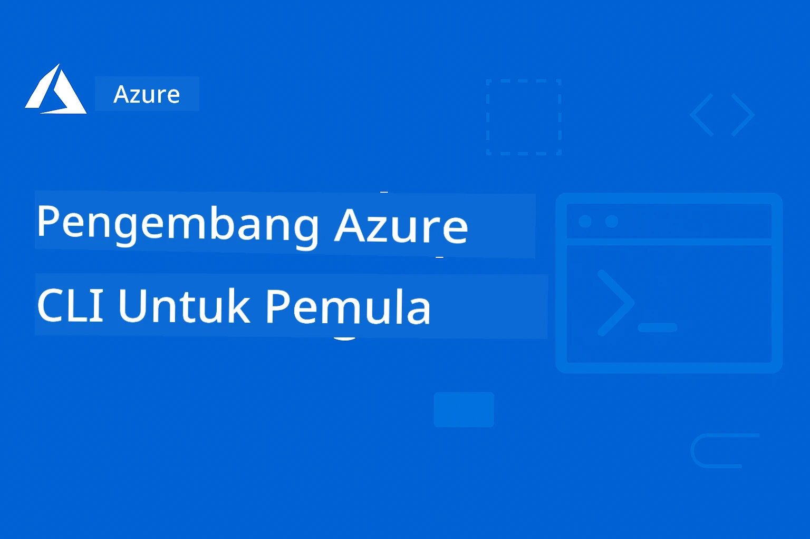

# AZD Untuk Pemula: Perjalanan Pembelajaran yang Terstruktur

 

[](https://github.com/microsoft/AZD-for-beginners)
[](https://GitHub.com/microsoft/azd-for-beginners/network/)
[](https://github.com/microsoft/AZD-for-beginners)

[](https://discord.com/invite/nkVh3dp)
[](https://discord.gg/nTYy5BXMWG)

---

### Terjemahan Otomatis (Selalu Terbaru)

<!-- CO-OP TRANSLATOR LANGUAGES TABLE START -->
[Arab](../ar/README.md) | [Bengali](../bn/README.md) | [Bulgaria](../bg/README.md) | [Birma (Myanmar)](../my/README.md) | [Cina (Sederhana)](../zh-CN/README.md) | [Cina (Tradisional, Hong Kong)](../zh-HK/README.md) | [Cina (Tradisional, Macau)](../zh-MO/README.md) | [Cina (Tradisional, Taiwan)](../zh-TW/README.md) | [Kroasia](../hr/README.md) | [Ceko](../cs/README.md) | [Denmark](../da/README.md) | [Belanda](../nl/README.md) | [Estonia](../et/README.md) | [Finlandia](../fi/README.md) | [Prancis](../fr/README.md) | [Jerman](../de/README.md) | [Yunani](../el/README.md) | [Ibrani](../he/README.md) | [Hindi](../hi/README.md) | [Hungaria](../hu/README.md) | [Indonesia](./README.md) | [Italia](../it/README.md) | [Jepang](../ja/README.md) | [Kannada](../kn/README.md) | [Khmr](../km/README.md) | [Korea](../ko/README.md) | [Lituania](../lt/README.md) | [Melayu](../ms/README.md) | [Maladalam](../ml/README.md) | [Marathi](../mr/README.md) | [Nepali](../ne/README.md) | [Pidgin Nigeria](../pcm/README.md) | [Norwegia](../no/README.md) | [Persia (Farsi)](../fa/README.md) | [Polandia](../pl/README.md) | [Portugis (Brazil)](../pt-BR/README.md) | [Portugis (Portugal)](../pt-PT/README.md) | [Punjabi (Gurmukhi)](../pa/README.md) | [Rumania](../ro/README.md) | [Rusia](../ru/README.md) | [Serbia (Cyrillic)](../sr/README.md) | [Slovakia](../sk/README.md) | [Slovenia](../sl/README.md) | [Spanyol](../es/README.md) | [Swahili](../sw/README.md) | [Swedia](../sv/README.md) | [Tagalog (Filipina)](../tl/README.md) | [Tamil](../ta/README.md) | [Telugu](../te/README.md) | [Thai](../th/README.md) | [Turki](../tr/README.md) | [Ukraina](../uk/README.md) | [Urdu](../ur/README.md) | [Vietnam](../vi/README.md)

> **Lebih Suka Clone Secara Lokal?**
>
> Repositori ini mencakup lebih dari 50 terjemahan bahasa yang secara signifikan meningkatkan ukuran unduhan. Untuk meng-clone tanpa terjemahan, gunakan sparse checkout:
>
> **Bash / macOS / Linux:**
> ```bash
> git clone --filter=blob:none --sparse https://github.com/microsoft/AZD-for-beginners.git
> cd AZD-for-beginners
> git sparse-checkout set --no-cone '/*' '!translations' '!translated_images'
> ```
>
> **CMD (Windows):**
> ```cmd
> git clone --filter=blob:none --sparse https://github.com/microsoft/AZD-for-beginners.git
> cd AZD-for-beginners
> git sparse-checkout set --no-cone "/*" "!translations" "!translated_images"
> ```
>
> Ini memberi Anda semua yang Anda butuhkan untuk menyelesaikan kursus dengan unduhan yang jauh lebih cepat.
<!-- CO-OP TRANSLATOR LANGUAGES TABLE END -->

## 🆕 Apa yang Baru di azd Hari Ini

> 📌 **Pembaruan Foundry GA (2026-11-09):** Bundel **`microsoft.foundry` 1.0 telah tersedia secara umum**, diumumkan pada [5 November 2026](https://devblogs.microsoft.com/azure-sdk/microsoft-foundry-azure-developer-cli-ga/). Gunakan **`azd >= 1.37.0`** dan pasang dengan `azd ext install microsoft.foundry`. Ikuti [panduan hosted-agent](docs/chapter-02-ai-development/microsoft-foundry-integration.md#hosted-agent-walkthrough-ga) untuk penyiapan, pengujian lokal, dan penyebaran. Pembaruan ini didasarkan pada panduan yang diterbitkan, bukan penyebaran Azure langsung; bundel GA tidak menjadikan semua fitur opsional, ekstensi, atau SDK tersedia secara umum.

Azure Developer CLI mendukung banyak jenis aplikasi, termasuk web apps, API, dan agen AI, melalui host, template, dan ekstensi yang didukung.

Berikut arti ini untuk Anda:

- **Sebuah bundel GA untuk pengembangan Foundry.** `microsoft.foundry` memasang tujuh ekstensi inti, termasuk agen, proyek, dan Agent Inspector. Kode agen dan pengaturan penyebaran tetap bersama di `azure.yaml`.
- **Uji secara lokal, lalu sebarkan kode Anda.** Gunakan `azd ai agent init --deploy-mode code`, `azd provision`, dan `azd ai agent run` untuk memeriksa permintaan dan tanggapan lokal. Kemudian gunakan `azd deploy` untuk build jarak jauh di Foundry, tanpa build kontainer lokal.
- **Ukur kualitas secara terpisah.** Pasang **`azure.ai.evaluations`** untuk `azd ai eval generate`, `init`, dan `run start`; ini tidak termasuk dalam bundel. Simpan kumpulan data dan rubrik yang telah direview bersama kode Anda. Proyek lama harus mengikuti [panduan migrasi evaluasi dan optimasi](docs/chapter-08-production/production-ai-practices.md#evaluation-migration-and-quality-checks).
- **Gunakan kembali konfigurasi dalam CI/CD.** Setelah `azd up` berhasil, konfigurasikan pipeline dengan `azd pipeline config`. Pasang bundel pada runner dan simpan pengaturan autentikasi serta lingkungan yang dihasilkan.
- **Dasar-dasar harian yang lebih lancar.** Rilis terbaru membuat `azd init` idempoten (aman dijalankan ulang), membuat `azd auth login` secara otomatis membersihkan token usang, dan menambahkan prompt pengaturan pertama kali yang ramah `azd tool`.
- **Alur kerja inti tidak berubah.** Baik Anda menyebarkan aplikasi todo, microservice, atau solusi AI multi-agen, perintahnya sama.

> **Catatan untuk pengguna Aspire:** Microsoft sekarang menyebut produk ini hanya sebagai **Aspire** (sebelumnya ".NET Aspire"). Dukungan Aspire di azd tidak berubah—hanya namanya yang diperbarui.

Jika Anda pernah menggunakan azd sebelumnya, dukungan AI adalah ekstensi alami—bukan alat terpisah atau jalur lanjutan. Jika Anda memulai dari awal, Anda akan belajar satu alur kerja yang bekerja untuk semuanya.

---

## 🚀 Apa Itu Azure Developer CLI (azd)?

**Azure Developer CLI (azd)** adalah alat baris perintah yang ramah bagi pengembang yang mempermudah penyebaran aplikasi ke Azure. Alih-alih membuat dan menghubungkan puluhan sumber daya Azure secara manual, Anda dapat menyebarkan seluruh aplikasi hanya dengan satu perintah.

### Keajaiban `azd up`

```bash
# This single command does everything:
# ✅ Creates all Azure resources  
# ✅ Configures networking and security
# ✅ Builds your application code
# ✅ Deploys to Azure
# ✅ Gives you a working URL
azd up
```

Template menyediakan konfigurasi aplikasi dan infrastruktur. Penyebaran yang berhasil tetap membutuhkan layanan/model yang didukung, kuota dan izin yang cukup, input yang tepat, dan verifikasi aplikasi yang disebarkan. `azd up` tidak secara otomatis membuat template aman, patuh, atau siap produksi.

---

## ❓ Azure Developer CLI vs Azure CLI: Apa Bedanya?

Ini adalah pertanyaan paling umum yang diajukan pemula. Berikut jawaban singkatnya:

| Fitur | **Azure CLI (`az`)** | **Azure Developer CLI (`azd`)** |
|---------|---------------------|--------------------------------|
| **Tujuan** | Mengelola sumber daya Azure individu | Menyebarkan aplikasi lengkap |
| **Mindset** | Fokus pada infrastruktur | Fokus pada aplikasi |
| **Contoh** | `az webapp create --name myapp...` | `azd up` |
| **Kurva Pembelajaran** | Harus tahu layanan Azure | Cukup tahu aplikasi Anda |
| **Terbaik Untuk** | DevOps, Infrastruktur | Pengembang, Prototipe |

### Analogi Sederhana

- **Azure CLI** seperti memiliki semua alat untuk membangun rumah - palu, gergaji, paku. Anda bisa membangun apa saja, tapi Anda perlu tahu konstruksi.
- **Azure Developer CLI** seperti menyewa kontraktor - Anda jelaskan apa yang Anda inginkan, dan mereka yang membangun.

### Kapan Menggunakan Masing-Masing

| Skenario | Gunakan Ini |
|----------|----------|
| "Saya ingin menyebarkan web app dengan cepat" | `azd up` |
| "Saya perlu membuat hanya akun penyimpanan" | `az storage account create` |
| "Saya membangun aplikasi AI lengkap" | `azd init --template azure-search-openai-demo` |
| "Saya perlu debug sumber daya Azure tertentu" | `az resource show` |
| "Saya ingin menyebarkan ke lingkungan produksi yang sudah saya konfigurasi" | Tinjau konfigurasi, akses, biaya, dan gerbang operasional sebelum `azd up --environment production` |

### Mereka Bekerja Bersama!

AZD dan Azure CLI memiliki autentikasi dan konfigurasi terpisah. Gunakan `azd auth login` untuk AZD, dan `az login` saat perintah hook atau diagnostik secara eksplisit membutuhkan Azure CLI. Anda dapat menggunakan keduanya:
```bash
# Deploy your app with AZD
azd up

# Then fine-tune specific resources with Azure CLI
az webapp config set --name myapp --always-on true
```

---

## 🌟 Temukan Template di Awesome AZD

Jangan mulai dari awal! **Awesome AZD** adalah koleksi komunitas template siap pakai:

| Sumber Daya | Deskripsi |
|----------|-------------|
| 🔗 [**Galeri Awesome AZD**](https://azure.github.io/awesome-azd/) | Telusuri 200+ template dengan penyebaran satu klik |
| 🔗 [**Kirim Template**](https://github.com/Azure/awesome-azd/issues) | Berkontribusi template Anda sendiri ke komunitas |
| 🔗 [**Repositori GitHub**](https://github.com/Azure/awesome-azd) | Beri bintang dan jelajahi sumbernya |

### Template AI Populer dari Awesome AZD

Pilih satu template di direktori kosongnya sendiri; perintah di bawah ini adalah alternatif. `.` di akhir menginisialisasi direktori itu.

```bash
# RAG Chat with Microsoft Foundry Models + AI Search
azd init --template azure-search-openai-demo .

# Quick AI Chat Application
azd init --template openai-chat-app-quickstart .

# AI Agents with Foundry Agents
azd init --template get-started-with-ai-agents .
```

---

## 🎯 Memulai dalam 3 Langkah

Sebelum memulai, pastikan mesin Anda siap untuk template yang ingin Anda deploy:

**Windows:**
```powershell
.\validate-setup.ps1
```

**macOS / Linux:**
```bash
bash ./validate-setup.sh
```

Jika ada pemeriksaan yang gagal, perbaiki itu dulu lalu lanjutkan dengan start cepat.

### Langkah 1: Pasang AZD (2 menit)

**Windows:**
```powershell
winget install microsoft.azd
```

**macOS:**
```bash
brew tap azure/azd && brew install azd
```

**Linux:**
```bash
curl -fsSL https://aka.ms/install-azd.sh | bash
```

### Langkah 2: Autentikasi untuk AZD

```bash
# Optional if you plan to use Azure CLI commands directly in this course
az login

# Required for AZD workflows
azd auth login
```

Jika Anda tidak yakin yang mana yang Anda butuhkan, ikuti alur penyiapan lengkap di [Instalasi & Penyiapan](docs/chapter-01-foundation/installation.md#authentication-setup).

### Langkah 3: Sebarkan Aplikasi Pertama Anda

```bash
# Initialize from a template
azd init --template todo-nodejs-mongo .

# Deploy to Azure (creates everything!)
azd up
```

**🎉 Selesai!** Aplikasi Anda sekarang telah live di Azure.

### Bersihkan (Jangan Lupa!)

```bash
# Remove all resources when done experimenting
azd down --force --purge
```

---

## 📚 Cara Menggunakan Kursus Ini

Kursus ini dirancang untuk **pembelajaran bertahap** - mulai dari yang Anda nyaman dan kembangkan kemampuan Anda:

| Pengalaman Anda | Mulai Dari Sini |
|-----------------|------------|
| **Baru di Azure** | [Bab 1: Dasar](#-chapter-1-foundation--quick-start) |
| **Tahu Azure, baru di AZD** | [Bab 1: Dasar](#-chapter-1-foundation--quick-start) |
| **Ingin menyebarkan aplikasi AI** | [Bab 2: Pengembangan AI-Pertama](#-chapter-2-ai-first-development-recommended-for-ai-developers) |
| **Ingin praktik langsung** | [🎓 Workshop Interaktif](workshop/README.md) - lab panduan 3-4 jam |
| **Butuh pola produksi** | [Bab 8: Produksi & Enterprise](#-chapter-8-production--enterprise-patterns) |

### Setup Cepat

1. **Fork Repositori Ini**: [](https://GitHub.com/microsoft/azd-for-beginners/fork)
2. **Clone**: `git clone https://github.com/YOUR-USERNAME/azd-for-beginners.git`
3. **Dapatkan Bantuan**: [Komunitas Azure Discord](https://discord.com/invite/ByRwuEEgH4)

> **Lebih Suka Clone Secara Lokal?**

> Repositori ini mencakup lebih dari 50 terjemahan bahasa yang secara signifikan meningkatkan ukuran unduhan. Untuk mengkloning tanpa terjemahan, gunakan sparse checkout:
> ```bash
> git clone --filter=blob:none --sparse https://github.com/microsoft/AZD-for-beginners.git
> cd AZD-for-beginners
> git sparse-checkout set --no-cone '/*' '!translations' '!translated_images'
> ```
> Ini memberi Anda semua yang Anda butuhkan untuk menyelesaikan kursus dengan unduhan yang jauh lebih cepat.


## Ikhtisar Kursus

Kuasai Azure Developer CLI (azd) melalui bab-bab terstruktur yang dirancang untuk pembelajaran progresif. **Fokus khusus pada penerapan aplikasi AI dengan integrasi Microsoft Foundry.**

### Mengapa Kursus Ini Penting untuk Pengembang Modern

Pengembang yang menerapkan beban kerja AI umumnya membutuhkan panduan tentang:
- Arsitektur AI multi-layanan yang kompleks
- Praktik terbaik penerapan AI di produksi  
- Integrasi dan konfigurasi layanan Azure AI
- Optimasi biaya untuk beban kerja AI
- Pemecahan masalah khusus penerapan AI

### Tujuan Pembelajaran

Dengan menyelesaikan kursus terstruktur ini, Anda akan:
- **Menguasai Dasar AZD**: Konsep inti, instalasi, dan konfigurasi
- **Menerapkan Aplikasi AI**: Gunakan AZD dengan layanan Microsoft Foundry
- **Mengimplementasikan Infrastruktur sebagai Kode**: Kelola sumber daya Azure dengan template Bicep
- **Memecahkan Masalah Penerapan**: Menyelesaikan masalah umum dan debug
- **Mengoptimalkan untuk Produksi**: Keamanan, skala, pemantauan, dan manajemen biaya
- **Membangun Solusi Multi-Agen**: Menerapkan arsitektur AI yang kompleks

## Sebelum Anda Mulai: Akun, Akses, dan Asumsi

Sebelum Anda mulai Bab 1, pastikan Anda memiliki hal-hal berikut. Langkah instalasi di panduan ini mengasumsikan hal-hal dasar ini sudah terpenuhi.

- **Langganan Azure**: Anda dapat menggunakan langganan yang ada dari pekerjaan atau akun pribadi Anda, atau membuat [trial gratis](https://aka.ms/azurefreetrial) untuk memulai.
- **Izin membuat sumber daya Azure**: Untuk sebagian besar latihan, Anda harus memiliki akses minimal **Contributor** pada langganan atau grup sumber daya target. Beberapa bab juga mengasumsikan Anda dapat membuat grup sumber daya, managed identity, dan penetapan RBAC.
- [**Akun GitHub**](https://github.com): Berguna untuk mem-fork repositori, melacak perubahan sendiri, dan menggunakan GitHub Codespaces untuk workshop.
- **Prasyarat runtime template**: Beberapa template membutuhkan alat lokal seperti Node.js, Python, Java, atau Docker. Jalankan validator setup sebelum mulai sehingga Anda bisa menemukan alat yang hilang lebih awal.
- **Familiaritas dasar terminal**: Anda tidak harus expert, tetapi harus nyaman menjalankan perintah seperti `git clone`, `azd auth login`, dan `azd up`.

> **Bekerja dalam langganan enterprise?**
> Jika lingkungan Azure Anda dikelola oleh administrator, pastikan sebelumnya bahwa Anda bisa menerapkan sumber daya di langganan atau grup sumber daya yang akan Anda gunakan. Jika tidak, minta langganan sandbox atau akses Contributor sebelum memulai.

> **Baru di Azure?**
> Mulailah dengan trial Azure pribadi atau langganan bayar sesuai pemakaian di https://aka.ms/azurefreetrial agar Anda bisa menyelesaikan latihan secara menyeluruh tanpa menunggu persetujuan tingkat tenant.

## 🗺️ Peta Kursus: Navigasi Cepat per Bab

Setiap bab memiliki README khusus dengan tujuan pembelajaran, mulai cepat, dan latihan:

| Bab | Topik | Pelajaran | Durasi | Kompleksitas |
|---------|-------|---------|----------|------------|
| **[Bab 1: Dasar](docs/chapter-01-foundation/README.md)** | Memulai | [Dasar AZD](docs/chapter-01-foundation/azd-basics.md) &#124; [Instalasi](docs/chapter-01-foundation/installation.md) &#124; [Proyek Pertama](docs/chapter-01-foundation/first-project.md) | 30-45 menit | ⭐ |
| **[Bab 2: Pengembangan AI](docs/chapter-02-ai-development/README.md)** | Aplikasi AI-Pertama | [Integrasi Foundry](docs/chapter-02-ai-development/microsoft-foundry-integration.md) &#124; [Agen AI](docs/chapter-02-ai-development/agents.md) &#124; [Penerapan Model](docs/chapter-02-ai-development/ai-model-deployment.md) &#124; [Workshop](docs/chapter-02-ai-development/ai-workshop-lab.md) | 1-2 jam | ⭐⭐ |
| **[Bab 3: Konfigurasi](docs/chapter-03-configuration/README.md)** | Autentikasi & Keamanan | [Konfigurasi](docs/chapter-03-configuration/configuration.md) &#124; [Autentikasi & Keamanan](docs/chapter-03-configuration/authsecurity.md) | 45-60 menit | ⭐⭐ |
| **[Bab 4: Infrastruktur](docs/chapter-04-infrastructure/README.md)** | IaC & Penerapan | [Panduan Penerapan](docs/chapter-04-infrastructure/deployment-guide.md) &#124; [Provisioning](docs/chapter-04-infrastructure/provisioning.md) | 1-1.5 jam | ⭐⭐⭐ |
| **[Bab 5: Multi-Agen](docs/chapter-05-multi-agent/README.md)** | Solusi Agen AI | [Skenario Retail](examples/retail-scenario.md) &#124; [Pola Koordinasi](docs/chapter-06-pre-deployment/coordination-patterns.md) | 2-3 jam | ⭐⭐⭐⭐ |
| **[Bab 6: Pra-Penerapan](docs/chapter-06-pre-deployment/README.md)** | Perencanaan & Validasi | [Pemeriksaan Preflight](docs/chapter-06-pre-deployment/preflight-checks.md) &#124; [Perencanaan Kapasitas](docs/chapter-06-pre-deployment/capacity-planning.md) &#124; [Pemilihan SKU](docs/chapter-06-pre-deployment/sku-selection.md) &#124; [App Insights](docs/chapter-06-pre-deployment/application-insights.md) | 1 jam | ⭐⭐ |
| **[Bab 7: Pemecahan Masalah](docs/chapter-07-troubleshooting/README.md)** | Debug & Perbaikan | [Masalah Umum](docs/chapter-07-troubleshooting/common-issues.md) &#124; [Debugging](docs/chapter-07-troubleshooting/debugging.md) &#124; [Masalah AI](docs/chapter-07-troubleshooting/ai-troubleshooting.md) | 1-1.5 jam | ⭐⭐ |
| **[Bab 8: Produksi](docs/chapter-08-production/README.md)** | Pola Enterprise | [Praktik Produksi](docs/chapter-08-production/production-ai-practices.md) | 2-3 jam | ⭐⭐⭐⭐ |
| **[🎓 Workshop](workshop/README.md)** | Lab Praktik | [Pengantar](workshop/docs/instructions/0-Introduction.md) &#124; [Pemilihan](workshop/docs/instructions/1-Select-AI-Template.md) &#124; [Validasi](workshop/docs/instructions/2-Validate-AI-Template.md) &#124; [Pembongkaran](workshop/docs/instructions/3-Deconstruct-AI-Template.md) &#124; [Konfigurasi](workshop/docs/instructions/4-Configure-AI-Template.md) &#124; [Kustomisasi](workshop/docs/instructions/5-Customize-AI-Template.md) &#124; [Pembongkaran](workshop/docs/instructions/6-Teardown-Infrastructure.md) &#124; [Penutupan](workshop/docs/instructions/7-Wrap-up.md) | 3-4 jam | ⭐⭐ |

**Total Durasi Kursus:** ~10-14 jam | **Progresi Keahlian:** Pemula → Siap Produksi

---

## 📚 Bab Pembelajaran

*Pilih jalur pembelajaran Anda berdasarkan tingkat pengalaman dan tujuan*

### 🚀 Bab 1: Dasar & Mulai Cepat
**Prasyarat**: Langganan Azure, pengetahuan dasar command line  
**Durasi**: 30-45 menit  
**Kompleksitas**: ⭐

#### Apa yang Akan Anda Pelajari
- Memahami dasar Azure Developer CLI
- Menginstal AZD di platform Anda
- Penerapan pertama yang berhasil

#### Sumber Belajar
- **🎯 Mulai di Sini**: [Apa itu Azure Developer CLI?](#-what-is-azure-developer-cli-azd)
- **📖 Teori**: [Dasar AZD](docs/chapter-01-foundation/azd-basics.md) - Konsep inti dan terminologi
- **⚙️ Setup**: [Instalasi & Setup](docs/chapter-01-foundation/installation.md) - Panduan khusus platform
- **🛠️ Praktik**: [Proyek Pertama Anda](docs/chapter-01-foundation/first-project.md) - Tutorial langkah demi langkah
- **📋 Referensi Cepat**: [Cheat Sheet Perintah](resources/cheat-sheet.md)

#### Latihan Praktik
```bash
# Quick installation check
azd version

# Deploy your first application
azd init --template todo-nodejs-mongo .
azd up
```

**💡 Hasil Bab**: Berhasil menerapkan aplikasi web sederhana ke Azure menggunakan AZD

**✅ Validasi Keberhasilan:**
```bash
# After completing Chapter 1, you should be able to:
azd version              # Shows installed version
azd init --template todo-nodejs-mongo  # Initializes project
azd up                  # Deploys to Azure
azd show                # Displays running app URL
# Application opens in browser and works
azd down --force --purge  # Cleans up resources
```

**📊 Investasi Waktu:** 30-45 menit  
**📈 Tingkat Keahlian Setelah:** Dapat menerapkan aplikasi dasar secara mandiri

---

### 🤖 Bab 2: Pengembangan AI-Pertama (Disarankan untuk Pengembang AI)
**Prasyarat**: Bab 1 selesai  
**Durasi**: 1-2 jam  
**Kompleksitas**: ⭐⭐

#### Apa yang Akan Anda Pelajari
- Integrasi Microsoft Foundry dengan AZD
- Menerapkan aplikasi bertenaga AI
- Memahami konfigurasi layanan AI

#### Sumber Belajar
- **🎯 Mulai di Sini**: [Integrasi Microsoft Foundry](docs/chapter-02-ai-development/microsoft-foundry-integration.md)
- **🤖 Agen AI**: [Panduan Agen AI](docs/chapter-02-ai-development/agents.md) - Menerapkan agen cerdas dengan AZD
- **📖 Pola**: [Penerapan Model AI](docs/chapter-02-ai-development/ai-model-deployment.md) - Menerapkan dan mengelola model AI
- **🛠️ Workshop**: [Lab Workshop AI](docs/chapter-02-ai-development/ai-workshop-lab.md) - Membuat solusi AI siap AZD
- **🎥 Panduan Interaktif**: [Materi Workshop](workshop/README.md) - Pembelajaran berbasis browser dengan MkDocs * Lingkungan DevContainer
- **📋 Template**: [Template Microsoft Foundry](#featured-microsoft-foundry-templates)
- **📝 Contoh**: [Contoh Penerapan AZD](examples/README.md)

#### Latihan Praktik
```bash
# Deploy your first AI application
azd init --template azure-search-openai-demo .
azd up

# Try additional AI templates
azd init --template openai-chat-app-quickstart .
azd init --template agent-openai-python-prompty .
```

**💡 Hasil Bab**: Terapkan dan konfigurasi aplikasi chat bertenaga AI dengan kemampuan RAG

**✅ Validasi Keberhasilan:**
```bash
# After Chapter 2, you should be able to:
azd init --template azure-search-openai-demo .
azd up
# Test the AI chat interface
# Ask questions and get AI-powered responses with sources
# Verify search integration works
azd monitor  # Check Application Insights shows telemetry
azd down --force --purge
```

**📊 Investasi Waktu:** 1-2 jam  
**📈 Tingkat Keahlian Setelah:** Dapat menerapkan aplikasi pembelajaran AI dan mengidentifikasi kebutuhan kesiapan produksi tambahan
**💰 Kesadaran Biaya:** Pahami biaya pengembangan $80-150/bulan, biaya produksi $300-3500/bulan

#### 💰 Pertimbangan Biaya untuk Penerapan AI

**Lingkungan Pengembangan (Perkiraan $80-150/bulan):**
- Model Microsoft Foundry (Bayar sesuai pemakaian): $0-50/bulan (berdasarkan penggunaan token)
- AI Search (tier Dasar): $75/bulan
- Container Apps (Konsumsi): $0-20/bulan
- Penyimpanan (Standar): $1-5/bulan

**Lingkungan Produksi (Perkiraan $300-3.500+/bulan):**
- Model Microsoft Foundry (PTU untuk kinerja konsisten): $3.000+/bulan ATAU Bayar sesuai pemakaian dengan volume tinggi
- AI Search (tier Standar): $250/bulan
- Container Apps (Dedicated): $50-100/bulan
- Application Insights: $5-50/bulan
- Penyimpanan (Premium): $10-50/bulan

**💡 Tips Optimasi Biaya:**
- Periksa harga inferensi model dan kredit spesifik akun; Azure OpenAI tidak termasuk kuota gratis token 50.000 bulanan universal
- Jalankan `azd down` untuk menghapus sumber daya saat tidak diperlukan lagi, setelah meninjau lingkungan yang dipilih
- Mulai dengan penagihan berbasis konsumsi, naikkan ke PTU hanya untuk produksi
- Gunakan `azd provision --preview` untuk memeriksa infrastruktur yang direncanakan, lalu harga sumber daya yang dihasilkan dengan Azure Pricing Calculator
- Aktifkan auto-scaling: bayar hanya untuk penggunaan aktual

**Pemantauan Biaya:**
```bash
# Inspect planned resources (this does not calculate prices)
azd provision --preview

# Monitor actual costs in Azure Portal
az consumption budget list --resource-group <your-rg>
```

---

### ⚙️ Bab 3: Konfigurasi & Autentikasi
**Prasyarat**: Bab 1 selesai  
**Durasi**: 45-60 menit  
**Kompleksitas**: ⭐⭐

#### Apa yang Akan Anda Pelajari
- Konfigurasi dan manajemen lingkungan
- Praktik terbaik autentikasi dan keamanan
- Penamaan dan pengorganisasian sumber daya

#### Sumber Belajar
- **📖 Konfigurasi**: [Panduan Konfigurasi](docs/chapter-03-configuration/configuration.md) - Setup lingkungan
- **🔐 Keamanan**: [Pola Autentikasi dan managed identity](docs/chapter-03-configuration/authsecurity.md) - Pola autentikasi
- **📝 Contoh**: [Contoh Aplikasi Database](examples/database-app/README.md) - Contoh Database AZD

#### Latihan Praktik
- Konfigurasi beberapa lingkungan (dev, staging, prod)
- Menyiapkan autentikasi managed identity
- Mengimplementasikan konfigurasi spesifik lingkungan

**💡 Hasil Bab**: Mengelola beberapa lingkungan dengan autentikasi dan keamanan yang tepat

---

### 🏗️ Bab 4: Infrastruktur sebagai Kode & Penerapan
**Prasyarat**: Bab 1-3 selesai  
**Durasi**: 1-1.5 jam  
**Kompleksitas**: ⭐⭐⭐

#### Apa yang Akan Anda Pelajari
- Pola penerapan lanjutan
- Infrastruktur sebagai Kode dengan Bicep
- Strategi provisioning sumber daya

#### Sumber Belajar
- **📖 Penerapan**: [Panduan Penerapan](docs/chapter-04-infrastructure/deployment-guide.md) - Alur kerja lengkap
- **🏗️ Provisioning**: [Provisioning Sumber Daya](docs/chapter-04-infrastructure/provisioning.md) - Manajemen sumber daya Azure
- **📝 Contoh**: [Contoh Container App](../../examples/container-app) - Penerapan dikontainerisasi

#### Latihan Praktik
- Membuat template Bicep kustom
- Menerapkan aplikasi multi-layanan
- Mengimplementasikan strategi penerapan blue-green

**💡 Hasil Bab**: Menerapkan aplikasi multi-layanan kompleks menggunakan template infrastruktur kustom

---

### 🎯 Bab 5: Solusi AI Multi-Agen (Lanjutan)
**Prasyarat**: Bab 1-2 selesai  
**Durasi**: 2-3 jam  
**Kompleksitas**: ⭐⭐⭐⭐

#### Apa yang Akan Anda Pelajari
- Pola arsitektur multi-agen
- Orkestrasi dan koordinasi agen
- Penerapan AI siap produksi

#### Sumber Belajar
- **🤖 Desain Unggulan**: [Solusi Multi-Agen Ritel](examples/retail-scenario.md) - Cetak biru arsitektur, bukan aplikasi lengkap
- **🛠️ Template ARM**: [Paket Template ARM](../../examples/retail-multiagent-arm-template) - Kerangka infrastruktur; tinjau prasyarat dan komponen aplikasi yang hilang
- **📖 Arsitektur**: [Pola koordinasi multi-agen](docs/chapter-06-pre-deployment/coordination-patterns.md) - Pola

#### Latihan Praktis
```bash
# Inspect the retail infrastructure scaffold before choosing to deploy it
cd examples/retail-multiagent-arm-template
cat README.md

# After an intentional deployment, inspect infrastructure state
az deployment group show --resource-group <rg-name> --name <deployment-name>
```

**💡 Hasil Bab**: Memahami desain multi-agen dan mengidentifikasi pekerjaan implementasi, validasi, dan operasional yang diperlukan di luar kerangka infrastruktur

---

### 🔍 Bab 6: Validasi & Perencanaan Pra-Penerapan
**Prasyarat**: Bab 4 selesai  
**Durasi**: 1 jam  
**Kompleksitas**: ⭐⭐

#### Apa yang Akan Anda Pelajari
- Perencanaan kapasitas dan validasi sumber daya
- Strategi pemilihan SKU
- Pemeriksaan pra-penerbangan dan otomatisasi

#### Sumber Belajar
- **📊 Perencanaan**: [Perencanaan Kapasitas](docs/chapter-06-pre-deployment/capacity-planning.md) - Validasi sumber daya
- **💰 Pemilihan**: [Pemilihan SKU](docs/chapter-06-pre-deployment/sku-selection.md) - Pilihan yang hemat biaya
- **✅ Validasi**: [Pemeriksaan Pra-penerbangan](docs/chapter-06-pre-deployment/preflight-checks.md) - Skrip otomatis

#### Latihan Praktis
- Jalankan skrip validasi kapasitas
- Optimalkan pemilihan SKU untuk biaya
- Terapkan pemeriksaan pra-penerapan otomatis

**💡 Hasil Bab**: Memvalidasi dan mengoptimalkan penerapan sebelum pelaksanaan

---

### 🚨 Bab 7: Pemecahan Masalah & Debugging
**Prasyarat**: Selesai salah satu bab penerapan  
**Durasi**: 1-1.5 jam  
**Kompleksitas**: ⭐⭐

#### Apa yang Akan Anda Pelajari
- Pendekatan debugging sistematis
- Masalah umum dan solusinya
- Pemecahan masalah khusus AI

#### Sumber Belajar
- **🔧 Masalah Umum**: [Masalah Umum](docs/chapter-07-troubleshooting/common-issues.md) - FAQ dan solusi
- **🕵️ Debugging**: [Panduan Debugging](docs/chapter-07-troubleshooting/debugging.md) - Strategi langkah demi langkah
- **🤖 Masalah AI**: [Pemecahan Masalah Khusus AI](docs/chapter-07-troubleshooting/ai-troubleshooting.md) - Masalah layanan AI

#### Latihan Praktis
- Diagnosa kegagalan penerapan
- Atasi masalah otentikasi
- Debug konektivitas layanan AI

**💡 Hasil Bab**: Mendiagnosis dan menyelesaikan masalah penerapan umum secara mandiri

---

### 🏢 Bab 8: Pola Produksi & Enterprise
**Prasyarat**: Bab 1-4 selesai  
**Durasi**: 2-3 jam  
**Kompleksitas**: ⭐⭐⭐⭐

#### Apa yang Akan Anda Pelajari
- Strategi penerapan produksi
- Pola keamanan enterprise
- Pemantauan dan optimasi biaya

#### Sumber Belajar
- **🏭 Produksi**: [Praktik Terbaik AI Produksi](docs/chapter-08-production/production-ai-practices.md) - Pola enterprise
- **📝 Contoh**: [Contoh Microservices](../../examples/microservices) - Arsitektur kompleks
- **📊 Pemantauan**: [Integrasi Application Insights](docs/chapter-06-pre-deployment/application-insights.md) - Pemantauan

#### Latihan Praktis
- Terapkan pola keamanan enterprise
- Siapkan pemantauan komprehensif
- Terapkan ke produksi dengan tata kelola yang tepat

**💡 Hasil Bab**: Menerapkan aplikasi siap enterprise dengan kapabilitas produksi penuh

---

## 🎓 Gambaran Workshop: Pengalaman Belajar Praktis

> **⚠️ STATUS WORKSHOP: Pengembangan Aktif**  
> Materi workshop saat ini sedang dikembangkan dan diperbaiki. Modul inti berfungsi, tetapi beberapa bagian lanjutan belum lengkap. Kami aktif bekerja menyelesaikan semua konten. [Lacak kemajuan →](workshop/README.md)

### Materi Workshop Interaktif
**Pembelajaran praktis komprehensif dengan alat berbasis browser dan latihan terpandu**

Materi workshop kami menyediakan pengalaman belajar interaktif yang terstruktur yang melengkapi kurikulum berbasis bab di atas. Workshop ini dirancang untuk pembelajaran mandiri dan sesi yang dipandu instruktur.

#### 🛠️ Fitur Workshop
- **Antarmuka Berbasis Browser**: Workshop lengkap berbasis MkDocs dengan fitur pencarian, salin, dan tema
- **Integrasi GitHub Codespaces**: Pengaturan lingkungan pengembangan satu klik
- **Jalur Pembelajaran Terstruktur**: 8 modul latihan terpandu (total 3-4 jam)
- **Metodologi Progresif**: Pengenalan → Pemilihan → Validasi → Pembongkaran → Konfigurasi → Kustomisasi → Pembersihan → Penutup
- **Lingkungan DevContainer Interaktif**: Alat dan dependensi yang sudah dikonfigurasi sebelumnya

#### 📚 Struktur Modul Workshop
Workshop mengikuti **metodologi progresif 8 modul** yang membawa Anda dari penemuan hingga penguasaan penerapan:

| Modul | Topik | Apa yang Akan Anda Lakukan | Durasi |
|--------|-------|----------------|----------|
| **0. Pengenalan** | Gambaran Workshop | Memahami tujuan belajar, prasyarat, dan struktur workshop | 15 menit |
| **1. Pemilihan** | Penemuan Template | Jelajahi template AZD dan pilih template AI yang tepat untuk skenario Anda | 20 menit |
| **2. Validasi** | Terapkan & Verifikasi | Terapkan template dengan `azd up` dan validasi infrastruktur berfungsi | 30 menit |
| **3. Pembongkaran** | Pahami Struktur | Gunakan GitHub Copilot untuk mengeksplorasi arsitektur template, file Bicep, dan organisasi kode | 30 menit |
| **4. Konfigurasi** | Pendalaman azure.yaml | Kuasai konfigurasi `azure.yaml`, lifecycle hooks, dan variabel lingkungan | 30 menit |
| **5. Kustomisasi** | Jadikan Milik Anda | Aktifkan AI Search, tracing, evaluasi, dan kustomisasi untuk skenario Anda | 45 menit |
| **6. Pembersihan** | Bersihkan | Lepaskan sumber daya dengan aman menggunakan `azd down --purge` | 15 menit |
| **7. Penutup** | Langkah Selanjutnya | Tinjau pencapaian, konsep kunci, dan lanjutkan perjalanan belajar Anda | 15 menit |

**Alur Workshop:**
```
Introduction → Selection → Validation → Deconstruction → Configuration → Customization → Teardown → Wrap-up
     ↓            ↓           ↓              ↓               ↓              ↓            ↓           ↓
  Overview    Find the     Deploy &      Explore        Master         Customize     Clean up    Review &
             right        verify        code &        azure.yaml      for your      resources   next steps
             template                   structure                     scenario
```

#### 🚀 Memulai Workshop
```bash
# Option 1: GitHub Codespaces (Recommended)
# Click "Code" → "Create codespace on main" in the repository

# Option 2: Local Development
git clone https://github.com/microsoft/azd-for-beginners.git
cd azd-for-beginners/workshop
# Follow the setup instructions in workshop/README.md
```

#### 🎯 Hasil Belajar Workshop
Dengan menyelesaikan workshop, peserta akan:
- **Menerapkan Aplikasi AI Produksi**: Gunakan AZD dengan layanan Microsoft Foundry
- **Menguasai Arsitektur Multi-Agen**: Terapkan solusi agen AI yang terkoordinasi
- **Menerapkan Praktik Keamanan Terbaik**: Konfigurasi autentikasi dan kontrol akses
- **Optimalkan untuk Skala**: Rancang penerapan yang hemat biaya dan berkinerja
- **Memecahkan Masalah Penerapan**: Selesaikan masalah umum secara mandiri

#### 📖 Sumber Workshop
- **🎥 Panduan Interaktif**: [Materi Workshop](workshop/README.md) - Lingkungan belajar berbasis browser
- **📋 Instruksi Modul per Modul**:
  - [0. Pengenalan](workshop/docs/instructions/0-Introduction.md) - Gambaran dan tujuan workshop
  - [1. Pemilihan](workshop/docs/instructions/1-Select-AI-Template.md) - Temukan dan pilih template AI
  - [2. Validasi](workshop/docs/instructions/2-Validate-AI-Template.md) - Terapkan dan verifikasi template
  - [3. Pembongkaran](workshop/docs/instructions/3-Deconstruct-AI-Template.md) - Eksplorasi arsitektur template
  - [4. Konfigurasi](workshop/docs/instructions/4-Configure-AI-Template.md) - Kuasai azure.yaml
  - [5. Kustomisasi](workshop/docs/instructions/5-Customize-AI-Template.md) - Kustomisasi untuk skenario Anda
  - [6. Pembersihan](workshop/docs/instructions/6-Teardown-Infrastructure.md) - Bersihkan sumber daya
  - [7. Penutup](workshop/docs/instructions/7-Wrap-up.md) - Tinjauan dan langkah selanjutnya
- **🛠️ AI Workshop Lab**: [Laboratorium Workshop AI](docs/chapter-02-ai-development/ai-workshop-lab.md) - Latihan berfokus pada AI
- **💡 Mulai Cepat**: [Panduan Pengaturan Workshop](workshop/README.md#browser-based-guide) - Konfigurasi lingkungan

**Sangat cocok untuk**: Pelatihan korporat, kursus universitas, pembelajaran mandiri, dan bootcamp pengembang.

---

## 📖 Pendalaman: Kapabilitas AZD

Selain dasar, AZD menyediakan fitur kuat untuk penerapan produksi:

- **Penerapan berbasis template** - Gunakan template pra-bangun untuk pola aplikasi umum
- **Infrastruktur sebagai Kode** - Kelola sumber daya Azure menggunakan Bicep atau Terraform  
- **Alur kerja terintegrasi** - Menyediakan, menerapkan, dan memantau aplikasi secara mulus
- **Ramah pengembang** - Dioptimalkan untuk produktivitas dan pengalaman pengembang

### **AZD + Microsoft Foundry: Sempurna untuk Penerapan AI**

**Mengapa AZD untuk Solusi AI?** AZD mengatasi tantangan utama yang dihadapi pengembang AI:

- **Template Siap AI** - Template yang sudah dikonfigurasi untuk Model Microsoft Foundry, Layanan AI Azure, dan beban kerja ML
- **Penerapan AI Aman** - Pola keamanan built-in untuk layanan AI, kunci API, dan endpoint model  
- **Pola AI Produksi** - Praktik terbaik untuk penerapan aplikasi AI yang skalabel dan hemat biaya
- **Alur Kerja AI End-to-End** - Dari pengembangan model hingga penerapan produksi dengan pemantauan yang tepat
- **Optimasi Biaya** - Alokasi sumber daya pintar dan strategi scaling untuk beban kerja AI
- **Integrasi Microsoft Foundry** - Koneksi mulus ke katalog model dan endpoint Microsoft Foundry

---

## 🎯 Perpustakaan Template & Contoh

### Unggulan: Template Microsoft Foundry
**Mulailah di sini jika Anda menerapkan aplikasi AI!**

> **Catatan:** Template ini menunjukkan berbagai pola AI. Beberapa adalah Azure Samples eksternal, lainnya implementasi lokal.

| Template | Bab | Kompleksitas | Layanan | Tipe |
|----------|---------|------------|----------|------|
| [**Mulai dengan chat AI**](https://github.com/Azure-Samples/get-started-with-ai-chat) | Bab 2 | ⭐⭐ | AzureOpenAI + Azure AI Model Inference API + Azure AI Search + Azure Container Apps + Application Insights | Eksternal |
| [**Mulai dengan agen AI**](https://github.com/Azure-Samples/get-started-with-ai-agents) | Bab 2 | ⭐⭐ | Foundry Agents + AzureOpenAI + Azure AI Search + Azure Container Apps + Application Insights| Eksternal |
| [**Demo Azure Search + OpenAI**](https://github.com/Azure-Samples/azure-search-openai-demo) | Bab 2 | ⭐⭐ | Azure OpenAI + Azure AI Search + Container Apps (default) + Storage | Eksternal |
| [**Quickstart Aplikasi Chat OpenAI**](https://github.com/Azure-Samples/openai-chat-app-quickstart) | Bab 2 | ⭐ | AzureOpenAI + Container Apps + Application Insights | Eksternal |
| [**Agent OpenAI Python Prompty**](https://github.com/Azure-Samples/agent-openai-python-prompty) | Bab 5 | ⭐⭐⭐ | AzureOpenAI + Azure Functions + Prompty | Eksternal |
| [**Contoso Chat RAG**](https://github.com/Azure-Samples/contoso-chat) | Bab 8 | ⭐⭐⭐⭐ | AzureOpenAI + AI Search + Cosmos DB + Container Apps | Eksternal |
| [**Solusi Multi-Agen Ritel**](examples/retail-scenario.md) | Bab 5 | ⭐⭐⭐⭐ | Cetak biru arsitektur dan kerangka infrastruktur; implementasi aplikasi diperlukan | **Cetak biru lokal** |

### Unggulan: Skenario Pembelajaran Lengkap
**Template aplikasi siap produksi yang dipetakan ke bab pembelajaran**

| Template | Bab Pembelajaran | Kompleksitas | Pembelajaran Utama |
|----------|------------------|------------|--------------|
| [**openai-chat-app-quickstart**](https://github.com/Azure-Samples/openai-chat-app-quickstart) | Bab 2 | ⭐ | Pola penerapan AI dasar |
| [**azure-search-openai-demo**](https://github.com/Azure-Samples/azure-search-openai-demo) | Bab 2 | ⭐⭐ | Implementasi RAG dengan Azure AI Search |
| [**get-started-with-ai-agents**](https://github.com/Azure-Samples/get-started-with-ai-agents) | Bab 2 | ⭐⭐ | Chat berbasis agen dan uji evaluasi spesifik contoh |
| [**agent-openai-python-prompty**](https://github.com/Azure-Samples/agent-openai-python-prompty) | Bab 5 | ⭐⭐⭐ | Kerangka agen dan pemanggilan fungsi |
| [**contoso-chat**](https://github.com/Azure-Samples/contoso-chat) | Bab 8 | ⭐⭐⭐ | Orkestrasi AI enterprise |
| [**retail-multi-agent-solution**](examples/retail-scenario.md) | Bab 5 | ⭐⭐⭐⭐ | Arsitektur multi-agen dengan agen Customer dan Inventory |

### Belajar Berdasarkan Jenis Contoh

> **📌 Contoh Lokal vs Eksternal:**  
> **Contoh Lokal** (di repositori ini) = Periksa README contoh untuk status implementasi dan prasyarat
> **Contoh Eksternal** (Azure Samples) = Clone dari repositori terkait

#### Contoh Lokal (Siap Pakai)
- [**Solusi Multi-Agen Ritel**](examples/retail-scenario.md) - Cetak biru arsitektur dengan kerangka infrastruktur ARM
  - Peran agen Customer dan Inventory yang diusulkan
  - Pemantauan, evaluasi, dan kode aplikasi harus diimplementasikan dan diverifikasi
  - Penyediaan sumber daya saja tidak menghasilkan aplikasi ritel yang berfungsi

#### Contoh Lokal - Aplikasi Kontainer (Bab 2-5)
**Contoh penerapan kontainer komprehensif di repositori ini:**
- [**Contoh Aplikasi Kontainer**](examples/container-app/README.md) - Panduan lengkap penerapan kontainerisasi
  - [API Flask Sederhana](../../examples/container-app/simple-flask-api) - REST API dasar dengan skala-ke-nol
  - [Arsitektur Microservices](../../examples/container-app/microservices) - Sampel pembelajaran dua layanan; pengamanan produksi adalah pekerjaan tambahan
  - Pola penerapan Quick Start, Produksi, dan Lanjutan
  - Panduan pemantauan, keamanan, dan optimasi biaya

#### Contoh Eksternal - Aplikasi Sederhana (Bab 1-2)
**Clone repositori Azure Samples ini untuk memulai:**
- [Simple Web App - Node.js + MongoDB](https://github.com/Azure-Samples/todo-nodejs-mongo) - Pola penerapan dasar
- [Static Website - React SPA](https://github.com/Azure-Samples/todo-csharp-sql-swa-func) - Penerapan konten statis
- [Container App - Python Flask](https://github.com/Azure-Samples/container-apps-store-api-microservice) - Penyebaran REST API  

#### Contoh Eksternal - Integrasi Database (Bab 3-4)  
- [Aplikasi Database - C# + SQL](https://github.com/Azure-Samples/todo-csharp-sql) - Pola konektivitas database  
- [Fungsi + Cosmos DB](https://github.com/Azure-Samples/todo-python-mongo-swa-func) - Alur kerja data serverless  

#### Contoh Eksternal - Pola Lanjutan (Bab 4-8)  
- [Mikroservis Java](https://github.com/Azure-Samples/java-microservices-aca-lab) - Arsitektur multi-layanan  
- [Container Apps Jobs](https://github.com/Azure-Samples/container-apps-jobs) - Pemrosesan latar belakang  
- [Pipeline ML Perusahaan](https://github.com/Azure/mlops-v2) - Pola referensi MLOps; bukan template AZD siap pakai  

### Koleksi Template Eksternal  
- [**Galeri Template AZD Resmi**](https://azure.github.io/awesome-azd/) - Koleksi kurasi template resmi dan komunitas  
- [**Dokumentasi Template Azure Developer CLI**](https://learn.microsoft.com/en-us/azure/developer/azure-developer-cli/azd-templates) - Dokumentasi template Microsoft Learn  
- [**Direktori Contoh**](examples/README.md) - Contoh pembelajaran lokal dengan penjelasan mendetail  

---

## 📚 Sumber Belajar & Referensi  

### Referensi Cepat  
- [**Lembar Perintah**](resources/cheat-sheet.md) - Perintah azd penting yang diorganisasikan berdasarkan bab  
- [**Glosarium**](resources/glossary.md) - Terminologi Azure dan azd  
- [**FAQ**](resources/faq.md) - Pertanyaan umum yang dibuat berdasarkan bab pembelajaran  
- [**Panduan Studi**](resources/study-guide.md) - Latihan praktik yang komprehensif  

### Workshop Praktik  
- [**Workshop Laboratorium AI**](docs/chapter-02-ai-development/ai-workshop-lab.md) - Buat solusi AI Anda dapat disebarkan dengan AZD (2-3 jam)  
- [**Workshop Interaktif**](workshop/README.md) - 8 modul latihan dengan panduan menggunakan MkDocs dan GitHub Codespaces  
  - Mengikuti urutan: Pengantar → Pemilihan → Validasi → Dekonstruksi → Konfigurasi → Kustomisasi → Pembongkaran → Penutup  

### Sumber Pembelajaran Eksternal  
- [Dokumentasi Azure Developer CLI](https://learn.microsoft.com/en-us/azure/developer/azure-developer-cli/)  
- [Pusat Arsitektur Azure](https://learn.microsoft.com/en-us/azure/architecture/)  
- [Kalkulator Harga Azure](https://azure.microsoft.com/pricing/calculator/)  
- [Status Azure](https://status.azure.com/)  

### Kemampuan Agen AI untuk Editor Anda  
- [**Kemampuan Microsoft Azure di skills.sh**](https://skills.sh/microsoft/github-copilot-for-azure) - 37 kemampuan agen terbuka untuk Azure AI, Foundry, penyebaran, diagnostik, optimisasi biaya, dan lainnya. Pasang di GitHub Copilot, Cursor, Claude Code, atau agen yang didukung lainnya:  
  ```bash
  npx skills add microsoft/github-copilot-for-azure
  ```
  
---

## 🔧 Panduan Pemecahan Masalah Cepat  

**Masalah umum yang dialami pemula dan solusi langsung:**  

<details>
<summary><strong>❌ "azd: command not found"</strong></summary>

```bash
# Install AZD first
# Windows (PowerShell):
winget install microsoft.azd

# macOS:
brew tap azure/azd && brew install azd

# Linux:
curl -fsSL https://aka.ms/install-azd.sh | bash

# Verify installation
azd version
```
</details>

<details>
<summary><strong>❌ "No subscription found" atau "Subscription not set"</strong></summary>

```bash
# List available subscriptions
az account list --output table

# Set default subscription
az account set --subscription "<subscription-id-or-name>"

# Set for AZD environment
azd env set AZURE_SUBSCRIPTION_ID "<subscription-id>"

# Verify
az account show
```
</details>

<details>
<summary><strong>❌ "InsufficientQuota" atau "Quota exceeded"</strong></summary>

```bash
# Try different Azure region
azd env set AZURE_LOCATION "westus2"
azd up

# Or use smaller SKUs in development
# Edit infra/main.parameters.json:
{
  "sku": "B1"  // Instead of "P1V2"
}
```
</details>

<details>
<summary><strong>❌ "azd up" gagal di tengah jalan</strong></summary>

```bash
# Option 1: Inspect the error and retry after correcting its cause
azd show
azd up --debug

# Option 2: Just fix infrastructure
azd provision

# Option 3: Check detailed status
azd show

# Option 4: Check logs in Azure Monitor
azd monitor --logs
```
</details>

<details>
<summary><strong>❌ "Authentication failed" atau "Token expired"</strong></summary>

```bash
# Re-authenticate for AZD
azd auth logout
azd auth login

# Optional: refresh Azure CLI too if you are running az commands
az logout
az login

# Verify authentication
az account show
```
</details>

<details>
<summary><strong>❌ "Resource already exists" atau konflik penamaan</strong></summary>

```bash
# Inspect the conflicting resource before changing or deleting anything.
# For an isolated new deployment, create a separate environment:
azd env new dev-v2
azd up
```
</details>

<details>
<summary><strong>❌ Penyebaran template memakan waktu terlalu lama</strong></summary>

**Waktu tunggu normal:**  
- Aplikasi web sederhana: 5-10 menit  
- Aplikasi dengan database: 10-15 menit  
- Aplikasi AI: 15-25 menit (Penyediaan OpenAI lambat)  

```bash
# Check progress
azd show

# If stuck >30 minutes, check Azure Portal:
azd monitor --overview
# Look for failed deployments
```
</details>

<details>
<summary><strong>❌ "Permission denied" atau "Forbidden"</strong></summary>

```bash
# Check your Azure role
az role assignment list --assignee $(az account show --query user.name -o tsv)

# You need at least "Contributor" role
# Ask your Azure admin to grant:
# - Contributor (for resources)
# - User Access Administrator (for role assignments)
```
</details>

<details>
<summary><strong>❌ Tidak dapat menemukan URL aplikasi yang disebarkan</strong></summary>

```bash
# Show all service endpoints
azd show

# Or open Azure Portal
azd monitor

# Check specific service
azd env get-values
# Look for *_URL variables
```
</details>

### 📚 Sumber Lengkap Pemecahan Masalah  

- **Panduan Masalah Umum:** [Solusi Detail](docs/chapter-07-troubleshooting/common-issues.md)  
- **Masalah Khusus AI:** [Pemecahan Masalah AI](docs/chapter-07-troubleshooting/ai-troubleshooting.md)  
- **Panduan Debugging:** [Debugging Langkah demi Langkah](docs/chapter-07-troubleshooting/debugging.md)  
- **Dapatkan Bantuan:** [Azure Discord](https://discord.gg/microsoft-azure) #azure-developer-cli  

---

## 🎓 Penyelesaian Kursus & Sertifikasi  

### Pelacakan Kemajuan  
Lacak kemajuan belajar Anda melalui tiap bab:  

- [ ] **Bab 1**: Dasar & Mulai Cepat ✅  
- [ ] **Bab 2**: Pengembangan AI-Pertama ✅  
- [ ] **Bab 3**: Konfigurasi & Autentikasi ✅  
- [ ] **Bab 4**: Infrastruktur sebagai Kode & Penyebaran ✅  
- [ ] **Bab 5**: Solusi AI Multi-Agen ✅  
- [ ] **Bab 6**: Validasi & Perencanaan Pra-Penyebaran ✅  
- [ ] **Bab 7**: Pemecahan Masalah & Debugging ✅  
- [ ] **Bab 8**: Pola Produksi & Perusahaan ✅  

### Verifikasi Pembelajaran  
Setelah menyelesaikan tiap bab, verifikasi pengetahuan Anda dengan:  
1. **Latihan Praktis**: Selesaikan penyebaran praktis bab tersebut  
2. **Pemeriksaan Pengetahuan**: Tinjau bagian FAQ untuk bab Anda  
3. **Diskusi Komunitas**: Bagikan pengalaman Anda di Azure Discord  
4. **Bab Selanjutnya**: Lanjutkan ke tingkat kompleksitas berikutnya  

### Manfaat Penyelesaian Kursus  
Setelah menyelesaikan semua bab, Anda akan memiliki:  
- **Pengalaman Produksi**: Menyebarkan aplikasi AI nyata ke Azure  
- **Keterampilan Profesional**: Kemampuan penyebaran siap perusahaan  
- **Pengakuan Komunitas**: Anggota aktif komunitas pengembang Azure  
- **Kemajuan Karir**: Keahlian AZD dan penyebaran AI yang diminati  

---

## 🤝 Komunitas & Dukungan  

### Dapatkan Bantuan & Dukungan  
- **Masalah Teknis**: [Laporkan bug dan minta fitur](https://github.com/microsoft/azd-for-beginners/issues)  
- **Pertanyaan Pembelajaran**: [Komunitas Discord Microsoft Azure](https://discord.gg/microsoft-azure) dan [](https://discord.gg/nTYy5BXMWG)  
- **Bantuan Khusus AI**: Bergabung dengan [](https://discord.gg/nTYy5BXMWG)  
- **Dokumentasi**: [Dokumentasi resmi Azure Developer CLI](https://learn.microsoft.com/en-us/azure/developer/azure-developer-cli/)  

### Wawasan Komunitas dari Microsoft Foundry Discord  

**Topik yang dibahas komunitas:**  
- Penyebaran multi-layanan, manajemen kredensial, dan kesiapan produksi  
- Template khusus AI, panduan pemecahan masalah, dan praktik terbaik  

**Bergabunglah dengan komunitas kami untuk:**  
- Bagikan pengalaman AZD + AI Anda dan dapatkan bantuan  
- Akses pratinjau awal template AI baru  
- Berkontribusi pada praktik terbaik penyebaran AI  
- Mempengaruhi pengembangan fitur AI + AZD di masa depan  

### Berkontribusi pada Kursus  
Kami menyambut kontribusi! Silakan baca [Panduan Kontribusi](CONTRIBUTING.md) untuk detail tentang:  
- **Peningkatan Konten**: Tingkatkan bab dan contoh yang ada  
- **Contoh Baru**: Tambahkan skenario dunia nyata dan template  
- **Terjemahan**: Bantu memelihara dukungan multi-bahasa  
- **Laporan Bug**: Tingkatkan akurasi dan kejelasan  
- **Standar Komunitas**: Ikuti pedoman komunitas inklusif kami  

---

## 📄 Informasi Kursus  

### Lisensi  
Proyek ini dilisensikan di bawah Lisensi MIT - lihat file [LICENSE](../../LICENSE) untuk detail.  

### Sumber Belajar Terkait Microsoft  

Tim kami memproduksi kursus pembelajaran komprehensif lainnya:  

<!-- CO-OP TRANSLATOR OTHER COURSES START -->  
### LangChain  
[](https://aka.ms/langchain4j-for-beginners)  
[](https://aka.ms/langchainjs-for-beginners?WT.mc_id=m365-94501-dwahlin)  
[](https://github.com/microsoft/langchain-for-beginners?WT.mc_id=m365-94501-dwahlin)  
---

### Azure / Edge / MCP / Agen  
[](https://github.com/microsoft/AZD-for-beginners?WT.mc_id=academic-105485-koreyst)  
[](https://github.com/microsoft/edgeai-for-beginners?WT.mc_id=academic-105485-koreyst)  
[](https://github.com/microsoft/mcp-for-beginners?WT.mc_id=academic-105485-koreyst)  
[](https://github.com/microsoft/ai-agents-for-beginners?WT.mc_id=academic-105485-koreyst)  

---
 
### Seri Generative AI  
[](https://github.com/microsoft/generative-ai-for-beginners?WT.mc_id=academic-105485-koreyst)  
[-9333EA?style=for-the-badge&labelColor=E5E7EB&color=9333EA)](https://github.com/microsoft/Generative-AI-for-beginners-dotnet?WT.mc_id=academic-105485-koreyst)  
[-C084FC?style=for-the-badge&labelColor=E5E7EB&color=C084FC)](https://github.com/microsoft/generative-ai-for-beginners-java?WT.mc_id=academic-105485-koreyst)  
[-E879F9?style=for-the-badge&labelColor=E5E7EB&color=E879F9)](https://github.com/microsoft/generative-ai-with-javascript?WT.mc_id=academic-105485-koreyst)  

---
 
### Pembelajaran Inti  
[](https://aka.ms/ml-beginners?WT.mc_id=academic-105485-koreyst)  
[](https://aka.ms/datascience-beginners?WT.mc_id=academic-105485-koreyst)  
[](https://aka.ms/ai-beginners?WT.mc_id=academic-105485-koreyst)  
[](https://github.com/microsoft/Security-101?WT.mc_id=academic-96948-sayoung)  
[](https://aka.ms/webdev-beginners?WT.mc_id=academic-105485-koreyst)  
[](https://aka.ms/iot-beginners?WT.mc_id=academic-105485-koreyst)  
[](https://github.com/microsoft/xr-development-for-beginners?WT.mc_id=academic-105485-koreyst)  

---
 
### Seri Copilot  
[](https://aka.ms/GitHubCopilotAI?WT.mc_id=academic-105485-koreyst)  
[](https://github.com/microsoft/mastering-github-copilot-for-dotnet-csharp-developers?WT.mc_id=academic-105485-koreyst)  
[](https://github.com/microsoft/CopilotAdventures?WT.mc_id=academic-105485-koreyst)  
<!-- CO-OP TRANSLATOR OTHER COURSES END -->  

---

## 🗺️ Navigasi Kursus  

**🚀 Siap untuk Mulai Belajar?**  

**Pemula**: Mulailah dengan [Bab 1: Dasar & Mulai Cepat](#-chapter-1-foundation--quick-start)  
**Pengembang AI**: Langsung ke [Bab 2: Pengembangan AI-Pertama](#-chapter-2-ai-first-development-recommended-for-ai-developers)  
**Pengembang Berpengalaman**: Mulailah dengan [Bab 3: Konfigurasi & Autentikasi](#️-chapter-3-configuration--authentication)  

**Langkah Selanjutnya**: [Mulai Bab 1 - Dasar AZD](docs/chapter-01-foundation/azd-basics.md) →  

---

<!-- CO-OP TRANSLATOR DISCLAIMER START -->
**Penafian**:
Dokumen ini telah diterjemahkan menggunakan layanan terjemahan AI [Co-op Translator](https://github.com/Azure/co-op-translator). Meskipun kami berupaya untuk mencapai akurasi, harap diketahui bahwa terjemahan otomatis mungkin mengandung kesalahan atau ketidakakuratan. Dokumen asli dalam bahasa aslinya harus dianggap sebagai sumber yang sah. Untuk informasi penting, disarankan menggunakan terjemahan profesional oleh manusia. Kami tidak bertanggung jawab atas kesalahpahaman atau penafsiran yang keliru yang timbul dari penggunaan terjemahan ini.
<!-- CO-OP TRANSLATOR DISCLAIMER END -->