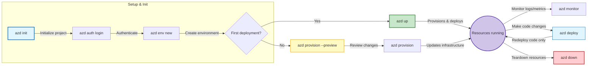
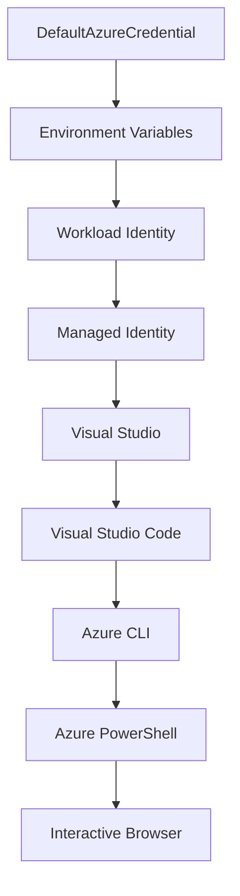

# Dasar-Dasar AZD - Konsep Inti dan Fundamental

**Navigasi Bab:**
- **📚 Beranda Kursus**: [AZD Untuk Pemula](../../README.md)
- **📖 Bab Saat Ini**: Bab 1 - Fondasi & Mulai Cepat
- **⬅️ Sebelumnya**: [Ikhtisar Kursus](../../README.md#-chapter-1-foundation--quick-start)
- **➡️ Berikutnya**: [Instalasi & Pengaturan](installation.md)
- **🚀 Bab Berikutnya**: [Bab 2: Pengembangan AI-Pertama](../chapter-02-ai-development/microsoft-foundry-integration.md)

## Pendahuluan

> Ditinjau terhadap `azd 1.37.2` (November 2026). Perintah Bash menggunakan placeholder dalam tanda kutip yang harus Anda ganti. Alur kerja template menggunakan `.` untuk menginisialisasi direktori saat ini; tanpa argumen direktori, inisialisasi template membuat subdirektori dan tidak mengubah direktori kerja shell Anda. Snippet lanjutan bersifat ilustratif, bukan proyek lengkap.

Pelajaran ini memperkenalkan Anda pada Azure Developer CLI (azd), alat baris perintah yang kuat yang mempercepat perjalanan Anda dari pengembangan lokal ke penyebaran Azure. Anda akan mempelajari konsep dasar, fitur inti, dan memahami bagaimana azd menyederhanakan penyebaran aplikasi cloud-native.

## Tujuan Pembelajaran

Pada akhir pelajaran ini, Anda akan:
- Memahami apa itu Azure Developer CLI dan tujuan utamanya
- Mempelajari konsep inti template, lingkungan, dan layanan
- Menjelajahi fitur utama termasuk pengembangan berbasis template dan Infrastruktur sebagai Kode
- Memahami struktur proyek azd dan alur kerjanya
- Siap menginstal dan mengonfigurasi azd untuk lingkungan pengembangan Anda

## Hasil Pembelajaran

Setelah menyelesaikan pelajaran ini, Anda akan mampu:
- Menjelaskan peran azd dalam alur kerja pengembangan cloud modern
- Mengidentifikasi komponen struktur proyek azd
- Mendeskripsikan bagaimana template, lingkungan, dan layanan bekerja sama
- Memahami manfaat Infrastruktur sebagai Kode dengan azd
- Mengenali berbagai perintah azd dan tujuan penggunaannya

## Apa itu Azure Developer CLI (azd)?

Azure Developer CLI (azd) adalah alat baris perintah yang dirancang untuk mempercepat perjalanan Anda dari pengembangan lokal ke penyebaran Azure. Ini menyederhanakan proses membangun, menyebarkan, dan mengelola aplikasi cloud-native di Azure.

### Apa yang Bisa Anda Sebarkan dengan azd?

azd mendukung berbagai jenis beban kerja—dan daftarnya terus bertambah. Saat ini, Anda dapat menggunakan azd untuk menyebarkan:

| Jenis Beban Kerja | Contoh | Alur Kerja Sama? |
|---------------|----------|----------------|
| **Aplikasi tradisional** | Aplikasi web, REST API, situs statis | ✅ `azd up` |
| **Layanan dan mikroservis** | Container Apps, Function Apps, backend multi-layanan | ✅ `azd up` |
| **Aplikasi bertenaga AI** | Aplikasi chat dengan Model Microsoft Foundry, solusi RAG dengan AI Search | ✅ `azd up` |
| **Agen cerdas** | Agen yang dihosting Foundry, orkestrasi multi-agen | ✅ `azd up` |

Inti pentingnya adalah **siklus hidup azd tetap sama terlepas dari apa yang Anda sebarkan**. Anda menginisialisasi proyek, menyediakan infrastruktur, menyebarkan kode, memantau aplikasi, dan membersihkan—baik itu situs web sederhana atau agen AI canggih.

Kontinuitas ini sengaja dirancang. azd memperlakukan kemampuan AI sebagai jenis layanan lain yang dapat digunakan aplikasi Anda, bukan sebagai sesuatu yang benar-benar berbeda. Endpoint obrolan yang didukung oleh Model Microsoft Foundry, dari perspektif azd, hanyalah layanan lain untuk dikonfigurasi dan disebarkan.

### 🎯 Mengapa Menggunakan AZD? Perbandingan Dunia Nyata

Mari kita bandingkan penyebaran aplikasi web sederhana dengan database:

#### ❌ TANPA AZD: Penyebaran Azure Manual (30+ menit)

**Perbandingan Bash ilustratif, bukan starter aplikasi yang bisa dijalankan.** Ini mengasumsikan kode aplikasi yang sudah ada, nama sumber daya unik, autentikasi Azure CLI, dan ekstensi CLI yang diperlukan. Gunakan latihan template di bawah untuk jalur end-to-end yang didukung.

```bash
# Step 1: Create resource group
az group create --name myapp-rg --location eastus

# Step 2: Create App Service Plan
az appservice plan create --name myapp-plan \
  --resource-group myapp-rg \
  --sku B1 --is-linux

# Step 3: Create Web App
az webapp create --name myapp-web-unique123 \
  --resource-group myapp-rg \
  --plan myapp-plan \
  --runtime "NODE:22-lts"

# Step 4: Create Cosmos DB account (10-15 minutes)
az cosmosdb create --name myapp-cosmos-unique123 \
  --resource-group myapp-rg \
  --kind MongoDB

# Step 5: Create database
az cosmosdb mongodb database create \
  --account-name myapp-cosmos-unique123 \
  --resource-group myapp-rg \
  --name tododb

# Step 6: Create collection
az cosmosdb mongodb collection create \
  --account-name myapp-cosmos-unique123 \
  --resource-group myapp-rg \
  --database-name tododb \
  --name todos

# Step 7: Get connection string
CONN_STR=$(az cosmosdb keys list \
  --name myapp-cosmos-unique123 \
  --resource-group myapp-rg \
  --type connection-strings \
  --query "connectionStrings[0].connectionString" -o tsv)

# Step 8: Configure app settings
az webapp config appsettings set \
  --name myapp-web-unique123 \
  --resource-group myapp-rg \
  --settings MONGODB_URI="$CONN_STR"

# Step 9: Enable logging
az webapp log config --name myapp-web-unique123 \
  --resource-group myapp-rg \
  --application-logging filesystem \
  --detailed-error-messages true

# Step 10: Set up Application Insights
az monitor app-insights component create \
  --app myapp-insights \
  --location eastus \
  --resource-group myapp-rg

# Step 11: Link App Insights to Web App
INSTRUMENTATION_KEY=$(az monitor app-insights component show \
  --app myapp-insights \
  --resource-group myapp-rg \
  --query "instrumentationKey" -o tsv)

az webapp config appsettings set \
  --name myapp-web-unique123 \
  --resource-group myapp-rg \
  --settings APPINSIGHTS_INSTRUMENTATIONKEY="$INSTRUMENTATION_KEY"

# Step 12: Build application locally
npm install
npm run build

# Step 13: Create deployment package
zip -r app.zip . -x "*.git*" "node_modules/*"

# Step 14: Deploy application
az webapp deployment source config-zip \
  --resource-group myapp-rg \
  --name myapp-web-unique123 \
  --src app.zip

# Step 15: Wait and pray it works 🙏
# (No automated validation, manual testing required)
```

**Masalah:**
- ❌ Lebih dari 15 perintah untuk diingat dan dijalankan secara berurutan
- ❌ 30-45 menit kerja manual
- ❌ Mudah membuat kesalahan (typo, parameter salah)
- ❌ Kredensial memerlukan penanganan eksplisit; log debug dan pelacakan shell dapat mengeksposnya
- ❌ Tidak ada rollback otomatis jika terjadi kegagalan
- ❌ Sulit direplikasi untuk anggota tim
- ❌ Berbeda setiap kali (tidak dapat direproduksi)

#### ✅ DENGAN AZD: Penyebaran Otomatis (5 perintah, 10-15 menit)

```bash
# Step 1: Initialize from template
azd init --template todo-nodejs-mongo .

# Step 2: Authenticate
azd auth login

# Step 3: Select the environment created during init
azd env select dev

# Step 4: Preview changes (optional but recommended)
azd provision --preview

# Step 5: Deploy everything
azd up

# ✨ Done! Everything is deployed, configured, and monitored
```

**Manfaat:**
- ✅ **5 perintah** versus 15+ langkah manual
- ✅ **10-15 menit** total waktu (kebanyakan menunggu Azure)
- ✅ **Kesalahan manual lebih sedikit** - alur kerja konsisten berbasis template
- ✅ **Penanganan rahasia aman** - banyak template menggunakan penyimpanan rahasia yang dikelola Azure
- ✅ **Penyebaran dapat diulang** - alur kerja sama setiap kali
- ✅ **Definisi infrastruktur yang dapat diulang** - tunduk pada kuota, ketersediaan wilayah, dan versi template
- ✅ **Siap untuk tim** - siapa saja dapat menyebarkan dengan perintah yang sama
- ✅ **Infrastruktur sebagai Kode** - template Bicep yang dikontrol versinya
- ✅ **Monitoring yang didefinisikan template** - Application Insights saat disertakan dalam template

### Waktu dan Keandalan

Perkiraan waktu di atas adalah estimasi, bukan tolok ukur. azd mengurangi perintah yang harus Anda koordinasikan, namun tidak menjamin durasi penyebaran, menghilangkan kesalahan, atau menyediakan rollback otomatis aplikasi/database. Simpan versi kerja di kontrol sumber dan uji prosedur pemulihan.

## Konsep Inti

### Template
Template adalah dasar dari azd. Mereka berisi:
- **Kode aplikasi** - Kode sumber dan dependensi Anda
- **Definisi infrastruktur** - Sumber daya Azure yang didefinisikan dalam Bicep atau Terraform
- **File konfigurasi** - Pengaturan dan variabel lingkungan
- **Skrip penyebaran** - Alur kerja penyebaran otomatis

### Lingkungan
Lingkungan mewakili target penyebaran yang berbeda:
- **Pengembangan** - Untuk pengujian dan pengembangan
- **Staging** - Lingkungan pra-produksi
- **Produksi** - Lingkungan produksi langsung

Setiap lingkungan memelihara:
- Nama lingkungan dan nilai; isolasi sumber daya bergantung pada template infrastruktur
- Pengaturan konfigurasi
- Status penyebaran

### Layanan
Layanan di `azure.yaml` menggambarkan komponen aplikasi yang dapat disebarkan:
- **Frontend** - Aplikasi web, SPA
- **Backend** - API, mikroservis

Basis data dan penyimpanan biasanya disediakan sebagai sumber daya infrastruktur, bukan sebagai hos layanan yang dibuat seperti `host: postgres`.

## Fitur Utama

### 1. Pengembangan Berbasis Template
```bash
# Browse available templates
azd template list

# Initialize from a template
azd init --template "<template-name>" .
```

### 2. Infrastruktur sebagai Kode
- **Bicep** - Bahasa khusus domain Azure
- **Terraform** - Alat infrastruktur multi-cloud
- Bicep mengompilasi ke template ARM; JSON ARM mentah bukan built-in terpisah di `infra.provider`.

### 3. Alur Kerja Terpadu
```bash
# Complete deployment workflow
azd up            # Provision + Deploy this is hands off for first time setup

# 🧪 NEW: Preview infrastructure changes before deployment (SAFE)
azd provision --preview    # Simulate infrastructure deployment without making changes

azd provision     # Create Azure resources if you update the infrastructure use this
azd deploy        # Deploy application code or redeploy application code once update
azd down          # Clean up resources
```

#### 🛡️ Perencanaan Infrastruktur yang Aman dengan Preview
Perintah `azd provision --preview` adalah perubahan permainan untuk penyebaran yang aman:
- **Analisis dry-run** - Menampilkan apa yang akan dibuat, diubah, atau dihapus
- **Tidak ada apply infrastruktur** - Meninjau perubahan penyedia; periksa hook proyek terlebih dahulu, karena hook dapat menjalankan perintah dengan efek samping
- **Kolaborasi tim** - Bagikan hasil preview sebelum penyebaran
- **Input perencanaan biaya** - Periksa SKU yang diusulkan, kemudian hitung harga dengan Azure Pricing Calculator; preview tidak menghitung harga

```bash
# Example preview workflow
azd provision --preview           # See what will change
# Review the output, discuss with team
azd provision                     # Apply changes with confidence
```

### 📊 Visual: Alur Kerja Pengembangan AZD



**Penjelasan Alur Kerja:**
1. **Init** - Mulai dengan template atau proyek baru
2. **Auth** - Autentikasi dengan Azure
3. **Environment** - Buat lingkungan penyebaran terisolasi
4. **Preview** - 🆕 Selalu preview perubahan infrastruktur terlebih dahulu (praktik aman)
5. **Provision** - Buat/perbarui sumber daya Azure
6. **Deploy** - Dorong kode aplikasi Anda
7. **Monitor** - Amati kinerja aplikasi
8. **Iterate** - Buat perubahan dan deploy ulang kode
9. **Cleanup** - Hapus sumber daya saat selesai

### 4. Manajemen Lingkungan
```bash
# Create and manage environments
azd env new "<environment-name>"
azd env select "<environment-name>"
azd env list
```

### 5. Ekstensi dan Perintah AI

azd menggunakan sistem ekstensi untuk menambah kemampuan di luar CLI inti. Ini sangat berguna untuk beban kerja AI:

```bash
# List available extensions
azd extension list

# Install the Foundry agents extension
azd extension install azure.ai.agents

# Initialize an AI agent project interactively
azd ai agent init

# Test a deployed agent (shows latency and time-to-first-byte)
azd ai agent invoke

# Start the MCP server for AI-assisted development (Alpha)
azd mcp start
```

**Siklus hidup agen, dari awal hingga akhir.** Gunakan `azure.ai.agents` untuk operasi siklus hidup agen dan instal `azure.ai.evaluations` secara terpisah untuk evaluasi. Gunakan `azd >= 1.37.0` untuk alur kerja gabungan. Anda tidak perlu semua ini pada hari pertama:

| Tahap | Perintah | Fungsinya |
|-------|---------|--------------|
| **Scaffold** | `azd ai agent init --template <path-to-azure.yaml>` | Mengadopsi template proyek agen terbaru |
| **Test** | `azd ai agent invoke` | Memanggil agen dan melihat waktu respons |
| **Measure** | `azd ai eval init`, `generate`, `run start` | Mengonfigurasi, menyebarkan, dan menjalankan evaluasi menggunakan ekstensi terpisah |
| **Improve** | `azd ai agent optimize --eval <evaluation-name> --optimize-model <optimizer-deployment>` | Menggunakan ulang evaluasi kompatibel untuk mengoptimalkan agen |
| **Inspect** | `azd ai agent endpoint show` | Melihat konfigurasi endpoint langsung |
| **Clean up** | `azd ai agent delete` | Menghapus agen yang dihosting dan semua versinya |

> Ekstensi dibahas secara rinci di [Bab 2: Pengembangan AI-Pertama](../chapter-02-ai-development/agents.md) dan referensi [Perintah AZD AI CLI](../chapter-08-production/production-ai-practices.md#azd-ai-cli-commands-and-extensions).

## 📁 Struktur Proyek

Struktur proyek azd yang khas:
```
my-app/
├── .azure/                  # Local environments and selected-environment config
│   ├── config.json
│   └── dev/.env
├── .devcontainer/          # Development container config
├── .github/workflows/      # GitHub Actions
├── .vscode/               # VS Code settings
├── infra/                 # Infrastructure code
│   ├── main.bicep        # Main infrastructure template
│   ├── main.parameters.json
│   └── modules/          # Reusable modules
├── src/                  # Application source code
│   ├── api/             # Backend services
│   └── web/             # Frontend application
├── azure.yaml           # azd project configuration
└── README.md
```

## 🔧 File Konfigurasi

### azure.yaml
File konfigurasi utama proyek:
```yaml
name: my-awesome-app
metadata:
  template: my-template@1.0.0

services:
  web:
    project: ./src/web
    language: js
    host: appservice
  api:
    project: ./src/api
    language: js
    host: appservice

hooks:
  preprovision:
    shell: pwsh
    run: echo "Preparing to provision..."
```

### .azure/config.json
Pemilihan lingkungan default lokal proyek (ilustratif; dikelola oleh azd):
```json
{
  "defaultEnvironment": "dev"
}
```

## 🎪 Alur Kerja Umum dengan Latihan Praktis

> **💡 Tips Pembelajaran:** Ikuti latihan ini secara berurutan untuk membangun keterampilan AZD Anda secara bertahap.

### 🎯 Latihan 1: Inisialisasi Proyek Pertama Anda

**Tujuan:** Membuat proyek AZD dan menjelajahi strukturnya

**Langkah-langkah:**
```bash
# Use a proven template
mkdir azd-basics-practice
cd azd-basics-practice
# Choose "dev" for the environment name when prompted
azd init --template todo-nodejs-mongo .

# Explore the generated files
ls -la  # View all files including hidden ones

# Key files created:
# - azure.yaml (main config)
# - infra/ (infrastructure code)
# - src/ (application code)
```

**✅ Sukses:** Anda memiliki file azure.yaml, direktori infra/, dan src/

---

### 🎯 Latihan 2: Menyebarkan ke Azure

**Tujuan:** Menyelesaikan penyebaran end-to-end

**Langkah-langkah:**
```bash
# 1. Authenticate
azd auth login

# 2. Select the dev environment created in Exercise 1
azd env select dev
azd env set AZURE_LOCATION eastus

# 3. Preview changes (RECOMMENDED)
azd provision --preview

# 4. Deploy everything
azd up

# 5. Verify deployment
azd show    # View your app URL
```

**Perkiraan Waktu:** 10-15 menit  
**✅ Sukses:** URL aplikasi terbuka di browser

---

### 🎯 Latihan 3: Beberapa Lingkungan

**Tujuan:** Menyebarkan ke dev dan staging

**Langkah-langkah:**
```bash
# Already have dev, create staging
azd env new staging
azd env set AZURE_LOCATION westus2
azd up

# Switch between them
azd env list
azd env select dev
```

**✅ Sukses:** Dua grup sumber daya terpisah di Azure Portal

**Pembersihan:** Latihan 3 menciptakan penyebaran kedua yang ditagih. Hapus keduanya saat selesai:

```bash
azd down --environment dev
azd down --environment staging
```

---

### 🛡️ Pembersihan Destruktif: `azd down --force --purge`

Saat Anda sengaja ingin menghapus sumber daya Azure di lingkungan yang dipilih:

```bash
azd down --force --purge
```

**Apa yang dilakukan:**
- `--force`: Tidak ada prompt konfirmasi
- `--purge`: Juga menghapus permanen sumber daya soft-delete yang didukung (misalnya Key Vault), jika proteksi penghapusan mengizinkan. Tidak menghapus direktori lokal `.azure/`.

**Gunakan ketika:** selesai dengan lingkungan sekali pakai. Jangan anggap pembersihan destruktif sebagai respons pertama terhadap kesalahan autentikasi, kuota, atau konfigurasi.

---

## 🎪 Referensi Alur Kerja Asli

### Memulai Proyek Baru
```bash
# Method 1: Use existing template
azd init --template todo-nodejs-mongo .

# Method 2: Start from scratch
azd init

# Method 3: Use current directory
azd init .
```

### Siklus Pengembangan
```bash
# Set up development environment
azd auth login
azd env new dev
azd env select dev

# Deploy everything
azd up

# Make changes and redeploy
azd deploy

# Clean up when done
azd down --force --purge # Deletes this environment's discovered Azure resources; review before forcing deletion.
```

## Memahami `azd down --force --purge`
Perintah `azd down --force --purge` adalah cara ampuh untuk sepenuhnya membongkar lingkungan azd Anda dan semua sumber daya terkait. Berikut penjelasan fungsi setiap flag:
```
--force
```
- Melewati prompt konfirmasi.
- Berguna untuk otomatisasi atau scripting dimana input manual tidak memungkinkan.
- Tidak melewati izin, proteksi purge, atau kegagalan penghapusan.

```
--purge
```
Secara permanen menghapus sumber daya Azure yang dihapus secara lunak dan didukung tanpa konfirmasi tambahan. Perlindungan pembersihan dan izin masih berlaku. Ini **tidak** menghapus lingkungan lokal atau folder `.azure/`.


### Mengapa menggunakan keduanya?
Gunakan keduanya hanya ketika Anda bermaksud menghapus sumber daya Azure dari lingkungan yang dipilih dan membersihkan sumber daya yang dapat dipulihkan. Ini adalah pembersihan destruktif, bukan perbaikan umum atau pengaturan ulang status lokal.

Ini sangat berguna setelah penghapusan sumber daya secara manual di portal Azure atau saat mengganti templat, lingkungan, atau konvensi penamaan grup sumber daya.


### Mengelola Beberapa Lingkungan
```bash
# Create staging environment
azd env new staging
azd env select staging
azd up

# Switch back to dev
azd env select dev

# Compare environments
azd env list
```

## 🔐 Otentikasi dan Kredensial

Bedakan otentikasi penyebaran (`azd auth login`) dari otentikasi SDK aplikasi (`DefaultAzureCredential`). Keduanya terpisah. azd secara default tidak menggunakan kredensial Azure CLI.

### Otentikasi Azure CLI (`az login`)

Jalankan `azd auth login` untuk azd. Perintah Azure CLI berikut bersifat opsional dan mengotentikasi perintah `az` secara terpisah:

```bash
# Interactive login (opens browser)
az login

# Login with specific tenant
az login --tenant "<tenant-id>"

# Login with service principal
az login --service-principal -u "<app-id>" -p "<password>" --tenant "<tenant-id>"

# Check current login status
az account show

# List available subscriptions
az account list --output table

# Set default subscription
az account set --subscription "<subscription-id>"
```

### Alur Otentikasi
1. **Login Interaktif**: Membuka browser default Anda untuk otentikasi
2. **Alur Kode Perangkat**: Untuk lingkungan tanpa akses browser
3. **Service Principal**: Untuk otomatisasi dan skenario CI/CD
4. **Managed Identity**: Untuk aplikasi yang dihosting di Azure

### Rantai DefaultAzureCredential

`DefaultAzureCredential` adalah jenis kredensial yang memberikan pengalaman otentikasi yang disederhanakan dengan secara otomatis mencoba beberapa sumber kredensial dalam urutan tertentu:

#### Rantai Kredensial SDK Aplikasi

Rantai yang tepat tergantung pada bahasa SDK Azure Identity, versi, plugin yang terpasang, dan opsi. Diagram ini bersifat konseptual, bukan urutan autentikasi azd yang tetap; SDK terbaru juga dapat menyertakan kredensial Azure Developer CLI.


#### 1. Variabel Lingkungan
```bash
# Set environment variables for service principal
export AZURE_CLIENT_ID="<app-id>"
export AZURE_CLIENT_SECRET="<password>"
export AZURE_TENANT_ID="<tenant-id>"
```

#### 2. Workload Identity (Kubernetes/GitHub Actions)
Digunakan secara otomatis di:
- Azure Kubernetes Service (AKS) dengan Workload Identity
- GitHub Actions dengan federasi OIDC
- Skenario identitas federasi lainnya

#### 3. Managed Identity
Untuk sumber daya Azure seperti:
- Mesin Virtual
- App Service
- Azure Functions
- Container Instances

```bash
# Inspect a deployed Container App's configured identity (requires az login)
az containerapp show --name "<app-name>" --resource-group "<rg-name>" --query identity
```

#### 4. Integrasi Alat Pengembang
- **Visual Studio**: Menggunakan akun yang masuk secara otomatis
- **VS Code**: Dukungan tergantung pada SDK dan pengaturan broker/plugin yang didukung
- **Azure CLI**: Menggunakan kredensial `az login` (paling umum untuk pengembangan lokal)

### Pengaturan Autentikasi AZD

```bash
# Method 1: Direct azd authentication (recommended)
azd auth login

# Method 2: Direct azd authentication
azd auth login --use-device-code  # For headless environments

# Method 3: Check authentication status
azd auth login --check-status

# Method 4: Logout and re-authenticate
azd auth logout
azd auth login
```

### Praktik Terbaik Autentikasi

#### Untuk Pengembangan Lokal
```bash
# 1. Log in to azd
azd auth login

# 2. Select the subscription for this initialized environment
azd env set AZURE_SUBSCRIPTION_ID "<subscription-id>"

# 3. Check azd sign-in details (read the status message)
azd auth login --check-status
```

#### Untuk Pipeline CI/CD
```yaml
# Partial GitHub Actions steps: assumes checkout, azd installation,
# required AZURE_* environment values, and pipeline secret configuration.
- name: Deploy with azd
  run: |
    azd auth login --client-id ${{ secrets.AZURE_CLIENT_ID }} \
                    --client-secret ${{ secrets.AZURE_CLIENT_SECRET }} \
                    --tenant-id ${{ secrets.AZURE_TENANT_ID }}
    azd up --no-prompt
```

#### Untuk Lingkungan Produksi
- Gunakan **Managed Identity** saat menjalankan di sumber daya Azure
- Gunakan **Service Principal** untuk skenario otomatisasi
- Hindari menyimpan kredensial dalam kode atau berkas konfigurasi
- Gunakan **Azure Key Vault** untuk konfigurasi yang sensitif

### Masalah dan Solusi Autentikasi Umum

#### Masalah: "Tidak ditemukan langganan"
```bash
# Solution: Set default subscription
az account list --output table
az account set --subscription "<subscription-id>"
azd env set AZURE_SUBSCRIPTION_ID "<subscription-id>"
```

#### Masalah: "Izin tidak cukup"
```bash
# Solution: Check and assign required roles
az role assignment list --assignee $(az account show --query user.name --output tsv)

# Common required roles:
# - Contributor (for resource management)
# - User Access Administrator (for role assignments)
```

#### Masalah: "Token kedaluwarsa"
```bash
# Solution: Re-authenticate
az logout
az login
azd auth logout
azd auth login
```

### Autentikasi dalam Skenario Berbeda

#### Pengembangan Lokal
```bash
# Personal development account
az login
azd auth login
```

#### Pengembangan Tim
```bash
# Use specific tenant for organization
az login --tenant contoso.onmicrosoft.com
azd auth login --tenant-id "<tenant-id>"
```

#### Skenario Multi-penyewa
```bash
# Switch between tenants
az login --tenant tenant1.onmicrosoft.com
azd auth login --tenant-id "<tenant-1-id>"
# Select an environment configured with tenant 1's subscription
azd env select tenant1-dev
# Deploy to tenant 1
azd up

az login --tenant tenant2.onmicrosoft.com  
azd auth login --tenant-id "<tenant-2-id>"
azd env select tenant2-dev
# Deploy to tenant 2
azd up
```

### Pertimbangan Keamanan

1. **Penyimpanan Kredensial**: Jangan pernah menyimpan kredensial dalam kode sumber
2. **Pembatasan Cakupan**: Gunakan prinsip hak minimum untuk service principal
3. **Rotasi Token**: Lakukan rotasi rahasia service principal secara berkala
4. **Audit Trail**: Pantau aktivitas autentikasi dan penyebaran
5. **Keamanan Jaringan**: Gunakan private endpoint jika memungkinkan

### Pemecahan Masalah Autentikasi

```bash
# Debug authentication issues
azd auth login --check-status
az account show
az account get-access-token

# Common diagnostic commands
whoami                          # Current user context
az ad signed-in-user show      # Microsoft Entra ID user details
az group list                  # Test resource access
```

## Penemuan Perintah

### Penemuan
```bash
azd template list              # Browse templates
azd template list --help       # Template discovery options
azd init --help               # Initialization options
```

### Manajemen Proyek
```bash
azd show                     # Project overview
azd env list                # Available environments and selected default
azd config show            # Configuration settings
```

### Pemantauan
```bash
azd monitor                  # Open Azure portal monitoring
azd monitor --logs           # View application logs
azd monitor --live           # View live metrics
azd pipeline config          # Set up CI/CD
```

## Praktik Terbaik

### 1. Gunakan Nama yang Bermakna
```bash
# Good
azd env new production-east
azd init --template todo-nodejs-mongo .

# Avoid
azd env new env1
azd init --template template1 .
```

### 2. Manfaatkan Template
- Mulailah dengan template yang sudah ada
- Sesuaikan dengan kebutuhan Anda
- Buat template yang dapat digunakan ulang untuk organisasi Anda

### 3. Isolasi Lingkungan
- Gunakan lingkungan terpisah untuk dev/staging/prod
- Jangan pernah melakukan deploy langsung ke produksi dari mesin lokal
- Gunakan pipeline CI/CD untuk penyebaran produksi

### 4. Manajemen Konfigurasi
- Gunakan managed identity dan Key Vault untuk rahasia; nilai `azd env set` biasa adalah plaintext lokal
- Simpan konfigurasi dalam kontrol versi
- Dokumentasikan pengaturan khusus lingkungan

## Progres Pembelajaran

### Pemula (Minggu 1-2)
1. Pasang azd dan autentikasi
2. Deploy template sederhana
3. Pahami struktur proyek
4. Pelajari perintah dasar (up, down, deploy)

### Menengah (Minggu 3-4)
1. Sesuaikan template
2. Kelola beberapa lingkungan
3. Pahami kode infrastruktur
4. Siapkan pipeline CI/CD

### Lanjutan (Minggu 5+)
1. Buat template kustom
2. Pola infrastruktur tingkat lanjut
3. Penyebaran multi-region
4. Konfigurasi kelas enterprise

## Langkah Selanjutnya

**📖 Lanjutkan Pembelajaran Bab 1:**
- [Instalasi & Pengaturan](installation.md) - Pasang dan konfigurasikan azd
- [Proyek Pertama Anda](first-project.md) - Selesaikan tutorial langsung
- [Panduan Konfigurasi](../chapter-03-configuration/configuration.md) - Opsi konfigurasi lanjutan

**🎯 Siap ke Bab Berikutnya?**
- [Bab 2: Pengembangan AI-Pertama](../chapter-02-ai-development/microsoft-foundry-integration.md) - Mulai membangun aplikasi AI

## Sumber Daya Tambahan

- [Ikhtisar Azure Developer CLI](https://learn.microsoft.com/en-us/azure/developer/azure-developer-cli/)
- [Galeri Template](https://azure.github.io/awesome-azd/)
- [Contoh Komunitas](https://github.com/Azure-Samples)

---

## 🙋 Pertanyaan yang Sering Diajukan

### Pertanyaan Umum

**T: Apa perbedaan antara AZD dan Azure CLI?**

J: Azure CLI (`az`) untuk mengelola sumber daya Azure individu. AZD (`azd`) untuk mengelola seluruh aplikasi:

```bash
# Azure CLI - Low-level resource management
az webapp create --name myapp --resource-group rg
az sql server create --name myserver --resource-group rg
# ...many more commands needed

# AZD - Application-level management
azd up  # Deploys entire app with all resources
```

**Pikirkan seperti ini:**
- `az` = Mengoperasikan batu Lego individual
- `azd` = Bekerja dengan set Lego lengkap

---

**T: Apakah saya perlu tahu Bicep atau Terraform untuk menggunakan AZD?**

J: Tidak! Mulailah dengan template:
```bash
# Use existing template - no IaC knowledge needed
azd init --template todo-nodejs-mongo .
azd up
```

Anda bisa belajar Bicep nanti untuk menyesuaikan infrastruktur. Template menyediakan contoh kerja untuk dipelajari.

---

**T: Berapa biaya menjalankan template AZD?**

J: Biaya bervariasi menurut wilayah, SKU, waktu aktif, mode database, dan penggunaan model. Lingkungan pengembangan bisa menimbulkan biaya bulanan cukup besar meski dalam keadaan diam; jangan asumsikan rentang universal $50-150:

```bash
# Preview resource changes (not prices)
azd provision --preview

# Always cleanup when not using
azd down --force --purge  # Removes all resources
```

**Tip profesional:** Gunakan tingkatan gratis jika tersedia:
- App Service: tingkat F1 (Gratis)
- Azure OpenAI: tidak ada jaminan token gratis bulanan umum; cek model dan harga penawaran saat ini
- Cosmos DB: akun provisioned-throughput yang memenuhi syarat bisa memilih tingkatan gratis; template serverless tidak otomatis memenuhi syarat

---

**T: Bisakah saya menggunakan AZD dengan sumber daya Azure yang sudah ada?**

J: Ya, tapi lebih mudah mulai baru. AZD bekerja terbaik ketika mengelola siklus hidup penuh. Untuk sumber daya yang ada:

```bash
# Option 1: Import existing resources (advanced)
azd init
# Then modify infra/ to reference existing resources

# Option 2: Start fresh (recommended)
azd init --template "<verified-template-name>" .
azd up  # Creates new environment
```

---

**T: Bagaimana cara berbagi proyek saya dengan tim?**

J: Commit proyek AZD ke Git (tapi BUKAN folder .azure):

```bash
# Already in .gitignore by default
.azure/        # Contains secrets and environment data
*.env          # Environment variables

# Team members then:
git clone "<your-repo>"
# Change into the cloned repository before running the remaining commands.
azd auth login
azd env new "<their-name>-dev"
azd up
```

Semua orang mendapatkan infrastruktur identik dari template yang sama.

---

### Pertanyaan Pemecahan Masalah

**T: "azd up" gagal di tengah jalan. Apa yang harus saya lakukan?**

J: Periksa error, perbaiki, lalu coba lagi:

```bash
# Capture detailed diagnostics (redact sensitive values before sharing)
azd up --debug

# Common fixes:

# 1. If quota exceeded:
azd env set AZURE_LOCATION "westus2"  # Try different region

# 2. If resource name conflict:
azd down --force --purge  # Clean slate
azd up  # Retry

# 3. If auth expired:
az login
azd auth login
azd up
```

**Masalah paling umum:** Langganan Azure yang salah dipilih
```bash
az account list --output table
az account set --subscription "<correct-subscription>"
azd env set AZURE_SUBSCRIPTION_ID "<correct-subscription-id>"
```

---

**T: Bagaimana saya deploy hanya perubahan kode tanpa reprovisioning?**

J: Gunakan `azd deploy` daripada `azd up`:

```bash
azd up          # First time: provision + deploy (slow)

# Make code changes...

azd deploy      # Subsequent times: deploy only (fast)
```

Perbandingan kecepatan:
- `azd up`: 10-15 menit (meng-provision infrastruktur)
- `azd deploy`: 2-5 menit (hanya kode)

---

**T: Bisakah saya menyesuaikan template infrastruktur?**

J: Ya! Sunting file Bicep di `infra/`:

```bash
# After azd init
cd infra/
code main.bicep  # Edit in VS Code

# Preview changes
azd provision --preview

# Apply changes
azd provision
```

**Tip:** Mulailah dengan kecil - ubah SKU terlebih dahulu:
```bicep
// infra/main.bicep
sku: {
  name: 'B1'  // Change to 'P1V2' for production
}
```

---

**T: Bagaimana saya menghapus semua yang dibuat oleh AZD?**

J: Satu perintah menghapus semua sumber daya:

```bash
azd down --force --purge

# This deletes:
# - Azure resources/resource groups discovered for the selected environment
# - Supported soft-deleted resources, if purge protection allows
# Local .azure files remain; shared/external resources may remain too.
```

**Selalu jalankan ini saat:**
- Selesai menguji template
- Beralih ke proyek berbeda
- Ingin mulai dari awal

**Periksa biaya:** Konfirmasi penghapusan di Azure dan periksa sumber daya yang masih tertahan/berbagi. Biaya sebelumnya tetap berlaku.

---

**T: Apa yang terjadi jika saya secara tidak sengaja menghapus sumber daya di Azure Portal?**

J: Status AZD bisa tidak sinkron. Pendekatan bersih:

```bash
# 1. Delete remaining resources only if that is your intent
azd down --force --purge

# 2. Start fresh
azd up

# Alternative: Let AZD detect and fix
azd provision  # Will create missing resources
```

---

### Pertanyaan Lanjutan

**T: Bisakah saya menggunakan AZD di pipeline CI/CD?**

J: Ya! Contoh GitHub Actions:

```yaml
# .github/workflows/deploy.yml
name: Deploy with AZD

on:
  push:
    branches: [main]

jobs:
  deploy:
    runs-on: ubuntu-latest
    steps:
      - uses: actions/checkout@v4
      
      - name: Install azd
        run: curl -fsSL https://aka.ms/install-azd.sh | bash
      
      - name: Azure Login
        run: |
          azd auth login \
            --client-id ${{ secrets.AZURE_CLIENT_ID }} \
            --client-secret ${{ secrets.AZURE_CLIENT_SECRET }} \
            --tenant-id ${{ secrets.AZURE_TENANT_ID }}
      
      - name: Deploy
        env:
          AZURE_ENV_NAME: dev
          AZURE_LOCATION: ${{ vars.AZURE_LOCATION }}
          AZURE_SUBSCRIPTION_ID: ${{ vars.AZURE_SUBSCRIPTION_ID }}
        run: azd up --no-prompt
```

---

**T: Bagaimana saya menangani rahasia dan data sensitif?**

J: Gunakan Key Vault secara eksplisit. `azd env set` menulis nilai biasa ke file lingkungan lokal; tidak secara otomatis membuat vault, menetapkan peran, atau menyuntikkan rahasia ke aplikasi Anda.

```bash
# Interactive: create/select a Key Vault secret and save its reference
azd env set-secret DATABASE_PASSWORD
```

Anda perlu izin vault yang sesuai. Infrastruktur/aplikasi Anda masih harus menghubungkan rahasia ke pengguna dan memberikan akses identitas runtime. Jangan cetak nilai rahasia yang terselesaikan dalam log.

**Jangan pernah commit:**
- Folder `.azure/` (berisi data lingkungan)
- Berkas `.env` (rahasia lokal)
- String koneksi

---

**T: Bisakah saya melakukan deploy ke beberapa wilayah?**

J: Ya, buat lingkungan per wilayah:

```bash
# East US environment
azd env new prod-eastus
azd env set AZURE_LOCATION eastus
azd up

# West Europe environment
azd env new prod-westeurope
azd env set AZURE_LOCATION westeurope
azd up

# Each environment is independent
azd env list
```

Untuk aplikasi multi-region sejati, sesuaikan template Bicep agar dapat deploy ke beberapa wilayah sekaligus.

---

**T: Di mana saya bisa mendapatkan bantuan jika terjebak?**

1. **Dokumentasi AZD:** https://learn.microsoft.com/azure/developer/azure-developer-cli/
2. **Isu GitHub:** https://github.com/Azure/azure-dev/issues
3. **Discord:** [Azure Discord](https://discord.gg/microsoft-azure) - channel #azure-developer-cli
4. **Stack Overflow:** Tag `azure-developer-cli`
5. **Kursus Ini:** [Panduan Pemecahan Masalah](../chapter-07-troubleshooting/common-issues.md)

**Tip profesional:** Sebelum bertanya, jalankan:
```bash
azd show       # Shows current state
azd version    # Shows your version
```
Sertakan info ini dalam pertanyaan Anda untuk bantuan lebih cepat.

---

## 🎓 Apa Selanjutnya?

Sekarang Anda memahami dasar-dasar AZD. Pilih jalur Anda:

### 🎯 Untuk Pemula:
1. **Selanjutnya:** [Instalasi & Pengaturan](installation.md) - Pasang AZD di mesin Anda
2. **Kemudian:** [Proyek Pertama Anda](first-project.md) - Deploy aplikasi pertama Anda
3. **Latihan:** Selesaikan semua 3 latihan di pelajaran ini

### 🚀 Untuk Pengembang AI:
1. **Langsung ke:** [Bab 2: Pengembangan AI-Pertama](../chapter-02-ai-development/microsoft-foundry-integration.md)
2. **Deploy:** Di direktori proyek kosong, mulai dengan `azd init --template get-started-with-ai-chat .`
3. **Pelajari:** Bangun sambil Anda deploy

### 🏗️ Untuk Pengembang Berpengalaman:
1. **Review:** [Panduan Konfigurasi](../chapter-03-configuration/configuration.md) - Pengaturan lanjutan
2. **Eksplorasi:** [Infrastructure as Code](../chapter-04-infrastructure/provisioning.md) - Pendalaman Bicep
3. **Bangun:** Buat template kustom untuk tumpukan Anda

---

**Navigasi Bab:**
- **📚 Beranda Kursus**: [AZD Untuk Pemula](../../README.md)
- **📖 Bab Saat Ini**: Bab 1 - Dasar & Mulai Cepat  
- **⬅️ Sebelumnya**: [Ikhtisar Kursus](../../README.md#-chapter-1-foundation--quick-start)
- **➡️ Berikutnya**: [Instalasi & Pengaturan](installation.md)
- **🚀 Bab Berikutnya**: [Bab 2: Pengembangan AI-Pertama](../chapter-02-ai-development/microsoft-foundry-integration.md)

---

<!-- CO-OP TRANSLATOR DISCLAIMER START -->
**Penafian**:
Dokumen ini telah diterjemahkan menggunakan layanan terjemahan AI [Co-op Translator](https://github.com/Azure/co-op-translator). Meskipun kami berupaya untuk mencapai akurasi, harap diketahui bahwa terjemahan otomatis mungkin mengandung kesalahan atau ketidakakuratan. Dokumen asli dalam bahasa aslinya harus dianggap sebagai sumber yang sah. Untuk informasi penting, disarankan menggunakan terjemahan profesional oleh manusia. Kami tidak bertanggung jawab atas kesalahpahaman atau penafsiran yang keliru yang timbul dari penggunaan terjemahan ini.
<!-- CO-OP TRANSLATOR DISCLAIMER END -->