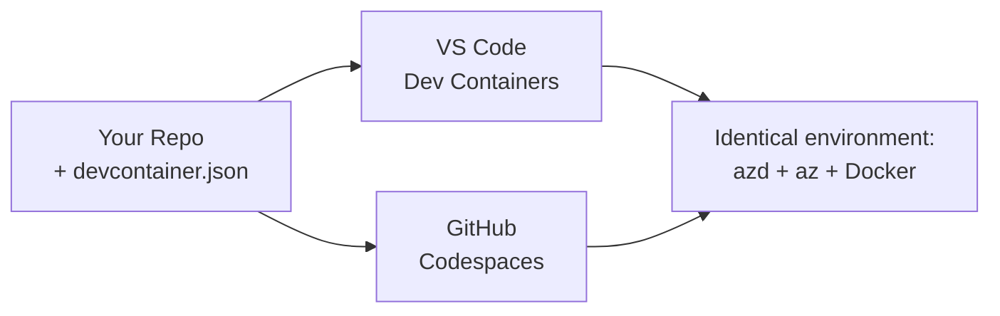

# Dev Containers & GitHub Codespaces untuk azd

**Navigasi Bab:**
- **📚 Beranda Kursus**: [AZD Untuk Pemula](../../README.md)
- **📖 Bab Saat Ini**: Bab 1 - Fondasi & Mulai Cepat
- **⬅️ Sebelumnya**: [Bawa Aplikasimu Sendiri](bring-your-own-app.md)
- **🚀 Bab Berikutnya**: [Bab 2: Pengembangan AI-Pertama](../chapter-02-ai-development/README.md)

> Target tinjauan perintah dan konfigurasi: `azd 1.37.2` (November 2026). Pembangunan container dan deployment Azure tidak dilakukan sebagai bagian dari tinjauan ini.

## Pengantar

Menginstal azd, runtime bahasa yang tepat, Docker, dan Azure CLI di setiap mesin adalah pekerjaan berat—dan ini alasan utama mengapa tutorial yang "berjalan di mesin saya" gagal bagi orang lain. **dev container** menyelesaikan ini dengan mendeskripsikan seluruh rangkaian alat Anda dalam sebuah file. Siapa pun yang membuka proyek di VS Code atau GitHub Codespaces mendapatkan lingkungan yang persis sama, dengan azd sudah terpasang. Pelajaran ini menunjukkan cara menambahkannya.

## Tujuan Pembelajaran

Di akhir pelajaran ini, Anda akan:
- Memahami apa itu dev container dan mengapa ia membantu dengan azd
- Menambahkan `.devcontainer/devcontainer.json` minimal ke dalam sebuah proyek
- Menyertakan azd, Azure CLI, dan Docker melalui *fitur* Dev Container
- Membuka proyek di GitHub Codespaces atau VS Code

## Hasil Pembelajaran

Setelah menyelesaikan pelajaran ini, Anda akan bisa:
- Menulis `devcontainer.json` untuk proyek azd
- Menambahkan azd dan alat Azure tanpa instalasi manual
- Menjalankan `azd up` dari dalam sebuah container atau Codespace

---

## Apa Itu Dev Container?

Dev container adalah lingkungan pengembangan berbasis Docker yang didefinisikan oleh file `.devcontainer/devcontainer.json` di repositori Anda. Saat Anda membuka proyek:

- **VS Code** (dengan ekstensi Dev Containers) membangun container dan terhubung ke dalamnya.
- **GitHub Codespaces** membangun container yang sama di cloud dan memberi Anda editor berbasis browser.

Dengan cara apapun, setiap kontributor mendapatkan alat yang identik—tidak perlu "apakah Anda sudah memasang azd?" untuk memecahkan masalah.



---

## Langkah 1: Buat file devcontainer

Buat `.devcontainer/devcontainer.json` di akar proyek Anda:

```json
{
  "name": "azd-project",
  "image": "mcr.microsoft.com/devcontainers/base:bookworm",
  "features": {
    "ghcr.io/devcontainers/features/azure-cli:1": {},
    "ghcr.io/azure/azure-dev/azd:0": { "version": "1.37.2" },
    "ghcr.io/devcontainers/features/docker-in-docker:2": {},
    "ghcr.io/devcontainers/features/node:1": {}
  },
  "customizations": {
    "vscode": {
      "extensions": [
        "ms-azuretools.azure-dev",
        "ms-azuretools.vscode-bicep"
      ]
    }
  },
  "forwardPorts": [3000],
  "postCreateCommand": "azd version"
}
```

Apa fungsi masing-masing bagian:

| Kunci | Tujuan |
|-----|---------|
| `image` | OS dasar untuk container |
| `features` | Installer prabuat—di sini: Azure CLI, **azd**, Docker, dan Node.js |
| `customizations.vscode.extensions` | Menginstal ekstensi azd dan Bicep VS Code secara otomatis |
| `forwardPorts` | Membuka port aplikasi Anda ke browser |
| `postCreateCommand` | Dijalan sekali setelah container dibangun (di sini, cek kesehatan) |

> Versi fitur (`azd:0`) dan versi CLI yang terpasang berbeda. Setel opsi `version` dari fitur ke `"1.37.2"` agar CLI tetap stabil; jangan gunakan versi CLI sebagai tag fitur.

---

## Langkah 2: Sesuaikan Fitur dengan Bahasa Aplikasi Anda

Ganti fitur `node` dengan apa pun yang digunakan aplikasi Anda:

```jsonc
// Python project
"ghcr.io/devcontainers/features/python:1": {},

// .NET project
"ghcr.io/devcontainers/features/dotnet:2": {},

// Java project
"ghcr.io/devcontainers/features/java:1": {},

// Go project
"ghcr.io/devcontainers/features/go:1": {}
```

Pertahankan `docker-in-docker` saat membangun image secara lokal. Pembangunan ACR jarak jauh yang dikonfigurasi (`docker.remoteBuild: true`) adalah alternatif; tipe host saja tidak selalu membutuhkan Docker lokal.

---

## Langkah 3: Buka Proyek

**Di VS Code:**
1. Pasang ekstensi **Dev Containers**.
2. Buka folder proyek.
3. Klik **Buka Kembali dalam Container** saat diminta (atau jalankan *Dev Containers: Reopen in Container*).

**Di GitHub Codespaces:**
1. Dorong repositori ke GitHub.
2. Klik **Code → Codespaces → Create codespace on main**.
3. Tunggu container terbangun—azd sudah siap di terminal.

---

## Langkah 4: Deploy dari Dalam Container

Container sudah memiliki azd terpasang, jadi alur kerja normal langsung berjalan:

```bash
azd auth login --use-device-code   # device code is handy inside Codespaces
azd up
```

> **Kenapa `--use-device-code`?** Dalam container atau Codespace jarak jauh tidak ada browser lokal untuk diarahkan, jadi login dengan device-code adalah cara yang dapat diandalkan. Anda akan menempelkan kode ke tab browser untuk menyelesaikan masuk.

---

## Kesalahan Umum

| Masalah | Solusi |
|---------|-----|
| `azd up` tidak bisa membangun image | Tambahkan fitur `docker-in-docker` |
| Login browser macet di Codespaces | Gunakan `azd auth login --use-device-code` |
| Alat berbeda antar anggota tim | Kunci CLI melalui opsi `version` fitur azd dan kunci runtime bahasa |
| Aplikasi tidak dapat diakses di browser | Tambahkan port ke `forwardPorts` |

---

## Ringkasan

- Dev container membuat rangkaian alat azd Anda dapat direproduksi oleh semua orang.
- Tambahkan azd, Azure CLI, dan Docker melalui *fitur* Dev Container.
- Sesuaikan fitur bahasa dengan aplikasi Anda dan pertahankan `docker-in-docker` untuk host container.
- Gunakan login device-code saat menjalankan di dalam Codespaces.

---

## 🔗 Navigasi

| Arah | Sumber |
|-----------|----------|
| **Sebelumnya** | [Bawa Aplikasimu Sendiri](bring-your-own-app.md) |
| **Beranda Bab** | [Bab 1: Fondasi & Mulai Cepat](README.md) |
| **Bab Berikutnya** | [Bab 2: Pengembangan AI-Pertama](../chapter-02-ai-development/README.md) |

## 📖 Sumber Terkait

- [Instalasi & Pengaturan](installation.md)
- [Daftar Perintah](../../resources/cheat-sheet.md)
- [Spesifikasi resmi Dev Containers](https://containers.dev/)
- [Fitur Dev Container azd](https://github.com/Azure/azure-dev/tree/main/ext/devcontainer)

---

<!-- CO-OP TRANSLATOR DISCLAIMER START -->
**Penafian**:
Dokumen ini telah diterjemahkan menggunakan layanan terjemahan AI [Co-op Translator](https://github.com/Azure/co-op-translator). Meskipun kami berupaya untuk mencapai akurasi, harap diketahui bahwa terjemahan otomatis mungkin mengandung kesalahan atau ketidakakuratan. Dokumen asli dalam bahasa aslinya harus dianggap sebagai sumber yang sah. Untuk informasi penting, disarankan menggunakan terjemahan profesional oleh manusia. Kami tidak bertanggung jawab atas kesalahpahaman atau penafsiran yang keliru yang timbul dari penggunaan terjemahan ini.
<!-- CO-OP TRANSLATOR DISCLAIMER END -->