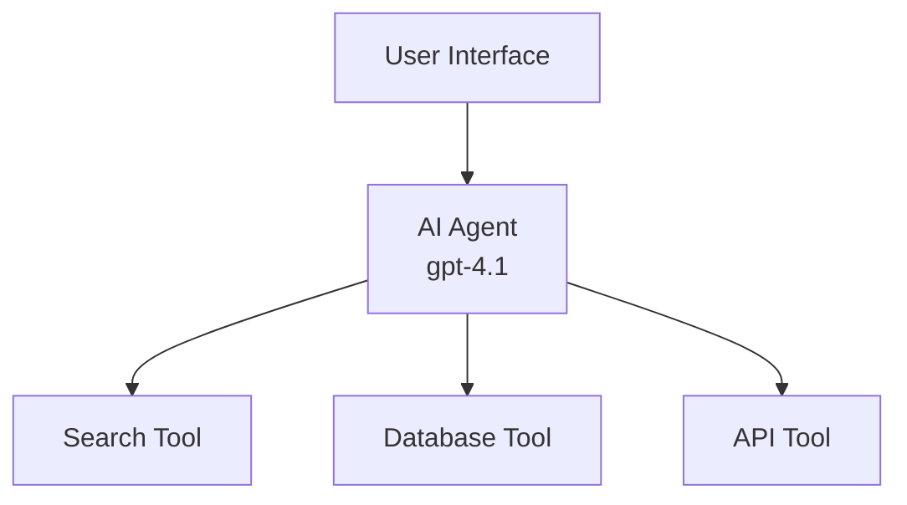
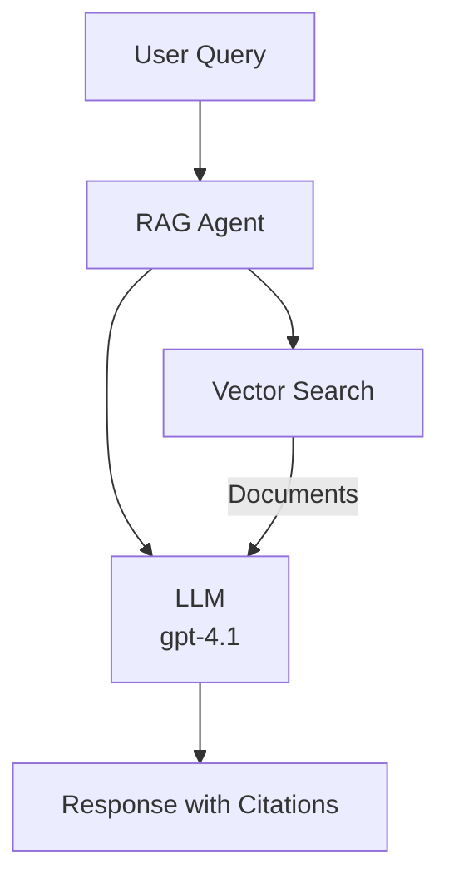
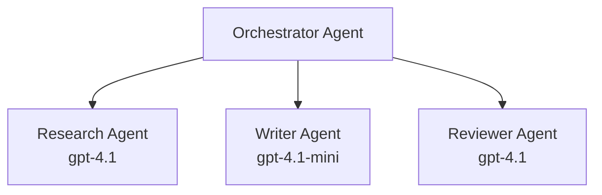

# Agen AI dengan Azure Developer CLI

**Navigasi Bab:**
- **📚 Beranda Kursus**: [AZD Untuk Pemula](../../README.md)
- **📖 Bab Saat Ini**: Bab 2 - Pengembangan AI-Pertama
- **⬅️ Sebelumnya**: [Integrasi Microsoft Foundry](microsoft-foundry-integration.md)
- **➡️ Selanjutnya**: [Penerapan Model AI](ai-model-deployment.md)
- **🚀 Lanjutan**: [Solusi Multi-Agen](../../examples/retail-scenario.md)

---

## Pendahuluan

Agen AI adalah program otonom yang dapat mengamati lingkungan mereka, membuat keputusan, dan mengambil tindakan untuk mencapai tujuan tertentu. Berbeda dengan chatbot sederhana yang merespons permintaan, agen dapat:

- **Menggunakan alat** - Memanggil API, mencari database, menjalankan kode
- **Merencanakan dan bernalar** - Memecah tugas kompleks menjadi langkah-langkah
- **Belajar dari konteks** - Mempertahankan memori dan menyesuaikan perilaku
- **Bekerja sama** - Bekerja dengan agen lain (sistem multi-agen)

Panduan ini menunjukkan cara menerapkan agen AI ke Azure menggunakan Azure Developer CLI (azd).

Menggunakan konteks percakapan bukanlah pelatihan model: memori persisten, kontrol akses, dan retensi harus diimplementasikan/dikonfigurasi oleh aplikasi.

> **Tinjauan rilis (2026-11-04):** Contoh CLI telah dicek terhadap dokumentasi/sumber `azd` `1.37.2`, `azure.ai.agents` `1.0.0-beta.23`, dan `azure.ai.evaluations` `1.0.0-beta.2`, bukan pada penerapan Azure langsung. Gunakan `azd >= 1.37.0` untuk alur kerja gabungan. Lihat [perubahan dan perbaikan terbaru](../chapter-08-production/production-ai-practices.md#recent-release-changes-and-fixes) sebelum memperbarui proyek lama.

## Tujuan Pembelajaran

Dengan menyelesaikan panduan ini, Anda akan:
- Memahami apa itu agen AI dan bagaimana mereka berbeda dari chatbot
- Menerapkan template agen AI yang sudah dibuat menggunakan AZD
- Mengonfigurasi Agen Foundry untuk agen kustom
- Mengimplementasikan pola agen dasar (penggunaan alat, RAG, multi-agen)
- Memantau dan men-debug agen yang diterapkan

## Hasil Pembelajaran

Setelah selesai, Anda akan dapat:
- Menerapkan aplikasi agen AI ke Azure dengan satu perintah
- Mengonfigurasi alat dan kemampuan agen
- Mengimplementasikan retrieval-augmented generation (RAG) dengan agen
- Mendesain arsitektur multi-agen untuk alur kerja kompleks
- Memecahkan masalah umum penerapan agen

---

## 🤖 Apa yang Membuat Agen Berbeda dari Chatbot?

| Fitur | Chatbot | Agen AI |
|---------|---------|----------|
| **Perilaku** | Merespons permintaan | Mengambil tindakan otonom |
| **Alat** | Mungkin menggunakan retrieval atau alat | Biasanya menggunakan alat dalam siklus berorientasi tujuan |
| **Memori** | Bergantung aplikasi | Memori persisten hanya jika diimplementasikan secara eksplisit |
| **Perencanaan** | Respon tunggal | Penalaran multi-langkah |
| **Kolaborasi** | Entitas tunggal | Bisa bekerja dengan agen lain |

### Analogi Sederhana

- **Chatbot** = Seseorang yang membantu menjawab pertanyaan di meja informasi
- **Agen AI** = Asisten pribadi yang bisa melakukan panggilan, memesan janji, dan menyelesaikan tugas untuk Anda

---

## 🚀 Mulai Cepat: Terapkan Agen Pertama Anda

Pilih salah satu opsi di **direktori kerja kosong baru**. Trailing `.` menginisialisasi di sana; tanpa tujuan eksplisit, AZD saat ini mungkin membuat subdirektori bernama template dan tidak mengubah direktori shell Anda. Jaga template/lingkungan terpisah di direktori terpisah.

Rentang waktu/biaya di bawah ini hanya ilustrasi, bukan kutipan yang divalidasi. Periksa prasyarat, harga, kuota model, dan layanan opsional setiap contoh saat ini sebelum penerapan.

### Opsi 1: Template Agen Foundry (Direkomendasikan)

```bash
# Initialize the AI agents template
azd init --template get-started-with-ai-agents .

# Deploy to Azure
azd up
```

**Apa yang diterapkan:** Infrastruktur contoh saat ini dan opsi yang dipilih menentukan model, alat, hosting, dan sumber daya pemantauan. Baca README dan `infra/` sebelum provisioning; jangan asumsikan setiap template agen termasuk Search atau antarmuka web.

**Waktu:** ~15-20 menit
**Biaya:** ~$100-150/bulan (pengembangan)

### Opsi 2: Agen Penulisan Kreatif dengan Prompty

```bash
# Initialize the Prompty-based agent template
azd init --template https://github.com/Azure-Samples/contoso-creative-writer .

# Deploy to Azure
azd up
```

**Apa yang diterapkan:** Contoh penulisan multi-agen FastAPI/Prompty menggunakan Azure OpenAI, Bing Grounding, dan Azure AI Search. Repositori `agent-openai-python-prompty` sebelumnya mengarahkan ke sini; ini bukan template agen cuaca Azure Functions minimal. Ikuti README saat ini untuk hosting, kuota model, dan prasyarat Bing Grounding.

**Waktu:** ~10-15 menit
**Biaya:** ~$50-100/bulan (pengembangan)

### Opsi 3: Agen Chat RAG

```bash
# Initialize RAG chat template
azd init --template azure-search-openai-demo .

# Deploy to Azure
azd up
```

**Apa yang diterapkan:**
- ✅ Model Microsoft Foundry
- ✅ Azure AI Search dengan data contoh
- ✅ Pipeline pemrosesan dokumen
- ✅ Antarmuka chat dengan sitasi

**Waktu:** ~15-25 menit
**Biaya:** ~$80-150/bulan (pengembangan)

### Opsi 4: Inisialisasi Agen AI AZD (Pratinjau Template Proyek)

Gunakan `azd ai agent init` secara interaktif, atau adopsi proyek agen `azure.yaml` saat ini dengan `--template`/`-t`. Opsi lama `--manifest`/`-m` adalah alias yang sudah tidak digunakan, bukan konverter untuk manifest warisan.

```bash
# Install the AI agents extension
azd extension install azure.ai.agents

# Optional: verify the installed preview version
azd extension show azure.ai.agents

# Initialize from a current agent project template (supply your template path)
azd ai agent init --template ./templates/support-agent/azure.yaml

# Deploy to Azure
azd up

# Test the deployed agent (shows latency + time-to-first-byte)
azd ai agent invoke
```

**Kapan menggunakan `azd ai agent init` vs `azd init --template`:**

| Pendekatan | Terbaik Untuk | Cara Kerja |
|----------|----------|------|
| `azd init --template` | Memulai dari aplikasi contoh yang berfungsi | Mengkloning repo template penuh dengan kode + infra |
| `azd ai agent init --template` | Mengadopsi proyek agen Foundry saat ini | Menggunakan dokumen proyek `azure.yaml` dan definisinya |

> **Tip:** Gunakan `azd init --template` saat belajar (Opsi 1-3 di atas). Gunakan `azd ai agent init` untuk alur kerja agen Foundry. Untuk menambahkan definisi agen langsung ke proyek yang ada, lihat [panduan inisialisasi dan migrasi](../chapter-08-production/production-ai-practices.md#initializing-agent-projects-with-azd-ai-agent-init).

Setelah `azd up`, gunakan `azd ai agent invoke` untuk menguji, ekstensi `azure.ai.evaluations` terpisah (`azd ai eval init`, `generate`, dan `run start`) untuk mengukur kualitas, dan `azd ai agent optimize` untuk meningkatkannya menggunakan konfigurasi evaluasi baru. Agen beta.22 menggantikan alur evaluasi warisan dan mengubah format `--config` optimasi. Lihat [migrasi evaluasi](../chapter-08-production/production-ai-practices.md#evaluation-migration-and-quality-checks) dan [migrasi optimasi](../chapter-08-production/production-ai-practices.md#optimization-configuration-migration) sebelum menggunakan kembali contoh lama.

---

## 🏗️ Pola Arsitektur Agen

### Pola 1: Agen Tunggal dengan Alat

Pola agen paling sederhana - satu agen yang dapat menggunakan banyak alat.



**Terbaik untuk:**
- Bot dukungan pelanggan
- Asisten riset
- Agen analisis data

**Contoh aplikasi terkait:** `azure-search-openai-demo` mendemonstrasikan RAG, bukan loop agen alat sewenang-wenang generik.

### Pola 2: Agen RAG (Retrieval-Augmented Generation)

Agen yang mengambil dokumen relevan sebelum menghasilkan respons.



**Terbaik untuk:**
- Basis pengetahuan perusahaan
- Sistem tanya jawab dokumen
- Penelitian kepatuhan dan hukum

**Template AZD:** `azure-search-openai-demo`

### Pola 3: Sistem Multi-Agen

Beberapa agen khusus yang bekerja sama pada tugas kompleks.



**Terbaik untuk:**
- Pembuatan konten kompleks
- Alur kerja multi-langkah
- Tugas yang memerlukan keahlian berbeda

**Pelajari Lebih Lanjut:** [Pola Koordinasi Multi-Agen](../chapter-06-pre-deployment/coordination-patterns.md)

---

## ⚙️ Mengonfigurasi Alat Agen

Agen menjadi kuat ketika mereka dapat menggunakan alat. Berikut cara mengonfigurasi alat umum:

### Konfigurasi Alat di Agen Foundry

Fragmen **Agent Service SDK klasik** ini menargetkan `azure-ai-projects==1.0.0` dan `azure-ai-agents==1.1.0` dengan `azure-identity`. Ini bukan API responses/agen versi baru yang digunakan beberapa template Foundry saat ini, bukan ekstensi AZD `azure.ai.agents` (paket berbeda). Jangan mencampur generasi API ini. Setel `PROJECT_ENDPOINT` ke titik akhir proyek Foundry klasik dan `MODEL_DEPLOYMENT_NAME` ke penerapan model yang didukung; autentikasi dengan `az login` secara lokal dan berikan izin proyek yang diperlukan.

```python
# agent_config.py
import os
from azure.ai.projects import AIProjectClient
from azure.ai.agents.models import FunctionTool
from azure.identity import DefaultAzureCredential

def search_knowledge_base(query: str) -> str:
    """Search the demonstration knowledge base.

    :param query: Search text.
    :return: Matching demonstration information.
    """
    # Local fixture only, not a production search implementation.
    return "Demo policy: returns are accepted within 30 days."

project_client = AIProjectClient(
    endpoint=os.environ["PROJECT_ENDPOINT"],
    credential=DefaultAzureCredential(),
)
search_tool = FunctionTool(functions={search_knowledge_base})
project_client.agents.enable_auto_function_calls(search_tool)
agent = project_client.agents.create_agent(
    model=os.environ["MODEL_DEPLOYMENT_NAME"],
    name="Support Agent",
    instructions="Use search_knowledge_base for policy questions. Label results as demo data.",
    tools=search_tool.definitions,
)
```

Mendaftarkan skema fungsi tidak menjalankan Python di layanan. Dalam SDK ini, `enable_auto_function_calls` plus `agents.runs.create_and_process(...)` menjalankan callback terdaftar dalam proses klien Anda. Lihat [contoh SDK yang dirilis](https://github.com/Azure/azure-sdk-for-python/blob/azure-ai-agents_1.1.0/sdk/ai/azure-ai-agents/samples/agents_tools/sample_agents_auto_function_call.py). Tutup klien dan hapus agen/thread demo setelah selesai.

### Konfigurasi Lingkungan

Nama berikut adalah **input template kustom ilustratif**, bukan saklar bawaan AZD. Pertama sambungkan setiap nilai melalui `infra/main.parameters.json`, infrastruktur, dan kode aplikasi. `azd env set` sendiri tidak mengubah alat atau instruksi agen.

```bash
# Set up agent-specific environment variables
azd env set AZURE_OPENAI_MODEL "gpt-4.1"
azd env set AGENT_INSTRUCTIONS "You are a helpful assistant..."
azd env set ENABLE_CODE_INTERPRETER "true"
azd env set ENABLE_FILE_SEARCH "true"

# Apply wired infrastructure and application changes
azd up
```

---

## 📊 Memantau Agen

### Integrasi Application Insights

Jika template yang Anda pilih melakukan provisioning Application Insights dan mengonfigurasi instrumentasi:

```bash
# Open monitoring dashboard
azd monitor --overview

# Open the Application Insights logs view (not a streaming log tail)
azd monitor --logs

# View live metrics
azd monitor --live
```

### Metrik Kunci untuk Dilacak

| Metrik | Deskripsi | Target |
|--------|-------------|--------|
| Latensi Respons | Waktu untuk menghasilkan respons | < 5 detik |
| Penggunaan Token | Token per permintaan | Pantau untuk biaya |
| Tingkat Keberhasilan Panggilan Alat | % eksekusi alat berhasil | > 95% |
| Tingkat Kesalahan | Permintaan agen gagal | < 1% |
| Kepuasan Pengguna | Skor umpan balik | > 4.0/5.0 |

### Logging Kustom untuk Agen

```python
import os
from azure.monitor.opentelemetry import configure_azure_monitor
from opentelemetry import trace

# Configure Azure Monitor with OpenTelemetry
configure_azure_monitor(
    connection_string=os.environ["APPLICATIONINSIGHTS_CONNECTION_STRING"]
)

tracer = trace.get_tracer(__name__)

def log_agent_interaction(user_query, agent_response, tools_used, latency_ms):
    with tracer.start_as_current_span("agent_interaction") as span:
        span.set_attributes({
            "query_length": len(user_query),  # Do not log raw prompts or personal data
            "response_length": len(agent_response),
            "tools_used": tools_used,
            "latency_ms": latency_ms
        })
```

> **Catatan:** Instal paket yang diperlukan: `pip install azure-monitor-opentelemetry`. Paket ini menyertakan dependensi OpenTelemetry; namespace impor bukan persyaratan untuk menginstal paket bernama `opentelemetry`.

---

## 💰 Pertimbangan Biaya

### Estimasi Biaya Bulanan Berdasarkan Pola

Ini adalah rentang perencanaan ilustratif, bukan kutipan atau batas pengeluaran. Wilayah, token model, SKU Search/komputasi, sesi alat, penyimpanan, dan lalu lintas dapat melebihi ini. Periksa panduan biaya contoh dan harga Azure sebelum `azd up`.

| Pola | Lingkungan Dev | Produksi |
|---------|-----------------|------------|
| Agen Tunggal | $50-100 | $200-500 |
| Agen RAG | $80-150 | $300-800 |
| Multi-Agen (2-3 agen) | $150-300 | $500-1.500 |
| Multi-Agen Perusahaan | $300-500 | $1.500-5.000+ |

### Tips Optimasi Biaya

1. **Gunakan gpt-4.1-mini untuk tugas sederhana** (hanya jika template Anda mengonsumsi input ini)
   ```bash
   azd env set AZURE_OPENAI_MODEL "gpt-4.1-mini"
   ```

2. **Implementasikan caching terarah untuk kueri berulang yang aman.** Sertakan otorisasi tenant/user, penerapan model, instruksi, dan versi pengambilan dalam kunci cache; setel masa berlaku. Jangan bagikan respons percakapan privat melalui cache query-only yang berlaku proses. Objek agen SDK tidak memiliki metode `agent.run()` generik.

3. **Tetapkan batas token per run**
   ```python
   # Set max_completion_tokens when running the agent, not during creation
   run = project_client.agents.runs.create_and_process(
       thread_id=thread.id,
       agent_id=agent.id,
       max_completion_tokens=1000  # Budget across the run; may finish as incomplete
   )
   ```

4. **Skalakan Container Apps yang memenuhi syarat ke nol saat tidak digunakan**
   ```bash
   # Custom-template input: must map to template.scale.minReplicas
   azd env set MIN_REPLICAS "0"
   ```
 Terapkan perubahan infrastruktur dengan `azd provision` atau `azd up`. Skala ke nol membutuhkan pemicu yang sesuai dan tidak menghentikan biaya Search, penyimpanan, atau model/alat.

---

## 🔧 Pemecahan Masalah Agen

### Masalah Umum dan Solusinya

<details>
<summary><strong>❌ Agen tidak merespons panggilan alat</strong></summary>

```bash
# Inspect the application deployment (not the agent's registered tools)
azd show

# Verify OpenAI deployment
az cognitiveservices account deployment list \
  --name $AZURE_OPENAI_NAME \
  --resource-group $RG_NAME

# Check agent logs
azd monitor --logs
```

**Penyebab umum:**
- Tanda tangan fungsi alat tidak cocok
- Izin yang diperlukan hilang
- Titik akhir API tidak dapat diakses
</details>

<details>
<summary><strong>❌ Latensi tinggi dalam respons agen</strong></summary>

```bash
# Check Application Insights for bottlenecks
azd monitor --live

# Consider using a faster model
azd env set AZURE_OPENAI_MODEL "gpt-4.1-mini"
azd up
```

**Tips optimasi:**
- Gunakan respons streaming
- Terapkan caching respons
- Kurangi ukuran jendela konteks
</details>

<details>
<summary><strong>❌ Agen mengembalikan informasi salah atau halusinasi</strong></summary>

```python
# Improve with better system prompts
instructions = """
You are a helpful assistant. IMPORTANT:
- Only answer based on provided context
- If you don't know, say "I don't know"
- Always cite your sources
- Never make up information
"""

# Use these instructions in the agent definition.
# For classic file search, first upload/index documents in a vector store,
# then use FileSearchTool(vector_store_ids=[...]) and pass both its
# .definitions and .resources when creating the agent.
```
Instruksi dan pengambilan mengurangi risiko; keduanya tidak menjamin jawaban faktual. Evaluasi pertanyaan yang didasarkan dan di luar cakupan terhadap jawaban yang diketahui.
</details>

<details>
<summary><strong>❌ Kesalahan batas token terlampaui</strong></summary>

```python
# Implement context window management
def truncate_context(messages, max_tokens=8000, model="gpt-4.1"):
    """Approximate content-only budget for objects with .content strings."""
    import tiktoken
    encoding = tiktoken.encoding_for_model(model)
    total_tokens = 0
    truncated = []
    
    for msg in reversed(messages):
        msg_tokens = len(encoding.encode(msg.content))
        if total_tokens + msg_tokens > max_tokens:
            break
        truncated.insert(0, msg)
        total_tokens += msg_tokens
    
    return truncated
```
Pembantu ini mengecualikan skema peran/alat, instruksi sistem, token gambar, dan overhead protokol. Sisakan ruang untuk itu dan kelengkapan; jangan pisahkan pasangan panggilan alat/hasil atau buang instruksi sistem yang dibutuhkan. Instal `tiktoken` secara terpisah. Ini bukan validator jendela konteks umum.
</details>

---

## 🎓 Latihan Praktik

### Latihan 1: Terapkan Agen Dasar (20 menit)

**Tujuan:** Terapkan agen AI pertama Anda menggunakan AZD

```bash
# Step 1: Initialize template
azd init --template get-started-with-ai-agents .

# Step 2: Login to Azure
azd auth login
# If you work across tenants, add --tenant-id <tenant-id>

# Step 3: Deploy
azd up

# Step 4: Test the agent
# Expected output after deployment:
#   Deployment Complete!
#   Endpoint: https://<app-name>.<region>.azurecontainerapps.io
# Open the URL shown in the output and try asking a question

# Step 5: View monitoring
azd monitor --overview

# Step 6: Clean up
azd down --force --purge
```

**Kriteria Keberhasilan:**
- [ ] Agen merespons pertanyaan
- [ ] Dapat mengakses dashboard pemantauan via `azd monitor`
- [ ] Sumber daya dibersihkan dengan sukses

### Latihan 2: Tambahkan Alat Kustom (30 menit)

**Tujuan:** Perluas agen dengan alat kustom

**Titik awal:** Gunakan klien SDK klasik dari [Konfigurasi Alat](#tool-configuration-in-foundry-agents), bukan template sewenang-wenang dengan generasi SDK berbeda.

1. Tambahkan fixture deterministik ini ke `agent_config.py`:
   ```python
   def get_weather(location: str) -> str:
       """Return demonstration weather, not live conditions.

       :param location: City name.
       :return: A clearly labelled fixture.
       """
       print(f"TOOL_CALLED: {location}")
       return f"Demo weather in {location}: Sunny, 72°F (fixture, not live)"
   ```
2. Ganti blok registrasi dan pembuatan search-tool dengan:
   ```python
   weather_tool = FunctionTool(functions={get_weather})
   project_client.agents.enable_auto_function_calls(weather_tool)
   agent = project_client.agents.create_agent(
       model=os.environ["MODEL_DEPLOYMENT_NAME"],
       name="Weather Agent",
       instructions="Call get_weather for weather questions; explain that it returns demo data.",
       tools=weather_tool.definitions,
   )
   thread = project_client.agents.threads.create()
   try:
       project_client.agents.messages.create(
           thread_id=thread.id, role="user", content="Use get_weather for Seattle."
       )
       run = project_client.agents.runs.create_and_process(
           thread_id=thread.id, agent_id=agent.id
       )
       if run.status != "completed":
           raise RuntimeError(f"Run status: {run.status}; error: {run.last_error}")
       for message in project_client.agents.messages.list(thread_id=thread.id):
           for text in message.text_messages:
               print(text.text.value)
   finally:
       project_client.agents.threads.delete(thread.id)
       project_client.agents.delete_agent(agent.id)
       project_client.close()
   ```
3. Jalankan secara lokal (ini memanggil proyek Azure yang ada dan menimbulkan biaya model):
   ```bash
   python agent_config.py
   # Expected: TOOL_CALLED: Seattle, then a completed answer labelled demo data.
   ```

**Kriteria Keberhasilan:**
- [ ] Agen mengenali pertanyaan terkait cuaca
- [ ] Alat dipanggil dengan benar
- [ ] Respon mencakup informasi cuaca

### Latihan 3: Membangun Agen RAG (45 menit)

**Tujuan:** Membuat agen yang menjawab pertanyaan dari dokumen Anda

```bash
# Step 1: Deploy RAG template
azd init --template azure-search-openai-demo .
azd up

# Step 2: Upload your documents
# For the sample's local ingestion path, place supported files in data/.
# Run from the sample root after following its Python environment setup:
./scripts/prepdocs.sh
# Windows PowerShell equivalent: .\\scripts\\prepdocs.ps1

# Step 3: Test with domain-specific questions
# Open the web app URL from the azd up output
# Ask questions about your uploaded documents
# Responses should include citation references like [doc.pdf]
```

**Kriteria Keberhasilan:**
- [ ] Agen menjawab dari dokumen yang diunggah
- [ ] Respon menyertakan kutipan
- [ ] Pertanyaan uji di luar cakupan ditangani tanpa klaim yang tidak didukung (bukan jaminan untuk setiap pertanyaan di masa depan)

Jika `USE_CLOUD_INGESTION=true`, gunakan alur kerja pengunggahan/ingesti cloud dalam contoh ini; pembungkus lokal sengaja melewati ingesti. Setelah pengujian, jalankan `azd down` di lingkungan RAG dan tinjau sumber daya yang akan dihapus.

---

## 📚 Langkah Selanjutnya

Sekarang setelah Anda memahami agen AI, jelajahi topik lanjutan ini:

| Topik | Deskripsi | Tautan |
|-------|-------------|------|
| **Sistem Multi-Agen** | Membangun sistem dengan beberapa agen yang berkolaborasi | [Contoh Multi-Agen Ritel](../../examples/retail-scenario.md) |
| **Pola Koordinasi** | Pelajari pola orkestrasi dan komunikasi | [Pola Koordinasi](../chapter-06-pre-deployment/coordination-patterns.md) |
| **Penerapan Produksi** | Penerapan agen yang siap untuk perusahaan | [Praktik AI Produksi](../chapter-08-production/production-ai-practices.md) |
| **Evaluasi Agen** | Uji dan evaluasi kinerja agen | [Pemecahan Masalah AI](../chapter-07-troubleshooting/ai-troubleshooting.md) |
| **Lab Workshop AI** | Praktik langsung: Buat solusi AI Anda siap AZD | [Lab Workshop AI](ai-workshop-lab.md) |

---

## 📖 Sumber Daya Tambahan

### Dokumentasi Resmi
- [Microsoft Foundry Agent Service](https://learn.microsoft.com/azure/ai-services/agents/)
- [Microsoft Foundry Agent Service Quickstart](https://learn.microsoft.com/azure/ai-services/agents/quickstart)
- [Kerangka Agen Semantic Kernel](https://learn.microsoft.com/semantic-kernel/)

### Template AZD untuk Agen
- [Mulai dengan Agen AI](https://github.com/Azure-Samples/get-started-with-ai-agents)
- [Agen Penulisan Kreatif dengan Prompty](https://github.com/Azure-Samples/contoso-creative-writer)
- [Demo Azure Search OpenAI](https://github.com/Azure-Samples/azure-search-openai-demo)

### Sumber Daya Komunitas
- [Awesome AZD - Template Agen](https://azure.github.io/awesome-azd/?tags=ai-agents)
- [Azure AI Discord](https://discord.gg/microsoft-azure)
- [Microsoft Foundry Discord](https://discord.gg/nTYy5BXMWG)

### Keterampilan Agen untuk Editor Anda
- [**Keterampilan Agen Microsoft Azure**](https://skills.sh/microsoft/github-copilot-for-azure) - Instal keterampilan agen AI yang dapat digunakan ulang untuk pengembangan Azure di GitHub Copilot, Cursor, atau agen yang didukung. Termasuk keterampilan untuk [Azure AI](https://skills.sh/microsoft/github-copilot-for-azure/azure-ai), [Microsoft Foundry](https://skills.sh/microsoft/github-copilot-for-azure/microsoft-foundry), [penyebaran](https://skills.sh/microsoft/github-copilot-for-azure/azure-deploy), dan [diagnostik](https://skills.sh/microsoft/github-copilot-for-azure/azure-diagnostics):
  ```bash
  npx skills add microsoft/github-copilot-for-azure
  ```

---

**Navigasi**
- **Pelajaran Sebelumnya**: [Integrasi Microsoft Foundry](microsoft-foundry-integration.md)
- **Pelajaran Selanjutnya**: [Penerapan Model AI](ai-model-deployment.md)

---

<!-- CO-OP TRANSLATOR DISCLAIMER START -->
**Penafian**:
Dokumen ini telah diterjemahkan menggunakan layanan terjemahan AI [Co-op Translator](https://github.com/Azure/co-op-translator). Meskipun kami berupaya untuk mencapai akurasi, harap diketahui bahwa terjemahan otomatis mungkin mengandung kesalahan atau ketidakakuratan. Dokumen asli dalam bahasa aslinya harus dianggap sebagai sumber yang sah. Untuk informasi penting, disarankan menggunakan terjemahan profesional oleh manusia. Kami tidak bertanggung jawab atas kesalahpahaman atau penafsiran yang keliru yang timbul dari penggunaan terjemahan ini.
<!-- CO-OP TRANSLATOR DISCLAIMER END -->