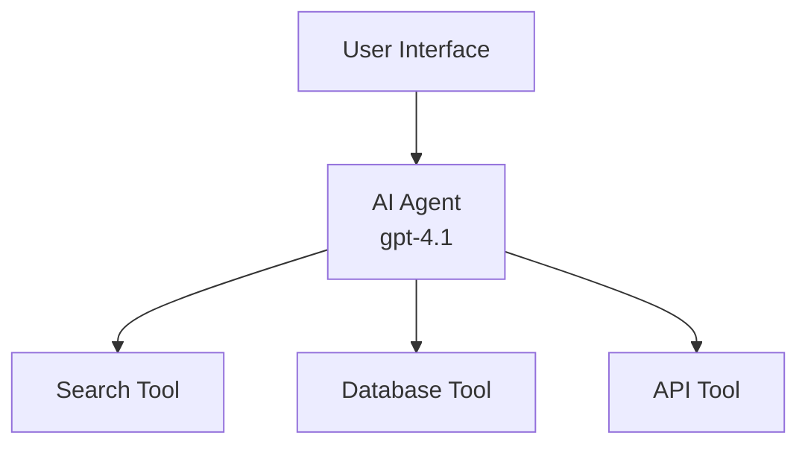
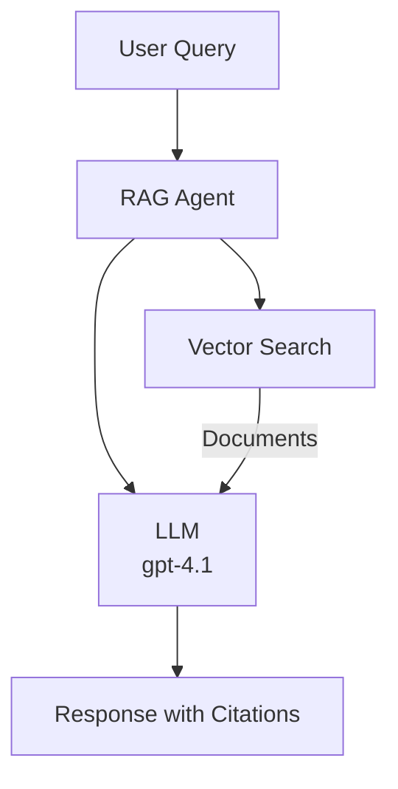
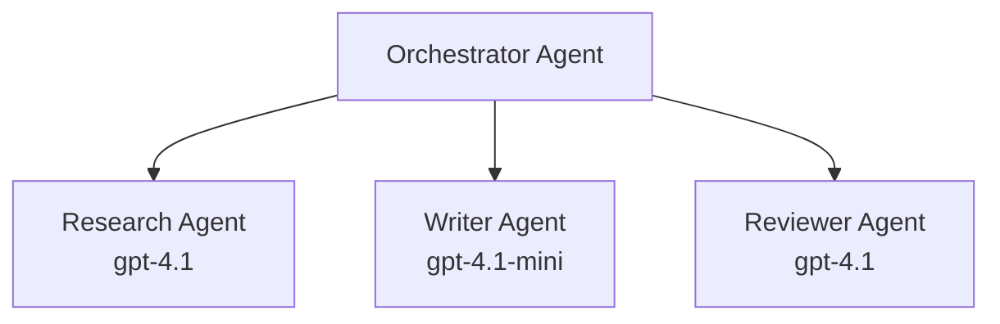

# Agen AI dengan Azure Developer CLI

**Navigasi Bab:**
- **📚 Beranda Kursus**: [AZD Untuk Pemula](../../README.md)
- **📖 Bab Saat Ini**: Bab 2 - Pengembangan AI-Pertama
- **⬅️ Sebelumnya**: [Integrasi Microsoft Foundry](microsoft-foundry-integration.md)
- **➡️ Berikutnya**: [Penerapan Model AI](ai-model-deployment.md)
- **🚀 Lanjutan**: [Solusi Multi-Agen](../../examples/retail-scenario.md)

---

## Pendahuluan

Agen AI adalah program otonom yang dapat memahami lingkungannya, membuat keputusan, dan mengambil tindakan untuk mencapai tujuan tertentu. Berbeda dengan chatbot sederhana yang hanya merespons perintah, agen dapat:

- **Menggunakan alat** - Memanggil API, mencari di basis data, menjalankan kode
- **Merencanakan dan bernalar** - Memecah tugas kompleks menjadi langkah-langkah
- **Belajar dari konteks** - Mempertahankan memori dan menyesuaikan perilaku
- **Bekerja sama** - Bekerja dengan agen lain (sistem multi-agen)

Panduan ini menunjukkan cara menerapkan agen AI ke Azure menggunakan Azure Developer CLI (azd).

Menggunakan konteks percakapan bukanlah pelatihan model: memori yang persisten, kontrol akses, dan retensi harus diimplementasikan/dikonfigurasi oleh aplikasi.

> **Pembaruan Foundry GA (2026-11-09):** Instal bundel  `microsoft.foundry` 1.0 versi umum yang tersedia dengan `azd >= 1.37.0`. Evaluasi diinstal secara terpisah; fitur preview opsional dan fragmen SDK klasik di bawah ini tidak dipromosikan ke GA oleh pengumuman bundel. Panduan ini berdasarkan pada [pengumuman GA](https://devblogs.microsoft.com/azure-sdk/microsoft-foundry-azure-developer-cli-ga/) dan dokumentasi, bukan penerapan Azure langsung.

## Tujuan Pembelajaran

Dengan menyelesaikan panduan ini, Anda akan:
- Memahami apa itu agen AI dan bagaimana mereka berbeda dari chatbot
- Menerapkan template agen AI yang sudah dibuat menggunakan AZD
- Mengkonfigurasi Foundry Agents untuk agen kustom
- Mengimplementasikan pola agen dasar (penggunaan alat, RAG, multi-agen)
- Memantau dan men-debug agen yang diterapkan

## Hasil Pembelajaran

Setelah menyelesaikan, Anda akan dapat:
- Menerapkan aplikasi agen AI ke Azure dengan satu perintah
- Mengkonfigurasi alat dan kemampuan agen
- Mengimplementasikan retrieval-augmented generation (RAG) dengan agen
- Merancang arsitektur multi-agen untuk alur kerja kompleks
- Memecahkan masalah umum penerapan agen

---

## 🤖 Apa yang Membuat Agen Berbeda dari Chatbot?

| Fitur | Chatbot | Agen AI |
|---------|---------|----------|
| **Perilaku** | Merespons arahan | Mengambil tindakan otonom |
| **Alat** | Mungkin menggunakan pengambilan atau alat | Biasanya menggunakan alat dalam loop yang diarahkan tujuan |
| **Memori** | Bergantung pada aplikasi | Memori persisten hanya jika diimplementasikan secara eksplisit |
| **Perencanaan** | Respons tunggal | Penalaran multi-langkah |
| **Kolaborasi** | Entitas tunggal | Dapat bekerja dengan agen lain |

### Analogi Sederhana

- **Chatbot** = Seseorang yang membantu menjawab pertanyaan di meja informasi
- **Agen AI** = Asisten pribadi yang dapat menelepon, menjadwalkan janji, dan menyelesaikan tugas untuk Anda

---

## 🚀 Mulai Cepat: Terapkan Agen Pertama Anda

Pilih salah satu opsi di **direktori kerja kosong baru**. `.` diinisialisasi di sana; tanpa tujuan eksplisit, AZD saat ini dapat membuat subdirektori bernama template dan tidak mengubah direktori shell Anda. Simpan template/lingkungan terpisah di direktori terpisah.

Rentang waktu/biaya di bawah ini hanya ilustratif, bukan kutipan yang tervalidasi. Periksa prasyarat, harga, kuota model, dan layanan opsional masing-masing sampel sebelum penerapan.

### Opsi 1: Template Foundry Agents (Direkomendasikan)

```bash
# Initialize the AI agents template
azd init --template get-started-with-ai-agents .

# Deploy to Azure
azd up
```

**Yang diterapkan:** Infrastruktur dan opsi yang dipilih dari sampel menentukan model, alat, hosting, dan sumber daya pemantauan. Tinjau README dan `infra/` sebelum penyediaan; jangan menganggap setiap template agen menyertakan Search atau antarmuka web.

**Waktu:** ~15-20 menit
**Biaya:** ~$100-150/bulan (pengembangan)

### Opsi 2: Agen Penulisan Kreatif dengan Prompty

```bash
# Initialize the Prompty-based agent template
azd init --template https://github.com/Azure-Samples/contoso-creative-writer .

# Deploy to Azure
azd up
```

**Yang diterapkan:** Sampel penulisan multi-agen FastAPI/Prompty menggunakan Azure OpenAI, Bing Grounding, dan Azure AI Search. Repositori `agent-openai-python-prompty` sebelumnya mengarahkan ke sini; ini bukan template agen cuaca Azure Functions minimal. Ikuti README saat ini untuk hosting, kuota model, dan prasyarat Bing Grounding.

**Waktu:** ~10-15 menit
**Biaya:** ~$50-100/bulan (pengembangan)

### Opsi 3: Agen Chat RAG

```bash
# Initialize RAG chat template
azd init --template azure-search-openai-demo .

# Deploy to Azure
azd up
```

**Yang diterapkan:**
- ✅ Model Microsoft Foundry
- ✅ Azure AI Search dengan data sampel
- ✅ Pipeline pemrosesan dokumen
- ✅ Antarmuka chat dengan kutipan

**Waktu:** ~15-25 menit
**Biaya:** ~$80-150/bulan (pengembangan)

### Opsi 4: Agen Hosted dengan Bundel GA Foundry

Gunakan [panduan lengkap agen-hosted](microsoft-foundry-integration.md#hosted-agent-walkthrough-ga) untuk contoh dasar Framework Respon API Python Agent. Jalur penerapan kode ini membutuhkan Python 3.13+, uv saat ini, izin Foundry, dan kuota model regional. Autentikasi panggilan SDK lokal secara terpisah saat menggunakan kredensial Azure CLI.

```bash
azd auth login
azd ext install microsoft.foundry
```

Di direktori kosong, inisialisasi sampel:

```text
azd ai agent init --template https://github.com/microsoft-foundry/foundry-samples/blob/main/samples/python/hosted-agents/agent-framework/responses/01-basic/azure.yaml --deploy-mode code --src .
```

Pilih proyek baru atau yang sudah ada, tinjau `azure.yaml`, dan jalankan `azd provision`. Gunakan `azd ai agent run` untuk membuka Agent Inspector dan, dari terminal lain di direktori itu, `azd ai agent invoke --local "Explain how this agent is hosted."`. Setelah verifikasi lokal, gunakan `azd deploy` dan `azd ai agent invoke "Explain how this agent is hosted."` untuk membandingkan respons yang diterapkan. Foundry membangun sumber yang diunggah secara remote; pembangunan container lokal tidak diperlukan.

**Kapan menggunakan `azd ai agent init` vs `azd init --template`:**

| Pendekatan | Terbaik Untuk | Cara Kerja |
|----------|----------|------|
| `azd init --template` | Memulai dari aplikasi sampel yang berjalan | Mengkloning repo template lengkap dengan kode + infra |
| `azd ai agent init --template` | Mengadopsi proyek agen Foundry saat ini | Menggunakan dokumen proyek `azure.yaml` dan definisinya |

> **Tip:** Opsi 1-3 mulai dari template aplikasi lengkap; Opsi 4 mengajarkan alur kerja agen-hosted GA. Tidak ada perintah inisialisasi yang secara otomatis memigrasikan manifest agen legacy. Untuk menambahkan definisi agen langsung ke proyek yang ada, lihat [panduan inisialisasi dan migrasi](../chapter-08-production/production-ai-practices.md#initializing-agent-projects-with-azd-ai-agent-init).

Instal `azure.ai.evaluations` secara terpisah untuk menghasilkan dan meninjau data/rubrik pengujian, mengkonfigurasi evaluasi, dan menjalankannya menggunakan `azd ai eval`. Optimasi dapat menggunakan kembali evaluasi yang kompatibel; tinjau kandidat sebelum menerapkan secara eksplisit. Ikuti [alur kerja evaluasi](../chapter-08-production/production-ai-practices.md#evaluation-migration-and-quality-checks) dan [migrasi optimasi](../chapter-08-production/production-ai-practices.md#optimization-configuration-migration) sebelum menggunakan kembali contoh lama. Untuk pembersihan, sumber daya proyek Foundry yang digunakan kembali tetap ada setelah `azd down`; grup sumber daya proyek baru akan dihapus. Lihat [panduan pembersihan walkthrough](microsoft-foundry-integration.md#7-clean-up-deliberately).

---

## 🏗️ Pola Arsitektur Agen

### Pola 1: Agen Tunggal dengan Alat

Pola agen paling sederhana - satu agen yang dapat menggunakan beberapa alat.



**Terbaik untuk:**
- Bot dukungan pelanggan
- Asisten riset
- Agen analisis data

**Contoh aplikasi terkait:** `azure-search-openai-demo` mendemonstrasikan RAG, bukan loop agen alat sewenang-wenang generik.

### Pola 2: Agen RAG (Retrieval-Augmented Generation)

Agen yang mengambil dokumen relevan sebelum menghasilkan respons.



**Terbaik untuk:**
- Basis pengetahuan perusahaan
- Sistem Q&A dokumen
- Riset kepatuhan dan hukum

**Template AZD:** `azure-search-openai-demo`

### Pola 3: Sistem Multi-Agen

Beberapa agen khusus yang bekerja bersama pada tugas kompleks.



**Terbaik untuk:**
- Pembuatan konten kompleks
- Alur kerja multi-langkah
- Tugas yang membutuhkan keahlian berbeda

**Pelajari Lebih Lanjut:** [Pola Koordinasi Multi-Agen](../chapter-06-pre-deployment/coordination-patterns.md)

---

## ⚙️ Mengkonfigurasi Alat Agen

Agen menjadi kuat ketika mereka dapat menggunakan alat. Berikut cara mengkonfigurasi alat umum:

### Konfigurasi Alat di Foundry Agents

Fragmen **SDK Layanan Agen klasik** ini menargetkan `azure-ai-projects==1.0.0` dan `azure-ai-agents==1.1.0` dengan `azure-identity`. Ini bukan API agen versi baru/Responses yang digunakan oleh beberapa template Foundry saat ini, juga bukan ekstensi AZD `azure.ai.agents` (paket berbeda). Jangan mencampur generasi API ini. Setel `PROJECT_ENDPOINT` ke endpoint proyek klasik Foundry dan `MODEL_DEPLOYMENT_NAME` ke penyebaran model yang didukung; autentikasi dengan `az login` secara lokal dan berikan izin proyek yang diperlukan.

```python
# agent_config.py
import os
from azure.ai.projects import AIProjectClient
from azure.ai.agents.models import FunctionTool
from azure.identity import DefaultAzureCredential

def search_knowledge_base(query: str) -> str:
    """Search the demonstration knowledge base.

    :param query: Search text.
    :return: Matching demonstration information.
    """
    # Local fixture only, not a production search implementation.
    return "Demo policy: returns are accepted within 30 days."

project_client = AIProjectClient(
    endpoint=os.environ["PROJECT_ENDPOINT"],
    credential=DefaultAzureCredential(),
)
search_tool = FunctionTool(functions={search_knowledge_base})
project_client.agents.enable_auto_function_calls(search_tool)
agent = project_client.agents.create_agent(
    model=os.environ["MODEL_DEPLOYMENT_NAME"],
    name="Support Agent",
    instructions="Use search_knowledge_base for policy questions. Label results as demo data.",
    tools=search_tool.definitions,
)
```

Mendaftarkan skema fungsi tidak menjalankan Python pada layanan. Dalam SDK ini, `enable_auto_function_calls` plus `agents.runs.create_and_process(...)` menjalankan callback terdaftar di proses klien Anda. Lihat [contoh SDK yang dirilis](https://github.com/Azure/azure-sdk-for-python/blob/azure-ai-agents_1.1.0/sdk/ai/azure-ai-agents/samples/agents_tools/sample_agents_auto_function_call.py). Tutup klien dan hapus agen/thread demo saat selesai.

### Konfigurasi Lingkungan

Nama-nama berikut adalah **input template kustom ilustratif**, bukan saklar AZD bawaan. Pertama sambungkan setiap nilai melalui `infra/main.parameters.json`, infrastruktur, dan kode aplikasi. `azd env set` saja tidak mengubah alat atau instruksi agen.

```bash
# Set up agent-specific environment variables
azd env set AZURE_OPENAI_MODEL "gpt-4.1"
azd env set AGENT_INSTRUCTIONS "You are a helpful assistant..."
azd env set ENABLE_CODE_INTERPRETER "true"
azd env set ENABLE_FILE_SEARCH "true"

# Apply wired infrastructure and application changes
azd up
```

---

## 📊 Memantau Agen

### Integrasi Application Insights

Jika template yang Anda pilih menyediakan Application Insights dan mengkonfigurasi instrumentasi:

```bash
# Open monitoring dashboard
azd monitor --overview

# Open the Application Insights logs view (not a streaming log tail)
azd monitor --logs

# View live metrics
azd monitor --live
```

### Metrik Kunci untuk Dilacak

| Metrik | Deskripsi | Target |
|--------|-------------|--------|
| Latensi Respons | Waktu untuk menghasilkan respons | < 5 detik |
| Penggunaan Token | Token per permintaan | Pantau untuk biaya |
| Tingkat Keberhasilan Panggilan Alat | % eksekusi alat berhasil | > 95% |
| Tingkat Kesalahan | Permintaan agen gagal | < 1% |
| Kepuasan Pengguna | Skor umpan balik | > 4.0/5.0 |

### Logging Kustom untuk Agen

```python
import os
from azure.monitor.opentelemetry import configure_azure_monitor
from opentelemetry import trace

# Configure Azure Monitor with OpenTelemetry
configure_azure_monitor(
    connection_string=os.environ["APPLICATIONINSIGHTS_CONNECTION_STRING"]
)

tracer = trace.get_tracer(__name__)

def log_agent_interaction(user_query, agent_response, tools_used, latency_ms):
    with tracer.start_as_current_span("agent_interaction") as span:
        span.set_attributes({
            "query_length": len(user_query),  # Do not log raw prompts or personal data
            "response_length": len(agent_response),
            "tools_used": tools_used,
            "latency_ms": latency_ms
        })
```

> **Catatan:** Instal paket yang diperlukan: `pip install azure-monitor-opentelemetry`. Paket ini membawa dependensi OpenTelemetry; namespace impor bukan persyaratan untuk menginstal paket bernama `opentelemetry`.

---

## 💰 Pertimbangan Biaya

### Estimasi Biaya Bulanan berdasarkan Pola

Ini adalah rentang perencanaan ilustratif, bukan kutipan atau batas pengeluaran. Wilayah, token model, SKU Search/komputasi, sesi alat, penyimpanan, dan lalu lintas dapat melebihi ini. Periksa panduan biaya sampel dan harga Azure sebelum `azd up`.

| Pola | Lingkungan Pengembangan | Produksi |
|---------|-----------------|------------|
| Agen Tunggal | $50-100 | $200-500 |
| Agen RAG | $80-150 | $300-800 |
| Multi-Agen (2-3 agen) | $150-300 | $500-1,500 |
| Multi-Agen Perusahaan | $300-500 | $1,500-5,000+ |

### Tips Optimasi Biaya

1. **Gunakan gpt-4.1-mini untuk tugas sederhana** (hanya jika template Anda menggunakan input ini)
   ```bash
   azd env set AZURE_OPENAI_MODEL "gpt-4.1-mini"
   ```

2. **Implementasikan caching scoped untuk kueri berulang yang aman.** Sertakan otorisasi tenant/pengguna, penyebaran model, instruksi, dan versi pengambilan dalam kunci cache; tetapkan masa kedaluwarsa. Jangan bagikan respons percakapan pribadi melalui cache hanya kueri proses luas. Objek agen SDK tidak memiliki metode generik `agent.run()`.

3. **Tetapkan batas token per run**
   ```python
   # Set max_completion_tokens when running the agent, not during creation
   run = project_client.agents.runs.create_and_process(
       thread_id=thread.id,
       agent_id=agent.id,
       max_completion_tokens=1000  # Budget across the run; may finish as incomplete
   )
   ```

4. **Skalakan Container Apps yang memenuhi syarat ke nol saat tidak digunakan**
   ```bash
   # Custom-template input: must map to template.scale.minReplicas
   azd env set MIN_REPLICAS "0"
   ```
   Terapkan perubahan infrastruktur dengan `azd provision` atau `azd up`. Skalasi ke nol membutuhkan pemicu yang sesuai dan tidak menghentikan biaya Search, penyimpanan, atau model/alat.

---

## 🔧 Pemecahan Masalah Agen

### Masalah Umum dan Solusi

<details>
<summary><strong>❌ Agen tidak merespons panggilan alat</strong></summary>

```bash
# Inspect the application deployment (not the agent's registered tools)
azd show

# Verify OpenAI deployment
az cognitiveservices account deployment list \
  --name $AZURE_OPENAI_NAME \
  --resource-group $RG_NAME

# Check agent logs
azd monitor --logs
```

**Penyebab umum:**
- Ketidaksesuaian tanda tangan fungsi alat
- Izin yang diperlukan hilang
- Endpoint API tidak dapat diakses
</details>

<details>
<summary><strong>❌ Latensi tinggi dalam respons agen</strong></summary>

```bash
# Check Application Insights for bottlenecks
azd monitor --live

# Consider using a faster model
azd env set AZURE_OPENAI_MODEL "gpt-4.1-mini"
azd up
```

**Tips optimasi:**
- Gunakan respons streaming
- Terapkan caching respons
- Kurangi ukuran jendela konteks
</details>

<details>
<summary><strong>❌ Agen mengembalikan informasi salah atau halusinasi</strong></summary>

```python
# Improve with better system prompts
instructions = """
You are a helpful assistant. IMPORTANT:
- Only answer based on provided context
- If you don't know, say "I don't know"
- Always cite your sources
- Never make up information
"""

# Use these instructions in the agent definition.
# For classic file search, first upload/index documents in a vector store,
# then use FileSearchTool(vector_store_ids=[...]) and pass both its
# .definitions and .resources when creating the agent.
```
Instruksi dan pengambilan mengurangi risiko; keduanya tidak menjamin jawaban faktual. Evaluasi pertanyaan berdasar dan di luar cakupan terhadap jawaban yang diketahui.
</details>

<details>
<summary><strong>❌ Kesalahan melebihi batas token</strong></summary>

```python
# Implement context window management
def truncate_context(messages, max_tokens=8000, model="gpt-4.1"):
    """Approximate content-only budget for objects with .content strings."""
    import tiktoken
    encoding = tiktoken.encoding_for_model(model)
    total_tokens = 0
    truncated = []
    
    for msg in reversed(messages):
        msg_tokens = len(encoding.encode(msg.content))
        if total_tokens + msg_tokens > max_tokens:
            break
        truncated.insert(0, msg)
        total_tokens += msg_tokens
    
    return truncated
```
Bantuan ini mengecualikan skema peran/alat, instruksi sistem, token gambar, dan overhead protokol. Sisakan ruang untuk itu dan penyelesaian; jangan memisahkan pasangan panggilan/hasil alat atau membuang instruksi sistem yang diperlukan. Instal `tiktoken` secara terpisah. Ini bukan validator jendela konteks umum.
</details>

---

## 🎓 Latihan Praktis

### Latihan 1: Terapkan Agen Dasar (20 menit)

**Tujuan:** Terapkan agen AI pertama Anda menggunakan AZD

```bash
# Step 1: Initialize template
azd init --template get-started-with-ai-agents .

# Step 2: Login to Azure
azd auth login
# If you work across tenants, add --tenant-id <tenant-id>

# Step 3: Deploy
azd up

# Step 4: Test the agent
# Expected output after deployment:
#   Deployment Complete!
#   Endpoint: https://<app-name>.<region>.azurecontainerapps.io
# Open the URL shown in the output and try asking a question

# Step 5: View monitoring
azd monitor --overview

# Step 6: Review the listed resources and confirm cleanup
azd down
```

**Kriteria Keberhasilan:**
- [ ] Agen merespons pertanyaan
- [ ] Dapat mengakses dasbor pemantauan melalui `azd monitor`
- [ ] Sumber daya dibersihkan dengan sukses

### Latihan 2: Tambahkan Alat Kustom (30 menit)

**Tujuan:** Memperluas agen dengan alat kustom

**Titik awal:** Gunakan klien SDK klasik dari [Konfigurasi Alat](#tool-configuration-in-foundry-agents), bukan template sembarangan dengan generasi SDK yang berbeda.

1. Tambahkan fixture deterministik ini ke `agent_config.py`:
   ```python
   def get_weather(location: str) -> str:
       """Return demonstration weather, not live conditions.

       :param location: City name.
       :return: A clearly labelled fixture.
       """
       print(f"TOOL_CALLED: {location}")
       return f"Demo weather in {location}: Sunny, 72°F (fixture, not live)"
   ```
2. Ganti blok pendaftaran dan pembuatan search-tool dengan:
   ```python
   weather_tool = FunctionTool(functions={get_weather})
   project_client.agents.enable_auto_function_calls(weather_tool)
   agent = project_client.agents.create_agent(
       model=os.environ["MODEL_DEPLOYMENT_NAME"],
       name="Weather Agent",
       instructions="Call get_weather for weather questions; explain that it returns demo data.",
       tools=weather_tool.definitions,
   )
   thread = project_client.agents.threads.create()
   try:
       project_client.agents.messages.create(
           thread_id=thread.id, role="user", content="Use get_weather for Seattle."
       )
       run = project_client.agents.runs.create_and_process(
           thread_id=thread.id, agent_id=agent.id
       )
       if run.status != "completed":
           raise RuntimeError(f"Run status: {run.status}; error: {run.last_error}")
       for message in project_client.agents.messages.list(thread_id=thread.id):
           for text in message.text_messages:
               print(text.text.value)
   finally:
       project_client.agents.threads.delete(thread.id)
       project_client.agents.delete_agent(agent.id)
       project_client.close()
   ```
3. Jalankan secara lokal (ini memanggil proyek Azure yang sudah ada dan menimbulkan biaya model):
   ```bash
   python agent_config.py
   # Expected: TOOL_CALLED: Seattle, then a completed answer labelled demo data.
   ```

**Kriteria Keberhasilan:**
- [ ] Agen mengenali pertanyaan terkait cuaca
- [ ] Alat dipanggil dengan benar
- [ ] Respon mencakup informasi cuaca

### Latihan 3: Bangun Agen RAG (45 menit)

**Tujuan:** Membuat agen yang menjawab pertanyaan dari dokumen Anda

```bash
# Step 1: Deploy RAG template
azd init --template azure-search-openai-demo .
azd up

# Step 2: Upload your documents
# For the sample's local ingestion path, place supported files in data/.
# Run from the sample root after following its Python environment setup:
./scripts/prepdocs.sh
# Windows PowerShell equivalent: .\\scripts\\prepdocs.ps1

# Step 3: Test with domain-specific questions
# Open the web app URL from the azd up output
# Ask questions about your uploaded documents
# Responses should include citation references like [doc.pdf]
```

**Kriteria Keberhasilan:**
- [ ] Agen menjawab dari dokumen yang diunggah
- [ ] Respon mencakup kutipan
- [ ] Pertanyaan uji di luar cakupan ditangani tanpa klaim yang tidak didukung (bukan jaminan untuk setiap pertanyaan di masa depan)

Jika `USE_CLOUD_INGESTION=true`, gunakan alur kerja pengunggahan/ingest cloud pada contoh tersebut sebagai gantinya; pembungkus lokal sengaja melewati ingest. Setelah pengujian, jalankan `azd down` di lingkungan RAG dan tinjau sumber daya yang akan dihapus.

---

## 📚 Langkah Selanjutnya

Sekarang setelah Anda memahami agen AI, jelajahi topik lanjutan ini:

| Topik | Deskripsi | Tautan |
|-------|-------------|------|
| **Sistem Multi-Agen** | Bangun sistem dengan beberapa agen yang berkolaborasi | [Contoh Multi-Agen Ritel](../../examples/retail-scenario.md) |
| **Pola Koordinasi** | Pelajari pola orkestrasi dan komunikasi | [Pola Koordinasi](../chapter-06-pre-deployment/coordination-patterns.md) |
| **Penerapan Produksi** | Penerapan agen siap untuk perusahaan | [Praktik AI Produksi](../chapter-08-production/production-ai-practices.md) |
| **Evaluasi Agen** | Uji dan evaluasi kinerja agen | [Pemecahan Masalah AI](../chapter-07-troubleshooting/ai-troubleshooting.md) |
| **Laboratorium Workshop AI** | Praktik langsung: Buat solusi AI Anda siap AZD | [Laboratorium Workshop AI](ai-workshop-lab.md) |

---

## 📖 Sumber Daya Tambahan

### Dokumentasi Resmi
- [Layanan Agen Microsoft Foundry](https://learn.microsoft.com/azure/ai-services/agents/)
- [Panduan Cepat Layanan Agen Microsoft Foundry](https://learn.microsoft.com/azure/ai-services/agents/quickstart)
- [Kerangka Agen Semantic Kernel](https://learn.microsoft.com/semantic-kernel/)

### Template AZD untuk Agen
- [Mulai dengan Agen AI](https://github.com/Azure-Samples/get-started-with-ai-agents)
- [Agen Penulisan Kreatif dengan Prompty](https://github.com/Azure-Samples/contoso-creative-writer)
- [Demo Azure Search OpenAI](https://github.com/Azure-Samples/azure-search-openai-demo)

### Sumber Daya Komunitas
- [Awesome AZD - Template Agen](https://azure.github.io/awesome-azd/?tags=ai-agents)
- [Azure AI Discord](https://discord.gg/microsoft-azure)
- [Microsoft Foundry Discord](https://discord.gg/nTYy5BXMWG)

### Keterampilan Agen untuk Editor Anda
- [**Keterampilan Agen Microsoft Azure**](https://skills.sh/microsoft/github-copilot-for-azure) - Instal keterampilan agen AI yang dapat digunakan ulang untuk pengembangan Azure di GitHub Copilot, Cursor, atau agen apa pun yang didukung. Termasuk keterampilan untuk [Azure AI](https://skills.sh/microsoft/github-copilot-for-azure/azure-ai), [Microsoft Foundry](https://skills.sh/microsoft/github-copilot-for-azure/microsoft-foundry), [penyebaran](https://skills.sh/microsoft/github-copilot-for-azure/azure-deploy), dan [diagnostik](https://skills.sh/microsoft/github-copilot-for-azure/azure-diagnostics):
  ```bash
  npx skills add microsoft/github-copilot-for-azure
  ```

---

**Navigasi**
- **Pelajaran Sebelumnya**: [Integrasi Microsoft Foundry](microsoft-foundry-integration.md)
- **Pelajaran Berikutnya**: [Penerapan Model AI](ai-model-deployment.md)

---

<!-- CO-OP TRANSLATOR DISCLAIMER START -->
**Penafian**:
Dokumen ini telah diterjemahkan menggunakan layanan terjemahan AI [Co-op Translator](https://github.com/Azure/co-op-translator). Meskipun kami berupaya untuk mencapai akurasi, harap diketahui bahwa terjemahan otomatis mungkin mengandung kesalahan atau ketidakakuratan. Dokumen asli dalam bahasa aslinya harus dianggap sebagai sumber yang sah. Untuk informasi penting, disarankan menggunakan terjemahan profesional oleh manusia. Kami tidak bertanggung jawab atas kesalahpahaman atau penafsiran yang keliru yang timbul dari penggunaan terjemahan ini.
<!-- CO-OP TRANSLATOR DISCLAIMER END -->