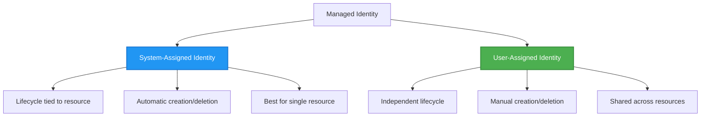

# Pola Otentikasi dan Identitas Terkelola

⏱️ **Perkiraan Waktu**: 45-60 menit membaca; beri waktu ekstra untuk integrasi latihan | 💰 **Dampak Biaya**: Identity/RBAC gratis; komputasi, penyimpanan, dan Key Vault yang diterapkan dikenakan biaya | ⭐ **Kompleksitas**: Menengah

> Ditinjau terhadap `azd 1.37.2` (November 2026). Pelajaran ini berisi **fragmen integrasi ilustratif, bukan template `secure-app` lengkap yang dapat diunduh**. Buat file-file yang dirujuk, sediakan infrastruktur yang sesuai, dan ganti placeholder sebelum penerapan. Tidak ada sumber daya Azure yang diprovisikan selama peninjauan.

**📚 Jalur Pembelajaran:**
- ← Sebelumnya: [Manajemen Konfigurasi](configuration.md) - Mengelola variabel lingkungan dan rahasia
- 🎯 **Anda Di Sini**: Otentikasi & Keamanan (Identitas Terkelola, Key Vault, pola aman)
- → Berikutnya: [Infrastruktur sebagai Kode](../chapter-04-infrastructure/README.md) - Menyediakan dan menerapkan sumber daya
- 🏠 [Beranda Kursus](../../README.md)

---

## Apa yang Akan Anda Pelajari

Dengan menyelesaikan pelajaran ini, Anda akan:
- Memahami pola otentikasi Azure (kunci, string koneksi, identitas terkelola)
- Menerapkan **Identitas Terkelola** untuk otentikasi tanpa kata sandi
- Melindungi rahasia dengan integrasi **Azure Key Vault**
- Mengonfigurasi **kontrol akses berbasis peran (RBAC)** untuk penerapan AZD
- Menerapkan praktik terbaik keamanan di Container Apps dan layanan Azure
- Migrasi dari otentikasi berbasis kunci ke berbasis identitas

## Mengapa Identitas Terkelola Penting

### Masalah: Otentikasi Tradisional

**Sebelum Identitas Terkelola:**
```javascript
// ❌ SECURITY RISK: Hardcoded secrets in code
const connectionString = "Server=mydb.database.windows.net;User=admin;Password=P@ssw0rd123";
const storageKey = "xK7mN9pQ2wR5tY8uI0oP3aS6dF1gH4jK...";
const cosmosKey = "C2x7B9n4M1p8Q5w3E6r0T2y5U8i1O4p7...";
```

**Masalah:**
- 🔴 **Rahasia terekspos** dalam kode, file konfigurasi, variabel lingkungan
- 🔴 **Rotasi kredensial** memerlukan perubahan kode dan penerapan ulang
- 🔴 **Mimpi buruk audit** - siapa mengakses apa, kapan?
- 🔴 **Penyebaran** - rahasia tersebar di banyak sistem
- 🔴 **Risiko kepatuhan** - gagal audit keamanan

### Solusi: Identitas Terkelola

**Setelah Identitas Terkelola:**
```javascript
// ✅ SECURE: No secrets in code
const credential = new DefaultAzureCredential();
const client = new BlobServiceClient(
  "https://mystorageaccount.blob.core.windows.net",
  credential  // Azure automatically handles authentication
);
```

**Manfaat:**
- ✅ **Nol rahasia** dalam kode atau konfigurasi
- ✅ **Rotasi otomatis** - diatur oleh Azure
- ✅ **Jejak audit lengkap** di log Microsoft Entra ID
- ✅ **Keamanan terpusat** - kelola di Azure Portal
- ✅ **Siap kepatuhan** - memenuhi standar keamanan

**Analogi**: Otentikasi tradisional seperti membawa banyak kunci fisik untuk berbagai pintu. Identitas Terkelola seperti memiliki kartu keamanan yang secara otomatis memberikan akses berdasarkan siapa Anda—tidak ada kunci yang hilang, disalin, atau harus diputar.

---

## Ikhtisar Arsitektur

### Alur Otentikasi dengan Identitas Terkelola

```mermaid
sequenceDiagram
    participant App as Your Application<br/>(Container App)
    participant MI as Managed Identity<br/>(Microsoft Entra ID)
    participant KV as Key Vault
    participant Storage as Azure Storage
    participant DB as Azure SQL
    
    App->>MI: Request access token<br/>(automatic)
    MI->>MI: Verify identity<br/>(no password needed)
    MI-->>App: Return token for requested audience<br/>(lifetime varies)
    
    App->>KV: Get secret<br/>(using token)
    KV->>KV: Check RBAC permissions
    KV-->>App: Return secret value
    
    App->>Storage: Upload blob<br/>(using token)
    Storage->>Storage: Check RBAC permissions
    Storage-->>App: Success
    
    App->>DB: Query data<br/>(using token)
    DB->>DB: Check SQL permissions
    DB-->>App: Return results
    
    Note over App,DB: Request a separate token for each service audience;<br/>SDK credentials handle caching and renewal
```

### Jenis Identitas Terkelola



| Fitur | System-Assigned | User-Assigned |
|---------|----------------|---------------|
| **Siklus Hidup** | Terikat pada sumber daya | Independen |
| **Pembuatan** | Otomatis dengan sumber daya | Pembuatan manual |
| **Penghapusan** | Dihapus bersama sumber daya | Bertahan setelah penghapusan sumber daya |
| **Berbagi** | Satu sumber daya saja | Banyak sumber daya |
| **Kasus Penggunaan** | Skenario sederhana | Skenario multi-sumber daya kompleks |
| **Pilihan template** | Didefinisikan dalam infrastruktur | Didefinisikan dalam infrastruktur |

---

## Prasyarat

### Alat yang Dibutuhkan

Anda seharusnya sudah memiliki ini dari pelajaran sebelumnya:

```bash
# Verify Azure Developer CLI
azd version
# ✅ Expected: azd version 1.0.0 or higher

# Verify Azure CLI
az --version
# ✅ Expected: azure-cli 2.50.0 or higher
```

### Persyaratan Azure

- Langganan Azure aktif
- Izin untuk:
  - Membuat identitas terkelola
  - Menetapkan peran RBAC
  - Membuat sumber daya Key Vault
  - Menerapkan Container Apps

### Prasyarat Pengetahuan

Anda harus sudah menyelesaikan:
- [Panduan Instalasi](../chapter-01-foundation/installation.md) - Pengaturan AZD
- [Dasar-Dasar AZD](../chapter-01-foundation/azd-basics.md) - Konsep inti
- [Manajemen Konfigurasi](configuration.md) - Variabel lingkungan

---

## Pelajaran 1: Memahami Pola Otentikasi

### Pola 1: String Koneksi (Warisan - Hindari)

**Cara kerjanya:**
```bash
# Connection string contains credentials
STORAGE_CONNECTION_STRING="DefaultEndpointsProtocol=https;AccountName=myaccount;AccountKey=xK7mN9pQ2wR5..."
COSMOS_CONNECTION_STRING="AccountEndpoint=https://myaccount.documents.azure.com:443/;AccountKey=C2x7..."
SQL_CONNECTION_STRING="Server=myserver.database.windows.net;User=admin;Password=P@ssw0rd..."
```

**Masalah:**
- ❌ Rahasia terlihat di variabel lingkungan
- ❌ Tercatat dalam sistem penerapan
- ❌ Sulit diputar ulang
- ❌ Tidak ada jejak audit akses

**Kapan digunakan:** Saat layanan target membutuhkan otentikasi berbasis kunci. Utamakan identitas jika didukung; jika tidak, simpan kunci dengan aman dan putar, termasuk di produksi.

---

### Pola 2: Referensi Key Vault (Lebih Baik)

**Cara kerjanya:**
**Fragmen Bicep Parsial:** bidang vault yang diperlukan, identitas Container App, dan entri `configuration.secrets`-nya dihilangkan. `secretRef` memberi nama rahasia Container App; itu **bukan sendiri** URI Key Vault. Untuk menggunakan Key Vault, definisikan rahasia bernama tersebut dengan `keyVaultUrl` dan `identity` yang berwenang.

```bicep
// Store secret in Key Vault
resource keyVault 'Microsoft.KeyVault/vaults@2023-02-01' = {
  name: 'mykv'
  properties: {
    enableRbacAuthorization: true
  }
}

// Reference in Container App
env: [
  {
    name: 'STORAGE_KEY'
    secretRef: 'storage-key'  // References Key Vault
  }
]
```

**Manfaat:**
- ✅ Rahasia disimpan dengan aman di Key Vault
- ✅ Manajemen rahasia terpusat
- ✅ Rotasi tanpa perubahan kode

**Keterbatasan:**
- ⚠️ Masih menggunakan kunci/kata sandi
- ⚠️ Perlu mengelola akses Key Vault

**Kapan digunakan:** Langkah transisi dari string koneksi ke identitas terkelola.

---

### Pola 3: Identitas Terkelola (Praktik Terbaik)

**Cara kerjanya:**
**Bicep Parsial:** gabungkan blok identitas ke dalam Container App lengkap dan sediakan `storageAccount` serta definisi peran. Penugasan peran juga memerlukan `name` yang deterministik.

```bicep
// Enable managed identity
resource containerApp 'Microsoft.App/containerApps@2023-05-01' = {
  name: 'myapp'
  identity: {
    type: 'SystemAssigned'  // Automatically creates identity
  }
}

// Grant permissions
resource roleAssignment 'Microsoft.Authorization/roleAssignments@2022-04-01' = {
  name: guid(storageAccount.id, containerApp.id, storageBlobDataContributorRole)
  scope: storageAccount
  properties: {
    roleDefinitionId: storageBlobDataContributorRole
    principalId: containerApp.identity.principalId
    principalType: 'ServicePrincipal'
  }
}
```

**Kode aplikasi:**
```javascript
// No secrets needed!
const { DefaultAzureCredential } = require('@azure/identity');
const { BlobServiceClient } = require('@azure/storage-blob');

const credential = new DefaultAzureCredential();
const blobServiceClient = new BlobServiceClient(
  'https://mystorageaccount.blob.core.windows.net',
  credential
);
```

**Manfaat:**
- ✅ Nol rahasia dalam kode/konfigurasi
- ✅ Rotasi kredensial otomatis
- ✅ Jejak audit lengkap
- ✅ Izin berbasis RBAC
- ✅ Siap kepatuhan

**Kapan digunakan:** Utamakan untuk aplikasi yang dihosting di Azure yang mengakses layanan yang mendukung otentikasi Microsoft Entra.

---

### Pola 4: Service Principal (CI/CD & Otomasi)

Identitas terkelola adalah standar emas *untuk sumber daya yang berjalan di dalam Azure*. Tetapi bagaimana dengan hal yang berjalan **di luar** Azure—seperti pipeline CI/CD di agen build, atau skrip di laptop Anda yang tidak dapat menggunakan login interaktif? Di sinilah **service principal** berperan: identitas non-manusia dengan kredensialnya sendiri yang dapat digunakan proses otomatis untuk masuk.

**Cara kerjanya:**

Buat service principal yang ditetapkan ke grup sumber daya (hak istimewa paling rendah):

```bash
az ad sp create-for-rbac \
  --name "myapp-cicd" \
  --role contributor \
  --scopes "/subscriptions/<sub-id>/resourceGroups/<rg-name>"
```

Ini mencetak client ID, client secret, dan tenant ID. azd dapat masuk dengan mereka secara non-interaktif:

```bash
azd auth login \
  --client-id "<appId>" \
  --client-secret "<password>" \
  --tenant-id "<tenant>"
```

**Utamakan kredensial federasi (OIDC) daripada rahasia.** Alih-alih client secret yang berlaku lama, konfigurasikan kredensial federasi agar pipeline menukar token jangka pendek—tidak ada rahasia yang bocor atau perlu diputar:

```bash
azd auth login \
  --client-id "<appId>" \
  --federated-credential-provider "github" \
  --tenant-id "<tenant>"
```

> `azd pipeline config` mengatur ini secara otomatis untuk Anda. Lihat panduan CI/CD di [Bab 8](../chapter-08-production/production-ai-practices.md).

**Manfaat:**
- ✅ Berfungsi di luar Azure (agen build, on-prem, cloud lain)
- ✅ Bisa ditetapkan ke satu grup sumber daya dengan satu peran
- ✅ Varian federasi (OIDC) tidak menggunakan rahasia yang disimpan

**Pertukaran:**
- ⚠️ Varian berbasis rahasia memerlukan penyimpanan dan rotasi hati-hati
- ⚠️ Rahasia yang bocor memberi akses sesuai kemampuan SP—jaga cakupan tetap ketat

**Kapan digunakan:** Pipeline CI/CD dan otomasi yang tidak bisa menggunakan identitas terkelola. Selalu utamakan varian **federasi/OIDC** daripada client secret, dan utamakan identitas terkelola jika beban kerja berjalan di dalam Azure.

**Menyimpan kredensial dengan aman:**
- Jangan pernah meng-commit rahasia—gunakan penyimpanan rahasia pipeline Anda (GitHub Actions secrets, Azure DevOps variable groups / Key Vault).
- Tetapkan SP ke peran dan grup sumber daya terkecil yang diperlukan.
- Tetapkan tanggal kedaluwarsa dan putar, atau hilangkan rahasia sepenuhnya dengan OIDC.

---

## Pelajaran 2: Menerapkan Identitas Terkelola dengan AZD

### Implementasi Langkah-demi-Langkah

Fragmen berikut menunjukkan cara mengintegrasikan identitas terkelola ke dalam proyek Container App. Mereka **bukan starter salin-dan-jalankan**: modul Storage, infrastruktur lingkungan/registry lengkap, Dockerfile, dan file parameter tidak semua disediakan di sini. Mulailah dari template Container Apps yang berfungsi dan gabungkan pola ini, pertahankan konfigurasi registry dan tag layanan.

### Struktur Proyek

```
secure-app/
├── azure.yaml                 # AZD configuration
├── infra/
│   ├── main.bicep            # Main infrastructure
│   ├── core/
│   │   ├── identity.bicep    # Managed identity setup
│   │   ├── keyvault.bicep    # Key Vault configuration
│   │   └── storage.bicep     # Storage with RBAC
│   └── app/
│       └── container-app.bicep
└── src/
    ├── app.js                # Application code
    ├── package.json
    └── Dockerfile
```

### 1. Konfigurasi AZD (azure.yaml)

```yaml
name: secure-app
metadata:
  template: secure-app@1.0.0

services:
  api:
    project: ./src
    language: js
    host: containerapp

# Managed identity must be enabled in the infrastructure, not by this YAML.
```

### 2. Infrastruktur: Aktifkan Identitas Terkelola

**File: `infra/main.bicep`**

```bicep
targetScope = 'subscription'

param environmentName string
param location string = 'eastus'
param containerAppsEnvironmentId string
param containerImage string

var tags = { 'azd-env-name': environmentName }

// Resource group
resource rg 'Microsoft.Resources/resourceGroups@2021-04-01' = {
  name: 'rg-${environmentName}'
  location: location
  tags: tags
}

// Storage Account
module storage './core/storage.bicep' = {
  name: 'storage'
  scope: rg
  params: {
    name: 'st${uniqueString(rg.id)}'
    location: location
    tags: tags
  }
}

// Key Vault
module keyVault './core/keyvault.bicep' = {
  name: 'keyvault'
  scope: rg
  params: {
    name: 'kv-${uniqueString(rg.id)}'
    location: location
    tags: tags
  }
}

// Container App with Managed Identity
module containerApp './app/container-app.bicep' = {
  name: 'container-app'
  scope: rg
  params: {
    name: 'ca-${environmentName}'
    location: location
    tags: tags
    storageAccountName: storage.outputs.name
    keyVaultName: keyVault.outputs.name
    containerAppsEnvironmentId: containerAppsEnvironmentId
    containerImage: containerImage
  }
}

// Grant Container App access to Storage
module storageRoleAssignment './core/role-assignment.bicep' = {
  name: 'storage-role'
  scope: rg
  params: {
    principalId: containerApp.outputs.identityPrincipalId
    roleDefinitionId: 'ba92f5b4-2d11-453d-a403-e96b0029c9fe'  // Storage Blob Data Contributor
    targetResourceType: 'storage'
    targetResourceName: storage.outputs.name
  }
}

// Grant Container App access to Key Vault
module kvRoleAssignment './core/role-assignment.bicep' = {
  name: 'kv-role'
  scope: rg
  params: {
    principalId: containerApp.outputs.identityPrincipalId
    roleDefinitionId: '4633458b-17de-408a-b874-0445c86b69e6'  // Key Vault Secrets User
    targetResourceType: 'keyvault'
    targetResourceName: keyVault.outputs.name
  }
}

// Outputs
output AZURE_STORAGE_ACCOUNT_NAME string = storage.outputs.name
output AZURE_KEY_VAULT_NAME string = keyVault.outputs.name
output APP_URL string = containerApp.outputs.url
```

### 3. Container App dengan Identitas System-Assigned

**File: `infra/app/container-app.bicep`**

```bicep
param name string
param location string
param tags object = {}
param storageAccountName string
param keyVaultName string
param containerAppsEnvironmentId string
param containerImage string

resource containerApp 'Microsoft.App/containerApps@2023-05-01' = {
  name: name
  location: location
  tags: union(tags, { 'azd-service-name': 'api' })
  identity: {
    type: 'SystemAssigned'  // 🔑 Enable managed identity
  }
  properties: {
    managedEnvironmentId: containerAppsEnvironmentId
    configuration: {
      ingress: {
        external: true
        targetPort: 3000
      }
    }
    template: {
      containers: [
        {
          name: 'api'
          image: containerImage // Must exist; configure registry credentials for private images
          resources: {
            cpu: json('0.5')
            memory: '1Gi'
          }
          env: [
            {
              name: 'AZURE_STORAGE_ACCOUNT_NAME'
              value: storageAccountName
            }
            {
              name: 'AZURE_KEY_VAULT_NAME'
              value: keyVaultName
            }
            // 🔑 No secrets - managed identity handles authentication!
          ]
        }
      ]
    }
  }
}

// Output the identity for RBAC assignments
output identityPrincipalId string = containerApp.identity.principalId
output id string = containerApp.id
output url string = 'https://${containerApp.properties.configuration.ingress.fqdn}'
```

### 4. Modul Penugasan Peran RBAC

**File: `infra/core/role-assignment.bicep`**

```bicep
param principalId string
param roleDefinitionId string  // Azure built-in role ID
@allowed(['storage', 'keyvault'])
param targetResourceType string
param targetResourceName string

// Typed existing resources give Bicep a valid resource scope, not a string ID.
resource storageTarget 'Microsoft.Storage/storageAccounts@2023-01-01' existing = {
  name: targetResourceName
}
resource vaultTarget 'Microsoft.KeyVault/vaults@2023-02-01' existing = {
  name: targetResourceName
}

resource storageAssignment 'Microsoft.Authorization/roleAssignments@2022-04-01' = if (targetResourceType == 'storage') {
  name: guid(storageTarget.id, principalId, roleDefinitionId)
  scope: storageTarget
  properties: {
    roleDefinitionId: subscriptionResourceId('Microsoft.Authorization/roleDefinitions', roleDefinitionId)
    principalId: principalId
    principalType: 'ServicePrincipal'
  }
}

resource vaultAssignment 'Microsoft.Authorization/roleAssignments@2022-04-01' = if (targetResourceType == 'keyvault') {
  name: guid(vaultTarget.id, principalId, roleDefinitionId)
  scope: vaultTarget
  properties: {
    roleDefinitionId: subscriptionResourceId('Microsoft.Authorization/roleDefinitions', roleDefinitionId)
    principalId: principalId
    principalType: 'ServicePrincipal'
  }
}

// This module assigns at the target resource scope, not the whole resource group.
```

### 5. Kode Aplikasi dengan Identitas Terkelola

**File: `src/app.js`**

```javascript
const express = require('express');
const { DefaultAzureCredential } = require('@azure/identity');
const { BlobServiceClient } = require('@azure/storage-blob');
const { SecretClient } = require('@azure/keyvault-secrets');

const app = express();
const PORT = process.env.PORT || 3000;

// 🔑 Initialize credential (works automatically with managed identity)
const credential = new DefaultAzureCredential();

// Azure Storage setup
const storageAccountName = process.env.AZURE_STORAGE_ACCOUNT_NAME;
const blobServiceClient = new BlobServiceClient(
  `https://${storageAccountName}.blob.core.windows.net`,
  credential  // No keys needed!
);

// Key Vault setup
const keyVaultName = process.env.AZURE_KEY_VAULT_NAME;
const secretClient = new SecretClient(
  `https://${keyVaultName}.vault.azure.net`,
  credential  // No keys needed!
);

// Health check
app.get('/health', (req, res) => {
  res.json({ status: 'healthy', authentication: 'managed-identity' });
});

// Upload file to blob storage
app.post('/upload', async (req, res) => {
  try {
    const containerClient = blobServiceClient.getContainerClient('uploads');
    await containerClient.createIfNotExists();
    
    const blobName = `file-${Date.now()}.txt`;
    const blockBlobClient = containerClient.getBlockBlobClient(blobName);
    
    const content = 'Hello from managed identity!';
    await blockBlobClient.upload(content, Buffer.byteLength(content));
    
    res.json({
      success: true,
      blobName: blobName,
      message: 'File uploaded using managed identity!'
    });
  } catch (error) {
    console.error('Upload error:', error);
    res.status(500).json({ error: error.message });
  }
});

// Get secret from Key Vault
app.get('/secret/:name', async (req, res) => {
  try {
    const secretName = req.params.name;
    const secret = await secretClient.getSecret(secretName);
    
    res.json({
      name: secretName,
      retrieved: secret.value !== undefined, // Never return the secret value to callers
      message: 'Secret retrieved using managed identity!'
    });
  } catch (error) {
    console.error('Secret error:', error);
    res.status(500).json({ error: error.message });
  }
});

// List blob containers (demonstrates read access)
app.get('/containers', async (req, res) => {
  try {
    const containers = [];
    for await (const container of blobServiceClient.listContainers()) {
      containers.push(container.name);
    }
    
    res.json({
      containers: containers,
      count: containers.length,
      message: 'Containers listed using managed identity!'
    });
  } catch (error) {
    console.error('List error:', error);
    res.status(500).json({ error: error.message });
  }
});

app.listen(PORT, () => {
  console.log(`Secure API listening on port ${PORT}`);
  console.log('Authentication: Managed Identity (passwordless)');
});
```

**File: `src/package.json`**

```json
{
  "name": "secure-app",
  "version": "1.0.0",
  "dependencies": {
    "express": "^4.18.2",
    "@azure/identity": "^4.0.0",
    "@azure/storage-blob": "^12.17.0",
    "@azure/keyvault-secrets": "^4.7.0"
  },
  "scripts": {
    "start": "node app.js"
  }
}
```

### 6. Terapkan dan Uji

Jalankan perintah ini **setelah** menyelesaikan infrastruktur yang hilang, Dockerfile, dan `main.parameters.json` yang sesuai di proyek Anda sendiri. Autentikasi azd dengan `azd auth login`; masuk secara terpisah dengan `az login` untuk pemeriksaan Azure CLI nanti. Endpoint yang ditampilkan adalah demonstrasi dan memerlukan kontrol akses yang sesuai sebelum digunakan secara publik.

```bash
# Initialize AZD environment
azd init

# Deploy infrastructure and application
azd up

# Get the app URL
APP_URL=$(azd env get-value APP_URL)

# Test health check
curl $APP_URL/health
```

**✅ Keluaran yang Diharapkan:**
```json
{
  "status": "healthy",
  "authentication": "managed-identity"
}
```

**Uji unggah blob:**
```bash
curl -X POST $APP_URL/upload
```

**✅ Keluaran yang Diharapkan:**
```json
{
  "success": true,
  "blobName": "file-1700404800000.txt",
  "message": "File uploaded using managed identity!"
}
```

**Uji daftar kontainer:**
```bash
curl $APP_URL/containers
```

**✅ Keluaran yang Diharapkan:**
```json
{
  "containers": ["uploads"],
  "count": 1,
  "message": "Containers listed using managed identity!"
}
```

---

## Peran RBAC Azure Umum

### ID Peran Bawaan untuk Identitas Terkelola

| Layanan | Nama Peran | ID Peran | Izin |
|---------|-----------|---------|-------------|
| **Storage** | Storage Blob Data Reader | `2a2b9908-6ea1-4ae2-8e65-a410df84e7d1` | Membaca blob dan kontainer |
| **Storage** | Storage Blob Data Contributor | `ba92f5b4-2d11-453d-a403-e96b0029c9fe` | Membaca, menulis, menghapus blob |
| **Storage** | Storage Queue Data Contributor | `974c5e8b-45b9-4653-ba55-5f855dd0fb88` | Membaca, menulis, menghapus antrean/pesan |
| **Key Vault** | Key Vault Secrets User | `4633458b-17de-408a-b874-0445c86b69e6` | Membaca rahasia |
| **Key Vault** | Key Vault Secrets Officer | `b86a8fe4-44ce-4948-aee5-eccb2c155cd7` | Membaca, menulis, menghapus rahasia |
| **Cosmos DB** | Cosmos DB Built-in Data Reader | `00000000-0000-0000-0000-000000000001` | Membaca data Cosmos DB |
| **Cosmos DB** | Cosmos DB Built-in Data Contributor | `00000000-0000-0000-0000-000000000002` | Membaca, menulis data Cosmos DB |
| **SQL Database** | SQL DB Contributor | `9b7fa17d-e63e-47b0-bb0a-15c516ac86ec` | Mengelola sumber daya database; tidak memberikan akses data SQL |
| **Service Bus** | Azure Service Bus Data Owner | `090c5cfd-751d-490a-894a-3ce6f1109419` | Mengirim, menerima, mengelola pesan |

### Cara Menemukan ID Peran

Dua ID Cosmos DB untuk NoSQL di atas adalah **definisi peran data-plan asli Cosmos**, bukan ID peran langganan Azure RBAC. Tetapkan dengan `az cosmosdb sql role assignment create` (atau `Microsoft.DocumentDB/databaseAccounts/sqlRoleAssignments`), bukan `az role assignment create`. Akses data SQL memerlukan pengguna database Entra dan izin SQL.

```bash
# List all built-in roles
az role definition list --query "[].{Name:roleName, ID:name}" --output table

# Search for specific role
az role definition list --query "[?contains(roleName, 'Storage Blob')].{Name:roleName, ID:name}" --output table

# Get role details
az role definition list --name "Storage Blob Data Contributor"
```

---

## Latihan Praktis

**Prasyarat integrasi untuk ketiga latihan:** template Container App yang berfungsi di proyek Anda sendiri, sumber daya Bicep yang sesuai, masuk Azure CLI/azd, dan otoritas untuk menetapkan peran yang diperlukan. Ini adalah adaptasi panduan, bukan starter lokal mandiri; ganti nama sumber daya contoh dengan nama yang Anda terapkan.

### Latihan 1: Aktifkan Identitas Terkelola untuk Aplikasi yang Ada ⭐⭐ (Menengah)

**Tujuan**: Menambahkan identitas terkelola ke penerapan Container App yang sudah ada

**Skenario**: Anda memiliki Container App yang menggunakan string koneksi. Ubah menjadi identitas terkelola.

**Titik Awal**: Container App dengan konfigurasi ini:

```bicep
// ❌ Current: Using connection string
env: [
  {
    name: 'STORAGE_CONNECTION_STRING'
    secretRef: 'storage-connection'
  }
]
```

**Langkah-langkah**:

1. **Aktifkan identitas terkelola di Bicep:**

```bicep
resource containerApp 'Microsoft.App/containerApps@2023-05-01' = {
  name: 'myapp'
  identity: {
    type: 'SystemAssigned'  // Add this
  }
  // ... rest of configuration
}
```

2. **Beri akses Storage:**

```bicep
// Get storage account reference
resource storageAccount 'Microsoft.Storage/storageAccounts@2023-01-01' existing = {
  name: storageAccountName
}

// Assign role
resource roleAssignment 'Microsoft.Authorization/roleAssignments@2022-04-01' = {
  name: guid(containerApp.id, 'ba92f5b4-2d11-453d-a403-e96b0029c9fe', storageAccount.id)
  scope: storageAccount
  properties: {
    roleDefinitionId: subscriptionResourceId('Microsoft.Authorization/roleDefinitions', 'ba92f5b4-2d11-453d-a403-e96b0029c9fe')
    principalId: containerApp.identity.principalId
    principalType: 'ServicePrincipal'
  }
}
```

3. **Perbarui kode aplikasi:**

**Sebelum (string koneksi):**
```javascript
const { BlobServiceClient } = require('@azure/storage-blob');

const blobServiceClient = BlobServiceClient.fromConnectionString(
  process.env.STORAGE_CONNECTION_STRING
);
```

**Sesudah (identitas terkelola):**
```javascript
const { DefaultAzureCredential } = require('@azure/identity');
const { BlobServiceClient } = require('@azure/storage-blob');

const credential = new DefaultAzureCredential();
const blobServiceClient = new BlobServiceClient(
  `https://${process.env.STORAGE_ACCOUNT_NAME}.blob.core.windows.net`,
  credential
);
```

4. **Perbarui variabel lingkungan:**

```bicep
env: [
  {
    name: 'STORAGE_ACCOUNT_NAME'
    value: storageAccountName  // Just the name, no secrets!
  }
  // Remove STORAGE_CONNECTION_STRING
]
```

5. **Terapkan dan uji:**

```bash
# Redeploy
azd up

# Test that it still works
APP_URL=$(azd show --output json | jq -er '.services.api.ingressUrl')
curl --fail -X POST "$APP_URL/upload"
```

**✅ Kriteria Keberhasilan:**
- ✅ Aplikasi diterapkan tanpa kesalahan
- ✅ Operasi Storage berfungsi (unggah, daftar, unduh)
- ✅ Tidak ada string koneksi di variabel lingkungan
- ✅ Identitas terlihat di Azure Portal di bawah blade "Identity"

**Verifikasi:**

```bash
# Check managed identity is enabled
az containerapp show \
  --name myapp \
  --resource-group rg-myapp \
  --query "identity.type"
# ✅ Expected: "SystemAssigned"

# Check role assignment
az role assignment list \
  --assignee $(az containerapp show --name myapp --resource-group rg-myapp --query "identity.principalId" -o tsv) \
  --scope /subscriptions/{sub-id}/resourceGroups/rg-myapp/providers/Microsoft.Storage/storageAccounts/mystorageaccount
# ✅ Expected: Shows "Storage Blob Data Contributor" role
```

**Waktu**: 20-30 menit

---

### Latihan 2: Akses Multi-Layanan dengan Identitas User-Assigned ⭐⭐⭐ (Mahir)

**Tujuan**: Membuat identitas user-assigned yang dibagikan ke beberapa Container Apps

**Skenario**: Anda memiliki 3 mikroservis yang semuanya membutuhkan akses ke akun Storage dan Key Vault yang sama.

**Langkah-langkah**:

1. **Buat identitas user-assigned:**

**File: `infra/core/identity.bicep`**

```bicep
param name string
param location string
param tags object = {}

resource userAssignedIdentity 'Microsoft.ManagedIdentity/userAssignedIdentities@2023-01-31' = {
  name: name
  location: location
  tags: tags
}

output id string = userAssignedIdentity.id
output principalId string = userAssignedIdentity.properties.principalId
output clientId string = userAssignedIdentity.properties.clientId
```

2. **Tetapkan peran ke identitas user-assigned:**

```bicep
// In main.bicep
module userIdentity './core/identity.bicep' = {
  name: 'user-identity'
  scope: rg
  params: {
    name: 'id-${environmentName}'
    location: location
    tags: tags
  }
}

// Grant Storage access
resource storageRoleAssignment 'Microsoft.Authorization/roleAssignments@2022-04-01' = {
  name: guid(storageAccount.id, environmentName, 'storage-contributor')
  scope: storageAccount
  properties: {
    roleDefinitionId: subscriptionResourceId('Microsoft.Authorization/roleDefinitions', 'ba92f5b4-2d11-453d-a403-e96b0029c9fe')
    principalId: userIdentity.outputs.principalId
    principalType: 'ServicePrincipal'
  }
}

// Grant Key Vault access
resource kvRoleAssignment 'Microsoft.Authorization/roleAssignments@2022-04-01' = {
  name: guid(keyVault.id, environmentName, 'kv-secrets-user')
  scope: keyVault
  properties: {
    roleDefinitionId: subscriptionResourceId('Microsoft.Authorization/roleDefinitions', '4633458b-17de-408a-b874-0445c86b69e6')
    principalId: userIdentity.outputs.principalId
    principalType: 'ServicePrincipal'
  }
}
```

3. **Tugaskan identitas ke beberapa Container Apps:**

```bicep
resource apiGateway 'Microsoft.App/containerApps@2023-05-01' = {
  name: 'api-gateway'
  identity: {
    type: 'UserAssigned'
    userAssignedIdentities: {
      '${userIdentity.outputs.id}': {}
    }
  }
  // ... rest of config
}

resource productService 'Microsoft.App/containerApps@2023-05-01' = {
  name: 'product-service'
  identity: {
    type: 'UserAssigned'
    userAssignedIdentities: {
      '${userIdentity.outputs.id}': {}
    }
  }
  // ... rest of config
}

resource orderService 'Microsoft.App/containerApps@2023-05-01' = {
  name: 'order-service'
  identity: {
    type: 'UserAssigned'
    userAssignedIdentities: {
      '${userIdentity.outputs.id}': {}
    }
  }
  // ... rest of config
}
```

4. **Kode aplikasi (semua layanan menggunakan pola yang sama):**

```javascript
const { ManagedIdentityCredential } = require('@azure/identity');
const { BlobServiceClient } = require('@azure/storage-blob');

// For user-assigned identity, specify the client ID
const credential = new ManagedIdentityCredential(
  process.env.AZURE_CLIENT_ID  // User-assigned identity client ID
);

// Alternative (choose ONE credential declaration):
// const { DefaultAzureCredential } = require('@azure/identity');
// const credential = new DefaultAzureCredential({
//   managedIdentityClientId: process.env.AZURE_CLIENT_ID
// });

const blobServiceClient = new BlobServiceClient(
  `https://${process.env.STORAGE_ACCOUNT_NAME}.blob.core.windows.net`,
  credential
);
```

Atur setiap runtime Container App `AZURE_CLIENT_ID` ke `userIdentity.outputs.clientId` dan `STORAGE_ACCOUNT_NAME` ke nama penyimpanan Anda di Bicep. Hanya dengan memberikan identitas atau menjalankan `azd env set` tidak mengkonfigurasi nilai runtime ini.

5. **Deploy dan verifikasi:**

```bash
azd up

# Test all services can access storage
# Replace with the actual ingress URLs reported for your three services
curl --fail -X POST "$API_GATEWAY_URL/upload"
curl --fail -X POST "$PRODUCT_SERVICE_URL/upload"
curl --fail -X POST "$ORDER_SERVICE_URL/upload"
```

**✅ Kriteria Sukses:**
- ✅ Satu identitas dibagikan di 3 layanan
- ✅ Semua layanan dapat mengakses Storage dan Key Vault
- ✅ Identitas bertahan jika Anda menghapus satu layanan
- ✅ Manajemen izin terpusat

**Manfaat Identitas yang Ditugaskan Pengguna:**
- Identitas tunggal untuk dikelola
- Izin konsisten di seluruh layanan
- Bertahan dari penghapusan layanan
- Lebih baik untuk arsitektur kompleks

**Waktu**: 30-40 menit

---

### Latihan 3: Implementasi Rotasi Rahasia Key Vault ⭐⭐⭐ (Lanjutan)

**Tujuan**: Simpan kunci API pihak ketiga di Key Vault dan akses menggunakan managed identity

**Skenario**: Aplikasi Anda perlu memanggil API eksternal (OpenAI, Stripe, SendGrid) yang memerlukan kunci API.

**Langkah-langkah**:

1. **Buat Key Vault dengan RBAC:**

**File: `infra/core/keyvault.bicep`**

```bicep
param name string
param location string
param tags object = {}

resource keyVault 'Microsoft.KeyVault/vaults@2023-02-01' = {
  name: name
  location: location
  tags: tags
  properties: {
    enableRbacAuthorization: true  // Use RBAC instead of access policies
    sku: {
      family: 'A'
      name: 'standard'
    }
    tenantId: subscription().tenantId
    enableSoftDelete: true
    softDeleteRetentionInDays: 90
  }
}

// Allow Container App to read secrets
output id string = keyVault.id
output name string = keyVault.name
output uri string = keyVault.properties.vaultUri
```

2. **Simpan rahasia di Key Vault:**

```bash
# Get Key Vault name
KV_NAME=$(azd env get-value AZURE_KEY_VAULT_NAME)

# Store third-party API keys
az keyvault secret set \
  --vault-name $KV_NAME \
  --name "OpenAI-ApiKey" \
  --value "sk-proj-xxxxxxxxxxxxx"

az keyvault secret set \
  --vault-name $KV_NAME \
  --name "Stripe-ApiKey" \
  --value "sk_live_xxxxxxxxxxxxx"

az keyvault secret set \
  --vault-name $KV_NAME \
  --name "SendGrid-ApiKey" \
  --value "SG.xxxxxxxxxxxxx"
```

3. **Kode aplikasi untuk mengambil rahasia:**

**File: `src/config.js`**

```javascript
const { DefaultAzureCredential } = require('@azure/identity');
const { SecretClient } = require('@azure/keyvault-secrets');

class Config {
  constructor() {
    this.credential = new DefaultAzureCredential();
    this.secretClient = new SecretClient(
      `https://${process.env.AZURE_KEY_VAULT_NAME}.vault.azure.net`,
      this.credential
    );
    this.cache = {};
  }

  async getSecret(secretName) {
    // Check cache first
    if (this.cache[secretName]) {
      return this.cache[secretName];
    }

    try {
      const secret = await this.secretClient.getSecret(secretName);
      this.cache[secretName] = secret.value;
      console.log(`✅ Retrieved secret: ${secretName}`);
      return secret.value;
    } catch (error) {
      console.error(`❌ Failed to get secret ${secretName}:`, error.message);
      throw error;
    }
  }

  async getOpenAIKey() {
    return this.getSecret('OpenAI-ApiKey');
  }

  async getStripeKey() {
    return this.getSecret('Stripe-ApiKey');
  }

  async getSendGridKey() {
    return this.getSecret('SendGrid-ApiKey');
  }
}

module.exports = new Config();
```

4. **Gunakan rahasia dalam aplikasi:**

**File: `src/app.js`**

Fragmen aplikasi **pengganti** ini membutuhkan `npm install openai`, kunci pihak ketiga yang sebenarnya, model yang dapat diakses, dan infrastruktur dari proyek kerja Anda. Ini memanggil OpenAI langsung, bukan deployment Azure OpenAI. Kunci placeholder di bawah tidak mengotorisasi permintaan.

```javascript
const express = require('express');
const config = require('./config');
const { OpenAI } = require('openai');

const app = express();

// Initialize OpenAI with key from Key Vault
let openaiClient;

async function initializeServices() {
  const openaiKey = await config.getOpenAIKey();
  openaiClient = new OpenAI({ apiKey: openaiKey });
  console.log('✅ Services initialized with secrets from Key Vault');
}

app.post('/chat', async (req, res) => {
  try {
    const completion = await openaiClient.chat.completions.create({
      model: 'gpt-4.1',
      messages: [{ role: 'user', content: 'Hello!' }]
    });
    
    res.json({
      response: completion.choices[0].message.content,
      authentication: 'Key from Key Vault via Managed Identity'
    });
  } catch (error) {
    res.status(500).json({ error: error.message });
  }
});

// Start listening only after initialization succeeds.
initializeServices().then(() => {
  app.listen(3000, () => console.log('Key Vault demo running'));
}).catch(error => {
  console.error('Initialization failed:', error.message);
  process.exitCode = 1;
});
```

5. **Deploy dan uji:**

```bash
azd up

# Test that API keys work
curl -X POST https://myapp.azurecontainerapps.io/chat \
  -H "Content-Type: application/json" \
  -d '{"message":"Hello AI"}'
```

**✅ Kriteria Sukses:**
- ✅ Tidak ada kunci API di kode atau variabel lingkungan
- ✅ Aplikasi mengambil kunci dari Key Vault
- ✅ API pihak ketiga berfungsi dengan benar
- ✅ Bisa merotasi kunci tanpa perubahan kode

**Rotasi rahasia:**

```bash
# Update secret in Key Vault
az keyvault secret set \
  --vault-name $KV_NAME \
  --name "OpenAI-ApiKey" \
  --value "sk-proj-NEW_KEY_HERE"

# Find the active revision name, then restart it to clear the in-process cache
az containerapp revision list --name myapp --resource-group rg-myapp --output table
az containerapp revision restart \
  --name myapp \
  --resource-group rg-myapp \
  --revision "<active-revision-name>"
```

**Waktu**: 25-35 menit

---

## Pengecekan Pengetahuan

### 1. Pola Autentikasi ✓

Uji pemahaman Anda:

- [ ] **Q1**: Apa tiga pola autentikasi utama? 
  - **A**: Connection strings (warisan), referensi Key Vault (transisi), Managed Identity (terbaik)

- [ ] **Q2**: Mengapa managed identity lebih baik daripada connection strings?
  - **A**: Tidak ada rahasia di kode, rotasi otomatis, jejak audit lengkap, izin RBAC

- [ ] **Q3**: Kapan Anda menggunakan user-assigned identity dibanding system-assigned?
  - **A**: Saat berbagi identitas di beberapa sumber daya atau ketika siklus hidup identitas terpisah dari siklus hidup sumber daya

**Verifikasi Praktik:**
```bash
# Check what type of identity your app uses
az containerapp show \
  --name myapp \
  --resource-group rg-myapp \
  --query "identity.type"

# List all role assignments for the identity
az role assignment list \
  --assignee $(az containerapp show --name myapp --resource-group rg-myapp --query "identity.principalId" -o tsv)
```

---

### 2. RBAC dan Izin ✓

Uji pemahaman Anda:

- [ ] **Q1**: Apa role ID untuk "Storage Blob Data Contributor"?
  - **A**: `ba92f5b4-2d11-453d-a403-e96b0029c9fe`

- [ ] **Q2**: Izin apa yang diberikan "Key Vault Secrets User"?
  - **A**: Akses baca saja ke rahasia (tidak dapat membuat, memperbarui, atau menghapus)

- [ ] **Q3**: Bagaimana memberikan akses Container App ke Azure SQL?
  - **A**: Konfigurasikan autentikasi Microsoft Entra, buat identitas sebagai pengguna database, dan berikan izin SQL yang diperlukan. "SQL DB Contributor" hanya mengelola sumber daya Azure; tidak mengotorisasi query.

**Verifikasi Praktik:**
```bash
# Find specific role
az role definition list --name "Storage Blob Data Contributor"

# Check what roles are assigned to your identity
PRINCIPAL_ID=$(az containerapp show --name myapp --resource-group rg-myapp --query "identity.principalId" -o tsv)
az role assignment list --assignee $PRINCIPAL_ID --output table
```

---

### 3. Integrasi Key Vault ✓

Uji pemahaman Anda:

- [ ] **Q1**: Bagaimana mengaktifkan RBAC untuk Key Vault daripada kebijakan akses?
  - **A**: Atur `enableRbacAuthorization: true` di Bicep

- [ ] **Q2**: Perpustakaan SDK Azure apa yang menangani autentikasi managed identity?
  - **A**: `@azure/identity` dengan kelas `DefaultAzureCredential`

- [ ] **Q3**: Berapa lama rahasia Key Vault tetap di cache?
  - **A**: Tergantung aplikasi; terapkan strategi caching Anda sendiri

**Verifikasi Praktik:**
```bash
# Test Key Vault access
az keyvault secret show \
  --vault-name $KV_NAME \
  --name "OpenAI-ApiKey" \
  --query "{name:name,enabled:attributes.enabled}"

# Check RBAC is enabled
az keyvault show \
  --name $KV_NAME \
  --query "properties.enableRbacAuthorization"
# ✅ Expected: true
```

---

## Praktik Terbaik Keamanan

### ✅ LAKUKAN:

1. **Selalu gunakan managed identity di produksi**
   ```bicep
   identity: {
     type: 'SystemAssigned'
   }
   ```

2. **Gunakan peran RBAC dengan hak paling sedikit**
   - Gunakan peran "Reader" bila memungkinkan
   - Hindari "Owner" atau "Contributor" kecuali perlu

3. **Simpan kunci pihak ketiga di Key Vault**
   ```javascript
   const apiKey = await secretClient.getSecret('ThirdPartyApiKey');
   ```

4. **Aktifkan pencatatan audit** (fragmen sumber daya parsial; gabungkan dengan deklarasi vault dan workspace Anda)
   ```bicep
   resource vaultDiagnostics 'Microsoft.Insights/diagnosticSettings@2021-05-01-preview' = {
     name: 'vault-audit'
     scope: keyVault
     properties: {
       workspaceId: logAnalytics.id
       logs: [{ category: 'AuditEvent', enabled: true }]
     }
   }
   ```

5. **Gunakan identitas berbeda untuk dev/staging/production**
   ```bash
   azd env new dev
   azd env new staging
   azd env new prod
   ```

6. **Rotasi rahasia secara teratur**
   - Atur tanggal kadaluarsa pada rahasia Key Vault
   - Otomatiskan rotasi dengan Azure Functions

### ❌ JANGAN:

1. **Jangan pernah menyisipkan rahasia secara keras di kode**
   ```javascript
   // ❌ BAD
   const apiKey = "sk-proj-xxxxxxxxxxxxx";
   ```

2. **Jangan gunakan connection strings di produksi**
   ```javascript
   // ❌ BAD
   BlobServiceClient.fromConnectionString(process.env.STORAGE_CONNECTION_STRING)
   ```

3. **Jangan berikan izin berlebihan**
   ```bicep
   // ❌ BAD - too much access
   roleDefinitionId: subscriptionResourceId('Microsoft.Authorization/roleDefinitions', '8e3af657-a8ff-443c-a75c-2fe8c4bcb635')
   
   // ✅ GOOD - least privilege
   roleDefinitionId: subscriptionResourceId('Microsoft.Authorization/roleDefinitions', '2a2b9908-6ea1-4ae2-8e65-a410df84e7d1')
   ```

4. **Jangan mencatat rahasia**
   ```javascript
   // ❌ BAD
   console.log('API Key:', apiKey);
   
   // ✅ GOOD
   console.log('API Key retrieved successfully');
   ```

5. **Jangan bagikan identitas produksi di berbagai lingkungan**
   ```bicep
   // ❌ BAD - same identity for dev and prod
   // ✅ GOOD - separate identities per environment
   ```

---

## Panduan Pemecahan Masalah

### Masalah: "Unauthorized" saat mengakses Azure Storage

**Gejala:**
```
Error: Unauthorized (403)
AuthorizationPermissionMismatch: This request is not authorized to perform this operation
```

**Diagnosis:**

```bash
# Check if managed identity is enabled
az containerapp show \
  --name myapp \
  --resource-group rg-myapp \
  --query "identity.type"
# ✅ Expected: "SystemAssigned" or "UserAssigned"

# Check role assignments
PRINCIPAL_ID=$(az containerapp show --name myapp --resource-group rg-myapp --query "identity.principalId" -o tsv)
az role assignment list --assignee $PRINCIPAL_ID

# Expected: Should see "Storage Blob Data Contributor" or similar role
```

**Solusi:**

1. **Berikan peran RBAC yang benar:**
```bash
STORAGE_ID=$(az storage account show --name mystorageaccount --resource-group rg-myapp --query "id" -o tsv)
az role assignment create \
  --assignee $PRINCIPAL_ID \
  --role "Storage Blob Data Contributor" \
  --scope $STORAGE_ID
```

2. **Tunggu propagasi (bisa 5-10 menit):**
```bash
# Check role assignment status
az role assignment list --assignee $PRINCIPAL_ID --scope $STORAGE_ID
```

3. **Verifikasi kode aplikasi menggunakan kredensial yang benar:**
```javascript
// Make sure you're using DefaultAzureCredential
const credential = new DefaultAzureCredential();
```

---

### Masalah: Akses Key Vault ditolak

**Gejala:**
```
Error: Forbidden (403)
The user, group or application does not have secrets get permission
```

**Diagnosis:**

```bash
# Check Key Vault RBAC is enabled
az keyvault show \
  --name $KV_NAME \
  --query "properties.enableRbacAuthorization"
# ✅ Expected: true

# Check role assignments
az role assignment list \
  --assignee $PRINCIPAL_ID \
  --scope /subscriptions/{sub-id}/resourceGroups/rg-myapp/providers/Microsoft.KeyVault/vaults/$KV_NAME
```

**Solusi:**

1. **Aktifkan RBAC di Key Vault:**
```bash
az keyvault update \
  --name $KV_NAME \
  --enable-rbac-authorization true
```

2. **Berikan peran Key Vault Secrets User:**
```bash
KV_ID=$(az keyvault show --name $KV_NAME --query "id" -o tsv)
az role assignment create \
  --assignee $PRINCIPAL_ID \
  --role "Key Vault Secrets User" \
  --scope $KV_ID
```

---

### Masalah: DefaultAzureCredential gagal secara lokal

**Gejala:**
```
Error: DefaultAzureCredential failed to retrieve a token
CredentialUnavailableError: No credential available
```

**Diagnosis:**

```bash
# Check if you're logged in
az account show

# Check Azure CLI authentication
az ad signed-in-user show
```

**Solusi:**

1. **Login ke Azure CLI:**
```bash
az login
```

2. **Atur langganan Azure:**
```bash
az account set --subscription "Your Subscription Name"
```

3. **Untuk pengembangan lokal, gunakan variabel lingkungan:**
```bash
export AZURE_TENANT_ID="your-tenant-id"
export AZURE_CLIENT_ID="your-client-id"
export AZURE_CLIENT_SECRET="your-client-secret"
```

4. **Atau gunakan kredensial berbeda secara lokal:**
```javascript
const { DefaultAzureCredential, AzureCliCredential } = require('@azure/identity');

// Use AzureCliCredential for local dev
const credential = process.env.NODE_ENV === 'production' 
  ? new DefaultAzureCredential()
  : new AzureCliCredential();
```

---

### Masalah: Penugasan peran memakan waktu lama untuk propagasi

**Gejala:**
- Peran berhasil diberikan
- Masih mendapat error 403
- Akses tidak konsisten (kadang berhasil, kadang tidak)

**Penjelasan:**
Perubahan RBAC Azure bisa memerlukan 5-10 menit untuk propagasi secara global.

**Solusi:**

```bash
# Wait and retry
echo "Waiting for RBAC propagation..."
sleep 300  # Wait 5 minutes

# Test access
curl --fail -X POST "$APP_URL/upload"

# If still failing, restart the app
az containerapp revision restart \
  --name myapp \
  --resource-group rg-myapp \
  --revision "<active-revision-name>"
```

---

## Pertimbangan Biaya

### Biaya Managed Identity

| Sumber Daya | Biaya |
|----------|------|
| **Managed Identity** | 🆓 **GRATIS** - Tidak dikenakan biaya |
| **Penugasan Peran RBAC** | 🆓 **GRATIS** - Tidak dikenakan biaya |
| **Permintaan Token Microsoft Entra ID** | 🆓 **GRATIS** - Termasuk |
| **Operasi Key Vault** | $0.03 per 10.000 operasi |
| **Penyimpanan rahasia Key Vault** | Periksa harga saat ini; jangan asumsikan biaya penyimpanan per rahasia per bulan |

**Managed identity menghemat biaya dengan:**
- ✅ Mengeliminasi operasi Key Vault untuk autentikasi layanan ke layanan
- ✅ Mengurangi insiden keamanan (tidak ada kredensial bocor)
- ✅ Mengurangi beban operasional (tidak perlu rotasi manual)

Jumlah permintaan aplikasi tidak sama dengan jumlah operasi Key Vault: pola caching dan rotasi menentukan biaya baca rahasia. Identitas tidak menghapus biaya komputasi/penyimpanan. Periksa [harga Key Vault](https://azure.microsoft.com/pricing/details/key-vault/) dan Kalkulator Harga Azure untuk wilayah Anda daripada mengira penghematan bulanan dari jumlah permintaan saja.

---

## Pelajari Lebih Lanjut

### Dokumentasi Resmi
- [Azure Managed Identity](https://learn.microsoft.com/entra/identity/managed-identities-azure-resources/overview)
- [Azure RBAC](https://learn.microsoft.com/azure/role-based-access-control/overview)
- [Azure Key Vault](https://learn.microsoft.com/azure/key-vault/general/overview)
- [DefaultAzureCredential](https://learn.microsoft.com/dotnet/api/azure.identity.defaultazurecredential)

### Dokumentasi SDK
- [@azure/identity (Node.js)](https://www.npmjs.com/package/@azure/identity)
- [Azure.Identity (C#)](https://www.nuget.org/packages/Azure.Identity/)
- [azure-identity (Python)](https://pypi.org/project/azure-identity/)

### Langkah Berikutnya di Kursus Ini
- ← Sebelumnya: [Manajemen Konfigurasi](configuration.md)
- → Berikutnya: [Infrastructure as Code](../chapter-04-infrastructure/README.md)
- 🏠 [Beranda Kursus](../../README.md)

### Contoh Terkait
- [Contoh Chat Microsoft Foundry Models](../../../../examples/azure-openai-chat) - Menggunakan managed identity untuk Microsoft Foundry Models
- [Contoh Microservices](../../../../examples/microservices) - Pola autentikasi multi-layanan

---

## Ringkasan

**Anda telah mempelajari:**
- ✅ Tiga pola autentikasi (connection strings, Key Vault, managed identity)
- ✅ Cara mengaktifkan dan mengonfigurasi managed identity di AZD
- ✅ Penugasan peran RBAC untuk layanan Azure
- ✅ Integrasi Key Vault untuk rahasia pihak ketiga
- ✅ Identitas yang ditugaskan pengguna vs sistem
- ✅ Praktik terbaik keamanan dan pemecahan masalah

**Poin Penting:**
1. **Selalu gunakan managed identity di produksi** - Tanpa rahasia, rotasi otomatis
2. **Gunakan peran RBAC dengan hak paling sedikit** - Berikan hanya izin yang diperlukan
3. **Simpan kunci pihak ketiga di Key Vault** - Manajemen rahasia terpusat
4. **Pisahkan identitas per lingkungan** - Isolasi dev, staging, produksi
5. **Aktifkan pencatatan audit** - Lacak siapa mengakses apa

**Langkah Selanjutnya:**
1. Selesaikan latihan praktis di atas
2. Migrasikan aplikasi yang ada dari connection strings ke managed identity
3. Tinjau ulang alur deployment pemula: [Proyek Pertama](../chapter-01-foundation/first-project.md)

---

<!-- CO-OP TRANSLATOR DISCLAIMER START -->
**Penafian**:
Dokumen ini telah diterjemahkan menggunakan layanan terjemahan AI [Co-op Translator](https://github.com/Azure/co-op-translator). Meskipun kami berupaya untuk mencapai akurasi, harap diketahui bahwa terjemahan otomatis mungkin mengandung kesalahan atau ketidakakuratan. Dokumen asli dalam bahasa aslinya harus dianggap sebagai sumber yang sah. Untuk informasi penting, disarankan menggunakan terjemahan profesional oleh manusia. Kami tidak bertanggung jawab atas kesalahpahaman atau penafsiran yang keliru yang timbul dari penggunaan terjemahan ini.
<!-- CO-OP TRANSLATOR DISCLAIMER END -->