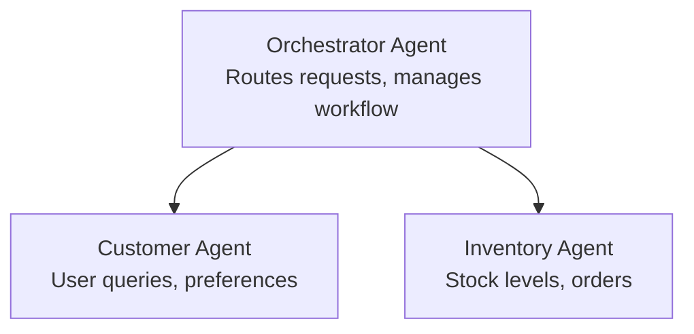

# Bab 5: Solusi AI Multi-Agen

**📚 Kursus**: [AZD Untuk Pemula](../../README.md) | **⏱️ Durasi**: 2-3 jam | **⭐ Kompleksitas**: Lanjutan

---

## Ikhtisar

Bab ini membahas pola arsitektur multi-agen yang canggih, orkestrasi agen, dan penerapan AI siap produksi untuk skenario kompleks.

> Panduan perintah ditinjau berdasarkan referensi `azd 1.37.2` yang dirilis. Penyebaran cloud tidak dilaksanakan.

## Tujuan Pembelajaran

Dengan menyelesaikan bab ini, Anda akan:
- Memahami pola arsitektur multi-agen
- Menyebarkan sistem agen AI yang terkoordinasi
- Menerapkan komunikasi antar agen
- Membangun solusi multi-agen siap produksi

---

## 📚 Pelajaran

| # | Pelajaran | Deskripsi | Waktu |
|---|--------|-------------|------|
| 1 | [Dasar-Dasar Multi-Agen](multi-agent-basics.md) | Praktik langsung: menyebarkan aplikasi multi-agen yang berfungsi dengan `azd up` | 45 menit |
| 2 | [Pola Koordinasi](../chapter-06-pre-deployment/coordination-patterns.md) | Strategi orkestrasi agen (berlanjut di Bab 6) | 30 menit |
| 3 | [Penerapan Template ARM](../../examples/retail-multiagent-arm-template/README.md) | Contoh penyebaran satu klik | 30 menit |

> **Mulai dengan Pelajaran 1.** Ini adalah satu-satunya pelajaran yang sepenuhnya praktis dan dapat disebarkan di bab ini. Pelajaran 2 ada di Bab 6 (berbagi dengan perencanaan pra-penyebaran), dan [Solusi Retail Multi-Agen](../../examples/retail-scenario.md) adalah cetak biru arsitektur—referensi desain, bukan template satu perintah.

---

## 🚀 Memulai Cepat

```bash
# Option 1: Deploy the multi-agent template used in Lesson 1
azd init --template Azure-Samples/contoso-creative-writer .
azd up

# Option 2: Initialize a Foundry agent interactively with the GA bundle
azd ext install microsoft.foundry
azd ai agent init
azd up
```

> **Pendekatan mana?** Gunakan `azd init --template` untuk memulai dari contoh yang berfungsi. Gunakan `azd ai agent init` secara interaktif, atau `azd ai agent init --template <path-to-azure.yaml>` untuk mengadopsi proyek agen yang sedang berjalan. Lihat [referensi AZD AI CLI](../chapter-08-production/production-ai-practices.md#azd-ai-cli-commands-and-extensions) untuk persyaratan versi dan migrasi evaluasi.

Jalankan alternatif ini di folder kosong yang terpisah. Alur kerja GA Foundry membutuhkan `azd >= 1.37.0`; alur interaktifnya tidak menghasilkan pipeline Service Bus khusus dalam pelajaran koordinasi. Untuk pengujian lokal, penyebaran kode, dan pembersihan proyek baru versus yang digunakan ulang, ikuti [panduan agen terhost](../chapter-02-ai-development/microsoft-foundry-integration.md#hosted-agent-walkthrough-ga).

---

## 🤖 Arsitektur Multi-Agen



---

## 🎯 Solusi Unggulan: Retail Multi-Agen

Solusi [Retail Multi-Agent](../../examples/retail-scenario.md) menunjukkan:

- **Customer Agent**: Menangani interaksi dan preferensi pengguna
- **Inventory Agent**: Mengelola stok dan pemrosesan pesanan
- **Orchestrator**: Mengkoordinasikan antar agen
- **Shared Memory**: Manajemen konteks lintas agen

### Layanan yang Digunakan

| Layanan | Tujuan |
|---------|---------|
| Microsoft Foundry Models | Pemahaman bahasa |
| Azure AI Search | Katalog produk |
| Cosmos DB | Status dan memori agen |
| Container Apps | Hosting agen |
| Application Insights | Pemantauan |

---

## 🔗 Navigasi

| Arah | Bab |
|-----------|---------|
| **Sebelumnya** | [Bab 4: Infrastruktur](../chapter-04-infrastructure/README.md) |
| **Berikutnya** | [Bab 6: Pra-Penerapan](../chapter-06-pre-deployment/README.md) |

---

## 📖 Sumber Terkait

- [Panduan Agen AI](../chapter-02-ai-development/agents.md)
- [Praktik AI Produksi](../chapter-08-production/production-ai-practices.md)
- [Pemecahan Masalah AI](../chapter-07-troubleshooting/ai-troubleshooting.md)

---

<!-- CO-OP TRANSLATOR DISCLAIMER START -->
**Penafian**:
Dokumen ini telah diterjemahkan menggunakan layanan terjemahan AI [Co-op Translator](https://github.com/Azure/co-op-translator). Meskipun kami berupaya untuk mencapai akurasi, harap diketahui bahwa terjemahan otomatis mungkin mengandung kesalahan atau ketidakakuratan. Dokumen asli dalam bahasa aslinya harus dianggap sebagai sumber yang sah. Untuk informasi penting, disarankan menggunakan terjemahan profesional oleh manusia. Kami tidak bertanggung jawab atas kesalahpahaman atau penafsiran yang keliru yang timbul dari penggunaan terjemahan ini.
<!-- CO-OP TRANSLATOR DISCLAIMER END -->