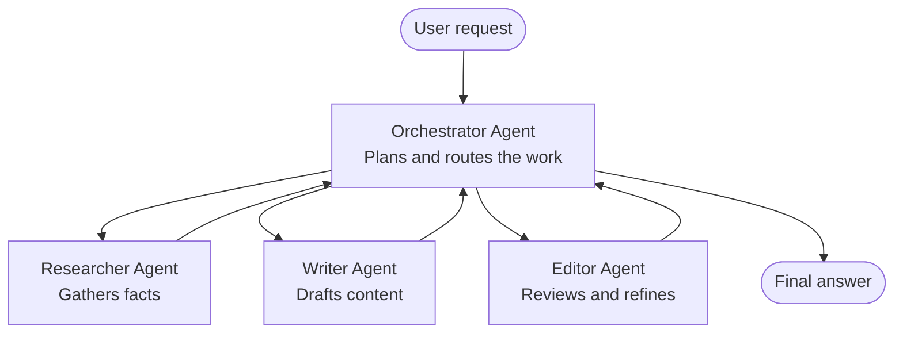

# Dasar-Dasar Multi-Agen - Terapkan Sistem AI Terkoordinasi Pertama Anda

**Navigasi Bab:**
- **📚 Beranda Kursus**: [AZD Untuk Pemula](../../README.md)
- **📖 Bab Saat Ini**: Bab 5 - Solusi AI Multi-Agen
- **⬅️ Sebelumnya**: [Bab 4: Infrastruktur](../chapter-04-infrastructure/README.md)
- **➡️ Berikutnya**: [Pola Koordinasi](../chapter-06-pre-deployment/coordination-patterns.md)

> Panduan perintah ditinjau terhadap referensi `azd 1.37.2` yang dirilis. Penyebaran cloud tidak dijalankan.

## Pendahuluan

Di bab-bab sebelumnya Anda menerapkan satu aplikasi—dan di Bab 2 Anda menerapkan satu agen AI. Pelajaran ini mengambil langkah berikutnya: menerapkan **sistem multi-agen**, di mana beberapa agen khusus bekerja bersama untuk menyelesaikan masalah yang tidak bisa ditangani dengan baik oleh satu agen saja.

Kabar baik untuk pemula: **Anda tidak perlu perintah baru.** Solusi multi-agen masih merupakan proyek azd. Anda akan `azd init`, `azd up`, menguji, dan `azd down`—persis alur kerja yang sudah Anda ketahui. Yang berubah adalah *bentuk* aplikasi di dalamnya.

## Tujuan Pembelajaran

Pada akhir pelajaran ini, Anda akan:
- Memahami apa arti "multi-agen" dan kapan layak menggunakan kerumitan ekstra
- Mengenali peran umum dalam sistem multi-agen (orchestrator + spesialis)
- Menerapkan template multi-agen nyata dan berfungsi dengan `azd up`
- Memahami sumber daya Azure yang mendukung aplikasi multi-agen
- Mengetahui cara memverifikasi, menyesuaikan, dan membongkar solusi dengan aman

## Hasil Pembelajaran

Setelah menyelesaikan pelajaran ini, Anda akan dapat:
- Menjelaskan perbedaan antara agen tunggal dan sistem multi-agen
- Memilih antara agen tunggal dengan alat dan desain multi-agen yang sebenarnya
- Menerapkan dan menguji template multi-agen dari awal ke akhir dengan azd
- Mengidentifikasi tempat masing-masing agen berjalan dan bagaimana mereka berkomunikasi
- Membersihkan semua sumber daya untuk menghindari biaya yang berkelanjutan

---

## Apa Itu Sistem Multi-Agen?

Sebuah agen AI tunggal adalah satu model dengan satu set instruksi dan (opsional) beberapa alat. Itu bekerja dengan baik untuk tugas fokus. Tetapi saat tugas bertambah—riset, lalu menulis, kemudian mengedit, kemudian memeriksa fakta—memasukkan semuanya ke dalam satu prompt membuat agen menjadi lebih lambat, kurang andal, dan lebih sulit untuk debug.

Sistem **multi-agen** memecah pekerjaan menjadi spesialis yang masing-masing melakukan satu pekerjaan dengan baik, dikordinasikan oleh seorang orchestrator:



### Dua peran yang selalu Anda lihat

| Peran | Pekerjaan | Contoh |
|------|----------|---------|
| **Orchestrator** | Memutuskan *apa yang terjadi selanjutnya* dan mengarahkan pekerjaan antar agen | "Pertama riset, kemudian menulis, lalu mengedit" |
| **Spesialis** | Melakukan satu pekerjaan fokus dan menghasilkan hasil | Seorang "peneliti" yang hanya mengumpulkan fakta |

### Apakah Anda benar-benar membutuhkan banyak agen?

Mulai simpel. Gunakan multi-agen **hanya** ketika salah satu dari ini benar:

- ✅ Tugas memiliki **tahapan berbeda** yang mendapat manfaat dari instruksi yang berbeda (riset vs. menulis vs. review)
- ✅ Anda ingin spesialis berjalan **secara paralel** untuk menghemat waktu
- ✅ Langkah berbeda membutuhkan **alat atau sumber data berbeda**
- ✅ Anda perlu setiap langkah dapat **dites dan debug secara independen**

Jika tugas Anda berupa pertanyaan dan jawaban tunggal atau panggilan alat yang sederhana, **agen tunggal dengan alat** (Bab 2) lebih sederhana, murah, dan mudah dioperasikan.

> **Tip Pemula:** "Lebih banyak agen" bukan berarti "lebih baik." Setiap agen menambah latensi, biaya, dan sesuatu yang harus dipantau. Tambah agen hanya saat masalahnya jelas terbagi menjadi bagian-bagian.

---

## Dua Cara Membangun Multi-Agen di Azure

| Pendekatan | Apa itu | Terbaik untuk |
|-----------|---------|------------|
| **Agen tunggal + alat** | Satu agen Foundry yang memanggil fungsi/alat | Alur kerja sederhana, memulai |
| **Beberapa agen terkoordinasi** | Beberapa agen dengan orchestrator | Tahapan berbeda, kerja paralel, spesialisasi |

Pelajaran ini fokus pada pendekatan kedua menggunakan **template siap pakai**, sehingga Anda dapat melihat sistem multi-agen nyata berjalan sebelum membangun sendiri.

---

## Praktik: Terapkan Aplikasi Multi-Agen yang Berfungsi

Kita akan menerapkan **Contoso Creative Writer**, contoh resmi Azure yang mengkoordinasikan agen riset, produk, penulisan, dan pengeditan untuk menghasilkan artikel. Sebelum melanjutkan, periksa [prasyarat dan biaya contoh](https://github.com/Azure-Samples/contoso-creative-writer#azure-account-requirements): dibutuhkan kuota model, Azure AI Search, akses Bing Grounding, Python, Docker, dan hook kompatibel Bash. Ketersediaan model dan wilayah tergantung langganan Anda; penyebaran tidak dijamin hanya dengan memilih wilayah tertentu.

### Langkah 1: Inisialisasi template

```bash
# Create a working folder
mkdir creative-writer && cd creative-writer

# Initialize from the official multi-agent template
azd init --template Azure-Samples/contoso-creative-writer .
```

> Jelajah template multi-agen lainnya kapan saja di [Galeri AZD AI Keren](https://azure.github.io/awesome-azd/?tags=ai). Opsi ramah-pemula lain mencakup `get-started-with-ai-agents` dan `azure-ai-travel-agents`.

### Langkah 2: Autentikasi

```bash
# Required for azd workflows
azd auth login

# Also required by this sample's Azure CLI hooks
az login
```

### Langkah 3: Periksa lingkungan

```bash
# init normally creates/selects an environment; confirm it before proceeding
azd env list
# Only if you need an additional environment:
# azd env new dev
```

### Langkah 4: Pratinjau, lalu terapkan

```bash
# See what will be created before spending anything (recommended)
azd provision --preview

# Provision infrastructure and deploy all agents in one step
azd up
```

`azd up` akan meminta pengaturan langganan dan wilayah yang hilang, lalu menyediakan sumber daya dan menerapkan aplikasi. Pratinjau tidak memesan kuota atau menjamin keberhasilan; hook template mungkin masih berjalan saat pratinjau penyediaan, jadi periksa dulu. Untuk memperpanjang waktu tunggu azd untuk setiap **penyebaran layanan** (bukan penyediaan model):

```bash
azd deploy --timeout 1800
```

Waktu habis menghentikan tunggu azd; tidak membatalkan penyebaran di Azure. Periksa status sumber daya sebelum mencoba lagi.

> **Perhatian biaya dan kapasitas:** Aplikasi multi-agen menerapkan model AI yang menggunakan kuota dan menimbulkan biaya. Jika `azd up` gagal karena kuota model, lihat [Pemecahan Masalah AI](../chapter-07-troubleshooting/ai-troubleshooting.md) untuk perbaikan wilayah dan kuota, serta Bab 6 [Perencanaan Kapasitas](../chapter-06-pre-deployment/capacity-planning.md).

---

## Memahami Apa yang Anda Terapkan

Aplikasi multi-agen tipikal seperti ini menyediakan sekumpulan sumber daya Azure yang sesuai langsung dengan tanggung jawab dalam diagram di atas:

| Sumber Daya | Alasan Ada |
|------------|-------------|
| **Microsoft Foundry / Models** | Menjadi host model bahasa yang digunakan setiap agen |
| **Azure AI Search** | Memberi agen peneliti data berlandaskan untuk mencari |
| **Container Apps** (atau App Service) | Menjadi host kode orchestrator dan agen |
| **Cosmos DB** (di beberapa contoh) | Menyimpan keadaan/memori bersama yang dilewatkan antar agen |
| **Application Insights** | Melacak permintaan *melintasi* agen agar Anda bisa debug alurnya |

### Bagaimana agen berkomunikasi satu sama lain

Di sebagian besar contoh azd multi-agen, **orchestrator berjalan dalam kode aplikasi Anda** (misalnya, menggunakan kerangka seperti Semantic Kernel atau Microsoft Agent Framework). Orchestrator memanggil setiap agen spesialis secara bergiliran, meneruskan hasilnya, dan merakit jawaban akhir. Agen berbagi konteks melalui:

- **Panggilan fungsi/alat** — orchestrator memanggil spesialis dan mendapatkan hasil kembali
- **Memori bersama** — basis data (sering Cosmos DB) menyimpan keadaan yang dapat dibaca kedua agen
- **Pesan/peristiwa** — untuk pengikatan longgar, agen berkomunikasi melalui antrian atau Service Bus

> **Mengapa ini penting untuk debugging:** karena setiap langkah terpisah, Application Insights menunjukkan *agen mana* yang lambat atau gagal. Itu alasan utama membagi pekerjaan antar agen sejak awal.

---

## Verifikasi Penyebaran

Pastikan sistem benar-benar berfungsi sebelum melanjutkan:

```bash
# Show the deployed endpoints
azd show

# Open the app's monitoring dashboard
azd monitor

# Open Application Insights Logs (not a terminal log stream)
azd monitor --logs
```

Kemudian buka URL aplikasi dari `azd show` dan minta artikel singkat. Gunakan tampilan debug contoh untuk memeriksa alur kerja agennya. Pencarian transaksi Application Insights dapat menunjukkan langkah individual hanya jika contoh menginstrumentasi dan menghubungkannya; azd tidak menambahkan rentang agen secara otomatis.

**Kriteria keberhasilan:**
- ✅ `azd show` menampilkan endpoint yang dapat dijangkau
- ✅ Permintaan menghasilkan hasil yang jelas melewati beberapa tahap
- ✅ Tampilan debug menunjukkan beberapa langkah agen; jika pelacakan aktif, verifikasi telemetri terkait setelah pengambilan

---

## Sesuaikan: Tambah atau Atur Agen

Karena setiap agen hanyalah instruksi plus alat, penyesuaian cukup terjangkau:

1. **Temukan definisi agen** di template (sering kali satu set file `prompts/`, `agents/`, atau `*.prompty`).
2. **Sesuaikan instruksi agen**—misalnya, beri tahu agen editor untuk menerapkan nada atau jumlah kata tertentu.
3. **Terapkan ulang hanya kode** (infrastruktur tidak berubah):

   ```bash
   azd deploy
   ```

Untuk melangkah lebih jauh dengan proyek agen Foundry *milik Anda sendiri*, gunakan bundel GA dengan AZD 1.37.0+ di direktori kosong terpisah:

```bash
azd ext install microsoft.foundry
azd ai agent init
azd up
azd ai agent invoke      # test, with response timing
```

Lihat [panduan agen-hosted GA](../chapter-02-ai-development/microsoft-foundry-integration.md#hosted-agent-walkthrough-ga) untuk pengujian lokal Agent Inspector, penyebaran kode jarak jauh, dan kepemilikan pembersihan. Referensi [AZD AI CLI](../chapter-08-production/production-ai-practices.md#azd-ai-cli-commands-and-extensions) juga membahas ekstensi evaluasi terpisah, optimisasi, dan penghapusan agen.

---

## Bersihkan

Aplikasi multi-agen menjalankan beberapa layanan yang dapat ditagih. Bongkar semuanya saat selesai:

```bash
# Review the resources and confirm deletion interactively
azd down
```

Penghapusan bersifat destruktif. Untuk lab sementara, `azd down --force --purge` melewati penghapusan dan konfirmasi penghapusan lunak yang didukung; pembersihan tidak dapat dibatalkan jika didukung dan dapat diblokir oleh perlindungan pembersihan. Penghapusan lunak adalah masalah pemulihan/penggunaan ulang nama, bukan bukti biaya berkelanjutan. Periksa sumber daya tertahan dan penagihan setelah pembersihan.

Jika Anda juga menginisialisasi agen hosted terhadap proyek Foundry yang sudah ada, `azd down` meninggalkan agen dan sumber daya proyek itu tetap ada. Hapus hanya sumber daya yang tidak diinginkan yang Anda miliki secara terpisah. Untuk proyek Foundry baru yang dibuat oleh lingkungan AZD-nya, `azd down` menghapus grup sumber daya dan semua isinya.

---

## Catatan Tentang Sistem Multi-Agen Produksi

Solusi [Retail Multi-Agent](../../examples/retail-scenario.md) di repo ini adalah **cetakan arsitektur**, bukan template satu perintah—itu mendokumentasikan bagaimana sistem ritel produksi *akan* dibangun (dan secara eksplisit menyatakan bahwa pembangunan penuh adalah upaya besar). Gunakan sebagai referensi desain *setelah* Anda menerapkan contoh yang berfungsi di sini. Untuk masalah produksi (ketahanan, biaya, pemantauan, tata kelola), lanjutkan ke [Bab 8: Praktik AI Produksi](../chapter-08-production/production-ai-practices.md).

---

## Ringkasan

- Sistem multi-agen membagi pekerjaan di antara spesialis yang dikoordinasikan oleh orchestrator.
- Gunakan hanya ketika tugas memiliki tahapan berbeda, paralelisme, atau alat berbeda per langkah—jika tidak pilih agen tunggal.
- Alur kerja azd tidak berubah: `azd init` → `azd up` → test → `azd down`.
- Template nyata seperti `contoso-creative-writer` memungkinkan Anda melihat dan menyesuaikan aplikasi multi-agen yang berfungsi hari ini.
- Pelacakan Application Insights melintasi agen adalah salah satu manfaat praktis terbesar desain multi-agen.

---

## 🔗 Navigasi

| Arah | Pelajaran |
|--------|---------|
| **Sebelumnya** | [Bab 4: Infrastruktur](../chapter-04-infrastructure/README.md) |
| **Berikutnya** | [Pola Koordinasi](../chapter-06-pre-deployment/coordination-patterns.md) |

## 📖 Sumber Terkait

- [Panduan Agen AI](../chapter-02-ai-development/agents.md)
- [Pola Koordinasi](../chapter-06-pre-deployment/coordination-patterns.md)
- [Praktik AI Produksi](../chapter-08-production/production-ai-practices.md)
- [Pemecahan Masalah AI](../chapter-07-troubleshooting/ai-troubleshooting.md)

---

<!-- CO-OP TRANSLATOR DISCLAIMER START -->
**Penafian**:
Dokumen ini telah diterjemahkan menggunakan layanan terjemahan AI [Co-op Translator](https://github.com/Azure/co-op-translator). Meskipun kami berupaya untuk mencapai akurasi, harap diketahui bahwa terjemahan otomatis mungkin mengandung kesalahan atau ketidakakuratan. Dokumen asli dalam bahasa aslinya harus dianggap sebagai sumber yang sah. Untuk informasi penting, disarankan menggunakan terjemahan profesional oleh manusia. Kami tidak bertanggung jawab atas kesalahpahaman atau penafsiran yang keliru yang timbul dari penggunaan terjemahan ini.
<!-- CO-OP TRANSLATOR DISCLAIMER END -->