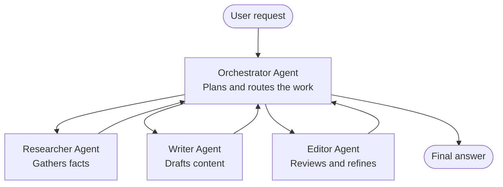

# Dasar Multi-Agen - Terapkan Sistem AI Koordinasi Pertama Anda

**Navigasi Bab:**
- **📚 Beranda Kursus**: [AZD Untuk Pemula](../../README.md)
- **📖 Bab Saat Ini**: Bab 5 - Solusi AI Multi-Agen
- **⬅️ Sebelumnya**: [Bab 4: Infrastruktur](../chapter-04-infrastructure/README.md)
- **➡️ Berikutnya**: [Pola Koordinasi](../chapter-06-pre-deployment/coordination-patterns.md)

> Panduan perintah ditinjau berdasarkan referensi `azd 1.37.2` yang dirilis. Penempatan cloud tidak dijalankan.

## Pendahuluan

Dalam bab sebelumnya Anda menerapkan satu aplikasi—dan di Bab 2 Anda menerapkan satu agen AI. Pelajaran ini mengambil langkah berikutnya: menerapkan **sistem multi-agen**, di mana beberapa agen spesialis bekerja bersama menyelesaikan masalah yang tidak bisa ditangani dengan baik oleh agen tunggal sendirian.

Kabar baik untuk pemula: **Anda tidak perlu perintah baru.** Solusi multi-agen masih merupakan proyek azd. Anda akan `azd init`, `azd up`, menguji, dan `azd down`—persis seperti alur kerja yang sudah Anda kenal. Yang berubah adalah *bentuk* aplikasi di dalamnya.

## Tujuan Pembelajaran

Pada akhir pelajaran ini, Anda akan:
- Memahami apa arti "multi-agen" dan kapan layak menanggung kompleksitas tambahan
- Mengenali peran umum dalam sistem multi-agen (orchestrator + spesialis)
- Menerapkan templat multi-agen nyata yang berfungsi dengan `azd up`
- Memahami sumber daya Azure yang mendukung aplikasi multi-agen
- Tahu cara memverifikasi, menyesuaikan, dan membersihkan solusi dengan aman

## Hasil Pembelajaran

Setelah menyelesaikan pelajaran ini, Anda akan mampu:
- Menjelaskan perbedaan antara agen tunggal dan sistem multi-agen
- Memilih antara agen tunggal dengan alat dan desain multi-agen sejati
- Menerapkan dan menguji templat multi-agen secara menyeluruh dengan azd
- Mengidentifikasi dimana setiap agen berjalan dan bagaimana mereka berkomunikasi
- Membersihkan semua sumber daya untuk menghindari biaya berkelanjutan

---

## Apa Itu Sistem Multi-Agen?

Satu agen AI adalah satu model dengan seperangkat instruksi dan (opsional) beberapa alat. Itu bekerja dengan baik untuk tugas fokus. Tetapi saat tugas tumbuh—riset, kemudian menulis, kemudian mengedit, kemudian memeriksa fakta—memasukkan semuanya ke dalam satu prompt membuat agen menjadi lebih lambat, kurang dapat diandalkan, dan lebih sulit untuk debug.

Sistem **multi-agen** memecah pekerjaan menjadi spesialis yang masing-masing menjalankan satu pekerjaan dengan baik, yang dikoordinasi oleh seorang orchestrator:



### Dua peran yang selalu Anda lihat

| Peran | Tugas | Contoh |
|------|-------|--------|
| **Orchestrator** | Memutuskan *apa yang terjadi selanjutnya* dan mengarahkan pekerjaan antar agen | "Pertama riset, lalu menulis, lalu mengedit" |
| **Spesialis** | Melakukan satu pekerjaan fokus dan mengembalikan hasil | "Peneliti" yang hanya mengumpulkan fakta |

### Apakah Anda benar-benar memerlukan banyak agen?

Mulailah sederhana. Gunakan multi-agen **hanya** ketika salah satu ini benar:

- ✅ Tugas memiliki **tahapan berbeda** yang mendapat manfaat dari instruksi berbeda (riset vs menulis vs review)
- ✅ Anda ingin spesialis dijalankan **secara paralel** untuk menghemat waktu
- ✅ Langkah berbeda membutuhkan **alat atau sumber data berbeda**
- ✅ Anda butuh setiap langkah **dapat diuji dan debug secara independen**

Jika tugas Anda berupa tanya jawab tunggal atau panggilan alat sederhana, **agen tunggal dengan alat** (Bab 2) lebih sederhana, lebih murah, dan lebih mudah dioperasikan.

> **Tip pemula:** "Lebih banyak agen" bukan berarti "lebih baik." Setiap agen menambah latensi, biaya, dan hal baru untuk dipantau. Tambah agen hanya saat masalah jelas terbagi menjadi bagian.

---

## Dua Cara Membangun Multi-Agen di Azure

| Pendekatan | Apa itu | Terbaik untuk |
|----------|---------|-------------|
| **Agen tunggal + alat** | Satu agen Foundry yang memanggil fungsi/alat | Alur kerja sederhana, mulai belajar |
| **Beberapa agen terkoordinasi** | Beberapa agen dengan orchestrator | Tahapan jelas, pekerjaan paralel, spesialisasi |

Pelajaran ini fokus pada pendekatan kedua menggunakan **templat siap pakai**, agar Anda dapat melihat sistem multi-agen nyata berjalan sebelum membangun sendiri.

---

## Praktik Langsung: Terapkan Aplikasi Multi-Agen yang Berfungsi

Kami akan menerapkan **Contoso Creative Writer**, sampel resmi Azure yang mengoordinasikan agen riset, produk, penulisan, dan pengeditan untuk menghasilkan sebuah artikel. Sebelum melanjutkan, periksa [prasyarat dan biaya sampel](https://github.com/Azure-Samples/contoso-creative-writer#azure-account-requirements): dibutuhkan kuota model, Azure AI Search, akses Bing Grounding, Python, Docker, dan hook kompatibel Bash. Ketersediaan model dan wilayah tergantung langganan Anda; penempatan tidak dijamin hanya dengan memilih wilayah tertentu.

### Langkah 1: Inisialisasi templat

```bash
# Create a working folder
mkdir creative-writer && cd creative-writer

# Initialize from the official multi-agent template
azd init --template Azure-Samples/contoso-creative-writer .
```

> Telusuri lebih banyak templat multi-agen kapan saja di [galeri Awesome AZD AI](https://azure.github.io/awesome-azd/?tags=ai). Pilihan ramah pemula lainnya termasuk `get-started-with-ai-agents` dan `azure-ai-travel-agents`.

### Langkah 2: Autentikasi

```bash
# Required for azd workflows
azd auth login

# Also required by this sample's Azure CLI hooks
az login
```

### Langkah 3: Periksa lingkungan

```bash
# init normally creates/selects an environment; confirm it before proceeding
azd env list
# Only if you need an additional environment:
# azd env new dev
```

### Langkah 4: Pratinjau, lalu terapkan

```bash
# See what will be created before spending anything (recommended)
azd provision --preview

# Provision infrastructure and deploy all agents in one step
azd up
```

`azd up` akan meminta pengaturan langganan dan wilayah yang hilang, lalu menyediakan sumber daya dan menerapkan aplikasi. Pratinjau tidak memesan kuota atau menjamin keberhasilan; hook templat mungkin masih berjalan selama pratinjau penyediaan, jadi periksa dulu. Untuk memperpanjang waktu tunggu azd untuk setiap **penyebaran layanan** (bukan penyediaan model):

```bash
azd deploy --timeout 1800
```

Batas waktu menghentikan azd menunggu; tidak membatalkan penyebaran di Azure. Periksa status sumber daya sebelum mencoba ulang.

> **Perhatian biaya dan kapasitas:** Aplikasi multi-agen menerapkan model AI yang mengkonsumsi kuota dan menimbulkan biaya. Jika `azd up` gagal pada kuota model, lihat [Pemecahan Masalah AI](../chapter-07-troubleshooting/ai-troubleshooting.md) untuk perbaikan wilayah dan kuota, serta Bab 6 [Perencanaan Kapasitas](../chapter-06-pre-deployment/capacity-planning.md).

---

## Memahami Apa yang Anda Terapkan

Aplikasi multi-agen tipikal seperti ini menyediakan seperangkat sumber daya Azure yang langsung sesuai dengan tanggung jawab dalam diagram di atas:

| Sumber Daya | Kenapa ada |
|------------|-----------|
| **Microsoft Foundry / Models** | Menampung model bahasa yang digunakan setiap agen |
| **Azure AI Search** | Memberi agen peneliti data berbasis sumber yang dapat dicari |
| **Container Apps** (atau App Service) | Menampung kode orchestrator dan agen |
| **Cosmos DB** (di beberapa sampel) | Menyimpan status/memori bersama yang dipertukarkan antar agen |
| **Application Insights** | Melacak permintaan *lintas* agen agar Anda dapat debug alur kerja |

### Bagaimana agen berkomunikasi satu sama lain

Dalam sebagian besar sampel azd multi-agen, **orchestrator berjalan di kode aplikasi Anda** (misalnya, menggunakan kerangka kerja seperti Semantic Kernel atau Framework Agen Microsoft). Orchestrator memanggil tiap agen spesialis berurutan, meneruskan hasil, dan merakit jawaban akhir. Agen berbagi konteks melalui:

- **Panggilan fungsi/alat** — orchestrator memanggil spesialis dan mendapat hasil kembali
- **Memori bersama** — database (sering Cosmos DB) memegang status yang bisa dibaca kedua agen
- **Pesan/acara** — untuk pengikatan longgar, agen berkomunikasi melalui antrean atau Service Bus

> **Mengapa ini penting untuk debugging:** karena setiap langkah terpisah, Application Insights menunjukkan *agen mana* yang lambat atau gagal. Itu alasan utama memecah pekerjaan ke beberapa agen sejak awal.

---

## Verifikasi Penempatan

Pastikan sistem benar-benar berfungsi sebelum melanjutkan:

```bash
# Show the deployed endpoints
azd show

# Open the app's monitoring dashboard
azd monitor

# Open Application Insights Logs (not a terminal log stream)
azd monitor --logs
```

Kemudian buka URL aplikasi dari `azd show` dan minta artikel singkat. Gunakan tampilan debug sampel untuk memeriksa alur kerja agen. Pencarian transaksi Application Insights bisa menampilkan langkah individual hanya jika sampel menginstrumentasi dan mengkorelasikannya; azd tidak secara otomatis menambah rentang agen.

**Kriteria keberhasilan:**
- ✅ `azd show` mencantumkan endpoint yang dapat dijangkau
- ✅ Permintaan menghasilkan hasil yang jelas melewati banyak tahapan
- ✅ Tampilan debug menunjukkan beberapa langkah agen; jika pelacakan diaktifkan, verifikasi telemetri terkait setelah pengambilan

---

## Kustomisasi: Tambah atau Sesuaikan Agen

Karena setiap agen hanyalah instruksi plus alat, kustomisasi bisa dilakukan:

1. **Temukan definisi agen** dalam templat (sering berupa set file `prompts/`, `agents/`, atau `*.prompty`).
2. **Sesuaikan instruksi agen** — misalnya, beri tahu agen editor untuk menerapkan nada atau jumlah kata tertentu.
3. **Terapkan ulang hanya kode** (infrastruktur tidak berubah):

   ```bash
   azd deploy
   ```

Untuk melangkah lebih jauh dengan proyek agen Foundry *milik Anda sendiri*, gunakan inisialisasi interaktif ekstensi agen:

```bash
azd extension install azure.ai.agents
azd ai agent init
azd up
azd ai agent invoke      # test, with response timing
```

Lihat [Bab 2: Agen](../chapter-02-ai-development/agents.md) dan [referensi AZD AI CLI](../chapter-08-production/production-ai-practices.md#azd-ai-cli-commands-and-extensions) untuk siklus lengkap: agen `invoke`, alur kerja ekstensi evaluasi terpisah `azd ai eval`, agen `optimize`, dan agen `delete`.

---

## Bersihkan

Aplikasi multi-agen menjalankan banyak layanan berbayar. Hancurkan semuanya setelah selesai digunakan:

```bash
# Review the resources and confirm deletion interactively
azd down
```

Penghapusan bersifat destruktif. Untuk lab sekali pakai, `azd down --force --purge` melewati penghapusan dan konfirmasi purge soft-delete yang didukung; pembersihan tidak dapat dibatalkan jika didukung dan dapat diblokir oleh proteksi purge. Penghapusan lunak adalah perhatian pemulihan/pemakaian nama ulang, bukan bukti biaya berkelanjutan sendiri. Periksa sumber daya tersisa dan penagihan setelah pembersihan.

---

## Catatan tentang Sistem Multi-Agen Produksi

Solusi [Retail Multi-Agent](../../examples/retail-scenario.md) dalam repo ini adalah **cetakan arsitektur**, bukan template satu perintah—ia mendokumentasikan bagaimana sebuah sistem ritel produksi *akan* dibangun (dan secara eksplisit menyatakan bahwa pembangunan penuh adalah usaha yang besar). Gunakan ini sebagai referensi desain *setelah* Anda menerapkan contoh kerja di sini. Untuk masalah produksi (ketahanan, biaya, pemantauan, tata kelola), lanjutkan ke [Bab 8: Praktik AI Produksi](../chapter-08-production/production-ai-practices.md).

---

## Ringkasan

- Sistem multi-agen membagi pekerjaan di antara para spesialis yang dikoordinasikan oleh seorang pengatur.
- Gunakan hanya ketika tugas memiliki tahapan berbeda, paralelisme, atau alat berbeda di setiap langkah—jika tidak, lebih baik menggunakan satu agen saja.
- Alur kerja azd tidak berubah: `azd init` → `azd up` → test → `azd down`.
- Template nyata seperti `contoso-creative-writer` memungkinkan Anda melihat dan menyesuaikan aplikasi multi-agen yang berfungsi hari ini.
- Pelacakan Application Insights di seluruh agen adalah salah satu manfaat praktis terbesar dari desain multi-agen.

---

## 🔗 Navigasi

| Arah | Pelajaran |
|-----------|--------|
| **Sebelumnya** | [Bab 4: Infrastruktur](../chapter-04-infrastructure/README.md) |
| **Berikutnya** | [Pola Koordinasi](../chapter-06-pre-deployment/coordination-patterns.md) |

## 📖 Sumber Terkait

- [Panduan Agen AI](../chapter-02-ai-development/agents.md)
- [Pola Koordinasi](../chapter-06-pre-deployment/coordination-patterns.md)
- [Praktik AI Produksi](../chapter-08-production/production-ai-practices.md)
- [Pemecahan Masalah AI](../chapter-07-troubleshooting/ai-troubleshooting.md)

---

<!-- CO-OP TRANSLATOR DISCLAIMER START -->
**Penafian**:
Dokumen ini telah diterjemahkan menggunakan layanan terjemahan AI [Co-op Translator](https://github.com/Azure/co-op-translator). Meskipun kami berupaya untuk mencapai akurasi, harap diketahui bahwa terjemahan otomatis mungkin mengandung kesalahan atau ketidakakuratan. Dokumen asli dalam bahasa aslinya harus dianggap sebagai sumber yang sah. Untuk informasi penting, disarankan menggunakan terjemahan profesional oleh manusia. Kami tidak bertanggung jawab atas kesalahpahaman atau penafsiran yang keliru yang timbul dari penggunaan terjemahan ini.
<!-- CO-OP TRANSLATOR DISCLAIMER END -->