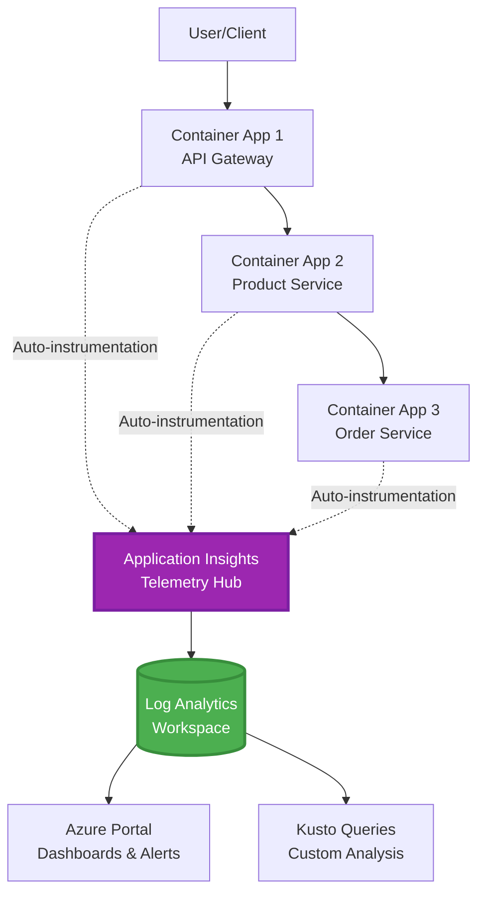
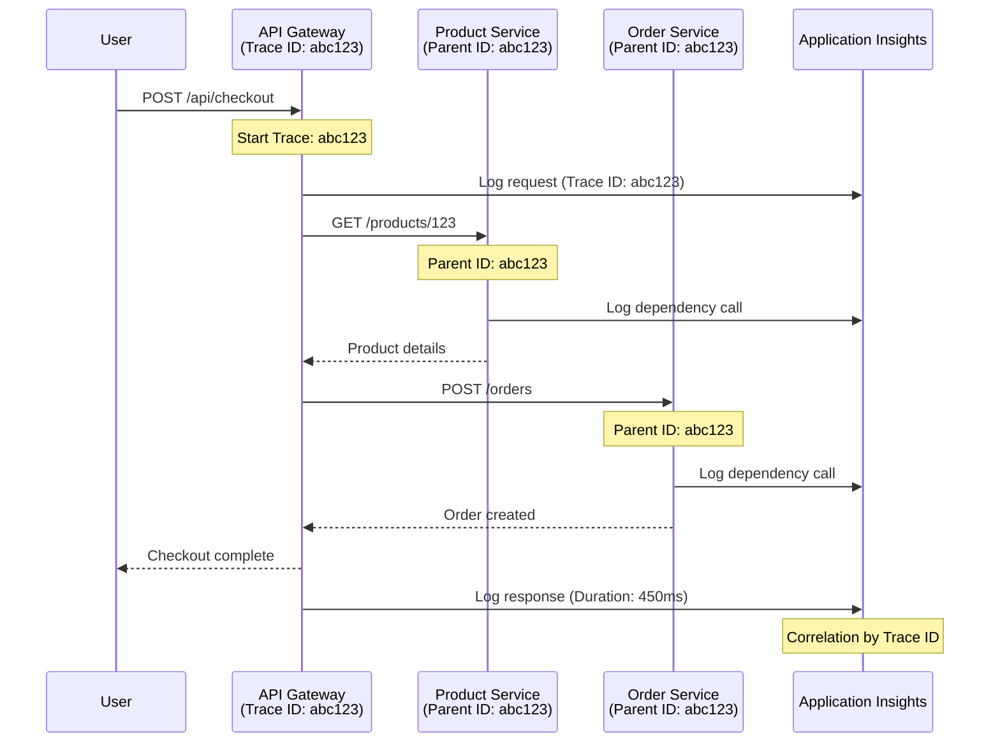

# Integrasi Application Insights dengan AZD

⏱️ **Perkiraan Waktu**: 40-50 menit | 💰 **Dampak Biaya**: ~$5-15/bulan | ⭐ **Tingkat Kesulitan**: Menengah

**📚 Jalur Pembelajaran:**
- ← Sebelumnya: [Pemeriksaan Pra-penerbangan](preflight-checks.md) - Validasi pra-penyebaran
- 🎯 **Anda di sini**: Integrasi Application Insights (Pemantauan, telemetri, debugging)
- → Berikutnya: [Panduan Penyebaran](../chapter-04-infrastructure/deployment-guide.md) - Menyebarkan ke Azure
- 🏠 [Beranda Kursus](../../README.md)

---

## Apa yang Akan Anda Pelajari

Dengan menyelesaikan pelajaran ini, Anda akan:
- Mendeklarasikan **Application Insights** dalam infrastruktur AZD dan mengonfigurasi instrumentasi SDK
- Mengonfigurasi **distributed tracing** untuk microservices
- Menerapkan **telemetri kustom** (metrik, event, dependensi)
- Mengatur **live metrics** untuk pemantauan real-time
- Membuat **alert dan dasbor** dari penyebaran AZD
- Debug masalah produksi dengan **kueri telemetri**
- Mengoptimalkan **biaya dan strategi sampling**
- Memantau **aplikasi AI/LLM** (token, latensi, biaya)

## Mengapa Application Insights dengan AZD Penting

### Tantangan: Observabilitas Produksi

**Tanpa Application Insights:**
```
❌ No visibility into production behavior
❌ Manual log aggregation across services
❌ Reactive debugging (wait for customer complaints)
❌ No performance metrics
❌ Cannot trace requests across services
❌ Unknown failure rates and bottlenecks
```

**Dengan Application Insights + AZD:**
```
✅ Automatic telemetry collection
✅ Centralized logs from all services
✅ Proactive issue detection
✅ End-to-end request tracing
✅ Performance metrics and insights
✅ Real-time dashboards
✅ AZD provisions the monitoring declared in your templates
```

**Analogi**: Application Insights seperti memiliki “kotak hitam” pencatat penerbangan + dasbor kokpit untuk aplikasi Anda. Anda dapat melihat segala sesuatu yang terjadi secara real-time dan memutar ulang insiden apa pun.

---

## Ikhtisar Arsitektur

### Application Insights dalam Arsitektur AZD



### Apa yang Dipantau Secara Otomatis

Auto-instrumentasi yang didukung menangkap permintaan/dependensi untuk pustaka yang diinstrumentasi. Event dan metrik kustom memerlukan kode aplikasi; tes ketersediaan harus dikonfigurasi secara terpisah. Ini tidak mengumpulkan setiap baris di bawah hanya karena sumber daya ada.

| Jenis Telemetri | Apa yang Ditangkap | Kasus Penggunaan |
|----------------|------------------|----------|
| **Requests** | Permintaan HTTP, kode status, durasi | Pemantauan kinerja API |
| **Dependencies** | Panggilan eksternal (DB, API, penyimpanan) | Identifikasi kemacetan |
| **Exceptions** | Error yang tidak tertangani dengan jejak tumpukan | Debugging kegagalan |
| **Custom Events** | Event bisnis (pendaftaran, pembelian) | Analitik dan funnel |
| **Metrics** | Counter performa, metrik kustom | Perencanaan kapasitas |
| **Traces** | Pesan log dengan tingkat keparahan | Debugging dan audit |
| **Availability** | Tes waktu aktif dan respons | Pemantauan SLA |

---

## Prasyarat

### Alat yang Dibutuhkan

```bash
# Verify Azure Developer CLI
azd version
# Command reference baseline: azd 1.37.2

# Verify Azure CLI
az --version
# ✅ Expected: azure-cli 2.50.0 or higher
```

### Persyaratan Azure

- Langganan Azure aktif
- Izin untuk membuat:
  - Sumber daya Application Insights
  - Workspace Log Analytics
  - Container Apps
  - Grup sumber daya

### Prasyarat Pengetahuan

Anda harus sudah menyelesaikan:
- [Dasar-dasar AZD](../chapter-01-foundation/azd-basics.md) - Konsep inti AZD
- [Konfigurasi](../chapter-03-configuration/configuration.md) - Pengaturan lingkungan
- [Proyek Pertama](../chapter-01-foundation/first-project.md) - Penyebaran dasar

---

## Pelajaran 1: Application Insights Otomatis dengan AZD

### Bagaimana AZD Menyediakan Application Insights

AZD hanya menyediakan Application Insights **ketika infrastruktur proyek mendeklarasikannya**. `azure.yaml` sendiri tidak membuat pemantauan atau menginstrumentasi kode aplikasi.

> **Contoh cakupan:** Pelajaran ini berisi fragmen integrasi, bukan proyek seluruhnya `monitored-app` dalam repositori ini. Berikan template utama dan pemetaan parameter, lingkungan Container Apps, konfigurasi registry/image dan identitas, Dockerfile, dan tag layanan sebelum menerapkan. Pelajaran selanjutnya menunjukkan fragmen alternatif/perluasan, bukan file yang bisa langsung digabung tanpa perubahan. Mulailah dengan [contoh microservices](../../../../examples/microservices) jika Anda membutuhkan baseline yang dapat dijalankan.

### Struktur Proyek

```
monitored-app/
├── azure.yaml                     # AZD configuration
├── infra/
│   ├── main.bicep                # Main infrastructure
│   ├── core/
│   │   └── monitoring.bicep      # Application Insights + Log Analytics
│   └── app/
│       └── api.bicep             # Container App with monitoring
└── src/
    ├── app.py                    # Application with telemetry
    ├── requirements.txt
    └── Dockerfile
```

---

### Langkah 1: Konfigurasi AZD (azure.yaml)

**File: `azure.yaml`**

```yaml
name: monitored-app
metadata:
  template: monitored-app@1.0.0

services:
  api:
    project: ./src
    language: python
    host: containerapp

# Monitoring must be declared in infra/ and enabled in application code.
```

Ini mendeklarasikan layanan yang dapat diterapkan. Konfigurasi Bicep dan SDK berikut menyediakan pemantauan; azd tidak menambahkannya secara implisit.

---

### Langkah 2: Infrastruktur Pemantauan (Bicep)

**File: `infra/core/monitoring.bicep`**

```bicep
param logAnalyticsName string
param applicationInsightsName string
param location string = resourceGroup().location
param tags object = {}

// Log Analytics Workspace (required for Application Insights)
resource logAnalytics 'Microsoft.OperationalInsights/workspaces@2022-10-01' = {
  name: logAnalyticsName
  location: location
  tags: tags
  properties: {
    sku: {
      name: 'PerGB2018'  // Pay-as-you-go pricing
    }
    retentionInDays: 30  // Keep logs for 30 days
    features: {
      enableLogAccessUsingOnlyResourcePermissions: true
    }
  }
}

// Application Insights
resource applicationInsights 'Microsoft.Insights/components@2020-02-02' = {
  name: applicationInsightsName
  location: location
  tags: tags
  kind: 'web'
  properties: {
    Application_Type: 'web'
    WorkspaceResourceId: logAnalytics.id
    IngestionMode: 'LogAnalytics'
    publicNetworkAccessForIngestion: 'Enabled'
    publicNetworkAccessForQuery: 'Enabled'
  }
}

// Outputs for Container Apps
output logAnalyticsWorkspaceId string = logAnalytics.id
output logAnalyticsWorkspaceName string = logAnalytics.name
output applicationInsightsConnectionString string = applicationInsights.properties.ConnectionString
output applicationInsightsInstrumentationKey string = applicationInsights.properties.InstrumentationKey
output applicationInsightsName string = applicationInsights.name
output applicationInsightsId string = applicationInsights.id
```

---

### Langkah 3: Hubungkan Container App ke Application Insights

**File: `infra/app/api.bicep`**

```bicep
param name string
param location string
param tags object = {}
param containerAppsEnvironmentId string
param containerImage string
param applicationInsightsConnectionString string

resource containerApp 'Microsoft.App/containerApps@2023-05-01' = {
  name: name
  location: location
  tags: tags
  properties: {
    managedEnvironmentId: containerAppsEnvironmentId
    configuration: {
      ingress: {
        external: true
        targetPort: 8000
      }
      secrets: [
        {
          name: 'appinsights-connection-string'
          value: applicationInsightsConnectionString
        }
      ]
    }
    template: {
      containers: [
        {
          name: 'api'
          image: containerImage // Supply an accessible image and registry authentication
          resources: {
            cpu: json('0.5')
            memory: '1Gi'
          }
          env: [
            {
              name: 'APPLICATIONINSIGHTS_CONNECTION_STRING'
              secretRef: 'appinsights-connection-string'
            }
            {
              name: 'APPLICATIONINSIGHTS_ENABLED'
              value: 'true'
            }
          ]
        }
      ]
    }
  }
}

output uri string = 'https://${containerApp.properties.configuration.ingress.fqdn}'
```

---

### Langkah 4: Kode Aplikasi dengan Telemetri

**File: `src/app.py`**

```python
from flask import Flask, request, jsonify
from azure.monitor.opentelemetry import configure_azure_monitor
import logging
import os

app = Flask(__name__)

# Get Application Insights connection string
connection_string = os.environ.get('APPLICATIONINSIGHTS_CONNECTION_STRING')

if connection_string:
    # Azure Monitor OpenTelemetry instruments supported libraries, including Flask.
    configure_azure_monitor(
        connection_string=connection_string,
        logger_name=__name__,
        enable_live_metrics=True
    )
    logger = logging.getLogger(__name__)
    logger.setLevel(logging.INFO)
    
    print("✅ Application Insights enabled")
else:
    logger = logging.getLogger(__name__)
    logger.setLevel(logging.INFO)
    print("⚠️ Application Insights not configured")

@app.route('/health')
def health():
    logger.info('Health check endpoint called')
    return jsonify({'status': 'healthy', 'monitoring': 'enabled' if connection_string else 'disabled'})

@app.route('/api/products')
def get_products():
    logger.info('Fetching products')
    
    # In-memory fixture: this is not a database dependency call.
    products = [
        {'id': 1, 'name': 'Laptop', 'price': 999.99},
        {'id': 2, 'name': 'Mouse', 'price': 29.99},
        {'id': 3, 'name': 'Keyboard', 'price': 79.99}
    ]
    
    logger.info(f'Returned {len(products)} products')
    return jsonify(products)

@app.route('/api/error-test')
def error_test():
    """Test error tracking"""
    logger.error('Testing error tracking')
    try:
        raise ValueError('This is a test exception')
    except Exception as e:
        logger.exception('Exception occurred in error-test endpoint')
        return jsonify({'error': str(e)}), 500

@app.route('/api/slow')
def slow_endpoint():
    """Test performance tracking"""
    import time
    logger.info('Slow endpoint called')
    time.sleep(3)  # Simulate slow operation
    logger.warning('Endpoint took 3 seconds to respond')
    return jsonify({'message': 'Slow operation completed'})

if __name__ == '__main__':
    app.run(host='0.0.0.0', port=8000)
```

**File: `src/requirements.txt`**

```txt
Flask
azure-monitor-opentelemetry
gunicorn
requests
openai
```

Selesaikan dependensi ini dalam proyek Anda, uji bersama, dan kunci versi hasilnya. Proyek baru harus menggunakan Azure Monitor OpenTelemetry, bukan eksportir OpenCensus Python yang sudah dihentikan.

---

### Langkah 5: Deploy dan Verifikasi

```bash
# Deploy only after completing and wiring the infrastructure fragments above
azd up

# Get app URL
APP_URL=$(azd env get-value API_URL) # Requires this output in main.bicep

# Generate telemetry
curl $APP_URL/health
curl $APP_URL/api/products
curl $APP_URL/api/error-test
curl $APP_URL/api/slow
```

**✅ Output yang Diharapkan:**
```json
{
  "status": "healthy",
  "monitoring": "enabled"
}
```

---

### Langkah 6: Lihat Telemetri di Portal Azure

```bash
# Get Application Insights details
azd env get-values | grep APPLICATIONINSIGHTS

# Open in Azure Portal
az monitor app-insights component show \
  --app $(azd env get-values | grep APPLICATIONINSIGHTS_NAME | cut -d '=' -f2 | tr -d '"') \
  --resource-group $(azd env get-values | grep AZURE_RESOURCE_GROUP | cut -d '=' -f2 | tr -d '"') \
  --query "appId" -o tsv
```

**Navigasi ke Portal Azure → Application Insights → Pencarian Transaksi**

Anda harus melihat:
- ✅ Permintaan HTTP dengan kode status
- ✅ Durasi permintaan (3+ detik untuk `/api/slow`)
- ✅ Detail exception dari `/api/error-test`
- ✅ Pesan log kustom

---

## Pelajaran 2: Telemetri dan Event Kustom

### Melacak Event Bisnis

Mari tambahkan telemetri kustom untuk event bisnis kritis.

**File: `src/telemetry.py`**

```python
from contextlib import contextmanager
from azure.monitor.opentelemetry import configure_azure_monitor
from opentelemetry import metrics, trace
from opentelemetry.trace import SpanKind
import logging
import os

class TelemetryClient:
    """Custom telemetry client for Application Insights"""
    
    def __init__(self, connection_string=None):
        self.connection_string = connection_string or os.environ.get('APPLICATIONINSIGHTS_CONNECTION_STRING')
        
        # Configure once per process. If app.py already calls this, keep only
        # one configure_azure_monitor call and use logger_name='telemetry'.
        if self.connection_string:
            configure_azure_monitor(
                connection_string=self.connection_string,
                logger_name=__name__,
                enable_live_metrics=True
            )
        self.logger = logging.getLogger(__name__)
        self.logger.setLevel(logging.INFO)
        self.tracer = trace.get_tracer(__name__)
        self.meter = metrics.get_meter(__name__)
        self.instruments = {}
    
    def track_event(self, event_name: str, properties: dict = None):
        """Track custom business event"""
        properties = properties or {}
        self.logger.info(
            f"CustomEvent: {event_name}",
            extra={
                # OTel log attributes become customDimensions in App Insights.
                    'event_name': event_name,
                    **properties
            }
        )
    
    def track_metric(self, metric_name: str, value: float, properties: dict = None):
        """Track custom metric"""
        properties = properties or {}
        if metric_name not in self.instruments:
            self.instruments[metric_name] = self.meter.create_histogram(metric_name)
        self.instruments[metric_name].record(value, attributes=properties)
    
    @contextmanager
    def track_dependency(self, name: str):
        """Time the real operation inside a client span; exceptions mark failure."""
        with self.tracer.start_as_current_span(name, kind=SpanKind.CLIENT) as span:
            yield span

# Global telemetry client
telemetry = TelemetryClient()
```

### Perbarui Aplikasi dengan Event Kustom

**File: `src/app.py` (versi ditingkatkan)**

Tambahkan rute ini ke aplikasi Flask yang ada; pertahankan rute kesehatan/test sebelumnya. Blok singkat di bawah menunjukkan aplikasi terpisah untuk kejelasan. Inisialisasi telemetri kini ada di `telemetry.py`—jangan inisialisasi eksportir dua kali.

```python
from flask import Flask, request, jsonify
from telemetry import telemetry
import time
import random
import os

app = Flask(__name__)

@app.route('/api/purchase', methods=['POST'])
def purchase():
    """Track purchase event with custom telemetry"""
    data = request.get_json(silent=True) or {}
    product_id = data.get('product_id')
    quantity = data.get('quantity', 1)
    price = data.get('price', 0)
    if not isinstance(quantity, int) or quantity < 1 or \
       not isinstance(price, (int, float)) or price < 0:
        return jsonify({'error': 'quantity and price must be non-negative numbers; quantity >= 1'}), 400
    
    # Track business event
    telemetry.track_event('Purchase', {
        'product_id': product_id,
        'quantity': quantity,
        'total_amount': price * quantity,
        'user_id': request.headers.get('X-User-Id', 'anonymous')
    })
    
    # Track revenue metric
    telemetry.track_metric('Revenue', price * quantity, {
        'product_id': product_id,
        'currency': 'USD'
    })
    
    return jsonify({
        'order_id': f'ORD-{random.randint(1000, 9999)}',
        'status': 'confirmed',
        'total': price * quantity
    })

@app.route('/api/search')
def search():
    """Track search queries"""
    query = request.args.get('q', '')
    
    start_time = time.time()
    
    # Simulate search (would be real database query)
    results = [{'id': 1, 'name': f'Result for {query}'}]
    
    duration = (time.time() - start_time) * 1000  # Convert to ms
    
    # Track search event
    telemetry.track_event('Search', {
        'query': query,
        'results_count': len(results),
        'duration_ms': duration
    })
    
    # Track search performance metric
    telemetry.track_metric('SearchDuration', duration, {
        'query_length': len(query)
    })
    
    return jsonify({'results': results, 'count': len(results)})

@app.route('/api/external-call')
def external_call():
    """Track external API dependency"""
    import requests
    
    try:
        # Set an actual test endpoint; api.example.com is not a working API.
        with telemetry.track_dependency('ExternalAPI'):
            response = requests.get(os.environ['EXTERNAL_API_URL'], timeout=5)
            response.raise_for_status()
            result = response.json()
    except Exception as e:
        return jsonify({'error': 'External dependency failed'}), 502
    
    return jsonify(result)

if __name__ == '__main__':
    app.run(host='0.0.0.0', port=8000)
```

### Uji Telemetri Kustom

```bash
# Track purchase event
curl -X POST $APP_URL/api/purchase \
  -H "Content-Type: application/json" \
  -H "X-User-Id: user123" \
  -d '{"product_id": 1, "quantity": 2, "price": 29.99}'

# Track search event
curl "$APP_URL/api/search?q=laptop"

# Track external dependency
curl $APP_URL/api/external-call
```

**Lihat di Portal Azure:**

Navigasi ke Application Insights → Logs, lalu jalankan:

```kusto
// View purchase events
traces
| where customDimensions.event_name == "Purchase"
| project 
    timestamp,
    product_id = tostring(customDimensions.product_id),
    total_amount = todouble(customDimensions.total_amount),
    user_id = tostring(customDimensions.user_id)
| order by timestamp desc

// Revenue recorded in Purchase events (not a billing ledger)
traces
| where customDimensions.event_name == "Purchase"
| summarize TotalRevenue = sum(todouble(customDimensions.total_amount)) by bin(timestamp, 1h)
| render timechart

// View search performance
traces
| where customDimensions.event_name == "Search"
| summarize 
    AvgDuration = avg(todouble(customDimensions.duration_ms)),
    SearchCount = count()
  by bin(timestamp, 5m)
| render timechart
```

---

## Pelajaran 3: Distributed Tracing untuk Microservices

### Aktifkan Cross-Service Tracing

Dengan instrumentasi yang kompatibel dan propagasi konteks trace W3C, Application Insights mengkorelasikan permintaan antar layanan. Membagikan string koneksi saja tidak membangun parent-child span. Fragmen arsitektur berikut merujuk modul yang harus Anda implementasikan.

**File: `infra/main.bicep`**

```bicep
targetScope = 'subscription'

param environmentName string
param location string = 'eastus'

var tags = { 'azd-env-name': environmentName }

resource rg 'Microsoft.Resources/resourceGroups@2021-04-01' = {
  name: 'rg-${environmentName}'
  location: location
  tags: tags
}

// Monitoring (shared by all services)
module monitoring './core/monitoring.bicep' = {
  name: 'monitoring'
  scope: rg
  params: {
    logAnalyticsName: 'log-${environmentName}'
    applicationInsightsName: 'appi-${environmentName}'
    location: location
    tags: tags
  }
}

// API Gateway
module apiGateway './app/api-gateway.bicep' = {
  name: 'api-gateway'
  scope: rg
  params: {
    name: 'ca-gateway-${environmentName}'
    location: location
    tags: union(tags, { 'azd-service-name': 'gateway' })
    applicationInsightsConnectionString: monitoring.outputs.applicationInsightsConnectionString
  }
}

// Product Service
module productService './app/product-service.bicep' = {
  name: 'product-service'
  scope: rg
  params: {
    name: 'ca-products-${environmentName}'
    location: location
    tags: union(tags, { 'azd-service-name': 'products' })
    applicationInsightsConnectionString: monitoring.outputs.applicationInsightsConnectionString
  }
}

// Order Service
module orderService './app/order-service.bicep' = {
  name: 'order-service'
  scope: rg
  params: {
    name: 'ca-orders-${environmentName}'
    location: location
    tags: union(tags, { 'azd-service-name': 'orders' })
    applicationInsightsConnectionString: monitoring.outputs.applicationInsightsConnectionString
  }
}

output APPLICATIONINSIGHTS_CONNECTION_STRING string = monitoring.outputs.applicationInsightsConnectionString
output GATEWAY_URL string = apiGateway.outputs.uri
```

### Lihat Transaksi End-to-End



**Kueri trace end-to-end:**

```kusto
// Find complete request flow
let traceId = "abc123...";  // Copy operation_Id from a request in Application Insights
dependencies
| union requests
| where operation_Id == traceId
| project 
    timestamp,
    type = itemType,
    name,
    duration,
    success,
    cloud_RoleName
| order by timestamp asc
```

---

## Pelajaran 4: Live Metrics dan Pemantauan Real-Time

### Aktifkan Live Metrics Stream

Live Metrics menyediakan telemetri hampir real-time saat didukung dan diaktifkan oleh SDK. Ini bukan SLA latensi. Setup OpenTelemetry Python di atas mengaktifkannya dengan `enable_live_metrics=True`.

**Akses Live Metrics:**

```bash
# Get Application Insights resource
APPI_NAME=$(azd env get-values | grep APPLICATIONINSIGHTS_NAME | cut -d '=' -f2 | tr -d '"')

# Get resource group
RG_NAME=$(azd env get-values | grep AZURE_RESOURCE_GROUP | cut -d '=' -f2 | tr -d '"')

echo "Navigate to: Azure Portal → Resource Groups → $RG_NAME → $APPI_NAME → Live Metrics"
```

**Yang Anda lihat secara real-time:**
- ✅ Laju permintaan masuk (permintaan/detik)
- ✅ Panggilan dependensi keluar
- ✅ Jumlah exception
- ✅ Penggunaan CPU dan memori
- ✅ Jumlah server aktif
- ✅ Telemetri sampel

### Hasilkan Beban untuk Pengujian

```bash
# Generate load to see live metrics
for i in {1..100}; do
  curl --silent --max-time 10 "$APP_URL/api/products"
  curl --silent --max-time 10 "$APP_URL/api/search?q=test$i"
done

# Watch live metrics in Azure Portal
# You should see request rate spike
```

---

## Latihan Praktis

### Latihan 1: Atur Alerts ⭐⭐ (Menengah)

**Tujuan**: Membuat alert untuk tingkat error tinggi dan respons lambat.

**Langkah-langkah:**

1. **Buat alert untuk tingkat error:**

```bash
# Get Application Insights resource ID
APPI_ID=$(az monitor app-insights component show \
  --app $APPI_NAME \
  --resource-group $RG_NAME \
  --query "id" -o tsv)

# Create metric alert for failed requests
az monitor metrics alert create \
  --name "High-Error-Rate" \
  --resource-group $RG_NAME \
  --scopes $APPI_ID \
  --condition "count requests/failed > 10" \
  --window-size 5m \
  --evaluation-frequency 1m \
  --description "Alert when failed request count exceeds 10 per 5 minutes"
```

2. **Buat alert untuk respons lambat:**

```bash
az monitor metrics alert create \
  --name "Slow-Responses" \
  --resource-group $RG_NAME \
  --scopes $APPI_ID \
  --condition "avg requests/duration > 3000" \
  --window-size 5m \
  --evaluation-frequency 1m \
  --description "Alert when average response time exceeds 3 seconds"
```

3. **Buat alert lewat Bicep (disarankan untuk AZD):**

**File: `infra/core/alerts.bicep`**

```bicep
param applicationInsightsId string
param actionGroupId string = ''
param location string = resourceGroup().location

// High error rate alert
resource errorRateAlert 'Microsoft.Insights/metricAlerts@2018-03-01' = {
  name: 'high-error-rate'
  location: 'global'
  properties: {
    description: 'Alert when error rate exceeds threshold'
    severity: 2
    enabled: true
    scopes: [
      applicationInsightsId
    ]
    evaluationFrequency: 'PT1M'
    windowSize: 'PT5M'
    criteria: {
      'odata.type': 'Microsoft.Azure.Monitor.SingleResourceMultipleMetricCriteria'
      allOf: [
        {
          name: 'Error rate'
          metricName: 'requests/failed'
          operator: 'GreaterThan'
          threshold: 10
          timeAggregation: 'Count'
        }
      ]
    }
    actions: actionGroupId != '' ? [
      {
        actionGroupId: actionGroupId
      }
    ] : []
  }
}

// Slow response alert
resource slowResponseAlert 'Microsoft.Insights/metricAlerts@2018-03-01' = {
  name: 'slow-responses'
  location: 'global'
  properties: {
    description: 'Alert when response time is too high'
    severity: 3
    enabled: true
    scopes: [
      applicationInsightsId
    ]
    evaluationFrequency: 'PT1M'
    windowSize: 'PT5M'
    criteria: {
      'odata.type': 'Microsoft.Azure.Monitor.SingleResourceMultipleMetricCriteria'
      allOf: [
        {
          name: 'Response duration'
          metricName: 'requests/duration'
          operator: 'GreaterThan'
          threshold: 3000
          timeAggregation: 'Average'
        }
      ]
    }
  }
}

output errorAlertId string = errorRateAlert.id
output slowResponseAlertId string = slowResponseAlert.id
```

4. **Uji alert:**

```bash
# Generate errors
for i in {1..20}; do
  curl $APP_URL/api/error-test
done

# Generate slow responses
for i in {1..10}; do
  curl $APP_URL/api/slow
done

# Check rule configuration (not fired/resolved alert-instance history)
az monitor metrics alert list \
  --resource-group $RG_NAME \
  --query "[].{Name:name, Enabled:enabled}" \
  --output table
```

**✅ Kriteria Keberhasilan:**
- ✅ Alert berhasil dibuat
- ✅ Alert aktif saat ambang batas terlampaui
- ✅ Dapat melihat riwayat alert di Portal Azure
- ✅ Terintegrasi dengan penyebaran AZD

**Waktu**: 20-25 menit

---

### Latihan 2: Buat Dasbor Kustom ⭐⭐ (Menengah)

**Tujuan**: Bangun dasbor yang menunjukkan metrik kunci aplikasi.

**Langkah-langkah:**

1. **Buat dasbor lewat Portal Azure:**

Navigasi ke: Portal Azure → Dasbor → Dasbor Baru

2. **Tambahkan tile untuk metrik kunci:**

- Jumlah permintaan (24 jam terakhir)
- Rata-rata waktu respons
- Tingkat error
- 5 operasi terlambat terbanyak
- Distribusi geografis pengguna

3. **Buat dasbor lewat Bicep:**

**File: `infra/core/dashboard.bicep`**

```bicep
param dashboardName string
param applicationInsightsId string
param location string = resourceGroup().location

resource dashboard 'Microsoft.Portal/dashboards@2020-09-01-preview' = {
  name: dashboardName
  location: location
  properties: {
    lenses: [
      {
        order: 0
        parts: [
          // Request count
          {
            position: {
              x: 0
              y: 0
              rowSpan: 4
              colSpan: 6
            }
            metadata: {
              type: 'Extension/Microsoft_OperationsManagementSuite_Workspace/PartType/LogsDashboardPart'
              inputs: [
                {
                  name: 'resourceId'
                  value: applicationInsightsId
                }
                {
                  name: 'query'
                  value: '''
                    requests
                    | summarize RequestCount = count() by bin(timestamp, 1h)
                    | render timechart
                  '''
                }
              ]
            }
          }
          // Error rate
          {
            position: {
              x: 6
              y: 0
              rowSpan: 4
              colSpan: 6
            }
            metadata: {
              type: 'Extension/Microsoft_OperationsManagementSuite_Workspace/PartType/LogsDashboardPart'
              inputs: [
                {
                  name: 'resourceId'
                  value: applicationInsightsId
                }
                {
                  name: 'query'
                  value: '''
                    requests
                    | summarize 
                        Total = count(),
                        Failed = countif(success == false)
                    | extend ErrorRate = (Failed * 100.0) / Total
                    | project ErrorRate
                  '''
                }
              ]
            }
          }
        ]
      }
    ]
  }
}

output dashboardId string = dashboard.id
```

4. **Deploy dasbor:**

```bicep
// Add to a subscription-scoped main.bicep with rg and monitoring declared
module dashboard './core/dashboard.bicep' = {
  name: 'dashboard'
  scope: rg
  params: {
    dashboardName: 'dashboard-${environmentName}'
    applicationInsightsId: monitoring.outputs.applicationInsightsId
    location: location
  }
}
```

```bash
# Deploy
azd up
```

**✅ Kriteria Keberhasilan:**
- ✅ Dasbor menampilkan metrik kunci
- ✅ Dapat dipin ke beranda Portal Azure
- ✅ Memperbarui secara real-time
- ✅ Dapat diterapkan lewat AZD

**Waktu**: 25-30 menit

---

### Latihan 3: Monitor Aplikasi AI/LLM ⭐⭐⭐ (Lanjutan)

**Tujuan**: Melacak penggunaan Microsoft Foundry Models (token, biaya, latensi).

**Langkah-langkah:**

1. **Buat pembungkus monitoring AI:**

**File: `src/ai_telemetry.py`**

```python
from telemetry import telemetry
from openai import AzureOpenAI
import time

class MonitoredAzureOpenAI:
    """Microsoft Foundry Models client with automatic telemetry"""
    
    def __init__(self, api_key, endpoint, input_usd_per_million,
                 output_usd_per_million, api_version="2024-10-21"):
        self.client = AzureOpenAI(
            api_key=api_key,
            api_version=api_version,
            azure_endpoint=endpoint
        )
        self.input_rate = input_usd_per_million
        self.output_rate = output_usd_per_million
    
    def chat_completion(self, model: str, messages: list, **kwargs):
        """Track chat completion with telemetry"""
        start_time = time.time()
        
        try:
            # Call Microsoft Foundry Models
            response = self.client.chat.completions.create(
                model=model,
                messages=messages,
                **kwargs
            )
            
            duration = (time.time() - start_time) * 1000  # ms
            
            # Extract usage
            usage = response.usage
            prompt_tokens = usage.prompt_tokens
            completion_tokens = usage.completion_tokens
            total_tokens = usage.total_tokens
            
            # Approximation: supply actual deployment/region/contract rates.
            # Cached input, batch, provisioned and other charges need separate accounting.
            prompt_cost = (prompt_tokens / 1_000_000) * self.input_rate
            completion_cost = (completion_tokens / 1_000_000) * self.output_rate
            total_cost = prompt_cost + completion_cost
            
            # Track custom event
            telemetry.track_event('OpenAI_Request', {
                'model': model,
                'prompt_tokens': prompt_tokens,
                'completion_tokens': completion_tokens,
                'total_tokens': total_tokens,
                'duration_ms': duration,
                'cost_usd': total_cost,
                'success': True
            })
            
            # Track metrics
            telemetry.track_metric('OpenAI_Tokens', total_tokens, {
                'model': model,
                'type': 'total'
            })
            
            telemetry.track_metric('OpenAI_Cost', total_cost, {
                'model': model,
                'currency': 'USD'
            })
            
            telemetry.track_metric('OpenAI_Duration', duration, {
                'model': model
            })
            
            return response
            
        except Exception as e:
            duration = (time.time() - start_time) * 1000
            
            telemetry.track_event('OpenAI_Request', {
                'model': model,
                'duration_ms': duration,
                'success': False,
                'error': str(e)
            })
            
            raise
```

2. **Gunakan klien yang dimonitor:**

```python
from flask import Flask, request, jsonify
from ai_telemetry import MonitoredAzureOpenAI
import os

app = Flask(__name__)

# Initialize monitored OpenAI client
openai_client = MonitoredAzureOpenAI(
    api_key=os.environ['AZURE_OPENAI_API_KEY'],
    endpoint=os.environ['AZURE_OPENAI_ENDPOINT'],
    input_usd_per_million=float(os.environ['INPUT_USD_PER_MILLION']),
    output_usd_per_million=float(os.environ['OUTPUT_USD_PER_MILLION'])
)

@app.route('/api/chat', methods=['POST'])
def chat():
    data = request.json
    user_message = data.get('message')
    
    # Call with automatic monitoring
    response = openai_client.chat_completion(
        model=os.environ['AZURE_OPENAI_DEPLOYMENT'], # Deployment name, not catalog ID
        messages=[
            {'role': 'user', 'content': user_message}
        ]
    )
    
    return jsonify({
        'response': response.choices[0].message.content,
        'tokens': response.usage.total_tokens
    })
```

3. **Kueri metrik AI:**

```kusto
// Total AI spend over time
traces
| where customDimensions.event_name == "OpenAI_Request"
| where tobool(customDimensions.success) == true
| summarize TotalCost = sum(todouble(customDimensions.cost_usd)) by bin(timestamp, 1h)
| render timechart

// Token usage by model
traces
| where customDimensions.event_name == "OpenAI_Request"
| summarize 
    TotalTokens = sum(toint(customDimensions.total_tokens)),
    RequestCount = count()
  by Model = tostring(customDimensions.model)

// Average latency
traces
| where customDimensions.event_name == "OpenAI_Request"
| summarize AvgDuration = avg(todouble(customDimensions.duration_ms))
| project AvgDurationSeconds = AvgDuration / 1000

// Cost per request
traces
| where customDimensions.event_name == "OpenAI_Request"
| extend Cost = todouble(customDimensions.cost_usd)
| summarize 
    TotalCost = sum(Cost),
    RequestCount = count(),
    AvgCostPerRequest = avg(Cost)
```

**✅ Kriteria Keberhasilan:**
- ✅ Setiap panggilan OpenAI terlacak secara otomatis
- ✅ Penggunaan token dan biaya terlihat
- ✅ Latensi dimonitor
- ✅ Dapat mengatur alert anggaran

**Waktu**: 35-45 menit

---

## Optimasi Biaya

### Strategi Sampling

Kontrol biaya dengan sampling telemetri:

```python
import os

# Configure before the one configure_azure_monitor() call in your process.
os.environ["OTEL_TRACES_SAMPLER"] = "microsoft.fixed_percentage"
os.environ["OTEL_TRACES_SAMPLER_ARG"] = "0.1" # 10% trace sampling
```

Sampling trace tidak mengurangi setiap kategori telemetri sebesar 90%. Metrik dan log yang diterbitkan secara independen perlu kontrol volume sendiri. Pilih tingkat sampling menggunakan kebutuhan observabilitas, bukan larangan produksi menyeluruh.

Tetapkan sampling SDK secara eksplisit; properti `SamplingPercentage` komponen bukan pengganti pengaturan sampler OpenTelemetry Python.

### Retensi Data

```bicep
resource logAnalytics 'Microsoft.OperationalInsights/workspaces@2022-10-01' = {
  name: logAnalyticsName
  properties: {
    retentionInDays: 30  // Minimum (cheapest)
    // Options: 30, 31, 60, 90, 120, 180, 270, 365, 550, 730
  }
}
```

### Perkiraan Biaya Bulanan

| Volume Data | Retensi | Biaya Bulanan |
|-------------|-----------|--------------|
| 1 GB/bulan | 30 hari | ~$2-5 |
| 5 GB/bulan | 30 hari | ~$10-15 |
| 10 GB/bulan | 90 hari | ~$25-40 |
| 50 GB/bulan | 90 hari | ~$100-150 |

Angka ini hanya ilustrasi, bukan penawaran harga. Verifikasi harga ingest, retensi, alert, dan pengujian di wilayah dan perjanjian Anda; kuota gratis dibagi/diskop sesuai harga Azure Monitor, bukan SKU gratis terjamin per sumber daya Application Insights.

---

## Checkpoint Pengetahuan

### 1. Integrasi Dasar ✓

Uji pemahaman Anda:

- [ ] **Q1**: Bagaimana AZD menyediakan Application Insights?
  - **A**: Ia menerapkan sumber daya monitoring yang secara eksplisit dideklarasikan oleh template Bicep/Terraform proyek.

- [ ] **Q2**: Variabel lingkungan apa yang mengaktifkan Application Insights?
  - **A**: `APPLICATIONINSIGHTS_CONNECTION_STRING`

- [ ] **Q3**: Apa tiga jenis telemetri utama?
  - **A**: Requests (panggilan HTTP), Dependencies (panggilan eksternal), Exceptions (error)

**Verifikasi Praktis:**
```bash
# Check if Application Insights is configured
azd env get-values | grep APPLICATIONINSIGHTS

# Verify telemetry is flowing
az monitor app-insights metrics show \
  --app $APPI_NAME \
  --resource-group $RG_NAME \
  --metric "requests/count"
```

---

### 2. Telemetri Kustom ✓

Uji pemahaman Anda:

- [ ] **Q1**: Bagaimana cara melacak event bisnis kustom?
  - **A**: Pembungkus pelajaran ini menulis log OTel terstruktur dengan atribut `event_name`, dapat dikueri di `traces`; ini tidak otomatis `customEvents`.

- [ ] **Q2**: Apa bedanya event dan metrik?
  - **A**: Event adalah kejadian diskrit, metrik adalah pengukuran numerik

- [ ] **Q3**: Bagaimana cara mengkorelasikan telemetri antar layanan?
  - **A**: Application Insights otomatis menggunakan `operation_Id` untuk korelasi

**Verifikasi Praktis:**
```kusto
// Verify custom events
traces
| where customDimensions.event_name != ""
| summarize count() by tostring(customDimensions.event_name)
```

---

### 3. Pemantauan Produksi ✓

Uji pemahaman Anda:

- [ ] **Q1**: Apa itu sampling dan mengapa digunakan?
  - **A**: Sampling mengurangi volume data (dan biaya) dengan hanya menangkap persentase telemetri

- [ ] **Q2**: Bagaimana cara mengatur alert?
  - **A**: Gunakan metric alert di Bicep atau Portal Azure berdasarkan metrik Application Insights

- [ ] **Q3**: Apa perbedaan Log Analytics dan Application Insights?
  - **A**: Application Insights menyimpan data di workspace Log Analytics; App Insights menyediakan tampilan spesifik aplikasi

**Verifikasi Praktis:**
```bash
# Check the sampler configured for the running application, not only the ARM component.
az containerapp show --name "$APP_NAME" --resource-group "$RG_NAME" \
  --query "properties.template.containers[].env[?starts_with(name, 'OTEL_TRACES_SAMPLER')]"
```

---

## Praktik Terbaik

### ✅ LAKUKAN:

1. **Gunakan ID korelasi**
   ```python
   logger.info('Processing order', extra={
           'order_id': order_id,
           'user_id': user_id
   })
   ```

2. **Atur alert untuk metrik kritis**
   ```bicep
   // Error rate, slow responses, availability
   ```

3. **Gunakan logging terstruktur**
   ```python
   # ✅ GOOD: Structured
   logger.info('User signup', extra={'user_id': 'pseudonymous-id'})
   
   # ❌ BAD: Unstructured
   logger.info(f'User 123 signed up')
   ```

4. **Pantau dependensi**
   ```python
   # Automatically track database calls, HTTP requests, etc.
   ```

5. **Gunakan Live Metrics selama penyebaran**

### ❌ JANGAN:

1. **Jangan mencatat data sensitif**
   ```python
   # ❌ BAD
   logger.info(f'Login: {username}:{password}')
   
   # ✅ GOOD
   logger.info('Login attempt', extra={'result': 'failed'})
   ```

2. **Jangan memilih sampling tanpa mengukur volume dan kebutuhan diagnostik**
   ```python
   # ❌ Expensive
   # 100% traces may be appropriate for a small workload or investigation.
   
   # ✅ Cost-effective
   # A lower trace rate reduces visibility; validate coverage before enabling.
   ```

3. **Jangan mengabaikan antrean surat mati**

4. **Jangan lupa untuk menetapkan batas retensi data**

---

## Pemecahan Masalah

### Masalah: Tidak ada telemetry yang muncul

**Diagnosa:**
```bash
# Check connection string is set
azd env get-values | grep APPLICATIONINSIGHTS

# Check application logs via Azure Monitor
azd monitor --logs

# Or use Azure CLI for Container Apps:
az containerapp logs show --name $APP_NAME --resource-group $RG_NAME --tail 50
```

**Solusi:**
```bash
# Verify connection string in Container App
az containerapp show \
  --name $APP_NAME \
  --resource-group $RG_NAME \
  --query "properties.template.containers[0].env" \
  | grep -i applicationinsights
```

---

### Masalah: Biaya tinggi

**Diagnosa:**
```bash
# Query ingestion volume in the linked Log Analytics workspace.
# WORKSPACE_ID is the workspace customer ID (GUID), not its ARM resource ID.
az monitor log-analytics query --workspace "$WORKSPACE_ID" \
  --analytics-query "Usage | where TimeGenerated > ago(30d) | where IsBillable == true | summarize IngestedMB=sum(Quantity) by DataType"
```

**Solusi:**
- Kurangi tingkat sampling
- Kurangi periode retensi
- Hapus pencatatan verbose

---

## Pelajari Lebih Lanjut

### Dokumentasi Resmi
- [Ikhtisar Application Insights](https://learn.microsoft.com/azure/azure-monitor/app/app-insights-overview)
- [Pengaturan Azure Monitor OpenTelemetry](https://learn.microsoft.com/azure/azure-monitor/app/opentelemetry-enable?tabs=python)
- [Bahasa Kueri Kusto](https://learn.microsoft.com/azure/data-explorer/kusto/query/)
- [Pemantauan AZD](https://learn.microsoft.com/azure/developer/azure-developer-cli/monitor-your-app)

### Langkah Berikutnya dalam Kursus Ini
- ← Sebelumnya: [Pemeriksaan Pra-penerbangan](preflight-checks.md)
- → Berikutnya: [Panduan Penyebaran](../chapter-04-infrastructure/deployment-guide.md)
- 🏠 [Beranda Kursus](../../README.md)

### Contoh Terkait
- [Contoh Microsoft Foundry Models](../../../../examples/azure-openai-chat) - Telemetri AI
- [Contoh Microservices](../../../../examples/microservices) - Pelacakan terdistribusi

---

## Ringkasan

**Anda telah mempelajari:**
- ✅ Penyediaan otomatis Application Insights dengan AZD
- ✅ Telemetri khusus (event, metrik, dependensi)
- ✅ Pelacakan terdistribusi di seluruh microservices
- ✅ Metrik langsung dan pemantauan waktu nyata
- ✅ Alarm dan dashboard
- ✅ Pemantauan aplikasi AI/LLM
- ✅ Strategi optimasi biaya

**Poin Penting:**
1. **Deklarasikan pemantauan secara eksplisit** - AZD menerapkan template Anda; instrumentasi SDK mengirimkan telemetri
2. **Gunakan pencatatan terstruktur** - Mempermudah kueri
3. **Lacak acara bisnis** - Bukan hanya metrik teknis
4. **Pantau biaya AI** - Lacak token dan pengeluaran
5. **Atur peringatan** - Bersikap proaktif, bukan reaktif
6. **Optimalkan biaya** - Gunakan sampling dan batas retensi

**Langkah Berikutnya:**
1. Selesaikan latihan praktis
2. Tambahkan Application Insights ke proyek AZD Anda
3. Buat dashboard khusus untuk tim Anda
4. Pelajari [Panduan Penyebaran](../chapter-04-infrastructure/deployment-guide.md)

---

<!-- CO-OP TRANSLATOR DISCLAIMER START -->
**Penafian**:
Dokumen ini telah diterjemahkan menggunakan layanan terjemahan AI [Co-op Translator](https://github.com/Azure/co-op-translator). Meskipun kami berupaya untuk mencapai akurasi, harap diketahui bahwa terjemahan otomatis mungkin mengandung kesalahan atau ketidakakuratan. Dokumen asli dalam bahasa aslinya harus dianggap sebagai sumber yang sah. Untuk informasi penting, disarankan menggunakan terjemahan profesional oleh manusia. Kami tidak bertanggung jawab atas kesalahpahaman atau penafsiran yang keliru yang timbul dari penggunaan terjemahan ini.
<!-- CO-OP TRANSLATOR DISCLAIMER END -->