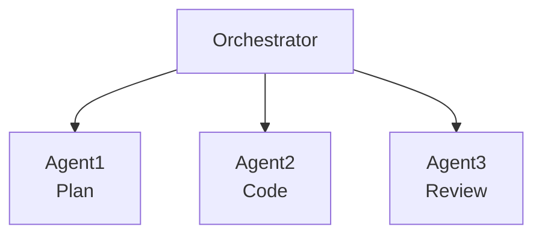
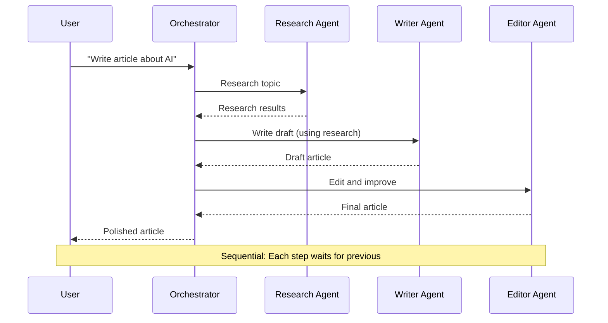
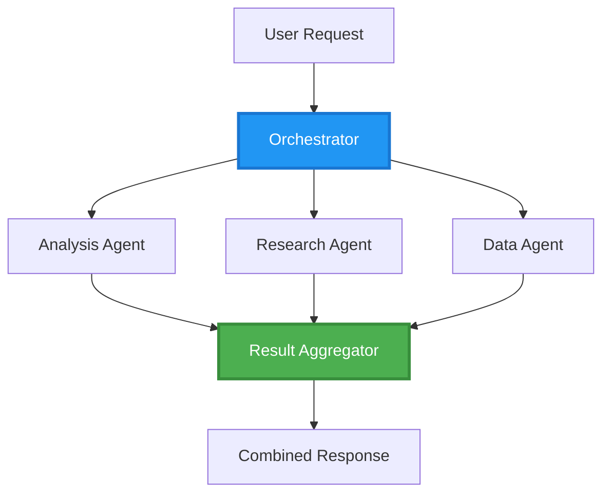
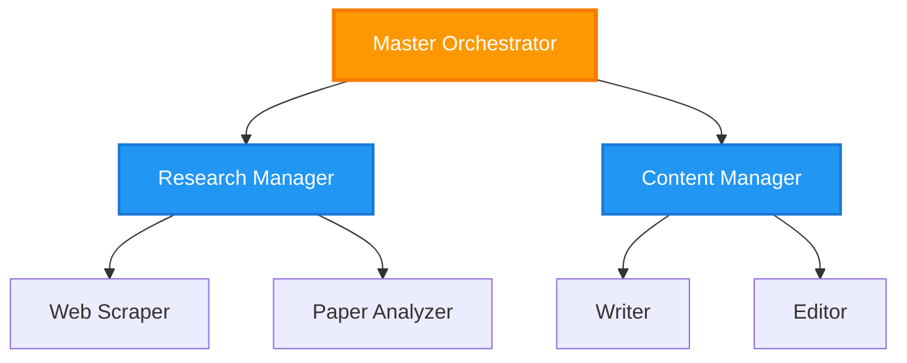
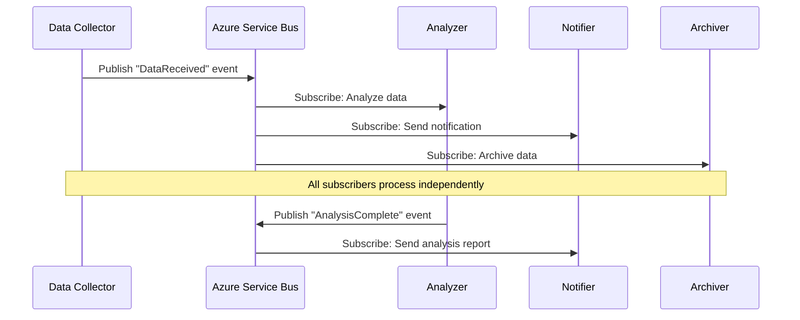
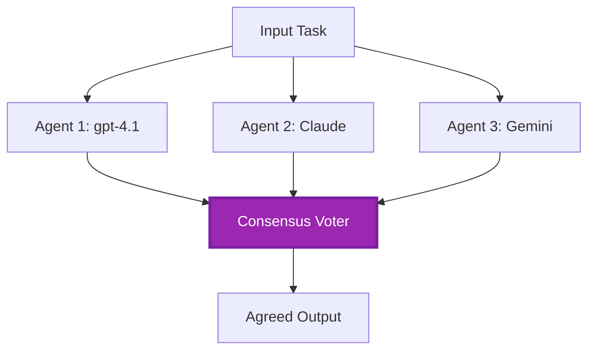
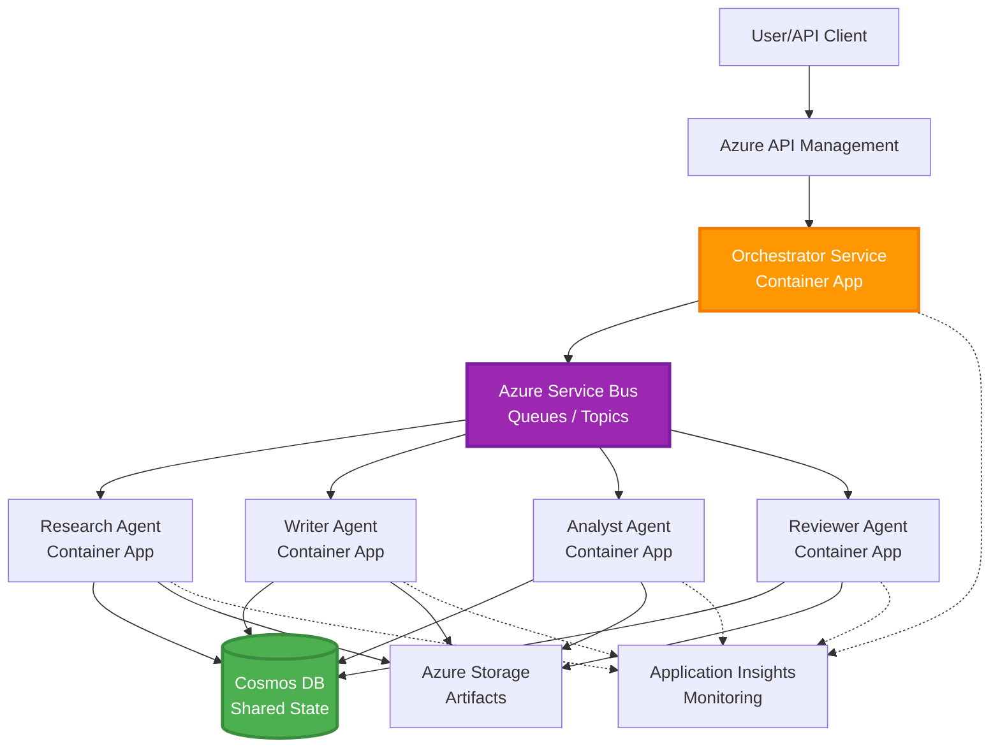

# Pola Koordinasi Multi-Agen

⏱️ **Perkiraan Waktu**: 60-75 menit membaca; beberapa jam untuk implementasi | 💰 **Perkiraan Biaya**: tergantung beban kerja | ⭐ **Tingkat Kesulitan**: Lanjutan

**📚 Jalur Pembelajaran:**
- ← Sebelumnya: [Perencanaan Kapasitas](capacity-planning.md) - Strategi penentuan ukuran dan penskalaan sumber daya
- 🎯 **Anda Berada Di Sini**: Pola Koordinasi Multi-Agen (Orkestrasi, komunikasi, manajemen status)
- → Berikutnya: [Pemilihan SKU](sku-selection.md) - Memilih layanan Azure yang tepat
- 🏠 [Beranda Kursus](../../README.md)

---

## Apa yang Akan Anda Pelajari

Dengan menyelesaikan pelajaran ini, Anda akan:
- Memahami pola **arsitektur multi-agen** dan kapan menggunakannya
- Mengimplementasikan **pola orkestrasi** (terpusat, terdesentralisasi, hierarkis)
- Merancang strategi **komunikasi agen** (sinkron, asinkron, berorientasi peristiwa)
- Mengelola **status bersama** antar agen terdistribusi
- Menyebarkan **sistem multi-agen** di Azure dengan AZD
- Menerapkan **pola koordinasi** untuk skenario AI dunia nyata
- Memantau dan debug sistem agen terdistribusi

## Mengapa Koordinasi Multi-Agen Penting

### Evolusi: Dari Agen Tunggal ke Multi-Agen

**Agen Tunggal (Sederhana):**
```
User → Agent → Response
```
- ✅ Mudah dipahami dan diimplementasikan
- ✅ Cepat untuk tugas sederhana
- ❌ Terbatas oleh kemampuan satu model
- ❌ Tidak bisa menjalankan tugas kompleks secara paralel
- ❌ Tidak ada spesialisasi

**Sistem Multi-Agen (Lanjutan):**

- ✅ Agen khusus untuk tugas tertentu
- ✅ Eksekusi paralel untuk kecepatan
- ✅ Modular dan mudah dipelihara
- ✅ Lebih baik untuk alur kerja kompleks
- ⚠️ Membutuhkan logika koordinasi

**Analogi**: Agen tunggal seperti satu orang yang mengerjakan semua tugas. Multi-agen seperti tim di mana setiap anggota memiliki keahlian khusus (peneliti, pemrogram, peninjau, penulis) yang bekerja sama.

---

## Pola Koordinasi Inti

### Pola 1: Koordinasi Berurutan (Rantai Tanggung Jawab)

**Kapan digunakan**: Tugas harus selesai dalam urutan tertentu, setiap agen membangun output dari agen sebelumnya.



**Manfaat:**
- ✅ Aliran data yang jelas
- ✅ Mudah untuk debug
- ✅ Urutan eksekusi dapat diprediksi

**Keterbatasan:**
- ❌ Lebih lambat (tanpa paralelisme)
- ❌ Satu kegagalan memblokir seluruh rantai
- ❌ Tidak dapat menangani tugas yang saling bergantung

**Contoh Kasus Penggunaan:**
- Pipeline pembuatan konten (riset → tulis → edit → publikasikan)
- Generasi kode (rencana → implementasi → uji → deploy)
- Pembuatan laporan (pengumpulan data → analisis → visualisasi → ringkasan)

---

### Pola 2: Koordinasi Paralel (Fan-Out/Fan-In)

**Kapan digunakan**: Tugas independen bisa berjalan bersamaan, hasil digabungkan di akhir.



**Manfaat:**
- ✅ Cepat (eksekusi paralel)
- ✅ Toleran kesalahan (hasil parsial dapat diterima)
- ✅ Skalabel secara horizontal

**Keterbatasan:**
- ⚠️ Hasil bisa datang tidak berurutan
- ⚠️ Memerlukan logika agregasi
- ⚠️ Manajemen status yang kompleks

**Contoh Kasus Penggunaan:**
- Pengumpulan data dari berbagai sumber (API + database + web scraping)
- Analisis kompetitif (beberapa model menghasilkan solusi, yang terbaik dipilih)
- Layanan terjemahan (menerjemahkan ke beberapa bahasa secara simultan)

---

### Pola 3: Koordinasi Hierarkis (Manajer-Pekerja)

**Kapan digunakan**: Alur kerja kompleks dengan sub-tugas, diperlukan delegasi.



**Manfaat:**
- ✅ Menangani alur kerja kompleks
- ✅ Modular dan mudah dipelihara
- ✅ Batas tanggung jawab yang jelas

**Keterbatasan:**
- ⚠️ Arsitektur lebih kompleks
- ⚠️ Latensi lebih tinggi (beberapa lapisan koordinasi)
- ⚠️ Membutuhkan orkestrasi yang canggih

**Contoh Kasus Penggunaan:**
- Pengolahan dokumen perusahaan (klasifikasi → pengalihan → proses → arsip)
- Pipeline data bertahap (ingest → bersihkan → transformasi → analisis → laporan)
- Alur kerja otomatisasi kompleks (perencanaan → alokasi sumber daya → eksekusi → pemantauan)

---

### Pola 4: Koordinasi Berbasis Peristiwa (Publish-Subscribe)

**Kapan digunakan**: Agen perlu merespons peristiwa, diinginkan keterikatan longgar.



**Manfaat:**
- ✅ Keterikatan longgar antar agen
- ✅ Mudah menambahkan agen baru (cukup berlangganan)
- ✅ Pemrosesan asinkron
- ✅ Tangguh (pesan tersimpan)

**Keterbatasan:**
- ⚠️ Konsistensi akhir
- ⚠️ Debugging kompleks
- ⚠️ Tantangan pengurutan pesan

**Contoh Kasus Penggunaan:**
- Sistem pemantauan real-time (alert, dashboard, log)
- Notifikasi multi-channel (email, SMS, push, Slack)
- Pipeline pemrosesan data (banyak konsumen data sama)

---

### Pola 5: Koordinasi Berbasis Konsensus (Voting/Quorum)

**Kapan digunakan**: Perlu persetujuan dari beberapa agen sebelum melanjutkan.



**Manfaat:**
- ✅ Akurasi lebih tinggi (berbagai opini)
- ✅ Toleran kesalahan (kegagalan minoritas dapat diterima)
- ✅ Jaminan kualitas bawaan

**Keterbatasan:**
- ❌ Mahal (banyak panggilan model)
- ❌ Lebih lambat (menunggu semua agen)
- ⚠️ Diperlukan resolusi konflik

**Contoh Kasus Penggunaan:**
- Moderasi konten (beberapa model meninjau konten)
- Review kode (beberapa linter/analyzer)
- Diagnosis medis (beberapa model AI, validasi ahli)

---

## Gambaran Arsitektur

### Sistem Multi-Agen Lengkap di Azure



**Komponen Utama:**

| Komponen | Tujuan | Layanan Azure |
|-----------|---------|---------------|
| **API Gateway** | Titik masuk, pembatasan laju, otentikasi | API Management |
| **Orkestrator** | Mengkoordinasi alur kerja agen | Container Apps |
| **Message Queue** | Komunikasi asinkron | Service Bus / Event Hubs |
| **Agen** | Pekerja AI khusus | Container Apps / Functions |
| **Penyimpanan Status** | Status bersama, pelacakan tugas | Cosmos DB |
| **Penyimpanan Artefak** | Dokumen, hasil, log | Blob Storage |
| **Monitoring** | Tracing terdistribusi, log | Application Insights |

Antrean/topik Service Bus dan Event Hubs adalah layanan berbeda dengan model pengiriman/konsumsi yang berbeda; Event Hubs bukan pengganti langsung untuk kode pekerja Service Bus di bawah ini. Paralelisme, pesan persisten, dan voting model tidak secara otomatis menjamin toleransi kesalahan atau akurasi lebih tinggi.

---

## Prasyarat

### Alat yang Diperlukan

```bash
# Verify Azure Developer CLI
azd version
# Command reference baseline: azd 1.37.2

# Verify Azure CLI
az --version
# ✅ Expected: azure-cli 2.50.0 or higher

# Verify Docker (for local testing)
docker --version
# ✅ Expected: Docker version 20.10 or higher
```

### Persyaratan Azure

- Langganan Azure aktif
- Izin untuk membuat:
  - Container Apps
  - Namespace Service Bus
  - Akun Cosmos DB
  - Akun penyimpanan
  - Application Insights

### Prasyarat Pengetahuan

Anda harus sudah menyelesaikan:
- [Manajemen Konfigurasi](../chapter-03-configuration/configuration.md)
- [Otentikasi & Keamanan](../chapter-03-configuration/authsecurity.md)
- [Contoh Microservices](../../../../examples/microservices)

---

## Panduan Implementasi

> **Fragmen desain, bukan lab yang dapat dideploy:** Struktur proyek dan label `File:` di bawah ini menjelaskan file yang harus dibuat dalam proyek Anda sendiri; repositori ini tidak berisi aplikasi `multi-agent-system` lengkap. Bagian yang hilang termasuk template utama/parameter, lingkungan/registry Container Apps, Dockerfile dan penguncian dependensi, setup database/container Cosmos, penyebaran model, konfigurasi identitas/peran, aturan penskalaan, dan pekerja/antrian paralel. Jangan harap `azd init` menghasilkan file-file ini atau `azd up` menyebarkan potongan kode tanpa perubahan. Untuk titik awal yang dapat dijalankan, selesaikan [Dasar Multi-Agen](../chapter-05-multi-agent/multi-agent-basics.md).

**Asumsi runtime:** Python 3.10+, `azure-servicebus`, `azure-cosmos`, `openai`, Flask, dan (untuk monitoring) `azure-monitor-opentelemetry`; letakkan `shared` pada path impor Python di setiap image layanan. Container Cosmos `agent-state/tasks` harus sudah ada dengan kunci partisi `/id`. Koneksi berbasis kunci menyederhanakan fragmen ini, bukan panduan produksi: lebih baik gunakan identitas terkelola dengan peran plane data Service Bus/Cosmos/OpenAI yang dibatasi. Jangan mengekspos kunci di output atau log.

Pengiriman Service Bus adalah **setidaknya sekali**. Simpan idempoten per tugas **dan langkah**, gunakan konkurensi optimistis (ETag) untuk baca/ubah/tulis status, dan perbarui kunci pesan selama pemrosesan lama. Pengelola status sederhana di bawah ini hanya berurutan dan tidak menerapkan jaminan produksi ini.

### Struktur Proyek

```
multi-agent-system/
├── azure.yaml                    # AZD configuration
├── infra/
│   ├── main.bicep               # Main infrastructure
│   ├── core/
│   │   ├── servicebus.bicep     # Message queue
│   │   ├── cosmos.bicep         # State store
│   │   ├── storage.bicep        # Artifact storage
│   │   └── monitoring.bicep     # Application Insights
│   └── app/
│       ├── orchestrator.bicep   # Orchestrator service
│       └── agent.bicep          # Agent template
└── src/
    ├── orchestrator/            # Orchestration logic
    │   ├── app.py
    │   ├── workflows.py
    │   └── Dockerfile
    ├── agents/
    │   ├── research/            # Research agent
    │   ├── writer/              # Writer agent
    │   ├── analyst/             # Analyst agent
    │   └── reviewer/            # Reviewer agent
    └── shared/
        ├── state_manager.py     # Shared state logic
        └── message_handler.py   # Message handling
```

---

## Pelajaran 1: Pola Koordinasi Berurutan

### Implementasi: Pipeline Pembuatan Konten

Mari desain pipeline berurutan: Riset → Tulis → Edit. Publikasi tidak termasuk dalam contoh ini.

### 1. Konfigurasi AZD

**File: `azure.yaml`**

```yaml
name: content-pipeline
metadata:
  template: multi-agent-sequential@1.0.0

services:
  orchestrator:
    project: ./src/orchestrator
    language: python
    host: containerapp
  
  research-agent:
    project: ./src/agents/research
    language: python
    host: containerapp
  
  writer-agent:
    project: ./src/agents/writer
    language: python
    host: containerapp
  
  editor-agent:
    project: ./src/agents/editor
    language: python
    host: containerapp
```

### 2. Infrastruktur: Service Bus untuk Koordinasi

**File: `infra/core/servicebus.bicep`**

```bicep
param name string
param location string
param tags object = {}

resource serviceBusNamespace 'Microsoft.ServiceBus/namespaces@2022-10-01-preview' = {
  name: name
  location: location
  tags: tags
  sku: {
    name: 'Standard'
    tier: 'Standard'
  }
  properties: {
    minimumTlsVersion: '1.2'
  }
}

// Queue for orchestrator → research agent
resource researchQueue 'Microsoft.ServiceBus/namespaces/queues@2022-10-01-preview' = {
  parent: serviceBusNamespace
  name: 'research-tasks'
  properties: {
    maxDeliveryCount: 3
    lockDuration: 'PT5M'
    deadLetteringOnMessageExpiration: true
  }
}

// Queue for research agent → writer agent
resource writerQueue 'Microsoft.ServiceBus/namespaces/queues@2022-10-01-preview' = {
  parent: serviceBusNamespace
  name: 'writer-tasks'
  properties: {
    maxDeliveryCount: 3
    lockDuration: 'PT5M'
  }
}

// Queue for writer agent → editor agent
resource editorQueue 'Microsoft.ServiceBus/namespaces/queues@2022-10-01-preview' = {
  parent: serviceBusNamespace
  name: 'editor-tasks'
  properties: {
    maxDeliveryCount: 3
    lockDuration: 'PT5M'
  }
}

output namespace string = serviceBusNamespace.name
// Do not output RootManageSharedAccessKey. Resolve scoped credentials
// securely or use managed identity in the application and scale rules.
```

### 3. Pengelola Status Bersama

**File: `src/shared/state_manager.py`**

```python
from azure.cosmos import CosmosClient, PartitionKey
from datetime import datetime, timezone
import os

class StateManager:
    """Manages shared state across agents using Cosmos DB"""
    
    def __init__(self):
        endpoint = os.environ['COSMOS_ENDPOINT']
        key = os.environ['COSMOS_KEY']
        
        self.client = CosmosClient(endpoint, key)
        self.database = self.client.get_database_client('agent-state')
        self.container = self.database.get_container_client('tasks')
    
    def create_task(self, task_id: str, task_type: str, input_data: dict):
        """Create a new task"""
        task = {
            'id': task_id,
            'type': task_type,
            'status': 'pending',
            'input': input_data,
            'created_at': datetime.now(timezone.utc).isoformat(),
            'steps': []
        }
        self.container.create_item(task)
        return task
    
    def update_task_step(self, task_id: str, step_name: str, result: dict):
        """Update task with completed step"""
        task = self.container.read_item(task_id, partition_key=task_id)
        
        task['steps'].append({
            'name': step_name,
            'completed_at': datetime.now(timezone.utc).isoformat(),
            'result': result
        })
        
        self.container.replace_item(task_id, task)
        return task
    
    def complete_task(self, task_id: str, final_result: dict):
        """Mark task as complete"""
        task = self.container.read_item(task_id, partition_key=task_id)
        task['status'] = 'completed'
        task['result'] = final_result
        task['completed_at'] = datetime.now(timezone.utc).isoformat()
        self.container.replace_item(task_id, task)
        return task
    
    def get_task(self, task_id: str):
        """Retrieve task state"""
        return self.container.read_item(task_id, partition_key=task_id)
```

### 4. Layanan Orkestrator

**File: `src/orchestrator/app.py`**

```python
from flask import Flask, request, jsonify
from azure.servicebus import ServiceBusClient, ServiceBusMessage
import json
import uuid
import os
from shared.state_manager import StateManager

app = Flask(__name__)
state_manager = StateManager()

# Service Bus connection
servicebus_connection_str = os.environ['SERVICEBUS_CONNECTION_STRING']
servicebus_client = ServiceBusClient.from_connection_string(servicebus_connection_str)

@app.route('/health', methods=['GET'])
def health():
    return jsonify({'status': 'healthy', 'service': 'orchestrator'})

@app.route('/create-content', methods=['POST'])
def create_content():
    """
    Sequential workflow: Research → Write → Edit (returns a draft; no publishing)
    """
    data = request.get_json(silent=True) or {}
    topic = data.get('topic')
    
    if not topic:
        return jsonify({'error': 'Topic required'}), 400
    
    # Create task in state store
    task_id = str(uuid.uuid4())
    task = state_manager.create_task(
        task_id=task_id,
        task_type='content_creation',
        input_data={'topic': topic}
    )
    
    # Send message to research agent (first step)
    sender = servicebus_client.get_queue_sender('research-tasks')
    message = ServiceBusMessage(
        body=json.dumps({
            'task_id': task_id,
            'topic': topic,
            'next_queue': 'writer-tasks'  # Where to send results
        }),
        content_type='application/json'
    )
    
    with sender:
        sender.send_messages(message)
    
    return jsonify({
        'task_id': task_id,
        'status': 'started',
        'workflow': 'sequential',
        'steps': ['research', 'write', 'edit'],
        'message': 'Content creation pipeline initiated'
    }), 202

@app.route('/task/<task_id>', methods=['GET'])
def get_task_status(task_id):
    """Check task status"""
    try:
        task = state_manager.get_task(task_id)
        return jsonify(task)
    except Exception as e:
        return jsonify({'error': str(e)}), 404

if __name__ == '__main__':
    app.run(host='0.0.0.0', port=8080)
```

### 5. Agen Peneliti

**File: `src/agents/research/app.py`**

```python
from azure.servicebus import ServiceBusClient, ServiceBusMessage
from openai import AzureOpenAI
import json
import os
import time
from shared.state_manager import StateManager

# Initialize clients
state_manager = StateManager()
servicebus_client = ServiceBusClient.from_connection_string(
    os.environ['SERVICEBUS_CONNECTION_STRING']
)

openai_client = AzureOpenAI(
    api_key=os.environ['AZURE_OPENAI_API_KEY'],
    api_version="2024-10-21",
    azure_endpoint=os.environ['AZURE_OPENAI_ENDPOINT']
)

def process_research_task(message_data):
    """Process research request and pass to writer"""
    task_id = message_data['task_id']
    topic = message_data['topic']
    next_queue = message_data['next_queue']
    
    print(f"🔬 Researching: {topic}")
    
    # Call Microsoft Foundry Models for research
    response = openai_client.chat.completions.create(
        model=os.environ['AZURE_OPENAI_DEPLOYMENT'],
        messages=[
            {"role": "system", "content": "You are a research assistant. Provide comprehensive research on the given topic."},
            {"role": "user", "content": f"Research this topic thoroughly: {topic}"}
        ],
        max_tokens=1500
    )
    
    research_results = response.choices[0].message.content
    
    # Update state
    state_manager.update_task_step(
        task_id=task_id,
        step_name='research',
        result={'research': research_results}
    )
    
    # Send to next agent (writer)
    sender = servicebus_client.get_queue_sender(next_queue)
    message = ServiceBusMessage(
        body=json.dumps({
            'task_id': task_id,
            'topic': topic,
            'research': research_results,
            'next_queue': 'editor-tasks'
        }),
        content_type='application/json'
    )
    
    with sender:
        sender.send_messages(message)
    
    print(f"✅ Research complete for task {task_id}")

def main():
    """Listen to research queue"""
    receiver = servicebus_client.get_queue_receiver('research-tasks')
    
    print("🔬 Research Agent started, listening for tasks...")
    
    with receiver:
        while True:
            messages = receiver.receive_messages(max_wait_time=5)
            for message in messages:
                try:
                    message_data = json.loads(str(message))
                    process_research_task(message_data)
                    receiver.complete_message(message)
                except Exception as e:
                    print(f"❌ Error processing message: {e}")
                    receiver.abandon_message(message)

if __name__ == '__main__':
    main()
```

### 6. Agen Penulis

**File: `src/agents/writer/app.py`**

```python
from azure.servicebus import ServiceBusClient, ServiceBusMessage
from openai import AzureOpenAI
import json
import os
from shared.state_manager import StateManager

state_manager = StateManager()
servicebus_client = ServiceBusClient.from_connection_string(
    os.environ['SERVICEBUS_CONNECTION_STRING']
)

openai_client = AzureOpenAI(
    api_key=os.environ['AZURE_OPENAI_API_KEY'],
    api_version="2024-10-21",
    azure_endpoint=os.environ['AZURE_OPENAI_ENDPOINT']
)

def process_writing_task(message_data):
    """Write article based on research"""
    task_id = message_data['task_id']
    topic = message_data['topic']
    research = message_data['research']
    next_queue = message_data['next_queue']
    
    print(f"✍️ Writing article: {topic}")
    
    # Call Microsoft Foundry Models to write article
    response = openai_client.chat.completions.create(
        model=os.environ['AZURE_OPENAI_DEPLOYMENT'],
        messages=[
            {"role": "system", "content": "You are a professional writer. Write engaging, well-structured articles."},
            {"role": "user", "content": f"Based on this research:\n\n{research}\n\nWrite a comprehensive article about: {topic}"}
        ],
        max_tokens=2000
    )
    
    article_draft = response.choices[0].message.content
    
    # Update state
    state_manager.update_task_step(
        task_id=task_id,
        step_name='writing',
        result={'draft': article_draft}
    )
    
    # Send to editor
    sender = servicebus_client.get_queue_sender(next_queue)
    message = ServiceBusMessage(
        body=json.dumps({
            'task_id': task_id,
            'topic': topic,
            'draft': article_draft
        }),
        content_type='application/json'
    )
    
    with sender:
        sender.send_messages(message)
    
    print(f"✅ Article draft complete for task {task_id}")

def main():
    """Listen to writer queue"""
    receiver = servicebus_client.get_queue_receiver('writer-tasks')
    
    print("✍️ Writer Agent started, listening for tasks...")
    
    with receiver:
        while True:
            messages = receiver.receive_messages(max_wait_time=5)
            for message in messages:
                try:
                    message_data = json.loads(str(message))
                    process_writing_task(message_data)
                    receiver.complete_message(message)
                except Exception as e:
                    print(f"❌ Error: {e}")
                    receiver.abandon_message(message)

if __name__ == '__main__':
    main()
```

### 7. Agen Editor

**File: `src/agents/editor/app.py`**

```python
from azure.servicebus import ServiceBusClient
from openai import AzureOpenAI
import json
import os
from shared.state_manager import StateManager

state_manager = StateManager()
servicebus_client = ServiceBusClient.from_connection_string(
    os.environ['SERVICEBUS_CONNECTION_STRING']
)

openai_client = AzureOpenAI(
    api_key=os.environ['AZURE_OPENAI_API_KEY'],
    api_version="2024-10-21",
    azure_endpoint=os.environ['AZURE_OPENAI_ENDPOINT']
)

def process_editing_task(message_data):
    """Edit and finalize article"""
    task_id = message_data['task_id']
    topic = message_data['topic']
    draft = message_data['draft']
    
    print(f"📝 Editing article: {topic}")
    
    # Call Microsoft Foundry Models to edit
    response = openai_client.chat.completions.create(
        model=os.environ['AZURE_OPENAI_DEPLOYMENT'],
        messages=[
            {"role": "system", "content": "You are an expert editor. Improve grammar, clarity, and structure."},
            {"role": "user", "content": f"Edit and improve this article:\n\n{draft}"}
        ],
        max_tokens=2000
    )
    
    final_article = response.choices[0].message.content
    
    # Mark task as complete
    state_manager.complete_task(
        task_id=task_id,
        final_result={
            'topic': topic,
            'final_article': final_article,
            'word_count': len(final_article.split())
        }
    )
    
    print(f"✅ Article finalized for task {task_id}")

def main():
    """Listen to editor queue"""
    receiver = servicebus_client.get_queue_receiver('editor-tasks')
    
    print("📝 Editor Agent started, listening for tasks...")
    
    with receiver:
        while True:
            messages = receiver.receive_messages(max_wait_time=5)
            for message in messages:
                try:
                    message_data = json.loads(str(message))
                    process_editing_task(message_data)
                    receiver.complete_message(message)
                except Exception as e:
                    print(f"❌ Error: {e}")
                    receiver.abandon_message(message)

if __name__ == '__main__':
    main()
```

### 8. Deploy dan Uji

Perintah ini berlaku **hanya setelah Anda mengimplementasikan file proyek yang hilang**. Inisialisasi agen Foundry interaktif adalah alur kerja terpisah; ia tidak menghasilkan desain Service Bus ini.

```bash
# In your completed custom project
azd up

# Alternative in a SEPARATE empty folder (agents beta.23 requires azd >= 1.37)
azd extension install azure.ai.agents
azd ai agent init
azd up
```

> Lihat [Perintah AZD AI CLI](../chapter-08-production/production-ai-practices.md#azd-ai-cli-commands-and-extensions) untuk semua bendera dan opsi `azd ai`.

```bash
# Get orchestrator URL
ORCHESTRATOR_URL=$(azd env get-values | grep ORCHESTRATOR_URL | cut -d '=' -f2 | tr -d '"')

# Create content
curl -X POST $ORCHESTRATOR_URL/create-content \
  -H "Content-Type: application/json" \
  -d '{"topic": "The Future of AI in Healthcare"}'
```

**✅ Output yang Diharapkan:**
```json
{
  "task_id": "a1b2c3d4-e5f6-7890-abcd-ef1234567890",
  "status": "started",
  "workflow": "sequential",
  "steps": ["research", "write", "edit"],
  "message": "Content creation pipeline initiated"
}
```

**Periksa kemajuan tugas:**
```bash
TASK_ID="a1b2c3d4-e5f6-7890-abcd-ef1234567890"
curl $ORCHESTRATOR_URL/task/$TASK_ID
```

**✅ Output yang Diharapkan (selesai):**
```json
{
  "id": "a1b2c3d4-e5f6-7890-abcd-ef1234567890",
  "type": "content_creation",
  "status": "completed",
  "steps": [
    {
      "name": "research",
      "completed_at": "2025-11-19T10:30:00Z",
      "result": {"research": "..."}
    },
    {
      "name": "writing",
      "completed_at": "2025-11-19T10:32:00Z",
      "result": {"draft": "..."}
    }
  ],
  "result": {
    "topic": "The Future of AI in Healthcare",
    "final_article": "...",
    "word_count": 1500
  }
}
```

---

## Pelajaran 2: Pola Koordinasi Paralel

### Implementasi: Pengumpul Riset Multi-Sumber

Mari kita buat sistem paralel yang mengumpulkan informasi dari beberapa sumber secara bersamaan.

### Orkestrator Paralel

**File: `src/orchestrator/parallel_workflow.py`**

```python
from flask import Flask, request, jsonify
from azure.servicebus import ServiceBusClient, ServiceBusMessage
import json
import uuid
import os
from shared.state_manager import StateManager

app = Flask(__name__)
state_manager = StateManager()

servicebus_client = ServiceBusClient.from_connection_string(
    os.environ['SERVICEBUS_CONNECTION_STRING']
)

@app.route('/research-parallel', methods=['POST'])
def research_parallel():
    """
    Parallel workflow: Multiple agents work simultaneously
    """
    data = request.json
    query = data.get('query')
    
    task_id = str(uuid.uuid4())
    task = state_manager.create_task(
        task_id=task_id,
        task_type='parallel_research',
        input_data={
            'query': query,
            'agents': ['web', 'academic', 'news', 'social']
        }
    )
    
    # Fan-out: publish sequentially; workers may process concurrently.
    agents = [
        ('web-research-queue', 'web'),
        ('academic-research-queue', 'academic'),
        ('news-research-queue', 'news'),
        ('social-research-queue', 'social')
    ]
    
    for queue_name, agent_type in agents:
        sender = servicebus_client.get_queue_sender(queue_name)
        message = ServiceBusMessage(
            body=json.dumps({
                'task_id': task_id,
                'query': query,
                'agent_type': agent_type,
                'result_queue': 'aggregation-queue'
            }),
            content_type='application/json'
        )
        
        with sender:
            sender.send_messages(message)
    
    return jsonify({
        'task_id': task_id,
        'status': 'started',
        'workflow': 'parallel',
        'agents_dispatched': 4,
        'message': 'Parallel research initiated'
    }), 202

if __name__ == '__main__':
    app.run(host='0.0.0.0', port=8080)
```

### Logika Agregasi

**File: `src/agents/aggregator/app.py`**

```python
from azure.servicebus import ServiceBusClient
import json
import os
from collections import defaultdict
from shared.state_manager import StateManager

state_manager = StateManager()
servicebus_client = ServiceBusClient.from_connection_string(
    os.environ['SERVICEBUS_CONNECTION_STRING']
)

# Single-process demo only: not durable or shared across replicas.
# Production: use durable unique (task_id, agent_type) result records.
task_results = defaultdict(dict)
expected_agents = 4  # web, academic, news, social

def process_result(message_data):
    """Aggregate results from parallel agents"""
    task_id = message_data['task_id']
    agent_type = message_data['agent_type']
    result = message_data['result']
    
    # Store result
    task_results[task_id][agent_type] = {
        'agent': agent_type,
        'data': result
    }
    
    print(f"📊 Received result from {agent_type} agent ({len(task_results[task_id])}/{expected_agents})")
    
    # Check if all agents completed (fan-in)
    if len(task_results[task_id]) == expected_agents:
        print(f"✅ All agents completed for task {task_id}. Aggregating...")
        
        # Combine results
        aggregated = {
            'query': message_data['query'],
            'sources': list(task_results[task_id].values()),
            'summary': generate_summary(list(task_results[task_id].values()))
        }
        
        # Mark complete
        state_manager.complete_task(task_id, aggregated)
        
        # Clean up
        del task_results[task_id]
        
        print(f"✅ Aggregation complete for task {task_id}")

def generate_summary(results):
    """Generate summary from all sources"""
    summaries = [r['data'].get('summary', '') for r in results]
    return '\n\n'.join(summaries)

def main():
    """Listen to aggregation queue"""
    receiver = servicebus_client.get_queue_receiver('aggregation-queue')
    
    print("📊 Aggregator started, listening for results...")
    
    with receiver:
        while True:
            messages = receiver.receive_messages(max_wait_time=5)
            for message in messages:
                try:
                    message_data = json.loads(str(message))
                    process_result(message_data)
                    receiver.complete_message(message)
                except Exception as e:
                    print(f"❌ Error: {e}")
                    receiver.abandon_message(message)

if __name__ == '__main__':
    main()
```

**Manfaat Pola Paralel:**
- ⚡ **Potensi latensi lebih rendah** (dibatasi oleh pekerja paling lambat plus overhead koordinasi)
- 🔄 **Dapat mendukung hasil parsial** dengan batas waktu dan kebijakan kegagalan eksplisit (tidak diimplementasikan pada agregator dasar)
- 📈 **Skalabel** (mudah menambah agen)

---

## Latihan Praktis

### Latihan 1: Tambahkan Penanganan Timeout ⭐⭐ (Menengah)

**Tujuan**: Mengimplementasikan logika timeout agar agregator tidak menunggu agen lambat selamanya.

**Titik awal:** Jalankan simulasi tenggat lokal ini sebelum mengintegrasikannya ke pekerja antrian. Timeout yang dicek hanya saat pesan lain tiba tidak pernah aktif jika pekerja yang hilang tidak mengirim apa pun.

**Langkah-langkah**:

1. **Tambahkan pelacakan timeout ke agregator:**

```python
import asyncio

async def simulated_agent(name, delay):
    await asyncio.sleep(delay)
    return {'agent': name, 'result': 'done'}

async def main():
    tasks = [asyncio.create_task(simulated_agent(name, delay))
             for name, delay in [('web', 0.1), ('academic', 0.2),
                                 ('news', 0.3), ('social', 3)]]
    done, pending = await asyncio.wait(tasks, timeout=1)
    results = [task.result() for task in done]
    for task in pending:
        task.cancel()
    await asyncio.gather(*pending, return_exceptions=True)
    print({'completed_agents': len(results), 'timed_out': bool(pending)})
    assert len(results) == 3 and pending

asyncio.run(main())
```

2. **Output yang diharapkan:**

```text
{'completed_agents': 3, 'timed_out': True}
```

3. **Integrasi sistem antrian (tugas desain):** Simpan tenggat pengiriman dan agen yang diharapkan saat membuat tugas, jalankan pembersihan tenggat secara berkala terpisah dari hasil yang masuk, selesaikan hasil parsial secara atomik, dan abaikan pesan terlambat/duplikat untuk tugas yang sudah selesai. Timeout lokal tidak membatalkan pekerja jarak jauh.

Hanya untuk proyek yang sudah Anda implementasikan:

```bash
azd deploy aggregator

# Submit task
curl -X POST $ORCHESTRATOR_URL/research-parallel \
  -H "Content-Type: application/json" \
  -d '{"query": "AI safety research"}'

# Check results after 30 seconds
curl $ORCHESTRATOR_URL/task/$TASK_ID
```

**✅ Kriteria Keberhasilan:**
- ✅ Tes lokal selesai setelah tenggat satu detiknya walau ada agen yang belum lengkap
- ✅ Respon menunjukkan hasil parsial (`"timed_out": true`)
- ✅ Hasil yang tersedia dikembalikan (3 dari 4 agen)

**Waktu**: 20-25 menit

---

### Latihan 2: Implementasikan Logika Retry ⭐⭐⭐ (Lanjutan)

**Tujuan**: Mengulang tugas agen yang gagal secara otomatis sebelum menyerah.

**Langkah-langkah**:

1. **Gunakan hitungan pengiriman Service Bus daripada menghitung ulang retry secara kustom:**

```python
import json
import time
# Integration fragment: use a live peek-lock ServiceBusReceiver.
# Set queue maxDeliveryCount to 4 for one attempt + up to three retries.
```

2. **Tambahkan handler retry ke agen:**

```python
def process_with_retry(message, receiver, process_func):
    """Process message with automatic retry on failure"""
    try:
        message_data = json.loads(str(message))
        
        # Process the message
        process_func(message_data)
        
        # Success - complete
        receiver.complete_message(message)
        
    except Exception as e:
        if message.delivery_count < 4:
            # Bounded exponential delay: 5s, 10s, 20s.
            # Renew the lock if processing + waiting can exceed its duration.
            time.sleep(5 * 2 ** (message.delivery_count - 1))
            receiver.abandon_message(message)
        else:
            # Max retries exceeded - move to dead letter queue
            print(f"❌ Max attempts exceeded for message {message.message_id}")
            receiver.dead_letter_message(
                message,
                reason="MaxRetriesExceeded",
                error_description=str(e)
            )
```

3. **Pantau antrean dead letter:**

```python
def monitor_dead_letters():
    """Check dead letter queue for failed messages"""
    receiver = servicebus_client.get_queue_receiver(
        'research-tasks',
        sub_queue='deadletter'
    )
    
    with receiver:
        messages = receiver.receive_messages(max_wait_time=5)
        for message in messages:
            print(f"☠️ Dead letter: {message.message_id}")
            print(f"Reason: {message.dead_letter_reason}")
            print(f"Description: {message.dead_letter_error_description}")
```

**✅ Kriteria Keberhasilan:**
- ✅ Tugas yang gagal otomatis dicoba ulang (hingga 3 kali)
- ✅ Backoff eksponensial antar retry (5s, 10s, 20s), dengan pembaruan kunci pesan bila perlu
- ✅ Setelah retry maksimal, pesan masuk ke antrean dead letter
- ✅ Pesan dead letter bisa diperiksa; replay memerlukan alur kerja recovery idempoten terpisah

**Waktu**: 30-40 menit

---

### Latihan 3: Implementasikan Circuit Breaker ⭐⭐⭐ (Lanjutan)

**Tujuan**: Mencegah kegagalan berantai dengan menghentikan permintaan ke agen yang gagal.

**Langkah-langkah**:

1. **Buat kelas circuit breaker:**

```python
from enum import Enum
from datetime import datetime, timedelta, timezone

class CircuitState(Enum):
    CLOSED = "closed"      # Normal operation
    OPEN = "open"          # Failing, reject requests
    HALF_OPEN = "half_open"  # Testing if recovered

class CircuitBreaker:
    def __init__(self, failure_threshold=5, timeout_seconds=60):
        self.failure_threshold = failure_threshold
        self.timeout_seconds = timeout_seconds
        self.failure_count = 0
        self.last_failure_time = None
        self.state = CircuitState.CLOSED
    
    def call(self, func):
        """Execute function with circuit breaker protection"""
        if self.state == CircuitState.OPEN:
            # Check if timeout expired
            if datetime.now(timezone.utc) - self.last_failure_time > timedelta(seconds=self.timeout_seconds):
                self.state = CircuitState.HALF_OPEN
                print("🔄 Circuit breaker: HALF_OPEN (testing)")
            else:
                raise Exception(f"Circuit breaker OPEN for agent. Try again in {self.timeout_seconds}s")
        
        try:
            result = func()
            
            # Success
            self.failure_count = 0 # Count consecutive failures only
            if self.state == CircuitState.HALF_OPEN:
                self.state = CircuitState.CLOSED
                self.failure_count = 0
                print("✅ Circuit breaker: CLOSED (recovered)")
            
            return result
            
        except Exception as e:
            self.failure_count += 1
            self.last_failure_time = datetime.now(timezone.utc)
            
            if self.failure_count >= self.failure_threshold:
                self.state = CircuitState.OPEN
                print(f"🔴 Circuit breaker: OPEN (too many failures)")
            
            raise
```

2. **Terapkan pada pemanggilan agen:**

```python
# In orchestrator
agent_circuits = {
    'web': CircuitBreaker(failure_threshold=5, timeout_seconds=60),
    'academic': CircuitBreaker(failure_threshold=5, timeout_seconds=60),
    'news': CircuitBreaker(failure_threshold=5, timeout_seconds=60),
    'social': CircuitBreaker(failure_threshold=5, timeout_seconds=60)
}

def send_to_agent(agent_type, message_data):
    """Send with circuit breaker protection"""
    circuit = agent_circuits[agent_type]
    
    try:
        circuit.call(lambda: send_message(agent_type, message_data))
    except Exception as e:
        print(f"⚠️ Skipping {agent_type} agent: {e}")
        # Continue with other agents
```

Rangkaian ini melindungi **operasi pengiriman**, bukan penyelesaian oleh pekerja jarak jauh: berhasil memasukkan pesan ke antrean tidak mengatakan apa-apa tentang apakah agen itu hidup. `send_message` adalah fungsi pengirim aplikasi Anda. Untuk rangkaian eksekusi, masukkan kegagalan/tenggat waktu tugas yang teramati ke dalam koordinator yang tahan lama. Kelas in-memory ini adalah demonstrasi satu-thread, bukan pemutus sirkuit yang didistribusikan.

3. **Uji pemutus sirkuit secara lokal:**

```python
# Run after the class definition; no Azure changes required.
circuit = CircuitBreaker(failure_threshold=5, timeout_seconds=0)
def fail():
    raise RuntimeError("simulated failure")
for _ in range(5):
    try:
        circuit.call(fail)
    except RuntimeError:
        pass
assert circuit.state == CircuitState.OPEN
assert circuit.call(lambda: "recovered") == "recovered"
assert circuit.state == CircuitState.CLOSED
print("Circuit breaker recovery verified")
```

**✅ Kriteria Keberhasilan:**
- ✅ Setelah 5 kegagalan, sirkuit terbuka (menolak permintaan)
- ✅ Setelah 60 detik, sirkuit menjadi setengah terbuka (menguji pemulihan)
- ✅ Agen lain terus bekerja secara normal
- ✅ Sirkuit menutup secara otomatis ketika agen pulih

**Waktu**: 40-50 menit

---

## Monitoring dan Debugging

### Penjejakan Terdistribusi dengan Application Insights

**File: `src/shared/tracing.py`**

```python
from azure.monitor.opentelemetry import configure_azure_monitor
from opentelemetry import trace
from opentelemetry.trace import SpanKind
import logging
import os

connection_string = os.environ.get('APPLICATIONINSIGHTS_CONNECTION_STRING')

# Configure once per process. Message send/receive trace-context propagation
# and agent attributes on exceptions need explicit instrumentation.
if connection_string:
    configure_azure_monitor(connection_string=connection_string, logger_name=__name__)
tracer = trace.get_tracer(__name__)

# Configure logging
logger = logging.getLogger(__name__)
logger.setLevel(logging.INFO)

def trace_agent_call(agent_name, task_id, operation_name, operation):
    """Trace agent operations"""
    with tracer.start_as_current_span(f'agent.{agent_name}.{operation_name}', kind=SpanKind.CLIENT) as span:
        span.set_attribute('agent', agent_name)
        span.set_attribute('task_id', task_id)
        span.set_attribute('operation', operation_name)
        
        try:
            result = operation()
            span.set_attribute('status', 'success')
            logger.info('Agent operation completed', extra={
                'agent': agent_name, 'task_id': task_id, 'operation': operation_name
            })
            return result
        except Exception as e:
            span.set_attribute('status', 'error')
            logger.exception('Agent operation failed', extra={
                'agent': agent_name, 'task_id': task_id, 'operation': operation_name
            })
            raise
```

### Kuery Application Insights

**Lacak alur kerja multi-agen:**

```kusto
// Trace complete workflow for a task
traces
| where customDimensions.task_id == "a1b2c3d4-..."
| project timestamp, message, customDimensions.agent, customDimensions.operation
| order by timestamp asc
```

**Perbandingan kinerja agen:**

```kusto
// Compare agent execution times
dependencies
| where name contains "agent"
| summarize 
    avg_duration = avg(duration),
    p95_duration = percentile(duration, 95),
    count = count()
  by agent = tostring(customDimensions.agent)
| order by avg_duration desc
```

**Analisis kegagalan:**

```kusto
// Find which agents fail most
exceptions
| where customDimensions.agent != ""
| summarize 
    failure_count = count(),
    unique_errors = dcount(outerMessage)
  by agent = tostring(customDimensions.agent)
| order by failure_count desc
```

---

## Analisis Biaya

### Biaya Sistem Multi-Agen (Perkiraan Bulanan)

Angka perencanaan ilustratif saja, bukan penawaran: jumlah di bawah ini adalah **$240-565/bulan**. Verifikasi tarif regional saat ini, jam replika aktif/diam, campuran token input/output, penyimpanan, dan telemetri. Serverless tidak memiliki minimum throughput yang disediakan tetapi tetap menagih untuk permintaan dan penyimpanan.

| Komponen | Konfigurasi | Biaya |
|-----------|--------------|------|
| **Orchestrator** | 1 Container App (1 vCPU, 2GB) | $30-50 |
| **4 Agen** | 4 Container Apps (0.5 vCPU, 1GB masing-masing) | $60-120 |
| **Service Bus** | Tier standar, 10M pesan | $10-20 |
| **Cosmos DB** | Serverless, penyimpanan 5GB, 1M RU | $25-50 |
| **Blob Storage** | Penyimpanan 10GB, 100K operasi | $5-10 |
| **Application Insights** | Ingesti 5GB | $10-15 |
| **Microsoft Foundry Models** | gpt-4.1, 10M token | $100-300 |
| **Total** | | **$240-565/bulan** |

### Strategi Optimasi Biaya

1. **Gunakan serverless bila mungkin:**
   ```bicep
   // Cosmos DB serverless (no minimum cost)
   properties: {
     databaseAccountOfferType: 'Standard'
     capabilities: [{ name: 'EnableServerless' }]
   }
   ```

2. **Skalakan agen ke nol saat diam:**
   ```bicep
   scale: {
     minReplicas: 0  // Requires a Service Bus/KEDA scale rule to wake workers
     maxReplicas: 10
   }
   ```

3. **Gunakan batching untuk Service Bus:**
   ```python
   # Send messages in batches (cheaper)
   sender.send_messages([message1, message2, message3])
   ```

4. **Cache hasil yang sering digunakan:**
   ```python
   # Use Azure Cache for Redis
   if cache.exists(query_hash):
       return cache.get(query_hash)
   ```

---

## Praktik Terbaik

### ✅ LAKUKAN:

1. **Gunakan operasi idempoten**
   ```python
   # Pseudocode: implement a durable, atomic per-step deduplication claim.
   def process_task(task_id):
       raise NotImplementedError("Claim (task_id, step) atomically, execute, persist outcome")
   ```

2. **Implementasikan logging komprehensif**
   ```python
   logger.info(f"Agent: {agent_name}, Task: {task_id}, Action: {action}")
   ```

3. **Gunakan ID korelasi**
   ```python
   # Pass task_id through entire workflow
   message_data = {
       'task_id': task_id,  # Correlation ID
       'timestamp': datetime.utcnow().isoformat()
   }
   ```

4. **Tetapkan TTL pesan (time-to-live)**
   ```bicep
   properties: {
     defaultMessageTimeToLive: 'PT1H'  // 1 hour max
   }
   ```

5. **Monitor dead letter queues**
   ```python
   # Regular monitoring of failed messages
   monitor_dead_letters()
   ```

### ❌ JANGAN:

1. **Jangan buat dependensi melingkar**
   ```python
   # ❌ BAD: Agent A → Agent B → Agent A (infinite loop)
   # ✅ GOOD: Define clear directed acyclic graph (DAG)
   ```

2. **Jangan blokir thread agen**
   ```python
   # ❌ BAD: Synchronous wait
   while not task_complete:
       time.sleep(1)
   
   # ✅ GOOD: Use message queue callbacks
   ```

3. **Jangan abaikan kegagalan parsial**
   ```python
   # ❌ BAD: Fail entire workflow if one agent fails
   # ✅ GOOD: Return partial results with error indicators
   ```

4. **Jangan gunakan retry tak terbatas**
   ```python
   # ❌ BAD: retry forever
   # ✅ GOOD: max_retries = 3, then dead letter
   ```

---

## Panduan Pemecahan Masalah

### Masalah: Pesan tersangkut di antrean

**Gejala:**
- Pesan menumpuk dalam antrean
- Agen tidak memproses
- Status tugas tersangkut di "pending"

**Diagnosis:**
```bash
# Check queue depth
az servicebus queue show \
  --resource-group "$RG_NAME" \
  --namespace-name mybus \
  --name research-tasks \
  --query "countDetails"

# Check agent logs using Azure CLI
az containerapp logs show --name research-agent --resource-group $RG_NAME --tail 50
```

**Solusi:**

1. **Tambahkan replika agen:**
   ```bash
   az containerapp update \
     --resource-group "$RG_NAME" \
     --name research-agent \
     --min-replicas 3 \
     --max-replicas 10
   ```

2. **Periksa dead letter queue:**
   ```bash
   az servicebus queue show \
     --resource-group "$RG_NAME" \
     --namespace-name mybus \
     --name research-tasks \
     --query "countDetails.deadLetterMessageCount"
   ```

---

### Masalah: Tugas timeout/tidak pernah selesai

**Gejala:**
- Status tugas tetap "in_progress"
- Beberapa agen menyelesaikan, yang lain tidak
- Tidak ada pesan kesalahan

**Diagnosis:**
```bash
# Check task state
curl $ORCHESTRATOR_URL/task/$TASK_ID

# Check Application Insights
# Run query: traces | where customDimensions.task_id == "..."
```

**Solusi:**

1. **Terapkan timeout di aggregator (Latihan 1)**

2. **Periksa kegagalan agen menggunakan Azure Monitor:**
   ```bash
   # View logs via azd monitor
   azd monitor --logs
   
   # Or use Azure CLI to check specific container app logs
   az containerapp logs show --name <agent-name> --resource-group $RG_NAME --follow | grep "ERROR\|FAIL"
   ```

3. **Verifikasi semua agen berjalan:**
   ```bash
   az containerapp list \
     --resource-group rg-agents \
     --query "[].{name:name, status:properties.runningStatus}"
   ```

---

## Pelajari Lebih Lanjut

### Dokumentasi Resmi
- [Azure Service Bus](https://learn.microsoft.com/azure/service-bus-messaging/service-bus-messaging-overview)
- [Cosmos DB](https://learn.microsoft.com/azure/cosmos-db/introduction)
- [Container Apps DAPR](https://learn.microsoft.com/azure/container-apps/dapr-overview)
- [Pola Orkestrasi Agen AI](https://learn.microsoft.com/azure/architecture/ai-ml/guide/ai-agent-design-patterns)

### Langkah Berikutnya dalam Kursus Ini
- ← Sebelumnya: [Perencanaan Kapasitas](capacity-planning.md)
- → Selanjutnya: [Pemilihan SKU](sku-selection.md)
- 🏠 [Beranda Kursus](../../README.md)

### Contoh Terkait
- [Contoh Microservices](../../../../examples/microservices) - Pola komunikasi layanan
- [Contoh Microsoft Foundry Models](../../../../examples/azure-openai-chat) - Integrasi AI

---

## Ringkasan

**Anda telah mempelajari:**
- ✅ Lima pola koordinasi (berurutan, paralel, hierarkis, event-driven, konsensus)
- ✅ Arsitektur multi-agen di Azure (Service Bus, Cosmos DB, Container Apps)
- ✅ Manajemen status di antara agen terdistribusi
- ✅ Penanganan timeout, percobaan ulang, dan pemutus sirkuit
- ✅ Monitoring dan debugging sistem terdistribusi
- ✅ Strategi optimasi biaya

**Pokok-Pokok Penting:**
1. **Pilih pola yang tepat** - Berurutan untuk alur kerja terurut, paralel untuk kecepatan, event-driven untuk fleksibilitas
2. **Kelola status dengan hati-hati** - Gunakan Cosmos DB atau yang serupa untuk status bersama
3. **Tangani kegagalan dengan baik** - Timeout, percobaan ulang, pemutus sirkuit, dead letter queues
4. **Monitoring semuanya** - Penjejakan terdistribusi penting untuk debugging
5. **Optimalkan biaya** - Skala ke nol, gunakan serverless, terapkan caching

**Langkah Berikutnya:**
1. Selesaikan latihan praktis
2. Bangun sistem multi-agen untuk penggunaan Anda
3. Pelajari [Pemilihan SKU](sku-selection.md) untuk mengoptimalkan performa dan biaya

---

<!-- CO-OP TRANSLATOR DISCLAIMER START -->
**Penafian**:
Dokumen ini telah diterjemahkan menggunakan layanan terjemahan AI [Co-op Translator](https://github.com/Azure/co-op-translator). Meskipun kami berupaya untuk mencapai akurasi, harap diketahui bahwa terjemahan otomatis mungkin mengandung kesalahan atau ketidakakuratan. Dokumen asli dalam bahasa aslinya harus dianggap sebagai sumber yang sah. Untuk informasi penting, disarankan menggunakan terjemahan profesional oleh manusia. Kami tidak bertanggung jawab atas kesalahpahaman atau penafsiran yang keliru yang timbul dari penggunaan terjemahan ini.
<!-- CO-OP TRANSLATOR DISCLAIMER END -->