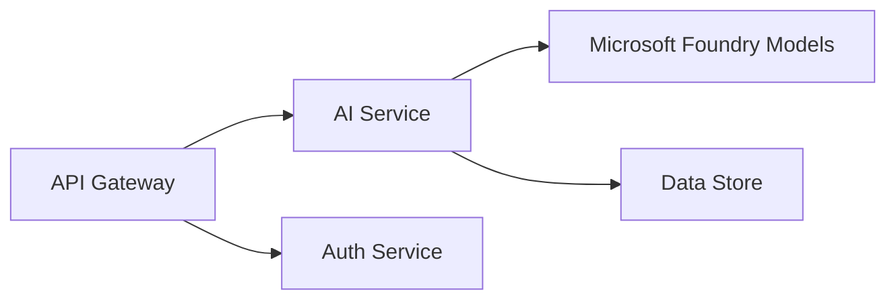
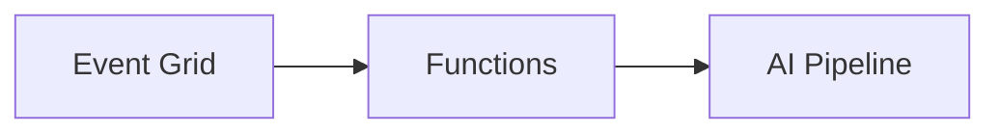

# Bab 8: Pola Produksi & Perusahaan

**📚 Kursus**: [AZD Untuk Pemula](../../README.md) | **⏱️ Durasi**: 2-3 jam | **⭐ Kompleksitas**: Lanjutan

---

## Ikhtisar

Bab ini membahas pola penyebaran siap perusahaan, penguatan keamanan, pemantauan, dan optimasi biaya untuk beban kerja AI produksi.

Ini adalah referensi arsitektur, bukan template produksi yang dapat langsung diterapkan. Contoh menghilangkan detail integrasi yang harus disediakan dan diuji dalam aplikasi Anda sendiri; membaca daftar periksa tidak menjamin kesiapan produksi.

> **Tinjauan rilis (2026-11-04):** Panduan AI CLI telah diperiksa melawan dokumentasi/sumber `azd 1.37.2`, agen `1.0.0-beta.23`, dan evaluasi `1.0.0-beta.2`. Lihat [perubahan dan perbaikan rilis](production-ai-practices.md#recent-release-changes-and-fixes) untuk persyaratan kompatibilitas dan detail migrasi; ini bukan validasi penyebaran secara langsung.

## Tujuan Pembelajaran

Dengan menyelesaikan bab ini, Anda akan:
- Menyebarkan aplikasi multi-wilayah yang tahan banting
- Menerapkan pola keamanan perusahaan
- Mengonfigurasi pemantauan menyeluruh
- Mengoptimalkan biaya dalam skala besar
- Menyiapkan pipeline CI/CD dengan AZD

---

## 📚 Pelajaran

| # | Pelajaran | Deskripsi | Waktu |
|---|--------|-------------|------|
| 1 | [Praktik AI Produksi](production-ai-practices.md) | Pola penyebaran perusahaan | 90 mnt |

---

## 🚀 Daftar Periksa Produksi

- [ ] Penyebaran multi-wilayah untuk ketahanan
- [ ] Identitas terkelola untuk otentikasi (tanpa kunci)
- [ ] Application Insights untuk pemantauan
- [ ] Anggaran biaya dan peringatan dikonfigurasi
- [ ] Pemindaian keamanan diaktifkan
- [ ] Integrasi pipeline CI/CD
- [ ] Rencana pemulihan bencana

---

## 🏗️ Pola Arsitektur

### Pola 1: AI Microservices



### Pola 2: AI Berbasis Peristiwa



---

## 🔐 Praktik Keamanan Terbaik

```bicep
// Illustrative properties from different resources, NOT a standalone Bicep file.
// Attach identity to the application host:
identity: {
  type: 'SystemAssigned'
}

// AI account properties (also require private endpoints, DNS and app connectivity):
properties: {
  publicNetworkAccess: 'Disabled'
  networkAcls: {
    defaultAction: 'Deny'
  }
}
```

---

## 💰 Optimasi Biaya

| Strategi | Kendala Utama |
|----------|---------|
| Skalakan ke nol (Container Apps) | Memerlukan pemicu yang sesuai; layanan lain tetap menimbulkan biaya |
| Gunakan tingkat konsumsi untuk pengembangan | Bandingkan harga layanan terpilih dan beban kerja |
| Skalasi terjadwal | Skalakan melalui infrastruktur/otomasi yang didukung |
| Reservasi/kapasitas penyediaan | Hanya ketika didukung; komitmen dapat meningkatkan biaya menganggur |

Gunakan [pola sumber daya anggaran lengkap](production-ai-practices.md#2-cost-monitoring-and-budgets) dengan tanggal mulai yang valid, ruang lingkup penagihan, penerima, dan izin. Anggaran mengirimkan peringatan; tidak membatasi pengeluaran. Penghematan bergantung pada pemanfaatan yang diukur dan tidak dijamin persentasenya.

---

## 📊 Pengaturan Pemantauan

```bash
# Open the Application Insights logs view (requires configured monitoring)
azd monitor --logs

# Check Application Insights
azd monitor --overview

# View metrics
az monitor metrics list --resource <resource-id>
```

---

## 🔗 Navigasi

| Arah | Bab |
|-----------|---------|
| **Sebelumnya** | [Bab 7: Pemecahan Masalah](../chapter-07-troubleshooting/README.md) |
| **Selesai Kursus** | [Beranda Kursus](../../README.md) |

---

## 📖 Sumber Daya Terkait

- [Panduan Agen AI](../chapter-02-ai-development/agents.md)
- [Application Insights](../chapter-06-pre-deployment/application-insights.md)
- [Solusi Multi-Agen](../chapter-05-multi-agent/README.md)
- [Contoh Microservices](../../examples/microservices/README.md)

---

<!-- CO-OP TRANSLATOR DISCLAIMER START -->
**Penafian**:
Dokumen ini telah diterjemahkan menggunakan layanan terjemahan AI [Co-op Translator](https://github.com/Azure/co-op-translator). Meskipun kami berupaya untuk mencapai akurasi, harap diketahui bahwa terjemahan otomatis mungkin mengandung kesalahan atau ketidakakuratan. Dokumen asli dalam bahasa aslinya harus dianggap sebagai sumber yang sah. Untuk informasi penting, disarankan menggunakan terjemahan profesional oleh manusia. Kami tidak bertanggung jawab atas kesalahpahaman atau penafsiran yang keliru yang timbul dari penggunaan terjemahan ini.
<!-- CO-OP TRANSLATOR DISCLAIMER END -->