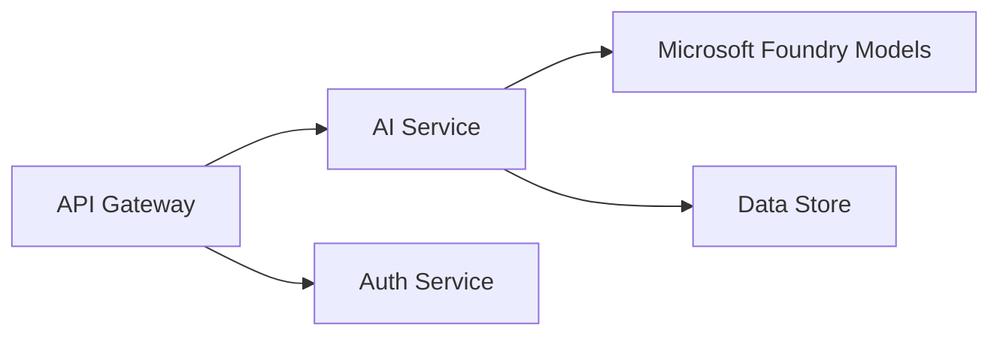
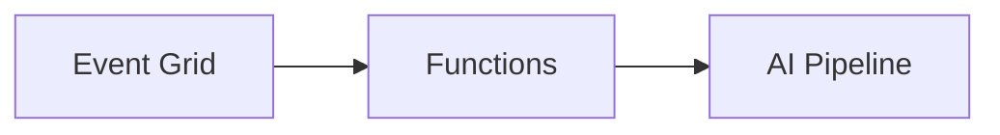

# Bab 8: Pola Produksi & Enterprise

**📚 Kursus**: [AZD Untuk Pemula](../../README.md) | **⏱️ Durasi**: 2-3 jam | **⭐ Kompleksitas**: Lanjutan

---

## Ikhtisar

Bab ini membahas pola penerapan siap enterprise, penguatan keamanan, pemantauan, dan optimasi biaya untuk beban kerja AI produksi.

Ini adalah referensi arsitektur, bukan template produksi lengkap yang dapat diterapkan. Contoh menghilangkan detail integrasi yang harus disediakan dan diuji dalam aplikasi Anda sendiri; membaca daftar periksa tidak menjamin kesiapan produksi.

> **Pembaruan Foundry GA (2026-11-09):** Gunakan `azd >= 1.37.0` dan bundel `microsoft.foundry` 1.0 yang tersedia secara umum untuk alur kerja Foundry; evaluasi diinstal terpisah. Lihat [ruang lingkup rilis dan migrasi](production-ai-practices.md#recent-release-changes-and-fixes) dan [contoh pipeline dengan otentikasi](production-ai-practices.md#cicd-pipeline-configuration). Ini adalah tinjauan dokumentasi, bukan validasi penerapan langsung atau status GA menyeluruh untuk fitur pratinjau opsional.

## Tujuan Pembelajaran

Dengan menyelesaikan bab ini, Anda akan:
- Menerapkan aplikasi tahan banting multi-wilayah
- Menerapkan pola keamanan enterprise
- Mengonfigurasi pemantauan komprehensif
- Mengoptimalkan biaya dalam skala besar
- Mengatur pipeline CI/CD dengan AZD

---

## 📚 Pelajaran

| # | Pelajaran | Deskripsi | Waktu |
|---|--------|-------------|------|
| 1 | [Praktik AI Produksi](production-ai-practices.md) | Pola penerapan enterprise | 90 menit |

---

## 🚀 Daftar Periksa Produksi

- [ ] Penerapan multi-wilayah untuk ketahanan
- [ ] Identitas terkelola untuk otentikasi (tanpa kunci)
- [ ] Application Insights untuk pemantauan
- [ ] Anggaran biaya dan peringatan dikonfigurasi
- [ ] Pemindaian keamanan diaktifkan
- [ ] Integrasi pipeline CI/CD
- [ ] Rencana pemulihan bencana

---

## 🏗️ Pola Arsitektur

### Pola 1: Microservices AI



### Pola 2: AI Berbasis Peristiwa



---

## 🔐 Praktik Terbaik Keamanan

```bicep
// Illustrative properties from different resources, NOT a standalone Bicep file.
// Attach identity to the application host:
identity: {
  type: 'SystemAssigned'
}

// AI account properties (also require private endpoints, DNS and app connectivity):
properties: {
  publicNetworkAccess: 'Disabled'
  networkAcls: {
    defaultAction: 'Deny'
  }
}
```

---

## 💰 Optimasi Biaya

| Strategi | Kendala Utama |
|----------|---------|
| Skala ke nol (Container Apps) | Memerlukan pemicu yang sesuai; layanan lain tetap menimbulkan biaya |
| Gunakan tingkat konsumsi untuk dev | Bandingkan harga layanan yang dipilih dan beban kerja |
| Skala terjadwal | Skala melalui infrastruktur/otomasi yang didukung |
| Reservasi/kapasitas yang disediakan | Hanya saat didukung; komitmen dapat meningkatkan biaya menganggur |

Gunakan [pola sumber daya anggaran lengkap](production-ai-practices.md#2-cost-monitoring-and-budgets) dengan tanggal mulai yang valid, ruang lingkup penagihan, penerima, dan izin. Anggaran mengirim peringatan; itu tidak membatasi pengeluaran. Penghematan tergantung pada pemanfaatan yang diukur dan tidak dijamin dalam persentase.

---

## 📊 Pengaturan Pemantauan

```bash
# Open the Application Insights logs view (requires configured monitoring)
azd monitor --logs

# Check Application Insights
azd monitor --overview

# View metrics
az monitor metrics list --resource <resource-id>
```

---

## 🔗 Navigasi

| Arah | Bab |
|-----------|---------|
| **Sebelumnya** | [Bab 7: Pemecahan Masalah](../chapter-07-troubleshooting/README.md) |
| **Kursus Selesai** | [Beranda Kursus](../../README.md) |

---

## 📖 Sumber Terkait

- [Panduan Agen AI](../chapter-02-ai-development/agents.md)
- [Application Insights](../chapter-06-pre-deployment/application-insights.md)
- [Solusi Multi-Agen](../chapter-05-multi-agent/README.md)
- [Contoh Microservices](../../examples/microservices/README.md)

---

<!-- CO-OP TRANSLATOR DISCLAIMER START -->
**Penafian**:
Dokumen ini telah diterjemahkan menggunakan layanan terjemahan AI [Co-op Translator](https://github.com/Azure/co-op-translator). Meskipun kami berupaya untuk mencapai akurasi, harap diketahui bahwa terjemahan otomatis mungkin mengandung kesalahan atau ketidakakuratan. Dokumen asli dalam bahasa aslinya harus dianggap sebagai sumber yang sah. Untuk informasi penting, disarankan menggunakan terjemahan profesional oleh manusia. Kami tidak bertanggung jawab atas kesalahpahaman atau penafsiran yang keliru yang timbul dari penggunaan terjemahan ini.
<!-- CO-OP TRANSLATOR DISCLAIMER END -->