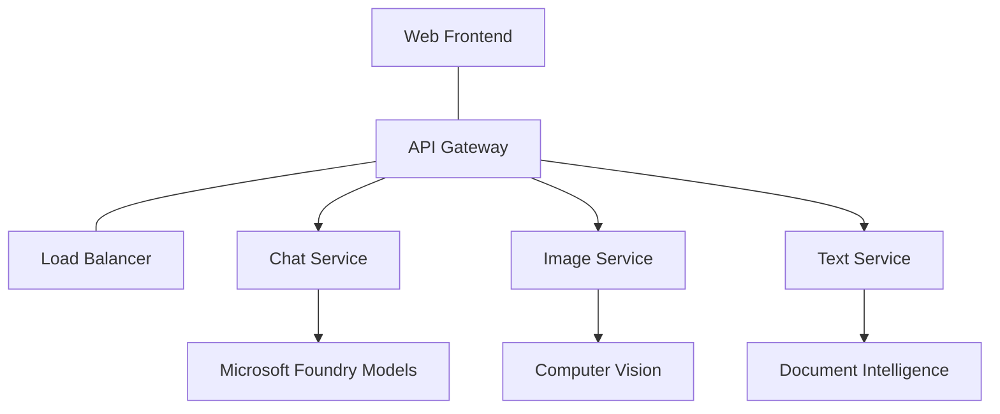

# Praktik Terbaik Beban Kerja AI Produksi dengan AZD

**Navigasi Bab:**
- **📚 Beranda Kursus**: [AZD Untuk Pemula](../../README.md)
- **📖 Bab Saat Ini**: Bab 8 - Pola Produksi & Enterprise
- **⬅️ Bab Sebelumnya**: [Bab 7: Pemecahan Masalah](../chapter-07-troubleshooting/debugging.md)
- **⬅️ Juga Terkait**: [Lab Workshop AI](../chapter-02-ai-development/ai-workshop-lab.md)
- **🎯 Kursus Selesai**: [AZD Untuk Pemula](../../README.md)

## Ikhtisar

Panduan ini menjelaskan pola desain AI produksi menggunakan Azure Developer CLI (AZD). Ini adalah referensi desain, bukan aplikasi yang dapat dipasang atau sertifikasi produksi.

**Batas contoh:** Kecuali secara eksplisit dijelaskan sebagai lengkap, fragmen Bicep mengasumsikan parameter dan sumber daya yang direferensikan dari template induk. Mereka menghilangkan gambar/plan host, identitas, penugasan peran, DNS, keluaran, dan integrasi lain yang diperlukan. Jalur layanan YAML dan skrip hook/test adalah file ilustratif untuk dibuat dalam **aplikasi Anda sendiri**; tidak disediakan oleh kursus ini. Gunakan contoh AZD yang berfungsi sebagai dasar, kompilasi infrastruktur lengkap dan uji dalam lingkungan terisolasi sebelum produksi.

## Tantangan Kunci yang Diatasi

Kekhawatiran produksi umum termasuk penyebaran multi-layanan, pengelolaan identitas dan rahasia, penskalaan, kontrol biaya, dan pemantauan. Tidak ada klaim prevalensi terukur di sini.

## Pola Arsitektur untuk AI Produksi

### Pola 1: Arsitektur AI Mikroservis

**Kapan digunakan**: Aplikasi AI kompleks dengan banyak kemampuan



**Implementasi AZD**:

```yaml
# azure.yaml
name: enterprise-ai-platform
services:
  web:
    project: ./web
    host: staticwebapp
  api-gateway:
    project: ./api-gateway
    host: containerapp
  chat-service:
    project: ./services/chat
    host: containerapp
  vision-service:
    project: ./services/vision
    host: containerapp
  text-service:
    project: ./services/text
    host: containerapp
```

### Pola 2: Pemrosesan AI Berbasis Peristiwa

**Kapan digunakan**: Pemrosesan batch, analisis dokumen, alur kerja asinkron

```bicep
// Event Hub for AI processing pipeline
resource eventHub 'Microsoft.EventHub/namespaces@2024-01-01' = {
  name: eventHubNamespaceName
  location: location
  sku: {
    name: 'Standard'
    tier: 'Standard'
    capacity: 1
  }
}

// Service Bus for reliable message processing
resource serviceBus 'Microsoft.ServiceBus/namespaces@2024-01-01' = {
  name: serviceBusNamespaceName
  location: location
  sku: {
    name: 'Premium'
    tier: 'Premium'
    capacity: 1
  }
}

// Function App for processing
resource functionApp 'Microsoft.Web/sites@2023-01-01' = {
  name: functionAppName
  location: location
  kind: 'functionapp,linux'
  properties: {
    siteConfig: {
      appSettings: [
        {
          name: 'FUNCTIONS_EXTENSION_VERSION'
          value: '~4'
        }
        {
          name: 'AZURE_OPENAI_ENDPOINT'
          value: '@Microsoft.KeyVault(VaultName=${keyVault.name};SecretName=openai-endpoint)'
        }
      ]
    }
  }
}
```

Ini membuat fragmen namespace, bukan hub, antrian, langganan, atau pemicu Function. Function yang dapat dijalankan juga butuh plan hosting, konfigurasi runtime/storage, identitas terlampir, RBAC, dan akses jaringan. Referensi Key Vault perlu izin membaca rahasia; URL endpoint sendiri bukan kredensial.

## Memikirkan Kesehatan Agen AI

Ketika aplikasi web tradisional rusak, gejalanya familiar: halaman tidak dimuat, API mengembalikan error, atau penyebaran gagal. Aplikasi berbasis AI dapat rusak dengan cara yang sama—tetapi juga dapat berperilaku tidak tepat dengan cara yang lebih halus tanpa pesan error jelas.

Bagian ini membantu Anda membangun model mental untuk memantau beban kerja AI sehingga Anda tahu tempat yang harus diperiksa saat ada yang tidak beres.

### Bagaimana Kesehatan Agen Berbeda dari Kesehatan Aplikasi Tradisional

Aplikasi tradisional juga bisa mengalami kegagalan kebenaran yang halus. Agen AI menambahkan kualitas respons nondeterministik pada kekhawatiran ketersediaan dan kebenaran biasa. Pikirkan kesehatan agen pada dua lapisan:

| Lapisan | Yang Dipantau | Tempat Melihat |
|-------|--------------|---------------|
| **Kesehatan Infrastruktur** | Apakah layanan berjalan? Apakah sumber daya disediakan? Apakah endpoint dapat dijangkau? | `azd monitor`, kesehatan sumber daya Azure Portal, log container/aplikasi |
| **Kesehatan Perilaku** | Apakah agen merespons dengan akurat? Apakah respons tepat waktu? Apakah model dipanggil dengan benar? | Traces Application Insights, metrik latensi panggilan model, log kualitas respons |

Kesehatan infrastruktur sudah familiar—sama untuk aplikasi azd mana pun. Kesehatan perilaku adalah lapisan baru yang diperkenalkan beban kerja AI.

### Tempat Melihat Saat Aplikasi AI Tidak Berperilaku Seperti Diharapkan

Jika aplikasi AI Anda tidak menghasilkan hasil yang diharapkan, berikut daftar periksa konseptual:

1. **Mulai dari hal dasar.** Apakah aplikasi berjalan? Apakah dapat menjangkau ketergantungan? Periksa `azd monitor` dan kesehatan sumber daya seperti biasa untuk aplikasi apa pun.
2. **Periksa koneksi model.** Apakah aplikasi Anda berhasil memanggil model AI? Panggilan model gagal atau timeout adalah penyebab paling umum masalah aplikasi AI dan akan muncul di log aplikasi Anda.
3. **Inspeksi input dan grounding dengan aman.** Jawaban yang salah bisa berasal dari pengambilan, instruksi, keterbatasan model, atau eksekusi alat. Gunakan data diagnostik yang terkendali akses dan di-redaksi; jangan aktifkan logging prompt/response secara sembarangan di produksi.
4. **Tinjau latensi respons.** Panggilan model AI lebih lambat daripada panggilan API biasa. Jika aplikasi terasa lambat, periksa apakah waktu respons model meningkat—ini dapat menunjukkan throttling, batas kapasitas, atau kemacetan tingkat wilayah.
5. **Perhatikan sinyal biaya.** Lonjakan tak terduga dalam penggunaan token atau panggilan API dapat menandakan loop, prompt yang salah konfigurasi, atau retry berlebihan.

Anda tidak perlu menguasai alat observabilitas langsung. Inti yang perlu diingat adalah aplikasi AI memiliki lapisan perilaku tambahan yang dipantau, dan pemantauan bawaan azd (`azd monitor`) memberi Anda titik awal untuk menyelidiki kedua lapisan.

---

## Praktik Keamanan Terbaik

### 1. Model Keamanan Zero-Trust

**Strategi Implementasi**:
- Tidak ada komunikasi layanan-ke-layanan tanpa autentikasi
- Semua panggilan API menggunakan managed identities
- Isolasi jaringan dengan private endpoints
- Kontrol akses hak minimum

```bicep
// Managed Identity for each service
resource chatServiceIdentity 'Microsoft.ManagedIdentity/userAssignedIdentities@2023-01-31' = {
  name: 'chat-service-identity'
  location: location
}

// Role assignments with minimal permissions
resource openAIUserRole 'Microsoft.Authorization/roleAssignments@2022-04-01' = {
  scope: openAIAccount
  name: guid(openAIAccount.id, chatServiceIdentity.id, '5e0bd9bd-7b93-4f28-af87-19fc36ad61bd')
  properties: {
    roleDefinitionId: subscriptionResourceId('Microsoft.Authorization/roleDefinitions', '5e0bd9bd-7b93-4f28-af87-19fc36ad61bd')
    principalId: chatServiceIdentity.properties.principalId
    principalType: 'ServicePrincipal'
  }
}
```

### 2. Manajemen Rahasia yang Aman

**Pola Integrasi Key Vault**:

```bicep
// Key Vault with proper access policies
resource keyVault 'Microsoft.KeyVault/vaults@2023-02-01' = {
  name: keyVaultName
  location: location
  properties: {
    tenantId: tenant().tenantId
    sku: {
      family: 'A'
      name: 'standard' // Premium is needed for HSM-backed keys, not ordinary secrets
    }
    enableRbacAuthorization: true  // Use RBAC instead of access policies
    enablePurgeProtection: true    // Prevent accidental deletion
    enableSoftDelete: true
    softDeleteRetentionInDays: 90
  }
}

// Optional legacy key-auth alternative; omit when using Entra ID.
resource openAIKeySecret 'Microsoft.KeyVault/vaults/secrets@2023-02-01' = {
  parent: keyVault
  name: 'openai-api-key'
  properties: {
    value: openAIAccount.listKeys().key1
    attributes: {
      enabled: true
    }
  }
}
```

Tetapkan identitas runtime `Key Vault Secrets User` pada cakupan yang sesuai dan lampirkan ke host; `enableRbacAuthorization` saja tidak memberi akses. Utamakan autentikasi identitas terkelola OpenAI dengan `disableLocalAuth: true`. Rahasia kunci opsional hanya berguna untuk akun yang sengaja diaktifkan kunci, dan prinsip penyedia juga perlu izin menulis rahasia.

### 3. Keamanan Jaringan

**Konfigurasi Private Endpoint**:

```bicep
// Virtual Network for AI services
resource virtualNetwork 'Microsoft.Network/virtualNetworks@2023-04-01' = {
  name: vnetName
  location: location
  properties: {
    addressSpace: {
      addressPrefixes: ['10.0.0.0/16']
    }
    subnets: [
      {
        name: 'ai-services-subnet'
        properties: {
          addressPrefix: '10.0.1.0/24'
          privateEndpointNetworkPolicies: 'Disabled'
        }
      }
      {
        name: 'app-services-subnet'
        properties: {
          addressPrefix: '10.0.2.0/24'
          delegations: [
            {
              name: 'Microsoft.Web/serverFarms'
              properties: {
                serviceName: 'Microsoft.Web/serverFarms'
              }
            }
          ]
        }
      }
    ]
  }
}

// Private endpoints for all AI services
resource openAIPrivateEndpoint 'Microsoft.Network/privateEndpoints@2023-04-01' = {
  name: '${openAIAccountName}-pe'
  location: location
  properties: {
    subnet: {
      id: virtualNetwork.properties.subnets[0].id
    }
    privateLinkServiceConnections: [
      {
        name: 'openai-connection'
        properties: {
          privateLinkServiceId: openAIAccount.id
          groupIds: ['account']
        }
      }
    ]
  }
}
```

Private endpoints juga memerlukan grup zona DNS privat/tautan VNet dan integrasi VNet aplikasi. Mereka tidak secara otomatis memblokir akses publik: nonaktifkan akses jaringan publik akun AI secara eksplisit setelah memvalidasi konektivitas privat dan akses penyebaran.

## Performa dan Penskalaan

### 1. Strategi Auto-Scaling

**Auto-scaling Container Apps**:

```bicep
resource containerApp 'Microsoft.App/containerApps@2023-05-01' = {
  name: containerAppName
  location: location
  properties: {
    configuration: {
      ingress: {
        external: true
        targetPort: 8000
        transport: 'http'
      }
    }
    template: {
      scale: {
        minReplicas: 2  // Always have 2 instances minimum
        maxReplicas: 50 // Scale up to 50 for high load
        rules: [
          {
            name: 'http-scaling'
            http: {
              metadata: {
                concurrentRequests: '20'  // Scale when >20 concurrent requests
              }
            }
          }
          {
            name: 'cpu-scaling'
            custom: {
              type: 'cpu'
              metadata: {
                type: 'Utilization'
                value: '70'  // Scale when CPU >70%
              }
            }
          }
        ]
      }
    }
  }
}
```

### 2. Strategi Caching

**Redis Cache untuk Respons AI**:

```bicep
// Legacy Azure Cache for Redis example (not recommended for new deployments)
resource redisCache 'Microsoft.Cache/redis@2023-04-01' = {
  name: redisCacheName
  location: location
  properties: {
    sku: {
      name: 'Premium'
      family: 'P'
      capacity: 1
    }
    enableNonSslPort: false
    minimumTlsVersion: '1.2'
    redisConfiguration: {
      'maxmemory-policy': 'allkeys-lru'
    }
    // Sharding distributes data; replication/failover provides availability.
    shardCount: 2
  }
}

// Cache configuration in application
var cacheConnectionString = '${redisCache.properties.hostName}:6380,password=${redisCache.listKeys().primaryKey},ssl=True,abortConnect=False'
```

Azure Cache for Redis Basic/Standard/Premium sedang dalam [jalur pensiun](https://learn.microsoft.com/azure/azure-cache-for-redis/retirement-faq). Gunakan Azure Managed Redis untuk desain baru dan konfigurasinya yang terdokumentasi terkait SKU, identitas, dan TLS, bukan menyalin sumber daya warisan ini ke sistem produksi baru. Baris connection-string adalah placeholder non-fungsional, bukan kredensial. Partisi kunci cache menurut otorisasi, model/instruksi, dan versi pengambilan, dengan kedaluwarsa; cache query-only bersama dapat mengekspos data pengguna lain.

### 3. Load Balancing dan Manajemen Lalu Lintas

**Application Gateway dengan WAF**:

```bicep
// Application Gateway with Web Application Firewall
resource applicationGateway 'Microsoft.Network/applicationGateways@2023-04-01' = {
  name: appGatewayName
  location: location
  properties: {
    sku: {
      name: 'WAF_v2'
      tier: 'WAF_v2'
      capacity: 2
    }
    webApplicationFirewallConfiguration: {
      enabled: true
      firewallMode: 'Prevention'
      ruleSetType: 'OWASP'
      ruleSetVersion: '3.2'
    }
    // Backend pools for AI services
    backendAddressPools: [
      {
        name: 'ai-services-pool'
        properties: {
          backendAddresses: [
            {
              fqdn: '${containerApp.properties.configuration.ingress.fqdn}'
            }
          ]
        }
      }
    ]
  }
}
```

Ini adalah sumber daya gateway parsial: penyebaran nyata juga membutuhkan konfigurasi subnet/IP gateway, IP dan port frontend, pendengar/certificate TLS, pengaturan/probe HTTP backend, aturan dan prioritas routing, serta kebijakan WAF yang ditinjau. Hostname/SNI TLS dan autentikasi harus sesuai backend Container App.

## 💰 Optimasi Biaya

### 1. Penyesuaian Ukuran Sumber Daya

**Konfigurasi Spesifik Lingkungan**:

Nama-nama ini adalah **input template khusus ilustratif**, bukan pengaturan otomatis AZD. Peta masing-masing ke `infra/main.parameters.json`/Bicep dan konfigurasi host terlebih dahulu. Contohnya, sampel RAG menggunakan `AZURE_SEARCH_SERVICE_SKU` dan `AZURE_OPENAI_CHATGPT_DEPLOYMENT_CAPACITY`, bukan nama umum di bawah ini. Beri memori Container Apps unit yang didukung seperti `1Gi` dalam sumber daya sebenarnya. Terapkan perubahan infrastruktur dengan `azd up` atau `azd provision`; `azd deploy` saja tidak menerapkan perubahan Bicep.

```bash
# Development environment
azd env new development
azd env set AZURE_OPENAI_SKU "S0"
azd env set AZURE_OPENAI_CAPACITY 10
azd env set AZURE_SEARCH_SKU "basic"
azd env set CONTAINER_CPU 0.5
azd env set CONTAINER_MEMORY 1.0

# Production environment  
azd env new production
azd env set AZURE_OPENAI_SKU "S0"
azd env set AZURE_OPENAI_CAPACITY 100
azd env set AZURE_SEARCH_SKU "standard"
azd env set CONTAINER_CPU 2.0
azd env set CONTAINER_MEMORY 4.0
```

### 2. Pemantauan Biaya dan Anggaran

```bicep
// Supply the first day of the current UTC month, e.g. 2026-11-01T00:00:00Z.
param budgetStartDate string

// Cost management and budgets
resource budget 'Microsoft.Consumption/budgets@2024-08-01' = {
  name: 'ai-workload-budget'
  properties: {
    timePeriod: {
      startDate: budgetStartDate
    }
    timeGrain: 'Monthly'
    amount: 2000  // In the billing currency, not necessarily USD
    category: 'Cost'
    notifications: {
      warning: {
        enabled: true
        operator: 'GreaterThan'
        threshold: 80
        contactEmails: [
          'finance@company.com'
          'engineering@company.com'
        ]
        contactRoles: [
          'Owner'
          'Contributor'
        ]
      }
      critical: {
        enabled: true
        operator: 'GreaterThan'
        threshold: 95
        contactEmails: [
          'cto@company.com'
        ]
      }
    }
  }
}
```

Ganti penerima contoh dan periksa cakupan/izin. Peringatan anggaran menggunakan data tagihan tertunda dan tidak membatasi pengeluaran.

### 3. Optimasi Penggunaan Token

**Manajemen Biaya OpenAI**:

Ini hanya heuristik berbasis karakter untuk preview UI, **bukan** validator batas token model. Kode produksi harus menggunakan tokenizer sesuai model yang digunakan dan mempertimbangkan instruksi sistem, skema alat, riwayat, dan anggaran keluaran. Tolak pesan pengguna yang terlalu besar, jangan potong diam-diam.

```typescript
// Application-level token optimization
class TokenOptimizer {
  private readonly maxTokens = 4000;
  private readonly reserveTokens = 500;
  
  optimizePrompt(userInput: string, context: string): string {
    const availableTokens = this.maxTokens - this.reserveTokens;
    if (this.estimateTokens(userInput) + 8 >= availableTokens) {
      throw new Error("User input exceeds the illustrative prompt budget");
    }
    const estimatedTokens = this.estimateTokens(userInput + context) + 8;
    
    if (estimatedTokens > availableTokens) {
      // Truncate context, not user input
      context = this.truncateContext(context, Math.max(0, availableTokens - this.estimateTokens(userInput) - 8));
    }
    
    return `${context}\n\nUser: ${userInput}`;
  }
  
  private estimateTokens(text: string): number {
    // Rough estimation: 1 token ≈ 4 characters
    return Math.ceil(text.length / 4);
  }

  private truncateContext(text: string, estimatedBudget: number): string {
    return text.slice(0, Math.max(0, estimatedBudget) * 4);
  }
}
```

## Pemantauan dan Observabilitas

### 1. Application Insights Komprehensif

```bicep
// Application Insights with advanced features
resource applicationInsights 'Microsoft.Insights/components@2020-02-02' = {
  name: applicationInsightsName
  location: location
  kind: 'web'
  properties: {
    Application_Type: 'web'
    WorkspaceResourceId: logAnalyticsWorkspace.id
    SamplingPercentage: 100  // Ingestion setting; review cost and SDK sampling separately
    DisableIpMasking: false  // Retain IP masking
  }
}

// Custom metrics for AI operations
resource aiMetricAlerts 'Microsoft.Insights/metricAlerts@2018-03-01' = {
  name: 'ai-high-error-rate'
  location: 'global'
  properties: {
    description: 'Alert when failed request count exceeds 10 in five minutes'
    severity: 2
    enabled: true
    scopes: [
      applicationInsights.id
    ]
    evaluationFrequency: 'PT1M'
    windowSize: 'PT5M'
    criteria: {
      'odata.type': 'Microsoft.Azure.Monitor.SingleResourceMultipleMetricCriteria'
      allOf: [
        {
          name: 'high-error-rate'
          metricName: 'requests/failed'
          operator: 'GreaterThan'
          threshold: 10
          timeAggregation: 'Count'
        }
      ]
    }
  }
}
```

### 2. Pemantauan Khusus AI

**Dashboard Kustom untuk Metrik AI**:

```json
{
  "dashboard": {
    "name": "AI Application Monitoring",
    "tiles": [
      {
        "name": "OpenAI Request Volume",
        "query": "dependencies | where target contains 'openai' | summarize count() by bin(timestamp, 5m)"
      },
      {
        "name": "AI Response Latency",
        "query": "dependencies | where target contains 'openai' | summarize avg(duration) by bin(timestamp, 5m)"
      },
      {
        "name": "Token Usage",
        "query": "customMetrics | where name == 'openai_tokens_used' | summarize sum(value) by bin(timestamp, 1h)"
      },
      {
        "name": "Cost per Hour",
        "query": "customMetrics | where name == 'openai_cost' | summarize sum(value) by bin(timestamp, 1h)"
      }
    ]
  }
}
```

JSON ini adalah sketsa yang didefinisikan aplikasi, bukan skema dashboard portal Azure yang dapat diimpor. Kuere token/biaya memerlukan aplikasi Anda untuk mengeluarkan metrik kustom tersebut dengan tepat; tidak dibuat oleh AZD. Sesuaikan filter dependensi untuk nama endpoint/span model sebenarnya.

### 3. Pemeriksaan Kesehatan dan Pemantauan Waktu Aktif

```bicep
// Application Insights availability tests
resource availabilityTest 'Microsoft.Insights/webtests@2022-06-15' = {
  name: 'ai-app-availability-test'
  location: location
  tags: {
    'hidden-link:${applicationInsights.id}': 'Resource'
  }
  properties: {
    SyntheticMonitorId: 'ai-app-availability-test'
    Name: 'AI Application Availability Test'
    Description: 'Tests AI application endpoints'
    Enabled: true
    Frequency: 300  // 5 minutes
    Timeout: 120    // 2 minutes
    Kind: 'standard'
    Locations: [
      {
        Id: 'us-east-2-azr'
      }
      {
        Id: 'us-west-2-azr'
      }
    ]
    Request: {
      RequestUrl: 'https://${webApp.properties.defaultHostName}/health'
      HttpVerb: 'GET'
      FollowRedirects: true
      ParseDependentRequests: false
    }
    ValidationRules: {
      ExpectedHttpStatusCode: 200
      SSLCheck: true
      SSLCertRemainingLifetimeCheck: 7
    }
  }
}
```

## Pemulihan Bencana dan Ketersediaan Tinggi

Tes sebelumnya mengasumsikan App Service `webApp` dan sumber daya Application Insights yang sudah ada. Tes ketersediaan standar dapat ditagih dan memerlukan endpoint yang dapat dijangkau; aplikasi privat saja memerlukan desain pemantauan privat yang tepat. Tes ping URL sudah tidak digunakan; gunakan [tes ketersediaan standar](https://learn.microsoft.com/azure/azure-monitor/app/availability).

### 1. Penyebaran Multi-Wilayah

```yaml
# azure.yaml - Multi-region configuration
name: ai-app-multiregion
services:
  api-primary:
    project: ./api
    host: containerapp
    env:
      AZURE_REGION: eastus
  api-secondary:
    project: ./api
    host: containerapp
    env:
      AZURE_REGION: westus2
```

```bicep
// Separate App Service topology, not the Container Apps declarations above
resource trafficManager 'Microsoft.Network/trafficManagerProfiles@2022-04-01' = {
  name: trafficManagerProfileName
  location: 'global'
  properties: {
    profileStatus: 'Enabled'
    trafficRoutingMethod: 'Priority'
    dnsConfig: {
      relativeName: trafficManagerProfileName
      ttl: 30
    }
    monitorConfig: {
      protocol: 'HTTPS'
      port: 443
      path: '/health'
      intervalInSeconds: 30
      toleratedNumberOfFailures: 3
      timeoutInSeconds: 10
    }
    endpoints: [
      {
        name: 'primary-endpoint'
        type: 'Microsoft.Network/trafficManagerProfiles/azureEndpoints'
        properties: {
          targetResourceId: primaryAppService.id
          endpointStatus: 'Enabled'
          priority: 1
        }
      }
      {
        name: 'secondary-endpoint'
        type: 'Microsoft.Network/trafficManagerProfiles/azureEndpoints'
        properties: {
          targetResourceId: secondaryAppService.id
          endpointStatus: 'Enabled'
          priority: 2
        }
      }
    ]
  }
}
```

Variabel lingkungan tidak memilih lokasi sumber daya. IaC harus menyediakan host regional yang berbeda dan mengikat setiap layanan dengan tag `resourceName` atau `azd-service-name`. Contoh Traffic Manager adalah **topologi App Service terpisah** (`primaryAppService`/`secondaryAppService`), bukan routing untuk deklarasi Container Apps. Container Apps memerlukan endpoint eksternal/front door yang dikonfigurasi tepat, routing TLS/domain kustom, dan probe kesehatan.

### 2. Cadangan Data dan Pemulihan

```bicep
// Backup configuration for critical data
resource backupVault 'Microsoft.DataProtection/backupVaults@2023-05-01' = {
  name: backupVaultName
  location: location
  identity: {
    type: 'SystemAssigned'
  }
  properties: {
    storageSettings: [
      {
        datastoreType: 'VaultStore'
        type: 'LocallyRedundant'
      }
    ]
  }
}

```

Vault saja tidak mencadangkan apa pun. Konfigurasikan **kebijakan dan instance cadangan khusus beban kerja yang didukung**, izin sumber, retensi, dan pengujian pemulihan menggunakan [matriks dukungan Azure Backup](https://learn.microsoft.com/azure/backup/backup-support-matrix). Tidak ada kebijakan Azure Backup generik untuk penyebaran model Azure OpenAI terhosting. Simpan definisi infrastruktur/penerapan model dalam kontrol sumber; lindungi dokumen yang diunggah, data aplikasi, dan artefak fine-tuning dengan fitur cadangan/ekspor yang didukung masing-masing layanan pendukung. Definisikan dan uji RPO/RTO secara eksplisit.

## Integrasi DevOps dan CI/CD

### 1. Alur Kerja GitHub Actions

```yaml
# .github/workflows/deploy-ai-app.yml
name: Deploy AI Application

on:
  push:
    branches: [main]
  pull_request:
    branches: [main]

jobs:
  test:
    runs-on: ubuntu-latest
    steps:
      - uses: actions/checkout@v4
      
      - name: Setup Python
        uses: actions/setup-python@v4
        with:
          python-version: '3.11'
          
      - name: Install dependencies
        run: |
          pip install -r requirements.txt
          pip install pytest
          
      - name: Run tests
        run: pytest tests/
        
      - name: AI Safety Tests
        run: |
          python scripts/test_ai_safety.py
          python scripts/validate_prompts.py

```

Ini adalah **bagian khusus pengujian** dari alur kerja dan mengasumsikan Anda sudah membuat `requirements.txt`, `tests/`, dan dua skrip keamanan. Tambahkan pekerjaan provisioning/penyebaran OIDC terautentikasi dari [Konfigurasi Pipeline CI/CD](#cicd-pipeline-configuration), dengan `needs: test`, trigger push/manual yang dipercaya, dan lingkungan GitHub yang terlindungi. Jangan sebarkan kode pull-request yang tidak terpercaya dengan kredensial cloud. Runner baru tidak memiliki lingkungan AZD lokal yang dipilih; berikan input lingkungan/subscription/lokasi dan gunakan `azd auth login`, bukan hanya `azure/login`.

### 2. Validasi Infrastruktur

```bash
# scripts/validate_infrastructure.sh
#!/bin/bash
set -euo pipefail

echo "Validating AI infrastructure deployment..."

# Requires Azure CLI login and the resource group selected explicitly.
: "${AZURE_RESOURCE_GROUP:?Set AZURE_RESOURCE_GROUP}"
: "${AZURE_OPENAI_NAME:?Set AZURE_OPENAI_NAME}"
: "${AZURE_OPENAI_CHAT_DEPLOYMENT:?Set the actual deployment name}"

# A successful empty list is not proof that resources exist.
types=("Microsoft.CognitiveServices/accounts" "Microsoft.Search/searchServices"
       "Microsoft.Storage/storageAccounts" "Microsoft.KeyVault/vaults")
for resource_type in "${types[@]}"; do
    count=$(az resource list --resource-group "$AZURE_RESOURCE_GROUP" \
        --resource-type "$resource_type" --query "length(@)" -o tsv)
    if [[ "$count" -lt 1 ]]; then
        echo "ERROR: No $resource_type found in $AZURE_RESOURCE_GROUP"
        exit 1
    fi
done

# Validate OpenAI model deployments
echo "Validating OpenAI model deployments..."
state=$(az cognitiveservices account deployment show \
  --name "$AZURE_OPENAI_NAME" --resource-group "$AZURE_RESOURCE_GROUP" \
  --deployment-name "$AZURE_OPENAI_CHAT_DEPLOYMENT" \
  --query "properties.provisioningState" -o tsv)
if [[ "$state" != "Succeeded" ]]; then
    echo "ERROR: Required model deployment is not provisioned successfully"
    exit 1
fi

echo "Infrastructure validation completed successfully!"
```

Diharapkan: nol keluar dan pesan selesai hanya saat semua tipe yang diharapkan ada dan penyebaran model bernama sudah disediakan. Ini memeriksa inventaris/status penyediaan, **bukan** kesehatan sumber daya, topologi tepat, RBAC, keterjangkauan jaringan, atau perilaku model. Sesuaikan tipe yang diharapkan sesuai arsitektur Anda, kemudian lakukan pengujian kesiapan aplikasi terautentikasi terpisah.

## Daftar Periksa Kesiapan Produksi

### Keamanan ✅
- [ ] Semua layanan menggunakan managed identities
- [ ] Rahasia disimpan di Key Vault
- [ ] Private endpoints dikonfigurasi
- [ ] Grup keamanan jaringan diterapkan
- [ ] RBAC dengan hak minimum
- [ ] WAF diaktifkan di endpoint publik

### Performa ✅
- [ ] Auto-scaling dikonfigurasi
- [ ] Caching diimplementasikan
- [ ] Load balancing disiapkan
- [ ] CDN untuk konten statis
- [ ] Pooling koneksi database
- [ ] Optimasi penggunaan token

### Pemantauan ✅
- [ ] Application Insights dikonfigurasi
- [ ] Metrik kustom didefinisikan
- [ ] Aturan peringatan disiapkan
- [ ] Dashboard dibuat
- [ ] Pemeriksaan kesehatan diimplementasikan
- [ ] Kebijakan retensi log

### Keandalan ✅
- [ ] Penyebaran multi-wilayah
- [ ] Rencana cadangan dan pemulihan
- [ ] Circuit breakers diimplementasikan
- [ ] Kebijakan retry dikonfigurasi
- [ ] Degradasi yang mulus
- [ ] Endpoint pemeriksaan kesehatan

### Manajemen Biaya ✅
- [ ] Peringatan anggaran dikonfigurasi
- [ ] Penyesuaian ukuran sumber daya
- [ ] Diskon dev/test diterapkan
- [ ] Instance cadangan dibeli
- [ ] Dashboard pemantauan biaya
- [ ] Tinjauan biaya rutin

### Kepatuhan ✅
- [ ] Persyaratan lokasi data terpenuhi
- [ ] Logging audit diaktifkan
- [ ] Kebijakan kepatuhan diterapkan
- [ ] Baseline keamanan diimplementasikan
- [ ] Penilaian keamanan rutin
- [ ] Rencana respons insiden

## Tolak Ukur Performa

### Target Produksi Ilustratif

Ini adalah contoh SLO untuk dinegosiasi dan diuji beban, bukan tolok ukur atau jaminan yang terukur. Latensi respons tergantung panjang model/keluaran; belanja token bulanan tergantung lalu lintas dan harga, bukan jumlah token saja.

| Metrik | Target | Pemantauan |
|--------|--------|------------|
| **Waktu Respons** | < 2 detik | Application Insights |
| **Ketersediaan** | 99,9% | Pemantauan waktu aktif |
| **Tingkat Kesalahan** | < 0,1% | Log aplikasi |
| **Pengeluaran Model** | < $500/bulan (anggaran contoh) | Manajemen biaya |
| **Pengguna Konkuren** | 1000+ | Pengujian beban |
| **Waktu Pemulihan** | < 1 jam | Tes pemulihan bencana |

### Pengujian Beban

Berikut adalah sketsa antarmuka untuk skrip pengujian beban **yang harus Anda terapkan**; repositori ini tidak menyediakan `scripts/load_test.py`. Definisikan payload permintaan, autentikasi, beban kerja representatif, penegasan latensi/persentil kesalahan, dan batas pengeluaran dalam alat pengujian beban pilihan Anda sebelum menjalankannya:

```bash
# Load testing script for AI applications
python scripts/load_test.py \
  --endpoint https://your-ai-app.azurewebsites.net \
  --concurrent-users 100 \
  --duration 300 \
  --ramp-up 60
```

## 🤝 Praktik Terbaik Komunitas

Berdasarkan umpan balik komunitas Discord Microsoft Foundry:

### Rekomendasi Utama dari Komunitas:

1. **Mulai dari Kecil, Skala Secara Bertahap**: Mulailah dengan SKU dasar dan skala naik berdasarkan penggunaan aktual
2. **Pantau Segalanya**: Siapkan pemantauan komprehensif sejak hari pertama
3. **Otomatiskan Keamanan**: Gunakan infrastruktur sebagai kode untuk keamanan yang konsisten
4. **Uji Secara Mendalam**: Sertakan pengujian khusus AI dalam pipeline Anda
5. **Rencanakan Biaya**: Pantau penggunaan token dan atur peringatan anggaran sejak awal

### Kesalahan Umum yang Harus Dihindari:

- ❌ Memasukkan kunci API secara keras dalam kode
- ❌ Tidak menyiapkan pemantauan yang tepat
- ❌ Mengabaikan optimasi biaya
- ❌ Tidak menguji skenario kegagalan
- ❌ Men-deploy tanpa pemeriksaan kesehatan

## Perintah dan Ekstensi AZD AI CLI

AZD mencakup kumpulan perintah dan ekstensi AI khusus yang semakin bertambah untuk mempermudah alur kerja AI produksi. Alat ini menjembatani kesenjangan antara pengembangan lokal dan penyebaran produksi untuk beban kerja AI.

> **Tinjauan rilis (2026-11-04):** Panduan CLI di bawah ini telah diperiksa terhadap rilis yang dipublikasikan dari `azd` **1.37.2**, `azure.ai.agents` **1.0.0-beta.23**, dan `azure.ai.evaluations` **1.0.0-beta.2**. Agents beta.23 memerlukan `azd >= 1.37.0`; evaluations beta.2 memerlukan `azd >= 1.33.0`. Gunakan minimal 1.37.0 untuk alur kerja gabungan. Ini adalah tinjauan dokumentasi/sumber, bukan validasi penyebaran Azure langsung.

### Ekstensi AZD untuk AI

AZD menggunakan sistem ekstensi untuk menambahkan kemampuan AI khusus. Pasang dan kelola ekstensi dengan:

```bash
# List all available extensions (including AI)
azd extension list

# Inspect installed extension details
azd version
azd extension show azure.ai.agents

# Install the Foundry agents extension
azd extension install azure.ai.agents

# Install the separate Foundry evaluations extension
azd extension install azure.ai.evaluations

# Install the fine-tuning extension
azd extension install azure.ai.finetune

# Install the custom models extension
azd extension install azure.ai.models

# Upgrade all installed extensions
azd extension upgrade --all
```

**Ekstensi AI yang tersedia:**

| Ekstensi | Tujuan | Status |
|-----------|---------|--------|
| `azure.ai.agents` | Manajemen Layanan Foundry Agent | Pratinjau |
| `azure.ai.evaluations` | Dataset evaluasi, evaluator, grup evaluasi, dan jalankan | Pratinjau |
| `azure.ai.skills` | Keterampilan agen yang dapat digunakan ulang | Pratinjau |
| `azure.ai.connections` | Koneksi Foundry (sumber data, alat) | Pratinjau |
| `azure.ai.finetune` | Penyesuaian model Foundry | Pratinjau |
| `azure.ai.models` | Model khusus Foundry | Pratinjau |
| `azure.coding-agent` | Konfigurasi agen pengkodean | Tersedia |

> Jalankan `azd extension list --installed` dan `azd extension show azure.ai.evaluations` untuk memeriksa versi yang terpasang. Tingkatkan core CLI terlebih dahulu menggunakan [petunjuk instalasi/pembaruan](https://learn.microsoft.com/azure/developer/azure-developer-cli/install-azd) (untuk instalasi winget Windows: `winget upgrade Microsoft.Azd`), kemudian jalankan `azd extension upgrade --all`. Tidak ada perintah core `azd upgrade`. Tinjau perubahan besar sebelum meningkatkan otomatisasi produksi; jangan menganggap peningkatan ekstensi mempertahankan format perintah atau konfigurasi lama.

### Perubahan dan Perbaikan Rilis Terbaru

| Rilis | Apa yang berubah untuk kursus ini |
|---------|------------------------------|
| `azd 1.37.0` | Menambahkan API pratinjau penyebaran stabil dan memperbaiki penyuntingan ekstensi yang menulis ulang pengaturan `azure.yaml` yang tidak terkait. |
| `azd 1.37.1` | Memperbaiki propagasi Ctrl+C lintas ekstensi dan membedakan pembatalan/waktu habis dari kegagalan umum. |
| `azd 1.37.2` | Meningkatkan validasi penyediaan: peringatan kritis default **Tidak**, gagal tanpa konfirmasi dalam jalankan tanpa pengawasan, dan pembatalan melewati hook pasca-penyediaan. Juga memperbaiki nilai lingkungan yang belum terselesaikan dalam daftar tolak Deployment Stacks saat fitur alfa itu diaktifkan. |
| Agents `beta.22` | Migrasi evaluasi ke `azd ai eval`, mengubah optimasi ke API GA v1, mewajibkan bentuk jamak `toolboxes`, dan memisahkan opt-in pra-tayang managed-harness, suara, dan eksekusi jangka panjang. Memperbaiki pemilihan model spesifik lingkungan dan autentikasi toolbox. |
| Agents `beta.23` | Mengekspos `init --harness`; memperbaiki keluaran jawaban A2A 0.3, jalur/module prompt-agent tidak valid di semua lapisan infrastruktur, diagnostik timeout aktivasi, dan peringatan RBAC pengembang yang dipertahankan. |
| Evaluations `beta.2` | Memerlukan konfigurasi evaluasi camelCase, menambah penulisan percakapan statis/tersimulasi dan sumber file lokal eksplisit, dan memperbaiki penanganan identitas/versi dataset, hitungan quality-gate, serta diagnostik jalankan gagal. |

Timeout aktivasi agen **tidak** membuktikan kegagalan penyebaran: periksa versi yang dicoba dan statusnya sebelum mencoba ulang. Peringatan RBAC pengembang bisa tetap ada walaupun penyediaan berhasil; selesaikan akses yang hilang sebelum memanggil sebagai pengembang tersebut.

Sumber: [rilis AZD](https://github.com/Azure/azure-dev/releases), [rilis agents beta.23](https://github.com/Azure/azure-dev/releases/tag/azd-ext-azure-ai-agents_1.0.0-beta.23), [migrasi agents beta.22](https://github.com/Azure/azure-dev/releases/tag/azd-ext-azure-ai-agents_1.0.0-beta.22), dan [rilis evaluations beta.2](https://github.com/Azure/azure-dev/releases/tag/azd-ext-azure-ai-evaluations_1.0.0-beta.2).

**Apa itu ekstensi `skills` dan `connections` yang lebih baru?**

Dua ekstensi pratinjau muncul bersamaan dengan alat agen dan layak dipahami bahkan untuk pemula:

- **`azure.ai.skills`** — Sebuah **keterampilan** adalah kemampuan yang dapat digunakan ulang (alat atau perilaku terbungkus) yang dapat Anda lampirkan ke satu atau lebih agen daripada menerapkannya ulang setiap kali. Anggap ini sebagai blok bangunan bersama: definisikan keterampilan "mencari dokumen" atau "memeriksa pesanan" sekali, lalu gunakan ulang di banyak agen. Ini menjaga sistem multi-agen (Bab 5) konsisten dan menghindari salin-tempel.
- **`azure.ai.connections`** — Sebuah **koneksi** adalah tautan yang dikelola dari proyek Foundry Anda ke sumber daya eksternal yang dibutuhkan agen Anda—sumber data (seperti Azure AI Search), titik akhir alat, atau layanan lain. Koneksi memusatkan *di mana* dan *bagaimana* agen mengakses data, sehingga kredensial dan titik akhir tinggal di satu lokasi yang diatur daripada tersebar dalam kode.

Anda tidak memerlukan ini untuk men-deploy agen pertama Anda—gunakan `azure.ai.agents` saat belajar. Gunakan `skills` ketika Anda mendapati duplikasi alat yang sama di beberapa agen, dan `connections` ketika beberapa agen berbagi sumber data yang sama.

### Inisialisasi Proyek Agen dengan `azd ai agent init`

Perintah `azd ai agent init` membuat kerangka proyek agen Microsoft Foundry. Gunakan template proyek `azure.yaml` yang terbaru, bukan manifes agen warisan implisit:

```bash
# Initialize a new agent project from a local project template
azd ai agent init --template ./templates/support-agent/azure.yaml

# Initialize and target a specific Foundry project
azd ai agent init --template ./templates/support-agent/azure.yaml --project-id <foundry-project-id>

# Adopt the template into a different directory
azd ai agent init --template ./templates/support-agent/azure.yaml --src ./agents/my-agent
```

**Flag kunci:**

| Flag | Deskripsi |
|------|-------------|
| `-t, --template` | Jalur atau URI GitHub yang didukung ke dokumen proyek `azure.yaml` |
| `-p, --project-id` | ID Proyek Microsoft Foundry yang ada untuk lingkungan azd Anda |
| `-s, --src` | Direktori sumber untuk agen yang dihasilkan, atau direktori target saat mengadopsi proyek |
| `--kind` | Inisialisasi agen `hosted`, `prompt`, atau pratinjau `prompt-voice` |
| `--harness` | Harness eksekusi opsional untuk `--kind prompt`; memerlukan opt-in pratinjau |
| `-e, --environment` | Lingkungan azd yang digunakan |

`--manifest`/`-m` adalah alias yang tidak digunakan lagi untuk `--template`/`-t`; mengganti nama flag tidak mengubah manifes lama menjadi dokumen proyek saat ini. `--host containerapp` bukan flag agent-init saat ini. Untuk aplikasi Container Apps biasa, gunakan `azd init --template` dengan template yang menyatakan `host: containerapp`.

Untuk proyek yang ada dengan tepat satu layanan `azure.ai.project`, `azd ai agent add support-agent --file ./agents/support-agent.yaml` menambah atau memperbarui definisi agen langsung tanpa penyediaan atau penyebaran. Perintah runtime menolak `agent.yaml`/AgentManifest implisit warisan dan definisi layanan `config:` bersarang; migrasikan ke layanan `azure.ai.agent` saat ini. Ketika init mencetak langkah berikutnya `cd`, jalankan itu sebelum `azd up`: init tidak mengubah direktori shell Anda.

**Tip produksi**: Gunakan `--project-id` untuk terhubung langsung ke proyek Foundry yang ada, menjaga kode agen dan sumber daya cloud Anda terhubung dari awal.

#### Fitur Pratinjau Opsional

Harness terkelola, suara, dan eksekusi jangka panjang secara default dinonaktifkan secara mandiri. Tetapkan hanya pengalih untuk fitur yang Anda perlukan di **lingkungan proses shell/CI**, bukan dengan `azd env set`:

| Fitur | Variabel lingkungan proses |
|---------|------------------------------|
| Harness terkelola (`init --kind prompt --harness ...`) | `AZD_ALPHA_ENABLE_AGENTS_MANAGED_HARNESS=true` |
| Suara (`init --kind prompt-voice`) | `AZD_ALPHA_ENABLE_AGENTS_VOICE=true` |
| Eksekusi jangka panjang | `AZD_ALPHA_ENABLE_AGENTS_LONG_RUNNING=true` |

Misalnya, gunakan `export AZD_ALPHA_ENABLE_AGENTS_MANAGED_HARNESS=true` di Bash atau `$env:AZD_ALPHA_ENABLE_AGENTS_MANAGED_HARNESS = "true"` di PowerShell sebelum menjalankan perintah terkait. Satu pengalih tidak mengaktifkan yang lainnya. Lihat [README agents rilis](https://github.com/Azure/azure-dev/blob/azd-ext-azure-ai-agents_1.0.0-beta.23/cli/azd/extensions/azure.ai.agents/README.md) untuk semua pengalih pratinjau dan keterbatasannya.

### Mengelola Siklus Hidup Agen

Gunakan `azure.ai.agents` untuk menguji, memeriksa, mengoptimalkan, dan memensiunkan agen, dan ekstensi terpisah `azure.ai.evaluations` untuk mengukur kualitas:

```bash
# Invoke a deployed agent and view server response timing
# (total latency and time to first byte)
azd ai agent invoke

# Show the live endpoint configuration before changing it
azd ai agent endpoint show

# Download the deployed source of a code-based hosted agent
# (with SHA-256 verification)
azd ai agent code download

# Delete a hosted agent and all of its versions
# (--force terminates active sessions)
azd ai agent delete --force
```

**Siklus hidup sekilas:**

| Tahap | Perintah | Penggunaan produksi |
|-------|---------|----------------|
| Uji | `azd ai agent invoke` | Validasi respons dan ukur latensi sebelum rilis |
| Periksa | `azd ai agent endpoint show` | Tinjau autentikasi/konfigurasi endpoint; deteksi perubahan kegagalan lebih awal |
| Ukur | `azd ai eval init`, `generate`, `run start` | Definisikan, deploy, dan jalankan evaluasi yang dapat diulang |
| Tingkatkan | `azd ai agent optimize --eval <evaluation-name> --optimize-model <optimizer-deployment>` | Gunakan ulang evaluasi kompatibel untuk mengoptimalkan agen |
| Pulihkan | `azd ai agent code download` | Ambil sumber tepat yang dideploy untuk audit/rollback |
| Pensiunkan | `azd ai agent delete --force` | Bongkar agen dan versinya secara bersih |

> Ini adalah perintah pratinjau dan mungkin berubah antar rilis ekstensi. Jalankan `azd ai agent --help` untuk melihat subperintah yang tersedia tepat di versi yang terpasang.

`endpoint show` mendukung agen hosted, prompt, dan voice, tapi pembaruan endpoint hanya untuk hosted; agen workflow tidak didukung. Unduh kode dan contoh pensiunan hosted-agent di atas bukan operasi umum untuk semua jenis agen.

#### Migrasi Evaluasi dan Pemeriksaan Kualitas

Mulai dengan agents **1.0.0-beta.22 (2026-10-23)**, perintah `azd ai agent eval` warisan memberi panduan migrasi menggantikan alur kerja evaluasi lama. Jangan salin contoh `eval generate --dataset ...` lama: evaluasi kini berada di bawah **`azd ai eval`**.

Di proyek agen yang diinisialisasi, autentikasi dengan `azd auth login`, konfirmasi lingkungan/proyek Foundry terpilih, dan pasang `azure.ai.evaluations`. Penyebaran model juri diperlukan untuk penilaian berbasis model; simulasi generasi dan percakapan dapat memerlukan pemilihan model sendiri dan menimbulkan biaya tambahan.

```bash
# Scaffold evals/ and wire an azure.ai.eval service into azure.yaml
azd ai eval init

# Optionally synthesize a rubric and dataset from the agent
azd ai eval generate

# Review generated files, then register datasets, evaluators, and eval groups
azd up

# Start an evaluation and wait for its results
azd ai eval run start --wait

# Inspect runs and available test-case output
azd ai eval run list
azd ai eval run show <run-id>
azd ai eval run output list <run-id>
```

Ikuti pilihan interaktif dan langkah berikut yang dicetak alih-alih menganggap aset yang dihasilkan sudah terdaftar. Konfigurasi evaluasi biasanya ada di `evals/azure.eval.yaml`, dirujuk oleh layanan `azure.ai.eval` di `azure.yaml`. Kunci menggunakan **camelCase** (`evaluationLevel`, `maxSamples`, `initializationParameters`, `dataMapping`); kunci konfigurasi snake_case lama ditolak. Jalur di dalam konfigurasi yang dirujuk diselesaikan relatif terhadap file tersebut, bukan akar repositori.

Untuk evaluasi percakapan, pilih **static** untuk menilai transkrip lengkap tanpa memanggil agen, atau **simulation** untuk menghasilkan percakapan dari seed skenario. Simulasi memerlukan target agen, model simulator, dan pemilihan model juri terpisah. Untuk perintah tanpa pengawasan, berikan input yang tercantum di `azd ai eval init --help` dan `azd ai eval generate --help`; jangan anggap model generasi juga adalah juri atau simulator.

Untuk CI, konfigurasikan kebijakan kualitas eksplisit menggunakan `azd ai eval run start --help` (`--fail-on`) dan anggap keluaran host nonzero sebagai kegagalan. Jalankan selesai tidak otomatis berarti lulus kualitas. Tinjau baris gagal/eror dan diagnostik; jumlah hasil yang hilang atau tidak konsisten bukan bukti keberhasilan. Dataset yang terdaftar mempertahankan identitas/versi layanan mereka; `--max-samples` tidak dapat menyubset dataset terdaftar. Publikasikan dataset lebih kecil secara sengaja, atau gunakan sumber file lokal yang didukung.

```bash
# Example CI policy: at least 90% of all test cases must pass
azd ai eval run start --wait --fail-on "pass-rate=0.9"
```

Gerbang tingkat kelulusan menggunakan kasus uji lulus dibagi total kasus uji; baris gagal, eror, dilewati, dan tidak lulus lainnya dihitung sebagai kegagalan. Jangan gabungkan gerbang dengan `--no-wait`, yang mengembalikan sebelum putusan tersedia.

#### Migrasi Konfigurasi Optimasi

Optimasi kini menggunakan API GA v1. Untuk menggunakan ulang evaluasi kompatibel **tingkat giliran, didukung dataset** dari alur kerja baru:

```bash
# Replace placeholders with the evaluation name and optimizer model deployment
azd ai agent optimize --eval-config ./evals/azure.eval.yaml --eval <evaluation-name> --optimize-model <optimizer-deployment>
```

`--eval` memilih sebuah evaluasi; `--eval-config` memilih file konfigurasi (termasuk definisi yang didukung file). `--config` sebaliknya mengambil **permintaan API optimasi mandiri** dalam format YAML atau JSON. Jangan mengoper agen lama `eval.yaml` atau yang baru `azure.eval.yaml` ke `--config`, dan jangan menggabungkan `--config` dengan `--eval`/`--eval-config`. Evaluasi percakapan, yang didukung jejak, atau simulasi tidak dapat dipertukarkan dengan pintasan optimasi berbasis dataset; gunakan format permintaan optimasi yang didukung untuk skenario tersebut. Tinjau kandidat sebelum menerapkan atau menyebarkannya.

Lihat [referensi evaluasi untuk rilis yang ditinjau](https://github.com/Azure/azure-dev/blob/azd-ext-azure-ai-evaluations_1.0.0-beta.2/cli/azd/extensions/azure.ai.evaluations/README.md) dan [sumber perintah optimasi untuk rilis yang ditinjau](https://github.com/Azure/azure-dev/blob/azd-ext-azure-ai-agents_1.0.0-beta.23/cli/azd/extensions/azure.ai.agents/internal/cmd/optimize.go) untuk opsi yang tepat.

#### Pratinjau Penyebaran Agen Hosted Hanya Baca

Untuk lingkungan yang sudah terikat Foundry dengan layanan `azure.ai.agent` terpadu dari `kind: hosted`, bandingkan konfigurasi yang didukung sebelum menyebarkan:

```bash
azd deploy <service-name> --preview --no-prompt
```

Pratinjau ini tidak menyebarkan agen. Ini bukan perbedaan lengkap infrastruktur/keamanan: agen prompt/suara/alur kerja, tata letak konfigurasi warisan, dan beberapa pengaturan hosted berada di luar cakupannya. Hasil `unknown` bukanlah persetujuan untuk menyebarkan. Tidak ada perintah `azd ai agent deploy` mandiri atau perintah agen `--dry-run`; gunakan alur kerja penyebaran inti.

### Protokol Konteks Model (MCP) dengan `azd mcp`

AZD menyertakan dukungan server MCP bawaan (Alpha), memungkinkan agen AI dan alat untuk berinteraksi dengan sumber daya Azure Anda melalui protokol standar:

```bash
# Start the MCP server for your project
azd mcp start

# Review current Copilot consent rules for tool execution
azd copilot consent list
```

Server MCP membuka konteks proyek azd Anda—lingkungan, layanan, dan sumber daya Azure—untuk alat pengembangan bertenaga AI. Ini memungkinkan:

- **Penyebaran dibantu AI**: Biarkan agen pemrograman menanyakan status proyek Anda dan memicu penyebaran
- **Penemuan sumber daya**: Alat AI dapat menemukan sumber daya Azure yang digunakan proyek Anda
- **Manajemen lingkungan**: Agen dapat berpindah antar lingkungan dev/staging/produksi

### Generasi Infrastruktur dengan `azd infra generate`

Untuk beban kerja AI produksi, Anda dapat menghasilkan dan menyesuaikan Infrastruktur sebagai Kode daripada mengandalkan penyediaan otomatis:

```bash
# Generate supported infrastructure for this project type
azd infra generate
```

Dukungan tergantung pada proyek/host dan penyedia yang terpasang; ini bukan perintah rekayasa balik umum untuk sumber daya Azure sembarangan ataupun janji untuk menghasilkan keduanya Bicep dan Terraform. Jalankan `azd infra generate --help` dan periksa format yang dihasilkan. Di tempat yang didukung, menulis IaC ke disk memungkinkan Anda:
- Meninjau dan mengaudit infrastruktur sebelum penyebaran
- Menambahkan kebijakan keamanan khusus (aturan jaringan, titik akhir pribadi)
- Mengintegrasikan dengan proses peninjauan IaC yang sudah ada
- Mengontrol versi perubahan infrastruktur secara terpisah dari kode aplikasi

### Hook Siklus Hidup Produksi

Hook AZD memungkinkan Anda menyisipkan logika khusus pada setiap tahap siklus hidup penyebaran—penting untuk beban kerja AI produksi:

```yaml
# azure.yaml - Production hooks example
name: ai-production-app
hooks:
  preprovision:
    shell: sh
    run: scripts/validate-quotas.sh    # Check AI model quota before provisioning
  postprovision:
    shell: sh
    run: scripts/verify-networking.sh  # Verify IaC-provisioned private connectivity
  predeploy:
    shell: sh
    run: scripts/run-ai-safety-tests.sh  # Run prompt safety checks
  postdeploy:
    shell: sh
    run: scripts/smoke-test.sh           # Verify agent responses post-deploy
services:
  agent-api:
    project: ./src/agent
    host: containerapp
    hooks:
      predeploy:
        shell: sh
        run: scripts/validate-model-access.sh  # Per-service hook
```

```bash
# Run a specific hook manually during development
azd hooks run predeploy
```

**Hook produksi yang direkomendasikan untuk beban kerja AI:**

| Hook | Kasus Penggunaan |
|------|----------|
| `preprovision` | Memvalidasi kuota langganan untuk kapasitas model AI |
| `postprovision` | Memverifikasi konektivitas privat dan output sumber daya yang diperlukan |
| `predeploy` | Menjalankan uji keamanan AI, memvalidasi templat prompt |
| `postdeploy` | Uji respons agen secara cepat, memverifikasi konektivitas model |

### Konfigurasi Pipeline CI/CD

Gunakan `azd pipeline config` untuk menghubungkan proyek Anda ke GitHub Actions atau Azure Pipelines dengan autentikasi Azure yang aman:

```bash
# Configure CI/CD pipeline (interactive)
azd pipeline config

# Configure with a specific provider
azd pipeline config --provider github
```

Perintah ini:
- Membuat atau mengonfigurasi identitas pipeline; tinjau lingkup peran/izin yang dihasilkan daripada mengasumsikan hak istimewa minimum
- Mengonfigurasi kredensial federasi (tanpa rahasia tersimpan)
- Menghasilkan atau memperbarui file definisi pipeline Anda
- Mengatur variabel lingkungan yang diperlukan pada sistem CI/CD Anda

#### Langkah demi langkah: pipeline GitHub Actions pertama Anda

Berikut adalah panduan lengkap dari proyek azd yang berfungsi hingga penyebaran otomatis saat setiap push.

**1. Pastikan proyek Anda ada di GitHub**

```bash
git init
git add .
git commit -m "Initial azd project"
gh repo create my-ai-app --private --source=. --push
```

**2. Jalankan konfigurasi pipeline**

```bash
azd pipeline config --provider github
```

azd akan, secara interaktif:
- Menanyakan langganan Azure dan lingkungan yang akan ditargetkan
- Membuat Entra **pendaftaran aplikasi + service principal** untuk pipeline
- Mengatur **kredensial federasi (OIDC)**—sehingga GitHub mengautentikasi ke Azure dengan token jangka pendek dan **tidak ada rahasia yang disimpan**
- Mengirim **variabel** yang diperlukan ke repo GitHub Anda (`AZURE_CLIENT_ID`, `AZURE_TENANT_ID`, `AZURE_SUBSCRIPTION_ID`, `AZURE_ENV_NAME`, `AZURE_LOCATION`)

**3. Pahami workflow yang dihasilkan**

Untuk template yang didukung, konfigurasikan/tinjau `.github/workflows/azure-dev.yml`. Bagian kunci terlihat seperti ini (template harus menyediakan rantai alat aplikasi dan parameter lingkungan):

```yaml
# .github/workflows/azure-dev.yml
on:
  push:
    branches: [ main ]
  workflow_dispatch:        # lets you run it manually too

permissions:
  id-token: write           # required for OIDC federated login
  contents: read

jobs:
  build:
    runs-on: ubuntu-latest
    env:
      AZURE_CLIENT_ID: ${{ vars.AZURE_CLIENT_ID }}
      AZURE_TENANT_ID: ${{ vars.AZURE_TENANT_ID }}
      AZURE_SUBSCRIPTION_ID: ${{ vars.AZURE_SUBSCRIPTION_ID }}
      AZURE_ENV_NAME: ${{ vars.AZURE_ENV_NAME }}
      AZURE_LOCATION: ${{ vars.AZURE_LOCATION }}
    steps:
      - uses: actions/checkout@v4
      - name: Install azd
        uses: Azure/setup-azd@v2
      - name: Log in with OIDC
        run: azd auth login --client-id "$AZURE_CLIENT_ID" --federated-credential-provider "github" --tenant-id "$AZURE_TENANT_ID"
      - name: Provision infrastructure
        run: azd provision --no-prompt
      - name: Deploy application
        run: azd deploy --no-prompt
```

**4. Verifikasi bahwa itu berfungsi**

```bash
# Push a change to trigger the pipeline
git commit -am "Trigger pipeline" --allow-empty
git push
```

Buka tab **Actions** di repo GitHub Anda dan lihat workflow berjalan `azd provision` dan `azd deploy` secara otomatis.

> **Mengapa kredensial federasi penting:** pipeline lama menyimpan rahasia klien di GitHub. Kredensial federasi OIDC menghilangkan rahasia itu sepenuhnya—GitHub meminta token jangka pendek saat runtime, yang lebih aman dan tidak perlu diputar atau bocor. Ini adalah default yang disiapkan oleh `azd pipeline config`.

> **Rahasia vs. variabel:** pengenal yang tidak sensitif (`AZURE_CLIENT_ID`, dll.) dimasukkan ke **variabel** repo. Jika aplikasi Anda benar-benar memerlukan rahasia saat build, tambahkan sebagai **secret** GitHub dan referensikan dengan `${{ secrets.NAME }}`—tetapi gunakan Key Vault + managed identity saat runtime (lihat [Bab 3](../chapter-03-configuration/authsecurity.md)).

**Workflow produksi dengan konfigurasi pipeline:**

```bash
# 1. Set up production environment
azd env new production
azd env set AZURE_OPENAI_CAPACITY 100

# 2. Configure the pipeline
azd pipeline config --provider github

# 3. Review the generated trigger, provisioning/deployment steps, and approvals
```

#### Langkah demi langkah: Azure DevOps Pipelines

Lebih suka Azure DevOps daripada GitHub Actions? azd mendukungnya secara native dengan penyedia `azdo`. Alurnya hampir identik—azd menghasilkan file pipeline, membuat koneksi layanan, dan mengatur autentikasi.

**1. Pastikan Anda memiliki proyek Azure DevOps**

Anda memerlukan organisasi dan proyek di `https://dev.azure.com/<your-org>`. Buat Personal Access Token (PAT) dengan cakupan **Build (Read & execute)**, **Code (Read & write)**, dan **Service Connections (Read, query & manage)**—azd akan meminta token ini.

**2. Konfigurasikan pipeline**

```bash
azd pipeline config --provider azdo
```

azd akan:
- Menanyakan organisasi dan proyek Azure DevOps Anda
- Membuat (atau menggunakan ulang) **koneksi layanan** ke Azure menggunakan service principal
- Mengonfigurasi **federasi identitas beban kerja (OIDC)** sehingga tidak ada rahasia klien yang disimpan
- Mengonfigurasi definisi pipeline (umumnya `.azdo/pipelines/azure-dev.yml`) dari template pipeline proyek

**3. Tinjau pipeline yang dihasilkan**

Gunakan pipeline yang dihasilkan proyek, termasuk **koneksi layanan Azure dan langkah autentikasi AZD**. Panduan resmi [Azure Pipelines setup guide](https://learn.microsoft.com/azure/developer/azure-developer-cli/pipeline-azure-pipelines) menampilkan potongan installer di bawah ini; ini hanya **instalasi**, bukan workflow penyebaran terautentikasi yang dapat dijalankan:

```yaml
# .azdo/pipelines/azure-dev.yml (installer fragment only)
trigger:
  - main

pool:
  vmImage: ubuntu-latest

steps:
  - task: setup-azd@0
    displayName: Install azd
```

Instal ekstensi AZD Azure DevOps jika tugas itu tidak tersedia di organisasi Anda. Jangan menyalin langkah shell `azd provision`/`azd deploy` mentah tanpa autentikasi: memiliki koneksi layanan tidak otomatis membuat setiap proses terautentikasi di AZD. Ikuti login OIDC template yang dihasilkan dan konteks tugas yang diotorisasi, serta berikan lingkungan/langganan/lokasi yang dipilih.

**4. Dari mana variabel berasal**

azd menyimpan nilai lingkungan (`AZURE_ENV_NAME`, `AZURE_LOCATION`, `AZURE_SUBSCRIPTION_ID`) sebagai **variable group** di Azure DevOps sehingga pipeline dapat membacanya. Anda dapat melihat dan mengubahnya di **Pipelines → Library**.

> **Manfaat OIDC sama seperti GitHub:** penyedia `azdo` juga mengonfigurasi federasi identitas beban kerja secara default, sehingga tidak ada rahasia klien yang tersimpan di koneksi layanan—Azure DevOps menukar token jangka pendek saat runtime. Operkan `--auth-type client-credentials` hanya jika organisasi Anda belum dapat menggunakan OIDC.

**5. Jalankan**

```bash
git commit -am "Add Azure DevOps pipeline" --allow-empty
git push
```

Buka **Pipelines** di Azure DevOps untuk melihat `azd provision` dan `azd deploy` berjalan.

### Menambahkan Komponen dengan `azd add`

Tambahkan layanan Azure secara bertahap ke proyek yang sudah ada:

```bash
# Add a new service component interactively
azd add
```

Ini sangat berguna untuk memperluas aplikasi AI produksi—misalnya, menambahkan layanan pencarian vektor, titik akhir agen baru, atau komponen pemantauan ke penyebaran yang ada.

## Sumber Daya Tambahan

- **Kerangka Kerja Azure Well-Architected**: [Panduan beban kerja AI](https://learn.microsoft.com/azure/well-architected/ai/)
- **Dokumentasi Microsoft Foundry**: [Dokumen resmi](https://learn.microsoft.com/azure/ai-studio/)
- **Template Komunitas**: [Contoh Azure](https://github.com/Azure-Samples)
- **Komunitas Discord**: [saluran #Azure](https://discord.gg/microsoft-azure)
- **Keahlian Agen untuk Azure**: [microsoft/github-copilot-for-azure di skills.sh](https://skills.sh/microsoft/github-copilot-for-azure) - Keahlian agen yang dapat digunakan ulang untuk Azure AI, Foundry, penyebaran, optimasi biaya, dan diagnostik. Install di editor Anda:
  ```bash
  npx skills add microsoft/github-copilot-for-azure
  ```

---

**Navigasi Bab:**
- **📚 Beranda Kursus**: [AZD Untuk Pemula](../../README.md)
- **📖 Bab Saat Ini**: Bab 8 - Pola Produksi & Perusahaan
- **⬅️ Bab Sebelumnya**: [Bab 7: Pemecahan Masalah](../chapter-07-troubleshooting/debugging.md)
- **⬅️ Juga Terkait**: [Lab Workshop AI](../chapter-02-ai-development/ai-workshop-lab.md)
- **🎯 Kursus Selesai**: [AZD Untuk Pemula](../../README.md)

**Ingat**: Beban kerja AI produksi membutuhkan perencanaan cermat, pemantauan, dan optimasi berkelanjutan. Mulailah dengan pola ini dan sesuaikan dengan kebutuhan spesifik Anda.

---

<!-- CO-OP TRANSLATOR DISCLAIMER START -->
**Penafian**:
Dokumen ini telah diterjemahkan menggunakan layanan terjemahan AI [Co-op Translator](https://github.com/Azure/co-op-translator). Meskipun kami berupaya untuk mencapai akurasi, harap diketahui bahwa terjemahan otomatis mungkin mengandung kesalahan atau ketidakakuratan. Dokumen asli dalam bahasa aslinya harus dianggap sebagai sumber yang sah. Untuk informasi penting, disarankan menggunakan terjemahan profesional oleh manusia. Kami tidak bertanggung jawab atas kesalahpahaman atau penafsiran yang keliru yang timbul dari penggunaan terjemahan ini.
<!-- CO-OP TRANSLATOR DISCLAIMER END -->