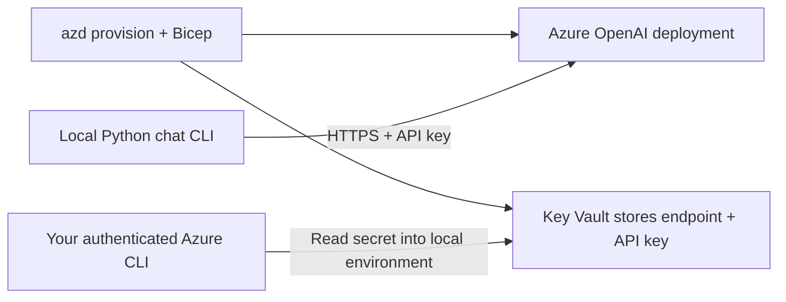

# Chat Azure OpenAI — CLI Lokal dan Infrastruktur AZD

**Tingkat:** Menengah · **Waktu:** 35–60 menit termasuk pengaturan

Contoh ini menyediakan **sumber daya Azure OpenAI dan Key Vault**, kemudian menjalankan
CLI obrolan Python interaktif **di mesin Anda**. Ini tidak menghosting aplikasi web
atau Container App. Model default adalah `gpt-4.1`, versi `2025-04-14`, dengan
kapasitas penyebaran `GlobalStandard` sebanyak 20. Periksa ketersediaan dan kuota saat ini di
wilayah yang Anda pilih sebelum penyediaan; tanggal siklus hidup model dapat berubah.

## Tujuan pembelajaran

- Menyediakan infrastruktur model dengan Bicep dan azd.
- Mengambil kunci API dari Key Vault tanpa menaruhnya di output penyebaran.
- Mengirim permintaan Chat Completions dan mempertahankan riwayat percakapan.
- Menafsirkan jumlah token dan keterbatasan perkiraan biaya.



Tidak ada integrasi runtime identitas terkelola, failover multi-region, pembatas laju khusus,
mode streaming, atau komputasi yang dihosting dalam contoh ini. SDK OpenAI
melakukan hingga dua kali percobaan ulang untuk kegagalan yang dapat dicoba ulang; CLI melaporkan kesalahan yang tersisa.

## Prasyarat

- Versi stabil saat ini [azd](https://learn.microsoft.com/azure/developer/azure-developer-cli/install-azd)
  (rilis yang dipublikasikan saat tinjauan: 1.37.2).
- [Azure CLI](https://learn.microsoft.com/cli/azure/install-azure-cli).
- Python **3.10+** (3.11 direkomendasikan) dan lingkungan virtual.
- Langganan Azure dengan izin untuk membuat Layanan Kognitif dan Key Vault
  sumber daya, menerapkan model, dan membaca rahasia dalam vault.
- Ketersediaan regional dan kuota `GlobalStandard` untuk `gpt-4.1`. Persyaratan akses
  bergantung pada langganan dan fitur; tidak ada jangka waktu persetujuan yang dijamin.

```bash
azd version
az version
python --version
azd auth login
az login
```

Ini adalah sesi otentikasi terpisah. Pilih langganan yang sama di kedua
alat sebelum menjalankan perintah di bawah ini.

## Mulai cepat (Bash)

Jalankan dari akar repositori:

```bash
cd examples/azure-openai-chat
azd env new myopenai
azd provision
```

Pilih wilayah yang didukung. Provisioning membuat grup sumber daya, akun OpenAI,
penyebaran model, Key Vault, dan rahasia `openai-endpoint`/`openai-api-key`.
Tidak ada **layanan untuk disebarkan** di `azure.yaml`.

Muat output tanpa rahasia dan ambil rahasia ke shell Anda saat ini:

```bash
export AZURE_OPENAI_ENDPOINT="$(azd env get-value AZURE_OPENAI_ENDPOINT)"
export AZURE_OPENAI_MODEL="$(azd env get-value AZURE_OPENAI_MODEL)"
KV_NAME="$(azd env get-value AZURE_KEY_VAULT_NAME)"
export AZURE_OPENAI_API_KEY="$(az keyvault secret show \
  --vault-name "$KV_NAME" --name openai-api-key --query value --output tsv)"

python -m venv .venv
source .venv/bin/activate
python -m pip install -r src/requirements.txt
python src/chat.py
```

Di PowerShell, aktifkan dengan `.\.venv\Scripts\Activate.ps1` dan tetapkan variabel lingkungan
dengan `$env:AZURE_OPENAI_ENDPOINT = azd env get-value AZURE_OPENAI_ENDPOINT`
(dan serupa untuk model). Ambil kunci API menggunakan
`$env:AZURE_OPENAI_API_KEY = az keyvault secret show --vault-name $KV_NAME --name openai-api-key --query value -o tsv`.
Setel `$KV_NAME = azd env get-value AZURE_KEY_VAULT_NAME` terlebih dahulu.

Jangan cetak, komit, atau tempel kunci API ke laporan masalah. CLI membaca variabel
lingkungan proses; itu **tidak** mengambil rahasia Key Vault atau memuat file `.env`.
`config.py` memvalidasi endpoint, batas token, dan suhu saat startup.

Output yang diharapkan (konten dan penggunaan bervariasi):

```text
Azure OpenAI Chat Application
Model: gpt-4.1
...
You: Say hello in one sentence.
Assistant: Hello! How can I help you today?
[Tokens: ... | Cost: $...]
```

Perintah: `stats` menampilkan total, `clear` menghapus riwayat percakapan, dan
`quit`/`exit` mengakhiri sesi. Tidak ada perintah `--stream`, `--show-tokens`, `tokens`,
atau `cost`.

## Verifikasi deployment

Setelah memuat variabel shell di atas:

```bash
curl --fail-with-body \
  "${AZURE_OPENAI_ENDPOINT%/}/openai/deployments/${AZURE_OPENAI_MODEL}/chat/completions?api-version=2024-10-21" \
  -H "Content-Type: application/json" \
  -H "api-key: $AZURE_OPENAI_API_KEY" \
  -d '{"messages":[{"role":"user","content":"Say hello!"}],"max_tokens":50}'

az keyvault secret list --vault-name "$KV_NAME" --query "[].name" -o table
```

Sukses: API mengembalikan HTTP 200 dengan `choices[0].message.content` dan `usage`;
vault mendaftar `openai-api-key` dan `openai-endpoint`. Deployment ARM yang berhasil
sendiri tidak memverifikasi inferensi.

## Berkas dan konfigurasi

```text
azure.yaml                         # Infrastructure-only AZD project
infra/main.bicep                   # Subscription deployment
infra/main.parameters.json         # Environment, location, principal ID
infra/resources/openai.bicep       # Account + model
infra/resources/keyvault.bicep     # Vault + deploying user's secret access policy
infra/resources/secrets.bicep      # Writes secrets, no key output
src/chat.py                        # Interactive CLI
src/config.py                      # Environment validation
src/requirements.txt               # Python packages
```

Untuk mengubah model/version/kapasitas yang disediakan, edit default di
`infra/main.bicep` dan jalankan `azd provision`. Menetapkan `AZURE_OPENAI_MODEL` dalam
shell Anda hanya memilih **nama deployment yang sudah ada**; ini tidak mendeploy model lain.

| Variabel runtime | Default / sumber |
|---|---|
| `AZURE_OPENAI_ENDPOINT` | Wajib; keluaran non-rahasia azd |
| `AZURE_OPENAI_API_KEY` | Wajib; ambil dari Key Vault |
| `AZURE_OPENAI_MODEL` | `gpt-4.1`; nama deployment Azure |
| `AZURE_OPENAI_MAX_TOKENS` | 800 (rentang validasi 1–4096) |
| `AZURE_OPENAI_TEMPERATURE` | 0.7 (rentang 0–2) |
| `AZURE_OPENAI_INPUT_PRICE_PER_1K` | 0,002 USD; tarif ilustratif input tanpa cache |
| `AZURE_OPENAI_OUTPUT_PRICE_PER_1K` | 0,008 USD; tarif ilustratif output |

## Biaya dan batasan keamanan

Tampilan biaya adalah sebuah **perkiraan**, bukan penagihan Azure. Itu mengalikan penggunaan token API
dengan tarif yang dikonfigurasi dan tidak memperhitungkan diskon input yang di-cache,
perbedaan regional/SKU, pajak, perubahan harga, atau panggilan yang gagal/dicoba ulang.
Timpa **kedua tarif** saat menggunakan model atau SKU lain dan periksa saat ini
[harga Azure OpenAI](https://azure.microsoft.com/pricing/details/cognitive-services/openai-service/).

Untuk ilustrasi, 100 permintaan menggunakan 500 token input tanpa cache dan 200 token output masing-masing
pada tarif default berbiaya `100 × (500/1000 × .002 + 200/1000 × .008) = $0.26`.
Operasi penyimpanan/Key Vault menimbulkan biaya terpisah. Tidak ada biaya tetap $50/bulan
untuk CLI lokal ini dan tidak ada komputasi yang dihosting dalam template.

Vault menggunakan kebijakan akses untuk principal yang melakukan deployment; ini bukan contoh aplikasi RBAC atau
managed-identity. Endpoint publik dan otentikasi kunci API
digunakan untuk pengajaran. Batasi izin dan tambahkan kontrol identitas/jaringan yang sesuai
sebelum menyesuaikannya untuk produksi.

## Latihan praktis

### 1. Verifikasi konteks dan reset

**Mulai:** menjalankan CLI. **Tujuan:** mengamati riwayat.
Katakan “Ingat kata cedar,” kemudian tanya “Kata apa yang saya minta kamu untuk ingat?”
Jalankan `stats`; dua giliran berhasil harus dihitung sebagai dua pesan yang dipertukarkan.
Jalankan `clear` dan `stats`; pesan yang dipertukarkan harus nol (jumlah token tetap).
Kata-kata tepat model tidak deterministik.

### 2. Ubah batasan respons

**Mulai:** keluar dari CLI, tetap menggunakan shell yang sama.
Jalankan `export AZURE_OPENAI_MAX_TOKENS=100`, restart `python src/chat.py`, dan minta 
penjelasan singkat tentang azd. Periksa bahwa banner menampilkan 100.
Pulihkan dengan `unset AZURE_OPENAI_MAX_TOKENS`. Batas respons yang lebih kecil tidak 
mengurangi token sejarah yang sudah dikirim.

### Masalah umum

- **Variabel lingkungan hilang:** provisioning tidak mengekspor nilai shell;
  ulangi langkah ekspor. Terminal baru membutuhkannya lagi.
- **403 saat membaca Key Vault:** verifikasi langganan/login Azure CLI dan principal 
  dalam kebijakan akses vault. Perubahan kebijakan bisa memerlukan waktu untuk menyebar.
- **404 inferensi:** periksa nama deployment, endpoint, dan status deployment.
- **429 inferensi:** tunggu batas kecepatan untuk direset; verifikasi kuota model regional.
  CLI menghapus putaran yang gagal dari sejarah sehingga mencoba ulang tidak menggandakan mereka.
- **Panjang konteks:** contoh tidak memangkas percakapan panjang; gunakan `clear`.
- **Model tidak tersedia/retired:** konsultasikan ketersediaan model saat ini dan perbarui
  model/versi/SKU bersama-sama; versi API dan versi model adalah pengaturan yang berbeda.

## Bersih-bersih dan langkah selanjutnya

```bash
azd down
unset AZURE_OPENAI_API_KEY
```

Retensi soft-delete Key Vault adalah tujuh hari; penghapusan permanen memerlukan izin terpisah.
Tidak ada suite pengujian yang dikomit; jangan jalankan perintah `pytest tests/` yang tidak ada.
Tambahkan tes API tiruan sebelum memperluas kode.

[Contoh container](../../../../examples/container-app) · [Cetak biru arsitektur ritel](../retail-scenario.md) ·
[Halaman kursus](../../README.md) · [Laporkan masalah](https://github.com/microsoft/AZD-for-beginners/issues)

---

<!-- CO-OP TRANSLATOR DISCLAIMER START -->
**Penafian**:
Dokumen ini telah diterjemahkan menggunakan layanan terjemahan AI [Co-op Translator](https://github.com/Azure/co-op-translator). Meskipun kami berupaya untuk mencapai akurasi, harap diketahui bahwa terjemahan otomatis mungkin mengandung kesalahan atau ketidakakuratan. Dokumen asli dalam bahasa aslinya harus dianggap sebagai sumber yang sah. Untuk informasi penting, disarankan menggunakan terjemahan profesional oleh manusia. Kami tidak bertanggung jawab atas kesalahpahaman atau penafsiran yang keliru yang timbul dari penggunaan terjemahan ini.
<!-- CO-OP TRANSLATOR DISCLAIMER END -->