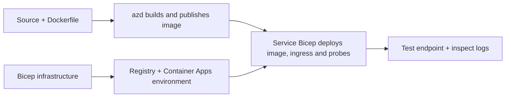

# Contoh Deployment Aplikasi Kontainer dengan AZD

Direktori ini berisi dua contoh pembelajaran dengan kode sumber, Dockerfile,
infrastruktur Bicep, dan `azure.yaml`. Keduanya tidak dioptimalkan untuk produksi.

## Pilih sebuah contoh

| Contoh | Apa yang diimplementasikan | Prasyarat |
|---|---|---|
| [Simple Flask API](../../../../examples/container-app/simple-flask-api) | API CRUD Python tunggal, item in-memory, pengecekan kesehatan, skala HTTP | Pengetahuan dasar CLI dan HTTP |
| [Two-service microservices](../../../../examples/container-app/microservices) | Gateway Node.js, layanan produk Python baca-saja internal, telemetri dan skala | Selesaikan contoh layanan tunggal terlebih dahulu |

Alokasikan 30–60 menit termasuk pengaturan dan verifikasi. Waktu penyediaan Azure bervariasi.

## Prasyarat

- [Azure Developer CLI](https://learn.microsoft.com/azure/developer/azure-developer-cli/install-azd)
- [Azure CLI](https://learn.microsoft.com/cli/azure/install-azure-cli) untuk perintah verifikasi
- Docker dengan daemon-nya berjalan untuk membangun image kontainer ini
- Langganan Azure dengan izin pembuatan sumber daya dan kuota regional yang cukup
- Bash untuk contoh shell, atau perintah PowerShell setara

```bash
azd version
az version
docker info
azd auth login
az login
```

Kedua alat memiliki sesi login terpisah. Gunakan azd stabil yang terbaru; versi
yang diterbitkan saat peninjauan adalah 1.37.2. Klaim versi minimum lama bukan
jaminan kompatibilitas.

## Mulai cepat

Dari akar repositori:

```bash
cd examples/container-app/simple-flask-api
azd env new flask-demo
azd up
API_URL=$(azd env get-value API_ENDPOINT)
curl --fail-with-body "${API_URL}/health"
```

Harapan: HTTP 200 dengan `"status": "healthy"`. Ikuti README contoh untuk membuat,
membaca, memperbarui, dan menghapus item, serta memeriksa log.



Penyediaan awal menggunakan image hello-world publik pada port 80. File parameter
Bicep spesifik layanan membiarkan `azd deploy` menggantikan dengan image aplikasi yang dibangun
dan port/probe aplikasi yang benar (8000 untuk Flask/produk, 8080 untuk gateway).
Simpan file-file ini dengan pengaturan `azure.yaml` `module` mereka.

## Konfigurasi: apa yang mengubah apa

`azure.yaml` memilih direktori sumber, bahasa, host, dan modul deploy.
CPU/memori kontainer, ingress, probe, jumlah replika, dan aturan skala didefinisikan
dalam **Bicep**, bukan properti layanan `resources`, `scale`, atau `regions` yang sembarangan.

`azd env set SOME_VALUE ...` menyimpan sebuah nilai secara lokal. Ini hanya mengubah sumber daya yang
dideploy saat sebuah parameter, pemetaan lingkungan, atau hook secara eksplisit menggunakan
nilai tersebut. Contoh ini tidak menggunakan `MAX_REPLICAS`, `SCALE_TO_ZERO_TIMEOUT`,
`CONTAINER_APP_REPLICA_TYPE`, atau pengaturan canary khusus dari nilai lingkungan azd.
Edit Bicep terkait dan jalankan `azd up` untuk meng-provision ulang dan menjalankan deploy.

Jangan letakkan sumber aplikasi di bawah `infra/`. `project` harus menunjuk ke direktori
sumber yang berisi Dockerfile dan manifest dependensi.

## Pemantauan dan biaya

- `azd monitor --logs` membuka tampilan portal; ini bukan aliran log terminal.
  Gunakan `az containerapp logs show --follow` dengan nama sumber daya yang sebenarnya.
- API sederhana menulis log stdout yang dikumpulkan melalui Container Apps/Log Analytics.
  Sumber daya Application Insights yang diprovisikan tidak otomatis diinstrumentasi.
- Gateway microservices menggunakan SDK Node.js Application Insights; layanan Python
  mengekspor jejak log aplikasi. Pelacakan request/dependency Python lengkap
  tidak dikonfigurasi.
- Scale-to-zero dapat mengurangi biaya komputasi, tetapi registry dan pengumpulan/penyimpanan
  log masih dapat menimbulkan biaya. Default microservices menjaga replika tetap berjalan.
  Perkirakan wilayah dan penggunaan Anda di
  [Azure pricing calculator](https://azure.microsoft.com/pricing/calculator/).

## Pola lanjutan — implementasi yang tidak termasuk

Ini adalah arahan desain, bukan proyek lokal tambahan atau potongan kode copy-and-run:

- **Data persisten dan otentikasi:** gantikan penyimpanan in-memory dan tambahkan
  otentikasi/otorisasi Microsoft Entra ID sebelum produksi.
- **Blue-green/canary:** gunakan mode multi-revisi Container Apps, label revisi,
  bobot lalu lintas, verifikasi kesehatan, dan prosedur rollback.
  Tidak ada konfigurasi azd `deploymentStrategy: canary` dalam contoh ini.
  Lihat [manajemen revisi](https://learn.microsoft.com/azure/container-apps/revisions).
- **Multi-wilayah:** buat lingkungan dan aplikasi terpisah di Bicep dan desain
  pengaturan routing global dan konsistensi data. Daftar layanan `regions`
  bukan mekanisme deploy azd.
- **Queue workers:** tambahkan sumber worker, dependensi, sumber antrian, identitas terkelola
  dengan peran data-plane, dan aturan skala autentikasi. Jangan salin
  jalur `src/worker` kosong dan harapkan proyek yang bisa dijalankan.
- **Dapr:** sediakan komponen, konfigurasikan sidecar, pasang SDK yang sesuai,
  dan terapkan penanganan kesalahan state/pub-sub.
- **Secrets:** gunakan identitas terkelola dan penugasan peran bila memungkinkan. Hanya
  membuat Key Vault tidak otomatis memberikan aplikasi akses atau memuat rahasia.

## Bersihkan

Dari direktori contoh:

```bash
azd down
```

Tinjau prompt penghapusan dan konfirmasi bahwa grup sumber daya khusus telah dihapus.
Jangan gunakan contoh ini sebagai dasar produksi tanpa desain dan pengujian tambahan.

[Indeks contoh](../README.md) · [Halaman kursus](../../README.md) ·
[Dokumentasi Container Apps](https://learn.microsoft.com/azure/container-apps/) ·
[Laporkan masalah](https://github.com/microsoft/AZD-for-beginners/issues)

---

<!-- CO-OP TRANSLATOR DISCLAIMER START -->
**Penafian**:
Dokumen ini telah diterjemahkan menggunakan layanan terjemahan AI [Co-op Translator](https://github.com/Azure/co-op-translator). Meskipun kami berupaya untuk mencapai akurasi, harap diketahui bahwa terjemahan otomatis mungkin mengandung kesalahan atau ketidakakuratan. Dokumen asli dalam bahasa aslinya harus dianggap sebagai sumber yang sah. Untuk informasi penting, disarankan menggunakan terjemahan profesional oleh manusia. Kami tidak bertanggung jawab atas kesalahpahaman atau penafsiran yang keliru yang timbul dari penggunaan terjemahan ini.
<!-- CO-OP TRANSLATOR DISCLAIMER END -->