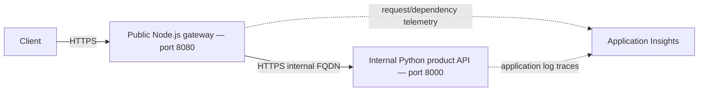

# Mikroservis Dua Layanan — Azure Container Apps

**Level:** Menengah · **Waktu:** 45–60 menit termasuk pengaturan

Contoh pembelajaran ini mengimplementasikan **Node.js API Gateway** dan **Layanan Produk Python hanya-baca**. Sumber, Dockerfiles, Bicep, dan konfigurasi azd disertakan.
Ini bukan sistem yang sudah diproduksi dan diperkuat.


## Apa yang akan Anda pelajari

- Men-deploy dua layanan secara independen.
- Menggunakan backend FQDN internal melalui HTTPS.
- Memverifikasi respon sukses, tidak ditemukan, dan layanan tidak tersedia.
- Memahami telemetry dan batasan penskalaan independen.



Katalog produk berisi lima produk tetap dalam memori. Tidak ada **penangan POST,
PUT, atau DELETE**, database, Service Bus, layanan order/user/notifikasi,
kode C#, atau Go. Itu adalah ide pengembangan masa depan, bukan fitur yang disertakan.
Gateway tidak mengautentikasi pengguna; ingress internal bukan pengganti
untuk otorisasi aplikasi.

## Prasyarat

Selesaikan [single Flask API](../../../../../examples/container-app/simple-flask-api) terlebih dahulu.
Instal azd stabil saat ini (rilis yang dipublikasikan saat peninjauan: 1.37.2), Azure CLI,
dan Docker dengan daemon berjalan. Anda membutuhkan langganan Azure, izin pembuatan sumber daya,
dan kuota regional Container Apps.

```bash
azd version
az version
docker info
azd auth login
az login
```

Gunakan langganan yang sama di kedua alat CLI. Perintah di bawah menggunakan Bash.

## Deploy dan verifikasi

Dari root repositori:

```bash
cd examples/container-app/microservices
azd env new microservices-demo
azd up
GATEWAY_URL=$(azd env get-value API_GATEWAY_URL)
RG_NAME=$(azd env get-value AZURE_RESOURCE_GROUP)
GATEWAY_NAME=$(azd env get-value API_GATEWAY_NAME)
PRODUCT_NAME=$(azd env get-value PRODUCT_SERVICE_NAME)

curl --fail-with-body "${GATEWAY_URL}/health"
curl --fail-with-body "${GATEWAY_URL}/api/products"
curl --fail-with-body "${GATEWAY_URL}/api/products/1"
curl -i "${GATEWAY_URL}/api/products/999"
```

**Sukses:** health 200; list 200 dengan **lima** produk; produk 1 adalah Laptop
dengan harga 999.99 dan stok 50; produk tidak dikenal mengembalikan 404.
Deskripsi termasuk dalam respons; cap waktu bervariasi.

Provision awal menggunakan gambar hello-world publik di port 80 jadi tidak mencoba
menarik gambar yang tidak ada dari registry kosong. Modul Bicep khusus layanan
dan file parameter menggantikannya dengan gambar hasil build dan port/probe aplikasi selama
`azd deploy`. Parameter utama mempertahankan nama gambar yang dipublikasikan untuk provisioning nanti.

## Layanan dan jaringan

| Layanan | Endpoint terbuka | Sumber daya default |
|---|---|---|
| Gateway | GET `/`, `/health`, `/api/products`, `/api/products/:id` | 1 vCPU, 2 GiB, 2–20 replika |
| Product | GET `/`, `/health`, `/products`, `/products/<id>` | 0.5 vCPU, 1 GiB, 1–10 replika |

Ingress produk memiliki `external: false` dan `allowInsecure: false`. Bicep menyuntikkan
`PRODUCT_SERVICE_URL=https://<actual-internal-fqdn>` ke gateway. HTTP akan
mengalihkan; HTTPS cocok dengan ingress yang dikonfigurasi. Nama DNS singkat harus cocok dengan
**nama Container App sebenarnya**, bukan kunci layanan logis `product-service`.
Jangan coba panggil URL internal langsung dari laptop Anda.

Gateway memiliki timeout lima detik untuk panggilan produk. ID produk yang hilang
dipropagasi sebagai 404; kegagalan transportasi/kegagalan backend lain mengembalikan 503. Gateway
`/health` hanya memeriksa gateway, bukan ketersediaan backend.

## File dan konfigurasi

```text
azure.yaml
infra/main.bicep
infra/main.parameters.json
infra/abbreviations.json
infra/core/container-apps-environment.bicep
infra/core/monitor.bicep
infra/app/api-gateway.bicep
infra/app/api-gateway.parameters.json
infra/app/product-service.bicep
infra/app/product-service.parameters.json
src/api-gateway/{app.js,package.json,Dockerfile}
src/product-service/{main.py,requirements.txt,Dockerfile}
```

Skala, CPU/memori, port, dan probe diatur di `infra/app/*.bicep`. Ubah file tersebut
dan jalankan `azd up` untuk menerapkan infrastruktur dan menyebarkan ulang. Tidak ada
parameter variabel lingkungan `GATEWAY_MAX_REPLICAS` dalam contoh ini.

Untuk perubahan hanya kode:

```bash
azd deploy product-service
azd deploy api-gateway
```

Gambar Node menggunakan Node 22; gambar Python menggunakan Python 3.11. Keduanya mengikat ke
`0.0.0.0`. Ingress/prob menggunakan port 8080 (gateway) dan 8000 (produk), masing-masing.

## Pengembangan lokal dengan Docker

Jalankan dari direktori contoh ini. Gunakan jaringan yang ditentukan pengguna, **bukan `localhost`
dari satu kontainer untuk mengakses kontainer lain**:

```bash
docker network create azd-microservices-demo
docker build -t local-product ./src/product-service
docker build -t local-gateway ./src/api-gateway
docker run -d --name azd-product --network azd-microservices-demo local-product
docker run -d --name azd-gateway --network azd-microservices-demo \
  -p 8080:8080 -e PRODUCT_SERVICE_URL=http://azd-product:8000 local-gateway
curl --fail-with-body http://localhost:8080/api/products
```

Diharapkan: lima produk. HTTP hanya digunakan untuk jaringan Docker lokal ini.

```bash
docker stop azd-product azd-gateway
docker rm azd-product azd-gateway
docker network rm azd-microservices-demo
```

## Pemantauan

```bash
az containerapp logs show --name "$GATEWAY_NAME" --resource-group "$RG_NAME" --follow
# In a separate terminal:
az containerapp logs show --name "$PRODUCT_NAME" --resource-group "$RG_NAME" --tail 100
```

`azd monitor --logs` membuka tampilan portal; itu tidak melakukan streaming log terminal.
SDK Node mengumpulkan permintaan/gateway dependensi. `AzureLogHandler` Python
mengekspor **jejak log**, bukan permintaan Flask otomatis, dependensi SQL, atau jejak
terdistribusi penuh. OpenCensus adalah SDK legacy; lebih disarankan menggunakan Azure Monitor OpenTelemetry
saat memperluas contoh ini.

Di Application Insights Logs, buat permintaan dan periksa:

```kusto
requests
| where timestamp > ago(1h)
| where name contains "products"
| summarize RequestCount=count(), AvgDuration=avg(duration) by bin(timestamp, 5m)
```

Untuk pesan aplikasi Python:

```kusto
traces
| where timestamp > ago(1h)
| where message contains "products"
| project timestamp, message, severityLevel
```

Berikan waktu keterlambatan untuk pengambilan data dan pengambilan sampel; jangan mengharapkan jumlah permintaan yang tepat atau
latensi yang dijamin. Tidak ada peringatan atau dasbor kustom yang dikonfigurasi.

## Latihan Praktis

### Latihan 1: Modifikasi katalog

**Titik mulai:** `src/product-service/main.py`.
**Tujuan:** memverifikasi penyebaran layanan independen.
Ubah stok Laptop dari 50 menjadi 49 dalam daftar `products` yang tetap, jalankan
`azd deploy product-service`, lalu minta `${GATEWAY_URL}/api/products/1`.

**Kriteria keberhasilan / solusi:** HTTP 200 dengan `"stock":49`. Kembalikan ke 50 dan sebarkan ulang.
**Masalah umum:** mengedit gateway alih-alih layanan yang memiliki katalog.
Ini mengubah data sumber, bukan basis data inventaris yang persisten.

### Latihan 2: Verifikasi konfigurasi replika

**Titik mulai:** `infra/app/product-service.bicep`.
**Tujuan:** mengamati perubahan infrastruktur tanpa menebak autoscaling.
Ubah `minReplicas: 1` menjadi `minReplicas: 2`, jalankan `azd up`, kemudian:

```bash
az containerapp show --name "$PRODUCT_NAME" --resource-group "$RG_NAME" \
  --query properties.template.scale -o json
```

**Kriteria keberhasilan:** minimum yang dikonfigurasi adalah 2 dan maksimum tetap 10.
Kembalikan minimum ke 1 dan jalankan `azd up`.
**Masalah umum:** `azd deploy` saja tidak menerapkan perubahan pada infrastruktur bersama yang tidak terkait.
Jangan atur `maxReplicas` ke nol sebagai simulasi kegagalan.
Ini memverifikasi konfigurasi, bukan pengujian beban atau jumlah replika instan yang dijamin.

### Latihan 3: Uji penanganan layanan tidak tersedia secara lokal

**Titik mulai:** kedua kontainer Docker lokal di atas sedang berjalan.
**Tujuan:** membedakan kegagalan backend dari produk yang hilang.
Hentikan hanya kontainer produk:

```bash
docker stop azd-product
curl -i http://localhost:8080/api/products
docker start azd-product
curl --fail-with-body http://localhost:8080/api/products
```

**Kriteria keberhasilan:** saat dihentikan, gateway mengembalikan 503 dengan
`"error":"Product service unavailable"`; setelah restart, daftar kembali mengembalikan 200.
Coba ulang setelah jeda startup singkat jika perlu.
**Masalah umum:** menghentikan gateway menguji kegagalan yang berbeda (tidak ada respons HTTP).

## Biaya dan kesenjangan produksi

Replika minimum default menjaga komputasi tetap berjalan. Registry dan monitoring juga menimbulkan
biaya. Tidak ada total tetap $50/bulan yang tervalidasi: perkiraan CPU/memori regional,
jam replika, permintaan, registry, dan retensi log di
[Azure pricing calculator](https://azure.microsoft.com/pricing/calculator/).
Hapus sumber belajar dengan segera.

Pekerjaan produksi meliputi autentikasi/otorisasi, identitas terkelola scoped,
data persisten, validasi input/respons, instrumentasi observabilitas yang didukung,
pengujian beban/kegagalan, CI/CD, peringatan, dan prosedur pemulihan. Menambahkan layanan pesanan,
antrean, atau basis data adalah tugas implementasi terpisah, bukan latihan selesai
atau fitur yang sudah tersedia di sini.

## Pemecahan masalah dan pembersihan

- **Gambar tidak ditemukan saat penyediaan pertama:** bootstrap harus menggunakan gambar publik;
  verifikasi parameter gambar utama default dan pemetaan modul penyebaran.
- **503 produk:** periksa log produk, revisi gambar, dan URL HTTPS internal yang disuntikkan.
- **404 jalur yang tidak terduga:** API produk hanya baca; verifikasi rute, bukan handler CRUD yang tidak ada.
- **Tidak ada telemetri:** periksa string koneksi runtime tanpa mengeksposnya dan
  izinkan penundaan pengambilan data. Tabel permintaan Python tidak terisi oleh handler log-nya.

Dari direktori contoh ini:

```bash
azd down
```

Tinjau permintaan penghapusan dan verifikasi grup sumber daya khusus telah dihapus.

[Sebelumnya: Flask API](../../../../../examples/container-app/simple-flask-api) · [Berikutnya: aplikasi basis data](../../../../../examples/database-app) ·
[Pengembangan AI](../../../docs/chapter-02-ai-development/README.md) ·
[Beranda kursus](../../../README.md) · [Laporkan masalah](https://github.com/microsoft/AZD-for-beginners/issues)

---

<!-- CO-OP TRANSLATOR DISCLAIMER START -->
**Penafian**:
Dokumen ini telah diterjemahkan menggunakan layanan terjemahan AI [Co-op Translator](https://github.com/Azure/co-op-translator). Meskipun kami berupaya untuk mencapai akurasi, harap diketahui bahwa terjemahan otomatis mungkin mengandung kesalahan atau ketidakakuratan. Dokumen asli dalam bahasa aslinya harus dianggap sebagai sumber yang sah. Untuk informasi penting, disarankan menggunakan terjemahan profesional oleh manusia. Kami tidak bertanggung jawab atas kesalahpahaman atau penafsiran yang keliru yang timbul dari penggunaan terjemahan ini.
<!-- CO-OP TRANSLATOR DISCLAIMER END -->