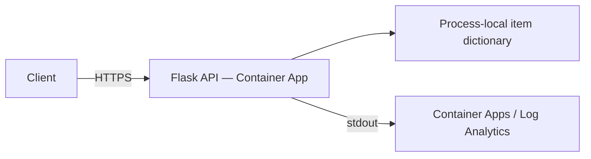

# API Flask Sederhana — Azure Container Apps

**Tingkat:** Pemula · **Waktu:** 30–45 menit termasuk pengaturan

Sebarkan API CRUD Python Flask dengan Azure Developer CLI (azd). Sumber, Dockerfile,
Bicep, dan parameter penyebaran disertakan. Ini adalah **contoh pembelajaran**, bukan
API siap produksi.

## Apa yang akan Anda pelajari

- Membangun dan memublikasikan sebuah container melalui azd.
- Mengonfigurasi ingress dan liveness/readiness probes.
- Memverifikasi respons CRUD dan memeriksa log aplikasi.
- Memahami mengapa data dalam memori tidak cocok untuk aplikasi tahan lama.



**Penting:** item disimpan dalam satu proses. Defaultnya adalah **satu pekerja Gunicorn,
0–1 replika**, sengaja untuk menghindari data yang tidak konsisten antar pekerja/replika.
Item hilang saat restart, perubahan revisi, atau skala ke nol. Meningkatkan replika
membutuhkan penyimpanan persisten bersama. API ini tidak memiliki autentikasi atau otorisasi.

## Prasyarat

- [azd stabil terbaru](https://learn.microsoft.com/azure/developer/azure-developer-cli/install-azd)
  (rilis yang diterbitkan saat tinjauan: 1.37.2).
- [Azure CLI](https://learn.microsoft.com/cli/azure/install-azure-cli) untuk verifikasi.
- Docker dengan daemon-nya berjalan; diperlukan untuk pembangunan gambar lokal default.
- Langganan Azure, izin pembuatan sumber daya, dan kuota regional Container Apps.
- Bash untuk perintah di bawah (atau PowerShell setara).
- Python 3.11 untuk pengembangan lokal opsional.

```bash
azd version
az version
docker info
azd auth login
az login
```

Alat CLI memiliki sesi login terpisah. Gunakan langganan yang sama pada keduanya.

## Mulai cepat

Dari akar repositori:

```bash
cd examples/container-app/simple-flask-api
azd env new flask-demo
azd up
API_URL=$(azd env get-value API_ENDPOINT)
RG_NAME=$(azd env get-value AZURE_RESOURCE_GROUP)
API_NAME=$(azd env get-value API_NAME)
curl --fail-with-body "${API_URL}/health"
```

Diharapkan: HTTP 200 dan JSON dengan `"status":"healthy"`,
`"service":"simple-flask-api"`, dan cap waktu UTC saat ini.
Proses penyediaan dan pembangunan gambar biasanya memakan beberapa menit; waktu bervariasi.

Penyediaan awal menggunakan gambar hello-world publik yang mendengarkan di port 80.
`azure.yaml` memilih `infra/app/api.bicep` dan file parameter yang cocok untuk
penyebaran layanan, yang mengganti gambar, ingress, dan probes ke port 8000.
Jangan hapus parameter penyebaran tersebut.

## Verifikasi CRUD

Jalankan yang berikut secara berurutan selama replika yang sama tetap aktif:

```bash
# Create: HTTP 201; note the returned id (1 for a fresh process).
curl -i -X POST "${API_URL}/api/items" \
  -H "Content-Type: application/json" \
  -d '{"name":"Test Item","description":"My first item"}'

# Read list: HTTP 200, total 1 in a fresh process.
curl --fail-with-body "${API_URL}/api/items"

# Replace 1 if your create response returned another id.
curl --fail-with-body "${API_URL}/api/items/1"
curl -i -X PUT "${API_URL}/api/items/1" \
  -H "Content-Type: application/json" -d '{"name":"Updated Item"}'
curl -i -X DELETE "${API_URL}/api/items/1"
curl -i "${API_URL}/api/items/1"
```

Berhasil: POST 201, baca/PUT 200, DELETE 204 tanpa badan, lalu item hilang 404.
JSON yang tidak berbentuk objek atau nama kosong mengembalikan 400.
Jika sebuah item menghilang di antara permintaan, periksa adanya restart atau skala ke nol;
ini adalah batasan sengaja dalam memori, bukan penyimpanan permanen.

| Endpoint | Metode |
|---|---|
| `/` | GET — informasi layanan |
| `/health` | GET — liveness/readiness |
| `/api/items` | GET, POST |
| `/api/items/{id}` | GET, PUT, DELETE |

## Log dan konfigurasi

```bash
az containerapp logs show --name "$API_NAME" --resource-group "$RG_NAME" --follow
```

Diharapkan: startup Gunicorn, log akses permintaan, dan pesan aplikasi.
`azd monitor --logs` membuka tampilan portal; itu tidak streaming ke terminal.
Application Insights disediakan tetapi **tidak diinstrumen oleh kode Flask ini**;
gunakan Container Apps/Log Analytics untuk log stdout.

Edit `infra/app/api.bicep` untuk CPU/memori, batasan replika, atau aturan skala, lalu
jalankan `azd up`. Default adalah 0.5 vCPU, 1 GiB, minimum 0 / maksimum 1 replika, dan
ambang HTTP 50 permintaan bersamaan. Skala ke nol dapat menambah latensi cold-start.

Arbitrer `azd env set MAX_REPLICAS`, `API_KEY`, `LOG_LEVEL`, atau
Nilai `SCALE_TO_ZERO_TIMEOUT` **tidak terhubung ke template atau aplikasi ini**.
Mengatur sebuah nilai tidak secara otomatis menjadikannya variabel lingkungan runtime.
Image mengikat port 8000 secara eksplisit; perbarui Dockerfile, Bicep ingress, dan probes
bersama-sama jika mengganti port.

## Berkas

```text
azure.yaml
infra/main.bicep
infra/main.parameters.json
infra/app/container-apps.bicep       # Environment, registry, monitoring
infra/app/api.bicep                  # App, ingress, probes, scale settings
infra/app/api.parameters.json        # Image and resource values for azd deploy
src/app.py
src/Dockerfile
src/requirements.txt
```

## Pengembangan lokal

Dari direktori contoh ini:

```bash
python -m venv .venv
source .venv/bin/activate  # PowerShell: .\.venv\Scripts\Activate.ps1
python -m pip install -r src/requirements.txt
python src/app.py
```

Di terminal lain, uji `http://localhost:8000/health` dan endpoint CRUD.
Atau bangun dan jalankan image sebenarnya:

```bash
docker build -t flask-api:local ./src
docker run --rm -p 8000:8000 flask-api:local
```

Untuk perubahan kode saja setelah penyebaran pertama, jalankan `azd deploy api`.
Untuk perubahan Bicep, jalankan `azd up` untuk mengatur ulang dan menyebarkan.

## Latihan praktis

### 1. Validasi penolakan input

**Titik awal:** API yang telah disebarkan, `API_URL` di atas.
**Tujuan:** memverifikasi API menolak bentuk JSON tidak valid dan nama yang hilang.

```bash
curl -i -X POST "${API_URL}/api/items" \
  -H "Content-Type: application/json" -d '[]'
curl -i -X POST "${API_URL}/api/items" \
  -H "Content-Type: application/json" -d '{"name":""}'
```

**Kriteria keberhasilan / solusi:** keduanya mengembalikan 400 dengan kesalahan JSON, bukan 500.
**Masalah umum:** melewatkan header tipe konten JSON.

### 2. Tambahkan endpoint versi baca-saja

**Titik awal:** `src/app.py`. **Tujuan:** perpanjang dan sebarkan ulang API.
Tambahkan ini sebelum blok `if __name__ == '__main__':`:

```python
@app.route('/version', methods=['GET'])
def version():
    return jsonify({'version': '1.0.0'})
```

Jalankan `azd deploy api`, lalu `curl --fail-with-body "${API_URL}/version"`.
**Kriteria keberhasilan:** HTTP 200 dan `{"version":"1.0.0"}`.
**Masalah umum:** meletakkan rute setelah panggilan blocking `app.run()` saat
menguji dengan `python src/app.py`.

### Titik pemeriksaan pengetahuan

Mengapa satu pekerja tidak cukup untuk data tahan lama? Karena bahkan satu proses pun kehilangan
kamusnya saat dimulai ulang. Versi produksi membutuhkan penyimpanan bersama yang persisten,
autentikasi, otorisasi, migrasi, pengujian, dan pemantauan operasional.

## Biaya dan pemecahan masalah

Ini bukan penyebaran gratis $0 yang dijamin: registry Basic dan penyimpanan/pengambilan log
dapat menimbulkan biaya walau aplikasi komputasi nol. Gunakan
[kalkulator harga](https://azure.microsoft.com/pricing/calculator/) untuk wilayah Anda.

- **Gagal build Docker:** pastikan `docker info`, akses jaringan, dan dependensi.
- **Aplikasi tidak sehat:** periksa log konsol/sistem dan verifikasi port image, ingress,
  dan probes sesuai. Placeholder tidak boleh diproban pada port Flask.
- **403/izin:** pastikan izin subscription dan pembuatan sumber daya.
- **Item hilang:** status memori reset saat restart/scale-to-zero; tambahkan database
  untuk perilaku tahan lama.

## Pembersihan dan langkah berikutnya

```bash
azd down
```

Tinjau prompt penghapusan dan verifikasi grup sumber daya khusus telah dihapus.
Jangan gunakan pembersihan destruktif terhadap grup sumber daya yang berisi data tidak terkait.

[Selanjutnya: Aplikasi database](../../../../../examples/database-app) · [Mikroservis](../../../../../examples/container-app/microservices) ·
[Ikhtisar kontainer](../README.md) · [Beranda kursus](../../../README.md) ·
[Laporkan masalah](https://github.com/microsoft/AZD-for-beginners/issues)

---

<!-- CO-OP TRANSLATOR DISCLAIMER START -->
**Penafian**:
Dokumen ini telah diterjemahkan menggunakan layanan terjemahan AI [Co-op Translator](https://github.com/Azure/co-op-translator). Meskipun kami berupaya untuk mencapai akurasi, harap diketahui bahwa terjemahan otomatis mungkin mengandung kesalahan atau ketidakakuratan. Dokumen asli dalam bahasa aslinya harus dianggap sebagai sumber yang sah. Untuk informasi penting, disarankan menggunakan terjemahan profesional oleh manusia. Kami tidak bertanggung jawab atas kesalahpahaman atau penafsiran yang keliru yang timbul dari penggunaan terjemahan ini.
<!-- CO-OP TRANSLATOR DISCLAIMER END -->