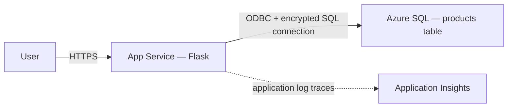

# Flask dan Azure SQL di App Service

**Tingkat:** Menengah · **Waktu:** 30–60 menit termasuk prasyarat

Contoh ini menerapkan API baca Python Flask ke **Linux App Service** dan database Azure SQL Basic.
Sumber, Bicep, dan konfigurasi azd disertakan. Ini adalah
aplikasi pembelajaran, bukan arsitektur database siap produksi.

## Apa yang akan Anda pelajari

- Menyediakan sumber daya App Service, SQL, dan pemantauan dengan Bicep.
- Mengonfigurasi konektivitas SQL terenkripsi tanpa menyimpan kredensial.
- Inisialisasi skema sebelum memulai pekerja Gunicorn.
- Memverifikasi data yang sudah dimasukkan, respons tidak ditemukan, dan kesehatan database.



Sumber daya: grup sumber daya khusus, paket App Service Linux B1, Python 3.11 Web
App, server SQL dan database Basic 2-GB, Application Insights, dan Log Analytics.
Web App menggunakan **deployment sumber/ZIP dan instalasi dependensi Oryx**;
`azd deploy` tidak membangun atau menerapkan Dockerfile opsional.

## Prasyarat

- Saat ini stabil [azd](https://learn.microsoft.com/azure/developer/azure-developer-cli/install-azd)
  (rilis yang diterbitkan saat tinjauan: 1.37.2).
- [Azure CLI](https://learn.microsoft.com/cli/azure/install-azure-cli) untuk verifikasi.
- Langganan Azure, izin untuk membuat sumber daya yang terdaftar, dan kuota regional.
- Python **3.11** untuk pengembangan lokal; `pyodbc==5.0.1` yang dikomit mungkin memerlukan
  alat build native pada versi Python yang lebih baru.
- Microsoft ODBC Driver 18 (atau 17) untuk SQL Server pada mesin lokal. `pip install
  pyodbc` tidak menginstal driver sistem. Lihat
  [instalasi ODBC](https://learn.microsoft.com/sql/connect/odbc/download-odbc-driver-for-sql-server).
- Docker hanya jika menguji kontainer opsional secara lokal.

```bash
azd version
az version
azd auth login
az login
```

Gunakan langganan yang sama di kedua alat. Perintah di bawah menggunakan Bash.

## Deploy

Dari akar repositori:

```bash
cd examples/database-app
azd env new sql-demo
azd provision
azd deploy
WEB_URL=$(azd env get-value WEB_APP_URI)
WEB_NAME=$(azd env get-value WEB_APP_NAME)
RG_NAME=$(azd env get-value AZURE_RESOURCE_GROUP)
```

Pilih wilayah yang didukung. `sqlAdminLogin` default ke `sqladmin`; 
`sqlAdminPassword` adalah parameter yang aman. Berikan kata sandi yang kuat saat diminta.
Jaga kredensial penyebaran agar tidak masuk ke Git dan laporan masalah. Penyusunan string koneksi saat ini
mengharapkan kata sandi tanpa pembatas string koneksi seperti
`;`; sesuaikan penghindaran sebelum menggunakan nilai tersebut.

Bicep mengatur perintah startup yang menjalankan `init_database()` **sebelum** pekerja Gunicorn
dimulai. Ini diperlukan karena mengimpor `app:app` tidak mengeksekusi
blok `if __name__ == '__main__'` Python. Pada basis data baru, inisialisasi
membuat `products` dan menyisipkan lima baris. Ini adalah bibit pengajaran sederhana, 
bukan kerangka migrasi konkuren; gunakan migrasi yang tepat sebelum memperbanyak instance.

Aplikasi memilih Microsoft ODBC Driver 18 yang terpasang, kemudian 17, jika string koneksi
tidak secara eksplisit menyebutkan driver. Jika keduanya tidak ada, startup gagal dengan
kesalahan instalasi yang dapat diatasi. Verifikasi ketersediaan driver di runtime App Service yang Anda pilih
daripada mengasumsikannya.

## Verifikasi

```bash
curl --fail-with-body "${WEB_URL}/"
curl --fail-with-body "${WEB_URL}/health"
curl --fail-with-body "${WEB_URL}/products"
curl --fail-with-body "${WEB_URL}/products/1"
curl -i "${WEB_URL}/products/999"
```

Diharapkan:

- `/` mengembalikan informasi endpoint.
- `/health` mengembalikan 200 dengan `{"status":"healthy","database":"connected"}`.
- `/products` mengembalikan lima produk yang sudah dimasukkan pada database yang baru.
- `/products/1` mengembalikan Laptop dengan harga 1299.99.
- Produk yang tidak ada mengembalikan 404 dengan `{"error":"Product not found"}`.

API ini hanya untuk baca. Tidak ada route POST/PUT/DELETE atau UI browser.
Kegagalan konektivitas database mengembalikan 503 dari `/health`; ini bukan sukses.

## File dan konfigurasi

```text
azure.yaml                         # Python App Service source deployment
infra/main.bicep
infra/main.parameters.json
infra/abbreviations.json
infra/resources/sql-server.bicep
infra/resources/sql-database.bicep
infra/resources/app-service-plan.bicep
infra/resources/web-app.bicep       # Settings + initialization/startup command
infra/resources/app-insights.bicep
src/web/app.py
src/web/requirements.txt
src/web/Dockerfile                 # Optional local container, not the azd target
.env.sample
```

`SQL_CONNECTION_STRING` diteruskan sebagai parameter Bicep yang aman ke modul Web App
dan disimpan di pengaturan App Service, bukan output deployment.
`APPLICATIONINSIGHTS_CONNECTION_STRING` mengonfigurasi ekspor log.
`SCM_DO_BUILD_DURING_DEPLOYMENT=true` mengaktifkan instalasi dependensi sisi server.
Menetapkan nilai `azd env` secara sembarangan tidak secara otomatis mengubah pengaturan aplikasi.

Aturan firewall SQL `0.0.0.0` mengizinkan koneksi dari **layanan Azure,
termasuk langganan pelanggan lain**, dengan syarat autentikasi SQL. Ini
tidak dibatasi pada aplikasi atau langganan ini. Akses jaringan publik SQL diaktifkan.
Gunakan jaringan terbatas dan identitas aplikasi non-admin sebelum produksi.

## Pengembangan lokal

Gunakan Python 3.11 dan driver Microsoft SQL ODBC yang terinstal:

```bash
python -m venv .venv
source .venv/bin/activate  # PowerShell: .\.venv\Scripts\Activate.ps1
python -m pip install -r src/web/requirements.txt
export SQL_CONNECTION_STRING='Server=tcp:YOUR_SERVER.database.windows.net,1433;Database=YOUR_DATABASE;UID=YOUR_USER;PWD=YOUR_PASSWORD;Encrypt=yes;TrustServerCertificate=no;Connection Timeout=30;'
python src/web/app.py
```

Ganti placeholder dengan aman. File `.env` yang disalin **tidak dimuat secara otomatis**
oleh aplikasi ini. Ekspor variabel di shell Anda saat ini sebagai gantinya.
Untuk Azure SQL dari laptop, sementara izinkan hanya IP publik Anda sendiri:

```bash
SQL_SERVER=$(azd env get-value SQL_SERVER_NAME)
MY_IP=YOUR_PUBLIC_IP
az sql server firewall-rule create -g "$RG_NAME" -s "$SQL_SERVER" \
  -n AllowMyLearningIP --start-ip-address "$MY_IP" --end-ip-address "$MY_IP"
```

Hapus aturan setelah pengujian:

```bash
az sql server firewall-rule delete -g "$RG_NAME" -s "$SQL_SERVER" -n AllowMyLearningIP
```

Tes kontainer opsional dari direktori contoh ini:

```bash
docker build -t sql-flask:local src/web
docker run --rm -p 8000:8000 -e SQL_CONNECTION_STRING sql-flask:local
```

Gambar ini memasang Driver 18 menggunakan repositori paket Debian 12 yang sesuai dengan
basis Bookworm-nya, menginisialisasi basis data sekali, lalu memulai Gunicorn.

## Pemantauan dan pemecahan masalah

Aktifkan/tail log aplikasi sistem file App Service saat mendiagnosis startup:

```bash
az webapp log config --name "$WEB_NAME" --resource-group "$RG_NAME" \
  --application-logging filesystem --level information
az webapp log tail --name "$WEB_NAME" --resource-group "$RG_NAME"
```

Kode ini mengekspor **jejak log** aplikasi melalui handler OpenCensus lawas.
Ini tidak mengonfigurasi pelacakan otomatis permintaan/dependensi Flask, Live Metrics,
audit SQL, pengaturan diagnostik, atau peringatan. Itu memerlukan pengaturan terpisah.
Untuk instrumentasi baru, disarankan Azure Monitor OpenTelemetry.

Dalam Application Insights Logs, setelah membuat permintaan API:

```kusto
traces
| where timestamp > ago(1h)
| where message contains "products" or message contains "Health check"
| project timestamp, message, severityLevel
```

Beri waktu penundaan pengambilan data. Aktivitas tabel permintaan atau Live Metrics bukan
kriteria penyelesaian untuk instrumentasi hanya log ini.

- **Driver hilang:** periksa `pyodbc.drivers()` di runtime dan pasang
  driver ODBC Microsoft yang didukung. Paket Python saja tidak cukup.
- **Kegagalan koneksi:** periksa pengaturan SQL, kredensial, firewall, dan langganan
  yang dipilih. Jangan nonaktifkan enkripsi untuk mengatasi kesalahan.
- **Tabel produk hilang:** pastikan perintah startup Bicep telah diterapkan;
  menjalankan `gunicorn app:app` saja melewati inisialisasi.
- **Kegagalan build paket:** gunakan Python 3.11 atau sediakan prasyarat build native.
- **Data harga nol:** nol adalah harga desimal yang valid; harus serialisasi sebagai 0.0,
  bukan `null`.

## Latihan Praktis

### Latihan 1: Verifikasi perilaku produk hilang

**Titik awal:** API dan `WEB_URL` yang diterapkan di atas.
**Tujuan:** membedakan baris yang hilang dari basis data yang rusak.
Minta `/health` dan `/products/999` menggunakan perintah di atas.
**Kriteria keberhasilan / jawaban:** status 200 untuk sehat, 404 untuk produk tidak ada (bukan 500 atau 503).
**Masalah umum:** menganggap respons tidak ditemukan sebagai bukti koneksi SQL rusak.

### Latihan 2: Ubah nilai yang sudah ditetapkan

**Titik awal:** Azure SQL Query Editor, terhubung ke basis data contoh.
**Tujuan:** tunjukkan bahwa data API disimpan di SQL bukan memori proses.

```sql
UPDATE products SET price = 0 WHERE id = 1;
SELECT id, name, price FROM products WHERE id = 1;
```

Minta `${WEB_URL}/products/1`. **Kriteria keberhasilan:** harga adalah `0.0`, bukan `null`.
Pulihkan nilainya:

```sql
UPDATE products SET price = 1299.99 WHERE id = 1;
```

**Masalah umum:** mengedit daftar seed Python tidak memperbarui baris yang sudah ada di SQL.
Jangan jalankan latihan skema/data pada basis data produksi.

### Latihan 3: Tambahkan endpoint hitung hanya baca

**Titik awal:** `src/web/app.py`.
**Tujuan:** memperluas API menggunakan query agregat tanpa parameter.
Tambahkan ini sebelum blok `if __name__ == '__main__':`:

```python
@app.route('/product-count')
def product_count():
    from contextlib import closing
    with closing(get_db_connection()) as conn, closing(conn.cursor()) as cursor:
        cursor.execute("SELECT COUNT(*) FROM products")
        return jsonify({'count': cursor.fetchone()[0]})
```

Jalankan `azd deploy web`, lalu minta `${WEB_URL}/product-count`.
**Kriteria keberhasilan:** 200 dengan `{"count":5}` pada database seeded yang belum disentuh.
**Masalah umum:** mengubah route tetapi lupa untuk menyebarkan ulang.
Untuk produksi, tambahkan penanganan kesalahan/penguji; latihan singkat ini fokus pada query.

## Biaya, celah produksi, dan pembersihan

B1 App Service dan database Basic dikenai biaya saat disediakan. Menghentikan
Web App **tidak** menghentikan penagihan App Service plan. Log dan penyimpanan dapat menambah biaya.
Gunakan [Azure pricing calculator](https://azure.microsoft.com/pricing/calculator/)
untuk harga regional saat ini. Beralih ke F1 juga memerlukan menonaktifkan `alwaysOn`;
ini bukan pengganti satu baris langsung. SQL serverless tidak otomatis gratis.

Pekerjaan produksi meliputi identitas aplikasi least-privilege (bukan admin SQL),
otentikasi/otorisasi, jaringan privat, migrasi aman, review pooling/siklus koneksi,
telemetri, auditing, peringatan, pengujian, dan prosedur pemulihan.
Caching Redis dan tabel tambahan adalah ide pengembangan, bukan latihan yang diimplementasikan.

Dari direktori contoh ini:

```bash
azd down
```

Tinjau prompt penghapusan dan verifikasi bahwa grup sumber daya khusus dihapus.
Jangan hapus grup yang berisi data tidak terkait.

[Contoh Container](../../../../examples/container-app) ·
[Pengembangan AI](../../docs/chapter-02-ai-development/README.md) ·
[Halaman kursus](../../README.md) · [Laporkan masalah](https://github.com/microsoft/AZD-for-beginners/issues)

---

<!-- CO-OP TRANSLATOR DISCLAIMER START -->
**Penafian**:
Dokumen ini telah diterjemahkan menggunakan layanan terjemahan AI [Co-op Translator](https://github.com/Azure/co-op-translator). Meskipun kami berupaya untuk mencapai akurasi, harap diketahui bahwa terjemahan otomatis mungkin mengandung kesalahan atau ketidakakuratan. Dokumen asli dalam bahasa aslinya harus dianggap sebagai sumber yang sah. Untuk informasi penting, disarankan menggunakan terjemahan profesional oleh manusia. Kami tidak bertanggung jawab atas kesalahpahaman atau penafsiran yang keliru yang timbul dari penggunaan terjemahan ini.
<!-- CO-OP TRANSLATOR DISCLAIMER END -->