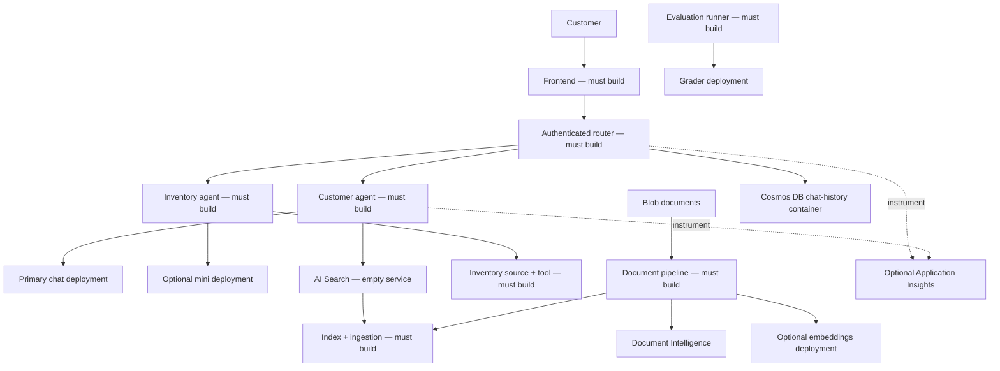

# Dukungan Pelanggan Multi-Agen — Cetak Biru Arsitektur Ritel

**Bab 5: Solusi AI Multi-Agen**

- [Halaman kursus](../README.md)
- [Bab 5](../docs/chapter-05-multi-agent/README.md)
- [Prasyarat: integrasi AI](../docs/chapter-02-ai-development/microsoft-foundry-integration.md)
- [Selanjutnya: Perencanaan kapasitas](../docs/chapter-06-pre-deployment/capacity-planning.md)
- [Kerangka infrastruktur ARM](retail-multiagent-arm-template/README.md)

> **Panduan arsitektur, bukan aplikasi yang berfungsi.** Satu-satunya berkas implementasi ritel
> adalah `azuredeploy.json`, `azuredeploy.parameters.json`, dan `deploy.sh` di
> `retail-multiagent-arm-template/`. Kontainer router/frontend adalah placeholder hello-world.
> Tidak ada agen ritel, UI, pipeline pengambilan data, evaluator, pemindai, atau
> rangkaian uji aplikasi yang ada secara lokal.

## Ikhtisar

**Tujuan:** merancang sistem dukungan pelanggan dengan agen pelanggan dan agen inventaris,
mengidentifikasi apa yang disediakan infrastruktur, dan merencanakan kontrak aplikasi
yang hilang serta verifikasi.

**Audiens:** pengembang yang telah menyelesaikan lokal
[contoh obrolan](../../../examples/azure-openai-chat) dan [contoh kontainer dua-layanan](../../../examples/container-app/microservices).
Luangkan 2–3 jam untuk studi arsitektur. Membangun aplikasi adalah proyek terpisah:
80–120 jam pengembangan adalah perkiraan perencanaan ilustratif untuk
pengembang yang berpengalaman, **bukan janji pengiriman**; pengerasan produksi, pengujian,
tinjauan keamanan, dan operasi memerlukan pekerjaan tambahan.

### Hasil pembelajaran

- Menjelaskan routing, grounding, izin alat, dan kepemilikan percakapan.
- Membedakan pengenal model, nama penyebaran, versi API, dan versi ARM.
- Merancang pengambilan dan penyimpanan dokumen dengan dimensi vektor yang cocok.
- Mendefinisikan persyaratan fungsional, evaluasi, dan pemulihan kegagalan yang dapat diverifikasi.
- Memisahkan tujuan arsitektur opsional dari sumber daya yang benar-benar disediakan.

## Arsitektur Solusi



Ini adalah **arsitektur aplikasi target**, bukan diagram layanan agen yang berjalan.
Kerangka ARM hanya membuat layanan dasar dan dua kontainer placeholder saja.
Front Door, registry, managed identities, penugasan peran,
endpoint privat, failover, instrumentasi aplikasi, dan peringatan tidak disertakan.

### Tanggung jawab dan kontrak

| Komponen | Perilaku yang diperlukan | Bukti sebelum dianggap selesai |
|---|---|---|
| Frontend | Mengautentikasi pengguna, menampilkan obrolan, mengunggah dokumen dengan aman | Pengujian UI dan unggah, kesalahan yang dapat diakses |
| Router | Mengesahkan permintaan, memilih agen, membatasi panggilan/timeout alat | Pengujian routing, pemeriksaan otorisasi, pengujian kegagalan |
| Agen pelanggan | Membumikan jawaban kebijakan/produk pada sumber yang disetujui | Kutipan yang benar, abstain saat data tidak tersedia |
| Alat inventaris | Membaca stok otoritatif dengan izin terbatas | Pengujian stok deterministik; tidak ada ketersediaan yang dibuat-buat |
| Jalur dokumen | Mengekstrak, memecah, menanam, mengindeks, memperbarui/menghapus | Perangkat pengujian terindeks dan perilaku coba ulang/kotak surat mati |
| Penyimpanan percakapan | Mengisolasi pengguna, memberlakukan retensi | Pengujian otorisasi lintas pengguna dan TTL |
| Penyaji evaluasi | Membandingkan keluaran dengan kebenaran dasar dan rubrik | Cakupan, jumlah kegagalan, laporan yang dapat direproduksi |

Anggap router sebagai meja resepsionis dan alat sebagai sistem internal terbatas:
memilih spesialis bukanlah otorisasi untuk mengakses semua catatan pelanggan.
Terapkan identitas dan izin dalam kode aplikasi dan layanan data, bukan di prompt.

## Infrastruktur vs. Aplikasi

Bacalah [README kerangka kerja](retail-multiagent-arm-template/README.md) sebelum
penyediaan. Ini mencantumkan sumber daya, mode, biaya, dan batasan secara tepat.

| Penggunaan logis | Nama penyebaran ARM | Model / versi | Wilayah default |
|---|---|---|---|
| Obrolan pelanggan | `gpt-4.1-chat` | `gpt-4.1` / `2025-04-14` | `eastus2` |
| Inventaris | `gpt-4.1-mini-inventory` | `gpt-4.1-mini` / `2025-04-14` | `westus2`, opsional |
| Embeddings | `text-embedding-ada-002` | `text-embedding-ada-002` / `2` | `francecentral`, opsional |
| Evaluasi | `gpt-4.1-grader` | `gpt-4.1` / `2025-04-14` | Wilayah utama secara default |

Periksa ketersediaan model/versi/SKU dan kuota di **setiap wilayah**. Obrolan/mini/grader
menggunakan `GlobalStandard`; embeddings menggunakan `Standard`. Pemetaan unit kapasitas ke TPM adalah
spesifik model. Jangan menambahkan unit kapasitas berbeda sebagai jaminan kuota universal.

Argumen `model` dari permintaan Azure OpenAI adalah **nama penyebaran**, bukan
selalu pengenal model katalog. Versi API data-plane `2024-10-21`
berbeda dari versi model `2025-04-14` dan sumber daya ARM `apiVersion`.
Anda tidak dapat memperbaiki model yang tidak tersedia hanya dengan mengubah versi API data-plane.

`--no-multi-region` melewati akun sekunder dan embeddings. Akun chat utama dan
grader independen tetap ada. Akun model terpisah tidak menyediakan failover otomatis;
itu memerlukan routing aplikasi, penyebaran kompatibel, pemeriksaan kesehatan,
batas coba ulang, dan tinjauan lokasi data.

## Peta Jalan Implementasi

### 1. Mulai dengan satu interaksi yang telah diuji

Sebelum menyediakan kerangka kerja besar, gunakan contoh obrolan lokal untuk membangun
konektivitas inferensi. Definisikan satu pertanyaan pelanggan representatif, sumber jawaban
yang disetujui, kutipan yang diharapkan, dan perilaku kegagalan saat sumber tersebut hilang.

### 2. Tentukan batas routing dan alat

Buat sumber router Anda sendiri, manifest dependensi, Dockerfile, dan pengujian. Kontrak ilustratif
bisa berupa `POST /chat` dengan `{"message":"...","conversation_id":"..."}`.
**Endpoint tersebut adalah proposal desain; tidak diimplementasikan oleh template ARM.**

Validasi tipe/batas tubuh, turunkan identitas pengguna dari autentikasi, terapkan
kepemilikan percakapan, terapkan batas waktu permintaan, dan kembalikan kode kesalahan yang bermakna.
Jangan anggap kegagalan HTTP atau balasan kosong sebagai hasil agen yang sukses.

### 3. Implementasi grounding dan pengambilan

Template ARM tidak membuat indeks pencarian. Ini adalah **fragmen JSON referensi
untuk diadaptasi dalam definisi indeks Anda sendiri**, bukan file yang sudah ada di repo:

```json
{
  "name": "retail-product-index",
  "fields": [
    {"name": "id", "type": "Edm.String", "key": true},
    {"name": "title", "type": "Edm.String", "searchable": true},
    {"name": "content", "type": "Edm.String", "searchable": true},
    {"name": "category", "type": "Edm.String", "filterable": true},
    {
      "name": "content_vector",
      "type": "Collection(Edm.Single)",
      "searchable": true,
      "dimensions": 1536,
      "vectorSearchProfile": "retail-profile"
    }
  ],
  "vectorSearch": {
    "algorithms": [{"name": "retail-hnsw", "kind": "hnsw"}],
    "profiles": [{"name": "retail-profile", "algorithm": "retail-hnsw"}]
  }
}
```

Profil menghubungkan bidang vektor ke algoritmanya. Dimensi harus cocok dengan
keluaran embedding aktual (1536 untuk penyebaran `ada-002` ini). Untuk pengambilan Python,
gunakan `azure.search.documents.models.VectorizedQuery` daripada
kamus tidak lengkap yang kehilangan jenis kueri vektornya:

```python
# Reference function only: supply an authenticated async SearchClient and an embedding.
from azure.search.documents.models import VectorizedQuery

async def retrieve(search_client, embedding):
    results = await search_client.search(
        search_text=None,
        vector_queries=[VectorizedQuery(
            vector=embedding,
            k_nearest_neighbors=5,
            fields="content_vector"
        )],
        select=["id", "title", "content"]
    )
    return [document async for document in results]
```

Buat implementasi pengambilan terpisah yang:

1. Mengesahkan akses unggah dan memvalidasi tipe dan ukuran konten.
2. Membaca blob privat menggunakan panggilan SDK yang diautentikasi. URL blob privat sendiri
   **bukan** input Document Intelligence yang bisa dibaca; kirim byte yang diunduh dengan
   `AnalyzeDocumentRequest(bytes_source=...)` atau gunakan SAS jangka pendek dengan cakupan yang sesuai setelah
   meninjau persyaratan akses.
3. Mengekstrak teks, memecahnya agar sesuai batas embedding, dan menghasilkan embeddings.
4. Membuat kunci dokumen yang valid dan stabil, mengunggah potongan dengan vektor yang cocok.
5. Memeriksa hasil pengindeksan per-dokumen, menangani coba ulang, dan memperbarui/menghapus data kadaluarsa.

Jangan menyisipkan kunci/nilai pengguna sembarangan ke dalam filter OData. Daftar putih kolom,
validasi tipe nilai, dan hindari tanda kutip dari string. Filter boolean dan numerik membutuhkan
literal bertipe, bukan string yang dikutip.

### 4. Grounding web

**Bing Search v7 sudah dihentikan pada 11 Agustus 2025.** `Microsoft.Bing/accounts` lama
dan contoh `api.bing.microsoft.com/v7.0/search` bukan merupakan jalur implementasi yang didukung.
Evaluasi integrasi pembumian yang saat ini didukung di Microsoft Foundry dan SDK-nya,
izin, penagihan, dan persyaratan kutipan; tidak ada yang diimplementasikan di sini.
Ini bukan pengganti langsung untuk endpoint yang dihentikan.

### 5. Tambahkan telemetri dan evaluasi

Membuat Application Insights tidak secara otomatis menginstrumentasikan kode. Gunakan instrumentasi Azure Monitor
OpenTelemetry yang didukung saat membangun aplikasi baru, teruskan konteks trace antar layanan,
dan hindari pencatatan permintaan pelanggan, dokumen, atau rahasia.
Memotong kueri **tidak** membuatnya anonim.

Ukur durasi permintaan, kegagalan routing/peralatan, relevansi pengambilan, ketepatan kutipan,
penggunaan token, dan penolakan. Simpan fakta inventaris/kebijakan yang benar sebenarnya
bersamaan dengan kasus evaluasi: seorang penguji tidak dapat secara andal menentukan ketepatan fakta
hanya dari pertanyaan dan jawaban.

Penyebaran penguji bukanlah pelaksana evaluasi. Implementasikan rubrik versi,
validasi output/struktur skema, pemeriksaan rentang skor, hitungan kegagalan transportasi,
dan kasus yang ditinjau oleh manusia. Laporkan kasus yang tidak lengkap/error secara terpisah;
jangan mengonversinya menjadi nilai berhasil atau diam-diam memasukkannya sebagai respons model kualitas nol.

Demikian juga, beberapa pemeriksaan kata kunci bukanlah sertifikasi keamanan. Permintaan HTTP yang gagal,
strategi pengujian yang hilang, atau respons kosong harus membuat pengujian menjadi **tidak konklusif atau gagal**,
bukan menghasilkan skor "100% aman". Lakukan pengujian yang diotorisasi dengan alat yang tepat
dan tinjauan manusia sebelum klaim kesiapan produksi apa pun.

### 6. Sebarkan aplikasi Anda

Buat direktori sumber Anda sendiri, manifes, pengujian, registri, dan izin penarikan gambar.
Ganti placeholder dengan gambar yang dibangun dan perbarui ingress/probe untuk
menyesuaikan port pendengaran setiap aplikasi. Konfigurasikan variabel lingkungan runtime di Bicep
atau pemetaan lingkungan azd yang didukung secara eksplisit.

Tidak ada kamus generik `config` di bawah layanan azd yang secara otomatis
membuat variabel lingkungan runtime. `azd env set` hanya mengubah sumber daya yang
secara eksplisit menggunakan nilai tersebut. Tidak ada canary, daftar region, atau kait fine-tuning
yang diimplementasikan dalam kerangka ini.

## Latihan desain praktis

Ini adalah **latihan arsitektur**, bukan klaim kode awal ritel yang dapat dijalankan.

### Latihan 1: Verifikasi batas

**Titik awal:** tiga file di `retail-multiagent-arm-template/`.
**Tujuan:** membedakan penyediaan dari fungsi aplikasi.
Buka `azuredeploy.json`, temukan kedua gambar kontainer dan nilai `targetPort`,
lalu daftarkan komponen aplikasi yang hilang dari repositori.

**Kriteria keberhasilan / jawaban:** kedua gambar adalah placeholder hello-world yang mendengarkan
pada port 80; agen, chat UI, pengelola router, indeks/penyisipan, evaluator, dan pemindai
tidak ada. Permintaan root placeholder yang berhasil tidak memvalidasi `/chat`.
**Masalah umum:** mengartikan nama sumber daya seperti `retail-router` sebagai kode yang berfungsi.

### Latihan 2: Telusuri konfigurasi vektor

**Titik awal:** JSON indeks di atas.
**Tujuan:** pahami hubungan antara field → profil → algoritma.
Identifikasi nilai mana yang harus berubah ketika beralih ke model embedding dengan
dimensi output yang berbeda, lalu periksa fungsi `retrieve`.

**Kriteria keberhasilan / jawaban:** ubah field `dimensions` ke panjang vektor sebenarnya;
jaga agar `vectorSearchProfile` tetap selaras dengan profil yang dideklarasikan dan algoritmanya;
query `fields` harus menyebutkan field vektor. Regenerasi vektor dokumen yang ada
saat model embedding berubah.
**Masalah umum:** hanya mengganti nama model tanpa mengubah vektor yang tidak kompatibel.

### Latihan 3: Definisikan tes kegagalan

**Titik awal:** tabel tanggung jawab.
**Tujuan:** cegah keberhasilan palsu.
Tuliskan perilaku yang diharapkan untuk API inventaris yang tidak tersedia, indeks pencarian tanpa
dokumen yang cocok, dan permintaan evaluasi yang mengembalikan HTTP 503.

**Kriteria keberhasilan / jawaban:** tidak ada nilai inventaris yang dibuat-buat; penolakan eksplisit atau
eskalasi saat konteks hilang; evaluasi melaporkan kegagalan transportasi daripada
lulus kualitas atau keamanan. Tambahkan pengujian yang dapat dieksekusi saat membangun aplikasi.
**Masalah umum:** menangkap setiap pengecualian dan melanjutkan dengan jawaban kosong.

## Biaya, pemecahan masalah, dan pembersihan

- Infrastruktur memiliki biaya berkelanjutan bahkan dengan indeks pencarian kosong dan aplikasi
  placeholder. Gunakan harga regional saat ini; baik “minimal” maupun multi-region tidak berarti gratis.
- Biaya token bergantung pada model, input yang di-cache/tidak, output, dan SKU penyebaran.
  Routing dapat menghemat uang hanya jika beban kerja dan hasil kualitas yang diukur mendukungnya;
  penghematan tetap 60–80% tidak dijamin.
- Periksa ketersediaan model dan kuota sebelum penyediaan; bedakan kesalahan izin,
  nama penyebaran, region, versi model, dan versi API.
- Jangan jalankan `setup-data.sh`, CLI evaluator yang hilang, atau perintah `pytest tests/`.
  Implementasi mereka adalah bagian dari backlog pengembangan Anda.
- Kerangka ini hanya ARM: ikuti
  [instruksi verifikasi dan pembersihan](retail-multiagent-arm-template/README.md).
  `azd down` tidak mengelola sumber daya tersebut.

## Sumber daya terkait

- [Contoh chat lokal yang berfungsi](../../../examples/azure-openai-chat)
- [Contoh dua layanan kontainer yang berfungsi](../../../examples/container-app/microservices)
- [Indeks vektor Pencarian AI](https://learn.microsoft.com/azure/search/vector-search-how-to-create-index)
- [Dokumentasi Container Apps](https://learn.microsoft.com/azure/container-apps/)
- [Pemecahan masalah](../docs/chapter-07-troubleshooting/common-issues.md)
- [Laporkan masalah](https://github.com/microsoft/AZD-for-beginners/issues)

---

<!-- CO-OP TRANSLATOR DISCLAIMER START -->
**Penafian**:
Dokumen ini telah diterjemahkan menggunakan layanan terjemahan AI [Co-op Translator](https://github.com/Azure/co-op-translator). Meskipun kami berupaya untuk mencapai akurasi, harap diketahui bahwa terjemahan otomatis mungkin mengandung kesalahan atau ketidakakuratan. Dokumen asli dalam bahasa aslinya harus dianggap sebagai sumber yang sah. Untuk informasi penting, disarankan menggunakan terjemahan profesional oleh manusia. Kami tidak bertanggung jawab atas kesalahpahaman atau penafsiran yang keliru yang timbul dari penggunaan terjemahan ini.
<!-- CO-OP TRANSLATOR DISCLAIMER END -->