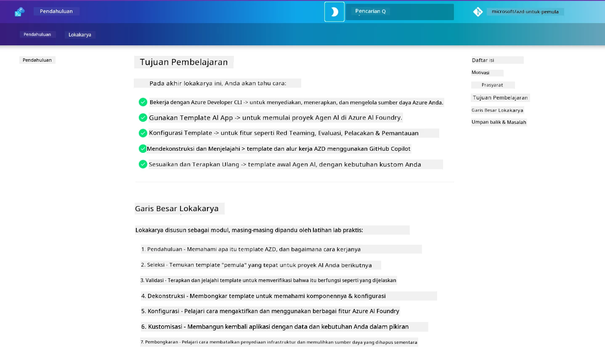

<div align="center">
  <div style="background: linear-gradient(135deg, #0078d4, #106ebe); border-radius: 10px; padding: 20px; margin: 20px 0; box-shadow: 0 4px 15px rgba(0, 120, 212, 0.3); border: 2px solid #005a9e;">
    <h2 style="color: white; margin: 0; font-size: 24px; text-shadow: 1px 1px 2px rgba(0,0,0,0.3);">
      🎯 Lokakarya AZD untuk Pengembang AI
    </h2>
    <p style="color: white; margin: 10px 0 0 0; font-size: 16px; text-shadow: 1px 1px 2px rgba(0,0,0,0.3);">
      <strong>Sebuah lokakarya praktik langsung untuk membangun aplikasi AI dengan Azure Developer CLI.</strong><br>
      Selesaikan 7 modul untuk menguasai template AZD dan alur kerja penempatan AI.
    </p>
    <div style="margin-top: 15px;">
      <span style="background: rgba(255,255,255,0.2); padding: 5px 10px; border-radius: 15px; color: white; font-size: 14px;">
        📅 Panduan sumber ditinjau: November 2026
      </span>
    </div>
  </div>
</div>

# Lokakarya AZD untuk Pengembang AI

Selamat datang di lokakarya praktik langsung untuk mempelajari Azure Developer CLI (AZD) dengan fokus pada penempatan aplikasi AI. Lokakarya ini membantu Anda memperoleh pemahaman terapan tentang template AZD dalam 3 langkah:

1. **Penemuan** - temukan template yang tepat untuk Anda.
1. **Penempatan** - tempatkan dan validasi bahwa itu berfungsi
1. **Kustomisasi** - modifikasi dan iterasikan agar menjadi milik Anda!

Sepanjang lokakarya ini, Anda juga akan diperkenalkan pada alat pengembang inti dan alur kerja, untuk membantu Anda memperlancar perjalanan pengembangan end-to-end.

<br/>

## Panduan Berbasis Browser

Pelajaran lokakarya tersedia dalam Markdown. Anda dapat menavigasinya langsung di GitHub - atau meluncurkan preview berbasis browser seperti yang ditunjukkan di tangkapan layar di bawah.



Untuk menggunakan opsi ini - buat fork repositori ke profil Anda, dan luncurkan GitHub Codespaces. Setelah terminal VS Code aktif, ketik perintah ini:

Preview browser ini bekerja di GitHub Codespaces, container pengembang, atau salinan lokal dengan Python dan MkDocs terpasang.

```bash title="" linenums="0"
python -m pip install -r requirements-dev.txt
python -m mkdocs serve --config-file workshop/mkdocs.yml
```

Jalankan perintah ini dari **akar repositori kursus**, bukan sampel AI yang diinisialisasi secara terpisah. Biarkan preview tetap di latar depan agar kesalahan tetap terlihat; hentikan dengan Ctrl+C. Untuk memeriksa situs tanpa menyajikannya, jalankan `python -m mkdocs build --strict --config-file workshop/mkdocs.yml`.

Dalam beberapa detik, Anda akan melihat dialog pop-up. Pilih opsi untuk `Open in browser`. Panduan berbasis web sekarang akan terbuka di tab browser baru. Beberapa manfaat dari preview ini:

1. **Pencarian bawaan** - temukan kata kunci atau pelajaran dengan cepat.
1. **Ikon salin** - arahkan mouse ke blok kode untuk melihat opsi ini
1. **Pengalih tema** - beralih antara tema gelap dan terang
1. **Dapatkan bantuan** - klik ikon Discord di footer untuk bergabung!

<br/>

## Ikhtisar Lokakarya

**Durasi:** 3-4 jam  
**Tingkat:** Pemula hingga Menengah  
**Prasyarat:** Familiar dengan Azure, konsep AI, VS Code & alat baris perintah.

Ini adalah lokakarya praktik langsung di mana Anda belajar dengan melakukan. Setelah menyelesaikan latihan, kami merekomendasikan meninjau kurikulum AZD Untuk Pemula untuk melanjutkan perjalanan belajar Anda ke praktik terbaik Keamanan dan Produktivitas.

| Waktu| Modul  | Tujuan |
|:---|:---|:---|
| 15 menit | [Pendahuluan](docs/instructions/0-Introduction.md) | Menetapkan tahap, memahami tujuan |
| 30 menit | [Pilih Template AI](docs/instructions/1-Select-AI-Template.md) | Eksplorasi opsi dan pilih starter | 
| 30 menit | [Validasi Template AI](docs/instructions/2-Validate-AI-Template.md) | Tempatkan solusi default ke Azure |
| 30 menit | [Dekonstruksi Template AI](docs/instructions/3-Deconstruct-AI-Template.md) | Jelajahi struktur dan konfigurasi |
| 30 menit | [Konfigurasi Template AI](docs/instructions/4-Configure-AI-Template.md) | Aktifkan dan coba fitur tersedia |
| 30 menit | [Kustomisasi Template AI](docs/instructions/5-Customize-AI-Template.md) | Sesuaikan template dengan kebutuhan Anda |
| 30 menit | [Pembongkaran Infrastruktur](docs/instructions/6-Teardown-Infrastructure.md) | Bersihkan dan lepaskan sumber daya |
| 15 menit | [Penutup & Langkah Berikutnya](docs/instructions/7-Wrap-up.md) | Sumber belajar, tantangan Lokakarya |

<br/>

## Apa yang Akan Anda Pelajari

Anggap Template AZD sebagai area belajar untuk mengeksplorasi berbagai kemampuan dan alat untuk pengembangan end-to-end di Microsoft Foundry. Pada akhir lokakarya ini, Anda seharusnya memiliki pemahaman intuitif untuk berbagai alat dan konsep dalam konteks ini.

| Konsep  | Tujuan |
|:---|:---|
| **Azure Developer CLI** | Pahami perintah alat dan alur kerja|
| **Template AZD**| Pahami struktur proyek dan konfigurasi|
| **Agen AI Azure**| Fasilitasi & tempatkan proyek Microsoft Foundry  |
| **Pencarian AI Azure**| Aktifkan rekayasa konteks dengan agen |
| **Observabilitas**| Jelajahi penelusuran, pemantauan dan evaluasi |
| **Red Teaming**| Jelajahi pengujian adversarial dan mitigasi |

<br/>

## Struktur Lokakarya

Lokakarya ini disusun untuk membawa Anda dalam perjalanan mulai dari penemuan template, penempatan, dekonstruksi, dan kustomisasi - menggunakan template starter resmi [Memulai dengan Agen AI](https://github.com/Azure-Samples/get-started-with-ai-agents) sebagai dasar.

### [Modul 1: Pilih Template AI](docs/instructions/1-Select-AI-Template.md) (30 menit)

- Apa itu Template AI?
- Di mana saya dapat menemukan Template AI?
- Bagaimana saya dapat mulai membangun Agen AI?
- **Lab**: Mulai cepat di Codespaces atau container pengembang

### [Modul 2: Validasi Template AI](docs/instructions/2-Validate-AI-Template.md) (30 menit)

- Apa arsitektur Template AI?
- Apa alur kerja Pengembangan AZD?
- Bagaimana saya dapat mendapatkan bantuan dengan Pengembangan AZD?
- **Lab**: Tempatkan & Validasi template Agen AI

### [Modul 3: Dekonstruksi Template AI](docs/instructions/3-Deconstruct-AI-Template.md) (30 menit)

- Jelajahi lingkungan Anda di `.azure/` 
- Jelajahi pengaturan sumber daya Anda di `infra/` 
- Jelajahi konfigurasi AZD Anda di `azure.yaml`s
- **Lab**: Modifikasi Variabel Lingkungan & Tempatkan kembali

### [Modul 4: Konfigurasi Template AI](docs/instructions/4-Configure-AI-Template.md) (30 menit)
- Jelajahi: Retrieval Augmented Generation
- Jelajahi: Evaluasi Agen & Red Teaming
- Jelajahi: Penelusuran & Pemantauan
- **Lab**: Jelajahi Agen AI + Observabilitas 

### [Modul 5: Kustomisasi Template AI](docs/instructions/5-Customize-AI-Template.md) (30 menit)
- Definisikan: PRD dengan Persyaratan Skenario
- Konfigurasikan: Variabel Lingkungan untuk AZD
- Implementasikan: Lifecycle Hooks untuk tugas tambahan
- **Lab**: Sesuaikan template untuk skenario saya

### [Modul 6: Pembongkaran Infrastruktur](docs/instructions/6-Teardown-Infrastructure.md) (30 menit)
- Ulasan: Apa itu Template AZD?
- Ulasan: Mengapa menggunakan Azure Developer CLI?
- Langkah Selanjutnya: Coba template berbeda!
- **Lab**: Deprovisi infrastruktur & pembersihan

<br/>

## Tantangan Lokakarya

Ingin menantang diri Anda untuk melakukan lebih? Berikut beberapa saran proyek - atau bagikan ide Anda dengan kami!!

| Proyek | Deskripsi |
|:---|:---|
|1. **Dekonstruksi Template AI Kompleks** | Gunakan alur kerja dan alat yang kami jelaskan dan lihat apakah Anda dapat menempatkan, memvalidasi, dan menyesuaikan template solusi AI yang berbeda. _Apa yang Anda pelajari?_|
|2. **Kustomisasi Dengan Skenario Anda**  | Cobalah menulis PRD (Dokumen Persyaratan Produk) untuk skenario berbeda. Kemudian gunakan GitHub Copilot di repo template Anda di Model Agen - dan minta untuk menghasilkan alur kerja kustomisasi untuk Anda. _Apa yang Anda pelajari? Bagaimana Anda dapat meningkatkan saran ini?_|
| | |

## Punya masukan?

1. Buat isu di repo ini - beri tag `Workshop` untuk kemudahan.
1. Bergabunglah di Discord Microsoft Foundry - terhubung dengan rekan Anda!


| | | 
|:---|:---|
| **📚 Beranda Kursus**| [AZD Untuk Pemula](../README.md)|
| **📖 Dokumentasi** | [Memulai dengan template AI](https://learn.microsoft.com/en-us/azure/ai-foundry/how-to/develop/ai-template-get-started)|
| **🛠️Template AI** | [Template Microsoft Foundry](https://ai.azure.com/templates) |
|**🚀 Langkah Berikutnya** | [Mulai Lokakarya](#workshop-overview) |
| | |

<br/>

---

**Navigasi:** [Kursus Utama](../README.md) | [Pendahuluan](docs/instructions/0-Introduction.md) | [Modul 1: Pilih Template](docs/instructions/1-Select-AI-Template.md)

**Siap mulai membangun aplikasi AI dengan AZD?**

[Mulai Lokakarya: Pendahuluan →](docs/instructions/0-Introduction.md)

---

<!-- CO-OP TRANSLATOR DISCLAIMER START -->
**Penafian**:
Dokumen ini telah diterjemahkan menggunakan layanan terjemahan AI [Co-op Translator](https://github.com/Azure/co-op-translator). Meskipun kami berupaya untuk mencapai akurasi, harap diketahui bahwa terjemahan otomatis mungkin mengandung kesalahan atau ketidakakuratan. Dokumen asli dalam bahasa aslinya harus dianggap sebagai sumber yang sah. Untuk informasi penting, disarankan menggunakan terjemahan profesional oleh manusia. Kami tidak bertanggung jawab atas kesalahpahaman atau penafsiran yang keliru yang timbul dari penggunaan terjemahan ini.
<!-- CO-OP TRANSLATOR DISCLAIMER END -->