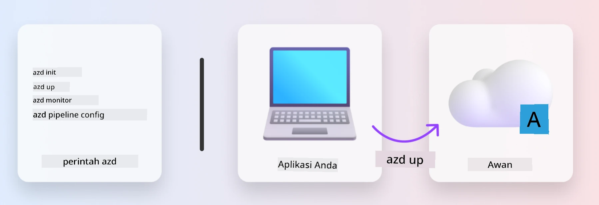
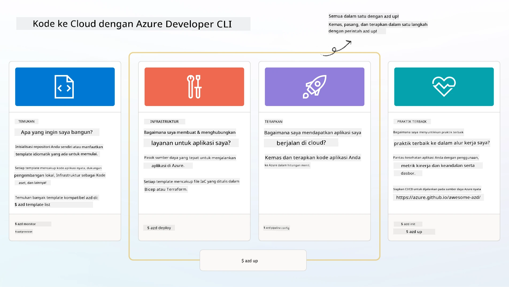

# 1. Pilih Template

!!! tip "PADA AKHIR MODUL INI ANDA AKAN BISA"

    - [ ] Describe what AZD templates are
    - [ ] Discover and use AZD templates for AI
    - [ ] Get started with the AI Agents template
    - [ ] **Lab 1:** AZD Quickstart in Codespaces or a dev container

---

## 1. Analogi Seorang Pembangun

Membangun aplikasi AI modern yang siap digunakan di perusahaan _dari nol_ bisa terasa menakutkan. Ini sedikit seperti membangun rumah baru Anda sendiri, satu per satu bata. Ya, itu bisa dilakukan! Tapi ini bukan cara paling efektif untuk mendapatkan hasil akhir yang diinginkan! 

Sebagai gantinya, kita sering memulai dengan sebuah _cetakan desain_ yang sudah ada, dan bekerja dengan seorang arsitek untuk menyesuaikannya dengan kebutuhan pribadi kita. Dan itulah pendekatan yang tepat saat membangun aplikasi cerdas. Pertama, temukan arsitektur desain yang bagus yang sesuai dengan ruang masalah Anda. Kemudian bekerja dengan seorang arsitek solusi untuk menyesuaikan dan mengembangkan solusi untuk skenario spesifik Anda.

Tapi di mana kita bisa menemukan cetakan desain ini? Dan bagaimana cara menemukan arsitek yang bersedia mengajari kita cara menyesuaikan dan menerapkan cetakan ini sendiri? Dalam lokakarya ini, kami menjawab pertanyaan-pertanyaan tersebut dengan memperkenalkan Anda pada tiga teknologi:

1. [Azure Developer CLI](https://aka.ms/azd) - sebuah alat open-source yang mempercepat jalur pengembang dari pengembangan lokal (membangun) hingga penerapan cloud (mengirim).
1. [Microsoft Foundry Templates](https://ai.azure.com/templates) - repositori open-source standar yang berisi contoh kode, infrastruktur, dan file konfigurasi untuk menerapkan arsitektur solusi AI.
1. [GitHub Copilot Agent Mode](https://code.visualstudio.com/docs/copilot/chat/chat-agent-mode) - agen pengkodean yang berlandaskan pengetahuan Azure, yang dapat membimbing kita dalam menavigasi basis kode dan membuat perubahan - menggunakan bahasa alami.

Dengan alat-alat ini di tangan, kita sekarang bisa _menemukan_ template yang tepat, _menerapkannya_ untuk memvalidasi bahwa itu bekerja, dan _menyesuaikannya_ agar sesuai dengan skenario spesifik kita. Mari kita mulai dan pelajari bagaimana alat-alat ini bekerja.


---

## 2. Azure Developer CLI

The [Azure Developer CLI](https://learn.microsoft.com/en-us/azure/developer/azure-developer-cli/) (atau `azd`) adalah alat baris perintah sumber terbuka yang dapat mempercepat perjalanan kode-ke-cloud Anda dengan serangkaian perintah ramah pengembang yang bekerja secara konsisten di IDE (pengembangan) dan lingkungan CI/CD (devops) Anda.

Dengan `azd`, perjalanan penyebaran Anda dapat sesederhana:

- `azd init` - Menginisialisasi proyek AI baru dari template AZD yang ada.
- `azd up` - Menyediakan infrastruktur dan menyebarkan aplikasi Anda dalam satu langkah.
- `azd monitor` - Mendapatkan pemantauan waktu nyata dan diagnostik untuk aplikasi yang telah disebarkan.
- `azd pipeline config` - Menyiapkan pipeline CI/CD untuk mengotomatiskan penyebaran ke Azure.

**🎯 | LATIHAN**: <br/> Jelajahi alat baris perintah `azd` di lingkungan lokakarya Anda saat ini sekarang. Ini bisa berupa GitHub Codespaces, kontainer dev, atau klon lokal dengan prasyarat terpasang. Mulailah dengan mengetik perintah ini untuk melihat apa yang bisa dilakukan alat tersebut:

```bash title="" linenums="0"
azd help
```



---

## 3. Template AZD

Agar `azd` dapat mencapai ini, ia perlu mengetahui infrastruktur yang harus disediakan, pengaturan konfigurasi yang harus ditegakkan, dan aplikasi yang akan disebarkan. Di sinilah [template AZD](https://learn.microsoft.com/en-us/azure/developer/azure-developer-cli/azd-templates?tabs=csharp) berperan.

Template AZD adalah repositori sumber terbuka yang menggabungkan kode contoh dengan berkas infrastruktur dan konfigurasi yang diperlukan untuk menyebarkan arsitektur solusi.
Dengan menggunakan pendekatan _Infrastructure-as-Code_ (IaC), mereka memungkinkan definisi sumber daya template dan pengaturan konfigurasi dikendalikan versinya (seperti kode sumber aplikasi) - menciptakan alur kerja yang dapat digunakan kembali dan konsisten antara pengguna proyek tersebut.

Saat membuat atau menggunakan kembali template AZD untuk skenario _Anda_, pertimbangkan pertanyaan berikut:

1. Apa yang sedang Anda bangun? → Apakah ada template yang memiliki kode awal untuk skenario tersebut?
1. Bagaimana arsitektur solusi Anda? → Apakah ada template yang memiliki sumber daya yang diperlukan?
1. Bagaimana solusi Anda disebarkan? → Pikirkan `azd deploy` dengan kait pra/pasca-pemrosesan!
1. Bagaimana Anda dapat mengoptimalkannya lebih lanjut? → Pikirkan pemantauan bawaan dan pipeline otomatisasi!

**🎯 | LATIHAN**: <br/>
Kunjungi galeri [Awesome AZD](https://azure.github.io/awesome-azd/) dan gunakan filter untuk menjelajahi 250+ template yang saat ini tersedia. Lihat apakah Anda dapat menemukan yang sesuai dengan kebutuhan skenario _Anda_.



---

## 4. Template Aplikasi AI

Untuk aplikasi bertenaga AI, Microsoft menyediakan template khusus yang menampilkan **Microsoft Foundry** dan **Foundry Agents**. Template ini mempercepat jalan Anda untuk membangun aplikasi cerdas yang siap produksi.

### Template Microsoft Foundry & Foundry Agents

Pilih template di bawah untuk melakukan penyebaran. Setiap template tersedia di [Awesome AZD](https://azure.github.io/awesome-azd/) dan dapat diinisialisasi dengan satu perintah.

| Template | Deskripsi | Perintah Penyebaran |
|----------|-------------|----------------|
| **[AI Chat dengan RAG](https://github.com/Azure-Samples/azure-search-openai-demo)** | Aplikasi chat berlandaskan pencarian | `azd init -t Azure-Samples/azure-search-openai-demo .` |
| **[Mulai dengan AI Agents](https://github.com/Azure-Samples/get-started-with-ai-agents)** | Aplikasi chat didukung agen; digunakan sepanjang lokakarya ini | `azd init -t Azure-Samples/get-started-with-ai-agents .` |
| **[Mulai dengan AI Chat](https://github.com/Azure-Samples/get-started-with-ai-chat)** | Aplikasi chat AI pemula | `azd init -t Azure-Samples/get-started-with-ai-chat .` |

Ini adalah alternatif: inisialisasi **satu** template di direktori kosongnya sendiri. `.` yang mengikuti memilih direktori tersebut; melewatkannya pada versi AZD saat ini membuat subdirektori bernama template. Inisialisasi mengunduh proyek; `azd up` melakukan penyebaran yang dapat ditagihkan setelah Anda meninjau prasyarat, sumber daya, dukungan wilayah, dan kuota.

### Mulai Cepat

1. **Jelajahi template**: Kunjungi [https://azure.github.io/awesome-azd/](https://azure.github.io/awesome-azd/) dan saring berdasarkan `AI`, `Agents`, atau `Microsoft Foundry`
2. **Pilih template Anda**: Pilih yang sesuai dengan kasus penggunaan Anda
3. **Inisialisasi**: Jalankan perintah `azd init` untuk template pilihan Anda
4. **Sosialisasi**: Jalankan `azd up` untuk menyediakan dan menyebarkan

**🎯 | LATIHAN**: <br/>
Pilih salah satu template di atas berdasarkan skenario Anda:

- **Melanjutkan lokakarya ini?** → Pilih **Mulai dengan AI Agents**
- **Membangun chat berlandaskan pencarian?** → Jelajahi **AI Chat dengan RAG** secara terpisah
- **Perlu arsitektur lain?** → Cari di galeri dan verifikasi repositori aktual, status implementasi, dan prasyarat

```bash title="Initialize the workshop template in an empty directory" linenums="0"
azd init -t Azure-Samples/get-started-with-ai-agents .
azd auth login
azd up
```

!!! info "Jelajahi Lebih Banyak Template"
    Galeri [Awesome AZD](https://azure.github.io/awesome-azd/) berisi 250+ template. Gunakan filter untuk menemukan template yang sesuai dengan kebutuhan spesifik Anda untuk bahasa, kerangka kerja, dan layanan Azure.

---

<!-- CO-OP TRANSLATOR DISCLAIMER START -->
**Penafian**:
Dokumen ini telah diterjemahkan menggunakan layanan terjemahan AI [Co-op Translator](https://github.com/Azure/co-op-translator). Meskipun kami berupaya untuk mencapai akurasi, harap diketahui bahwa terjemahan otomatis mungkin mengandung kesalahan atau ketidakakuratan. Dokumen asli dalam bahasa aslinya harus dianggap sebagai sumber yang sah. Untuk informasi penting, disarankan menggunakan terjemahan profesional oleh manusia. Kami tidak bertanggung jawab atas kesalahpahaman atau penafsiran yang keliru yang timbul dari penggunaan terjemahan ini.
<!-- CO-OP TRANSLATOR DISCLAIMER END -->