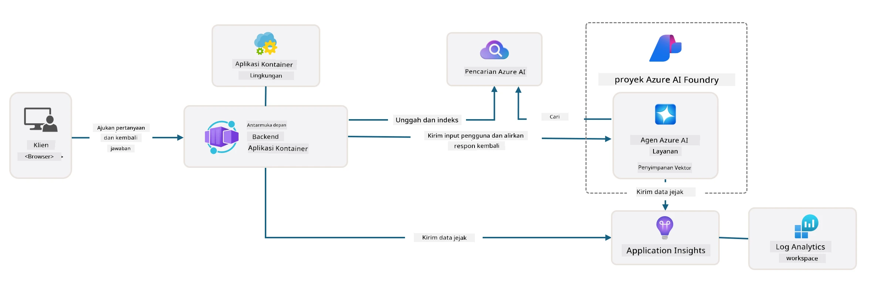

# 3. Membongkar Template

!!! tip "PADA AKHIR MODUL INI ANDA AKAN MAMPU"

    - [ ] Use GitHub Copilot and optional MCP tools for Azure documentation and read-only exploration
    - [ ] Identify the template's application, infrastructure, configuration, and test entry points
    - [ ] Verify generated explanations against actual repository files
    - [ ] **Lab 3:** Trace one request and one configuration input through the project

---

## 1. Aktifkan GitHub Copilot

Buka contoh AI yang diinisialisasi di VS Code dan aktifkan [GitHub Copilot](https://code.visualstudio.com/docs/copilot/chat/chat-agent-mode). Masuk dengan akun yang memiliki paket yang memenuhi syarat; batas penggunaan bervariasi. Mintalah Copilot untuk menjelaskan repositori sebelum mengizinkan perubahan.

### Server MCP Opsional

Layanan ini dapat menyediakan alat tambahan:

- [Azure MCP Server](https://learn.microsoft.com/azure/developer/azure-mcp-server/overview)
- [Microsoft Learn MCP Server](https://learn.microsoft.com/training/support/mcp)

Di VS Code, tinjau [panduan konfigurasi MCP](https://code.visualstudio.com/docs/copilot/chat/mcp-servers) dan buat `.vscode/mcp.json` jika diperlukan:

```json
{
  "servers": {
    "Azure MCP Server": {
      "type": "stdio",
      "command": "npx",
      "args": ["-y", "@azure/mcp@latest", "server", "start"]
    },
    "microsoft.docs.mcp": {
      "type": "http",
      "url": "https://learn.microsoft.com/api/mcp"
    }
  }
}
```

Perintah `npx` memerlukan instalasi Node.js/npm yang didukung dan mengunduh kode eksekusi. Tinjau paket dan tetapkan versi yang disetujui untuk pengaturan tim yang dapat direproduksi. Mulai server menggunakan kontrol MCP di VS Code dan periksa alat yang tersedia; nama dapat berubah antar versi.

**Otentikasi terpisah.** Gunakan `azd auth login` untuk AZD. Ikuti alur otentikasi Azure MCP yang terdokumentasi untuk alatnya; masuk AZD saja tidak membangun sesi MCP. Gunakan `az login` secara terpisah saat latihan atau hook memanggil Azure CLI.

Coba prompt hanya baca:

1. “Gunakan Microsoft Learn MCP untuk mencari dokumentasi konfigurasi Azure Developer CLI.”
2. “Jelaskan `azure.yaml` repositori ini; sebutkan file yang mengimplementasikan setiap hook.”
3. “Menggunakan alat Azure MCP yang tersedia, daftar sumber daya yang saya terapkan tanpa mengubah apa pun.”

Periksa tenant/langganan yang dipilih dan setiap panggilan alat yang diusulkan. Jangan setujui pembuatan, penghapusan, atau perubahan akses sumber daya hanya untuk menjelajahi arsitektur.

## 2. Memahami arsitektur

Contoh ini menampung backend Python FastAPI dan frontend React/TypeScript di Azure Container Apps. Backend berkomunikasi dengan agen di proyek Microsoft Foundry. Pengambilan dan observabilitas bergantung pada fitur template yang diaktifkan dan pengaturan yang berhasil; tidak dijamin hanya karena aplikasi diterapkan.



Bandingkan diagram ini dengan [panduan penerapan upstream saat ini](https://github.com/Azure-Samples/get-started-with-ai-agents/blob/main/docs/deployment.md) dan sumber daya aktual Anda. Periksa penerapan model yang dikonfigurasi, alat agen, identitas terkelola, penugasan peran, dan sumber daya AI Search/Application Insights opsional.

**Latihan:** Minta Copilot melacak permintaan chat dari frontend melalui API ke Foundry, dengan referensi file dan fungsi. Buka referensi tersebut dan verifikasi penjelasannya. Jangan menarik kesimpulan tentang otentikasi, routing, atau otorisasi yang diimplementasikan hanya dari diagram.

## 3. Struktur repositori

Jalur terpilih berikut diperiksa terhadap contoh pada 4 November 2026. Revisi inisialisasi Anda tetap menjadi sumber kebenaran:

```text
get-started-with-ai-agents/
  azure.yaml
  docker-compose.yaml
  requirements-dev.txt
  .devcontainer/
  infra/
    main.bicep
    main.parameters.json
    api.bicep
    core/
  src/
    Dockerfile
    pyproject.toml
    requirements.txt
    api/
      main.py
      routes.py
      search_index_manager.py
    frontend/
      package.json
      src/
    files/
  scripts/
    validate_env_vars.sh
    validate_env_vars.ps1
    postdeploy.sh
    postdeploy.ps1
  tests/
    test_evaluation.py
    test_red_teaming.py
  docs/
    deployment.md
    deploy_customization.md
    ai_search.md
    observability.md
    local_development.md
    troubleshooting.md
```

### Infrastruktur dan konfigurasi

`infra/main.bicep` mengorkestrasi sumber daya; `main.parameters.json` menghubungkan input template ke nilai lingkungan AZD. `azure.yaml` memilih layanan aplikasi dan lifecycle hooks. Telusuri input seperti `USE_AZURE_AI_SEARCH_SERVICE` melalui file-file ini untuk menemukan apa yang sebenarnya berubah.

### Aplikasi dan identitas

Baca `src/api/` dan `src/frontend/` bersama-sama. Identifikasi tempat agen dibuat atau diambil, di mana instruksi/alat dikonfigurasi, dan identitas mana yang digunakan setiap panggilan Azure. File contoh di bawah `src/files/` adalah data demonstrasi, bukan katalog produksi atau model otorisasi.

### Tes dan observabilitas

Titik masuk evaluasi dan red-teaming saat ini berada di bawah `tests/`; referensi direktori `evals/` dan `airedteaming/` yang lama sudah usang untuk contoh ini. Baca `docs/observability.md` untuk prasyarat dan biaya sebelum menjalankan tes cloud. Tes Python ini terpisah dari ekstensi AZD opsional `azure.ai.evaluations`.

## 4. Verifikasi temuan Anda

- Identifikasi rute API, interaksi agen, dan kode pengambilan untuk satu pertanyaan contoh.
- Jelaskan identitas mana yang mengakses Foundry dan konfigurasi mana yang memilih endpointnya.
- Temukan skrip pre-up dan post-deploy yang sebenarnya dan perilaku penanganan kesalahannya.
- Daftar dependensi atau fitur opsional yang tidak ada dalam penerapan Anda.

Lanjutkan ke [Konfigurasi Template](4-Configure-AI-Template.md).

---

<!-- CO-OP TRANSLATOR DISCLAIMER START -->
**Penafian**:
Dokumen ini telah diterjemahkan menggunakan layanan terjemahan AI [Co-op Translator](https://github.com/Azure/co-op-translator). Meskipun kami berupaya untuk mencapai akurasi, harap diketahui bahwa terjemahan otomatis mungkin mengandung kesalahan atau ketidakakuratan. Dokumen asli dalam bahasa aslinya harus dianggap sebagai sumber yang sah. Untuk informasi penting, disarankan menggunakan terjemahan profesional oleh manusia. Kami tidak bertanggung jawab atas kesalahpahaman atau penafsiran yang keliru yang timbul dari penggunaan terjemahan ini.
<!-- CO-OP TRANSLATOR DISCLAIMER END -->