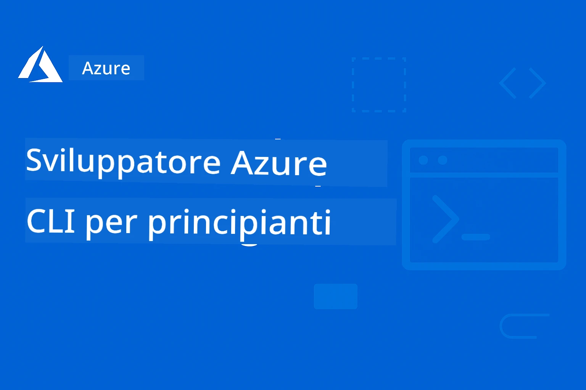

# AZD per Principianti: Un Percorso di Apprendimento Strutturato

 

[](https://github.com/microsoft/AZD-for-beginners)
[](https://GitHub.com/microsoft/azd-for-beginners/network/)
[](https://github.com/microsoft/AZD-for-beginners)

[](https://discord.com/invite/nkVh3dp)
[](https://discord.gg/nTYy5BXMWG)

---

### Traduzioni Automatiche (Sempre Aggiornate)

<!-- CO-OP TRANSLATOR LANGUAGES TABLE START -->
[Arabo](../ar/README.md) | [Bengalese](../bn/README.md) | [Bulgaro](../bg/README.md) | [Birmano (Myanmar)](../my/README.md) | [Cinese (Semplificato)](../zh-CN/README.md) | [Cinese (Tradizionale, Hong Kong)](../zh-HK/README.md) | [Cinese (Tradizionale, Macao)](../zh-MO/README.md) | [Cinese (Tradizionale, Taiwan)](../zh-TW/README.md) | [Croato](../hr/README.md) | [Ceco](../cs/README.md) | [Danese](../da/README.md) | [Olandese](../nl/README.md) | [Estone](../et/README.md) | [Finlandese](../fi/README.md) | [Francese](../fr/README.md) | [Tedesco](../de/README.md) | [Greco](../el/README.md) | [Ebraico](../he/README.md) | [Hindi](../hi/README.md) | [Ungherese](../hu/README.md) | [Indonesiano](../id/README.md) | [Italiano](./README.md) | [Giapponese](../ja/README.md) | [Kannada](../kn/README.md) | [Khmer](../km/README.md) | [Coreano](../ko/README.md) | [Lituano](../lt/README.md) | [Malese](../ms/README.md) | [Malayalam](../ml/README.md) | [Marathi](../mr/README.md) | [Nepalese](../ne/README.md) | [Pidgin Nigeriano](../pcm/README.md) | [Norvegese](../no/README.md) | [Persiano (Farsi)](../fa/README.md) | [Polacco](../pl/README.md) | [Portoghese (Brasile)](../pt-BR/README.md) | [Portoghese (Portogallo)](../pt-PT/README.md) | [Punjabi (Gurmukhi)](../pa/README.md) | [Rumeno](../ro/README.md) | [Russo](../ru/README.md) | [Serbo (Cirillico)](../sr/README.md) | [Slovacco](../sk/README.md) | [Sloveno](../sl/README.md) | [Spagnolo](../es/README.md) | [Swahili](../sw/README.md) | [Svedese](../sv/README.md) | [Tagalog (Filippino)](../tl/README.md) | [Tamil](../ta/README.md) | [Telugu](../te/README.md) | [Thailandese](../th/README.md) | [Turco](../tr/README.md) | [Ucraino](../uk/README.md) | [Urdu](../ur/README.md) | [Vietnamita](../vi/README.md)

> **Preferisci Clonare Localmente?**
>
> Questo repository include traduzioni in più di 50 lingue, il che aumenta significativamente la dimensione del download. Per clonare senza le traduzioni, usa sparse checkout:
>
> **Bash / macOS / Linux:**
> ```bash
> git clone --filter=blob:none --sparse https://github.com/microsoft/AZD-for-beginners.git
> cd AZD-for-beginners
> git sparse-checkout set --no-cone '/*' '!translations' '!translated_images'
> ```
>
> **CMD (Windows):**
> ```cmd
> git clone --filter=blob:none --sparse https://github.com/microsoft/AZD-for-beginners.git
> cd AZD-for-beginners
> git sparse-checkout set --no-cone "/*" "!translations" "!translated_images"
> ```
>
> Questo ti fornisce tutto il necessario per completare il corso con un download molto più veloce.
<!-- CO-OP TRANSLATOR LANGUAGES TABLE END -->

## 🆕 Novità di azd Oggi

> 📌 **Aggiornamento Foundry GA (09-11-2026):** Il **`microsoft.foundry` 1.0 bundle è generalmente disponibile**, annunciato il [5 novembre 2026](https://devblogs.microsoft.com/azure-sdk/microsoft-foundry-azure-developer-cli-ga/). Usa **`azd >= 1.37.0`** e installalo con `azd ext install microsoft.foundry`. Segui la [guida hosted-agent](docs/chapter-02-ai-development/microsoft-foundry-integration.md#hosted-agent-walkthrough-ga) per la configurazione, i test locali e il deployment. Questo aggiornamento si basa su indicazioni pubblicate, non su un deployment Azure dal vivo; il bundle GA non rende ogni funzionalità opzionale, estensione o SDK generalmente disponibile.

Azure Developer CLI supporta molti tipi di applicazioni, inclusi web app, API e agenti AI, tramite host, template ed estensioni supportate.

Ecco cosa significa per te:

- **Un bundle GA per lo sviluppo Foundry.** `microsoft.foundry` installa sette estensioni core, inclusi agenti, progetti e Agent Inspector. Il codice agente e le impostazioni di deployment rimangono insieme in `azure.yaml`.
- **Testa localmente, poi distribuisci il codice.** Usa `azd ai agent init --deploy-mode code`, `azd provision` e `azd ai agent run` per ispezionare richieste e risposte locali. Poi usa `azd deploy` per una build remota in Foundry, senza una build di container locale.
- **Misura la qualità separatamente.** Installa **`azure.ai.evaluations`** per `azd ai eval generate`, `init` e `run start`; non è incluso nel bundle. Conserva dataset e rubriche revisionate assieme al codice. I progetti più vecchi dovrebbero seguire la [guida alla migrazione per valutazione e ottimizzazione](docs/chapter-08-production/production-ai-practices.md#evaluation-migration-and-quality-checks).
- **Riutilizza la configurazione in CI/CD.** Dopo un `azd up` riuscito, configura una pipeline con `azd pipeline config`. Installa il bundle sul runner e conserva le impostazioni di autenticazione e ambiente generate.
- **Procedure di base più fluide.** Le recenti release hanno reso `azd init` idempotente (sicuro da rieseguire), `azd auth login` elimina automaticamente i token scaduti e hanno aggiunto un amichevole prompt di setup `azd tool` al primo avvio.
- **Il flusso di lavoro principale non è cambiato.** Che tu stia distribuendo una todo app, un microservizio o una soluzione AI multi-agente, i comandi sono gli stessi.

> **Nota per gli utenti Aspire:** Microsoft ora si riferisce al prodotto semplicemente come **Aspire** (in precedenza ".NET Aspire"). Il supporto azd per Aspire è invariato—solo il nome è stato aggiornato.

Se hai già usato azd, il supporto AI è un’estensione naturale—non uno strumento separato o un percorso avanzato. Se stai iniziando da zero, imparerai un unico flusso di lavoro che funziona per tutto.

---

## 🚀 Cos'è Azure Developer CLI (azd)?

**Azure Developer CLI (azd)** è uno strumento da riga di comando amichevole per sviluppatori che rende semplice distribuire applicazioni su Azure. Invece di creare e collegare manualmente decine di risorse Azure, puoi distribuire intere applicazioni con un solo comando.

### La Magia di `azd up`

```bash
# This single command does everything:
# ✅ Creates all Azure resources  
# ✅ Configures networking and security
# ✅ Builds your application code
# ✅ Deploys to Azure
# ✅ Gives you a working URL
azd up
```

Il template fornisce la configurazione dell’applicazione e dell’infrastruttura. Il deployment ha comunque bisogno di servizi/modelli supportati, quota e permessi sufficienti, input corretti e verifica dell’applicazione distribuita. `azd up` non rende automaticamente un template sicuro, conforme o pronto per la produzione.

---

## ❓ Azure Developer CLI vs Azure CLI: Qual è la Differenza?

Questa è la domanda più comune tra i principianti. Ecco la risposta semplice:

| Caratteristica | **Azure CLI (`az`)** | **Azure Developer CLI (`azd`)** |
|---------|---------------------|--------------------------------|
| **Scopo** | Gestire risorse Azure singole | Distribuire applicazioni complete |
| **Mentalità** | Incentrata sull’infrastruttura | Incentrata sull’applicazione |
| **Esempio** | `az webapp create --name myapp...` | `azd up` |
| **Curva di apprendimento** | Devi conoscere i servizi Azure | Devi solo conoscere la tua app |
| **Ideale per** | DevOps, Infrastruttura | Sviluppatori, Prototipazione |

### Analogia Semplice

- **Azure CLI** è come avere tutti gli strumenti per costruire una casa - martelli, seghe, chiodi. Puoi costruire qualsiasi cosa, ma devi conoscere l’edilizia.
- **Azure Developer CLI** è come assumere un appaltatore - descrivi ciò che vuoi, e lui si occupa della costruzione.

### Quando Usarli

| Scenario | Usa Questo |
|----------|----------|
| "Voglio distribuire la mia web app velocemente" | `azd up` |
| "Ho bisogno di creare solo un account di archiviazione" | `az storage account create` |
| "Sto costruendo un’app AI completa" | `azd init --template azure-search-openai-demo` |
| "Devo fare il debug di una risorsa Azure specifica" | `az resource show` |
| "Voglio distribuire nel mio ambiente di produzione configurato" | Controlla configurazione, accesso, costi e gate operativi prima di `azd up --environment production` |

### Lavorano Insieme!

AZD e Azure CLI hanno autenticazione e configurazioni separate. Usa `azd auth login` per AZD, e `az login` quando un hook o comando diagnostico richiede esplicitamente Azure CLI. Puoi usare entrambi:
```bash
# Deploy your app with AZD
azd up

# Then fine-tune specific resources with Azure CLI
az webapp config set --name myapp --always-on true
```

---

## 🌟 Trova Template in Awesome AZD

Non partire da zero! **Awesome AZD** è la raccolta comunitaria di template pronti da distribuire:

| Risorsa | Descrizione |
|----------|-------------|
| 🔗 [**Awesome AZD Gallery**](https://azure.github.io/awesome-azd/) | Sfoglia oltre 200 template con deploy con un clic |
| 🔗 [**Invia un Template**](https://github.com/Azure/awesome-azd/issues) | Contribuisci con il tuo template alla comunità |
| 🔗 [**Repository GitHub**](https://github.com/Azure/awesome-azd) | Metti una stella ed esplora il codice sorgente |

### Template AI Popolari da Awesome AZD

Scegli un template in una sua directory vuota; i comandi sotto sono alternative. Il comando finale `.` inizializza quella directory.

```bash
# RAG Chat with Microsoft Foundry Models + AI Search
azd init --template azure-search-openai-demo .

# Quick AI Chat Application
azd init --template openai-chat-app-quickstart .

# AI Agents with Foundry Agents
azd init --template get-started-with-ai-agents .
```

---

## 🎯 Inizia in 3 Passi

Prima di iniziare, assicurati che la tua macchina sia pronta per il template che vuoi distribuire:

**Windows:**
```powershell
.\validate-setup.ps1
```

**macOS / Linux:**
```bash
bash ./validate-setup.sh
```

Se qualche controllo richiesto fallisce, correggilo prima e poi continua con l’avvio rapido.

### Passo 1: Installa AZD (2 minuti)

**Windows:**
```powershell
winget install microsoft.azd
```

**macOS:**
```bash
brew tap azure/azd && brew install azd
```

**Linux:**
```bash
curl -fsSL https://aka.ms/install-azd.sh | bash
```

### Passo 2: Autenticati per AZD

```bash
# Optional if you plan to use Azure CLI commands directly in this course
az login

# Required for AZD workflows
azd auth login
```

Se non sei sicuro di quale ti serve, segui il flusso completo in [Installazione & Setup](docs/chapter-01-foundation/installation.md#authentication-setup).

### Passo 3: Distribuisci la tua Prima App

```bash
# Initialize from a template
azd init --template todo-nodejs-mongo .

# Deploy to Azure (creates everything!)
azd up
```

**🎉 Fatto!** La tua app è ora live su Azure.

### Pulizia (Non Dimenticare!)

```bash
# Remove all resources when done experimenting
azd down --force --purge
```

---

## 📚 Come Usare Questo Corso

Questo corso è progettato per un **apprendimento progressivo** - inizia da dove ti senti più a tuo agio e procedi gradualmente:

| La tua Esperienza | Inizia Qui |
|-----------------|------------|
| **Nuovo di Azure** | [Capitolo 1: Fondamenti](#-chapter-1-foundation--quick-start) |
| **Conosci Azure, nuovo ad AZD** | [Capitolo 1: Fondamenti](#-chapter-1-foundation--quick-start) |
| **Vuoi distribuire app AI** | [Capitolo 2: Sviluppo AI-First](#-chapter-2-ai-first-development-recommended-for-ai-developers) |
| **Vuoi pratica diretta** | [🎓 Laboratorio Interattivo](workshop/README.md) - laboratorio guidato di 3-4 ore |
| **Hai bisogno di pattern per la produzione** | [Capitolo 8: Produzione & Enterprise](#-chapter-8-production--enterprise-patterns) |

### Setup Rapido

1. **Forka Questo Repository**: [](https://GitHub.com/microsoft/azd-for-beginners/fork)
2. **Clona**: `git clone https://github.com/YOUR-USERNAME/azd-for-beginners.git`
3. **Ricevi Aiuto**: [Community Azure Discord](https://discord.com/invite/ByRwuEEgH4)

> **Preferisci Clonare Localmente?**

> Questo repository include oltre 50 traduzioni linguistiche che aumentano significativamente la dimensione del download. Per clonare senza traduzioni, usa il sparse checkout:
> ```bash
> git clone --filter=blob:none --sparse https://github.com/microsoft/AZD-for-beginners.git
> cd AZD-for-beginners
> git sparse-checkout set --no-cone '/*' '!translations' '!translated_images'
> ```
> Questo ti dà tutto il necessario per completare il corso con un download molto più veloce.


## Panoramica del Corso

Padroneggia Azure Developer CLI (azd) attraverso capitoli strutturati progettati per un apprendimento progressivo. **Focus speciale sul deployment di applicazioni AI con integrazione Microsoft Foundry.**

### Perché questo corso è essenziale per gli sviluppatori moderni

Gli sviluppatori che distribuiscono carichi di lavoro AI necessitano spesso di guida su:
- Architetture AI complesse multi-servizio
- Best practice per il deployment AI in produzione  
- Integrazione e configurazione di servizi AI di Azure
- Ottimizzazione dei costi per carichi di lavoro AI
- Risoluzione dei problemi specifici per il deployment AI

### Obiettivi di apprendimento

Completando questo corso strutturato, tu:
- **Padroneggerai le basi AZD**: Concetti core, installazione e configurazione
- **Distribuirai applicazioni AI**: Usa AZD con i servizi Microsoft Foundry
- **Implementerai Infrastructure as Code**: Gestisci risorse Azure con template Bicep
- **Risolvi problemi di deployment**: Risolvi problemi comuni e debug
- **Ottimizzerai per la produzione**: Sicurezza, scalabilità, monitoraggio e gestione costi
- **Costruirai soluzioni multi-agente**: Distribuisci architetture AI complesse

## Prima di iniziare: Account, Accesso e Assunzioni

Prima di iniziare il Capitolo 1, assicurati di avere quanto segue predisposto. I passaggi di installazione successivi in questa guida presumono che queste basi siano già sistemate.

- **Un abbonamento Azure**: Puoi usare un abbonamento esistente dal lavoro o il tuo account personale, oppure creare una [trial gratuita](https://aka.ms/azurefreetrial) per iniziare.
- **Permesso di creare risorse Azure**: Per la maggior parte degli esercizi, dovresti avere almeno accesso **Contributor** sull'abbonamento o gruppo di risorse target. Alcuni capitoli presumono anche che tu possa creare gruppi di risorse, managed identities, e assegnazioni RBAC.
- [**Un account GitHub**](https://github.com): Utile per fare fork del repository, tracciare le tue modifiche e usare GitHub Codespaces per il workshop.
- **Prerequisiti runtime dei template**: Alcuni template richiedono strumenti locali come Node.js, Python, Java o Docker. Esegui il validatore di setup prima di iniziare così da catturare mancanze precocemente.
- **Familiarità base con il terminale**: Non devi essere un esperto, ma dovresti sentirti a tuo agio nell’eseguire comandi come `git clone`, `azd auth login` e `azd up`.

> **Lavori in un abbonamento aziendale?**
> Se il tuo ambiente Azure è gestito da un amministratore, conferma in anticipo che puoi distribuire risorse nell’abbonamento o gruppo di risorse che intendi usare. Se no, richiedi un abbonamento sandbox o accesso Contributor prima di iniziare.

> **Sei nuovo di Azure?**
> Parti con la tua trial Azure personale o un abbonamento pay-as-you-go su https://aka.ms/azurefreetrial così puoi completare gli esercizi senza attendere approvazioni a livello di tenant.

## 🗺️ Mappa del Corso: Navigazione Rapida per Capitolo

Ogni capitolo ha un README dedicato con obiettivi di apprendimento, avvii rapidi ed esercizi:

| Capitolo | Argomento | Lezioni | Durata | Complessità |
|---------|----------|---------|--------|------------|
| **[Cap 1: Fondamenti](docs/chapter-01-foundation/README.md)** | Introduzione | [Basi AZD](docs/chapter-01-foundation/azd-basics.md) &#124; [Installazione](docs/chapter-01-foundation/installation.md) &#124; [Primo Progetto](docs/chapter-01-foundation/first-project.md) | 30-45 min | ⭐ |
| **[Cap 2: Sviluppo AI](docs/chapter-02-ai-development/README.md)** | App AI-First | [Integrazione Foundry](docs/chapter-02-ai-development/microsoft-foundry-integration.md) &#124; [Agenti AI](docs/chapter-02-ai-development/agents.md) &#124; [Deployment Modello](docs/chapter-02-ai-development/ai-model-deployment.md) &#124; [Workshop](docs/chapter-02-ai-development/ai-workshop-lab.md) | 1-2 ore | ⭐⭐ |
| **[Cap 3: Configurazione](docs/chapter-03-configuration/README.md)** | Autenticazione & Sicurezza | [Configurazione](docs/chapter-03-configuration/configuration.md) &#124; [Autenticazione & Sicurezza](docs/chapter-03-configuration/authsecurity.md) | 45-60 min | ⭐⭐ |
| **[Cap 4: Infrastruttura](docs/chapter-04-infrastructure/README.md)** | IaC & Deployment | [Guida al Deployment](docs/chapter-04-infrastructure/deployment-guide.md) &#124; [Provisioning](docs/chapter-04-infrastructure/provisioning.md) | 1-1.5 ore | ⭐⭐⭐ |
| **[Cap 5: Multi-Agente](docs/chapter-05-multi-agent/README.md)** | Soluzioni Agent AI | [Scenario Retail](examples/retail-scenario.md) &#124; [Pattern di Coordinamento](docs/chapter-06-pre-deployment/coordination-patterns.md) | 2-3 ore | ⭐⭐⭐⭐ |
| **[Cap 6: Pre-Deployment](docs/chapter-06-pre-deployment/README.md)** | Pianificazione & Validazione | [Controlli Prevolo](docs/chapter-06-pre-deployment/preflight-checks.md) &#124; [Pianificazione Capacità](docs/chapter-06-pre-deployment/capacity-planning.md) &#124; [Selezione SKU](docs/chapter-06-pre-deployment/sku-selection.md) &#124; [App Insights](docs/chapter-06-pre-deployment/application-insights.md) | 1 ora | ⭐⭐ |
| **[Cap 7: Risoluzione Problemi](docs/chapter-07-troubleshooting/README.md)** | Debug & Fix | [Problemi Comuni](docs/chapter-07-troubleshooting/common-issues.md) &#124; [Debugging](docs/chapter-07-troubleshooting/debugging.md) &#124; [Problemi AI](docs/chapter-07-troubleshooting/ai-troubleshooting.md) | 1-1.5 ore | ⭐⭐ |
| **[Cap 8: Produzione](docs/chapter-08-production/README.md)** | Pattern Aziendali | [Pratiche di Produzione](docs/chapter-08-production/production-ai-practices.md) | 2-3 ore | ⭐⭐⭐⭐ |
| **[🎓 Workshop](workshop/README.md)** | Laboratorio Pratico | [Introduzione](workshop/docs/instructions/0-Introduction.md) &#124; [Selezione](workshop/docs/instructions/1-Select-AI-Template.md) &#124; [Validazione](workshop/docs/instructions/2-Validate-AI-Template.md) &#124; [Smontaggio](workshop/docs/instructions/3-Deconstruct-AI-Template.md) &#124; [Configurazione](workshop/docs/instructions/4-Configure-AI-Template.md) &#124; [Personalizzazione](workshop/docs/instructions/5-Customize-AI-Template.md) &#124; [Chiusura](workshop/docs/instructions/6-Teardown-Infrastructure.md) &#124; [Conclusioni](workshop/docs/instructions/7-Wrap-up.md) | 3-4 ore | ⭐⭐ |

**Durata Totale Corso:** ~10-14 ore | **Progressione Competenze:** Principiante → Pronto per Produzione

---

## 📚 Capitoli di Apprendimento

*Seleziona il percorso di apprendimento in base al livello di esperienza e agli obiettivi*

### 🚀 Capitolo 1: Fondamenti & Avvio Veloce
**Prerequisiti**: abbonamento Azure, conoscenze base linea di comando  
**Durata**: 30-45 minuti  
**Complessità**: ⭐

#### Cosa imparerai
- Comprendere le basi di Azure Developer CLI
- Installare AZD sulla tua piattaforma
- Il tuo primo deployment di successo

#### Risorse di Apprendimento
- **🎯 Inizia qui**: [Cos’è Azure Developer CLI?](#-what-is-azure-developer-cli-azd)
- **📖 Teoria**: [Basi AZD](docs/chapter-01-foundation/azd-basics.md) - Concetti core e terminologia
- **⚙️ Setup**: [Installazione & Settaggio](docs/chapter-01-foundation/installation.md) - Guide piattaforma-specifiche
- **🛠️ Pratico**: [Il tuo primo progetto](docs/chapter-01-foundation/first-project.md) - Tutorial passo passo
- **📋 Riferimento Rapido**: [Cheat Sheet Comandi](resources/cheat-sheet.md)

#### Esercizi Pratici
```bash
# Quick installation check
azd version

# Deploy your first application
azd init --template todo-nodejs-mongo .
azd up
```

**💡 Risultato Capitolo**: Distribuire con successo una semplice applicazione web su Azure usando AZD

**✅ Validazione del Successo:**
```bash
# After completing Chapter 1, you should be able to:
azd version              # Shows installed version
azd init --template todo-nodejs-mongo  # Initializes project
azd up                  # Deploys to Azure
azd show                # Displays running app URL
# Application opens in browser and works
azd down --force --purge  # Cleans up resources
```

**📊 Tempo Stimato:** 30-45 minuti  
**📈 Livello di Competenza Dopo:** Capacità di distribuire applicazioni base in autonomia

---

### 🤖 Capitolo 2: Sviluppo AI-First (Raccomandato per sviluppatori AI)
**Prerequisiti**: Capitolo 1 completato  
**Durata**: 1-2 ore  
**Complessità**: ⭐⭐

#### Cosa imparerai
- Integrazione Microsoft Foundry con AZD
- Distribuzione di applicazioni AI-powered
- Comprendere configurazioni dei servizi AI

#### Risorse di Apprendimento
- **🎯 Inizia qui**: [Integrazione Microsoft Foundry](docs/chapter-02-ai-development/microsoft-foundry-integration.md)
- **🤖 Agenti AI**: [Guida Agenti AI](docs/chapter-02-ai-development/agents.md) - Distribuire agenti intelligenti con AZD
- **📖 Pattern**: [Deployment Modello AI](docs/chapter-02-ai-development/ai-model-deployment.md) - Distribuire e gestire modelli AI
- **🛠️ Workshop**: [Laboratorio AI](docs/chapter-02-ai-development/ai-workshop-lab.md) - Preparare le soluzioni AI per AZD
- **🎥 Guida Interattiva**: [Materiali Workshop](workshop/README.md) - Apprendimento browser-based con MkDocs * Ambiente DevContainer
- **📋 Template**: [Template Microsoft Foundry](#featured-microsoft-foundry-templates)
- **📝 Esempi**: [Esempi Deployment AZD](examples/README.md)

#### Esercizi Pratici
```bash
# Deploy your first AI application
azd init --template azure-search-openai-demo .
azd up

# Try additional AI templates
azd init --template openai-chat-app-quickstart .
azd init --template agent-openai-python-prompty .
```

**💡 Risultato Capitolo**: Distribuire e configurare un’app di chat AI con capacità RAG

**✅ Validazione del Successo:**
```bash
# After Chapter 2, you should be able to:
azd init --template azure-search-openai-demo .
azd up
# Test the AI chat interface
# Ask questions and get AI-powered responses with sources
# Verify search integration works
azd monitor  # Check Application Insights shows telemetry
azd down --force --purge
```

**📊 Tempo Stimato:** 1-2 ore  
**📈 Livello di Competenza Dopo:** Può distribuire applicazioni di apprendimento AI e identificare requisiti aggiuntivi per la produzione
**💰 Consapevolezza dei Costi:** Comprendere costi sviluppo di $80-150/mese, costi produzione $300-3500/mese

#### 💰 Considerazioni sui Costi per i Deployment AI

**Ambiente di Sviluppo (Stimato $80-150/mese):**
- Modelli Microsoft Foundry (Pay-as-you-go): $0-50/mese (basato sull’uso di token)
- AI Search (tier Basic): $75/mese
- Container Apps (Consumo): $0-20/mese
- Storage (Standard): $1-5/mese

**Ambiente di Produzione (Stimato $300-3,500+/mese):**
- Modelli Microsoft Foundry (PTU per prestazioni consistenti): $3,000+/mese O Pay-as-you-go con volume elevato
- AI Search (tier Standard): $250/mese
- Container Apps (Dedicato): $50-100/mese
- Application Insights: $5-50/mese
- Storage (Premium): $10-50/mese

**💡 Consigli per l’Ottimizzazione dei Costi:**
- Controlla prezzi inferenza modello e crediti account-specifici; Azure OpenAI non include una franchigia mensile universale di 50.000 token
- Esegui `azd down` per eliminare risorse quando non necessarie, dopo aver rivisto l’ambiente selezionato
- Parti con fatturazione a consumo, aggiorna a PTU solo per la produzione
- Usa `azd provision --preview` per ispezionare l'infrastruttura pianificata, poi prezzo le risorse risultanti con il Calcolatore Prezzi Azure
- Abilita auto-scaling: paga solo per l’uso effettivo

**Monitoraggio Costi:**
```bash
# Inspect planned resources (this does not calculate prices)
azd provision --preview

# Monitor actual costs in Azure Portal
az consumption budget list --resource-group <your-rg>
```

---

### ⚙️ Capitolo 3: Configurazione & Autenticazione
**Prerequisiti**: Capitolo 1 completato  
**Durata**: 45-60 minuti  
**Complessità**: ⭐⭐

#### Cosa imparerai
- Configurazione e gestione dell’ambiente
- Best practice di autenticazione e sicurezza
- Nominazione e organizzazione risorse

#### Risorse di Apprendimento
- **📖 Configurazione**: [Guida alla Configurazione](docs/chapter-03-configuration/configuration.md) - Setup ambiente
- **🔐 Sicurezza**: [Pattern di autenticazione e managed identity](docs/chapter-03-configuration/authsecurity.md) - Pattern di autenticazione
- **📝 Esempi**: [Esempio applicazione Database](examples/database-app/README.md) - Esempi AZD Database

#### Esercizi Pratici
- Configura ambienti multipli (dev, staging, prod)
- Imposta autenticazione tramite managed identity
- Implementa configurazioni specifiche per ambiente

**💡 Risultato Capitolo**: Gestire più ambienti con autenticazione e sicurezza adeguate

---

### 🏗️ Capitolo 4: Infrastructure as Code & Deployment
**Prerequisiti**: Capitoli 1-3 completati  
**Durata**: 1-1.5 ore  
**Complessità**: ⭐⭐⭐

#### Cosa imparerai
- Pattern avanzati di deployment
- Infrastructure as Code con Bicep
- Strategie di provisioning delle risorse

#### Risorse di Apprendimento
- **📖 Deployment**: [Guida al Deployment](docs/chapter-04-infrastructure/deployment-guide.md) - Flussi di lavoro completi
- **🏗️ Provisioning**: [Provisioning Risorse](docs/chapter-04-infrastructure/provisioning.md) - Gestione risorse Azure
- **📝 Esempi**: [Esempio Container App](../../examples/container-app) - Deployment containerizzato

#### Esercizi Pratici
- Crea template Bicep personalizzati
- Distribuisci applicazioni multi-servizio
- Implementa strategie di blue-green deployment

**💡 Risultato Capitolo**: Distribuire applicazioni multi-servizio complesse usando template di infrastruttura personalizzati

---

### 🎯 Capitolo 5: Soluzioni AI Multi-Agente (Avanzato)
**Prerequisiti**: Capitoli 1-2 completati  
**Durata**: 2-3 ore  
**Complessità**: ⭐⭐⭐⭐

#### Cosa imparerai
- Pattern di architettura multi-agente
- Orchestrazione e coordinamento agenti
- Deployment AI pronto per produzione

#### Risorse di Apprendimento
- **🤖 Design in Evidenza**: [Soluzione Multi-Agente per il Commercio al Dettaglio](examples/retail-scenario.md) - Progetto architettonico, non un'applicazione completa
- **🛠️ Template ARM**: [Pacchetto Template ARM](../../examples/retail-multiagent-arm-template) - Struttura infrastrutturale; rivedere i prerequisiti e i componenti applicativi mancanti
- **📖 Architettura**: [Pattern di coordinamento multi-agente](docs/chapter-06-pre-deployment/coordination-patterns.md) - Pattern

#### Esercizi Pratici
```bash
# Inspect the retail infrastructure scaffold before choosing to deploy it
cd examples/retail-multiagent-arm-template
cat README.md

# After an intentional deployment, inspect infrastructure state
az deployment group show --resource-group <rg-name> --name <deployment-name>
```

**💡 Risultato del Capitolo**: Comprendere il design multi-agente e identificare il lavoro di implementazione, convalida e operativo necessario oltre la struttura infrastrutturale

---

### 🔍 Capitolo 6: Validazione e Pianificazione Pre-Distribuzione
**Prerequisiti**: Capitolo 4 completato  
**Durata**: 1 ora  
**Complessità**: ⭐⭐

#### Cosa Imparerai
- Pianificazione della capacità e validazione delle risorse
- Strategie di selezione SKU
- Controlli pre-volo e automazione

#### Risorse per l'Apprendimento
- **📊 Pianificazione**: [Pianificazione della Capacità](docs/chapter-06-pre-deployment/capacity-planning.md) - Validazione delle risorse
- **💰 Selezione**: [Selezione SKU](docs/chapter-06-pre-deployment/sku-selection.md) - Scelte costo-efficaci
- **✅ Validazione**: [Controlli Pre-Volò](docs/chapter-06-pre-deployment/preflight-checks.md) - Script automatizzati

#### Esercizi Pratici
- Esegui script di validazione della capacità
- Ottimizza le selezioni SKU per i costi
- Implementa controlli automatizzati pre-distribuzione

**💡 Risultato del Capitolo**: Validare e ottimizzare le distribuzioni prima dell'esecuzione

---

### 🚨 Capitolo 7: Risoluzione Problemi e Debugging
**Prerequisiti**: Qualsiasi capitolo di distribuzione completato  
**Durata**: 1-1.5 ore  
**Complessità**: ⭐⭐

#### Cosa Imparerai
- Approcci sistematici al debugging
- Problemi comuni e soluzioni
- Risoluzione problemi specifica per AI

#### Risorse per l'Apprendimento
- **🔧 Problemi Comuni**: [Problemi Comuni](docs/chapter-07-troubleshooting/common-issues.md) - FAQ e soluzioni
- **🕵️ Debugging**: [Guida al Debugging](docs/chapter-07-troubleshooting/debugging.md) - Strategie passo passo
- **🤖 Problemi AI**: [Risoluzione Problemi Specifica per AI](docs/chapter-07-troubleshooting/ai-troubleshooting.md) - Problemi dei servizi AI

#### Esercizi Pratici
- Diagnostica dei fallimenti di distribuzione
- Risoluzione problemi di autenticazione
- Debug della connettività ai servizi AI

**💡 Risultato del Capitolo**: Diagnostica e risolvi in autonomia i problemi comuni di distribuzione

---

### 🏢 Capitolo 8: Pattern di Produzione e Enterprise
**Prerequisiti**: Capitoli 1-4 completati  
**Durata**: 2-3 ore  
**Complessità**: ⭐⭐⭐⭐

#### Cosa Imparerai
- Strategie di distribuzione in produzione
- Pattern di sicurezza enterprise
- Monitoraggio e ottimizzazione dei costi

#### Risorse per l'Apprendimento
- **🏭 Produzione**: [Best Practice AI per la Produzione](docs/chapter-08-production/production-ai-practices.md) - Pattern enterprise
- **📝 Esempi**: [Esempio Microservizi](../../examples/microservices) - Architetture complesse
- **📊 Monitoraggio**: [Integrazione Application Insights](docs/chapter-06-pre-deployment/application-insights.md) - Monitoraggio

#### Esercizi Pratici
- Implementa pattern di sicurezza enterprise
- Imposta un monitoraggio completo
- Distribuisci in produzione con una governance appropriata

**💡 Risultato del Capitolo**: Distribuisci applicazioni pronte per l'impresa con capacità produttive complete

---

## 🎓 Panoramica del Workshop: Esperienza di Apprendimento Pratica

> **⚠️ STATO DEL WORKSHOP: Sviluppo Attivo**  
> I materiali del workshop sono in fase di sviluppo e rifinitura. I moduli principali sono funzionali, ma alcune sezioni avanzate sono incomplete. Stiamo lavorando attivamente per completare tutto il contenuto. [Segui i progressi →](workshop/README.md)

### Materiali Interattivi del Workshop
**Apprendimento pratico completo con strumenti basati su browser ed esercizi guidati**

I nostri materiali del workshop offrono un'esperienza di apprendimento strutturata e interattiva che completa il curriculum basato sui capitoli sopra. Il workshop è progettato sia per l'apprendimento autonomo che per sessioni con istruttore.

#### 🛠️ Caratteristiche del Workshop
- **Interfaccia Browser**: Workshop completo basato su MkDocs con ricerca, copia e funzionalità di tema
- **Integrazione GitHub Codespaces**: Configurazione dell'ambiente di sviluppo con un clic
- **Percorso di Apprendimento Strutturato**: 8 moduli di esercizi guidati (3-4 ore totali)
- **Metodologia Progressiva**: Introduzione → Selezione → Validazione → Decomposizione → Configurazione → Personalizzazione → Smontaggio → Conclusione
- **Ambiente DevContainer Interattivo**: Strumenti e dipendenze preconfigurati

#### 📚 Struttura del Modulo del Workshop
Il workshop segue una **metodologia progressiva in 8 moduli** che ti porta dalla scoperta alla padronanza della distribuzione:

| Modulo | Argomento | Cosa Farai | Durata |
|--------|----------|------------|--------|
| **0. Introduzione** | Panoramica del Workshop | Comprendere gli obiettivi di apprendimento, i prerequisiti e la struttura del workshop | 15 min |
| **1. Selezione** | Scoperta del Template | Esplorare i template AZD e selezionare il template AI giusto per il tuo scenario | 20 min |
| **2. Validazione** | Distribuire e Verificare | Distribuire il template con `azd up` e convalidare il funzionamento dell'infrastruttura | 30 min |
| **3. Decomposizione** | Comprendere la Struttura | Usare GitHub Copilot per esplorare l'architettura del template, i file Bicep e l'organizzazione del codice | 30 min |
| **4. Configurazione** | Approfondimento di azure.yaml | Padroneggiare la configurazione `azure.yaml`, i lifecycle hook e le variabili d'ambiente | 30 min |
| **5. Personalizzazione** | Rendilo Tuo | Abilitare AI Search, tracing, valutazione e personalizzare per il tuo scenario | 45 min |
| **6. Smontaggio** | Pulizia | Deprovisionare in sicurezza le risorse con `azd down --purge` | 15 min |
| **7. Conclusione** | Prossimi Passi | Revisionare i risultati, i concetti chiave e continuare il percorso di apprendimento | 15 min |

**Flusso del Workshop:**
```
Introduction → Selection → Validation → Deconstruction → Configuration → Customization → Teardown → Wrap-up
     ↓            ↓           ↓              ↓               ↓              ↓            ↓           ↓
  Overview    Find the     Deploy &      Explore        Master         Customize     Clean up    Review &
             right        verify        code &        azure.yaml      for your      resources   next steps
             template                   structure                     scenario
```

#### 🚀 Iniziare con il Workshop
```bash
# Option 1: GitHub Codespaces (Recommended)
# Click "Code" → "Create codespace on main" in the repository

# Option 2: Local Development
git clone https://github.com/microsoft/azd-for-beginners.git
cd azd-for-beginners/workshop
# Follow the setup instructions in workshop/README.md
```

#### 🎯 Risultati di Apprendimento del Workshop
Completando il workshop, i partecipanti:
- **Distribuiranno Applicazioni AI in Produzione**: Utilizzeranno AZD con i servizi Microsoft Foundry
- **Padroneggeranno Architetture Multi-Agente**: Implementeranno soluzioni coordinate con agenti AI
- **Implementeranno le Best Practice di Sicurezza**: Configureranno autenticazione e controllo accessi
- **Ottimizzeranno per la Scalabilità**: Progetteranno distribuzioni cost-effective e performanti
- **Risoluzione Autonoma dei Problemi di Distribuzione**: Risolveranno problemi comuni in autonomia

#### 📖 Risorse del Workshop
- **🎥 Guida Interattiva**: [Materiali del Workshop](workshop/README.md) - Ambiente di apprendimento browser-based
- **📋 Istruzioni Modulo per Modulo**:
  - [0. Introduzione](workshop/docs/instructions/0-Introduction.md) - Panoramica e obiettivi del workshop
  - [1. Selezione](workshop/docs/instructions/1-Select-AI-Template.md) - Ricerca e selezione dei template AI
  - [2. Validazione](workshop/docs/instructions/2-Validate-AI-Template.md) - Distribuzione e verifica dei template
  - [3. Decomposizione](workshop/docs/instructions/3-Deconstruct-AI-Template.md) - Esplora l'architettura del template
  - [4. Configurazione](workshop/docs/instructions/4-Configure-AI-Template.md) - Padroneggia azure.yaml
  - [5. Personalizzazione](workshop/docs/instructions/5-Customize-AI-Template.md) - Personalizza per il tuo scenario
  - [6. Smontaggio](workshop/docs/instructions/6-Teardown-Infrastructure.md) - Pulizia delle risorse
  - [7. Conclusione](workshop/docs/instructions/7-Wrap-up.md) - Revisione e prossimi passi
- **🛠️ Laboratorio AI del Workshop**: [Laboratorio AI del Workshop](docs/chapter-02-ai-development/ai-workshop-lab.md) - Esercizi focalizzati su AI
- **💡 Avvio Rapido**: [Guida all'Installazione del Workshop](workshop/README.md#browser-based-guide) - Configurazione dell'ambiente

**Perfetto per**: Formazione aziendale, corsi universitari, apprendimento autonomo e bootcamp per sviluppatori.

---

## 📖 Approfondimento: Capacità di AZD

Oltre le basi, AZD offre funzionalità potenti per distribuzioni in produzione:

- **Distribuzioni basate su template** - Usa template predefiniti per pattern applicativi comuni
- **Infrastructure as Code** - Gestisci risorse Azure con Bicep o Terraform  
- **Workflow Integrati** - Provisioning, distribuzione e monitoraggio applicazioni in modo fluido
- **Ottimizzato per sviluppatori** - Mirato alla produttività e all'esperienza degli sviluppatori

### **AZD + Microsoft Foundry: Perfetto per Distribuzioni AI**

**Perché AZD per Soluzioni AI?** AZD affronta le principali sfide degli sviluppatori AI:

- **Template Pronti per AI** - Template preconfigurati per Microsoft Foundry Models, servizi Azure AI e carichi ML
- **Distribuzioni AI Sicure** - Pattern di sicurezza integrati per servizi AI, chiavi API e endpoint modelli  
- **Pattern AI per la Produzione** - Best practice per distribuzioni AI scalabili e costo-efficaci
- **Workflow AI End-to-End** - Dallo sviluppo del modello alla distribuzione in produzione con monitoraggio adeguato
- **Ottimizzazione Costi** - Strategie intelligenti di allocazione risorse e scaling per carichi AI
- **Integrazione Microsoft Foundry** - Connessione fluida al catalogo modelli e agli endpoint Microsoft Foundry

---

## 🎯 Libreria di Template & Esempi

### In Evidenza: Template Microsoft Foundry
**Inizia qui se stai distribuendo applicazioni AI!**

> **Nota:** Questi template mostrano vari pattern AI. Alcuni sono Azure Samples esterni, altri implementazioni locali.

| Template | Capitolo | Complessità | Servizi | Tipo |
|----------|---------|------------|----------|------|
| [**Inizia con chat AI**](https://github.com/Azure-Samples/get-started-with-ai-chat) | Capitolo 2 | ⭐⭐ | AzureOpenAI + Azure AI Model Inference API + Azure AI Search + Azure Container Apps + Application Insights | Esterno |
| [**Inizia con agenti AI**](https://github.com/Azure-Samples/get-started-with-ai-agents) | Capitolo 2 | ⭐⭐ | Foundry Agents + AzureOpenAI + Azure AI Search + Azure Container Apps + Application Insights| Esterno |
| [**Demo Azure Search + OpenAI**](https://github.com/Azure-Samples/azure-search-openai-demo) | Capitolo 2 | ⭐⭐ | Azure OpenAI + Azure AI Search + Container Apps (default) + Storage | Esterno |
| [**Avvio Rapido App Chat OpenAI**](https://github.com/Azure-Samples/openai-chat-app-quickstart) | Capitolo 2 | ⭐ | AzureOpenAI + Container Apps + Application Insights | Esterno |
| [**Agent OpenAI Python Prompty**](https://github.com/Azure-Samples/agent-openai-python-prompty) | Capitolo 5 | ⭐⭐⭐ | AzureOpenAI + Azure Functions + Prompty | Esterno |
| [**Contoso Chat RAG**](https://github.com/Azure-Samples/contoso-chat) | Capitolo 8 | ⭐⭐⭐⭐ | AzureOpenAI + AI Search + Cosmos DB + Container Apps | Esterno |
| [**Soluzione Multi-Agente Retail**](examples/retail-scenario.md) | Capitolo 5 | ⭐⭐⭐⭐ | Proposta architettura e struttura infrastrutturale; implementazione applicativa richiesta | **Progetto locale** |

### In Evidenza: Scenari Completi di Apprendimento
**Template applicativi pronti per la produzione mappati ai capitoli di apprendimento**

| Template | Capitolo di Apprendimento | Complessità | Apprendimento Chiave |
|----------|-------------------------|------------|---------------------|
| [**openai-chat-app-quickstart**](https://github.com/Azure-Samples/openai-chat-app-quickstart) | Capitolo 2 | ⭐ | Pattern base di distribuzione AI |
| [**azure-search-openai-demo**](https://github.com/Azure-Samples/azure-search-openai-demo) | Capitolo 2 | ⭐⭐ | Implementazione RAG con Azure AI Search |
| [**get-started-with-ai-agents**](https://github.com/Azure-Samples/get-started-with-ai-agents) | Capitolo 2 | ⭐⭐ | Chat supportata da agenti e test di valutazione specifici |
| [**agent-openai-python-prompty**](https://github.com/Azure-Samples/agent-openai-python-prompty) | Capitolo 5 | ⭐⭐⭐ | Framework agenti e chiamata funzioni |
| [**contoso-chat**](https://github.com/Azure-Samples/contoso-chat) | Capitolo 8 | ⭐⭐⭐ | Orchestrazione AI enterprise |
| [**retail-multi-agent-solution**](examples/retail-scenario.md) | Capitolo 5 | ⭐⭐⭐⭐ | Architettura multi-agente con agenti Cliente e Inventario |

### Tipo di Apprendimento per Esempio

> **📌 Esempi Locali vs. Esterni:**  
> **Esempi Locali** (in questo repo) = Controlla il README dell'esempio per stato implementazione e prerequisiti
> **Esempi Esterni** (Azure Samples) = Clona dai repository collegati

#### Esempi Locali (Pronti all'Uso)
- [**Soluzione Multi-Agente Retail**](examples/retail-scenario.md) - Progetto architettonico con struttura infrastrutturale ARM
  - Ruoli proposti di agente Cliente e Inventario
  - Monitoraggio, valutazione e codice applicativo devono essere implementati e verificati
  - Solo il provisioning delle risorse non produce un'applicazione retail funzionante

#### Esempi Locali - Applicazioni Container (Capitoli 2-5)
**Esempi completi di distribuzione container in questo repository:**
- [**Esempi App Container**](examples/container-app/README.md) - Guida completa a distribuzioni containerizzate
  - [API Flask Semplice](../../examples/container-app/simple-flask-api) - API REST di base con scale-to-zero
  - [Architettura Microservizi](../../examples/container-app/microservices) - Esempio di apprendimento a due servizi; messa in produzione richiede lavoro aggiuntivo
  - Pattern di avvio rapido, produzione e distribuzione avanzata
  - Monitoraggio, sicurezza e guida all'ottimizzazione dei costi

#### Esempi Esterni - Applicazioni Semplici (Capitoli 1-2)
**Clona questi repository Azure Samples per iniziare:**
- [App Web Semplice - Node.js + MongoDB](https://github.com/Azure-Samples/todo-nodejs-mongo) - Pattern di distribuzione base
- [Sito Statico - React SPA](https://github.com/Azure-Samples/todo-csharp-sql-swa-func) - Distribuzione contenuti statici
- [Container App - Python Flask](https://github.com/Azure-Samples/container-apps-store-api-microservice) - Distribuzione REST API

#### Esempi Esterni - Integrazione Database (Capitoli 3-4)  
- [Database App - C# + SQL](https://github.com/Azure-Samples/todo-csharp-sql) - Modelli di connettività database
- [Functions + Cosmos DB](https://github.com/Azure-Samples/todo-python-mongo-swa-func) - Flusso di lavoro dati serverless

#### Esempi Esterni - Modelli Avanzati (Capitoli 4-8)
- [Java Microservices](https://github.com/Azure-Samples/java-microservices-aca-lab) - Architetture multi-servizio
- [Container Apps Jobs](https://github.com/Azure-Samples/container-apps-jobs) - Elaborazione in background  
- [Enterprise ML Pipeline](https://github.com/Azure/mlops-v2) - Modelli di riferimento MLOps; non un modello AZD pronto all'uso

### Collezioni di Modelli Esterni
- [**Galleria Ufficiale di Modelli AZD**](https://azure.github.io/awesome-azd/) - Collezione curata di modelli ufficiali e della community
- [**Modelli del Azure Developer CLI**](https://learn.microsoft.com/en-us/azure/developer/azure-developer-cli/azd-templates) - Documentazione dei modelli Microsoft Learn
- [**Directory di Esempi**](examples/README.md) - Esempi di apprendimento locale con spiegazioni dettagliate

---

## 📚 Risorse di Apprendimento & Riferimenti

### Riferimenti Rapidi
- [**Comandi Rapidi**](resources/cheat-sheet.md) - Comandi azd essenziali organizzati per capitolo
- [**Glossario**](resources/glossary.md) - Terminologia Azure e azd  
- [**FAQ**](resources/faq.md) - Domande comuni organizzate per capitolo di apprendimento
- [**Guida di Studio**](resources/study-guide.md) - Esercizi pratici completi

### Workshop Pratici
- [**Laboratorio Workshop AI**](docs/chapter-02-ai-development/ai-workshop-lab.md) - Rendi le tue soluzioni AI distribuibili con AZD (2-3 ore)
- [**Workshop Interattivo**](workshop/README.md) - Esercizi guidati in 8 moduli con MkDocs e GitHub Codespaces
  - Segue: Introduzione → Selezione → Validazione → Decostruzione → Configurazione → Personalizzazione → Smontaggio → Conclusione

### Risorse Esterne di Apprendimento
- [Documentazione Azure Developer CLI](https://learn.microsoft.com/en-us/azure/developer/azure-developer-cli/)
- [Centro Architettura Azure](https://learn.microsoft.com/en-us/azure/architecture/)
- [Calcolatore Prezzi Azure](https://azure.microsoft.com/pricing/calculator/)
- [Stato Azure](https://status.azure.com/)

### Competenze AI per il Tuo Editor
- [**Competenze Microsoft Azure su skills.sh**](https://skills.sh/microsoft/github-copilot-for-azure) - 37 competenze agenti aperti per Azure AI, Foundry, distribuzione, diagnostica, ottimizzazione costi, e altro. Installale in GitHub Copilot, Cursor, Claude Code o qualsiasi agente supportato:
  ```bash
  npx skills add microsoft/github-copilot-for-azure
  ```

---

## 🔧 Guida Veloce alla Risoluzione dei Problemi

**Problemi comuni degli inizianti e soluzioni immediate:**

<details>
<summary><strong>❌ "azd: comando non trovato"</strong></summary>

```bash
# Install AZD first
# Windows (PowerShell):
winget install microsoft.azd

# macOS:
brew tap azure/azd && brew install azd

# Linux:
curl -fsSL https://aka.ms/install-azd.sh | bash

# Verify installation
azd version
```
</details>

<details>
<summary><strong>❌ "Nessuna sottoscrizione trovata" o "Sottoscrizione non impostata"</strong></summary>

```bash
# List available subscriptions
az account list --output table

# Set default subscription
az account set --subscription "<subscription-id-or-name>"

# Set for AZD environment
azd env set AZURE_SUBSCRIPTION_ID "<subscription-id>"

# Verify
az account show
```
</details>

<details>
<summary><strong>❌ "Quota insufficiente" o "Quota superata"</strong></summary>

```bash
# Try different Azure region
azd env set AZURE_LOCATION "westus2"
azd up

# Or use smaller SKUs in development
# Edit infra/main.parameters.json:
{
  "sku": "B1"  // Instead of "P1V2"
}
```
</details>

<details>
<summary><strong>❌ "azd up" fallisce a metà processo</strong></summary>

```bash
# Option 1: Inspect the error and retry after correcting its cause
azd show
azd up --debug

# Option 2: Just fix infrastructure
azd provision

# Option 3: Check detailed status
azd show

# Option 4: Check logs in Azure Monitor
azd monitor --logs
```
</details>

<details>
<summary><strong>❌ "Autenticazione fallita" o "Token scaduto"</strong></summary>

```bash
# Re-authenticate for AZD
azd auth logout
azd auth login

# Optional: refresh Azure CLI too if you are running az commands
az logout
az login

# Verify authentication
az account show
```
</details>

<details>
<summary><strong>❌ "Risorsa già esistente" o conflitti di denominazione</strong></summary>

```bash
# Inspect the conflicting resource before changing or deleting anything.
# For an isolated new deployment, create a separate environment:
azd env new dev-v2
azd up
```
</details>

<details>
<summary><strong>❌ La distribuzione del modello impiega troppo tempo</strong></summary>

**Tempi di attesa normali:**
- Applicazione web semplice: 5-10 minuti
- Applicazione con database: 10-15 minuti
- Applicazioni AI: 15-25 minuti (il provisioning OpenAI è lento)

```bash
# Check progress
azd show

# If stuck >30 minutes, check Azure Portal:
azd monitor --overview
# Look for failed deployments
```
</details>

<details>
<summary><strong>❌ "Permesso negato" o "Proibito"</strong></summary>

```bash
# Check your Azure role
az role assignment list --assignee $(az account show --query user.name -o tsv)

# You need at least "Contributor" role
# Ask your Azure admin to grant:
# - Contributor (for resources)
# - User Access Administrator (for role assignments)
```
</details>

<details>
<summary><strong>❌ Impossibile trovare l'URL dell'applicazione distribuita</strong></summary>

```bash
# Show all service endpoints
azd show

# Or open Azure Portal
azd monitor

# Check specific service
azd env get-values
# Look for *_URL variables
```
</details>

### 📚 Risorse Complete per la Risoluzione dei Problemi

- **Guida ai Problemi Comuni:** [Soluzioni Dettagliate](docs/chapter-07-troubleshooting/common-issues.md)
- **Problemi Specifici AI:** [Risoluzione Problemi AI](docs/chapter-07-troubleshooting/ai-troubleshooting.md)
- **Guida al Debug:** [Debug passo-passo](docs/chapter-07-troubleshooting/debugging.md)
- **Ottieni Aiuto:** [Azure Discord](https://discord.gg/microsoft-azure) #azure-developer-cli

---

## 🎓 Completamento del Corso & Certificazione

### Monitoraggio del Progresso
Monitora i tuoi progressi studio attraverso ogni capitolo:

- [ ] **Capitolo 1**: Fondamenti & Avvio Rapido ✅
- [ ] **Capitolo 2**: Sviluppo AI-First ✅  
- [ ] **Capitolo 3**: Configurazione & Autenticazione ✅
- [ ] **Capitolo 4**: Infrastruttura come Codice & Distribuzione ✅
- [ ] **Capitolo 5**: Soluzioni AI Multi-Agente ✅
- [ ] **Capitolo 6**: Validazione & Pianificazione Pre-Distribuzione ✅
- [ ] **Capitolo 7**: Risoluzione Problemi & Debugging ✅
- [ ] **Capitolo 8**: Modelli di Produzione & Enterprise ✅

### Verifica dell'Apprendimento
Dopo aver completato ogni capitolo, verifica le tue conoscenze tramite:
1. **Esercizio Pratico**: Completa la distribuzione pratica del capitolo
2. **Verifica della conoscenza**: Rivedi la sezione FAQ per il tuo capitolo
3. **Discussione Comunitaria**: Condividi la tua esperienza su Azure Discord
4. **Capitolo Successivo**: Passa al livello di complessità successivo

### Benefici del Completamento del Corso
Completati tutti i capitoli, avrai:
- **Esperienza di Produzione**: Applicazioni AI reali distribuite su Azure
- **Competenze Professionali**: Capacità di distribuzione pronte per l'impresa  
- **Riconoscimento Comunitario**: Membro attivo della community di sviluppatori Azure
- **Avanzamento di Carriera**: Competenza richiesta in AZD e distribuzione AI

---

## 🤝 Comunità & Supporto

### Ottieni Aiuto & Supporto
- **Problemi Tecnici**: [Segnala bug e richiedi funzionalità](https://github.com/microsoft/azd-for-beginners/issues)
- **Domande di Apprendimento**: [Microsoft Azure Discord Community](https://discord.gg/microsoft-azure) e [](https://discord.gg/nTYy5BXMWG)
- **Aiuto Specifico AI**: Unisciti al [](https://discord.gg/nTYy5BXMWG)
- **Documentazione**: [Documentazione ufficiale Azure Developer CLI](https://learn.microsoft.com/en-us/azure/developer/azure-developer-cli/)

### Approfondimenti dalla Comunità di Microsoft Foundry Discord

**Argomenti discussi dalla comunità:**
- Distribuzioni multi-servizio, gestione delle credenziali, e prontezza per la produzione
- Modelli specifici AI, guide alla risoluzione problemi, e best practice

**Unisciti alla nostra comunità per:**
- Condividere le tue esperienze AZD + AI e ottenere aiuto
- Accedere alle anteprime anticipate di nuovi modelli AI
- Contribuire alle best practice di distribuzione AI
- Influenzare lo sviluppo futuro delle funzionalità AI + AZD

### Contribuire al Corso
Accogliamo volentieri contributi! Leggi la nostra [Guida ai Contributi](CONTRIBUTING.md) per dettagli su:
- **Miglioramenti di Contenuto**: Migliora capitoli ed esempi esistenti
- **Nuovi Esempi**: Aggiungi scenari e modelli reali  
- **Traduzione**: Aiuta a mantenere il supporto multi-lingua
- **Segnalazioni di Bug**: Migliora accuratezza e chiarezza
- **Standard Comunitari**: Segui le nostre linee guida comunitarie inclusive

---

## 📄 Informazioni sul Corso

### Licenza
Questo progetto è concesso in licenza sotto la licenza MIT - consulta il file [LICENSE](../../LICENSE) per i dettagli.

### Risorse Microsoft Learning Correlate

Il nostro team produce altri corsi di apprendimento completi:

<!-- CO-OP TRANSLATOR OTHER COURSES START -->
### LangChain
[](https://aka.ms/langchain4j-for-beginners)
[](https://aka.ms/langchainjs-for-beginners?WT.mc_id=m365-94501-dwahlin)
[](https://github.com/microsoft/langchain-for-beginners?WT.mc_id=m365-94501-dwahlin)
---

### Azure / Edge / MCP / Agenti
[](https://github.com/microsoft/AZD-for-beginners?WT.mc_id=academic-105485-koreyst)
[](https://github.com/microsoft/edgeai-for-beginners?WT.mc_id=academic-105485-koreyst)
[](https://github.com/microsoft/mcp-for-beginners?WT.mc_id=academic-105485-koreyst)
[](https://github.com/microsoft/ai-agents-for-beginners?WT.mc_id=academic-105485-koreyst)

---
 
### Serie Generative AI
[](https://github.com/microsoft/generative-ai-for-beginners?WT.mc_id=academic-105485-koreyst)
[-9333EA?style=for-the-badge&labelColor=E5E7EB&color=9333EA)](https://github.com/microsoft/Generative-AI-for-beginners-dotnet?WT.mc_id=academic-105485-koreyst)
[-C084FC?style=for-the-badge&labelColor=E5E7EB&color=C084FC)](https://github.com/microsoft/generative-ai-for-beginners-java?WT.mc_id=academic-105485-koreyst)
[-E879F9?style=for-the-badge&labelColor=E5E7EB&color=E879F9)](https://github.com/microsoft/generative-ai-with-javascript?WT.mc_id=academic-105485-koreyst)

---
 
### Apprendimento Core
[](https://aka.ms/ml-beginners?WT.mc_id=academic-105485-koreyst)
[](https://aka.ms/datascience-beginners?WT.mc_id=academic-105485-koreyst)
[](https://aka.ms/ai-beginners?WT.mc_id=academic-105485-koreyst)
[](https://github.com/microsoft/Security-101?WT.mc_id=academic-96948-sayoung)
[](https://aka.ms/webdev-beginners?WT.mc_id=academic-105485-koreyst)
[](https://aka.ms/iot-beginners?WT.mc_id=academic-105485-koreyst)
[](https://github.com/microsoft/xr-development-for-beginners?WT.mc_id=academic-105485-koreyst)

---
 
### Serie Copilot
[](https://aka.ms/GitHubCopilotAI?WT.mc_id=academic-105485-koreyst)
[](https://github.com/microsoft/mastering-github-copilot-for-dotnet-csharp-developers?WT.mc_id=academic-105485-koreyst)
[](https://github.com/microsoft/CopilotAdventures?WT.mc_id=academic-105485-koreyst)
<!-- CO-OP TRANSLATOR OTHER COURSES END -->

---

## 🗺️ Navigazione del Corso

**🚀 Pronto per Iniziare?**

**Principianti**: Inizia con [Capitolo 1: Fondamenti & Avvio Rapido](#-chapter-1-foundation--quick-start)  
**Sviluppatori AI**: Passa a [Capitolo 2: Sviluppo AI-First](#-chapter-2-ai-first-development-recommended-for-ai-developers)  
**Sviluppatori Esperti**: Inizia con [Capitolo 3: Configurazione & Autenticazione](#️-chapter-3-configuration--authentication)

**Prossimi Passi**: [Inizia Capitolo 1 - Basi AZD](docs/chapter-01-foundation/azd-basics.md) →

---

<!-- CO-OP TRANSLATOR DISCLAIMER START -->
**Disclaimer**:
Questo documento è stato tradotto utilizzando il servizio di traduzione AI [Co-op Translator](https://github.com/Azure/co-op-translator). Sebbene ci impegniamo per garantire la precisione, si prega di notare che le traduzioni automatizzate possono contenere errori o imprecisioni. Il documento originale nella sua lingua nativa deve essere considerato la fonte autorevole. Per informazioni critiche, si raccomanda una traduzione professionale effettuata da un essere umano. Non siamo responsabili per eventuali malintesi o interpretazioni errate derivanti dall’uso di questa traduzione.
<!-- CO-OP TRANSLATOR DISCLAIMER END -->