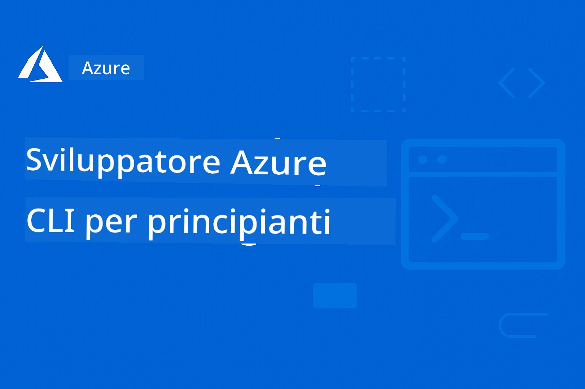

# AZD per Principianti: Un Percorso di Apprendimento Strutturato

 

[](https://GitHub.com/microsoft/azd-for-beginners/watchers/)
[](https://GitHub.com/microsoft/azd-for-beginners/network/)
[](https://GitHub.com/microsoft/azd-for-beginners/stargazers/)

[](https://discord.com/invite/nkVh3dp)
[](https://discord.gg/nTYy5BXMWG)

---

### Traduzioni Automatiche (Sempre Aggiornate)

<!-- CO-OP TRANSLATOR LANGUAGES TABLE START -->
[Arabic](../ar/README.md) | [Bengali](../bn/README.md) | [Bulgarian](../bg/README.md) | [Burmese (Myanmar)](../my/README.md) | [Chinese (Simplified)](../zh-CN/README.md) | [Chinese (Traditional, Hong Kong)](../zh-HK/README.md) | [Chinese (Traditional, Macau)](../zh-MO/README.md) | [Chinese (Traditional, Taiwan)](../zh-TW/README.md) | [Croatian](../hr/README.md) | [Czech](../cs/README.md) | [Danish](../da/README.md) | [Dutch](../nl/README.md) | [Estonian](../et/README.md) | [Finnish](../fi/README.md) | [French](../fr/README.md) | [German](../de/README.md) | [Greek](../el/README.md) | [Hebrew](../he/README.md) | [Hindi](../hi/README.md) | [Hungarian](../hu/README.md) | [Indonesian](../id/README.md) | [Italian](./README.md) | [Japanese](../ja/README.md) | [Kannada](../kn/README.md) | [Khmer](../km/README.md) | [Korean](../ko/README.md) | [Lithuanian](../lt/README.md) | [Malay](../ms/README.md) | [Malayalam](../ml/README.md) | [Manipuri (Meitei Mayek)](../mni/README.md) | [Marathi](../mr/README.md) | [Nepali](../ne/README.md) | [Nigerian Pidgin](../pcm/README.md) | [Norwegian](../no/README.md) | [Persian (Farsi)](../fa/README.md) | [Polish](../pl/README.md) | [Portuguese (Brazil)](../pt-BR/README.md) | [Portuguese (Portugal)](../pt-PT/README.md) | [Punjabi (Gurmukhi)](../pa/README.md) | [Romanian](../ro/README.md) | [Russian](../ru/README.md) | [Serbian (Cyrillic)](../sr/README.md) | [Slovak](../sk/README.md) | [Slovenian](../sl/README.md) | [Spanish](../es/README.md) | [Swahili](../sw/README.md) | [Swedish](../sv/README.md) | [Tagalog (Filipino)](../tl/README.md) | [Tamil](../ta/README.md) | [Telugu](../te/README.md) | [Thai](../th/README.md) | [Turkish](../tr/README.md) | [Ukrainian](../uk/README.md) | [Urdu](../ur/README.md) | [Vietnamese](../vi/README.md)

> **Preferisci clonare localmente?**
>
> Questo repository include oltre 50 traduzioni linguistiche che aumentano significativamente la dimensione del download. Per clonare senza traduzioni, usa il checkout sparso:
>
> **Bash / macOS / Linux:**
> ```bash
> git clone --filter=blob:none --sparse https://github.com/microsoft/AZD-for-beginners.git
> cd AZD-for-beginners
> git sparse-checkout set --no-cone '/*' '!translations' '!translated_images'
> ```
>
> **CMD (Windows):**
> ```cmd
> git clone --filter=blob:none --sparse https://github.com/microsoft/AZD-for-beginners.git
> cd AZD-for-beginners
> git sparse-checkout set --no-cone "/*" "!translations" "!translated_images"
> ```
>
> Questo ti dà tutto il necessario per completare il corso con un download molto più rapido.
<!-- CO-OP TRANSLATOR LANGUAGES TABLE END -->

## 🆕 Novità di oggi in azd

> 📌 Questo corso è validato per **`azd 1.27.1`** (luglio 2026). Esegui `azd version` per verificare la tua build, e `azd upgrade` per scaricare l'ultima versione.

Azure Developer CLI è cresciuto oltre le tradizionali app web e API. Oggi azd è lo strumento unico per distribuire **qualsiasi** applicazione su Azure—comprese applicazioni AI-powered e agenti intelligenti.

Ecco cosa significa per te:

- **Gli agenti AI sono ora workload di prima classe in azd.** Puoi inizializzare, distribuire e gestire progetti di agenti AI usando lo stesso flusso di lavoro `azd init` → `azd up` che già conosci.
- **Un ciclo di vita completo degli agenti dalla CLI.** L’estensione `azure.ai.agents` ora copre l’intero percorso—`azd ai agent init` per scaffoldare, `azd ai agent invoke` per testare (con output del tempo di risposta), `azd ai agent eval generate` e `azd ai agent optimize` per misurare e migliorare la qualità, e `azd ai agent delete` per pulire.
- **Più blocchi costruttivi AI.** Nuove estensioni in preview—`azure.ai.skills` e `azure.ai.connections`—ti permettono di gestire direttamente con azd competenze di agenti riutilizzabili e connessioni Foundry.
- **Integrazione Microsoft Foundry** porta il deployment di modelli, hosting di agenti e configurazione dei servizi AI direttamente nell’ecosistema dei template azd.
- **Operazioni quotidiane più fluide.** Le recenti release hanno reso `azd init` idempotente (sicuro da rieseguire), hanno fatto sì che `azd auth login` elimini automaticamente i token obsoleti, e hanno aggiunto un amichevole prompt di setup alla prima esecuzione `azd tool`.
- **Il flusso di lavoro base non è cambiato.** Che tu stia distribuendo una app todo, un microservizio o una soluzione AI multi-agente, i comandi sono gli stessi.

> **Nota per gli utenti Aspire:** Microsoft ora si riferisce al prodotto semplicemente come **Aspire** (precedentemente ".NET Aspire"). Il supporto di azd per Aspire è invariato—è stato aggiornato solo il nome.

Se hai già usato azd, il supporto AI è una naturale estensione—non uno strumento separato o una track avanzata. Se stai iniziando da zero, imparerai un flusso unico che funziona per tutto.

---

## 🚀 Cos’è Azure Developer CLI (azd)?

**Azure Developer CLI (azd)** è uno strumento a riga di comando amichevole per sviluppatori che rende semplice distribuire applicazioni su Azure. Invece di creare e connettere manualmente decine di risorse Azure, puoi distribuire intere applicazioni con un solo comando.

### La magia di `azd up`

```bash
# This single command does everything:
# ✅ Creates all Azure resources  
# ✅ Configures networking and security
# ✅ Builds your application code
# ✅ Deploys to Azure
# ✅ Gives you a working URL
azd up
```

**È tutto qui!** Niente clic nel Portale Azure, nessun complicato template ARM da imparare prima, nessuna configurazione manuale - solo applicazioni funzionanti su Azure.

---

## ❓ Azure Developer CLI vs Azure CLI: Qual è la differenza?

Questa è la domanda più comune che si pongono i principianti. Ecco la risposta semplice:

| Caratteristica | **Azure CLI (`az`)** | **Azure Developer CLI (`azd`)** |
|---------|---------------------|--------------------------------|
| **Scopo** | Gestire singole risorse Azure | Distribuire applicazioni complete |
| **Mentalità** | Focalizzato sull’infrastruttura | Focalizzato sull’applicazione |
| **Esempio** | `az webapp create --name myapp...` | `azd up` |
| **Curva di apprendimento** | Devi conoscere i servizi Azure | Devi conoscere la tua app |
| **Ideale per** | DevOps, Infrastruttura | Sviluppatori, prototipazione |

### Analogia semplice

- **Azure CLI** è come avere tutti gli strumenti per costruire una casa - martelli, seghe, chiodi. Puoi costruire di tutto, ma devi conoscere l’edilizia.
- **Azure Developer CLI** è come assumere un appaltatore - descrivi cosa vuoi e lui gestisce la costruzione.

### Quando usarli

| Scenario | Usa Questo |
|----------|----------|
| "Voglio distribuire la mia app web rapidamente" | `azd up` |
| "Ho bisogno solo di creare un account di archiviazione" | `az storage account create` |
| "Sto costruendo una applicazione AI completa" | `azd init --template azure-search-openai-demo` |
| "Ho bisogno di fare debug di una risorsa Azure specifica" | `az resource show` |
| "Voglio un deployment pronto per la produzione in pochi minuti" | `azd up --environment production` |

### Funzionano insieme!

AZD utilizza Azure CLI come base. Puoi usare entrambi:
```bash
# Deploy your app with AZD
azd up

# Then fine-tune specific resources with Azure CLI
az webapp config set --name myapp --always-on true
```

---

## 🌟 Trova template in Awesome AZD

Non partire da zero! **Awesome AZD** è la raccolta della community di template pronti per essere distribuiti:

| Risorsa | Descrizione |
|----------|-------------|
| 🔗 [**Awesome AZD Gallery**](https://azure.github.io/awesome-azd/) | Sfoglia oltre 200 template con deploy ad un solo clic |
| 🔗 [**Invia un Template**](https://github.com/Azure/awesome-azd/issues) | Contribuisci con il tuo template alla community |
| 🔗 [**Repository GitHub**](https://github.com/Azure/awesome-azd) | Metti una stella ed esplora il codice sorgente |

### Template AI popolari da Awesome AZD

```bash
# RAG Chat with Microsoft Foundry Models + AI Search
azd init --template azure-search-openai-demo

# Quick AI Chat Application
azd init --template openai-chat-app-quickstart

# AI Agents with Foundry Agents
azd init --template get-started-with-ai-agents
```

---

## 🎯 Inizia in 3 passi

Prima di iniziare, assicurati che la tua macchina sia pronta per il template che vuoi distribuire:

**Windows:**
```powershell
.\validate-setup.ps1
```

**macOS / Linux:**
```bash
bash ./validate-setup.sh
```

Se qualche controllo obbligatorio fallisce, risolvilo prima di continuare con l’avvio rapido.

### Passo 1: Installa AZD (2 minuti)

**Windows:**
```powershell
winget install microsoft.azd
```

**macOS:**
```bash
brew tap azure/azd && brew install azd
```

**Linux:**
```bash
curl -fsSL https://aka.ms/install-azd.sh | bash
```

### Passo 2: Autenticati per AZD

```bash
# Optional if you plan to use Azure CLI commands directly in this course
az login

# Required for AZD workflows
azd auth login
```

Se non sei sicuro di quale ti serve, segui il flusso completo in [Installazione e Configurazione](docs/chapter-01-foundation/installation.md#authentication-setup).

### Passo 3: Distribuisci la tua prima app

```bash
# Initialize from a template
azd init --template todo-nodejs-mongo

# Deploy to Azure (creates everything!)
azd up
```

**🎉 Fatto!** La tua app è ora attiva su Azure.

### Pulizia (Non dimenticare!)

```bash
# Remove all resources when done experimenting
azd down --force --purge
```

---

## 📚 Come usare questo corso

Questo corso è progettato per un **apprendimento progressivo** - inizia dal punto in cui ti senti a tuo agio e lavora gradualmente:

| La tua esperienza | Inizia qui |
|-----------------|------------|
| **Nuovo su Azure** | [Capitolo 1: Fondamenti](#-chapter-1-foundation--quick-start) |
| **Conosci Azure, nuovo ad AZD** | [Capitolo 1: Fondamenti](#-chapter-1-foundation--quick-start) |
| **Vuoi distribuire app AI** | [Capitolo 2: Sviluppo AI-First](#-chapter-2-ai-first-development-recommended-for-ai-developers) |
| **Vuoi pratica guidata** | [🎓 Laboratorio interattivo](workshop/README.md) - laboratorio guidato 3-4 ore |
| **Hai bisogno di pattern di produzione** | [Capitolo 8: Produzione & Enterprise](#-chapter-8-production--enterprise-patterns) |

### Configurazione rapida

1. **Crea un Fork di questo repository**: [](https://GitHub.com/microsoft/azd-for-beginners/fork)
2. **Clonalo**: `git clone https://github.com/YOUR-USERNAME/azd-for-beginners.git`
3. **Ottieni aiuto**: [Community Azure Discord](https://discord.com/invite/ByRwuEEgH4)

> **Preferisci clonare localmente?**

> Questo repository include oltre 50 traduzioni linguistiche che aumentano significativamente la dimensione del download. Per clonare senza traduzioni, usa il checkout sparso:
> ```bash
> git clone --filter=blob:none --sparse https://github.com/microsoft/AZD-for-beginners.git
> cd AZD-for-beginners
> git sparse-checkout set --no-cone '/*' '!translations' '!translated_images'
> ```
> Ti dà tutto il necessario per completare il corso con un download molto più rapido.


## Panorama del corso

Padroneggia Azure Developer CLI (azd) attraverso capitoli strutturati progettati per un apprendimento progressivo. **Focus speciale sul deployment di applicazioni AI con integrazione Microsoft Foundry.**

### Perché questo corso è essenziale per gli sviluppatori moderni

Basato sulle intuizioni della community Microsoft Foundry Discord, **il 45% degli sviluppatori vuole usare AZD per workload AI** ma incontra difficoltà con:
- Architetture AI complesse multi-servizio
- Best practice per il deployment AI in produzione  
- Integrazione e configurazione dei servizi Azure AI
- Ottimizzazione dei costi per workload AI
- Risoluzione dei problemi specifici di deployment AI

### Obiettivi di apprendimento

Completando questo corso strutturato, tu:
- **Padroneggerai i fondamenti di AZD**: concetti base, installazione e configurazione
- **Distribuirai applicazioni AI**: usa AZD con i servizi Microsoft Foundry
- **Implementare l'Infrastructure as Code**: Gestire le risorse Azure con template Bicep
- **Risoluzione dei problemi di distribuzione**: Risolvere problemi comuni e fare debug
- **Ottimizzare per la produzione**: Sicurezza, scalabilità, monitoraggio e gestione dei costi
- **Costruire soluzioni multi-agente**: Distribuire architetture AI complesse

## Prima di iniziare: Account, Accessi e Assunzioni

Prima di iniziare il Capitolo 1, assicurati di avere quanto segue in ordine. I passaggi di installazione più avanti in questa guida presuppongono che queste basi siano già gestite.

- **Un abbonamento Azure**: Puoi usare un abbonamento esistente dal lavoro o dal tuo account personale, oppure crearne uno tramite una [trial gratuita](https://aka.ms/azurefreetrial) per iniziare.
- **Permesso per creare risorse Azure**: Per la maggior parte degli esercizi, dovresti avere almeno accesso **Contributor** sull'abbonamento o sul gruppo di risorse di destinazione. Alcuni capitoli potrebbero anche presupporre che tu possa creare gruppi di risorse, managed identity e assegnazioni RBAC.
- [**Un account GitHub**](https://github.com): Utile per fare fork del repository, tracciare i tuoi cambiamenti e usare GitHub Codespaces per il workshop.
- **Prerequisiti di runtime per i template**: Alcuni template richiedono strumenti locali come Node.js, Python, Java o Docker. Esegui il validatore di setup prima di iniziare per intercettare eventuali strumenti mancanti.
- **Familiarità base con il terminale**: Non serve essere esperti, ma devi sentirti a tuo agio nell'eseguire comandi come `git clone`, `azd auth login` e `azd up`.

> **Lavori in un abbonamento aziendale?**
> Se il tuo ambiente Azure è gestito da un amministratore, conferma in anticipo che puoi distribuire risorse nell'abbonamento o nel gruppo di risorse che intendi usare. In caso contrario, richiedi un abbonamento sandbox o l'accesso Contributor prima di iniziare.

> **Sei nuovo in Azure?**
> Parti con il tuo abbonamento Azure trial o pay-as-you-go su https://aka.ms/azurefreetrial così puoi completare gli esercizi completamente senza aspettare approvazioni a livello di tenant.

## 🗺️ Mappa del corso: Navigazione rapida per capitolo

Ogni capitolo ha un README dedicato con obiettivi di apprendimento, quick start ed esercizi:

| Capitolo | Argomento | Lezioni | Durata | Complessità |
|---------|----------|---------|--------|-------------|
| **[Cap 1: Fondamenti](docs/chapter-01-foundation/README.md)** | Introduzione | [Basi AZD](docs/chapter-01-foundation/azd-basics.md) &#124; [Installazione](docs/chapter-01-foundation/installation.md) &#124; [Primo Progetto](docs/chapter-01-foundation/first-project.md) | 30-45 min | ⭐ |
| **[Cap 2: Sviluppo AI](docs/chapter-02-ai-development/README.md)** | App AI-First | [Integrazione Foundry](docs/chapter-02-ai-development/microsoft-foundry-integration.md) &#124; [Agenti AI](docs/chapter-02-ai-development/agents.md) &#124; [Distribuzione Modelli](docs/chapter-02-ai-development/ai-model-deployment.md) &#124; [Workshop](docs/chapter-02-ai-development/ai-workshop-lab.md) | 1-2 ore | ⭐⭐ |
| **[Cap 3: Configurazione](docs/chapter-03-configuration/README.md)** | Autenticazione & Sicurezza | [Configurazione](docs/chapter-03-configuration/configuration.md) &#124; [Autenticazione & Sicurezza](docs/chapter-03-configuration/authsecurity.md) | 45-60 min | ⭐⭐ |
| **[Cap 4: Infrastruttura](docs/chapter-04-infrastructure/README.md)** | IaC & Distribuzione | [Guida alla distribuzione](docs/chapter-04-infrastructure/deployment-guide.md) &#124; [Provisioning](docs/chapter-04-infrastructure/provisioning.md) | 1-1.5 ore | ⭐⭐⭐ |
| **[Cap 5: Multi-Agent](docs/chapter-05-multi-agent/README.md)** | Soluzioni Agent AI | [Scenario Retail](examples/retail-scenario.md) &#124; [Pattern di coordinamento](docs/chapter-06-pre-deployment/coordination-patterns.md) | 2-3 ore | ⭐⭐⭐⭐ |
| **[Cap 6: Pre-Distribuzione](docs/chapter-06-pre-deployment/README.md)** | Pianificazione & Validazione | [Check Preflight](docs/chapter-06-pre-deployment/preflight-checks.md) &#124; [Pianificazione Capacità](docs/chapter-06-pre-deployment/capacity-planning.md) &#124; [Selezione SKU](docs/chapter-06-pre-deployment/sku-selection.md) &#124; [App Insights](docs/chapter-06-pre-deployment/application-insights.md) | 1 ora | ⭐⭐ |
| **[Cap 7: Risoluzione Problemi](docs/chapter-07-troubleshooting/README.md)** | Debug & Correzioni | [Problemi Comuni](docs/chapter-07-troubleshooting/common-issues.md) &#124; [Debugging](docs/chapter-07-troubleshooting/debugging.md) &#124; [Problemi AI](docs/chapter-07-troubleshooting/ai-troubleshooting.md) | 1-1.5 ore | ⭐⭐ |
| **[Cap 8: Produzione](docs/chapter-08-production/README.md)** | Pattern Aziendali | [Best practice in produzione](docs/chapter-08-production/production-ai-practices.md) | 2-3 ore | ⭐⭐⭐⭐ |
| **[🎓 Workshop](workshop/README.md)** | Laboratorio Pratico | [Introduzione](workshop/docs/instructions/0-Introduction.md) &#124; [Selezione](workshop/docs/instructions/1-Select-AI-Template.md) &#124; [Validazione](workshop/docs/instructions/2-Validate-AI-Template.md) &#124; [De-costruzione](workshop/docs/instructions/3-Deconstruct-AI-Template.md) &#124; [Configurazione](workshop/docs/instructions/4-Configure-AI-Template.md) &#124; [Personalizzazione](workshop/docs/instructions/5-Customize-AI-Template.md) &#124; [Smantellamento](workshop/docs/instructions/6-Teardown-Infrastructure.md) &#124; [Conclusione](workshop/docs/instructions/7-Wrap-up.md) | 3-4 ore | ⭐⭐ |

**Durata totale del corso:** ~10-14 ore | **Progressione di competenze:** Principiante → Pronto per la produzione

---

## 📚 Capitoli di apprendimento

*Scegli il tuo percorso di apprendimento basato sul livello di esperienza e obiettivi*

### 🚀 Capitolo 1: Fondamenti e Quick Start
**Prerequisiti**: abbonamento Azure, conoscenze di base da riga di comando  
**Durata**: 30-45 minuti  
**Complessità**: ⭐

#### Cosa imparerai
- Comprendere i fondamenti di Azure Developer CLI
- Installare AZD sulla tua piattaforma
- La tua prima distribuzione di successo

#### Risorse di apprendimento
- **🎯 Inizia qui**: [Cos'è Azure Developer CLI?](#what-is-azure-developer-cli)
- **📖 Teoria**: [Basi di AZD](docs/chapter-01-foundation/azd-basics.md) - Concetti e terminologia di base
- **⚙️ Setup**: [Installazione & Configurazione](docs/chapter-01-foundation/installation.md) - Guide specifiche per piattaforma
- **🛠️ Pratica**: [Il tuo primo progetto](docs/chapter-01-foundation/first-project.md) - Tutorial passo-passo
- **📋 Riferimento rapido**: [Cheat Sheet comandi](resources/cheat-sheet.md)

#### Esercizi pratici
```bash
# Quick installation check
azd version

# Deploy your first application
azd init --template todo-nodejs-mongo
azd up
```

**💡 Risultato del capitolo**: Distribuire con successo una semplice applicazione web su Azure usando AZD

**✅ Validazione del successo:**
```bash
# After completing Chapter 1, you should be able to:
azd version              # Shows installed version
azd init --template todo-nodejs-mongo  # Initializes project
azd up                  # Deploys to Azure
azd show                # Displays running app URL
# Application opens in browser and works
azd down --force --purge  # Cleans up resources
```

**📊 Tempo richiesto:** 30-45 minuti  
**📈 Livello di competenza dopo:** Capacità di distribuire applicazioni base in autonomia
**📈 Livello di competenza dopo:** Capacità di distribuire applicazioni base in autonomia

---

### 🤖 Capitolo 2: Sviluppo AI-First (Consigliato per sviluppatori AI)
**Prerequisiti**: Capitolo 1 completato  
**Durata**: 1-2 ore  
**Complessità**: ⭐⭐

#### Cosa imparerai
- Integrazione Microsoft Foundry con AZD
- Distribuzione di applicazioni AI-powered
- Comprensione delle configurazioni dei servizi AI

#### Risorse di apprendimento
- **🎯 Inizia qui**: [Integrazione Microsoft Foundry](docs/chapter-02-ai-development/microsoft-foundry-integration.md)
- **🤖 Agenti AI**: [Guida agli Agenti AI](docs/chapter-02-ai-development/agents.md) - Distribuzione di agenti intelligenti con AZD
- **📖 Pattern**: [Distribuzione modelli AI](docs/chapter-02-ai-development/ai-model-deployment.md) - Distribuire e gestire modelli AI
- **🛠️ Workshop**: [Laboratorio AI Workshop](docs/chapter-02-ai-development/ai-workshop-lab.md) - Preparare le soluzioni AI con AZD
- **🎥 Guida interattiva**: [Materiali Workshop](workshop/README.md) - Apprendimento via browser con MkDocs * Ambiente DevContainer
- **📋 Template**: [Template Microsoft Foundry](#featured-microsoft-foundry-templates)
- **📝 Esempi**: [Esempi di distribuzione AZD](examples/README.md)

#### Esercizi pratici
```bash
# Deploy your first AI application
azd init --template azure-search-openai-demo
azd up

# Try additional AI templates
azd init --template openai-chat-app-quickstart
azd init --template agent-openai-python-prompty
```

**💡 Risultato del capitolo**: Distribuire e configurare una chat AI-powered con capacità RAG

**✅ Validazione del successo:**
```bash
# After Chapter 2, you should be able to:
azd init --template azure-search-openai-demo
azd up
# Test the AI chat interface
# Ask questions and get AI-powered responses with sources
# Verify search integration works
azd monitor  # Check Application Insights shows telemetry
azd down --force --purge
```

**📊 Tempo richiesto:** 1-2 ore  
**📈 Livello di competenza dopo:** Capacità di distribuire e configurare applicazioni AI pronte per la produzione  
**💰 Consapevolezza dei costi:** Comprendere i costi di sviluppo $80-150/mese, costi di produzione $300-3500/mese

#### 💰 Considerazioni sui costi per distribuzioni AI

**Ambiente di sviluppo (stimato $80-150/mese):**
- Modelli Microsoft Foundry (Pay-as-you-go): $0-50/mese (basato sull'uso di token)
- AI Search (livello base): $75/mese
- Container Apps (Consumo): $0-20/mese
- Storage (Standard): $1-5/mese

**Ambiente di produzione (stimato $300-3.500+/mese):**
- Modelli Microsoft Foundry (PTU per prestazioni consistenti): $3.000+/mese OPPURE pay-as-you-go con alto volume
- AI Search (livello standard): $250/mese
- Container Apps (Dedicato): $50-100/mese
- Application Insights: $5-50/mese
- Storage (Premium): $10-50/mese

**💡 Consigli per l'ottimizzazione dei costi:**
- Usa i modelli Microsoft Foundry a **livello gratuito** per l'apprendimento (inclusi 50.000 token/mese Azure OpenAI)
- Esegui `azd down` per deallocare le risorse quando non stai sviluppando attivamente
- Parti da fatturazione a consumo, esegui l'upgrade a PTU solo per produzione
- Usa `azd provision --preview` per stimare i costi prima della distribuzione
- Abilita l'auto-scalabilità: paga solo per l'uso effettivo

**Monitoraggio costi:**
```bash
# Check estimated monthly costs
azd provision --preview

# Monitor actual costs in Azure Portal
az consumption budget list --resource-group <your-rg>
```

---

### ⚙️ Capitolo 3: Configurazione & Autenticazione
**Prerequisiti**: Capitolo 1 completato  
**Durata**: 45-60 minuti  
**Complessità**: ⭐⭐

#### Cosa imparerai
- Configurazione e gestione dell’ambiente
- Best practice di autenticazione e sicurezza
- Nominativi e organizzazione delle risorse

#### Risorse di apprendimento
- **📖 Configurazione**: [Guida alla configurazione](docs/chapter-03-configuration/configuration.md) - Allestimento ambiente
- **🔐 Sicurezza**: [Pattern di autenticazione e managed identity](docs/chapter-03-configuration/authsecurity.md) - Pattern di autenticazione
- **📝 Esempi**: [Esempio app database](examples/database-app/README.md) - Esempi AZD con database

#### Esercizi pratici
- Configurare più ambienti (dev, staging, prod)
- Impostare autenticazione con managed identity
- Implementare configurazioni specifiche per ambiente

**💡 Risultato del capitolo**: Gestire più ambienti con corretta autenticazione e sicurezza

---

### 🏗️ Capitolo 4: Infrastructure as Code & Distribuzione
**Prerequisiti**: Capitoli 1-3 completati  
**Durata**: 1-1.5 ore  
**Complessità**: ⭐⭐⭐

#### Cosa imparerai
- Pattern avanzati di distribuzione
- Infrastructure as Code con Bicep
- Strategie di provisioning risorse

#### Risorse di apprendimento
- **📖 Distribuzione**: [Guida alla distribuzione](docs/chapter-04-infrastructure/deployment-guide.md) - Flussi di lavoro completi
- **🏗️ Provisioning**: [Provisioning risorse](docs/chapter-04-infrastructure/provisioning.md) - Gestione risorse Azure
- **📝 Esempi**: [Esempio Container App](../../examples/container-app) - Distribuzioni containerizzate

#### Esercizi pratici
- Creare template Bicep personalizzati
- Distribuire applicazioni multi-servizio
- Implementare strategie di distribuzione blue-green

**💡 Risultato del capitolo**: Distribuire applicazioni multi-servizio complesse usando template infrastrutturali personalizzati

---

### 🎯 Capitolo 5: Soluzioni AI Multi-Agent (Avanzato)
**Prerequisiti**: Capitoli 1-2 completati  
**Durata**: 2-3 ore  
**Complessità**: ⭐⭐⭐⭐

#### Cosa imparerai
- Pattern architetturali multi-agente
- Orchestrazione e coordinamento degli agenti
- Distribuzioni AI pronte per la produzione

#### Risorse di apprendimento
- **🤖 Progetto in evidenza**: [Soluzione Multi-Agent Retail](examples/retail-scenario.md) - Implementazione completa
- **🛠️ Template ARM**: [Pacchetto template ARM](../../examples/retail-multiagent-arm-template) - Distribuzione con un clic
- **📖 Architettura**: [Pattern coordinamento multi-agente](docs/chapter-06-pre-deployment/coordination-patterns.md) - Pattern

#### Esercizi pratici
```bash
# Deploy the complete retail multi-agent solution
cd examples/retail-multiagent-arm-template
./deploy.sh

# Explore agent configurations
az deployment group show --resource-group <rg-name> --name <deployment-name>
```

**💡 Risultato del capitolo**: Distribuire e gestire una soluzione AI multi-agente pronta per la produzione con agenti Customer e Inventory

---

### 🔍 Capitolo 6: Validazione & Pianificazione Pre-distribuzione
**Prerequisiti**: Capitolo 4 completato  
**Durata**: 1 ora  
**Complessità**: ⭐⭐

#### Cosa imparerai
- Pianificazione della capacità e validazione risorse
- Strategie di selezione SKU
- Check preflight e automazione

#### Risorse di apprendimento
- **📊 Pianificazione**: [Pianificazione della capacità](docs/chapter-06-pre-deployment/capacity-planning.md) - Validazione delle risorse
- **💰 Selezione**: [Selezione SKU](docs/chapter-06-pre-deployment/sku-selection.md) - Scelte convenienti
- **✅ Validazione**: [Controlli pre-volo](docs/chapter-06-pre-deployment/preflight-checks.md) - Script automatizzati

#### Esercizi Pratici
- Esegui script di validazione della capacità
- Ottimizza la selezione degli SKU per il costo
- Implementa controlli pre-distribuzione automatizzati

**💡 Risultato del Capitolo**: Convalidare e ottimizzare le distribuzioni prima dell'esecuzione

---

### 🚨 Capitolo 7: Risoluzione dei problemi e Debug
**Prerequisiti**: Qualsiasi capitolo di distribuzione completato  
**Durata**: 1-1,5 ore  
**Complessità**: ⭐⭐

#### Cosa Imparerai
- Approcci sistematici al debug
- Problemi comuni e soluzioni
- Risoluzione dei problemi specifica per l'IA

#### Risorse per l'Apprendimento
- **🔧 Problemi Comuni**: [Problemi Comuni](docs/chapter-07-troubleshooting/common-issues.md) - FAQ e soluzioni
- **🕵️ Debug**: [Guida al Debug](docs/chapter-07-troubleshooting/debugging.md) - Strategie passo-passo
- **🤖 Problemi AI**: [Risoluzione Problemi specifici AI](docs/chapter-07-troubleshooting/ai-troubleshooting.md) - Problemi dei servizi AI

#### Esercizi Pratici
- Diagnostica i fallimenti di distribuzione
- Risolvi problemi di autenticazione
- Debug della connettività dei servizi AI

**💡 Risultato del Capitolo**: Diagnosticare e risolvere autonomamente i problemi comuni di distribuzione

---

### 🏢 Capitolo 8: Pattern di Produzione e Enterprise
**Prerequisiti**: Capitoli 1-4 completati  
**Durata**: 2-3 ore  
**Complessità**: ⭐⭐⭐⭐

#### Cosa Imparerai
- Strategie di distribuzione in produzione
- Pattern di sicurezza enterprise
- Monitoraggio e ottimizzazione dei costi

#### Risorse per l'Apprendimento
- **🏭 Produzione**: [Best Practice AI in Produzione](docs/chapter-08-production/production-ai-practices.md) - Pattern enterprise
- **📝 Esempi**: [Esempio Microservizi](../../examples/microservices) - Architetture complesse
- **📊 Monitoraggio**: [Integrazione Application Insights](docs/chapter-06-pre-deployment/application-insights.md) - Monitoraggio

#### Esercizi Pratici
- Implementa pattern di sicurezza enterprise
- Configura un monitoraggio completo
- Distribuisci in produzione con governance adeguata

**💡 Risultato del Capitolo**: Distribuire applicazioni enterprise-ready con capacità complete di produzione

---

## 🎓 Panoramica del Workshop: Esperienza di Apprendimento Pratico

> **⚠️ STATO DEL WORKSHOP: Sviluppo Attivo**  
> I materiali del workshop sono attualmente in fase di sviluppo e perfezionamento. I moduli principali sono funzionali, ma alcune sezioni avanzate sono incomplete. Stiamo lavorando attivamente per completare tutti i contenuti. [Segui i progressi →](workshop/README.md)

### Materiali Interattivi del Workshop
**Apprendimento pratico completo con strumenti basati su browser ed esercizi guidati**

I materiali del workshop offrono un'esperienza di apprendimento strutturata e interattiva che integra il curriculum per capitoli sopra riportato. Il workshop è progettato sia per l'apprendimento autodidatta sia per sessioni guidate da istruttori.

#### 🛠️ Caratteristiche del Workshop
- **Interfaccia basata su browser**: Workshop completo con MkDocs, funzionalità di ricerca, copia e temi
- **Integrazione GitHub Codespaces**: Configurazione dell'ambiente di sviluppo con un clic
- **Percorso di apprendimento strutturato**: 8 moduli di esercizi guidati (3-4 ore totali)
- **Metodologia progressiva**: Introduzione → Selezione → Validazione → Smontaggio → Configurazione → Personalizzazione → Smantellamento → Conclusione
- **Ambiente DevContainer Interattivo**: Strumenti e dipendenze preconfigurate

#### 📚 Struttura dei Moduli del Workshop
Il workshop segue una **metodologia progressiva in 8 moduli** che ti porta dalla scoperta alla padronanza della distribuzione:

| Modulo | Argomento | Cosa Farai | Durata |
|--------|----------|------------|--------|
| **0. Introduzione** | Panoramica del Workshop | Comprendere obiettivi di apprendimento, prerequisiti e struttura del workshop | 15 min |
| **1. Selezione** | Scoperta Template | Esplora i template AZD e seleziona il template AI giusto per il tuo scenario | 20 min |
| **2. Validazione** | Distribuisci & Verifica | Distribuisci il template con `azd up` e valida che l'infrastruttura funzioni | 30 min |
| **3. Smontaggio** | Comprendere la Struttura | Usa GitHub Copilot per esplorare l'architettura del template, i file Bicep e l'organizzazione del codice | 30 min |
| **4. Configurazione** | Approfondimento azure.yaml | Padroneggia la configurazione `azure.yaml`, i lifecycle hook e le variabili d'ambiente | 30 min |
| **5. Personalizzazione** | Rendilo tuo | Abilita AI Search, tracing, valutazione e personalizza per il tuo scenario | 45 min |
| **6. Smantellamento** | Pulizia | Rimuovi in sicurezza le risorse con `azd down --purge` | 15 min |
| **7. Conclusione** | Prossimi Passi | Rivedi i risultati, i concetti chiave e continua il tuo percorso di apprendimento | 15 min |

**Flusso del Workshop:**
```
Introduction → Selection → Validation → Deconstruction → Configuration → Customization → Teardown → Wrap-up
     ↓            ↓           ↓              ↓               ↓              ↓            ↓           ↓
  Overview    Find the     Deploy &      Explore        Master         Customize     Clean up    Review &
             right        verify        code &        azure.yaml      for your      resources   next steps
             template                   structure                     scenario
```

#### 🚀 Inizia il Workshop
```bash
# Option 1: GitHub Codespaces (Recommended)
# Click "Code" → "Create codespace on main" in the repository

# Option 2: Local Development
git clone https://github.com/microsoft/azd-for-beginners.git
cd azd-for-beginners/workshop
# Follow the setup instructions in workshop/README.md
```

#### 🎯 Risultati di Apprendimento del Workshop
Completando il workshop, i partecipanti saranno in grado di:
- **Distribuire applicazioni AI in produzione**: Usa AZD con i servizi Microsoft Foundry
- **Padroneggiare architetture multi-agente**: Implementa soluzioni coordinate di agenti AI
- **Implementare best practice di sicurezza**: Configura autenticazione e controllo accessi
- **Ottimizzare per la scalabilità**: Progetta distribuzioni performanti e convenienti
- **Risoluzione problemi di distribuzione**: Risolvi autonomamente problemi comuni

#### 📖 Risorse del Workshop
- **🎥 Guida Interattiva**: [Materiali del Workshop](workshop/README.md) - Ambiente di apprendimento basato su browser
- **📋 Istruzioni Modulo per Modulo**:
  - [0. Introduzione](workshop/docs/instructions/0-Introduction.md) - Panoramica e obiettivi del workshop
  - [1. Selezione](workshop/docs/instructions/1-Select-AI-Template.md) - Trova e seleziona template AI
  - [2. Validazione](workshop/docs/instructions/2-Validate-AI-Template.md) - Distribuisci e verifica template
  - [3. Smontaggio](workshop/docs/instructions/3-Deconstruct-AI-Template.md) - Esplora l’architettura del template
  - [4. Configurazione](workshop/docs/instructions/4-Configure-AI-Template.md) - Padroneggia azure.yaml
  - [5. Personalizzazione](workshop/docs/instructions/5-Customize-AI-Template.md) - Personalizza per il tuo scenario
  - [6. Smantellamento](workshop/docs/instructions/6-Teardown-Infrastructure.md) - Pulizia risorse
  - [7. Conclusione](workshop/docs/instructions/7-Wrap-up.md) - Revisione e prossimi passi
- **🛠️ Laboratorio AI Workshop**: [Laboratorio AI Workshop](docs/chapter-02-ai-development/ai-workshop-lab.md) - Esercizi focalizzati sull’AI
- **💡 Avvio Rapido**: [Guida alla Configurazione del Workshop](workshop/README.md#quick-start) - Configurazione ambiente

**Perfetto per**: formazione aziendale, corsi universitari, apprendimento autodidatta e bootcamp per sviluppatori.

---

## 📖 Approfondimento: Capacità di AZD

Oltre alle basi, AZD offre funzionalità potenti per le distribuzioni in produzione:

- **Distribuzioni basate su template** - Usa template predefiniti per pattern comuni di applicazioni
- **Infrastructure as Code** - Gestisci risorse Azure usando Bicep o Terraform  
- **Flussi di lavoro integrati** - Provisiona, distribuisci e monitora applicazioni senza soluzione di continuità
- **Ottimizzato per sviluppatori** - Massimizza produttività ed esperienza dello sviluppatore

### **AZD + Microsoft Foundry: ideale per distribuzioni AI**

**Perché AZD per soluzioni AI?** AZD affronta le principali sfide per gli sviluppatori AI:

- **Template pronti per AI** - Template preconfigurati per Microsoft Foundry Models, Azure AI Services e workload ML
- **Distribuzioni AI sicure** - Pattern di sicurezza integrati per servizi AI, chiavi API e endpoint modello  
- **Pattern AI per la produzione** - Best practice per distribuzioni AI scalabili e convenienti
- **Workflow AI end-to-end** - Dallo sviluppo del modello alla produzione con monitoraggio adeguato
- **Ottimizzazione costi** - Allocazione intelligente delle risorse e strategie di scaling per workload AI
- **Integrazione Microsoft Foundry** - Connessione fluida al catalogo e agli endpoint modelli Microsoft Foundry

---

## 🎯 Libreria di Template ed Esempi

### In evidenza: Template Microsoft Foundry
**Inizia qui se stai distribuendo applicazioni AI!**

> **Nota:** Questi template mostrano vari pattern AI. Alcuni sono Azure Samples esterni, altri implementazioni locali.

| Template | Capitolo | Complessità | Servizi | Tipo |
|----------|---------|------------|----------|------|
| [**Inizia con chat AI**](https://github.com/Azure-Samples/get-started-with-ai-chat) | Capitolo 2 | ⭐⭐ | AzureOpenAI + Azure AI Model Inference API + Azure AI Search + Azure Container Apps + Application Insights | Esterno |
| [**Inizia con agenti AI**](https://github.com/Azure-Samples/get-started-with-ai-agents) | Capitolo 2 | ⭐⭐ | Foundry Agents + AzureOpenAI + Azure AI Search + Azure Container Apps + Application Insights| Esterno |
| [**Demo Azure Search + OpenAI**](https://github.com/Azure-Samples/azure-search-openai-demo) | Capitolo 2 | ⭐⭐ | AzureOpenAI + Azure AI Search + App Service + Storage | Esterno |
| [**OpenAI Chat App Avvio Rapido**](https://github.com/Azure-Samples/openai-chat-app-quickstart) | Capitolo 2 | ⭐ | AzureOpenAI + Container Apps + Application Insights | Esterno |
| [**Agent OpenAI Python Prompty**](https://github.com/Azure-Samples/agent-openai-python-prompty) | Capitolo 5 | ⭐⭐⭐ | AzureOpenAI + Azure Functions + Prompty | Esterno |
| [**Contoso Chat RAG**](https://github.com/Azure-Samples/contoso-chat) | Capitolo 8 | ⭐⭐⭐⭐ | AzureOpenAI + AI Search + Cosmos DB + Container Apps | Esterno |
| [**Soluzione multi-agente Retail**](examples/retail-scenario.md) | Capitolo 5 | ⭐⭐⭐⭐ | AzureOpenAI + AI Search + Storage + Container Apps + Cosmos DB | **Locale** |

### In evidenza: Scenari di apprendimento completi
**Template di applicazioni pronti per la produzione mappati ai capitoli di apprendimento**

| Template | Capitolo di Apprendimento | Complessità | Apprendimento Chiave |
|----------|-------------------------|------------|--------------------|
| [**openai-chat-app-quickstart**](https://github.com/Azure-Samples/openai-chat-app-quickstart) | Capitolo 2 | ⭐ | Pattern base di distribuzione AI |
| [**azure-search-openai-demo**](https://github.com/Azure-Samples/azure-search-openai-demo) | Capitolo 2 | ⭐⭐ | Implementazione RAG con Azure AI Search |
| [**ai-document-processing**](https://github.com/Azure-Samples/ai-document-processing) | Capitolo 4 | ⭐⭐ | Integrazione Document Intelligence |
| [**agent-openai-python-prompty**](https://github.com/Azure-Samples/agent-openai-python-prompty) | Capitolo 5 | ⭐⭐⭐ | Framework agenti e chiamate di funzione |
| [**contoso-chat**](https://github.com/Azure-Samples/contoso-chat) | Capitolo 8 | ⭐⭐⭐ | Orchestrazione AI enterprise |
| [**retail-multi-agent-solution**](examples/retail-scenario.md) | Capitolo 5 | ⭐⭐⭐⭐ | Architettura multi-agente con agenti Cliente e Inventario |

### Apprendimento per Tipo di Esempio

> **📌 Esempi Locali vs. Esterni:**  
> **Esempi Locali** (in questo repo) = Pronti all’uso immediato  
> **Esempi Esterni** (Azure Samples) = Clona dai repository collegati

#### Esempi Locali (Pronti all’Uso)
- [**Soluzione multi-agente Retail**](examples/retail-scenario.md) - Implementazione completa pronta per la produzione con template ARM
  - Architettura multi-agente (agenti Cliente + Inventario)
  - Monitoraggio e valutazione completi
  - Distribuzione con un clic tramite template ARM

#### Esempi Locali - Applicazioni Container (Capitoli 2-5)
**Esempi completi di distribuzione container in questo repository:**
- [**Esempi Container App**](examples/container-app/README.md) - Guida completa alle distribuzioni containerizzate
  - [API Flask semplice](../../examples/container-app/simple-flask-api) - API REST basic con scale-to-zero
  - [Architettura Microservizi](../../examples/container-app/microservices) - Distribuzione multi-servizio pronta per la produzione
  - Pattern di avvio rapido, produzione e avanzati
  - Monitoraggio, sicurezza e indicazioni per ottimizzazione costi

#### Esempi Esterni - Applicazioni Semplici (Capitoli 1-2)
**Clona questi repository Azure Samples per iniziare:**
- [Semplice Web App - Node.js + MongoDB](https://github.com/Azure-Samples/todo-nodejs-mongo) - Pattern base di distribuzione
- [Sito Statico - React SPA](https://github.com/Azure-Samples/todo-csharp-sql-swa-func) - Distribuzione contenuti statici
- [Container App - Python Flask](https://github.com/Azure-Samples/container-apps-store-api-microservice) - Distribuzione API REST

#### Esempi Esterni - Integrazione Database (Capitoli 3-4)  
- [App Database - C# + SQL](https://github.com/Azure-Samples/todo-csharp-sql) - Pattern di connettività database
- [Functions + Cosmos DB](https://github.com/Azure-Samples/todo-python-mongo-swa-func) - Workflow dati serverless

#### Esempi Esterni - Pattern Avanzati (Capitoli 4-8)
- [Microservizi Java](https://github.com/Azure-Samples/java-microservices-aca-lab) - Architetture multi-servizio
- [Job Container Apps](https://github.com/Azure-Samples/container-apps-jobs) - Elaborazioni in background  
- [Pipeline ML Enterprise](https://github.com/Azure-Samples/mlops-v2) - Pattern ML pronti per la produzione

### Collezioni di Template Esterni
- [**Galleria Ufficiale Template AZD**](https://azure.github.io/awesome-azd/) - Collezione curata di template ufficiali e di comunità
- [**Template Azure Developer CLI**](https://learn.microsoft.com/en-us/azure/developer/azure-developer-cli/azd-templates) - Documentazione template Microsoft Learn
- [**Directory Esempi**](examples/README.md) - Esempi di apprendimento locali con spiegazioni dettagliate

---

## 📚 Risorse di Apprendimento e Riferimenti

### Riferimenti Rapidi
- [**Cheat Sheet dei Comandi**](resources/cheat-sheet.md) - Comandi azd essenziali organizzati per capitolo
- [**Glossario**](resources/glossary.md) - Terminologia Azure e azd  
- [**FAQ**](resources/faq.md) - Domande comuni organizzate per capitolo di apprendimento
- [**Guida di Studio**](resources/study-guide.md) - Esercizi pratici completi

### Laboratori Pratici
- [**Laboratorio AI Workshop**](docs/chapter-02-ai-development/ai-workshop-lab.md) - Rendi le tue soluzioni AI distribuibili con AZD (2-3 ore)
- [**Laboratorio Interattivo**](workshop/README.md) - Esercizi guidati in 8 moduli con MkDocs e GitHub Codespaces
  - Segue: Introduzione → Selezione → Validazione → Smontaggio → Configurazione → Personalizzazione → Smantellamento → Conclusione

### Risorse Esterne per l'Apprendimento
- [Documentazione Azure Developer CLI](https://learn.microsoft.com/en-us/azure/developer/azure-developer-cli/)
- [Azure Architecture Center](https://learn.microsoft.com/en-us/azure/architecture/)
- [Calcolatore Prezzi Azure](https://azure.microsoft.com/pricing/calculator/)
- [Stato di Azure](https://status.azure.com/)

### Abilità Agente AI per il Tuo Editor
- [**Competenze Microsoft Azure su skills.sh**](https://skills.sh/microsoft/github-copilot-for-azure) - 37 competenze agente open per Azure AI, Foundry, distribuzione, diagnostica, ottimizzazione dei costi e altro. Installale in GitHub Copilot, Cursor, Claude Code o qualsiasi agente supportato:
  ```bash
  npx skills add microsoft/github-copilot-for-azure
  ```

---

## 🔧 Guida Rapida alla Risoluzione dei Problemi

**Problemi comuni affrontati dai principianti e soluzioni immediate:**

<details>
<summary><strong>❌ "azd: comando non trovato"</strong></summary>

```bash
# Install AZD first
# Windows (PowerShell):
winget install microsoft.azd

# macOS:
brew tap azure/azd && brew install azd

# Linux:
curl -fsSL https://aka.ms/install-azd.sh | bash

# Verify installation
azd version
```
</details>

<details>
<summary><strong>❌ "Nessuna sottoscrizione trovata" o "Sottoscrizione non impostata"</strong></summary>

```bash
# List available subscriptions
az account list --output table

# Set default subscription
az account set --subscription "<subscription-id-or-name>"

# Set for AZD environment
azd env set AZURE_SUBSCRIPTION_ID "<subscription-id>"

# Verify
az account show
```
</details>

<details>
<summary><strong>❌ "Quota insufficiente" o "Quota superata"</strong></summary>

```bash
# Try different Azure region
azd env set AZURE_LOCATION "westus2"
azd up

# Or use smaller SKUs in development
# Edit infra/main.parameters.json:
{
  "sku": "B1"  // Instead of "P1V2"
}
```
</details>

<details>
<summary><strong>❌ "azd up" fallisce a metà operazione</strong></summary>

```bash
# Option 1: Clean and retry
azd down --force --purge
azd up

# Option 2: Just fix infrastructure
azd provision

# Option 3: Check detailed status
azd show

# Option 4: Check logs in Azure Monitor
azd monitor --logs
```
</details>

<details>
<summary><strong>❌ "Autenticazione fallita" o "Token scaduto"</strong></summary>

```bash
# Re-authenticate for AZD
azd auth logout
azd auth login

# Optional: refresh Azure CLI too if you are running az commands
az logout
az login

# Verify authentication
az account show
```
</details>

<details>
<summary><strong>❌ "Risorsa già esistente" o conflitti di denominazione</strong></summary>

```bash
# AZD generates unique names, but if conflict:
azd down --force --purge

# Then retry with fresh environment
azd env new dev-v2
azd up
```
</details>

<details>
<summary><strong>❌ Il deployment del template richiede troppo tempo</strong></summary>

**Tempi di attesa normali:**
- Semplice app web: 5-10 minuti
- App con database: 10-15 minuti
- Applicazioni AI: 15-25 minuti (la provisioning di OpenAI è lenta)

```bash
# Check progress
azd show

# If stuck >30 minutes, check Azure Portal:
azd monitor --overview
# Look for failed deployments
```
</details>

<details>
<summary><strong>❌ "Permesso negato" o "Vietato"</strong></summary>

```bash
# Check your Azure role
az role assignment list --assignee $(az account show --query user.name -o tsv)

# You need at least "Contributor" role
# Ask your Azure admin to grant:
# - Contributor (for resources)
# - User Access Administrator (for role assignments)
```
</details>

<details>
<summary><strong>❌ Impossibile trovare l'URL dell'applicazione distribuita</strong></summary>

```bash
# Show all service endpoints
azd show

# Or open Azure Portal
azd monitor

# Check specific service
azd env get-values
# Look for *_URL variables
```
</details>

### 📚 Risorse Complete per la Risoluzione dei Problemi

- **Guida ai Problemi Comuni:** [Soluzioni Dettagliate](docs/chapter-07-troubleshooting/common-issues.md)
- **Problemi Specifici AI:** [Risoluzione Problemi AI](docs/chapter-07-troubleshooting/ai-troubleshooting.md)
- **Guida al Debugging:** [Debugging passo passo](docs/chapter-07-troubleshooting/debugging.md)
- **Ottieni Aiuto:** [Discord Azure](https://discord.gg/microsoft-azure) #azure-developer-cli

---

## 🎓 Completamento Corso & Certificazione

### Monitoraggio del Progresso
Monitora il tuo progresso di apprendimento attraverso ogni capitolo:

- [ ] **Capitolo 1**: Fondamenti & Avvio Rapido ✅
- [ ] **Capitolo 2**: Sviluppo AI-First ✅  
- [ ] **Capitolo 3**: Configurazione & Autenticazione ✅
- [ ] **Capitolo 4**: Infrastructure as Code & Deployment ✅
- [ ] **Capitolo 5**: Soluzioni AI Multi-Agente ✅
- [ ] **Capitolo 6**: Validazione & Pianificazione Pre-Distribuzione ✅
- [ ] **Capitolo 7**: Risoluzione Problemi & Debugging ✅
- [ ] **Capitolo 8**: Pattern di Produzione & Enterprise ✅

### Verifica dell'Apprendimento
Dopo aver completato ogni capitolo, verifica le tue conoscenze tramite:
1. **Esercizio Pratico**: Completa il deployment pratico del capitolo
2. **Verifica Conoscenze**: Rivedi la sezione FAQ del capitolo
3. **Discussione in Comunità**: Condividi la tua esperienza in Azure Discord
4. **Capitolo Successivo**: Passa al livello di complessità successivo

### Benefici del Completamento Corso
Al termine di tutti i capitoli, avrai:
- **Esperienza in Produzione**: Applicazioni AI reali distribuite su Azure
- **Competenze Professionali**: Capacità di deployment pronte per l'azienda  
- **Riconoscimento nella Comunità**: Membro attivo della comunità degli sviluppatori Azure
- **Avanzamento di Carriera**: Competenza richiesta in AZD e deployment AI

---

## 🤝 Comunità & Supporto

### Ottieni Aiuto & Supporto
- **Problemi Tecnici**: [Segnala bug e richiedi funzionalità](https://github.com/microsoft/azd-for-beginners/issues)
- **Domande sull'Apprendimento**: [Community Discord Microsoft Azure](https://discord.gg/microsoft-azure) e [](https://discord.gg/nTYy5BXMWG)
- **Aiuto Specifico AI**: Unisciti a [](https://discord.gg/nTYy5BXMWG)
- **Documentazione**: [Documentazione ufficiale Azure Developer CLI](https://learn.microsoft.com/en-us/azure/developer/azure-developer-cli/)

### Approfondimenti dalla Comunità Microsoft Foundry Discord

**Risultati recenti del sondaggio del canale #Azure:**
- **45%** degli sviluppatori vogliono usare AZD per carichi di lavoro AI
- **Principali sfide**: Deployment multi-servizio, gestione credenziali, prontezza in produzione  
- **Più richiesti**: Template specifici AI, guide di risoluzione problemi, best practice

**Unisciti alla nostra comunità per:**
- Condividere le tue esperienze AZD + AI e ricevere aiuto
- Accedere alle anteprime anticipate di nuovi template AI
- Contribuire alle best practice per il deployment AI
- Influenzare lo sviluppo futuro di funzionalità AI + AZD

### Contributioni al Corso
Accogliamo contributi! Per favore leggi la nostra [Guida ai Contributi](CONTRIBUTING.md) per dettagli su:
- **Miglioramenti Contenuto**: Migliora i capitoli ed esempi esistenti
- **Nuovi Esempi**: Aggiungi scenari reali e template  
- **Traduzione**: Aiuta a mantenere il supporto multilingue
- **Segnalazioni Bug**: Migliora accuratezza e chiarezza
- **Standard Comunitari**: Segui nostre linee guida inclusive per la comunità

---

## 📄 Informazioni sul Corso

### Licenza
Questo progetto è concesso in licenza sotto la licenza MIT - vedi il file [LICENSE](../../LICENSE) per dettagli.

### Risorse Microsoft Learning Correlate

Il nostro team produce altri corsi di apprendimento completi:

<!-- CO-OP TRANSLATOR OTHER COURSES START -->
### LangChain
[](https://aka.ms/langchain4j-for-beginners)
[](https://aka.ms/langchainjs-for-beginners?WT.mc_id=m365-94501-dwahlin)
[](https://github.com/microsoft/langchain-for-beginners?WT.mc_id=m365-94501-dwahlin)
---

### Azure / Edge / MCP / Agenti
[](https://github.com/microsoft/AZD-for-beginners?WT.mc_id=academic-105485-koreyst)
[](https://github.com/microsoft/edgeai-for-beginners?WT.mc_id=academic-105485-koreyst)
[](https://github.com/microsoft/mcp-for-beginners?WT.mc_id=academic-105485-koreyst)
[](https://github.com/microsoft/ai-agents-for-beginners?WT.mc_id=academic-105485-koreyst)

---
 
### Serie AI Generativa
[](https://github.com/microsoft/generative-ai-for-beginners?WT.mc_id=academic-105485-koreyst)
[-9333EA?style=for-the-badge&labelColor=E5E7EB&color=9333EA)](https://github.com/microsoft/Generative-AI-for-beginners-dotnet?WT.mc_id=academic-105485-koreyst)
[-C084FC?style=for-the-badge&labelColor=E5E7EB&color=C084FC)](https://github.com/microsoft/generative-ai-for-beginners-java?WT.mc_id=academic-105485-koreyst)
[-E879F9?style=for-the-badge&labelColor=E5E7EB&color=E879F9)](https://github.com/microsoft/generative-ai-with-javascript?WT.mc_id=academic-105485-koreyst)

---
 
### Apprendimento Core
[](https://aka.ms/ml-beginners?WT.mc_id=academic-105485-koreyst)
[](https://aka.ms/datascience-beginners?WT.mc_id=academic-105485-koreyst)
[](https://aka.ms/ai-beginners?WT.mc_id=academic-105485-koreyst)
[](https://github.com/microsoft/Security-101?WT.mc_id=academic-96948-sayoung)
[](https://aka.ms/webdev-beginners?WT.mc_id=academic-105485-koreyst)
[](https://aka.ms/iot-beginners?WT.mc_id=academic-105485-koreyst)
[](https://github.com/microsoft/xr-development-for-beginners?WT.mc_id=academic-105485-koreyst)

---
 
### Serie Copilot
[](https://aka.ms/GitHubCopilotAI?WT.mc_id=academic-105485-koreyst)
[](https://github.com/microsoft/mastering-github-copilot-for-dotnet-csharp-developers?WT.mc_id=academic-105485-koreyst)
[](https://github.com/microsoft/CopilotAdventures?WT.mc_id=academic-105485-koreyst)
<!-- CO-OP TRANSLATOR OTHER COURSES END -->

---

## 🗺️ Navigazione del Corso

**🚀 Pronto per Iniziare a Imparare?**

**Principianti**: Inizia con [Capitolo 1: Fondamenti & Avvio Rapido](#-chapter-1-foundation--quick-start)  
**Sviluppatori AI**: Vai a [Capitolo 2: Sviluppo AI-First](#-chapter-2-ai-first-development-recommended-for-ai-developers)  
**Sviluppatori Esperti**: Inizia con [Capitolo 3: Configurazione & Autenticazione](#️-chapter-3-configuration--authentication)

**Passi Successivi**: [Inizia Capitolo 1 - Fondamenti AZD](docs/chapter-01-foundation/azd-basics.md) →

---

<!-- CO-OP TRANSLATOR DISCLAIMER START -->
**Disclaimer**:
Questo documento è stato tradotto utilizzando il servizio di traduzione AI [Co-op Translator](https://github.com/Azure/co-op-translator). Sebbene ci impegniamo per garantire la precisione, si prega di notare che le traduzioni automatizzate possono contenere errori o imprecisioni. Il documento originale nella sua lingua nativa deve essere considerato la fonte autorevole. Per informazioni critiche, si raccomanda una traduzione professionale effettuata da un essere umano. Non siamo responsabili per eventuali malintesi o interpretazioni errate derivanti dall’uso di questa traduzione.
<!-- CO-OP TRANSLATOR DISCLAIMER END -->