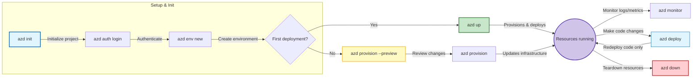
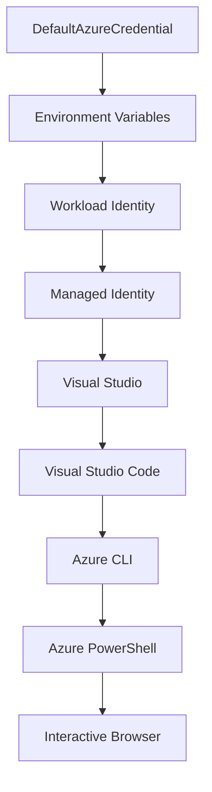

# Nozioni di base su AZD - Concetti fondamentali e principi base

**Navigazione del capitolo:**
- **📚 Home del corso**: [AZD per principianti](../../README.md)
- **📖 Capitolo attuale**: Capitolo 1 - Fondamenti e avvio rapido
- **⬅️ Precedente**: [Panoramica del corso](../../README.md#-chapter-1-foundation--quick-start)
- **➡️ Successivo**: [Installazione e configurazione](installation.md)
- **🚀 Capitolo successivo**: [Capitolo 2: Sviluppo AI-First](../chapter-02-ai-development/microsoft-foundry-integration.md)

## Introduzione

> Revisionato rispetto a `azd 1.37.2` (novembre 2026). I comandi Bash utilizzano segnaposto tra virgolette che devi sostituire. I flussi di lavoro dei template usano `.` per inizializzare la directory corrente; senza un argomento di directory, l'inizializzazione del template crea una sottodirectory e non modifica la directory di lavoro della shell. Gli snippet avanzati sono illustrativi e non rappresentano progetti completi.

Questa lezione ti introduce a Azure Developer CLI (azd), un potente strumento da linea di comando che accelera il tuo percorso dallo sviluppo locale al deployment su Azure. Imparerai i concetti fondamentali, le caratteristiche principali e comprenderai come azd semplifica il deployment di applicazioni cloud-native.

## Obiettivi di apprendimento

Al termine di questa lezione:
- Comprenderai cos'è Azure Developer CLI e il suo scopo principale
- Imparerai i concetti base di template, ambienti e servizi
- Esplorerai le funzionalità chiave, inclusi sviluppo basato su template e Infrastructure as Code
- Capirai la struttura del progetto azd e il suo flusso di lavoro
- Sarai pronto a installare e configurare azd per il tuo ambiente di sviluppo

## Risultati di apprendimento

Dopo aver completato la lezione, sarai in grado di:
- Spiegare il ruolo di azd nei moderni flussi di lavoro di sviluppo cloud
- Identificare i componenti della struttura di un progetto azd
- Descrivere come template, ambienti e servizi lavorano insieme
- Comprendere i benefici di Infrastructure as Code con azd
- Riconoscere comandi azd diversi e i loro scopi

## Cos'è Azure Developer CLI (azd)?

Azure Developer CLI (azd) è uno strumento da linea di comando progettato per accelerare il tuo percorso dallo sviluppo locale al deployment su Azure. Semplifica il processo di costruzione, deployment e gestione di applicazioni cloud-native su Azure.

### Cosa puoi distribuire con azd?

azd supporta un ampio ventaglio di carichi di lavoro — e la lista continua a crescere. Oggi puoi usare azd per distribuire:

| Tipo di carico di lavoro | Esempi | Stesso flusso di lavoro? |
|-------------------------|---------|-------------------------|
| **Applicazioni tradizionali** | Web app, API REST, siti statici | ✅ `azd up` |
| **Servizi e microservizi** | Container Apps, Function Apps, backend multi-servizio | ✅ `azd up` |
| **Applicazioni con AI** | App chat con Microsoft Foundry Models, soluzioni RAG con AI Search | ✅ `azd up` |
| **Agenti intelligenti** | Agenti ospitati su Foundry, orchestrazioni multi-agente | ✅ `azd up` |

L'intuizione chiave è che **il ciclo di vita di azd rimane lo stesso indipendentemente da cosa stai distribuendo**. Inizializzi un progetto, provisioni infrastruttura, distribuisci il codice, monitori l'app e pulisci — sia che si tratti di un semplice sito web o di un agente AI sofisticato.

Questa continuità è voluta. azd tratta le capacità AI come un altro tipo di servizio che la tua applicazione può utilizzare, non come qualcosa di fondamentalmente diverso. Un endpoint chat supportato dai modelli Microsoft Foundry è, dal punto di vista di azd, solo un altro servizio da configurare e distribuire.

### 🎯 Perché usare AZD? Un confronto reale

Confrontiamo il deployment di una semplice web app con database:

#### ❌ SENZA AZD: Deployment manuale su Azure (oltre 30 minuti)

**Confronto illustrativo in Bash, non un avviatore applicazione eseguibile.** Presuppone codice applicativo esistente, nomi risorsa unici, autenticazione Azure CLI e eventuali estensioni CLI richieste. Usa l'esercizio del template più sotto per il percorso end-to-end supportato.

```bash
# Step 1: Create resource group
az group create --name myapp-rg --location eastus

# Step 2: Create App Service Plan
az appservice plan create --name myapp-plan \
  --resource-group myapp-rg \
  --sku B1 --is-linux

# Step 3: Create Web App
az webapp create --name myapp-web-unique123 \
  --resource-group myapp-rg \
  --plan myapp-plan \
  --runtime "NODE:22-lts"

# Step 4: Create Cosmos DB account (10-15 minutes)
az cosmosdb create --name myapp-cosmos-unique123 \
  --resource-group myapp-rg \
  --kind MongoDB

# Step 5: Create database
az cosmosdb mongodb database create \
  --account-name myapp-cosmos-unique123 \
  --resource-group myapp-rg \
  --name tododb

# Step 6: Create collection
az cosmosdb mongodb collection create \
  --account-name myapp-cosmos-unique123 \
  --resource-group myapp-rg \
  --database-name tododb \
  --name todos

# Step 7: Get connection string
CONN_STR=$(az cosmosdb keys list \
  --name myapp-cosmos-unique123 \
  --resource-group myapp-rg \
  --type connection-strings \
  --query "connectionStrings[0].connectionString" -o tsv)

# Step 8: Configure app settings
az webapp config appsettings set \
  --name myapp-web-unique123 \
  --resource-group myapp-rg \
  --settings MONGODB_URI="$CONN_STR"

# Step 9: Enable logging
az webapp log config --name myapp-web-unique123 \
  --resource-group myapp-rg \
  --application-logging filesystem \
  --detailed-error-messages true

# Step 10: Set up Application Insights
az monitor app-insights component create \
  --app myapp-insights \
  --location eastus \
  --resource-group myapp-rg

# Step 11: Link App Insights to Web App
INSTRUMENTATION_KEY=$(az monitor app-insights component show \
  --app myapp-insights \
  --resource-group myapp-rg \
  --query "instrumentationKey" -o tsv)

az webapp config appsettings set \
  --name myapp-web-unique123 \
  --resource-group myapp-rg \
  --settings APPINSIGHTS_INSTRUMENTATIONKEY="$INSTRUMENTATION_KEY"

# Step 12: Build application locally
npm install
npm run build

# Step 13: Create deployment package
zip -r app.zip . -x "*.git*" "node_modules/*"

# Step 14: Deploy application
az webapp deployment source config-zip \
  --resource-group myapp-rg \
  --name myapp-web-unique123 \
  --src app.zip

# Step 15: Wait and pray it works 🙏
# (No automated validation, manual testing required)
```

**Problemi:**
- ❌ Più di 15 comandi da ricordare e eseguire in sequenza
- ❌ 30-45 minuti di lavoro manuale
- ❌ Facile commettere errori (errori di battitura, parametri sbagliati)
- ❌ Le credenziali richiedono gestione esplicita; i log di debug e il tracing shell possono esporle
- ❌ Nessun rollback automatico in caso di errore
- ❌ Difficile da replicare per altri membri del team
- ❌ Ogni volta diverso (non riproducibile)

#### ✅ CON AZD: Deployment automatizzato (5 comandi, 10-15 minuti)

```bash
# Step 1: Initialize from template
azd init --template todo-nodejs-mongo .

# Step 2: Authenticate
azd auth login

# Step 3: Select the environment created during init
azd env select dev

# Step 4: Preview changes (optional but recommended)
azd provision --preview

# Step 5: Deploy everything
azd up

# ✨ Done! Everything is deployed, configured, and monitored
```

**Benefici:**
- ✅ **5 comandi** invece di oltre 15 passaggi manuali
- ✅ **10-15 minuti** tempo totale (principalmente attesa Azure)
- ✅ **Meno errori manuali** — flusso di lavoro coerente e guidato da template
- ✅ **Gestione sicura dei segreti** — molti template usano archiviazione segreti gestita da Azure
- ✅ **Deployment ripetibili** — stesso flusso di lavoro ogni volta
- ✅ **Definizioni infrastrutturali ripetibili** — soggetto a quote, disponibilità regioni e versioni template
- ✅ **Pronto per il team** — chiunque può distribuire con gli stessi comandi
- ✅ **Infrastructure as Code** — template Bicep versionati
- ✅ **Monitoraggio definito dal template** — Application Insights quando incluso nel template

### Tempo e affidabilità

I tempi sopra sono stime, non benchmark. azd riduce i comandi da coordinare, ma non garantisce la durata del deployment, non elimina errori, né fornisce rollback automatico di applicazioni o database. Conserva versioni funzionanti nel controllo sorgente e testa le procedure di recupero.

## Concetti fondamentali

### Template
I template sono la base di azd. Contengono:
- **Codice applicativo** — il tuo codice sorgente e dipendenze
- **Definizioni infrastrutturali** — risorse Azure definite in Bicep o Terraform
- **File di configurazione** — impostazioni e variabili d'ambiente
- **Script di deployment** — flussi di lavoro automatizzati per il deployment

### Ambienti
Gli ambienti rappresentano destinazioni di deployment diverse:
- **Sviluppo** — per test e sviluppo
- **Staging** — ambiente pre-produzione
- **Produzione** — ambiente di produzione live

Ogni ambiente mantiene il proprio:
- Nome e valori ambiente; l'isolamento risorse dipende dal template infrastrutturale
- Impostazioni di configurazione
- Stato del deployment

### Servizi
I servizi in `azure.yaml` descrivono componenti di applicazioni distribuibili:
- **Frontend** — applicazioni web, SPA
- **Backend** — API, microservizi

Database e archiviazione sono di solito forniti come risorse infrastrutturali, non come host di servizio inventati come `host: postgres`.

## Caratteristiche chiave

### 1. Sviluppo guidato da template
```bash
# Browse available templates
azd template list

# Initialize from a template
azd init --template "<template-name>" .
```

### 2. Infrastructure as Code
- **Bicep** — linguaggio specifico di dominio di Azure
- **Terraform** — strumento infrastrutturale multi-cloud
- Bicep si compila in template ARM; JSON ARM grezzo non è un `infra.provider` separato integrato.

### 3. Flussi di lavoro integrati
```bash
# Complete deployment workflow
azd up            # Provision + Deploy this is hands off for first time setup

# 🧪 NEW: Preview infrastructure changes before deployment (SAFE)
azd provision --preview    # Simulate infrastructure deployment without making changes

azd provision     # Create Azure resources if you update the infrastructure use this
azd deploy        # Deploy application code or redeploy application code once update
azd down          # Clean up resources
```

#### 🛡️ Pianificazione sicura dell'infrastruttura con Preview
Il comando `azd provision --preview` è una rivoluzione per deploy sicuri:
- **Analisi a secco** — mostra cosa sarà creato, modificato o cancellato
- **Nessuna applicazione di infrastruttura** — rivede cambiamenti di provider; ispeziona prima gli hook di progetto, poiché possono eseguire comandi con effetti collaterali
- **Collaborazione di team** — condividi i risultati del preview prima del deployment
- **Input per pianificazione costi** — ispeziona SKU proposte, quindi calcola prezzi con Azure Pricing Calculator; preview non calcola prezzi

```bash
# Example preview workflow
azd provision --preview           # See what will change
# Review the output, discuss with team
azd provision                     # Apply changes with confidence
```

### 📊 Visuale: Flusso di lavoro di sviluppo AZD



**Spiegazione del flusso di lavoro:**
1. **Init** — Inizio con template o nuovo progetto
2. **Auth** — Autenticazione con Azure
3. **Environment** — Crea ambiente di deployment isolato
4. **Preview** — 🆕 Controlla sempre prima le modifiche infrastrutturali (pratica sicura)
5. **Provision** — Crea/aggiorna risorse Azure
6. **Deploy** — Pubblica il codice applicativo
7. **Monitor** — Osserva le prestazioni dell'applicazione
8. **Iterate** — Apporta modifiche e ridistribuisci codice
9. **Cleanup** — Rimuovi risorse quando non servono più

### 4. Gestione degli ambienti
```bash
# Create and manage environments
azd env new "<environment-name>"
azd env select "<environment-name>"
azd env list
```

### 5. Estensioni e comandi AI

azd usa un sistema di estensioni per aggiungere funzionalità oltre la CLI core. Questo è particolarmente utile per carichi di lavoro AI:

```bash
# List available extensions
azd extension list

# Install the Foundry agents extension
azd extension install azure.ai.agents

# Initialize an AI agent project interactively
azd ai agent init

# Test a deployed agent (shows latency and time-to-first-byte)
azd ai agent invoke

# Start the MCP server for AI-assisted development (Alpha)
azd mcp start
```

**Il ciclo di vita dell'agente, end to end.** Usa `azure.ai.agents` per operazioni ciclo di vita agente e installa `azure.ai.evaluations` separatamente per le valutazioni. Usa `azd >= 1.37.0` per il flusso combinato. Non servono tutti da subito:

| Fase | Comando | Cosa fa |
|------|---------|----------|
| **Scaffold** | `azd ai agent init --template <path-to-azure.yaml>` | Adotta un template progetto agente attuale |
| **Test** | `azd ai agent invoke` | Chiama l'agente e visualizza il tempo di risposta |
| **Measure** | `azd ai eval init`, `generate`, `run start` | Configura, distribuisci e esegui valutazioni con estensione separata |
| **Improve** | `azd ai agent optimize --eval <evaluation-name> --optimize-model <optimizer-deployment>` | Riusa una valutazione compatibile per ottimizzare l'agente |
| **Inspect** | `azd ai agent endpoint show` | Visualizza la configurazione endpoint live |
| **Clean up** | `azd ai agent delete` | Elimina un agente ospitato e tutte le sue versioni |

> Le estensioni sono trattate in dettaglio nel [Capitolo 2: Sviluppo AI-First](../chapter-02-ai-development/agents.md) e nel riferimento [Comandi CLI AZD AI](../chapter-08-production/production-ai-practices.md#azd-ai-cli-commands-and-extensions).

## 📁 Struttura del progetto

Una struttura tipica di progetto azd:
```
my-app/
├── .azure/                  # Local environments and selected-environment config
│   ├── config.json
│   └── dev/.env
├── .devcontainer/          # Development container config
├── .github/workflows/      # GitHub Actions
├── .vscode/               # VS Code settings
├── infra/                 # Infrastructure code
│   ├── main.bicep        # Main infrastructure template
│   ├── main.parameters.json
│   └── modules/          # Reusable modules
├── src/                  # Application source code
│   ├── api/             # Backend services
│   └── web/             # Frontend application
├── azure.yaml           # azd project configuration
└── README.md
```

## 🔧 File di configurazione

### azure.yaml
Il file principale di configurazione del progetto:
```yaml
name: my-awesome-app
metadata:
  template: my-template@1.0.0

services:
  web:
    project: ./src/web
    language: js
    host: appservice
  api:
    project: ./src/api
    language: js
    host: appservice

hooks:
  preprovision:
    shell: pwsh
    run: echo "Preparing to provision..."
```

### .azure/config.json
Selezione locale del progetto dell'ambiente predefinito (esemplificativo; gestito da azd):
```json
{
  "defaultEnvironment": "dev"
}
```

## 🎪 Flussi di lavoro comuni con esercizi pratici

> **💡 Suggerimento di apprendimento:** Segui questi esercizi in ordine per sviluppare le competenze AZD progressivamente.

### 🎯 Esercizio 1: Inizializza il tuo primo progetto

**Obiettivo:** Crea un progetto AZD ed esplora la sua struttura

**Passi:**
```bash
# Use a proven template
mkdir azd-basics-practice
cd azd-basics-practice
# Choose "dev" for the environment name when prompted
azd init --template todo-nodejs-mongo .

# Explore the generated files
ls -la  # View all files including hidden ones

# Key files created:
# - azure.yaml (main config)
# - infra/ (infrastructure code)
# - src/ (application code)
```

**✅ Successo:** Hai i file azure.yaml, rilevamento directory infra/ e src/

---

### 🎯 Esercizio 2: Distribuisci su Azure

**Obiettivo:** Completa un deployment end-to-end

**Passi:**
```bash
# 1. Authenticate
azd auth login

# 2. Select the dev environment created in Exercise 1
azd env select dev
azd env set AZURE_LOCATION eastus

# 3. Preview changes (RECOMMENDED)
azd provision --preview

# 4. Deploy everything
azd up

# 5. Verify deployment
azd show    # View your app URL
```

**Tempo previsto:** 10-15 minuti  
**✅ Successo:** L'URL dell'app si apre nel browser

---

### 🎯 Esercizio 3: Molteplici ambienti

**Obiettivo:** Distribuisci negli ambienti dev e staging

**Passi:**
```bash
# Already have dev, create staging
azd env new staging
azd env set AZURE_LOCATION westus2
azd up

# Switch between them
azd env list
azd env select dev
```

**✅ Successo:** Due gruppi di risorse separati nel portale Azure

**Pulizia:** L'esercizio 3 crea un secondo deployment a pagamento. Elimina entrambi a fine esercizio:

```bash
azd down --environment dev
azd down --environment staging
```

---

### 🛡️ Pulizia distruttiva: `azd down --force --purge`

Quando vuoi intenzionalmente eliminare le risorse Azure dell'ambiente selezionato:

```bash
azd down --force --purge
```

**Cosa fa:**
- `--force`: Nessuna richiesta di conferma
- `--purge`: Elimina anche risorse soft-delete supportate (es. Key Vault), quando è permessa la protezione purge. Non elimina la directory locale `.azure/`.

**Usalo quando:** hai finito con un ambiente usa e getta. Non usare la pulizia distruttiva come primo rimedio per errori di autenticazione, quota, o configurazione.

---

## 🎪 Riferimento al flusso di lavoro originale

### Avvio di un nuovo progetto
```bash
# Method 1: Use existing template
azd init --template todo-nodejs-mongo .

# Method 2: Start from scratch
azd init

# Method 3: Use current directory
azd init .
```

### Ciclo di sviluppo
```bash
# Set up development environment
azd auth login
azd env new dev
azd env select dev

# Deploy everything
azd up

# Make changes and redeploy
azd deploy

# Clean up when done
azd down --force --purge # Deletes this environment's discovered Azure resources; review before forcing deletion.
```

## Comprendere `azd down --force --purge`
Il comando `azd down --force --purge` è un modo potente per smantellare completamente il tuo ambiente azd e tutte le risorse associate. Ecco cosa fa ogni flag:
```
--force
```
- Salta le richieste di conferma.
- Utile per automazione o scripting dove non è possibile input manuale.
- Non aggira permessi, protezione purge o fallimenti di cancellazione.

```
--purge
```
Elimina definitivamente le risorse Azure eliminate soft supportate senza una conferma aggiuntiva. La protezione da cancellazione definitiva e i permessi si applicano ancora. **Non** rimuove gli ambienti locali o la cartella `.azure/`.


### Perché usare entrambi?
Usa entrambi solo quando intendi eliminare le risorse Azure dell'ambiente selezionato e cancellare definitivamente le risorse recuperabili. Questo è un pulizia distruttiva, non una riparazione generale o un reset dello stato locale.

È particolarmente utile dopo cancellazioni manuali di risorse nel portale di Azure o quando si cambiano modelli, ambienti o convenzioni di denominazione dei gruppi di risorse.


### Gestione di più Ambienti
```bash
# Create staging environment
azd env new staging
azd env select staging
azd up

# Switch back to dev
azd env select dev

# Compare environments
azd env list
```

## 🔐 Autenticazione e Credenziali

Distingui l’autenticazione di deploy (`azd auth login`) da quella dell’SDK applicativo (`DefaultAzureCredential`). Sono separate. azd non usa per default le credenziali Azure CLI.

### Autenticazione Azure CLI (`az login`)

Esegui `azd auth login` per azd. I seguenti comandi Azure CLI sono opzionali e autenticano separatamente i comandi `az`:

```bash
# Interactive login (opens browser)
az login

# Login with specific tenant
az login --tenant "<tenant-id>"

# Login with service principal
az login --service-principal -u "<app-id>" -p "<password>" --tenant "<tenant-id>"

# Check current login status
az account show

# List available subscriptions
az account list --output table

# Set default subscription
az account set --subscription "<subscription-id>"
```

### Flusso di Autenticazione
1. **Login Interattivo**: Apre il browser predefinito per l'autenticazione
2. **Flusso con Codice Dispositivo**: Per ambienti senza accesso al browser
3. **Service Principal**: Per scenari di automazione e CI/CD
4. **Identità Gestita**: Per applicazioni ospitate su Azure

### Catena DefaultAzureCredential

`DefaultAzureCredential` è un tipo di credenziale che offre un'esperienza di autenticazione semplificata provando automaticamente più fonti di credenziali in un ordine specifico:

#### Catena di Credenziali SDK per Applicazioni

La catena esatta dipende dal linguaggio del SDK Azure Identity, dalla versione, dai plugin installati e dalle opzioni. Questo diagramma è concettuale, non una sequenza fissa di autenticazione azd; le versioni recenti del SDK possono includere anche le credenziali di Azure Developer CLI.


#### 1. Variabili d'Ambiente
```bash
# Set environment variables for service principal
export AZURE_CLIENT_ID="<app-id>"
export AZURE_CLIENT_SECRET="<password>"
export AZURE_TENANT_ID="<tenant-id>"
```

#### 2. Identità di Carico di Lavoro (Kubernetes/GitHub Actions)
Utilizzato automaticamente in:
- Azure Kubernetes Service (AKS) con Workload Identity
- GitHub Actions con federazione OIDC
- Altri scenari di identità federata

#### 3. Identità Gestita
Per risorse Azure come:
- Macchine virtuali
- App Service
- Azure Functions
- Container Instances

```bash
# Inspect a deployed Container App's configured identity (requires az login)
az containerapp show --name "<app-name>" --resource-group "<rg-name>" --query identity
```

#### 4. Integrazione con Strumenti per Sviluppatori
- **Visual Studio**: Usa automaticamente l'account connesso
- **VS Code**: Il supporto dipende dal SDK e dalla configurazione del broker/plugin supportato
- **Azure CLI**: Usa credenziali `az login` (il più comune per lo sviluppo locale)

### Configurazione di Autenticazione AZD

```bash
# Method 1: Direct azd authentication (recommended)
azd auth login

# Method 2: Direct azd authentication
azd auth login --use-device-code  # For headless environments

# Method 3: Check authentication status
azd auth login --check-status

# Method 4: Logout and re-authenticate
azd auth logout
azd auth login
```

### Best Practice per l'Autenticazione

#### Per lo Sviluppo Locale
```bash
# 1. Log in to azd
azd auth login

# 2. Select the subscription for this initialized environment
azd env set AZURE_SUBSCRIPTION_ID "<subscription-id>"

# 3. Check azd sign-in details (read the status message)
azd auth login --check-status
```

#### Per Pipeline CI/CD
```yaml
# Partial GitHub Actions steps: assumes checkout, azd installation,
# required AZURE_* environment values, and pipeline secret configuration.
- name: Deploy with azd
  run: |
    azd auth login --client-id ${{ secrets.AZURE_CLIENT_ID }} \
                    --client-secret ${{ secrets.AZURE_CLIENT_SECRET }} \
                    --tenant-id ${{ secrets.AZURE_TENANT_ID }}
    azd up --no-prompt
```

#### Per Ambienti di Produzione
- Usa **Managed Identity** quando esegui su risorse Azure
- Usa **Service Principal** per scenari di automazione
- Evita di memorizzare credenziali nel codice o nei file di configurazione
- Usa **Azure Key Vault** per configurazioni sensibili

### Problemi Comuni di Autenticazione e Soluzioni

#### Problema: "Nessuna sottoscrizione trovata"
```bash
# Solution: Set default subscription
az account list --output table
az account set --subscription "<subscription-id>"
azd env set AZURE_SUBSCRIPTION_ID "<subscription-id>"
```

#### Problema: "Permessi insufficienti"
```bash
# Solution: Check and assign required roles
az role assignment list --assignee $(az account show --query user.name --output tsv)

# Common required roles:
# - Contributor (for resource management)
# - User Access Administrator (for role assignments)
```

#### Problema: "Token scaduto"
```bash
# Solution: Re-authenticate
az logout
az login
azd auth logout
azd auth login
```

### Autenticazione in Diversi Scenari

#### Sviluppo Locale
```bash
# Personal development account
az login
azd auth login
```

#### Sviluppo in Team
```bash
# Use specific tenant for organization
az login --tenant contoso.onmicrosoft.com
azd auth login --tenant-id "<tenant-id>"
```

#### Scenari Multi-tenant
```bash
# Switch between tenants
az login --tenant tenant1.onmicrosoft.com
azd auth login --tenant-id "<tenant-1-id>"
# Select an environment configured with tenant 1's subscription
azd env select tenant1-dev
# Deploy to tenant 1
azd up

az login --tenant tenant2.onmicrosoft.com  
azd auth login --tenant-id "<tenant-2-id>"
azd env select tenant2-dev
# Deploy to tenant 2
azd up
```

### Considerazioni sulla Sicurezza

1. **Archiviazione delle Credenziali**: Non memorizzare mai le credenziali nel codice sorgente
2. **Limitazione dello Scope**: Usa il principio del privilegio minimo per i service principal
3. **Rotazione del Token**: Ruota regolarmente i segreti dei service principal
4. **Traccia di Audit**: Monitora attività di autenticazione e deployment
5. **Sicurezza di Rete**: Usa endpoint privati quando possibile

### Risoluzione dei Problemi di Autenticazione

```bash
# Debug authentication issues
azd auth login --check-status
az account show
az account get-access-token

# Common diagnostic commands
whoami                          # Current user context
az ad signed-in-user show      # Microsoft Entra ID user details
az group list                  # Test resource access
```

## Scoperta Comandi

### Scoperta
```bash
azd template list              # Browse templates
azd template list --help       # Template discovery options
azd init --help               # Initialization options
```

### Gestione Progetti
```bash
azd show                     # Project overview
azd env list                # Available environments and selected default
azd config show            # Configuration settings
```

### Monitoraggio
```bash
azd monitor                  # Open Azure portal monitoring
azd monitor --logs           # View application logs
azd monitor --live           # View live metrics
azd pipeline config          # Set up CI/CD
```

## Best Practice

### 1. Usa Nomi Significativi
```bash
# Good
azd env new production-east
azd init --template todo-nodejs-mongo .

# Avoid
azd env new env1
azd init --template template1 .
```

### 2. Sfrutta i Modelli
- Inizia con modelli esistenti
- Personalizza secondo le tue esigenze
- Crea modelli riutilizzabili per la tua organizzazione

### 3. Isolamento degli Ambienti
- Usa ambienti separati per dev/staging/prod
- Non eseguire mai il deploy diretto in produzione dalla macchina locale
- Usa pipeline CI/CD per i deploy in produzione

### 4. Gestione della Configurazione
- Usa managed identity e Key Vault per i segreti; i valori ordinari `azd env set` sono in testo chiaro locale
- Conserva la configurazione nel controllo versione
- Documenta le impostazioni specifiche per ambiente

## Progressione dell'Apprendimento

### Principiante (Settimana 1-2)
1. Installa azd e autenticati
2. Distribuisci un modello semplice
3. Comprendi la struttura del progetto
4. Impara i comandi base (up, down, deploy)

### Intermedio (Settimana 3-4)
1. Personalizza i modelli
2. Gestisci più ambienti
3. Comprendi infrastruttura-as-code
4. Configura pipeline CI/CD

### Avanzato (Settimana 5+)
1. Crea modelli personalizzati
2. Pattern infrastrutturali avanzati
3. Deployment multi-regione
4. Configurazioni enterprise-grade

## Passi Successivi

**📖 Continua con il Capitolo 1:**
- [Installazione e Configurazione](installation.md) - Installa e configura azd
- [Il tuo Primo Progetto](first-project.md) - Completa il tutorial pratico
- [Guida alla Configurazione](../chapter-03-configuration/configuration.md) - Opzioni di configurazione avanzata

**🎯 Pronto per il Capitolo Successivo?**
- [Capitolo 2: Sviluppo AI-First](../chapter-02-ai-development/microsoft-foundry-integration.md) - Inizia a costruire applicazioni AI

## Risorse Aggiuntive

- [Panoramica Azure Developer CLI](https://learn.microsoft.com/en-us/azure/developer/azure-developer-cli/)
- [Galleria di Modelli](https://azure.github.io/awesome-azd/)
- [Esempi dalla Comunità](https://github.com/Azure-Samples)

---

## 🙋 Domande Frequenti

### Domande Generali

**D: Qual è la differenza tra AZD e Azure CLI?**

R: Azure CLI (`az`) serve per gestire risorse Azure singole. AZD (`azd`) gestisce intere applicazioni:

```bash
# Azure CLI - Low-level resource management
az webapp create --name myapp --resource-group rg
az sql server create --name myserver --resource-group rg
# ...many more commands needed

# AZD - Application-level management
azd up  # Deploys entire app with all resources
```

**Pensalo così:**
- `az` = Operare su singoli mattoncini Lego
- `azd` = Lavorare con set completi di Lego

---

**D: Devo conoscere Bicep o Terraform per usare AZD?**

R: No! Inizia con i modelli:
```bash
# Use existing template - no IaC knowledge needed
azd init --template todo-nodejs-mongo .
azd up
```

Puoi imparare Bicep più avanti per personalizzare l'infrastruttura. I modelli forniscono esempi funzionanti da cui imparare.

---

**D: Quanto costa eseguire i modelli AZD?**

R: I costi variano per regione, SKU, uptime, modalità database e uso modelli. Un ambiente di sviluppo può comportare costi mensili significativi anche quando inattivo; non presumere una fascia universale 50-150$:

```bash
# Preview resource changes (not prices)
azd provision --preview

# Always cleanup when not using
azd down --force --purge  # Removes all resources
```

**Suggerimento esperto:** Usa livelli gratuiti dove disponibili:
- App Service: livello F1 (Gratuito)
- Azure OpenAI: nessun token gratuito mensile garantito; controlla prezzi e modelli attuali
- Cosmos DB: account con throughput provisionato possono optare per un livello gratuito; modelli serverless non si qualificano automaticamente

---

**D: Posso usare AZD con risorse Azure esistenti?**

R: Sì, ma è più semplice iniziare da zero. AZD funziona meglio se gestisce l'intero ciclo di vita. Per risorse esistenti:

```bash
# Option 1: Import existing resources (advanced)
azd init
# Then modify infra/ to reference existing resources

# Option 2: Start fresh (recommended)
azd init --template "<verified-template-name>" .
azd up  # Creates new environment
```

---

**D: Come condivido il mio progetto con i compagni di squadra?**

R: Commit il progetto AZD su Git (ma NON la cartella .azure):

```bash
# Already in .gitignore by default
.azure/        # Contains secrets and environment data
*.env          # Environment variables

# Team members then:
git clone "<your-repo>"
# Change into the cloned repository before running the remaining commands.
azd auth login
azd env new "<their-name>-dev"
azd up
```

Tutti ottengono infrastruttura identica dagli stessi modelli.

---

### Domande sulla Risoluzione dei Problemi

**D: "azd up" è fallito a metà. Cosa faccio?**

R: Controlla l'errore, correggilo, poi riprova:

```bash
# Capture detailed diagnostics (redact sensitive values before sharing)
azd up --debug

# Common fixes:

# 1. If quota exceeded:
azd env set AZURE_LOCATION "westus2"  # Try different region

# 2. If resource name conflict:
azd down --force --purge  # Clean slate
azd up  # Retry

# 3. If auth expired:
az login
azd auth login
azd up
```

**Problema più comune:** Sottoscrizione Azure sbagliata selezionata
```bash
az account list --output table
az account set --subscription "<correct-subscription>"
azd env set AZURE_SUBSCRIPTION_ID "<correct-subscription-id>"
```

---

**D: Come posso distribuire solo le modifiche al codice senza reprovisioning?**

R: Usa `azd deploy` invece di `azd up`:

```bash
azd up          # First time: provision + deploy (slow)

# Make code changes...

azd deploy      # Subsequent times: deploy only (fast)
```

Confronto velocità:
- `azd up`: 10-15 minuti (provisiona infrastruttura)
- `azd deploy`: 2-5 minuti (solo codice)

---

**D: Posso personalizzare i modelli di infrastruttura?**

R: Sì! Modifica i file Bicep in `infra/`:

```bash
# After azd init
cd infra/
code main.bicep  # Edit in VS Code

# Preview changes
azd provision --preview

# Apply changes
azd provision
```

**Suggerimento:** Parti da poco - cambia prima gli SKU:
```bicep
// infra/main.bicep
sku: {
  name: 'B1'  // Change to 'P1V2' for production
}
```

---

**D: Come elimino tutto ciò che AZD ha creato?**

R: Un comando rimuove tutte le risorse:

```bash
azd down --force --purge

# This deletes:
# - Azure resources/resource groups discovered for the selected environment
# - Supported soft-deleted resources, if purge protection allows
# Local .azure files remain; shared/external resources may remain too.
```

**Eseguilo sempre quando:**
- Hai finito di testare un modello
- Passi a un progetto diverso
- Vuoi ricominciare da capo

**Controllo costi:** Conferma la cancellazione in Azure e verifica risorse trattenute/condivise. I costi già sostenuti rimangono validi.

---

**D: E se cancellassi risorse accidentalmente in Azure Portal?**

R: Lo stato AZD può non essere sincronizzato. Approccio di pulizia totale:

```bash
# 1. Delete remaining resources only if that is your intent
azd down --force --purge

# 2. Start fresh
azd up

# Alternative: Let AZD detect and fix
azd provision  # Will create missing resources
```

---

### Domande Avanzate

**D: Posso usare AZD nelle pipeline CI/CD?**

R: Sì! Esempio con GitHub Actions:

```yaml
# .github/workflows/deploy.yml
name: Deploy with AZD

on:
  push:
    branches: [main]

jobs:
  deploy:
    runs-on: ubuntu-latest
    steps:
      - uses: actions/checkout@v4
      
      - name: Install azd
        run: curl -fsSL https://aka.ms/install-azd.sh | bash
      
      - name: Azure Login
        run: |
          azd auth login \
            --client-id ${{ secrets.AZURE_CLIENT_ID }} \
            --client-secret ${{ secrets.AZURE_CLIENT_SECRET }} \
            --tenant-id ${{ secrets.AZURE_TENANT_ID }}
      
      - name: Deploy
        env:
          AZURE_ENV_NAME: dev
          AZURE_LOCATION: ${{ vars.AZURE_LOCATION }}
          AZURE_SUBSCRIPTION_ID: ${{ vars.AZURE_SUBSCRIPTION_ID }}
        run: azd up --no-prompt
```

---

**D: Come gestisco segreti e dati sensibili?**

R: Usa esplicitamente Key Vault. `azd env set` scrive valori ordinari nel file ambiente locale; non crea automaticamente un vault, assegna ruoli o inietta segreti nell’applicazione.

```bash
# Interactive: create/select a Key Vault secret and save its reference
azd env set-secret DATABASE_PASSWORD
```

Hai bisogno delle autorizzazioni appropriate per il vault. La tua infrastruttura/applicazione deve collegare il segreto al suo consumatore e concedere accesso all'identità di runtime. Non stampare valori di segreti risolti nei log.

**Mai commettere:**
- Cartella `.azure/` (contiene dati ambiente)
- File `.env` (segreti locali)
- Stringhe di connessione

---

**D: Posso distribuire in più regioni?**

R: Sì, crea un ambiente per regione:

```bash
# East US environment
azd env new prod-eastus
azd env set AZURE_LOCATION eastus
azd up

# West Europe environment
azd env new prod-westeurope
azd env set AZURE_LOCATION westeurope
azd up

# Each environment is independent
azd env list
```

Per app veramente multi-regione, personalizza i modelli Bicep per distribuire simultaneamente in più regioni.

---

**D: Dove posso trovare aiuto se sono bloccato?**

1. **Documentazione AZD:** https://learn.microsoft.com/azure/developer/azure-developer-cli/
2. **Problemi GitHub:** https://github.com/Azure/azure-dev/issues
3. **Discord:** [Azure Discord](https://discord.gg/microsoft-azure) - canale #azure-developer-cli
4. **Stack Overflow:** Tag `azure-developer-cli`
5. **Questo Corso:** [Guida alla Risoluzione dei Problemi](../chapter-07-troubleshooting/common-issues.md)

**Suggerimento esperto:** Prima di chiedere, esegui:
```bash
azd show       # Shows current state
azd version    # Shows your version
```
Includi queste informazioni nella tua domanda per un aiuto più veloce.

---

## 🎓 Cosa Fare Dopo?

Ora conosci i fondamenti di AZD. Scegli il tuo percorso:

### 🎯 Per Principianti:
1. **Prossimo:** [Installazione e Configurazione](installation.md) - Installa AZD sulla tua macchina
2. **Poi:** [Il tuo Primo Progetto](first-project.md) - Distribuisci la tua prima app
3. **Pratica:** Completa tutti e 3 gli esercizi di questa lezione

### 🚀 Per Sviluppatori AI:
1. **Passa a:** [Capitolo 2: Sviluppo AI-First](../chapter-02-ai-development/microsoft-foundry-integration.md)
2. **Distribuisci:** In una directory di progetto vuota, inizia con `azd init --template get-started-with-ai-chat .`
3. **Impara:** Costruisci mentre distribuisci

### 🏗️ Per Sviluppatori Esperti:
1. **Rivedi:** [Guida alla Configurazione](../chapter-03-configuration/configuration.md) - Impostazioni avanzate
2. **Esplora:** [Infrastructure as Code](../chapter-04-infrastructure/provisioning.md) - Approfondimento Bicep
3. **Crea:** Modelli personalizzati per il tuo stack

---

**Navigazione Capitolo:**
- **📚 Home del Corso**: [AZD Per Principianti](../../README.md)
- **📖 Capitolo Corrente**: Capitolo 1 - Fondamenti & Quick Start  
- **⬅️ Precedente**: [Panoramica Corso](../../README.md#-chapter-1-foundation--quick-start)
- **➡️ Successivo**: [Installazione e Configurazione](installation.md)
- **🚀 Capitolo Successivo**: [Capitolo 2: Sviluppo AI-First](../chapter-02-ai-development/microsoft-foundry-integration.md)

---

<!-- CO-OP TRANSLATOR DISCLAIMER START -->
**Disclaimer**:
Questo documento è stato tradotto utilizzando il servizio di traduzione AI [Co-op Translator](https://github.com/Azure/co-op-translator). Sebbene ci impegniamo per garantire la precisione, si prega di notare che le traduzioni automatizzate possono contenere errori o imprecisioni. Il documento originale nella sua lingua nativa deve essere considerato la fonte autorevole. Per informazioni critiche, si raccomanda una traduzione professionale effettuata da un essere umano. Non siamo responsabili per eventuali malintesi o interpretazioni errate derivanti dall’uso di questa traduzione.
<!-- CO-OP TRANSLATOR DISCLAIMER END -->