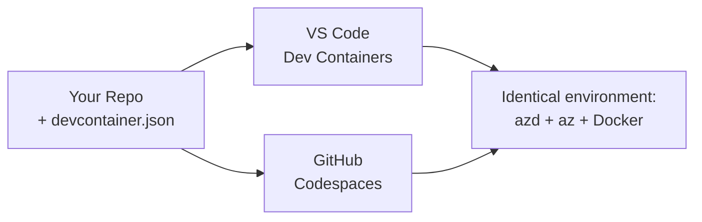

# Dev Containers & GitHub Codespaces per azd

**Navigazione Capitoli:**
- **📚 Home Corso**: [AZD Per Principianti](../../README.md)
- **📖 Capitolo Corrente**: Capitolo 1 - Fondamenti & Avvio Rapido
- **⬅️ Precedente**: [Porta la Tua App](bring-your-own-app.md)
- **🚀 Capitolo Successivo**: [Capitolo 2: Sviluppo AI-First](../chapter-02-ai-development/README.md)

> Obiettivo revisione comandi e configurazioni: `azd 1.37.2` (Novembre 2026). Non sono state eseguite build di container né deployment su Azure come parte di questa revisione.

## Introduzione

Installare azd, il runtime del linguaggio corretto, Docker e l'Azure CLI su ogni macchina è un lavoro noioso—ed è la causa numero uno per cui un tutorial che “funziona sulla mia macchina” fallisce per qualcun altro. Un **dev container** risolve questo descrivendo tutta la tua toolchain in un file. Chiunque apra il progetto in VS Code o GitHub Codespaces ottiene esattamente lo stesso ambiente, con azd già installato. Questa lezione ti mostra come aggiungerne uno.

## Obiettivi di Apprendimento

Al termine di questa lezione, sarai in grado di:
- Capire cos'è un dev container e perché aiuta con azd
- Aggiungere un `.devcontainer/devcontainer.json` minimo a un progetto
- Includere azd, l'Azure CLI e Docker tramite *features* del Dev Container
- Aprire il progetto in GitHub Codespaces o VS Code

## Risultati di Apprendimento

Dopo aver completato questa lezione, sarai in grado di:
- Scrivere un `devcontainer.json` per un progetto azd
- Aggiungere azd e gli strumenti Azure senza installazioni manuali
- Eseguire `azd up` da dentro un container o Codespace

---

## Cos'è un Dev Container?

Un dev container è un ambiente di sviluppo basato su Docker definito da un file `.devcontainer/devcontainer.json` nel tuo repository. Quando apri il progetto:

- **VS Code** (con l'estensione Dev Containers) costruisce il container e si attacca ad esso.
- **GitHub Codespaces** costruisce lo stesso container nel cloud e ti fornisce un editor basato sul browser.

In entrambi i casi, ogni collaboratore ottiene strumenti identici—niente più problemi tipo “hai installato azd?”.



---

## Passo 1: Crea il file devcontainer

Crea `.devcontainer/devcontainer.json` nella radice del tuo progetto:

```json
{
  "name": "azd-project",
  "image": "mcr.microsoft.com/devcontainers/base:bookworm",
  "features": {
    "ghcr.io/devcontainers/features/azure-cli:1": {},
    "ghcr.io/azure/azure-dev/azd:0": { "version": "1.37.2" },
    "ghcr.io/devcontainers/features/docker-in-docker:2": {},
    "ghcr.io/devcontainers/features/node:1": {}
  },
  "customizations": {
    "vscode": {
      "extensions": [
        "ms-azuretools.azure-dev",
        "ms-azuretools.vscode-bicep"
      ]
    }
  },
  "forwardPorts": [3000],
  "postCreateCommand": "azd version"
}
```

Cosa fa ciascuna parte:

| Chiave | Scopo |
|-----|---------|
| `image` | Il sistema operativo base per il container |
| `features` | Installer preconfigurati—qui: Azure CLI, **azd**, Docker e Node.js |
| `customizations.vscode.extensions` | Installa automaticamente le estensioni VS Code di azd e Bicep |
| `forwardPorts` | Espone la porta della tua app al browser |
| `postCreateCommand` | Viene eseguito una volta dopo che il container è costruito (qui, un controllo di integrità) |

> La versione della feature (`azd:0`) e la versione della CLI installata sono differenti. Imposta l'opzione `version` della feature su `"1.37.2"` per bloccare la versione della CLI; non usare la versione della CLI come tag della feature.

---

## Passo 2: Abbina la Feature al Linguaggio della Tua App

Sostituisci la feature `node` con quella che usa la tua app:

```jsonc
// Python project
"ghcr.io/devcontainers/features/python:1": {},

// .NET project
"ghcr.io/devcontainers/features/dotnet:2": {},

// Java project
"ghcr.io/devcontainers/features/java:1": {},

// Go project
"ghcr.io/devcontainers/features/go:1": {}
```

Mantieni `docker-in-docker` quando costruisci immagini localmente. Una build ACR remota configurata (`docker.remoteBuild: true`) è un'alternativa; il solo tipo di host non richiede sempre Docker locale.

---

## Passo 3: Aprilo

**In VS Code:**
1. Installa l'estensione **Dev Containers**.
2. Apri la cartella del progetto.
3. Clicca **Riapri nel Container** quando richiesto (o esegui *Dev Containers: Reopen in Container*).

**In GitHub Codespaces:**
1. Pubblica il repo su GitHub.
2. Clicca **Code → Codespaces → Create codespace on main**.
3. Aspetta che il container sia costruito—azd è pronto nel terminale.

---

## Passo 4: Effettua il Deploy Da Dentro il Container

Il container ha azd preinstallato, quindi il flusso di lavoro normale funziona direttamente:

```bash
azd auth login --use-device-code   # device code is handy inside Codespaces
azd up
```

> **Perché `--use-device-code`?** In un container remoto o Codespace non c'è un browser locale a cui fare redirect, quindi il login con device-code è la via più affidabile. Incollerai un codice in una scheda del browser per completare l'accesso.

---

## Problemi Comuni

| Problema | Soluzione |
|---------|-----|
| `azd up` non riesce a costruire un'immagine | Aggiungi la feature `docker-in-docker` |
| Login al browser si blocca in Codespaces | Usa `azd auth login --use-device-code` |
| Gli strumenti differiscono tra i membri del team | Blocca la versione della CLI tramite l'opzione `version` della feature azd e blocca i runtime del linguaggio |
| App non raggiungibile nel browser | Aggiungi la porta a `forwardPorts` |

---

## Riepilogo

- Un dev container rende la tua toolchain azd riproducibile per tutti.
- Aggiungi azd, l'Azure CLI e Docker tramite *features* del Dev Container.
- Abbina la feature del linguaggio alla tua app e mantieni `docker-in-docker` per gli host container.
- Usa il login device-code quando giri dentro Codespaces.

---

## 🔗 Navigazione

| Direzione | Risorsa |
|-----------|----------|
| **Precedente** | [Porta la Tua App](bring-your-own-app.md) |
| **Home Capitolo** | [Capitolo 1: Fondamenti & Avvio Rapido](README.md) |
| **Capitolo Successivo** | [Capitolo 2: Sviluppo AI-First](../chapter-02-ai-development/README.md) |

## 📖 Risorse Correlate

- [Installazione & Configurazione](installation.md)
- [Cheat Sheet dei Comandi](../../resources/cheat-sheet.md)
- [Specifiche ufficiali dei Dev Containers](https://containers.dev/)
- [Feature Dev Container di azd](https://github.com/Azure/azure-dev/tree/main/ext/devcontainer)

---

<!-- CO-OP TRANSLATOR DISCLAIMER START -->
**Disclaimer**:
Questo documento è stato tradotto utilizzando il servizio di traduzione AI [Co-op Translator](https://github.com/Azure/co-op-translator). Sebbene ci impegniamo per garantire la precisione, si prega di notare che le traduzioni automatizzate possono contenere errori o imprecisioni. Il documento originale nella sua lingua nativa deve essere considerato la fonte autorevole. Per informazioni critiche, si raccomanda una traduzione professionale effettuata da un essere umano. Non siamo responsabili per eventuali malintesi o interpretazioni errate derivanti dall’uso di questa traduzione.
<!-- CO-OP TRANSLATOR DISCLAIMER END -->