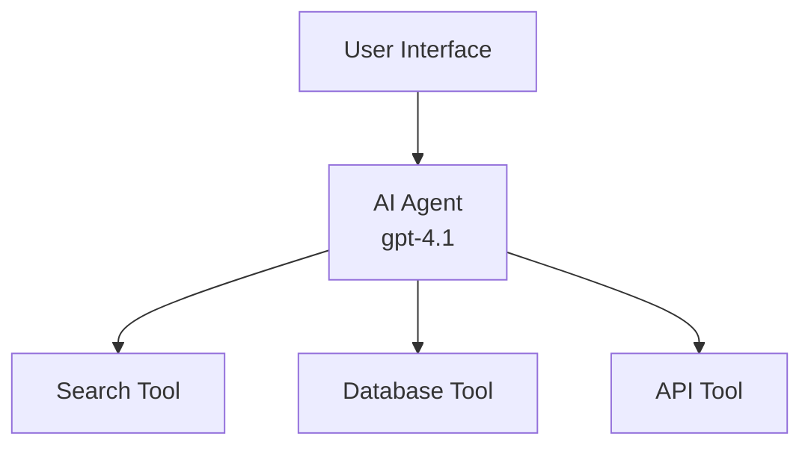
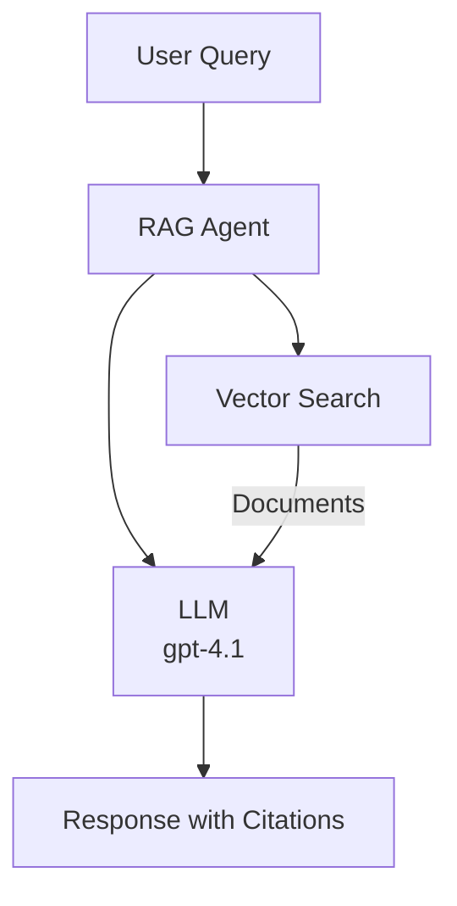
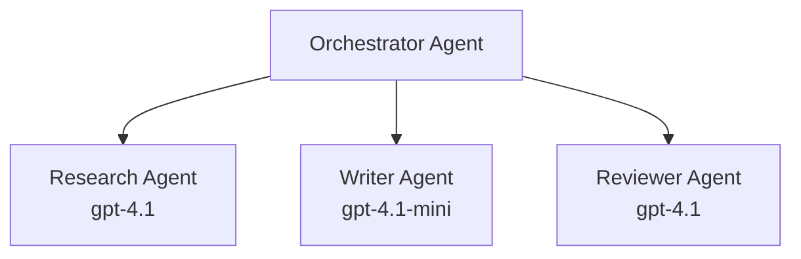

# Agenti AI con Azure Developer CLI

**Navigazione Capitolo:**
- **📚 Home Corso**: [AZD per Principianti](../../README.md)
- **📖 Capitolo Attuale**: Capitolo 2 - Sviluppo AI-First
- **⬅️ Precedente**: [Integrazione Microsoft Foundry](microsoft-foundry-integration.md)
- **➡️ Successivo**: [Distribuzione Modello AI](ai-model-deployment.md)
- **🚀 Avanzato**: [Soluzioni Multi-Agente](../../examples/retail-scenario.md)

---

## Introduzione

Gli agenti AI sono programmi autonomi che possono percepire il loro ambiente, prendere decisioni e compiere azioni per raggiungere obiettivi specifici. A differenza dei semplici chatbot che rispondono ai prompt, gli agenti possono:

- **Usare strumenti** - Chiamare API, cercare nei database, eseguire codice
- **Pianificare e ragionare** - Suddividere compiti complessi in passaggi
- **Imparare dal contesto** - Mantenere memoria e adattare il comportamento
- **Collaborare** - Lavorare con altri agenti (sistemi multi-agente)

Questa guida ti mostra come distribuire agenti AI su Azure usando Azure Developer CLI (azd).

Usare il contesto della conversazione non equivale a addestrare il modello: memoria persistente, controllo degli accessi e conservazione devono essere implementati/configurati dall'applicazione.

> **Aggiornamento Foundry GA (2026-11-09):** Installa il bundle generalmente disponibile `microsoft.foundry` 1.0 con `azd >= 1.37.0`. Le valutazioni sono installate separatamente; le funzionalità opzionali in anteprima e il frammento SDK classico di seguito non sono promossi a GA dall'annuncio del bundle. Questa guida si basa sull'[annuncio GA](https://devblogs.microsoft.com/azure-sdk/microsoft-foundry-azure-developer-cli-ga/) e sulla documentazione, non su una distribuzione Azure live.

## Obiettivi di Apprendimento

Completando questa guida, sarai in grado di:
- Comprendere cosa sono gli agenti AI e come differiscono dai chatbot
- Distribuire template di agenti AI pre-costruiti usando AZD
- Configurare Foundry Agents per agenti personalizzati
- Implementare pattern agenti base (uso strumenti, RAG, multi-agente)
- Monitorare e debugare agenti distribuiti

## Risultati di Apprendimento

Al termine, sarai in grado di:
- Distribuire applicazioni agenti AI su Azure con un singolo comando
- Configurare strumenti e capacità degli agenti
- Implementare generazione aumentata da ricerca (RAG) con agenti
- Progettare architetture multi-agente per flussi di lavoro complessi
- Risolvere problemi comuni di distribuzione agenti

---

## 🤖 Cosa Rende un Agente Diverso da un Chatbot?

| Caratteristica | Chatbot | Agente AI |
|---------|---------|----------|
| **Comportamento** | Risponde ai prompt | Compie azioni autonome |
| **Strumenti** | Può usare recupero o strumenti | Tipicamente usa strumenti in un ciclo orientato a obiettivi |
| **Memoria** | Dipende dall'applicazione | Memoria persistente solo se implementata esplicitamente |
| **Pianificazione** | Risposta singola | Ragionamento multi-step |
| **Collaborazione** | Entità singola | Può lavorare con altri agenti |

### Semplice Analogia

- **Chatbot** = Una persona disponibile che risponde alle domande a un desk informazioni
- **Agente AI** = Un assistente personale che può fare telefonate, prenotare appuntamenti e completare compiti per te

---

## 🚀 Avvio Rapido: Distribuisci il Tuo Primo Agente

Scegli un'opzione in una **nuova directory di lavoro vuota**. Il comando finale `.` la inizializza lì; senza una destinazione esplicita, AZD attuale può creare una sottodirectory denominata come il template e non cambia la directory del tuo shell. Mantieni template/ambienti separati in directory separate.

Le stime di tempo/costo di seguito sono illustrative, non preventivi verificati. Controlla i prerequisiti attuali, prezzi, quota modello e servizi opzionali di ogni esempio prima della distribuzione.

### Opzione 1: Template Foundry Agents (Consigliato)

```bash
# Initialize the AI agents template
azd init --template get-started-with-ai-agents .

# Deploy to Azure
azd up
```

**Cosa viene distribuito:** L'infrastruttura corrente del campione e le opzioni selezionate determinano modello, strumenti, hosting e risorse di monitoraggio. Rivedi il suo README e `infra/` prima della provisioning; non dare per scontato che ogni template agente includa Search o un'interfaccia web.

**Tempo:** ~15-20 minuti
**Costo:** ~$100-150/mese (sviluppo)

### Opzione 2: Agenti di Scrittura Creativa con Prompty

```bash
# Initialize the Prompty-based agent template
azd init --template https://github.com/Azure-Samples/contoso-creative-writer .

# Deploy to Azure
azd up
```

**Cosa viene distribuito:** Un esempio FastAPI/Prompty multi-agente per scrittura usando Azure OpenAI, Bing Grounding e Azure AI Search. Il precedente repository `agent-openai-python-prompty` reindirizza qui; non è un template minimale Azure Functions weather-agent. Segui il suo README attuale per hosting, quota modello e prerequisiti Bing Grounding.

**Tempo:** ~10-15 minuti
**Costo:** ~$50-100/mese (sviluppo)

### Opzione 3: Agente Chat RAG

```bash
# Initialize RAG chat template
azd init --template azure-search-openai-demo .

# Deploy to Azure
azd up
```

**Cosa viene distribuito:**
- ✅ Modelli Microsoft Foundry
- ✅ Azure AI Search con dati di esempio
- ✅ Pipeline di elaborazione documenti
- ✅ Interfaccia chat con citazioni

**Tempo:** ~15-25 minuti
**Costo:** ~$80-150/mese (sviluppo)

### Opzione 4: Agente Hostato con il Bundle GA Foundry

Usa la [guida completa per agente hostato](microsoft-foundry-integration.md#hosted-agent-walkthrough-ga) per l'esempio base Python Agent Framework Responses API. Questo percorso di distribuzione codice richiede Python 3.13+, uv attuale, permessi Foundry e quota modello regionale. Autentica le chiamate SDK locali separatamente usando le credenziali Azure CLI.

```bash
azd auth login
azd ext install microsoft.foundry
```

Nella directory vuota, inizializza il campione:

```text
azd ai agent init --template https://github.com/microsoft-foundry/foundry-samples/blob/main/samples/python/hosted-agents/agent-framework/responses/01-basic/azure.yaml --deploy-mode code --src .
```

Scegli un progetto nuovo o esistente, rivedi `azure.yaml`, e esegui `azd provision`. Usa `azd ai agent run` per aprire Agent Inspector e, da un altro terminale nella stessa directory, `azd ai agent invoke --local "Explain how this agent is hosted."`. Dopo la verifica locale, usa `azd deploy` e `azd ai agent invoke "Explain how this agent is hosted."` per confrontare la risposta distribuita. Foundry costruisce la sorgente caricata da remoto; non è richiesta una build locale del contenitore.

**Quando usare `azd ai agent init` vs `azd init --template`:**

| Approccio | Migliore Per | Come Funziona |
|----------|--------------|--------------|
| `azd init --template` | Partire da un'app campione funzionante | Clona un repository template completo con codice + infrastruttura |
| `azd ai agent init --template` | Adottare un progetto agente Foundry corrente | Usa un documento di progetto `azure.yaml` e le sue definizioni |

> **Suggerimento:** Le Opzioni 1-3 partono da template di applicazioni complete; l'Opzione 4 insegna il workflow di agente hostato GA. Nessuno dei comandi di inizializzazione migra automaticamente manifesti di agenti legacy. Per aggiungere una definizione agente diretta a un progetto esistente, vedi le [linee guida per inizializzazione e migrazione](../chapter-08-production/production-ai-practices.md#initializing-agent-projects-with-azd-ai-agent-init).

Installa `azure.ai.evaluations` separatamente per generare e rivedere dati/rubriche di test, configurare una valutazione e eseguirla con `azd ai eval`. L'ottimizzazione può riutilizzare una valutazione compatibile; rivedi i candidati prima di distribuirne uno esplicitamente. Segui il [workflow di valutazione](../chapter-08-production/production-ai-practices.md#evaluation-migration-and-quality-checks) e la [migrazione ottimizzazione](../chapter-08-production/production-ai-practices.md#optimization-configuration-migration) prima di riutilizzare esempi più vecchi. Per la pulizia, le risorse di un progetto Foundry riutilizzato rimangono dopo `azd down`; il gruppo di risorse di un progetto nuovo viene eliminato. Vedi le [linee guida per pulizia walkthrough](microsoft-foundry-integration.md#7-clean-up-deliberately).

---

## 🏗️ Modelli di Architettura Agenti

### Modello 1: Agente Singolo con Strumenti

Il pattern agente più semplice - un agente che può usare più strumenti.



**Ideale per:**
- Bot di assistenza clienti
- Assistenti di ricerca
- Agenti di analisi dati

**Esempio applicativo correlato:** `azure-search-openai-demo` dimostra RAG, non un ciclo generico agente-strumento arbitrario.

### Modello 2: Agente RAG (Retrieval-Augmented Generation)

Un agente che recupera documenti rilevanti prima di generare risposte.



**Ideale per:**
- Basi di conoscenza aziendali
- Sistemi Q&A documentali
- Conformità e ricerca legale

**Template AZD:** `azure-search-openai-demo`

### Modello 3: Sistema Multi-Agente

Molteplici agenti specializzati che lavorano insieme su compiti complessi.



**Ideale per:**
- Generazione di contenuti complessi
- Flussi di lavoro multi-step
- Compiti che richiedono diverse competenze

**Per saperne di più:** [Pattern di coordinamento multi-agente](../chapter-06-pre-deployment/coordination-patterns.md)

---

## ⚙️ Configurazione degli Strumenti Agente

Gli agenti diventano potenti quando possono usare strumenti. Ecco come configurare gli strumenti comuni:

### Configurazione Strumenti in Foundry Agents

Questo **frammento SDK Agent Service classico** è rivolto a `azure-ai-projects==1.0.0` e `azure-ai-agents==1.1.0` con `azure-identity`. Non è la versione più recente versioned-agent/Responses API usata da alcuni template Foundry attuali, né l'estensione `azure.ai.agents` AZD (un pacchetto diverso). Non mescolare queste generazioni API. Imposta `PROJECT_ENDPOINT` su un endpoint progetto Foundry classico e `MODEL_DEPLOYMENT_NAME` su una distribuzione modello supportata esistente; autentica con `az login` localmente e concedi i permessi progetto richiesti.

```python
# agent_config.py
import os
from azure.ai.projects import AIProjectClient
from azure.ai.agents.models import FunctionTool
from azure.identity import DefaultAzureCredential

def search_knowledge_base(query: str) -> str:
    """Search the demonstration knowledge base.

    :param query: Search text.
    :return: Matching demonstration information.
    """
    # Local fixture only, not a production search implementation.
    return "Demo policy: returns are accepted within 30 days."

project_client = AIProjectClient(
    endpoint=os.environ["PROJECT_ENDPOINT"],
    credential=DefaultAzureCredential(),
)
search_tool = FunctionTool(functions={search_knowledge_base})
project_client.agents.enable_auto_function_calls(search_tool)
agent = project_client.agents.create_agent(
    model=os.environ["MODEL_DEPLOYMENT_NAME"],
    name="Support Agent",
    instructions="Use search_knowledge_base for policy questions. Label results as demo data.",
    tools=search_tool.definitions,
)
```

Registrare uno schema funzione non esegue Python sul servizio. In questo SDK, `enable_auto_function_calls` più `agents.runs.create_and_process(...)` eseguono callback registrate nel tuo processo client. Vedi l'[esempio SDK rilasciato](https://github.com/Azure/azure-sdk-for-python/blob/azure-ai-agents_1.1.0/sdk/ai/azure-ai-agents/samples/agents_tools/sample_agents_auto_function_call.py). Chiudi il client ed elimina agenti/thread dimostrativi al termine.

### Configurazione Ambiente

I seguenti nomi sono **input template personalizzati illustrativi**, non commutatori AZD integrati. Prima instrada ogni valore tramite `infra/main.parameters.json`, infrastruttura e codice applicazione. `azd env set` da solo non cambia strumenti o istruzioni di un agente.

```bash
# Set up agent-specific environment variables
azd env set AZURE_OPENAI_MODEL "gpt-4.1"
azd env set AGENT_INSTRUCTIONS "You are a helpful assistant..."
azd env set ENABLE_CODE_INTERPRETER "true"
azd env set ENABLE_FILE_SEARCH "true"

# Apply wired infrastructure and application changes
azd up
```

---

## 📊 Monitoraggio Agenti

### Integrazione Application Insights

Se il template selezionato provvede Application Insights e configura l'instrumentazione:

```bash
# Open monitoring dashboard
azd monitor --overview

# Open the Application Insights logs view (not a streaming log tail)
azd monitor --logs

# View live metrics
azd monitor --live
```

### Metriche Chiave da Monitorare

| Metrica | Descrizione | Obiettivo |
|--------|-------------|----------|
| Latency Risposta | Tempo per generare risposta | < 5 secondi |
| Uso Token | Token per richiesta | Controllare per costo |
| Tasso Successo Chiamate Strumento | % esecuzioni corrette strumento | > 95% |
| Tasso Errori | Richieste agente fallite | < 1% |
| Soddisfazione Utente | Punteggio feedback | > 4.0/5.0 |

### Logging Personalizzato per Agenti

```python
import os
from azure.monitor.opentelemetry import configure_azure_monitor
from opentelemetry import trace

# Configure Azure Monitor with OpenTelemetry
configure_azure_monitor(
    connection_string=os.environ["APPLICATIONINSIGHTS_CONNECTION_STRING"]
)

tracer = trace.get_tracer(__name__)

def log_agent_interaction(user_query, agent_response, tools_used, latency_ms):
    with tracer.start_as_current_span("agent_interaction") as span:
        span.set_attributes({
            "query_length": len(user_query),  # Do not log raw prompts or personal data
            "response_length": len(agent_response),
            "tools_used": tools_used,
            "latency_ms": latency_ms
        })
```

> **Nota:** Installa il pacchetto richiesto: `pip install azure-monitor-opentelemetry`. Porta le dipendenze OpenTelemetry; lo spazio dei nomi importato non è un requisito per installare un pacchetto chiamato `opentelemetry`.

---

## 💰 Considerazioni sui Costi

### Costi Mensili Stimati per Modello

Questi sono intervalli illustrativi per pianificazione, non preventivi o limiti di spesa. Regione, token modello, SKU Search/compute, sessioni strumenti, storage e traffico possono superarli. Controlla le linee guida costi dell'esempio e il pricing Azure prima di `azd up`.

| Modello | Ambiente Dev | Produzione |
|---------|--------------|------------|
| Agente Singolo | $50-100 | $200-500 |
| Agente RAG | $80-150 | $300-800 |
| Multi-Agente (2-3 agenti) | $150-300 | $500-1,500 |
| Enterprise Multi-Agente | $300-500 | $1,500-5,000+ |

### Consigli per Ottimizzazione Costi

1. **Usa gpt-4.1-mini per compiti semplici** (solo se il tuo template consuma questo input)
   ```bash
   azd env set AZURE_OPENAI_MODEL "gpt-4.1-mini"
   ```

2. **Implementa caching a scopo per query ripetute in sicurezza.** Includi autorizzazione tenant/utente, distribuzione modello, istruzioni e versione recupero nella chiave cache; imposta una scadenza. Non condividere risposte di conversazione private tramite cache query-only a livello di processo. L'oggetto agente SDK non ha metodo generico `agent.run()`.

3. **Imposta limiti token per esecuzione**
   ```python
   # Set max_completion_tokens when running the agent, not during creation
   run = project_client.agents.runs.create_and_process(
       thread_id=thread.id,
       agent_id=agent.id,
       max_completion_tokens=1000  # Budget across the run; may finish as incomplete
   )
   ```

4. **Scala le Container Apps ammissibili a zero quando non in uso**
   ```bash
   # Custom-template input: must map to template.scale.minReplicas
   azd env set MIN_REPLICAS "0"
   ```
   Applica la modifica infrastruttura con `azd provision` o `azd up`. Scalare a zero richiede un trigger adeguato e non ferma Search, storage o costi modello/strumento.

---

## 🔧 Risoluzione Problemi Agenti

### Problemi Comuni e Soluzioni

<details>
<summary><strong>❌ Agente non risponde alle chiamate degli strumenti</strong></summary>

```bash
# Inspect the application deployment (not the agent's registered tools)
azd show

# Verify OpenAI deployment
az cognitiveservices account deployment list \
  --name $AZURE_OPENAI_NAME \
  --resource-group $RG_NAME

# Check agent logs
azd monitor --logs
```

**Cause comuni:**
- Incongruenza firma funzione strumento
- Mancanza permessi richiesti
- Endpoint API non accessibile
</details>

<details>
<summary><strong>❌ Alta latenza nelle risposte dell'agente</strong></summary>

```bash
# Check Application Insights for bottlenecks
azd monitor --live

# Consider using a faster model
azd env set AZURE_OPENAI_MODEL "gpt-4.1-mini"
azd up
```

**Consigli di ottimizzazione:**
- Usa risposte in streaming
- Implementa caching delle risposte
- Riduci dimensione finestra contesto
</details>

<details>
<summary><strong>❌ Agente restituisce informazioni errate o allucinazioni</strong></summary>

```python
# Improve with better system prompts
instructions = """
You are a helpful assistant. IMPORTANT:
- Only answer based on provided context
- If you don't know, say "I don't know"
- Always cite your sources
- Never make up information
"""

# Use these instructions in the agent definition.
# For classic file search, first upload/index documents in a vector store,
# then use FileSearchTool(vector_store_ids=[...]) and pass both its
# .definitions and .resources when creating the agent.
```
Le istruzioni e il recupero riducono il rischio; nessuno garantisce risposte fattuali. Valuta domande fondate e fuori ambito contro risposte note.
</details>

<details>
<summary><strong>❌ Errori di superamento limite token</strong></summary>

```python
# Implement context window management
def truncate_context(messages, max_tokens=8000, model="gpt-4.1"):
    """Approximate content-only budget for objects with .content strings."""
    import tiktoken
    encoding = tiktoken.encoding_for_model(model)
    total_tokens = 0
    truncated = []
    
    for msg in reversed(messages):
        msg_tokens = len(encoding.encode(msg.content))
        if total_tokens + msg_tokens > max_tokens:
            break
        truncated.insert(0, msg)
        total_tokens += msg_tokens
    
    return truncated
```
Questo helper esclude schemi ruolo/strumento, istruzioni sistema, token immagini e overhead protocollo. Riserva spazio per quelli e la completion; non dividere coppie chiamata/risultato strumento o scartare istruzioni sistema richieste. Installa `tiktoken` separatamente. Non è un validatore generale finestra contesto.
</details>

---

## 🎓 Esercizi Pratici

### Esercizio 1: Distribuisci un Agente Base (20 minuti)

**Obiettivo:** Distribuisci il tuo primo agente AI usando AZD

```bash
# Step 1: Initialize template
azd init --template get-started-with-ai-agents .

# Step 2: Login to Azure
azd auth login
# If you work across tenants, add --tenant-id <tenant-id>

# Step 3: Deploy
azd up

# Step 4: Test the agent
# Expected output after deployment:
#   Deployment Complete!
#   Endpoint: https://<app-name>.<region>.azurecontainerapps.io
# Open the URL shown in the output and try asking a question

# Step 5: View monitoring
azd monitor --overview

# Step 6: Review the listed resources and confirm cleanup
azd down
```

**Criteri di Successo:**
- [ ] L'agente risponde alle domande
- [ ] Può accedere alla dashboard di monitoraggio tramite `azd monitor`
- [ ] Risorse pulite con successo

### Esercizio 2: Aggiungi uno Strumento Personalizzato (30 minuti)

**Obiettivo:** Estendere un agente con uno strumento personalizzato

**Punto di partenza:** Usa il client SDK classico da [Configurazione Strumenti](#tool-configuration-in-foundry-agents), non un modello arbitrario con una generazione SDK differente.

1. Aggiungi questa fixture deterministica a `agent_config.py`:
   ```python
   def get_weather(location: str) -> str:
       """Return demonstration weather, not live conditions.

       :param location: City name.
       :return: A clearly labelled fixture.
       """
       print(f"TOOL_CALLED: {location}")
       return f"Demo weather in {location}: Sunny, 72°F (fixture, not live)"
   ```
2. Sostituisci il blocco di registrazione e creazione dello strumento di ricerca con:
   ```python
   weather_tool = FunctionTool(functions={get_weather})
   project_client.agents.enable_auto_function_calls(weather_tool)
   agent = project_client.agents.create_agent(
       model=os.environ["MODEL_DEPLOYMENT_NAME"],
       name="Weather Agent",
       instructions="Call get_weather for weather questions; explain that it returns demo data.",
       tools=weather_tool.definitions,
   )
   thread = project_client.agents.threads.create()
   try:
       project_client.agents.messages.create(
           thread_id=thread.id, role="user", content="Use get_weather for Seattle."
       )
       run = project_client.agents.runs.create_and_process(
           thread_id=thread.id, agent_id=agent.id
       )
       if run.status != "completed":
           raise RuntimeError(f"Run status: {run.status}; error: {run.last_error}")
       for message in project_client.agents.messages.list(thread_id=thread.id):
           for text in message.text_messages:
               print(text.text.value)
   finally:
       project_client.agents.threads.delete(thread.id)
       project_client.agents.delete_agent(agent.id)
       project_client.close()
   ```
3. Esegui localmente (questo chiama il progetto Azure esistente e comporta costi modello):
   ```bash
   python agent_config.py
   # Expected: TOOL_CALLED: Seattle, then a completed answer labelled demo data.
   ```

**Criteri di Successo:**
- [ ] L'agente riconosce le query relative al meteo
- [ ] Lo strumento è chiamato correttamente
- [ ] La risposta include informazioni meteo

### Esercizio 3: Costruisci un Agente RAG (45 minuti)

**Obiettivo:** Crea un agente che risponde alle domande dai tuoi documenti

```bash
# Step 1: Deploy RAG template
azd init --template azure-search-openai-demo .
azd up

# Step 2: Upload your documents
# For the sample's local ingestion path, place supported files in data/.
# Run from the sample root after following its Python environment setup:
./scripts/prepdocs.sh
# Windows PowerShell equivalent: .\\scripts\\prepdocs.ps1

# Step 3: Test with domain-specific questions
# Open the web app URL from the azd up output
# Ask questions about your uploaded documents
# Responses should include citation references like [doc.pdf]
```

**Criteri di Successo:**
- [ ] L'agente risponde da documenti caricati
- [ ] Le risposte includono citazioni
- [ ] Le domande fuori ambito sono gestite senza affermazioni non supportate (non garantito per ogni domanda futura)

Se `USE_CLOUD_INGESTION=true`, usa invece il flusso di lavoro di ingestione/caricamento cloud del campione; il wrapper locale salta intenzionalmente l'ingestione. Dopo il test, esegui `azd down` nell'ambiente RAG e rivedi le risorse da eliminare.

---

## 📚 Passi Successivi

Ora che conosci gli agenti AI, esplora questi argomenti avanzati:

| Argomento | Descrizione | Link |
|-------|-------------|------|
| **Sistemi Multi-Agente** | Costruisci sistemi con più agenti collaborativi | [Esempio Multi-Agente Retail](../../examples/retail-scenario.md) |
| **Modelli di Coordinamento** | Impara i modelli di orchestrazione e comunicazione | [Modelli di Coordinamento](../chapter-06-pre-deployment/coordination-patterns.md) |
| **Distribuzione in Produzione** | Distribuzione agente pronta per l'impresa | [Pratiche AI in Produzione](../chapter-08-production/production-ai-practices.md) |
| **Valutazione Agente** | Testa e valuta le prestazioni dell'agente | [Risoluzione Problemi AI](../chapter-07-troubleshooting/ai-troubleshooting.md) |
| **Laboratorio AI Workshop** | Pratico: Rendi la tua soluzione AI pronta per AZD | [Laboratorio AI Workshop](ai-workshop-lab.md) |

---

## 📖 Risorse Aggiuntive

### Documentazione Ufficiale
- [Microsoft Foundry Agent Service](https://learn.microsoft.com/azure/ai-services/agents/)
- [Microsoft Foundry Agent Service Quickstart](https://learn.microsoft.com/azure/ai-services/agents/quickstart)
- [Semantic Kernel Agent Framework](https://learn.microsoft.com/semantic-kernel/)

### Modelli AZD per Agenti
- [Inizia con Agenti AI](https://github.com/Azure-Samples/get-started-with-ai-agents)
- [Agenti di Scrittura Creativa con Prompty](https://github.com/Azure-Samples/contoso-creative-writer)
- [Demo Azure Search OpenAI](https://github.com/Azure-Samples/azure-search-openai-demo)

### Risorse della Comunità
- [Awesome AZD - Modelli di Agenti](https://azure.github.io/awesome-azd/?tags=ai-agents)
- [Azure AI Discord](https://discord.gg/microsoft-azure)
- [Microsoft Foundry Discord](https://discord.gg/nTYy5BXMWG)

### Competenze Agenti per il Tuo Editor
- [**Competenze Agenti Microsoft Azure**](https://skills.sh/microsoft/github-copilot-for-azure) - Installa competenze AI riutilizzabili per Azure in GitHub Copilot, Cursor, o qualsiasi agente supportato. Include competenze per [Azure AI](https://skills.sh/microsoft/github-copilot-for-azure/azure-ai), [Microsoft Foundry](https://skills.sh/microsoft/github-copilot-for-azure/microsoft-foundry), [distribuzione](https://skills.sh/microsoft/github-copilot-for-azure/azure-deploy), e [diagnostica](https://skills.sh/microsoft/github-copilot-for-azure/azure-diagnostics):
  ```bash
  npx skills add microsoft/github-copilot-for-azure
  ```

---

**Navigazione**
- **Lezione Precedente**: [Integrazione Microsoft Foundry](microsoft-foundry-integration.md)
- **Lezione Successiva**: [Distribuzione Modello AI](ai-model-deployment.md)

---

<!-- CO-OP TRANSLATOR DISCLAIMER START -->
**Disclaimer**:
Questo documento è stato tradotto utilizzando il servizio di traduzione AI [Co-op Translator](https://github.com/Azure/co-op-translator). Sebbene ci impegniamo per garantire la precisione, si prega di notare che le traduzioni automatizzate possono contenere errori o imprecisioni. Il documento originale nella sua lingua nativa deve essere considerato la fonte autorevole. Per informazioni critiche, si raccomanda una traduzione professionale effettuata da un essere umano. Non siamo responsabili per eventuali malintesi o interpretazioni errate derivanti dall’uso di questa traduzione.
<!-- CO-OP TRANSLATOR DISCLAIMER END -->