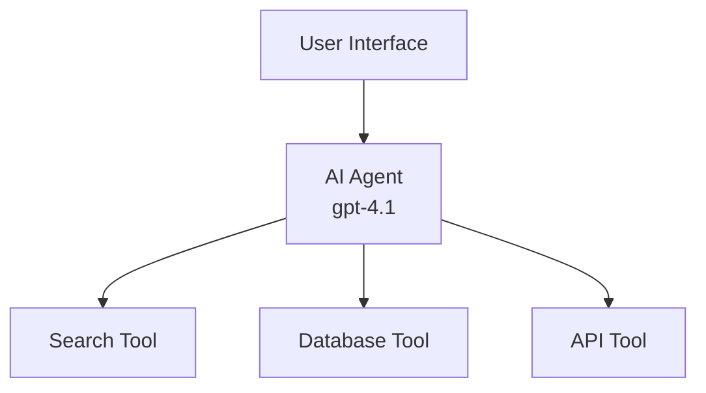
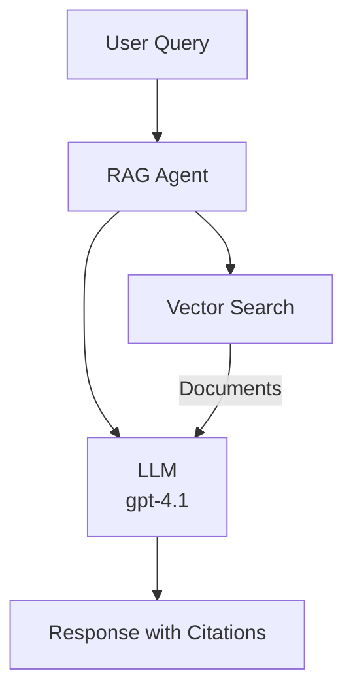
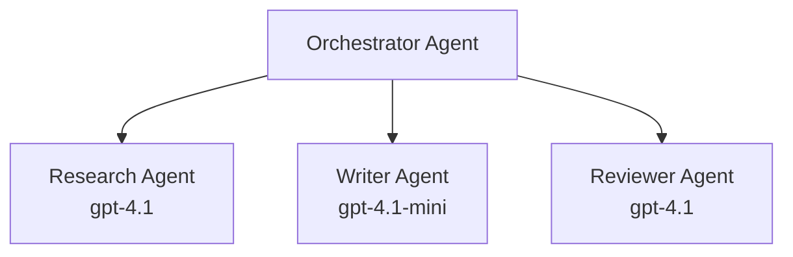

# Agenti AI con Azure Developer CLI

**Navigazione del Capitolo:**
- **📚 Home del Corso**: [AZD Per Principianti](../../README.md)
- **📖 Capitolo Attuale**: Capitolo 2 - Sviluppo AI-First
- **⬅️ Precedente**: [Integrazione Microsoft Foundry](microsoft-foundry-integration.md)
- **➡️ Successivo**: [Distribuzione Modelli AI](ai-model-deployment.md)
- **🚀 Avanzato**: [Soluzioni Multi-Agente](../../examples/retail-scenario.md)

---

## Introduzione

Gli agenti AI sono programmi autonomi che possono percepire il loro ambiente, prendere decisioni e intraprendere azioni per raggiungere obiettivi specifici. A differenza dei semplici chatbot che rispondono a input, gli agenti possono:

- **Usare strumenti** - Chiamare API, cercare nei database, eseguire codice
- **Pianificare e ragionare** - Suddividere compiti complessi in passaggi
- **Imparare dal contesto** - Mantenere la memoria e adattare il comportamento
- **Collaborare** - Lavorare con altri agenti (sistemi multi-agente)

Questa guida ti mostra come distribuire agenti AI su Azure usando Azure Developer CLI (azd).

L’uso del contesto di conversazione non è addestramento del modello: memoria persistente, controllo degli accessi e conservazione devono essere implementati/configurati dall’applicazione.

> **Revisione della release (2026-11-04):** Gli esempi CLI sono stati verificati rispetto alla documentazione/sorgente di `azd` `1.37.2`, `azure.ai.agents` `1.0.0-beta.23`, e `azure.ai.evaluations` `1.0.0-beta.2`, non su una distribuzione Azure attiva. Usa `azd >= 1.37.0` per il flusso di lavoro combinato. Consulta le [modifiche e correzioni recenti](../chapter-08-production/production-ai-practices.md#recent-release-changes-and-fixes) prima di aggiornare progetti più vecchi.

## Obiettivi di Apprendimento

Completando questa guida, sarai in grado di:
- Comprendere cosa sono gli agenti AI e come differiscono dai chatbot
- Distribuire template predefiniti per agenti AI usando AZD
- Configurare Foundry Agents per agenti personalizzati
- Implementare pattern base di agenti (uso strumenti, RAG, multi-agente)
- Monitorare e fare debug degli agenti distribuiti

## Risultati di Apprendimento

Al termine, sarai in grado di:
- Distribuire applicazioni agenti AI su Azure con un singolo comando
- Configurare strumenti e capacità degli agenti
- Implementare retrieval-augmented generation (RAG) con agenti
- Progettare architetture multi-agente per flussi di lavoro complessi
- Risolvere problemi comuni di distribuzione agenti

---

## 🤖 Cosa Differenzia un Agente da un Chatbot?

| Caratteristica | Chatbot | Agente AI |
|--------------|---------|-----------|
| **Comportamento** | Risponde a input | Prende azioni autonome |
| **Strumenti** | Può usare retrieval o strumenti | Tipicamente usa strumenti in un ciclo finalizzato |
| **Memoria** | Dipende dall’applicazione | Memoria persistente solo se implementata esplicitamente |
| **Pianificazione** | Risposta singola | Ragionamento multi-step |
| **Collaborazione** | Entità singola | Può lavorare con altri agenti |

### Semplice Analogia

- **Chatbot** = Una persona cortese che risponde alle domande a un banco informazioni
- **Agente AI** = Un assistente personale che può fare telefonate, prenotare appuntamenti e completare compiti per te

---

## 🚀 Avvio Rapido: Distribuisci il Tuo Primo Agente

Scegli un’opzione in una **nuova directory di lavoro vuota**. L’opzione finale `.` inizializza lì; senza una destinazione esplicita, l’attuale AZD può creare una sottodirectory con il nome del template e non cambia la directory del terminale. Mantieni template/ambienti separati in directory separate.

Le stime di tempo/costo seguenti sono indicative e non quotazioni validate. Verifica i prerequisiti attuali, prezzi, quote modello e servizi opzionali di ciascun esempio prima della distribuzione.

### Opzione 1: Template Foundry Agents (Consigliato)

```bash
# Initialize the AI agents template
azd init --template get-started-with-ai-agents .

# Deploy to Azure
azd up
```

**Cosa viene distribuito:** L’infrastruttura attuale e le opzioni selezionate del campione determinano modello, strumenti, hosting e risorse di monitoraggio. Rivedi il suo README e `infra/` prima di procedere; non assumere che ogni template agente includa Search o un’interfaccia web.

**Tempo:** ~15-20 minuti
**Costo:** ~$100-150/mese (sviluppo)

### Opzione 2: Agenti di Scrittura Creativa con Prompty

```bash
# Initialize the Prompty-based agent template
azd init --template https://github.com/Azure-Samples/contoso-creative-writer .

# Deploy to Azure
azd up
```

**Cosa viene distribuito:** Un esempio multi-agente FastAPI/Prompty per scrittura usando Azure OpenAI, Bing Grounding, e Azure AI Search. Il precedente repository `agent-openai-python-prompty` reindirizza qui; non è un template minimale per Azure Functions agenti meteo. Segui il suo README attuale per hosting, quota modello e prerequisiti Bing Grounding.

**Tempo:** ~10-15 minuti
**Costo:** ~$50-100/mese (sviluppo)

### Opzione 3: Agente Chat RAG

```bash
# Initialize RAG chat template
azd init --template azure-search-openai-demo .

# Deploy to Azure
azd up
```

**Cosa viene distribuito:**
- ✅ Modelli Microsoft Foundry
- ✅ Azure AI Search con dati di esempio
- ✅ Pipeline di elaborazione documenti
- ✅ Interfaccia chat con citazioni

**Tempo:** ~15-25 minuti
**Costo:** ~$80-150/mese (sviluppo)

### Opzione 4: AZD AI Agent Init (Anteprima Template Progetto)

Usa `azd ai agent init` in modo interattivo, oppure adotta un progetto agente `azure.yaml` corrente con `--template`/`-t`. La vecchia opzione `--manifest`/`-m` è un alias deprecato, non un convertitore per manifesti legacy.

```bash
# Install the AI agents extension
azd extension install azure.ai.agents

# Optional: verify the installed preview version
azd extension show azure.ai.agents

# Initialize from a current agent project template (supply your template path)
azd ai agent init --template ./templates/support-agent/azure.yaml

# Deploy to Azure
azd up

# Test the deployed agent (shows latency + time-to-first-byte)
azd ai agent invoke
```

**Quando usare `azd ai agent init` vs `azd init --template`:**

| Approccio | Migliore per | Come funziona |
|----------|-------------|---------------|
| `azd init --template` | Partendo da un'app di esempio funzionante | Clona un intero repo modello con codice + infrastruttura |
| `azd ai agent init --template` | Adottando un progetto agente Foundry corrente | Usa un documento progetto `azure.yaml` e le sue definizioni |

> **Suggerimento:** Usa `azd init --template` quando impari (Opzioni 1-3 sopra). Usa `azd ai agent init` per il flusso di lavoro agente Foundry. Per aggiungere una definizione agente diretta a un progetto esistente, vedi [indicazioni per inizializzazione e migrazione](../chapter-08-production/production-ai-practices.md#initializing-agent-projects-with-azd-ai-agent-init).

Dopo `azd up`, usa `azd ai agent invoke` per testare, l'estensione `azure.ai.evaluations` separata (`azd ai eval init`, `generate`, e `run start`) per misurare la qualità, e `azd ai agent optimize` per migliorarla usando la nuova configurazione di valutazione. Agenti beta.22 ha sostituito il flusso di lavoro di valutazione legacy e cambiato il formato `--config` dell'ottimizzazione. Vedi [migrazione valutazione](../chapter-08-production/production-ai-practices.md#evaluation-migration-and-quality-checks) e [migrazione ottimizzazione](../chapter-08-production/production-ai-practices.md#optimization-configuration-migration) prima di riutilizzare esempi più vecchi.

---

## 🏗️ Modelli di Architettura Agente

### Modello 1: Agente Singolo con Strumenti

Il modello agente più semplice - un agente che può usare più strumenti.



**Migliore per:**
- Bot di supporto clienti
- Assistenti per la ricerca
- Agenti per analisi dati

**Esempio di applicazione correlato:** `azure-search-openai-demo` dimostra RAG, non un ciclo agente con strumenti arbitrari generici.

### Modello 2: Agente RAG (Generazione Aumentata da Recupero)

Un agente che recupera documenti rilevanti prima di generare risposte.



**Migliore per:**
- Basi di conoscenza aziendale
- Sistemi Q&A su documenti
- Ricerca compliance e legale

**Modello AZD:** `azure-search-openai-demo`

### Modello 3: Sistema Multi-Agente

Più agenti specializzati che collaborano su compiti complessi.



**Migliore per:**
- Generazione contenuti complessi
- Workflow multi-step
- Compiti che richiedono diverse competenze

**Per saperne di più:** [Modelli di Coordinamento Multi-Agente](../chapter-06-pre-deployment/coordination-patterns.md)

---

## ⚙️ Configurazione Strumenti Agente

Gli agenti diventano potenti quando possono usare strumenti. Ecco come configurare strumenti comuni:

### Configurazione Strumenti negli Agenti Foundry

Questo **frammento classico del SDK Agent Service** è rivolto a `azure-ai-projects==1.0.0` e `azure-ai-agents==1.1.0` con `azure-identity`. Non è la versione più recente API versioned-agent/Responses usata da alcuni modelli Foundry attuali, né l'estensione `azure.ai.agents` AZD (un pacchetto differente). Non mescolare queste generazioni API. Imposta `PROJECT_ENDPOINT` a un endpoint progetto Foundry classico e `MODEL_DEPLOYMENT_NAME` a un deployment modello supportato esistente; autentica con `az login` localmente e concedi i permessi progetto richiesti.

```python
# agent_config.py
import os
from azure.ai.projects import AIProjectClient
from azure.ai.agents.models import FunctionTool
from azure.identity import DefaultAzureCredential

def search_knowledge_base(query: str) -> str:
    """Search the demonstration knowledge base.

    :param query: Search text.
    :return: Matching demonstration information.
    """
    # Local fixture only, not a production search implementation.
    return "Demo policy: returns are accepted within 30 days."

project_client = AIProjectClient(
    endpoint=os.environ["PROJECT_ENDPOINT"],
    credential=DefaultAzureCredential(),
)
search_tool = FunctionTool(functions={search_knowledge_base})
project_client.agents.enable_auto_function_calls(search_tool)
agent = project_client.agents.create_agent(
    model=os.environ["MODEL_DEPLOYMENT_NAME"],
    name="Support Agent",
    instructions="Use search_knowledge_base for policy questions. Label results as demo data.",
    tools=search_tool.definitions,
)
```

Registrare uno schema funzione non esegue Python sul servizio. In questo SDK, `enable_auto_function_calls` più `agents.runs.create_and_process(...)` eseguono callback registrati nel processo client. Vedi l'[esempio SDK rilasciato](https://github.com/Azure/azure-sdk-for-python/blob/azure-ai-agents_1.1.0/sdk/ai/azure-ai-agents/samples/agents_tools/sample_agents_auto_function_call.py). Chiudi il client ed elimina agenti/thread di dimostrazione al termine.

### Configurazione Ambiente

I nomi seguenti sono **input modello personalizzati illustrativi**, non switch AZD integrati. Prima inoltra ogni valore tramite `infra/main.parameters.json`, infrastruttura e codice applicazione. `azd env set` da solo non cambia strumenti o istruzioni di un agente.

```bash
# Set up agent-specific environment variables
azd env set AZURE_OPENAI_MODEL "gpt-4.1"
azd env set AGENT_INSTRUCTIONS "You are a helpful assistant..."
azd env set ENABLE_CODE_INTERPRETER "true"
azd env set ENABLE_FILE_SEARCH "true"

# Apply wired infrastructure and application changes
azd up
```

---

## 📊 Monitoraggio Agenti

### Integrazione Application Insights

Se il modello selezionato provvede Application Insights e configura l'instrumentazione:

```bash
# Open monitoring dashboard
azd monitor --overview

# Open the Application Insights logs view (not a streaming log tail)
azd monitor --logs

# View live metrics
azd monitor --live
```

### Metriche Chiave da Monitorare

| Metrica | Descrizione | Obiettivo |
|---------|-------------|----------|
| Latency Risposta | Tempo per generare risposta | < 5 secondi |
| Uso Token | Token per richiesta | Monitorare costi |
| Percentuale Chiamate Strumenti Riuscite | % esecuzioni strumento riuscite | > 95% |
| Tasso Errori | Richieste agente fallite | < 1% |
| Soddisfazione Utente | Punteggi feedback | > 4.0/5.0 |

### Logging Personalizzato per Agenti

```python
import os
from azure.monitor.opentelemetry import configure_azure_monitor
from opentelemetry import trace

# Configure Azure Monitor with OpenTelemetry
configure_azure_monitor(
    connection_string=os.environ["APPLICATIONINSIGHTS_CONNECTION_STRING"]
)

tracer = trace.get_tracer(__name__)

def log_agent_interaction(user_query, agent_response, tools_used, latency_ms):
    with tracer.start_as_current_span("agent_interaction") as span:
        span.set_attributes({
            "query_length": len(user_query),  # Do not log raw prompts or personal data
            "response_length": len(agent_response),
            "tools_used": tools_used,
            "latency_ms": latency_ms
        })
```

> **Nota:** Installa il pacchetto necessario: `pip install azure-monitor-opentelemetry`. Include le dipendenze OpenTelemetry; lo namespace import non è requisito per installare un pacchetto chiamato `opentelemetry`.

---

## 💰 Considerazioni sui Costi

### Costi Mensili Stimati per Modello

Questi sono intervalli illustrativi per pianificazione, non preventivi o limiti di spesa. Regione, token modello, SKU Search/compute, sessioni strumenti, storage e traffico possono superarli. Controlla le indicazioni sui costi del campione e i prezzi Azure prima di `azd up`.

| Modello | Ambiente Dev | Produzione |
|---------|---------------|------------|
| Agente Singolo | $50-100 | $200-500 |
| Agente RAG | $80-150 | $300-800 |
| Multi-Agente (2-3 agenti) | $150-300 | $500-1,500 |
| Multi-Agente Enterprise | $300-500 | $1,500-5,000+ |

### Suggerimenti per Ottimizzazione Costi

1. **Usa gpt-4.1-mini per compiti semplici** (solo se il tuo modello consuma questo input)
   ```bash
   azd env set AZURE_OPENAI_MODEL "gpt-4.1-mini"
   ```

2. **Implementa caching a livello locale per query sicure e ripetute.** Includi autorizzazione tenant/utente, deployment modello, istruzioni e versione recupero nella chiave cache; imposta scadenza. Non condividere risposte private di conversazione attraverso cache process-wide di sola query. L'oggetto agente SDK non ha un metodo generico `agent.run()`.

3. **Imposta limiti token per esecuzione**
   ```python
   # Set max_completion_tokens when running the agent, not during creation
   run = project_client.agents.runs.create_and_process(
       thread_id=thread.id,
       agent_id=agent.id,
       max_completion_tokens=1000  # Budget across the run; may finish as incomplete
   )
   ```

4. **Scala Container Apps idonei a zero quando non in uso**
   ```bash
   # Custom-template input: must map to template.scale.minReplicas
   azd env set MIN_REPLICAS "0"
   ```
   Applica la modifica infrastrutturale con `azd provision` o `azd up`. Scalare a zero necessita di un trigger adeguato e non blocca costi Search, storage o modello/strumento.

---

## 🔧 Risoluzione Problemi Agenti

### Problemi Comuni e Soluzioni

<details>
<summary><strong>❌ Agente non risponde a chiamate strumenti</strong></summary>

```bash
# Inspect the application deployment (not the agent's registered tools)
azd show

# Verify OpenAI deployment
az cognitiveservices account deployment list \
  --name $AZURE_OPENAI_NAME \
  --resource-group $RG_NAME

# Check agent logs
azd monitor --logs
```

**Cause comuni:**
- Firma funzione strumento non corrispondente
- Mancanza permessi richiesti
- Endpoint API non accessibile
</details>

<details>
<summary><strong>❌ Alta latenza nelle risposte agente</strong></summary>

```bash
# Check Application Insights for bottlenecks
azd monitor --live

# Consider using a faster model
azd env set AZURE_OPENAI_MODEL "gpt-4.1-mini"
azd up
```

**Suggerimenti per ottimizzazione:**
- Usa risposte in streaming
- Implementa caching risposte
- Riduci dimensione finestra contesto
</details>

<details>
<summary><strong>❌ Agente restituisce informazioni errate o allucinazioni</strong></summary>

```python
# Improve with better system prompts
instructions = """
You are a helpful assistant. IMPORTANT:
- Only answer based on provided context
- If you don't know, say "I don't know"
- Always cite your sources
- Never make up information
"""

# Use these instructions in the agent definition.
# For classic file search, first upload/index documents in a vector store,
# then use FileSearchTool(vector_store_ids=[...]) and pass both its
# .definitions and .resources when creating the agent.
```
Le istruzioni e il recupero riducono il rischio; nessuno garantisce risposte fattuali. Valuta domande fondate e fuori ambito rispetto a risposte note.
</details>

<details>
<summary><strong>❌ Errori per superamento limite token</strong></summary>

```python
# Implement context window management
def truncate_context(messages, max_tokens=8000, model="gpt-4.1"):
    """Approximate content-only budget for objects with .content strings."""
    import tiktoken
    encoding = tiktoken.encoding_for_model(model)
    total_tokens = 0
    truncated = []
    
    for msg in reversed(messages):
        msg_tokens = len(encoding.encode(msg.content))
        if total_tokens + msg_tokens > max_tokens:
            break
        truncated.insert(0, msg)
        total_tokens += msg_tokens
    
    return truncated
```
Questo helper esclude schemi ruolo/strumento, istruzioni di sistema, token immagine e overhead protocollo. Riserva spazio per quelli e completamento; non dividere coppie chiamata/risultato strumento né scartare istruzioni sistema richieste. Installa `tiktoken` separatamente. Non è un validatore generico finestra contesto.
</details>

---

## 🎓 Esercizi Pratici

### Esercizio 1: Distribuire un Agente Base (20 minuti)

**Obiettivo:** Distribuisci il tuo primo agente AI usando AZD

```bash
# Step 1: Initialize template
azd init --template get-started-with-ai-agents .

# Step 2: Login to Azure
azd auth login
# If you work across tenants, add --tenant-id <tenant-id>

# Step 3: Deploy
azd up

# Step 4: Test the agent
# Expected output after deployment:
#   Deployment Complete!
#   Endpoint: https://<app-name>.<region>.azurecontainerapps.io
# Open the URL shown in the output and try asking a question

# Step 5: View monitoring
azd monitor --overview

# Step 6: Clean up
azd down --force --purge
```

**Criteri di Successo:**
- [ ] L'agente risponde a domande
- [ ] Accesso al cruscotto di monitoraggio tramite `azd monitor`
- [ ] Risorse liberate con successo

### Esercizio 2: Aggiungere uno Strumento Personalizzato (30 minuti)

**Obiettivo:** Estendi un agente con uno strumento personalizzato

**Punto di partenza:** Usa il client SDK classico da [Configurazione Strumento](#tool-configuration-in-foundry-agents), non un modello arbitrario con diversa generazione SDK.

1. Aggiungi questo fixture deterministico a `agent_config.py`:
   ```python
   def get_weather(location: str) -> str:
       """Return demonstration weather, not live conditions.

       :param location: City name.
       :return: A clearly labelled fixture.
       """
       print(f"TOOL_CALLED: {location}")
       return f"Demo weather in {location}: Sunny, 72°F (fixture, not live)"
   ```
2. Sostituisci il blocco di registrazione e creazione dello strumento di ricerca con:
   ```python
   weather_tool = FunctionTool(functions={get_weather})
   project_client.agents.enable_auto_function_calls(weather_tool)
   agent = project_client.agents.create_agent(
       model=os.environ["MODEL_DEPLOYMENT_NAME"],
       name="Weather Agent",
       instructions="Call get_weather for weather questions; explain that it returns demo data.",
       tools=weather_tool.definitions,
   )
   thread = project_client.agents.threads.create()
   try:
       project_client.agents.messages.create(
           thread_id=thread.id, role="user", content="Use get_weather for Seattle."
       )
       run = project_client.agents.runs.create_and_process(
           thread_id=thread.id, agent_id=agent.id
       )
       if run.status != "completed":
           raise RuntimeError(f"Run status: {run.status}; error: {run.last_error}")
       for message in project_client.agents.messages.list(thread_id=thread.id):
           for text in message.text_messages:
               print(text.text.value)
   finally:
       project_client.agents.threads.delete(thread.id)
       project_client.agents.delete_agent(agent.id)
       project_client.close()
   ```
3. Esegui localmente (questo chiama il progetto Azure esistente e comporta costi per il modello):
   ```bash
   python agent_config.py
   # Expected: TOOL_CALLED: Seattle, then a completed answer labelled demo data.
   ```

**Criteri di successo:**
- [ ] L'agente riconosce le domande relative al meteo
- [ ] Lo strumento viene chiamato correttamente
- [ ] La risposta include informazioni sul meteo

### Esercizio 3: Costruisci un agente RAG (45 minuti)

**Obiettivo:** Crea un agente che risponda alle domande dai tuoi documenti

```bash
# Step 1: Deploy RAG template
azd init --template azure-search-openai-demo .
azd up

# Step 2: Upload your documents
# For the sample's local ingestion path, place supported files in data/.
# Run from the sample root after following its Python environment setup:
./scripts/prepdocs.sh
# Windows PowerShell equivalent: .\\scripts\\prepdocs.ps1

# Step 3: Test with domain-specific questions
# Open the web app URL from the azd up output
# Ask questions about your uploaded documents
# Responses should include citation references like [doc.pdf]
```

**Criteri di successo:**
- [ ] L'agente risponde dai documenti caricati
- [ ] Le risposte includono citazioni
- [ ] Le domande fuori ambito sono gestite senza affermazioni non supportate (non è una garanzia per ogni futura domanda)

Se `USE_CLOUD_INGESTION=true`, usa invece il workflow di ingestione/caricamento cloud del campione; il wrapper locale salta intenzionalmente l'ingestione. Dopo il test, esegui `azd down` nell'ambiente RAG e rivedi le risorse da eliminare.

---

## 📚 Passi successivi

Ora che conosci gli agenti AI, esplora questi argomenti avanzati:

| Argomento | Descrizione | Link |
|-------|-------------|------|
| **Sistemi Multi-Agente** | Costruisci sistemi con più agenti collaborativi | [Esempio Multi-Agente Retail](../../examples/retail-scenario.md) |
| **Pattern di Coordinamento** | Impara l'orchestrazione e i pattern di comunicazione | [Pattern di Coordinamento](../chapter-06-pre-deployment/coordination-patterns.md) |
| **Deployment in Produzione** | Deployment di agenti pronti per l'impresa | [Pratiche AI in Produzione](../chapter-08-production/production-ai-practices.md) |
| **Valutazione degli Agenti** | Testa e valuta le prestazioni degli agenti | [Risoluzione problemi AI](../chapter-07-troubleshooting/ai-troubleshooting.md) |
| **Laboratorio AI Workshop** | Pratico: rendi la tua soluzione AI pronta per AZD | [Laboratorio AI Workshop](ai-workshop-lab.md) |

---

## 📖 Risorse aggiuntive

### Documentazione ufficiale
- [Microsoft Foundry Agent Service](https://learn.microsoft.com/azure/ai-services/agents/)
- [Microsoft Foundry Agent Service Quickstart](https://learn.microsoft.com/azure/ai-services/agents/quickstart)
- [Semantic Kernel Agent Framework](https://learn.microsoft.com/semantic-kernel/)

### Template AZD per agenti
- [Inizia con gli agenti AI](https://github.com/Azure-Samples/get-started-with-ai-agents)
- [Agenti di scrittura creativa con Prompty](https://github.com/Azure-Samples/contoso-creative-writer)
- [Demo Azure Search OpenAI](https://github.com/Azure-Samples/azure-search-openai-demo)

### Risorse della community
- [Awesome AZD - Template per agenti](https://azure.github.io/awesome-azd/?tags=ai-agents)
- [Discord Azure AI](https://discord.gg/microsoft-azure)
- [Discord Microsoft Foundry](https://discord.gg/nTYy5BXMWG)

### Competenze agenti per il tuo editor
- [**Competenze Agenti Microsoft Azure**](https://skills.sh/microsoft/github-copilot-for-azure) - Installa competenze riutilizzabili per agenti AI per lo sviluppo Azure in GitHub Copilot, Cursor o qualsiasi agente supportato. Include competenze per [Azure AI](https://skills.sh/microsoft/github-copilot-for-azure/azure-ai), [Microsoft Foundry](https://skills.sh/microsoft/github-copilot-for-azure/microsoft-foundry), [deployment](https://skills.sh/microsoft/github-copilot-for-azure/azure-deploy) e [diagnostica](https://skills.sh/microsoft/github-copilot-for-azure/azure-diagnostics):
  ```bash
  npx skills add microsoft/github-copilot-for-azure
  ```

---

**Navigazione**
- **Lezione precedente**: [Microsoft Foundry Integration](microsoft-foundry-integration.md)
- **Lezione successiva**: [Deployment di modelli AI](ai-model-deployment.md)

---

<!-- CO-OP TRANSLATOR DISCLAIMER START -->
**Disclaimer**:
Questo documento è stato tradotto utilizzando il servizio di traduzione AI [Co-op Translator](https://github.com/Azure/co-op-translator). Sebbene ci impegniamo per garantire la precisione, si prega di notare che le traduzioni automatizzate possono contenere errori o imprecisioni. Il documento originale nella sua lingua nativa deve essere considerato la fonte autorevole. Per informazioni critiche, si raccomanda una traduzione professionale effettuata da un essere umano. Non siamo responsabili per eventuali malintesi o interpretazioni errate derivanti dall’uso di questa traduzione.
<!-- CO-OP TRANSLATOR DISCLAIMER END -->