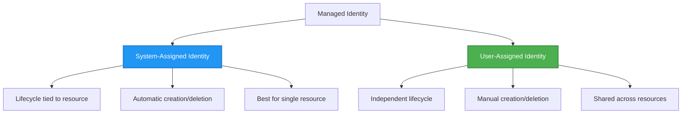

# Modelli di Autenticazione e Identità Gestita

⏱️ **Tempo Stimato**: 45-60 minuti di lettura; prevedi tempo extra per integrare gli esercizi | 💰 **Impatto sui Costi**: Identity/RBAC sono gratuiti; compute, storage e Key Vault distribuiti sono a pagamento | ⭐ **Complessità**: Intermedio

> Revisionato con `azd 1.37.2` (Novembre 2026). Questa lezione contiene **frammenti illustrativi di integrazione, non un modello completo `secure-app` scaricabile**. Crea i file referenziati, fornisci l'infrastruttura corrispondente e sostituisci i segnaposto prima della distribuzione. Nessuna risorsa Azure è stata provisionata durante la revisione.

**📚 Percorso di Apprendimento:**
- ← Precedente: [Gestione della Configurazione](configuration.md) - Gestione di variabili di ambiente e segreti
- 🎯 **Sei Qui**: Autenticazione & Sicurezza (Identità Gestita, Key Vault, modelli sicuri)
- → Successivo: [Infrastructure as Code](../chapter-04-infrastructure/README.md) - Provisionare e distribuire risorse
- 🏠 [Home del Corso](../../README.md)

---

## Cosa Imparerai

Completando questa lezione, sarai in grado di:
- Comprendere i modelli di autenticazione di Azure (chiavi, stringhe di connessione, identità gestita)
- Implementare **Identità Gestita** per un'autenticazione senza password
- Proteggere i segreti con l'integrazione di **Azure Key Vault**
- Configurare il **controllo degli accessi basato sui ruoli (RBAC)** per le distribuzioni AZD
- Applicare le migliori pratiche di sicurezza in Container Apps e servizi Azure
- Migrare dall'autenticazione basata su chiavi a quella basata su identità

## Perché l’Identità Gestita è Importante

### Il Problema: Autenticazione Tradizionale

**Prima dell’Identità Gestita:**
```javascript
// ❌ SECURITY RISK: Hardcoded secrets in code
const connectionString = "Server=mydb.database.windows.net;User=admin;Password=P@ssw0rd123";
const storageKey = "xK7mN9pQ2wR5tY8uI0oP3aS6dF1gH4jK...";
const cosmosKey = "C2x7B9n4M1p8Q5w3E6r0T2y5U8i1O4p7...";
```

**Problemi:**
- 🔴 **Segreti esposti** nel codice, nei file di configurazione, nelle variabili d'ambiente
- 🔴 **Rotazione delle credenziali** richiede modifiche al codice e ridistribuzione
- 🔴 **Incubi di audit** – chi ha usato cosa, quando?
- 🔴 **Dispersione** – segreti sparsi su più sistemi
- 🔴 **Rischi di conformità** – fallisce le verifiche di sicurezza

### La Soluzione: Identità Gestita

**Dopo l’Identità Gestita:**
```javascript
// ✅ SECURE: No secrets in code
const credential = new DefaultAzureCredential();
const client = new BlobServiceClient(
  "https://mystorageaccount.blob.core.windows.net",
  credential  // Azure automatically handles authentication
);
```

**Benefici:**
- ✅ **Nessun segreto** nel codice o nella configurazione
- ✅ **Rotazione automatica** - gestita da Azure
- ✅ **Traccia completa di audit** nei log di Microsoft Entra ID
- ✅ **Sicurezza centralizzata** - gestione tramite Azure Portal
- ✅ **Pronta per la conformità** - rispetta gli standard di sicurezza

**Analogia**: L'autenticazione tradizionale è come portare con sé più chiavi fisiche per porte diverse. L'Identità Gestita è come avere un badge di sicurezza che concede automaticamente l'accesso in base a chi sei — nessuna chiave da perdere, copiare o ruotare.

---

## Panoramica dell'Architettura

### Flusso di Autenticazione con Identità Gestita

```mermaid
sequenceDiagram
    participant App as Your Application<br/>(Container App)
    participant MI as Managed Identity<br/>(Microsoft Entra ID)
    participant KV as Key Vault
    participant Storage as Azure Storage
    participant DB as Azure SQL
    
    App->>MI: Request access token<br/>(automatic)
    MI->>MI: Verify identity<br/>(no password needed)
    MI-->>App: Return token for requested audience<br/>(lifetime varies)
    
    App->>KV: Get secret<br/>(using token)
    KV->>KV: Check RBAC permissions
    KV-->>App: Return secret value
    
    App->>Storage: Upload blob<br/>(using token)
    Storage->>Storage: Check RBAC permissions
    Storage-->>App: Success
    
    App->>DB: Query data<br/>(using token)
    DB->>DB: Check SQL permissions
    DB-->>App: Return results
    
    Note over App,DB: Request a separate token for each service audience;<br/>SDK credentials handle caching and renewal
```

### Tipi di Identità Gestite



| Funzionalità | System-Assigned | User-Assigned |
|---------|----------------|---------------|
| **Ciclo di vita** | Legata alla risorsa | Indipendente |
| **Creazione** | Automatica con la risorsa | Creazione manuale |
| **Eliminazione** | Eliminata con la risorsa | Persiste dopo eliminazione risorsa |
| **Condivisione** | Solo una risorsa | Più risorse |
| **Caso d’uso** | Scenari semplici | Scenari complessi multi-risorsa |
| **Scelta del modello** | Definita in infrastruttura | Definita in infrastruttura |

---

## Prerequisiti

### Strumenti Richiesti

Dovresti già avere questi installati dalle lezioni precedenti:

```bash
# Verify Azure Developer CLI
azd version
# ✅ Expected: azd version 1.0.0 or higher

# Verify Azure CLI
az --version
# ✅ Expected: azure-cli 2.50.0 or higher
```

### Requisiti Azure

- Sottoscrizione Azure attiva
- Autorizzazioni per:
  - Creare identità gestite
  - Assegnare ruoli RBAC
  - Creare risorse Key Vault
  - Distribuire Container Apps

### Prerequisiti di Conoscenza

Dovresti aver completato:
- [Guida all'Installazione](../chapter-01-foundation/installation.md) - Configurazione AZD
- [Fondamentali AZD](../chapter-01-foundation/azd-basics.md) - Concetti base
- [Gestione della Configurazione](configuration.md) - Variabili d'ambiente

---

## Lezione 1: Comprendere i Modelli di Autenticazione

### Modello 1: Stringhe di Connessione (Legacy - Evitare)

**Come funziona:**
```bash
# Connection string contains credentials
STORAGE_CONNECTION_STRING="DefaultEndpointsProtocol=https;AccountName=myaccount;AccountKey=xK7mN9pQ2wR5..."
COSMOS_CONNECTION_STRING="AccountEndpoint=https://myaccount.documents.azure.com:443/;AccountKey=C2x7..."
SQL_CONNECTION_STRING="Server=myserver.database.windows.net;User=admin;Password=P@ssw0rd..."
```

**Problemi:**
- ❌ Segreti visibili nelle variabili d'ambiente
- ❌ Registrati nei sistemi di distribuzione
- ❌ Difficili da ruotare
- ❌ Nessuna traccia di audit degli accessi

**Quando usarlo:** Quando il servizio target richiede autenticazione basata su chiave. Preferire l’identità dove supportata; altrimenti, memorizza le chiavi in modo sicuro e ruotale, anche in produzione.

---

### Modello 2: Riferimenti a Key Vault (Meglio)

**Come funziona:**
**Frammenti Bicep parziali:** campi richiesti del vault, identità Container App e la sua voce `configuration.secrets` sono omessi. `secretRef` nomina un segreto Container App; **non è esso stesso** un URI di Key Vault. Per usare Key Vault, definisci quel segreto nominato con `keyVaultUrl` e un `identity` autorizzato.

```bicep
// Store secret in Key Vault
resource keyVault 'Microsoft.KeyVault/vaults@2023-02-01' = {
  name: 'mykv'
  properties: {
    enableRbacAuthorization: true
  }
}

// Reference in Container App
env: [
  {
    name: 'STORAGE_KEY'
    secretRef: 'storage-key'  // References Key Vault
  }
]
```

**Benefici:**
- ✅ Segreti memorizzati in modo sicuro in Key Vault
- ✅ Gestione centralizzata dei segreti
- ✅ Rotazione senza cambiamenti al codice

**Limiti:**
- ⚠️ Usa ancora chiavi/password
- ⚠️ Necessità di gestire l’accesso a Key Vault

**Quando usarlo:** Passaggio di transizione da stringhe di connessione a identità gestita.

---

### Modello 3: Identità Gestita (Best Practice)

**Come funziona:**
**Bicep parziale:** unisci il blocco identità in un Container App completo e fornisci `storageAccount` e la definizione del ruolo. Una assegnazione di ruolo richiede anche un `name` deterministico.

```bicep
// Enable managed identity
resource containerApp 'Microsoft.App/containerApps@2023-05-01' = {
  name: 'myapp'
  identity: {
    type: 'SystemAssigned'  // Automatically creates identity
  }
}

// Grant permissions
resource roleAssignment 'Microsoft.Authorization/roleAssignments@2022-04-01' = {
  name: guid(storageAccount.id, containerApp.id, storageBlobDataContributorRole)
  scope: storageAccount
  properties: {
    roleDefinitionId: storageBlobDataContributorRole
    principalId: containerApp.identity.principalId
    principalType: 'ServicePrincipal'
  }
}
```

**Codice applicativo:**
```javascript
// No secrets needed!
const { DefaultAzureCredential } = require('@azure/identity');
const { BlobServiceClient } = require('@azure/storage-blob');

const credential = new DefaultAzureCredential();
const blobServiceClient = new BlobServiceClient(
  'https://mystorageaccount.blob.core.windows.net',
  credential
);
```

**Benefici:**
- ✅ Zero segreti nel codice/config
- ✅ Rotazione automatica delle credenziali
- ✅ Traccia completa di audit
- ✅ Permessi basati su RBAC
- ✅ Pronto per la conformità

**Quando usarlo:** Preferisci per applicazioni ospitate in Azure che accedono a servizi che supportano l’autenticazione Microsoft Entra.

---

### Modello 4: Principali di Servizio (CI/CD & Automazione)

L'identità gestita è lo standard d'oro *per risorse che girano dentro Azure*. Ma che dire di ciò che gira **fuori** Azure — come una pipeline CI/CD su un agente di build, o uno script sul tuo laptop che non può usare il login interattivo? Ecco dove entra in gioco un **principale di servizio**: un'identità non umana con proprie credenziali che un processo automatico può utilizzare per autenticarsi.

**Come funziona:**

Crea un principale di servizio vincolato a un gruppo di risorse (privilegio minimo):

```bash
az ad sp create-for-rbac \
  --name "myapp-cicd" \
  --role contributor \
  --scopes "/subscriptions/<sub-id>/resourceGroups/<rg-name>"
```

Questo stampa un client ID, segreto client e tenant ID. azd può autenticarsi con essi in modo non interattivo:

```bash
azd auth login \
  --client-id "<appId>" \
  --client-secret "<password>" \
  --tenant-id "<tenant>"
```

**Preferisci credenziali federate (OIDC) rispetto ai segreti.** Invece di un segreto client a lunga durata, configura una credenziale federata in modo che la pipeline scambi un token a breve durata — nessun segreto da perdere o ruotare:

```bash
azd auth login \
  --client-id "<appId>" \
  --federated-credential-provider "github" \
  --tenant-id "<tenant>"
```

> `azd pipeline config` lo configura automaticamente per te. Vedi le guide CI/CD in [Capitolo 8](../chapter-08-production/production-ai-practices.md).

**Benefici:**
- ✅ Funziona fuori da Azure (agenti di build, on-prem, altre cloud)
- ✅ Può essere vincolato a un singolo gruppo di risorse con un ruolo unico
- ✅ Variante federata (OIDC) senza segreti memorizzati

**Compromessi:**
- ⚠️ Variante basata su segreto richiede attenta conservazione e rotazione
- ⚠️ Un segreto divulgato concede ogni potere del SP — mantieni gli ambiti stretti

**Quando usarlo:** Pipeline CI/CD e automazione che non possono usare identità gestita. Preferisci sempre la variante **federata/OIDC** rispetto al segreto client, e preferisci l’identità gestita quando il carico di lavoro gira dentro Azure.

**Conservare le credenziali in modo sicuro:**
- Mai commettere segreti — usa il secret store della tua pipeline (segreti GitHub Actions, gruppi di variabili Azure DevOps / Key Vault).
- Limita il SP al ruolo e gruppo di risorse minimo necessario.
- Imposta una scadenza e ruota, o elimina il segreto completamente con OIDC.

---

## Lezione 2: Implementare l’Identità Gestita con AZD

### Implementazione Passo-Passo

I seguenti frammenti mostrano come integrare l’identità gestita in un progetto Container App. Non sono un starter "copia e incolla": il modulo Storage, l’infrastruttura completa ambiente gestito/registro, Dockerfile e file parametri non sono forniti qui. Parti da un template Container Apps funzionante e integra questi modelli, mantenendo la configurazione del registro e i tag di servizio.

### Struttura del Progetto

```
secure-app/
├── azure.yaml                 # AZD configuration
├── infra/
│   ├── main.bicep            # Main infrastructure
│   ├── core/
│   │   ├── identity.bicep    # Managed identity setup
│   │   ├── keyvault.bicep    # Key Vault configuration
│   │   └── storage.bicep     # Storage with RBAC
│   └── app/
│       └── container-app.bicep
└── src/
    ├── app.js                # Application code
    ├── package.json
    └── Dockerfile
```

### 1. Configura AZD (azure.yaml)

```yaml
name: secure-app
metadata:
  template: secure-app@1.0.0

services:
  api:
    project: ./src
    language: js
    host: containerapp

# Managed identity must be enabled in the infrastructure, not by this YAML.
```

### 2. Infrastruttura: Abilitare Identità Gestita

**File: `infra/main.bicep`**

```bicep
targetScope = 'subscription'

param environmentName string
param location string = 'eastus'
param containerAppsEnvironmentId string
param containerImage string

var tags = { 'azd-env-name': environmentName }

// Resource group
resource rg 'Microsoft.Resources/resourceGroups@2021-04-01' = {
  name: 'rg-${environmentName}'
  location: location
  tags: tags
}

// Storage Account
module storage './core/storage.bicep' = {
  name: 'storage'
  scope: rg
  params: {
    name: 'st${uniqueString(rg.id)}'
    location: location
    tags: tags
  }
}

// Key Vault
module keyVault './core/keyvault.bicep' = {
  name: 'keyvault'
  scope: rg
  params: {
    name: 'kv-${uniqueString(rg.id)}'
    location: location
    tags: tags
  }
}

// Container App with Managed Identity
module containerApp './app/container-app.bicep' = {
  name: 'container-app'
  scope: rg
  params: {
    name: 'ca-${environmentName}'
    location: location
    tags: tags
    storageAccountName: storage.outputs.name
    keyVaultName: keyVault.outputs.name
    containerAppsEnvironmentId: containerAppsEnvironmentId
    containerImage: containerImage
  }
}

// Grant Container App access to Storage
module storageRoleAssignment './core/role-assignment.bicep' = {
  name: 'storage-role'
  scope: rg
  params: {
    principalId: containerApp.outputs.identityPrincipalId
    roleDefinitionId: 'ba92f5b4-2d11-453d-a403-e96b0029c9fe'  // Storage Blob Data Contributor
    targetResourceType: 'storage'
    targetResourceName: storage.outputs.name
  }
}

// Grant Container App access to Key Vault
module kvRoleAssignment './core/role-assignment.bicep' = {
  name: 'kv-role'
  scope: rg
  params: {
    principalId: containerApp.outputs.identityPrincipalId
    roleDefinitionId: '4633458b-17de-408a-b874-0445c86b69e6'  // Key Vault Secrets User
    targetResourceType: 'keyvault'
    targetResourceName: keyVault.outputs.name
  }
}

// Outputs
output AZURE_STORAGE_ACCOUNT_NAME string = storage.outputs.name
output AZURE_KEY_VAULT_NAME string = keyVault.outputs.name
output APP_URL string = containerApp.outputs.url
```

### 3. Container App con Identità Assegnata dal Sistema

**File: `infra/app/container-app.bicep`**

```bicep
param name string
param location string
param tags object = {}
param storageAccountName string
param keyVaultName string
param containerAppsEnvironmentId string
param containerImage string

resource containerApp 'Microsoft.App/containerApps@2023-05-01' = {
  name: name
  location: location
  tags: union(tags, { 'azd-service-name': 'api' })
  identity: {
    type: 'SystemAssigned'  // 🔑 Enable managed identity
  }
  properties: {
    managedEnvironmentId: containerAppsEnvironmentId
    configuration: {
      ingress: {
        external: true
        targetPort: 3000
      }
    }
    template: {
      containers: [
        {
          name: 'api'
          image: containerImage // Must exist; configure registry credentials for private images
          resources: {
            cpu: json('0.5')
            memory: '1Gi'
          }
          env: [
            {
              name: 'AZURE_STORAGE_ACCOUNT_NAME'
              value: storageAccountName
            }
            {
              name: 'AZURE_KEY_VAULT_NAME'
              value: keyVaultName
            }
            // 🔑 No secrets - managed identity handles authentication!
          ]
        }
      ]
    }
  }
}

// Output the identity for RBAC assignments
output identityPrincipalId string = containerApp.identity.principalId
output id string = containerApp.id
output url string = 'https://${containerApp.properties.configuration.ingress.fqdn}'
```

### 4. Modulo Assegnazione Ruolo RBAC

**File: `infra/core/role-assignment.bicep`**

```bicep
param principalId string
param roleDefinitionId string  // Azure built-in role ID
@allowed(['storage', 'keyvault'])
param targetResourceType string
param targetResourceName string

// Typed existing resources give Bicep a valid resource scope, not a string ID.
resource storageTarget 'Microsoft.Storage/storageAccounts@2023-01-01' existing = {
  name: targetResourceName
}
resource vaultTarget 'Microsoft.KeyVault/vaults@2023-02-01' existing = {
  name: targetResourceName
}

resource storageAssignment 'Microsoft.Authorization/roleAssignments@2022-04-01' = if (targetResourceType == 'storage') {
  name: guid(storageTarget.id, principalId, roleDefinitionId)
  scope: storageTarget
  properties: {
    roleDefinitionId: subscriptionResourceId('Microsoft.Authorization/roleDefinitions', roleDefinitionId)
    principalId: principalId
    principalType: 'ServicePrincipal'
  }
}

resource vaultAssignment 'Microsoft.Authorization/roleAssignments@2022-04-01' = if (targetResourceType == 'keyvault') {
  name: guid(vaultTarget.id, principalId, roleDefinitionId)
  scope: vaultTarget
  properties: {
    roleDefinitionId: subscriptionResourceId('Microsoft.Authorization/roleDefinitions', roleDefinitionId)
    principalId: principalId
    principalType: 'ServicePrincipal'
  }
}

// This module assigns at the target resource scope, not the whole resource group.
```

### 5. Codice Applicativo con Identità Gestita

**File: `src/app.js`**

```javascript
const express = require('express');
const { DefaultAzureCredential } = require('@azure/identity');
const { BlobServiceClient } = require('@azure/storage-blob');
const { SecretClient } = require('@azure/keyvault-secrets');

const app = express();
const PORT = process.env.PORT || 3000;

// 🔑 Initialize credential (works automatically with managed identity)
const credential = new DefaultAzureCredential();

// Azure Storage setup
const storageAccountName = process.env.AZURE_STORAGE_ACCOUNT_NAME;
const blobServiceClient = new BlobServiceClient(
  `https://${storageAccountName}.blob.core.windows.net`,
  credential  // No keys needed!
);

// Key Vault setup
const keyVaultName = process.env.AZURE_KEY_VAULT_NAME;
const secretClient = new SecretClient(
  `https://${keyVaultName}.vault.azure.net`,
  credential  // No keys needed!
);

// Health check
app.get('/health', (req, res) => {
  res.json({ status: 'healthy', authentication: 'managed-identity' });
});

// Upload file to blob storage
app.post('/upload', async (req, res) => {
  try {
    const containerClient = blobServiceClient.getContainerClient('uploads');
    await containerClient.createIfNotExists();
    
    const blobName = `file-${Date.now()}.txt`;
    const blockBlobClient = containerClient.getBlockBlobClient(blobName);
    
    const content = 'Hello from managed identity!';
    await blockBlobClient.upload(content, Buffer.byteLength(content));
    
    res.json({
      success: true,
      blobName: blobName,
      message: 'File uploaded using managed identity!'
    });
  } catch (error) {
    console.error('Upload error:', error);
    res.status(500).json({ error: error.message });
  }
});

// Get secret from Key Vault
app.get('/secret/:name', async (req, res) => {
  try {
    const secretName = req.params.name;
    const secret = await secretClient.getSecret(secretName);
    
    res.json({
      name: secretName,
      retrieved: secret.value !== undefined, // Never return the secret value to callers
      message: 'Secret retrieved using managed identity!'
    });
  } catch (error) {
    console.error('Secret error:', error);
    res.status(500).json({ error: error.message });
  }
});

// List blob containers (demonstrates read access)
app.get('/containers', async (req, res) => {
  try {
    const containers = [];
    for await (const container of blobServiceClient.listContainers()) {
      containers.push(container.name);
    }
    
    res.json({
      containers: containers,
      count: containers.length,
      message: 'Containers listed using managed identity!'
    });
  } catch (error) {
    console.error('List error:', error);
    res.status(500).json({ error: error.message });
  }
});

app.listen(PORT, () => {
  console.log(`Secure API listening on port ${PORT}`);
  console.log('Authentication: Managed Identity (passwordless)');
});
```

**File: `src/package.json`**

```json
{
  "name": "secure-app",
  "version": "1.0.0",
  "dependencies": {
    "express": "^4.18.2",
    "@azure/identity": "^4.0.0",
    "@azure/storage-blob": "^12.17.0",
    "@azure/keyvault-secrets": "^4.7.0"
  },
  "scripts": {
    "start": "node app.js"
  }
}
```

### 6. Distribuisci e Testa

Esegui questi comandi **solo dopo** aver completato l’infrastruttura mancante, Dockerfile e `main.parameters.json` corrispondente nel tuo progetto. Autentica azd con `azd auth login`; effettua il login separatamente con `az login` per i controlli Azure CLI successivi. Gli endpoint mostrati sono dimostrativi e richiedono adeguati controlli d’accesso prima dell’uso pubblico.

```bash
# Initialize AZD environment
azd init

# Deploy infrastructure and application
azd up

# Get the app URL
APP_URL=$(azd env get-value APP_URL)

# Test health check
curl $APP_URL/health
```

**✅ Output previsto:**
```json
{
  "status": "healthy",
  "authentication": "managed-identity"
}
```

**Test caricamento blob:**
```bash
curl -X POST $APP_URL/upload
```

**✅ Output previsto:**
```json
{
  "success": true,
  "blobName": "file-1700404800000.txt",
  "message": "File uploaded using managed identity!"
}
```

**Test elenco container:**
```bash
curl $APP_URL/containers
```

**✅ Output previsto:**
```json
{
  "containers": ["uploads"],
  "count": 1,
  "message": "Containers listed using managed identity!"
}
```

---

## Ruoli RBAC Azure Comuni

### ID Ruoli Integrati per Identità Gestita

| Servizio | Nome Ruolo | ID Ruolo | Permessi |
|---------|-----------|---------|-------------|
| **Storage** | Storage Blob Data Reader | `2a2b9908-6ea1-4ae2-8e65-a410df84e7d1` | Legge blob e container |
| **Storage** | Storage Blob Data Contributor | `ba92f5b4-2d11-453d-a403-e96b0029c9fe` | Legge, scrive, elimina blob |
| **Storage** | Storage Queue Data Contributor | `974c5e8b-45b9-4653-ba55-5f855dd0fb88` | Legge, scrive, elimina code/messaggi |
| **Key Vault** | Key Vault Secrets User | `4633458b-17de-408a-b874-0445c86b69e6` | Legge segreti |
| **Key Vault** | Key Vault Secrets Officer | `b86a8fe4-44ce-4948-aee5-eccb2c155cd7` | Legge, scrive, elimina segreti |
| **Cosmos DB** | Cosmos DB Built-in Data Reader | `00000000-0000-0000-0000-000000000001` | Legge dati Cosmos DB |
| **Cosmos DB** | Cosmos DB Built-in Data Contributor | `00000000-0000-0000-0000-000000000002` | Legge, scrive dati Cosmos DB |
| **SQL Database** | SQL DB Contributor | `9b7fa17d-e63e-47b0-bb0a-15c516ac86ec` | Gestisce risorse database; non concede accesso dati SQL |
| **Service Bus** | Azure Service Bus Data Owner | `090c5cfd-751d-490a-894a-3ce6f1109419` | Invia, riceve, gestisce messaggi |

### Come Trovare gli ID Ruolo

I due ID sopra per Cosmos DB per NoSQL sono **definizioni di ruoli nativi del piano dati Cosmos**, non ID di ruoli Azure RBAC a livello di sottoscrizione. Assegnali con `az cosmosdb sql role assignment create` (o `Microsoft.DocumentDB/databaseAccounts/sqlRoleAssignments`), non `az role assignment create`. L’accesso ai dati SQL richiede un utente database Entra e permessi SQL.

```bash
# List all built-in roles
az role definition list --query "[].{Name:roleName, ID:name}" --output table

# Search for specific role
az role definition list --query "[?contains(roleName, 'Storage Blob')].{Name:roleName, ID:name}" --output table

# Get role details
az role definition list --name "Storage Blob Data Contributor"
```

---

## Esercizi Pratici

**Prerequisiti di integrazione per tutti e tre gli esercizi:** un template Container App funzionante nel tuo progetto, risorse Bicep corrispondenti, login Azure CLI/azd, e autorizzazione ad assegnare i ruoli richiesti. Sono adattamenti guidati, non starter locali autonomi; sostituisci i nomi delle risorse di esempio con quelli distribuiti.

### Esercizio 1: Abilitare l'Identità Gestita per App Esistente ⭐⭐ (Medio)

**Obiettivo**: Aggiungere identità gestita a una distribuzione Container App esistente

**Scenario**: Hai un Container App che usa stringhe di connessione. Converti in identità gestita.

**Punto di partenza**: Container App con questa configurazione:

```bicep
// ❌ Current: Using connection string
env: [
  {
    name: 'STORAGE_CONNECTION_STRING'
    secretRef: 'storage-connection'
  }
]
```

**Passaggi**:

1. **Abilita l'identità gestita in Bicep:**

```bicep
resource containerApp 'Microsoft.App/containerApps@2023-05-01' = {
  name: 'myapp'
  identity: {
    type: 'SystemAssigned'  // Add this
  }
  // ... rest of configuration
}
```

2. **Concedi accesso a Storage:**

```bicep
// Get storage account reference
resource storageAccount 'Microsoft.Storage/storageAccounts@2023-01-01' existing = {
  name: storageAccountName
}

// Assign role
resource roleAssignment 'Microsoft.Authorization/roleAssignments@2022-04-01' = {
  name: guid(containerApp.id, 'ba92f5b4-2d11-453d-a403-e96b0029c9fe', storageAccount.id)
  scope: storageAccount
  properties: {
    roleDefinitionId: subscriptionResourceId('Microsoft.Authorization/roleDefinitions', 'ba92f5b4-2d11-453d-a403-e96b0029c9fe')
    principalId: containerApp.identity.principalId
    principalType: 'ServicePrincipal'
  }
}
```

3. **Aggiorna il codice applicativo:**

**Prima (stringa di connessione):**
```javascript
const { BlobServiceClient } = require('@azure/storage-blob');

const blobServiceClient = BlobServiceClient.fromConnectionString(
  process.env.STORAGE_CONNECTION_STRING
);
```

**Dopo (identità gestita):**
```javascript
const { DefaultAzureCredential } = require('@azure/identity');
const { BlobServiceClient } = require('@azure/storage-blob');

const credential = new DefaultAzureCredential();
const blobServiceClient = new BlobServiceClient(
  `https://${process.env.STORAGE_ACCOUNT_NAME}.blob.core.windows.net`,
  credential
);
```

4. **Aggiorna variabili d’ambiente:**

```bicep
env: [
  {
    name: 'STORAGE_ACCOUNT_NAME'
    value: storageAccountName  // Just the name, no secrets!
  }
  // Remove STORAGE_CONNECTION_STRING
]
```

5. **Distribuisci e testa:**

```bash
# Redeploy
azd up

# Test that it still works
APP_URL=$(azd show --output json | jq -er '.services.api.ingressUrl')
curl --fail -X POST "$APP_URL/upload"
```

**✅ Criteri di successo:**
- ✅ Applicazione distribuita senza errori
- ✅ Operazioni di Storage funzionanti (upload, elenco, download)
- ✅ Nessuna stringa di connessione nelle variabili d’ambiente
- ✅ Identità visibile in Azure Portal nella scheda "Identity"

**Verifica:**

```bash
# Check managed identity is enabled
az containerapp show \
  --name myapp \
  --resource-group rg-myapp \
  --query "identity.type"
# ✅ Expected: "SystemAssigned"

# Check role assignment
az role assignment list \
  --assignee $(az containerapp show --name myapp --resource-group rg-myapp --query "identity.principalId" -o tsv) \
  --scope /subscriptions/{sub-id}/resourceGroups/rg-myapp/providers/Microsoft.Storage/storageAccounts/mystorageaccount
# ✅ Expected: Shows "Storage Blob Data Contributor" role
```

**Tempo**: 20-30 minuti

---

### Esercizio 2: Accesso Multi-Servizio con Identità User-Assigned ⭐⭐⭐ (Avanzato)

**Obiettivo**: Creare un’identità user-assigned condivisa tra più Container Apps

**Scenario**: Hai 3 microservizi che devono tutti accedere allo stesso account Storage e Key Vault.

**Passaggi**:

1. **Crea un’identità user-assigned:**

**File: `infra/core/identity.bicep`**

```bicep
param name string
param location string
param tags object = {}

resource userAssignedIdentity 'Microsoft.ManagedIdentity/userAssignedIdentities@2023-01-31' = {
  name: name
  location: location
  tags: tags
}

output id string = userAssignedIdentity.id
output principalId string = userAssignedIdentity.properties.principalId
output clientId string = userAssignedIdentity.properties.clientId
```

2. **Assegna ruoli all’identità user-assigned:**

```bicep
// In main.bicep
module userIdentity './core/identity.bicep' = {
  name: 'user-identity'
  scope: rg
  params: {
    name: 'id-${environmentName}'
    location: location
    tags: tags
  }
}

// Grant Storage access
resource storageRoleAssignment 'Microsoft.Authorization/roleAssignments@2022-04-01' = {
  name: guid(storageAccount.id, environmentName, 'storage-contributor')
  scope: storageAccount
  properties: {
    roleDefinitionId: subscriptionResourceId('Microsoft.Authorization/roleDefinitions', 'ba92f5b4-2d11-453d-a403-e96b0029c9fe')
    principalId: userIdentity.outputs.principalId
    principalType: 'ServicePrincipal'
  }
}

// Grant Key Vault access
resource kvRoleAssignment 'Microsoft.Authorization/roleAssignments@2022-04-01' = {
  name: guid(keyVault.id, environmentName, 'kv-secrets-user')
  scope: keyVault
  properties: {
    roleDefinitionId: subscriptionResourceId('Microsoft.Authorization/roleDefinitions', '4633458b-17de-408a-b874-0445c86b69e6')
    principalId: userIdentity.outputs.principalId
    principalType: 'ServicePrincipal'
  }
}
```

3. **Assegna l'identità a più Container Apps:**

```bicep
resource apiGateway 'Microsoft.App/containerApps@2023-05-01' = {
  name: 'api-gateway'
  identity: {
    type: 'UserAssigned'
    userAssignedIdentities: {
      '${userIdentity.outputs.id}': {}
    }
  }
  // ... rest of config
}

resource productService 'Microsoft.App/containerApps@2023-05-01' = {
  name: 'product-service'
  identity: {
    type: 'UserAssigned'
    userAssignedIdentities: {
      '${userIdentity.outputs.id}': {}
    }
  }
  // ... rest of config
}

resource orderService 'Microsoft.App/containerApps@2023-05-01' = {
  name: 'order-service'
  identity: {
    type: 'UserAssigned'
    userAssignedIdentities: {
      '${userIdentity.outputs.id}': {}
    }
  }
  // ... rest of config
}
```

4. **Codice dell'applicazione (tutti i servizi utilizzano lo stesso modello):**

```javascript
const { ManagedIdentityCredential } = require('@azure/identity');
const { BlobServiceClient } = require('@azure/storage-blob');

// For user-assigned identity, specify the client ID
const credential = new ManagedIdentityCredential(
  process.env.AZURE_CLIENT_ID  // User-assigned identity client ID
);

// Alternative (choose ONE credential declaration):
// const { DefaultAzureCredential } = require('@azure/identity');
// const credential = new DefaultAzureCredential({
//   managedIdentityClientId: process.env.AZURE_CLIENT_ID
// });

const blobServiceClient = new BlobServiceClient(
  `https://${process.env.STORAGE_ACCOUNT_NAME}.blob.core.windows.net`,
  credential
);
```

Imposta il runtime di ogni Container App `AZURE_CLIENT_ID` su `userIdentity.outputs.clientId` e `STORAGE_ACCOUNT_NAME` sul nome del tuo storage in Bicep. Assegnare semplicemente l'identità o eseguire `azd env set` non configura questi valori di runtime.

5. **Deploy e verifica:**

```bash
azd up

# Test all services can access storage
# Replace with the actual ingress URLs reported for your three services
curl --fail -X POST "$API_GATEWAY_URL/upload"
curl --fail -X POST "$PRODUCT_SERVICE_URL/upload"
curl --fail -X POST "$ORDER_SERVICE_URL/upload"
```

**✅ Criteri di Successo:**
- ✅ Un'identità condivisa tra 3 servizi
- ✅ Tutti i servizi possono accedere a Storage e Key Vault
- ✅ L'identità persiste se si elimina un servizio
- ✅ Gestione centralizzata delle autorizzazioni

**Vantaggi dell'Identità assegnata dall'utente:**
- Un'unica identità da gestire
- Permessi coerenti tra i servizi
- Sopravvive alla cancellazione del servizio
- Migliore per architetture complesse

**Tempo**: 30-40 minuti

---

### Esercizio 3: Implementare la Rotazione dei Segreti Key Vault ⭐⭐⭐ (Avanzato)

**Obiettivo**: Memorizzare le chiavi API di terze parti in Key Vault e accedervi utilizzando managed identity

**Scenario**: La tua app deve chiamare un'API esterna (OpenAI, Stripe, SendGrid) che richiede chiavi API.

**Passaggi**:

1. **Creare Key Vault con RBAC:**

**File: `infra/core/keyvault.bicep`**

```bicep
param name string
param location string
param tags object = {}

resource keyVault 'Microsoft.KeyVault/vaults@2023-02-01' = {
  name: name
  location: location
  tags: tags
  properties: {
    enableRbacAuthorization: true  // Use RBAC instead of access policies
    sku: {
      family: 'A'
      name: 'standard'
    }
    tenantId: subscription().tenantId
    enableSoftDelete: true
    softDeleteRetentionInDays: 90
  }
}

// Allow Container App to read secrets
output id string = keyVault.id
output name string = keyVault.name
output uri string = keyVault.properties.vaultUri
```

2. **Memorizzare i segreti in Key Vault:**

```bash
# Get Key Vault name
KV_NAME=$(azd env get-value AZURE_KEY_VAULT_NAME)

# Store third-party API keys
az keyvault secret set \
  --vault-name $KV_NAME \
  --name "OpenAI-ApiKey" \
  --value "sk-proj-xxxxxxxxxxxxx"

az keyvault secret set \
  --vault-name $KV_NAME \
  --name "Stripe-ApiKey" \
  --value "sk_live_xxxxxxxxxxxxx"

az keyvault secret set \
  --vault-name $KV_NAME \
  --name "SendGrid-ApiKey" \
  --value "SG.xxxxxxxxxxxxx"
```

3. **Codice dell'applicazione per recuperare i segreti:**

**File: `src/config.js`**

```javascript
const { DefaultAzureCredential } = require('@azure/identity');
const { SecretClient } = require('@azure/keyvault-secrets');

class Config {
  constructor() {
    this.credential = new DefaultAzureCredential();
    this.secretClient = new SecretClient(
      `https://${process.env.AZURE_KEY_VAULT_NAME}.vault.azure.net`,
      this.credential
    );
    this.cache = {};
  }

  async getSecret(secretName) {
    // Check cache first
    if (this.cache[secretName]) {
      return this.cache[secretName];
    }

    try {
      const secret = await this.secretClient.getSecret(secretName);
      this.cache[secretName] = secret.value;
      console.log(`✅ Retrieved secret: ${secretName}`);
      return secret.value;
    } catch (error) {
      console.error(`❌ Failed to get secret ${secretName}:`, error.message);
      throw error;
    }
  }

  async getOpenAIKey() {
    return this.getSecret('OpenAI-ApiKey');
  }

  async getStripeKey() {
    return this.getSecret('Stripe-ApiKey');
  }

  async getSendGridKey() {
    return this.getSecret('SendGrid-ApiKey');
  }
}

module.exports = new Config();
```

4. **Usare i segreti nell'applicazione:**

**File: `src/app.js`**

Questo **frammento di applicazione sostitutiva** richiede `npm install openai`, una vera chiave di terze parti, un modello accessibile e l'infrastruttura del tuo progetto in funzionamento. Chiama direttamente OpenAI, non un deployment Azure OpenAI. Le chiavi segnaposto sotto non autorizzano una richiesta.

```javascript
const express = require('express');
const config = require('./config');
const { OpenAI } = require('openai');

const app = express();

// Initialize OpenAI with key from Key Vault
let openaiClient;

async function initializeServices() {
  const openaiKey = await config.getOpenAIKey();
  openaiClient = new OpenAI({ apiKey: openaiKey });
  console.log('✅ Services initialized with secrets from Key Vault');
}

app.post('/chat', async (req, res) => {
  try {
    const completion = await openaiClient.chat.completions.create({
      model: 'gpt-4.1',
      messages: [{ role: 'user', content: 'Hello!' }]
    });
    
    res.json({
      response: completion.choices[0].message.content,
      authentication: 'Key from Key Vault via Managed Identity'
    });
  } catch (error) {
    res.status(500).json({ error: error.message });
  }
});

// Start listening only after initialization succeeds.
initializeServices().then(() => {
  app.listen(3000, () => console.log('Key Vault demo running'));
}).catch(error => {
  console.error('Initialization failed:', error.message);
  process.exitCode = 1;
});
```

5. **Deploy e test:**

```bash
azd up

# Test that API keys work
curl -X POST https://myapp.azurecontainerapps.io/chat \
  -H "Content-Type: application/json" \
  -d '{"message":"Hello AI"}'
```

**✅ Criteri di Successo:**
- ✅ Nessuna chiave API nel codice o nelle variabili d'ambiente
- ✅ L'applicazione recupera le chiavi da Key Vault
- ✅ Le API di terze parti funzionano correttamente
- ✅ È possibile ruotare le chiavi senza modifiche al codice

**Ruotare un segreto:**

```bash
# Update secret in Key Vault
az keyvault secret set \
  --vault-name $KV_NAME \
  --name "OpenAI-ApiKey" \
  --value "sk-proj-NEW_KEY_HERE"

# Find the active revision name, then restart it to clear the in-process cache
az containerapp revision list --name myapp --resource-group rg-myapp --output table
az containerapp revision restart \
  --name myapp \
  --resource-group rg-myapp \
  --revision "<active-revision-name>"
```

**Tempo**: 25-35 minuti

---

## Punto di Controllo della Conoscenza

### 1. Modelli di Autenticazione ✓

Metti alla prova la tua comprensione:

- [ ] **Q1**: Quali sono i tre principali modelli di autenticazione? 
  - **A**: Stringhe di connessione (legacy), riferimenti Key Vault (transizione), Managed Identity (migliore)

- [ ] **Q2**: Perché la managed identity è migliore delle stringhe di connessione?
  - **A**: Nessun segreto nel codice, rotazione automatica, tracciatura completa, permessi RBAC

- [ ] **Q3**: Quando useresti un'identità assegnata dall'utente invece di una assegnata dal sistema?
  - **A**: Quando si condivide l'identità tra più risorse o quando il ciclo di vita dell'identità è indipendente da quello della risorsa

**Verifica pratica:**
```bash
# Check what type of identity your app uses
az containerapp show \
  --name myapp \
  --resource-group rg-myapp \
  --query "identity.type"

# List all role assignments for the identity
az role assignment list \
  --assignee $(az containerapp show --name myapp --resource-group rg-myapp --query "identity.principalId" -o tsv)
```

---

### 2. RBAC e Permessi ✓

Metti alla prova la tua comprensione:

- [ ] **Q1**: Qual è l'ID del ruolo per "Storage Blob Data Contributor"?
  - **A**: `ba92f5b4-2d11-453d-a403-e96b0029c9fe`

- [ ] **Q2**: Quali permessi fornisce "Key Vault Secrets User"?
  - **A**: Accesso in sola lettura ai segreti (non può crearli, aggiornarli o eliminarli)

- [ ] **Q3**: Come concedi a una Container App l'accesso a Azure SQL?
  - **A**: Configura l'autenticazione Microsoft Entra, crea l'identità come utente del database e assegna i permessi SQL necessari. "SQL DB Contributor" gestisce solo risorse Azure; non autorizza query.

**Verifica pratica:**
```bash
# Find specific role
az role definition list --name "Storage Blob Data Contributor"

# Check what roles are assigned to your identity
PRINCIPAL_ID=$(az containerapp show --name myapp --resource-group rg-myapp --query "identity.principalId" -o tsv)
az role assignment list --assignee $PRINCIPAL_ID --output table
```

---

### 3. Integrazione Key Vault ✓

Metti alla prova la tua comprensione:

- [ ] **Q1**: Come abiliti RBAC per Key Vault invece delle policy di accesso?
  - **A**: Impostando `enableRbacAuthorization: true` in Bicep

- [ ] **Q2**: Quale libreria Azure SDK gestisce l'autenticazione con managed identity?
  - **A**: `@azure/identity` con la classe `DefaultAzureCredential`

- [ ] **Q3**: Quanto tempo rimangono in cache i segreti di Key Vault?
  - **A**: Dipende dall'applicazione; implementa la tua strategia di caching

**Verifica pratica:**
```bash
# Test Key Vault access
az keyvault secret show \
  --vault-name $KV_NAME \
  --name "OpenAI-ApiKey" \
  --query "{name:name,enabled:attributes.enabled}"

# Check RBAC is enabled
az keyvault show \
  --name $KV_NAME \
  --query "properties.enableRbacAuthorization"
# ✅ Expected: true
```

---

## Migliori Pratiche di Sicurezza

### ✅ FARE:

1. **Usare sempre l'identità gestita in produzione**
   ```bicep
   identity: {
     type: 'SystemAssigned'
   }
   ```

2. **Usare ruoli RBAC con privilegi minimi**
   - Usa i ruoli "Reader" quando possibile
   - Evita "Owner" o "Contributor" se non necessario

3. **Memorizzare le chiavi di terze parti in Key Vault**
   ```javascript
   const apiKey = await secretClient.getSecret('ThirdPartyApiKey');
   ```

4. **Abilitare il logging di audit** (frammento parziale di risorse; unisci con le dichiarazioni di vault e workspace)
   ```bicep
   resource vaultDiagnostics 'Microsoft.Insights/diagnosticSettings@2021-05-01-preview' = {
     name: 'vault-audit'
     scope: keyVault
     properties: {
       workspaceId: logAnalytics.id
       logs: [{ category: 'AuditEvent', enabled: true }]
     }
   }
   ```

5. **Usare identità diverse per dev/staging/prod**
   ```bash
   azd env new dev
   azd env new staging
   azd env new prod
   ```

6. **Ruotare i segreti regolarmente**
   - Imposta date di scadenza sui segreti Key Vault
   - Automatizza la rotazione con Azure Functions

### ❌ NON FARE:

1. **Mai codificare i segreti a priori**
   ```javascript
   // ❌ BAD
   const apiKey = "sk-proj-xxxxxxxxxxxxx";
   ```

2. **Non usare stringhe di connessione in produzione**
   ```javascript
   // ❌ BAD
   BlobServiceClient.fromConnectionString(process.env.STORAGE_CONNECTION_STRING)
   ```

3. **Non concedere permessi eccessivi**
   ```bicep
   // ❌ BAD - too much access
   roleDefinitionId: subscriptionResourceId('Microsoft.Authorization/roleDefinitions', '8e3af657-a8ff-443c-a75c-2fe8c4bcb635')
   
   // ✅ GOOD - least privilege
   roleDefinitionId: subscriptionResourceId('Microsoft.Authorization/roleDefinitions', '2a2b9908-6ea1-4ae2-8e65-a410df84e7d1')
   ```

4. **Non registrare i segreti nei log**
   ```javascript
   // ❌ BAD
   console.log('API Key:', apiKey);
   
   // ✅ GOOD
   console.log('API Key retrieved successfully');
   ```

5. **Non condividere identità di produzione tra ambienti**
   ```bicep
   // ❌ BAD - same identity for dev and prod
   // ✅ GOOD - separate identities per environment
   ```

---

## Guida alla Risoluzione dei Problemi

### Problema: "Non autorizzato" durante l'accesso ad Azure Storage

**Sintomi:**
```
Error: Unauthorized (403)
AuthorizationPermissionMismatch: This request is not authorized to perform this operation
```

**Diagnosi:**

```bash
# Check if managed identity is enabled
az containerapp show \
  --name myapp \
  --resource-group rg-myapp \
  --query "identity.type"
# ✅ Expected: "SystemAssigned" or "UserAssigned"

# Check role assignments
PRINCIPAL_ID=$(az containerapp show --name myapp --resource-group rg-myapp --query "identity.principalId" -o tsv)
az role assignment list --assignee $PRINCIPAL_ID

# Expected: Should see "Storage Blob Data Contributor" or similar role
```

**Soluzioni:**

1. **Assegna il ruolo RBAC corretto:**
```bash
STORAGE_ID=$(az storage account show --name mystorageaccount --resource-group rg-myapp --query "id" -o tsv)
az role assignment create \
  --assignee $PRINCIPAL_ID \
  --role "Storage Blob Data Contributor" \
  --scope $STORAGE_ID
```

2. **Attendi la propagazione (può richiedere 5-10 minuti):**
```bash
# Check role assignment status
az role assignment list --assignee $PRINCIPAL_ID --scope $STORAGE_ID
```

3. **Verifica che il codice dell'applicazione usi la credenziale corretta:**
```javascript
// Make sure you're using DefaultAzureCredential
const credential = new DefaultAzureCredential();
```

---

### Problema: Accesso a Key Vault negato

**Sintomi:**
```
Error: Forbidden (403)
The user, group or application does not have secrets get permission
```

**Diagnosi:**

```bash
# Check Key Vault RBAC is enabled
az keyvault show \
  --name $KV_NAME \
  --query "properties.enableRbacAuthorization"
# ✅ Expected: true

# Check role assignments
az role assignment list \
  --assignee $PRINCIPAL_ID \
  --scope /subscriptions/{sub-id}/resourceGroups/rg-myapp/providers/Microsoft.KeyVault/vaults/$KV_NAME
```

**Soluzioni:**

1. **Abilita RBAC su Key Vault:**
```bash
az keyvault update \
  --name $KV_NAME \
  --enable-rbac-authorization true
```

2. **Assegna il ruolo Key Vault Secrets User:**
```bash
KV_ID=$(az keyvault show --name $KV_NAME --query "id" -o tsv)
az role assignment create \
  --assignee $PRINCIPAL_ID \
  --role "Key Vault Secrets User" \
  --scope $KV_ID
```

---

### Problema: DefaultAzureCredential fallisce in locale

**Sintomi:**
```
Error: DefaultAzureCredential failed to retrieve a token
CredentialUnavailableError: No credential available
```

**Diagnosi:**

```bash
# Check if you're logged in
az account show

# Check Azure CLI authentication
az ad signed-in-user show
```

**Soluzioni:**

1. **Effettua il login con Azure CLI:**
```bash
az login
```

2. **Imposta l'abbonamento Azure:**
```bash
az account set --subscription "Your Subscription Name"
```

3. **Per sviluppo locale, usa variabili d'ambiente:**
```bash
export AZURE_TENANT_ID="your-tenant-id"
export AZURE_CLIENT_ID="your-client-id"
export AZURE_CLIENT_SECRET="your-client-secret"
```

4. **Oppure usa una credenziale diversa in locale:**
```javascript
const { DefaultAzureCredential, AzureCliCredential } = require('@azure/identity');

// Use AzureCliCredential for local dev
const credential = process.env.NODE_ENV === 'production' 
  ? new DefaultAzureCredential()
  : new AzureCliCredential();
```

---

### Problema: L'assegnazione del ruolo impiega troppo tempo per propagarsi

**Sintomi:**
- Ruolo assegnato con successo
- Continuano gli errori 403
- Accesso intermittente (a volte funziona, a volte no)

**Spiegazione:**
Le modifiche RBAC Azure possono richiedere 5-10 minuti per propagarsi globalmente.

**Soluzione:**

```bash
# Wait and retry
echo "Waiting for RBAC propagation..."
sleep 300  # Wait 5 minutes

# Test access
curl --fail -X POST "$APP_URL/upload"

# If still failing, restart the app
az containerapp revision restart \
  --name myapp \
  --resource-group rg-myapp \
  --revision "<active-revision-name>"
```

---

## Considerazioni sui Costi

### Costi dell'Identità Gestita

| Risorsa | Costo |
|----------|------|
| **Identità Gestita** | 🆓 **GRATUITA** - Nessun costo |
| **Assegnazioni Ruoli RBAC** | 🆓 **GRATUITE** - Nessun costo |
| **Richieste Token Microsoft Entra ID** | 🆓 **GRATUITE** - Incluse |
| **Operazioni Key Vault** | $0.03 per 10.000 operazioni |
| **Archiviazione segreti Key Vault** | Verifica i prezzi attuali; non presumere una tariffa mensile per segreto |

**L'identità gestita fa risparmiare denaro grazie a:**
- ✅ Eliminazione delle operazioni Key Vault per autenticazione servizio a servizio
- ✅ Riduzione degli incidenti di sicurezza (nessuna credenziale trapelata)
- ✅ Diminuzione del carico operativo (nessuna rotazione manuale)

Il numero di richieste applicative non coincide con quello delle operazioni Key Vault: schemi di caching e rotazione determinano i costi di lettura dei segreti. L'identità non elimina costi di calcolo/storage. Controlla [Prezzi Key Vault](https://azure.microsoft.com/pricing/details/key-vault/) e il Calcolatore di Prezzi Azure per la tua regione invece di inferire risparmi mensili in base al solo numero di richieste.

---

## Approfondimenti

### Documentazione Ufficiale
- [Azure Managed Identity](https://learn.microsoft.com/entra/identity/managed-identities-azure-resources/overview)
- [Azure RBAC](https://learn.microsoft.com/azure/role-based-access-control/overview)
- [Azure Key Vault](https://learn.microsoft.com/azure/key-vault/general/overview)
- [DefaultAzureCredential](https://learn.microsoft.com/dotnet/api/azure.identity.defaultazurecredential)

### Documentazione SDK
- [@azure/identity (Node.js)](https://www.npmjs.com/package/@azure/identity)
- [Azure.Identity (C#)](https://www.nuget.org/packages/Azure.Identity/)
- [azure-identity (Python)](https://pypi.org/project/azure-identity/)

### Prossimi Passi in Questo Corso
- ← Precedente: [Gestione della Configurazione](configuration.md)
- → Successivo: [Infrastruttura come Codice](../chapter-04-infrastructure/README.md)
- 🏠 [Home del Corso](../../README.md)

### Esempi Correlati
- [Esempio Chat Modelli Microsoft Foundry](../../../../examples/azure-openai-chat) - Usa identità gestita per modelli Microsoft Foundry
- [Esempio Microservizi](../../../../examples/microservices) - Modelli di autenticazione multi-servizio

---

## Sommario

**Hai imparato:**
- ✅ Tre modelli di autenticazione (stringhe di connessione, Key Vault, identità gestita)
- ✅ Come abilitare e configurare l'identità gestita in AZD
- ✅ Assegnazioni ruoli RBAC per servizi Azure
- ✅ Integrazione Key Vault per segreti di terze parti
- ✅ Identità assegnata dall'utente vs assegnata dal sistema
- ✅ Migliori pratiche di sicurezza e risoluzione problemi

**Punti Chiave:**
1. **Usa sempre l'identità gestita in produzione** - Zero segreti, rotazione automatica
2. **Usa ruoli RBAC con privilegi minimi** - Concedi solo i permessi necessari
3. **Memorizza le chiavi di terze parti in Key Vault** - Gestione segreti centralizzata
4. **Identità separate per ogni ambiente** - Isolamento dev, staging, prod
5. **Abilita logging di audit** - Traccia chi ha effettuato l'accesso a cosa

**Prossimi Passi:**
1. Completa gli esercizi pratici sopra
2. Migra un'app esistente dalle stringhe di connessione all'identità gestita
3. Rivedi il flusso di deployment per principianti: [Primo Progetto](../chapter-01-foundation/first-project.md)

---

<!-- CO-OP TRANSLATOR DISCLAIMER START -->
**Disclaimer**:
Questo documento è stato tradotto utilizzando il servizio di traduzione AI [Co-op Translator](https://github.com/Azure/co-op-translator). Sebbene ci impegniamo per garantire la precisione, si prega di notare che le traduzioni automatizzate possono contenere errori o imprecisioni. Il documento originale nella sua lingua nativa deve essere considerato la fonte autorevole. Per informazioni critiche, si raccomanda una traduzione professionale effettuata da un essere umano. Non siamo responsabili per eventuali malintesi o interpretazioni errate derivanti dall’uso di questa traduzione.
<!-- CO-OP TRANSLATOR DISCLAIMER END -->