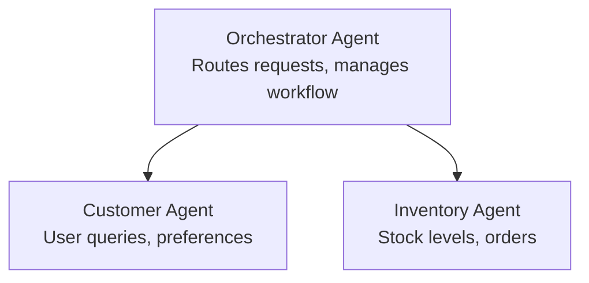

# Capitolo 5: Soluzioni AI Multi-Agente

**📚 Corso**: [AZD per Principianti](../../README.md) | **⏱️ Durata**: 2-3 ore | **⭐ Complessità**: Avanzato

---

## Panoramica

Questo capitolo tratta modelli architetturali multi-agente avanzati, orchestrazione degli agenti e distribuzioni AI pronte per la produzione per scenari complessi.

> Guida ai comandi revisionata rispetto al riferimento `azd 1.37.2` rilasciato. Le distribuzioni su cloud non sono state eseguite.

## Obiettivi di apprendimento

Completando questo capitolo, imparerai a:
- Comprendere i modelli architetturali multi-agente
- Distribuire sistemi AI con agenti coordinati
- Implementare la comunicazione tra agenti
- Costruire soluzioni multi-agente pronte per la produzione

---

## 📚 Lezioni

| # | Lezione | Descrizione | Tempo |
|---|--------|-------------|------|
| 1 | [Nozioni di base Multi-Agente](multi-agent-basics.md) | Pratica: distribuisci un'app multi-agente funzionante con `azd up` | 45 min |
| 2 | [Modelli di Coordinazione](../chapter-06-pre-deployment/coordination-patterns.md) | Strategie di orchestrazione degli agenti (continua nel Capitolo 6) | 30 min |
| 3 | [Distribuzione con ARM Template](../../examples/retail-multiagent-arm-template/README.md) | Esempio di distribuzione con un clic | 30 min |

> **Inizia con la Lezione 1.** È l'unica lezione completamente pratica e distribuibile in questo capitolo. La Lezione 2 si trova nel Capitolo 6 (è condivisa con la pianificazione pre-distribuzione), e la [Soluzione Multi-Agente Retail](../../examples/retail-scenario.md) è un blueprint architetturale—un riferimento di design, non un template con un solo comando.

---

## 🚀 Avvio rapido

```bash
# Option 1: Deploy the multi-agent template used in Lesson 1
azd init --template Azure-Samples/contoso-creative-writer .
azd up

# Option 2: Initialize a Foundry agent interactively with the GA bundle
azd ext install microsoft.foundry
azd ai agent init
azd up
```

> **Quale approccio?** Usa `azd init --template` per partire da un esempio funzionante. Usa `azd ai agent init` interattivamente, o `azd ai agent init --template <path-to-azure.yaml>` per adottare un progetto agente esistente. Vedi il [riferimento AZD AI CLI](../chapter-08-production/production-ai-practices.md#azd-ai-cli-commands-and-extensions) per requisiti di versione e migrazione.

Esegui queste alternative in cartelle vuote separate. Il workflow GA Foundry richiede `azd >= 1.37.0`; il suo flusso interattivo non genera la pipeline personalizzata Service Bus nella lezione di coordinazione. Per test locale, distribuzione del codice e pulizia del progetto nuovo vs riutilizzato, segui la [guida all'agente ospitato](../chapter-02-ai-development/microsoft-foundry-integration.md#hosted-agent-walkthrough-ga).

---

## 🤖 Architettura Multi-Agente



---

## 🎯 Soluzione in evidenza: Multi-Agente Retail

La [Soluzione Multi-Agente Retail](../../examples/retail-scenario.md) dimostra:

- **Agente Cliente**: Gestisce interazioni e preferenze dell'utente
- **Agente Inventario**: Gestisce scorte e gestione ordini
- **Orchestratore**: Coordina tra gli agenti
- **Memoria condivisa**: Gestione del contesto tra agenti

### Servizi utilizzati

| Servizio | Scopo |
|---------|---------|
| Microsoft Foundry Models | Comprensione del linguaggio |
| Azure AI Search | Catalogo prodotti |
| Cosmos DB | Stato e memoria degli agenti |
| Container Apps | Hosting degli agenti |
| Application Insights | Monitoraggio |

---

## 🔗 Navigazione

| Direzione | Capitolo |
|-----------|---------|
| **Precedente** | [Capitolo 4: Infrastruttura](../chapter-04-infrastructure/README.md) |
| **Successivo** | [Capitolo 6: Pre-Distribuzione](../chapter-06-pre-deployment/README.md) |

---

## 📖 Risorse correlate

- [Guida agli Agenti AI](../chapter-02-ai-development/agents.md)
- [Pratiche AI per la Produzione](../chapter-08-production/production-ai-practices.md)
- [Risoluzione problemi AI](../chapter-07-troubleshooting/ai-troubleshooting.md)

---

<!-- CO-OP TRANSLATOR DISCLAIMER START -->
**Disclaimer**:
Questo documento è stato tradotto utilizzando il servizio di traduzione AI [Co-op Translator](https://github.com/Azure/co-op-translator). Sebbene ci impegniamo per garantire la precisione, si prega di notare che le traduzioni automatizzate possono contenere errori o imprecisioni. Il documento originale nella sua lingua nativa deve essere considerato la fonte autorevole. Per informazioni critiche, si raccomanda una traduzione professionale effettuata da un essere umano. Non siamo responsabili per eventuali malintesi o interpretazioni errate derivanti dall’uso di questa traduzione.
<!-- CO-OP TRANSLATOR DISCLAIMER END -->