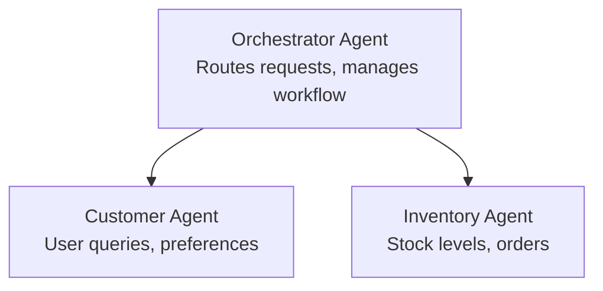

# Capitolo 5: Soluzioni AI Multi-Agente

**📚 Corso**: [AZD For Beginners](../../README.md) | **⏱️ Durata**: 2-3 ore | **⭐ Complessità**: Avanzato

---

## Panoramica

Questo capitolo copre pattern avanzati di architettura multi-agente, orchestrazione degli agenti e implementazioni AI pronte per la produzione in scenari complessi.

> Guida ai comandi verificata rispetto al riferimento `azd 1.37.2` rilasciato. Non sono state eseguite implementazioni nel cloud.

## Obiettivi di Apprendimento

Completando questo capitolo, sarai in grado di:
- Comprendere i pattern di architettura multi-agente
- Implementare sistemi coordinati di agenti AI
- Realizzare la comunicazione tra agenti
- Costruire soluzioni multi-agente pronte per la produzione

---

## 📚 Lezioni

| # | Lezione | Descrizione | Durata |
|---|--------|-------------|------|
| 1 | [Fondamenti Multi-Agente](multi-agent-basics.md) | Pratica: distribuisci un'app multi-agente funzionante con `azd up` | 45 min |
| 2 | [Pattern di Coordinamento](../chapter-06-pre-deployment/coordination-patterns.md) | Strategie di orchestrazione degli agenti (continua nel Capitolo 6) | 30 min |
| 3 | [Distribuzione Template ARM](../../examples/retail-multiagent-arm-template/README.md) | Esempio di distribuzione con un click | 30 min |

> **Inizia con la Lezione 1.** È l'unica lezione completamente pratica e distribuibile in questo capitolo. La Lezione 2 si trova nel Capitolo 6 (è condivisa con la pianificazione pre-distribuzione), e la [Soluzione Multi-Agente Retail](../../examples/retail-scenario.md) è un blueprint architetturale—un riferimento progettuale, non un template a comando singolo.

---

## 🚀 Avvio Rapido

```bash
# Option 1: Deploy the multi-agent template used in Lesson 1
azd init --template Azure-Samples/contoso-creative-writer .
azd up

# Option 2: Initialize a Foundry agent interactively (requires azure.ai.agents)
azd extension install azure.ai.agents
azd ai agent init
azd up
```

> **Quale approccio?** Usa `azd init --template` per partire da un esempio funzionante. Usa `azd ai agent init` in modo interattivo, o `azd ai agent init --template <path-to-azure.yaml>` per adottare un progetto agente attuale. Vedi il [riferimento AZD AI CLI](../chapter-08-production/production-ai-practices.md#azd-ai-cli-commands-and-extensions) per i requisiti di versione e migrazione dei modelli.

Esegui queste alternative in cartelle vuote separate. L'estensione agenti `1.0.0-beta.23` richiede `azd >= 1.37.0`; il suo flusso interattivo non genera la pipeline personalizzata di Service Bus nella lezione sulla coordinazione.

---

## 🤖 Architettura Multi-Agente



---

## 🎯 Soluzione In Evidenza: Multi-Agente Retail

La [Soluzione Multi-Agente Retail](../../examples/retail-scenario.md) dimostra:

- **Agente Cliente**: Gestisce le interazioni e le preferenze degli utenti
- **Agente Inventario**: Gestisce le scorte e l'elaborazione degli ordini
- **Orchestratore**: Coordina tra gli agenti
- **Memoria Condivisa**: Gestione del contesto tra agenti

### Servizi Utilizzati

| Servizio | Scopo |
|---------|---------|
| Microsoft Foundry Models | Comprensione del linguaggio |
| Azure AI Search | Catalogo prodotti |
| Cosmos DB | Stato e memoria dell'agente |
| Container Apps | Hosting degli agenti |
| Application Insights | Monitoraggio |

---

## 🔗 Navigazione

| Direzione | Capitolo |
|-----------|---------|
| **Precedente** | [Capitolo 4: Infrastruttura](../chapter-04-infrastructure/README.md) |
| **Successivo** | [Capitolo 6: Pre-Distribuzione](../chapter-06-pre-deployment/README.md) |

---

## 📖 Risorse Correlate

- [Guida agli Agenti AI](../chapter-02-ai-development/agents.md)
- [Pratiche AI per la Produzione](../chapter-08-production/production-ai-practices.md)
- [Risoluzione Problemi AI](../chapter-07-troubleshooting/ai-troubleshooting.md)

---

<!-- CO-OP TRANSLATOR DISCLAIMER START -->
**Disclaimer**:
Questo documento è stato tradotto utilizzando il servizio di traduzione AI [Co-op Translator](https://github.com/Azure/co-op-translator). Sebbene ci impegniamo per garantire la precisione, si prega di notare che le traduzioni automatizzate possono contenere errori o imprecisioni. Il documento originale nella sua lingua nativa deve essere considerato la fonte autorevole. Per informazioni critiche, si raccomanda una traduzione professionale effettuata da un essere umano. Non siamo responsabili per eventuali malintesi o interpretazioni errate derivanti dall’uso di questa traduzione.
<!-- CO-OP TRANSLATOR DISCLAIMER END -->